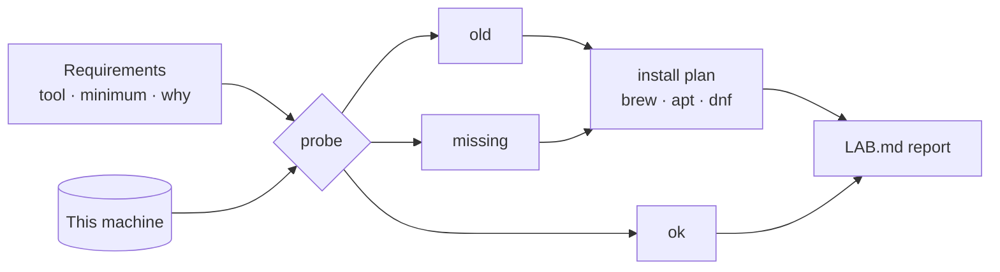

# The Lab: One Command That Proves Your Machine Is Ready

*Every later lesson assumes four tools and a Linux kernel; this one makes the assumption true and writes down what it found.*

## Metadata

| Field | Value |
|---|---|
| Type | Build |
| Languages | Python, Bash |
| Prerequisites | None |
| Time | 60 minutes |
| Tools | docker, kind, kubectl, tofu |

<Quiz stage="pre" />

## The Problem

The first hour of most courses is lost to the environment. `docker: command not found`. A `kubectl` from 2022 that cannot talk to the cluster you just created. `unshare: Operation not permitted` on a Mac, because the lesson quietly assumed Linux. A learner who gets three of these in a row concludes the course is broken and leaves; the course was fine, the laptop was undocumented.

Production has the same problem with the same cause: an environment nobody wrote down. The fix is the same too. Instead of a checklist in a README that drifts, write a small program that *probes* the machine, compares what it finds against what is required, and prints the exact commands that close the gap. Then every lesson can begin with one line, `python3 main.py check`, and every "works on my machine" turns into a diff you can read.

## The Concept

A lab for this curriculum is five things, and each one is a capability rather than a brand:

1. **A Linux kernel you control**: namespaces, cgroups and mounts are kernel features. On Linux you have them; on macOS and Windows they live inside a VM (Docker Desktop, Lima, WSL 2).
2. **A container engine**: Docker or Podman, both speaking OCI images.
3. **A throwaway Kubernetes cluster**: kind or k3d, each node a container, created and destroyed in a minute.
4. **An infrastructure-as-code CLI**: OpenTofu or Terraform, same commands.
5. **Your coding agent** with the tutor skills installed, so the course can run in your terminal.



The probe is a tiny version of what every monitoring agent, every CI image check and every `terraform plan` does: observe reality, diff it against a declared requirement, and report the gap with a remedy. Keep that shape in mind; it returns in the IaC phase as refresh → plan → apply.

## Build It

`code/main.py` is the lab doctor. It knows seven tools, what each is for, the minimum version a lesson needs, which binaries can satisfy it, and how to install it with the package manager this machine has.

### Step 1: turn tool output into a version you can compare

Every tool prints its version differently. Pull the first dotted number out and compare tuples, padding so that `1.30` and `1.30.0` are equal:

```python
VERSION_RE = re.compile(r"(\d+(?:\.\d+)+)")

def parse_version(text):
    match = VERSION_RE.search(text or "")
    return tuple(int(part) for part in match.group(1).split(".")) if match else None

def version_at_least(found, minimum):
    want = parse_version(minimum) or ()
    width = max(len(found), len(want))
    pad = lambda v: tuple(v) + (0,) * (width - len(v))
    return pad(found) >= pad(want)
```

### Step 2: probe without hard-wiring the side effect

`probe()` takes the function that runs a command as an argument. That is what makes the logic testable on a machine with none of the tools: the tests pass a fake runner that returns canned output. The same move, injecting the one impure call, is how every later lesson keeps its kernel, Docker and cloud calls out of the unit tests.

```python
def probe(tool, runner=subprocess_runner, which=shutil.which):
    for candidate in tool.candidates:
        if which(candidate) is None:
            continue
        code, output = runner([candidate, *tool.version_args])
        found = parse_version(output)
        if code != 0 or found is None:
            return Result(tool, "broken", candidate, output.strip()[:80])
        return Result(tool, "ok" if version_at_least(found, tool.minimum) else "old", candidate, ".".join(map(str, found)))
    return Result(tool, "missing")
```

Note `candidates`: the `docker` requirement is satisfied by `podman`, and `iac` by `tofu` or `terraform`. Requirements are capabilities.

### Step 3: the install plan for this machine

Detect the platform and its package manager once, then map every non-ok result to a command:

```python
def plan_install(results, package_manager):
    commands = []
    for result in results:
        if result.ok:
            continue
        command = result.tool.install.get(package_manager)
        commands.append(command or f"# install {result.tool.name} manually: no {package_manager} recipe")
    return commands
```

### Step 4: write it down

`report` renders a `LAB.md` with a status table, the Linux-feature notes (is cgroup v2 mounted, is `unshare` present, or which VM to use on macOS and Windows) and the plan. Commit that file to your learning repo; when something breaks three weeks from now, the diff between two reports is the bug report.

### Step 5: run it

```bash
python3 code/main.py check
python3 code/main.py plan
python3 code/main.py report --out LAB.md
python3 code/main.py check --json | python3 -m json.tool | head -20
```

`check` exits non-zero until every required tool is present at the minimum version, so it can gate a script.

<RunTests />

## Use It

Now install what the plan listed, then prove each capability with the real tool rather than its `--version` flag:

```bash
docker run --rm alpine:3.22 echo "containers: ok"
docker info --format 'engine {{.ServerVersion}} on {{.OSType}} · cgroup v{{.CgroupVersion}}'
bash code/main.sh cc-lab                     # kind create cluster + a pod that prints the kernel version
kubectl get nodes -o wide
kind delete cluster --name cc-lab
tofu version                                  # or: terraform version
npx skills add nomadicmehul/CloudCaptain      # the tutor: /captain-start, /captain-learn, /captain-guide, /captain-check
```

Read the kernel version the pod printed. On Linux it is your kernel; on macOS or Windows it is the VM's. Lessons that call `unshare(2)` directly (the containers phase) run inside that VM:

| Where you are | Where the Linux kernel is | How to get a root shell in it |
|---|---|---|
| Linux | your machine | `sudo -i` |
| macOS | Lima VM or Docker Desktop's VM | `limactl shell default` or `docker run --privileged -it --pid=host ubuntu nsenter -t 1 -m -u -i -n sh` |
| Windows | WSL 2 distribution | `wsl -d Ubuntu` |

The lab is disposable by design. `kind delete cluster`, `docker system prune`, and a fresh `report` bring it back to a known state; every later phase assumes you will do that between lessons rather than carry drift forward.

<Quiz stage="check" />

## Ship It

One artifact in `outputs/`:

- **`skill-lab-doctor.md`**: an agent skill that runs (or reproduces by hand) the doctor, classifies the usual failures (`command not found`, old version, `permission denied` on the Docker socket, daemon not running, no cgroup v2, kind hanging) into the layer that causes them, and reports what is ready, what is not with the exact fix, and whether the current lesson can proceed. Install it once and every "my environment is broken" moment becomes a three-line answer.

<ShipIt />

## Exercises

### Easy

Add `node` to the required set when the learner says they want the tutor (`python3 main.py check --with-agent`). The flag flips `required` on the `node` tool; the exit code must change accordingly. Test first.

### Medium

Add a `--min-ram 4G` check that reads total memory (`/proc/meminfo` on Linux, `sysctl hw.memsize` on macOS) and warns when `kind` will struggle. Keep the platform-specific read behind an injectable function so the tests stay portable.

### Hard

Turn the report into a GitHub Actions job: a workflow that runs `python3 main.py check --json` on `ubuntu-latest`, `macos-latest` and `windows-latest`, uploads each `LAB.md` as an artifact, and fails the job when `ready` is false. Then explain in two sentences why the Windows run reports differently from the other two.

<Quiz stage="post" />

## Key Terms

| Term | Common misconception | Precise definition |
|---|---|---|
| Probe | "Checking `--version` tells you the tool works." | Running a tool to observe a fact about the machine; version is one fact, daemon reachability and permissions are others, which is why Use It runs a real container. |
| Requirement as capability | "The lesson needs Docker." | The lesson needs an OCI container engine; Docker and Podman both satisfy it, as OpenTofu and Terraform do for IaC. |
| Dependency injection | "An enterprise Java pattern." | Passing the impure function (run a command, call an API) as an argument so the logic around it can be tested with fakes. |
| kind | "A lightweight Kubernetes distribution." | Kubernetes in Docker: each node is a container running kubelet and containerd, so a multi-node cluster starts in about a minute and leaves nothing behind when deleted. |
| Linux VM on macOS/Windows | "Docker Desktop makes containers native." | Docker Desktop, Lima and WSL 2 run a Linux kernel in a VM; containers and the namespace lessons execute there, not on the host kernel. |
| Disposable lab | "Set it up once, keep it forever." | An environment recreated from a script between lessons, so accumulated changes never become the bug you are debugging. |

## Further Reading

- [Docker Fundamentals](https://cloudcaptain.io/docs/tools/docker/fundamentals): installation per platform and what the daemon, CLI and socket are, before the containers phase takes them apart.
- [Kubernetes Fundamentals](https://cloudcaptain.io/docs/tools/kubernetes/fundamentals): what the kind cluster you just created consists of.
- [Python Fundamentals](https://cloudcaptain.io/docs/tools/python/fundamentals): dataclasses, `subprocess` and `argparse`, the three stdlib pieces this doctor is made of.
- [kind quick start](https://kind.sigs.k8s.io/docs/user/quick-start/): multi-node configs and image loading for later phases.
- [Lima](https://lima-vm.io/): the lightest way to get a real Linux kernel on macOS for the namespace and cgroup lessons.
