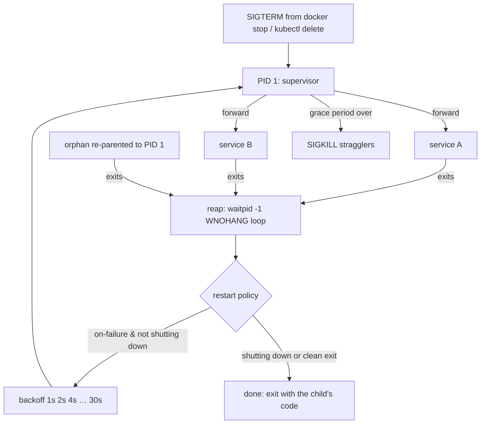

# PID 1: Why Your Container Ignores Ctrl-C

*A process that forgets to reap its children and forward its signals is a bug; inside a container it is PID 1, and the bug is the whole box.*

## Metadata

| Field | Value |
|---|---|
| Type | Build |
| Languages | Python, Bash |
| Prerequisites | [Lab Doctor](https://cloudcaptain.io/learn/setup/lab-doctor) |
| Time | 75 minutes |
| Tools | docker, ps, tini |

<Quiz stage="pre" />

## The Problem

Every deploy of the API takes ten seconds longer than it should, per container, because `docker stop` waits the full grace period and then kills. Ctrl-C in `docker run` does nothing. On another service, `ps` inside the container shows a growing column of `<defunct>` processes, and after a week the node runs out of PIDs. A third one restarts in a tight loop and nobody can say whether it is crashing or finishing.

All three are the same gap: the process at PID 1 is not doing the job of PID 1. On a normal Linux machine that job belongs to `systemd`, which starts services, forwards signals, waits for every exited child so the kernel can forget it, and restarts the ones that fail according to a policy. Inside a container there is no systemd. Whatever you put in `ENTRYPOINT` *is* init, and most application binaries and shell scripts were never written to be one.

You are going to write a small init. After that, `exec`, `--init`, `tini`, `terminationGracePeriodSeconds` and `CrashLoopBackOff` will all read as settings on something you understand.

## The Concept

PID 1 has three duties and two special rules:

- **Start** the services and record their PIDs.
- **Reap**: every child that exits stays in the process table as a *zombie* until its parent calls `wait()`. Orphaned processes are re-parented to PID 1, so PID 1 must reap children it never started.
- **Forward and shut down**: on `SIGTERM` or `SIGINT`, pass the signal to the children, give them a grace period, then `SIGKILL` whatever is left.
- Rule one: the kernel does not apply default signal actions to PID 1. A `sleep` that dies from `SIGTERM` as PID 4000 ignores it as PID 1.
- Rule two: `SIGCHLD` is not queued per child. One delivery can mean several exits, so reaping has to loop until nothing is left.



Restart policy and shutdown interact: a child killed by the forwarded `SIGTERM` looks like a failure. Shutdown has to suspend restarts or the supervisor fights itself. systemd, Docker and Kubernetes all encode exactly this.

## Build It

`code/main.py` is `mini_init`. Its logic lives in a `Supervisor` class that takes the impure operations (`spawn`, `kill`, the clock) as arguments, so the tests drive it with fakes and the real `run()` wires in `fork`, `execvp`, `os.kill` and `waitpid`.

### Step 1: read an exit status

`waitpid` returns a packed integer. The standard library decodes it:

```python
def decode_status(status):
    if os.WIFEXITED(status):
        return "exited", os.WEXITSTATUS(status)
    if os.WIFSIGNALED(status):
        return "signaled", os.WTERMSIG(status)
    return "unknown", status
```

A service that ends by `SIGTERM` reports `("signaled", 15)`; the convention for the supervisor's own exit code is `128 + signal`, which is where `143` comes from.

### Step 2: decide whether to restart

```python
def should_restart(service, kind, value, restarts, shutting_down):
    if shutting_down or restarts >= service.max_restarts:
        return False
    if service.restart == "always":
        return True
    if service.restart == "on-failure":
        return not (kind == "exited" and value == 0)
    return False

def backoff(attempt):
    return float(min(30, 2 ** max(0, attempt)))
```

### Step 3: reap everything, every time

The exit handler pops the child from the table, or counts an orphan if it never knew the PID. The caller loops `waitpid(-1, WNOHANG)` until it returns 0, because one `SIGCHLD` may stand for many exits:

```python
while True:
    try:
        pid, status = os.waitpid(-1, os.WNOHANG)
    except ChildProcessError:
        break
    if pid == 0:
        break
    supervisor.handle_exit(pid, status)
```

### Step 4: forward, wait, escalate

```python
def begin_shutdown(self, signum):
    if not self.shutting_down:
        self.shutting_down = True
        self.shutdown_started = self.now()
        self.pending.clear()
    self.forward_signal(signum)
```

`tick()` later sends `SIGKILL` to whatever is still alive once `grace_seconds` have passed. Children are started with `SIGTERM` and `SIGINT` reset to their default actions, because a handler installed in the parent would otherwise be inherited across `fork`.

### Step 5: run it

```bash
python3 code/main.py --restart never --run 'sh -c "exit 3"'; echo "exit $?"          # 3, propagated
python3 code/main.py --restart on-failure --run 'sh -c "exit 1"' --verbose          # restarts at 1s, 2s, 4s… then gives up
python3 code/main.py --run 'sleep 300' --verbose &  sleep 1; kill -TERM $!; wait $!; echo "exit $?"   # 143 within a second
```

A JSON spec supervises several services with different policies:

```json
{"services": [
  {"name": "web", "command": "python3 -m http.server 8080", "restart": "always"},
  {"name": "worker", "command": "sh -c 'sleep 2; exit 1'", "restart": "on-failure", "max_restarts": 3}
]}
```

<RunTests />

## Use It

Now measure the real thing. The same workload, three different PID 1s:

```bash
docker run --rm -d --name plain alpine:3.22 sh -c 'sleep 600'
docker run --rm -d --name withinit --init alpine:3.22 sh -c 'sleep 600'
docker run --rm -d --name mini -v "$PWD/code/main.py:/mini_init.py:ro" python:3.12-alpine \
  python3 /mini_init.py --restart never --run 'sleep 600'
time docker stop -t 10 plain        # ~10 s: sleep is PID 1 and ignores SIGTERM; Docker SIGKILLs after the grace period
time docker stop -t 10 withinit     # <1 s: tini is PID 1 and forwards SIGTERM
time docker stop -t 10 mini         # <1 s: your supervisor does the same
```

`code/main.sh` runs this comparison and prints the three durations. Then look at the exit codes and the process tree:

```bash
docker run --name c1 alpine:3.22 sh -c 'sleep 600' & sleep 1; docker stop -t 2 c1; docker inspect -f '{{.State.ExitCode}}' c1; docker rm c1   # 137 = SIGKILL
docker run --rm -it --init alpine:3.22 sh -c 'ps -o pid,ppid,comm'                                                                            # tini is PID 1, sh is its child
```

And the shell-wrapper trap that causes most of these tickets:

```bash
cat > entrypoint.sh <<'EOF'
#!/bin/sh
echo "starting"
sleep 600            # the shell is PID 1; sleep is its child; SIGTERM stops at the shell
EOF
```

Change the last line to `exec sleep 600` and the shell is replaced: `sleep` becomes PID 1, and with `--init` or a handler it stops immediately. In Dockerfiles, prefer the exec form `ENTRYPOINT ["python3", "app.py"]` over the shell form for the same reason.

| What you built | Docker | Kubernetes | systemd |
|---|---|---|---|
| forward `SIGTERM`, wait, `SIGKILL` | `docker stop -t N`, `--init` (tini) | `terminationGracePeriodSeconds`, `preStop` | `KillSignal=`, `TimeoutStopSec=` |
| reap orphans | `--init` | shared PID namespace + pause container reaps | PID 1 by definition |
| `restart: on-failure`, backoff, `max_restarts` | `--restart on-failure:5` | `restartPolicy`, `CrashLoopBackOff` (10s → 5m) | `Restart=on-failure`, `RestartSec=`, `StartLimitBurst=` |
| exit code `128 + signal` | `State.ExitCode` 137/143 | `Last State: Terminated, Exit Code` | `Main PID … code=killed, signal=TERM` |

<Quiz stage="check" />

## Ship It

Two artifacts in `outputs/`:

- **`skill-pid1-triage.md`**: a diagnostic skill for slow stops, ignored Ctrl-C, zombies and restart loops: find out what PID 1 is, classify the case (shell wrapper, app without a handler, app that forks without reaping), confirm with a timed `docker stop` and the exit code, and apply the one-line fix (`exec`, `--init`, a handler, a reaping loop).
- **`prompt-explain-process-tree.md`**: paste `ps --forest` output and get the tree annotated with who is PID 1, where `SIGTERM` would go, which rows are zombies and why, and the top three fixes.

<ShipIt />

## Exercises

### Easy

Add `--grace` to the JSON spec per service and make the supervisor use the longest one. Write the test before the code: two services, grace 2 and 8, the `SIGKILL` must come after 8.

### Medium

Add log prefixing: capture each child's stdout and stderr through pipes and print lines as `[web] …`, `[worker] …`, the way `docker compose` does. Keep the pure logic (line splitting, prefixing, partial lines across reads) in a function with tests.

### Hard

Replace the one-second sleep in the main loop with an event-driven design: a self-pipe written from the `SIGCHLD` handler and `select()` on it with the next deadline as the timeout. Prove with `strace -f -e trace=wait4,select` that the supervisor makes no spurious wakeups, and with `ps -o stat` that a child which double-forks never leaves a zombie.

<Quiz stage="post" />

## Key Terms

| Term | Common misconception | Precise definition |
|---|---|---|
| PID 1 | "Just the first process." | The process with special rules: default signal actions do not apply to it, and it adopts and must reap every orphan. In a container, whatever `ENTRYPOINT` runs. |
| Zombie | "A hung process." | A process that has exited but whose status has not been collected with `wait()`; it holds only a process-table slot, which still runs out. |
| Reaping | "Killing stray processes." | Calling `wait()`/`waitpid()` so the kernel can remove an exited child. A parent that never reaps leaks zombies. |
| Signal forwarding | "Signals reach every process in a container." | `docker stop` signals PID 1 only. If PID 1 does not forward, children never see `SIGTERM` and die by `SIGKILL` after the grace period. |
| Exit code 137 / 143 | "137 is out-of-memory." | `128 + signal`: 137 is `SIGKILL` (OOM killer *or* grace period expiry), 143 is `SIGTERM` honoured. Check `memory.events` before blaming memory. |
| exec form | "A Dockerfile style preference." | `ENTRYPOINT ["bin","arg"]` runs the binary as PID 1; the shell form wraps it in `sh -c`, which swallows signals. In scripts, `exec` does the same replacement. |
| Backoff | "Retry quickly until it works." | Increasing delay between restarts (1s, 2s, 4s… capped) so a crashing service does not consume the node; `CrashLoopBackOff` is Kubernetes' version with a five-minute cap. |

## Further Reading

- [Linux Fundamentals](https://cloudcaptain.io/docs/tools/linux/fundamentals): processes, signals and job control, the vocabulary this lesson leans on.
- [Linux System Administration](https://cloudcaptain.io/docs/tools/linux/administration): systemd units, `Restart=`, `KillMode=` and timeouts, the production-grade version of your supervisor.
- [Docker Security & Production](https://cloudcaptain.io/docs/tools/docker/security-production): `--init`, graceful shutdown and health checks in real deployments.
- [tini](https://github.com/krallin/tini): three hundred lines of C that do what you just did; read `main()` once.
- [Docker and the PID 1 zombie reaping problem](https://blog.phusion.nl/2015/01/20/docker-and-the-pid-1-zombie-reaping-problem/): the 2015 post that made the industry notice.
