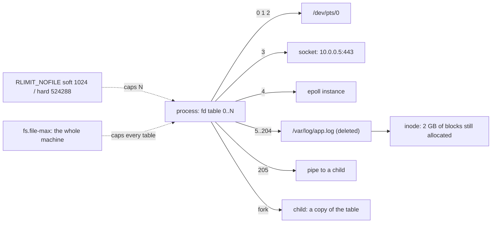

# File Descriptors: Too Many Open Files Is a Leak, Not a Limit

*Every socket, pipe and log file is a number in one small table; when it fills, the fix is in the process, not in ulimit.*

## Metadata

| Field | Value |
|---|---|
| Type | Build |
| Languages | Python, Bash |
| Prerequisites | [Lab Doctor](https://cloudcaptain.io/learn/setup/lab-doctor) |
| Time | 75 minutes |
| Tools | lsof, prlimit, ss, docker |

<Quiz stage="pre" />

## The Problem

At 03:10 the API starts answering 500s. Its log says `OSError: [Errno 24] Too many open files`; the nginx in front says `socket() failed (24: Too many open files)`. Someone raises `ulimit -n` from 1024 to 65536 in the unit file, restarts, and the incident closes. Three days later it happens again, at 03:10 again, and this time the limit is 65536. On a different node `df` reports the root disk 100% full while `du` finds forty gigabytes less, and deleting the four-gigabyte rotated log freed nothing.

Both tickets are about the same object. Every file a process opens, every socket it accepts, every pipe to a child, every timer and `epoll` instance and inotify watch, is a small integer in that process's **file descriptor table**. The kernel caps the size of the table per process, with a soft limit that `open()` checks and a hard limit the soft one may be raised to. A program that opens things and does not close them fills the table at a rate set by its traffic, so raising the limit changes *when* it falls over, not *whether*. And the deleted log is still a row in some process's table, which is why its blocks are still allocated: `df` counts blocks, `du` counts names.

You are going to write `fdwatch`, a tool that reads a process's table straight from `/proc`, classifies every entry, compares the count with the limit, measures how fast it grows and when the limit will be hit, and finds deleted files that are still open. After that, `lsof`, `ss`, `prlimit`, `LimitNOFILE=` and `--ulimit` are all views and knobs on a table you can picture.

## The Concept

Three tables sit behind one integer. The **file descriptor table** belongs to the process: index 0, 1, 2 are the standard streams, and each further slot points at an **open file description**, a kernel object with the current offset, the status flags (`O_APPEND`, `O_NONBLOCK`, `O_CLOEXEC`) and a reference to the thing itself: an inode on a filesystem, a socket, a pipe, or an anonymous object such as an `epoll` instance. `fork()` copies the first table, so parent and child share the same descriptions and therefore the same offset; `exec()` keeps every descriptor that was not opened with `O_CLOEXEC`. That is how a helper process a server spawns ends up holding the server's listening port.

Two limits apply. `RLIMIT_NOFILE` is per process, a soft and a hard value: `open()` fails with `EMFILE` when the soft value is reached, the process may raise soft up to hard itself, children inherit both, and `prlimit` can change them on a running process. `fs.file-max` is for the whole machine and fails with `ENFILE` instead. The error text tells you which one you hit, and the fix is in a different place for each.



`/proc/PID/fd/` is the table rendered as symlinks: each name is a descriptor number and each target is a path, `socket:[inode]`, `pipe:[inode]` or `anon_inode:[eventpoll]`. `/proc/PID/fdinfo/N` adds the offset and flags, `/proc/PID/limits` the soft and hard values. Everything `lsof` prints comes from there.

## Build It

`code/main.py` is `fdwatch`. The reading happens in one function, `snapshot()`, which takes the procfs root as an argument; everything after it is pure, so the tests build a fake `/proc` tree in a temporary directory and pass on macOS and in CI without root.

### Step 1: read and classify the table

`readlink` on each entry gives the target. Pseudo-files have a fixed shape; a path that ends in ` (deleted)` is a file whose name is gone:

```python
def classify(target):
    deleted = target.endswith(" (deleted)")
    if deleted:
        target = target[: -len(" (deleted)")]
    match = PSEUDO.match(target)
    if match:
        family, detail = match.group(1), match.group(2)
        if family == "anon_inode":
            return ANON_KINDS.get(detail, "anon_inode"), deleted
        return family, deleted
    if target.startswith("/dev/"):
        return "device", deleted
    return "file", deleted
```

For real paths `snapshot()` then calls `os.stat()` on the link, which follows it even when the file is deleted, to tell directories from files and to read the size.

### Step 2: the limit this process actually has

```python
def parse_limits(text):
    for line in text.splitlines():
        if line.startswith("Max open files"):
            parts = line.split()
            soft, hard = parts[3], parts[4]
            return (None if soft == "unlimited" else int(soft)), (None if hard == "unlimited" else int(hard))
    return None, None
```

`snap.usage` is `count / soft_limit`. The report warns at 80%, because the next `accept()` after 100% is the outage.

### Step 3: flags, and who inherits what

`fdinfo` holds the status flags in octal. One bit matters for leaks across processes:

```python
def without_cloexec(snap):
    return [d for d in snap.descriptors if d.flags is not None and not d.flags & 0o2000000 and d.fd > 2]
```

Every descriptor in that list survives `exec()`, so any child the process starts holds it too. Python 3.4+ and Go set `O_CLOEXEC` by default; a lot of C and older code does not.

### Step 4: growth, rate and time to limit

Two snapshots give the leak rate and a forecast:

```python
def diff(before, after):
    elapsed = max(after.taken_at - before.taken_at, 1e-9)
    growth = after.count - before.count
    rate_per_minute = growth / elapsed * 60
    seconds_to_limit = None
    if growth > 0 and after.soft_limit:
        seconds_to_limit = (after.soft_limit - after.count) / (growth / elapsed)
    ...
```

`--watch SECONDS` loops this and prints which kinds grew and which new paths appeared, which usually names the leaking call site.

### Step 5: deleted but open

`scan_deleted()` walks every `/proc/[0-9]*/fd` you are allowed to read and collects the targets that end in ` (deleted)`, with the size from `os.stat()`. The fix does not need a restart: the magic link is a real handle to the inode, so `: > /proc/PID/fd/N` truncates the file and gives the blocks back.

### Step 6: run it against a leak you control

```bash
python3 -c 'import time; fs=[open(f"/tmp/leak{i}.tmp","w") for i in range(200)]; time.sleep(600)' & HOLDER=$!
python3 code/main.py $HOLDER                     # 203 open, "file 201", usage against the soft limit
python3 code/main.py $HOLDER --json | head -20
bash code/main.sh $HOLDER                        # the same report with ls, readlink and awk
```

Now a leak in motion:

```bash
cat > /tmp/leaky.py <<'EOF'
import time
fs = []
while True:
    fs.append(open(f"/tmp/g{len(fs)}.tmp", "w"))
    time.sleep(0.05)
EOF
python3 /tmp/leaky.py & LEAK=$!
python3 code/main.py $LEAK --watch 2 --count 3   # "growing ... rate 1200/min ... soft limit reached in about 50s"
```

And the disk that `du` cannot explain:

```bash
python3 -c 'import time; f=open("/tmp/big.log","w"); f.write("x"*10**8); f.flush(); time.sleep(600)' & HOLD2=$!
rm /tmp/big.log
python3 code/main.py --deleted                   # pid, fd, 95.4 MB, /tmp/big.log
: > /proc/$HOLD2/fd/3                            # the space comes back; the process keeps running
kill $HOLDER $LEAK $HOLD2
```

<RunTests />

## Use It

`lsof` is `fdwatch` for every process at once, with names resolved; `prlimit` and `ulimit` read and write the limit; `ss` shows the sockets in the table with their TCP state. Run them against the same leaky process:

```bash
lsof -p $HOLDER | head                                    # one line per fd: FD, TYPE (REG, CHR, IPv4, unix, FIFO, a_inode), NAME
lsof -p $HOLDER | awk 'NR>1 {print $5}' | sort | uniq -c | sort -rn      # fdwatch's "by kind"
ls -l /proc/$HOLDER/fd | wc -l                             # the count, no tool needed
prlimit --pid $HOLDER --nofile                             # soft and hard for that process
prlimit --pid $HOLDER --nofile=8192:524288                 # raise it live, no restart (root for other users' processes)
ulimit -n; ulimit -Hn                                      # your shell's soft and hard; every child inherits them
cat /proc/sys/fs/file-max /proc/sys/fs/file-nr             # the machine-wide limit, and allocated / free / max
ss -s; ss -tanp state close-wait                           # sockets are descriptors too; CLOSE_WAIT means the app never called close()
lsof +L1                                                   # every deleted-but-open file on the box (link count below one)
```

Then see where the limit comes from at each layer, because the number you measured in `/proc/PID/limits` was set by whichever of these started the process:

```bash
systemctl show nginx -p LimitNOFILE -p LimitNOFILESoft    # systemd units: LimitNOFILE= in [Service], DefaultLimitNOFILE= in system.conf
docker run --rm alpine:3.22 sh -c 'ulimit -n'              # containers inherit the daemon's default-ulimits
docker run --rm --ulimit nofile=4096:4096 alpine:3.22 sh -c 'ulimit -n'
docker run --rm --ulimit nofile=16:16 python:3.12-alpine python3 -c 'fs=[open(f"/tmp/{i}","w") for i in range(100)]'   # Errno 24 on purpose
kubectl exec deploy/api -- sh -c 'ulimit -n'               # Kubernetes has no field for it; the runtime decides, so look
```

| What you built | Real tool | Note |
|---|---|---|
| kinds and counts per descriptor | `lsof -p PID`, TYPE column | `REG` file, `CHR` device, `IPv4`/`unix` socket, `FIFO` pipe, `a_inode` for epoll and friends |
| count against the soft limit | `ls /proc/PID/fd \| wc -l` and `prlimit --pid PID --nofile` | the only two numbers that matter during the incident |
| `--watch`: rate and time to limit | `watch -n1 'ls /proc/PID/fd \| wc -l'`, `lsof -r 5 -p PID` | `lsof -r` repeats every N seconds |
| deleted but open | `lsof +L1`, `find /proc/[0-9]*/fd -lname '*(deleted)'` | truncate through `/proc/PID/fd/N` to free space without a restart |
| descriptors without `O_CLOEXEC` | `cat /proc/PID/fdinfo/N` | `lsof` does not show flags |
| sockets by state | `ss -tanp state close-wait` | `CLOSE_WAIT` piles are a missing `close()`, not a network problem |
| the limit a process starts with | `LimitNOFILE=`, `--ulimit nofile=`, `pam_limits` | Go 1.19+ and the HotSpot JVM raise soft to hard themselves; Python and Node do not |

<Quiz stage="check" />

## Ship It

Two artifacts in `outputs/`:

- **`skill-fd-leak-triage.md`**: a diagnostic skill for `Too many open files`, `CLOSE_WAIT` piles and the `df`-versus-`du` gap. It tells `EMFILE` from `ENFILE`, measures count against limit, classifies the leak by what the descriptors point at, estimates time to failure, applies the two stop-gaps that need no restart, and names the fix in the code rather than the limit.
- **`prompt-explain-lsof.md`**: paste `lsof -p PID` or `ls -l /proc/PID/fd` output and get the table summarised by kind, repeated paths, deleted entries and sockets in `CLOSE_WAIT`, the most likely leaking call, and three fixes in order of impact.

<ShipIt />

## Exercises

### Easy

Add `--kind socket` (and any other kind) as a filter to `fdwatch`, and make `top_targets()` for files sort by total bytes instead of count so one open 2 GB log outranks two hundred empty temp files. Tests first.

### Medium

`socket:[inode]` tells you nothing about the peer. Join each socket descriptor with `/proc/net/tcp` and `/proc/net/tcp6` (the inode is the tenth column) and print local address, remote address and state per descriptor. Then add a `close_wait` count to the report and a warning when it is above half the soft limit.

### Hard

Turn `--watch` into a sidecar: sample every N seconds, keep a ring buffer of the last M counts, fit a line through them and exit non-zero when the fit predicts the soft limit within an hour. Package it as a Docker `HEALTHCHECK` for a container running the leaky script from Build It and show, with `docker inspect`, that the container turns `unhealthy` well before the application fails.

<Quiz stage="post" />

## Key Terms

| Term | Common misconception | Precise definition |
|---|---|---|
| File descriptor | "A handle for files on disk." | A non-negative integer indexing the process's table of open file descriptions. Files, sockets, pipes, timers, `epoll` instances and inotify watches all live there. |
| Open file description | "Each descriptor is independent." | The kernel object behind a descriptor: offset, status flags and a reference to the inode or socket. `fork()` and `dup()` make several descriptors share one, so they share the offset. |
| `RLIMIT_NOFILE` | "`ulimit -n` is a system setting." | A per-process pair of soft and hard values. `open()` fails with `EMFILE` at the soft value; the process may raise soft up to hard; children inherit both; `prlimit` changes them live. |
| `EMFILE` vs `ENFILE` | "Both mean the same thing." | `EMFILE` (24) is this process's table full; `ENFILE` (23) is the whole machine at `fs.file-max`. The fix is in the process for one and on the host for the other. |
| `O_CLOEXEC` | "Children never see the parent's descriptors." | A per-descriptor flag that closes it on `exec()`. Without it every child inherits the descriptor, which is how a port stays in use after a restart. |
| Deleted but open | "`rm` frees the space." | `unlink()` removes the name; the inode and its blocks stay until the last descriptor closes. `df` counts them and `du` cannot. Truncate through `/proc/PID/fd/N` or restart the holder. |
| `CLOSE_WAIT` | "A network problem." | A TCP state meaning the peer closed and the local application has not called `close()`. Each one is a descriptor and a slot in the table. |

## Further Reading

- [Linux Fundamentals](https://cloudcaptain.io/docs/tools/linux/fundamentals): processes, the filesystem and `/proc`, the vocabulary this lesson leans on.
- [Linux System Administration](https://cloudcaptain.io/docs/tools/linux/administration): systemd units and resource limits, where `LimitNOFILE=` lives in production.
- [Linux Networking](https://cloudcaptain.io/docs/tools/linux/networking): `ss`, socket states and where `CLOSE_WAIT` comes from.
- [Docker Security & Production](https://cloudcaptain.io/docs/tools/docker/security-production): `--ulimit` and the other resource constraints you set per container.
- [proc(5)](https://man7.org/linux/man-pages/man5/proc.5.html): `/proc/PID/fd`, `fdinfo` and `limits`, the API you just read by hand.
- [getrlimit(2)](https://man7.org/linux/man-pages/man2/getrlimit.2.html): `RLIMIT_NOFILE`, soft versus hard, and why `EMFILE` is per process.
- [lsof(8)](https://man7.org/linux/man-pages/man8/lsof.8.html): the TYPE and FD columns, `+L1`, and `-r` for repeating.
