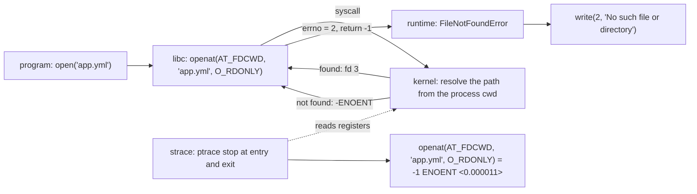

# Every Error Message Is a System Call That Failed

*The kernel answers every request with a number; strace shows the request, the answer and the order, so the error message explains itself.*

## Metadata

| Field | Value |
|---|---|
| Type | Build |
| Languages | Python, Bash |
| Prerequisites | [File Descriptors](https://cloudcaptain.io/learn/linux/file-descriptors) |
| Time | 75 minutes |
| Tools | strace, ltrace, perf, bpftrace, docker, kubectl |

<Quiz stage="pre" />

## The Problem

The 16:40 deploy rolls out and the new pod logs one line, `config: not found`, then exits 1. Kubernetes restarts it, the log repeats, `CrashLoopBackOff`. The config file is in the image: someone starts a shell in the same image, runs `ls -l /etc/app/app.yml`, and it is there. On another node a worker logs `database unreachable` every second while the database answers `psql` from the operator's laptop without complaint. A third service, moved to a non-root base image this week, prints `Permission denied` the first time it writes its log and dies. Three teams, three stack traces, one afternoon.

Each of those messages is the program's *opinion* about what happened. Underneath, the program asked the kernel for something and got a number back. A process cannot open a file, connect a socket, start another program or list a directory without a system call, and every system call either returns a result or `-1` with an errno: `ENOENT`, `ECONNREFUSED`, `EACCES`. The text you read was produced by a `write()` to descriptor 2 a few microseconds later, after the runtime had wrapped the number in words, and the words lose information: Python says `No such file or directory` and the shell says `not found` for the same `ENOENT`; neither tells you which of the three paths the program tried last, or that it was relative to a working directory you did not expect. `strace` sits between the process and the kernel using `ptrace` and prints every call with its arguments, the value that came back and how long it took, per process, in order, with the path or address the program actually used rather than the one it believed it used.

You are going to write `tracelens`, a tool that reads `strace` output and turns five hundred lines into one sentence: which process exited with which code because which call on which path or address returned which errno, after trying which alternatives. After that, `strace -c`, `-p`, `-Z`, `-e inject`, `ltrace`, `perf trace`, `bpftrace`, and the capability a container needs before it can trace anything, are all views on a model you already hold.

## The Concept

User space and the kernel share a machine but not an address space, and the system call is the only door between them. On x86-64 there are a few hundred of them; a typical service uses forty. The program calls a libc wrapper such as `open()`, the wrapper issues the `openat` system call, the kernel walks the path, and the result comes back in a register: a descriptor number if it worked, a negative errno if it did not. libc turns the negative number into `-1` plus the thread-local variable `errno`; the runtime turns `errno` into an exception or a return code; the program turns that into a message and writes it to stderr. The number is the fact. Everything after it is translation.

`strace` sees the fact. It uses `ptrace(2)` to become the process's tracer, which makes the kernel stop the process at the entry and the exit of every system call and let the tracer read its registers. From the registers strace decodes the call name, the arguments (dereferencing pointers to print strings and structures) and the return value, and prints one line per call. Three consequences follow. It slows the traced program, because every call now costs two stops and two context switches; syscall-heavy code can run tens of times slower under strace, so you trace a reproduction or you attach briefly. It needs permission: tracing a child you start is always allowed, but attaching to an existing process must pass the uid check and the Yama `ptrace_scope` policy, and inside a container that usually means `CAP_SYS_PTRACE`. And it shows exactly what the kernel saw, after `~` and relative paths were resolved, after DNS turned a name into an address, with the uid the process really had.



One line of output carries the whole story. `openat(AT_FDCWD, "app.yml", O_RDONLY|O_CLOEXEC) = -1 ENOENT (No such file or directory) <0.000011>` says: the call was `openat`; the directory descriptor was `AT_FDCWD`, so `app.yml` was resolved from the process's current working directory, which is `readlink /proc/PID/cwd` and not where you ran `ls`; the flags were read-only and close-on-exec; the kernel returned `-1` with `ENOENT`; strace added the errno's text and, with `-T`, the time the call took. `-f` follows children and threads and prefixes each line with `[pid N]` (or a bare pid when writing to a file with `-o`); `-tt` adds the wall-clock time; `-y` decorates descriptors with what they point at, so `read(3</etc/app.yml>, ...)` and `connect(3<TCP:[412233]>, ...)` need no cross-referencing.

Two kinds of line are not calls. `+++ exited with 1 +++` and `--- SIGCHLD {si_signo=SIGCHLD, ...} ---` are events the kernel reported about the process. And when several processes are traced, a call that blocks in one of them is printed in two halves, `wait4(-1,  <unfinished ...>` when it starts and `<... wait4 resumed>...) = 20412` when it returns, with other processes' lines in between. Only the two halves together carry the arguments, the result and the duration.

Reading a trace is mostly knowing what to ignore. Runtimes probe: Python `stat`s six filenames per import, the dynamic loader tries every directory in its search path, a shell walks `PATH` with one `execve` per directory, gettext looks for message catalogues that do not exist. Hundreds of `ENOENT` are normal in kind; what matters is the *last* failing call before the process exited, and whether the calls around it on the same filename were a search order. The error that killed the program is almost always the last meaningful failure, and the `write(2, ...)` right after it is the message you were shown.

## Build It

`code/main.py` is `tracelens`. Parsing happens in `parse()`, which takes text and returns a `Trace` of `Call` and `Event` objects; every report after it is a pure function of that object, so the tests run on fixture traces in `code/tests/fixtures/` and pass on macOS, where strace does not exist. On Linux, `--run` invokes strace itself with the flags the parser expects.

### Step 1: the shape of a line

A line has an optional pid, an optional clock, and a body. Two pid styles exist (`[pid 20412]` on stderr, bare `20412` in an `-o` file), three clocks (`-tt`, `-ttt`, `-r`), and the body is either a call, a marker or a strace message:

```python
LINE_RE = re.compile(
    r"^(?:\[pid\s+(?P<bracket_pid>\d+)\]\s*|(?P<bare_pid>\d+)\s+)?"
    r"(?:(?P<clock>\d{2}:\d{2}:\d{2}(?:\.\d+)?|\d+\.\d+)\s+)?"
    r"(?P<body>.*)$"
)
CALL_RE = re.compile(r"^(?P<name>[A-Za-z_][A-Za-z0-9_]*)\((?P<rest>.*)$")
RESULT_RE = re.compile(r"^(?P<value>0x[0-9a-fA-F]+|-?\d+|\?)(?:\s+(?P<errno>E[A-Z0-9_]+)(?:\s+\((?P<text>[^)]*)\))?)?(?P<tail>.*)$")
```

The result side handles `= 3`, `= 0x7f0c2a3d5000`, `= ?` (the process is gone, as after `exit_group`), `= -1 ENOENT (No such file or directory)`, a trailing `(INJECTED)` from fault injection, and the `<0.000011>` duration that `-T` appends.

### Step 2: arguments nest

You cannot split arguments on commas: strings contain commas, `{sa_family=AF_INET, sin_port=htons(5432), ...}` is one argument, and `/* 20 vars */` is a comment. One walker tracks quotes (with backslash escapes), brackets and comments, and finds the parenthesis that closes the call:

```python
def find_close(text):
    depth = 0
    quoted = False
    i = 0
    while i < len(text):
        ch = text[i]
        if quoted:
            if ch == "\\":
                i += 2
                continue
            if ch == '"':
                quoted = False
        elif ch == '"':
            quoted = True
        elif text.startswith("/*", i):
            end = text.find("*/", i + 2)
            i = len(text) if end < 0 else end + 2
            continue
        elif ch in "([{":
            depth += 1
        elif ch in ")]}":
            if depth == 0:
                return i
            depth -= 1
        i += 1
    return -1
```

`split_args()` is the same walk splitting on depth-zero commas, and `unquote()` decodes strace's C-style escapes (`\n`, `\"`, octal `\177`, hex `\x41`) so the stderr text the program wrote comes back readable.

### Step 3: what the call was about

A failure is only useful with its target. For file calls the path is a known argument (`open` first, `openat` and `statx` second, after the directory descriptor); for socket calls it is the `sockaddr` structure; for everything else `-y` has put the path or socket inside the descriptor decoration:

```python
def describe_target(name, args):
    index = PATH_ARG.get(name)
    if index is not None and index < len(args):
        path = unquote(args[index])
        if path is not None:
            if index == 1 and not path.startswith("/"):
                dirfd = FD_DECORATION_RE.match(args[0])
                if dirfd and dirfd.group("target") and dirfd.group("target").startswith("/"):
                    path = os.path.join(dirfd.group("target"), path)
            return path
    if name in ADDRESS_CALLS:
        for arg in args[1:]:
            address = parse_address(arg)
            if address:
                return address
    if args:
        decorated = FD_DECORATION_RE.match(args[0])
        if decorated and decorated.group("target"):
            return decorated.group("target")
    return None
```

`parse_address()` turns `{sa_family=AF_INET, sin_port=htons(5432), sin_addr=inet_addr("10.0.0.5")}` into `10.0.0.5:5432`, handles `AF_INET6` and `AF_UNIX` paths, and a relative path after a decorated directory descriptor such as `openat(5</app>, "app.yml", ...)` is joined to `/app/app.yml`.

### Step 4: lines that are not calls

Markers become `Event`s: `+++ exited with N +++` and `+++ killed by SIGKILL +++` record how a pid ended, `--- SIGCHLD ... ---` counts signals, and `strace: Process 20412 attached` or `strace: attach: ptrace(PTRACE_SEIZE, 1): Operation not permitted` are kept as messages. The two halves of a blocking call are joined through a pending table keyed by pid and syscall name:

```python
        resumed = RESUMED_RE.match(body)
        if resumed:
            found = pop_pending(pending, pid, resumed.group("name"))
            if found is None:
                events.append(Event(number, pid, "unparsed", line))
                continue
            key, head = found
            number, clock, partial = head[0], head[1] or clock, head[2]
            pid = pid if pid is not None else key[0]
            body = f"{resumed.group('name')}({partial}{resumed.group('rest')}"
        elif body.endswith(UNFINISHED_SUFFIX):
            head = CALL_RE.match(body[: -len(UNFINISHED_SUFFIX)])
            if head:
                pending[(pid, head.group("name"))] = (number, clock, head.group("rest"))
                continue
```

The pid fallback matters: when strace writes to stderr it only prefixes lines while more than one process is alive, so the leader's lines before the first `clone` and after the last child exits carry no pid. `resolve_leader()` collects every pid returned by `clone`, `fork` or `vfork` or named in an `attached` message, subtracts them from the pids seen, and if exactly one is left, that is the leader and the anonymous lines belong to it.

### Step 5: the reports

Failures are grouped by errno, each errno by syscall and target in first-seen order, so a run of `ENOENT` reads as the search path it is. Errnos that are part of normal operation are hidden unless you ask:

```python
LOW_SIGNAL_ERRNOS = frozenset({
    "EAGAIN", "EWOULDBLOCK", "EINTR", "EINPROGRESS", "EALREADY", "ECHILD", "ENOTTY", "EEXIST", "ENOSYS", "EINVAL",
    "ESPIPE", "ENOTSUP", "EOPNOTSUPP", "ENODATA", "ENOTCONN", "ERESTARTSYS", "ERESTARTNOINTR", "ERESTARTNOHAND",
    "ERESTART_RESTARTBLOCK",
})
NOISE_PATHS = ("/etc/ld.so.preload",)


def is_low_signal(call):
    return call.errno in LOW_SIGNAL_ERRNOS or (call.target or "").startswith(NOISE_PATHS)
```

`histogram()` is `strace -c` from the parsed lines, calls and errors per syscall plus total and percentage time when `-T` was on:

```python
    for call in trace.calls:
        calls[call.name] += 1
        if call.failed:
            errors[call.name] += 1
        if call.duration is not None:
            timed = True
            seconds[call.name] = seconds.get(call.name, 0.0) + call.duration
```

`slowest()` sorts by duration and marks the calls in `BLOCKING_CALLS` (`wait4`, `poll`, `epoll_wait`, `nanosleep`, `read`, `accept`...) because a slow `wait4` is a parent waiting for a child, not a slow kernel, while a slow `openat` or `connect` is news. `opened_files()` lists the paths each pid successfully opened, and `processes()` builds the tree from `clone` results and `execve` successes with each pid's exit.

### Step 6: the verdict

The culprit is the last failure that is not low-signal. Its siblings are the failures in the same process with the same errno and family that targeted the same filename in different directories, or the same address repeatedly:

```python
def same_group(a, b):
    if a.pid != b.pid or a.errno != b.errno or a.family != b.family:
        return False
    if a.family == "file":
        return os.path.basename(a.target or "") == os.path.basename(b.target or "")
    return a.target == b.target
```

```python
    candidates = meaningful_failures(trace)
    culprit = candidates[-1]
    siblings = [c for c in candidates if same_group(c, culprit)]
```

The sentence is then assembled from the process (its `execve` argv, its pid, its parent), the exit code, the call, the target, the errno text, `after trying 3 locations: ...` or `after 3 attempts`, and the last line the process wrote to descriptor 2. If the process exited 0 the wording changes to "and the program carried on", because a recovered failure is not a cause. `HINTS` maps the errno to what to check next, and a trace that is only `strace: attach: ... Operation not permitted` gets its own verdict naming `CAP_SYS_PTRACE`.

### Step 7: run it

The fixtures work everywhere:

```bash
python3 code/main.py code/tests/fixtures/missing-config.txt             # the full report
python3 code/main.py code/tests/fixtures/fork-exec.txt --verdict        # the child, its PATH search, exit 127
python3 code/main.py code/tests/fixtures/refused-connection.txt --json | head -30
python3 code/main.py code/tests/fixtures/permission-denied.txt --all    # include the low-signal errnos
```

On Linux, trace something real. `--run` adds `-f -tt -T -y -s 200 -e trace=%file,%network,%process,write` for you; `write` is in the set so the error message the program printed appears in the verdict:

```bash
python3 code/main.py --run -- cat /nonexistent
python3 code/main.py --out /tmp/app.trace --run -- python3 app.py       # keep the raw trace for the report
python3 code/main.py /tmp/app.trace --top 20
bash code/main.sh python3 app.py                                         # the same report with strace, grep, awk and sed
```

<RunTests />

## Use It

`strace` itself does most of what you built, flag by flag. Run them against the same failing program:

```bash
strace -f -tt -T -y -s 200 -e trace=%file,%network,%process -o /tmp/t.txt python3 app.py   # what tracelens expects
strace -Z -e trace=%file python3 app.py                       # only the calls that failed: your "failures by errno" without the grouping
strace -c -f python3 app.py                                   # your histogram: calls, errors, seconds per syscall; -w measures wall time instead of system time
strace -C -f -o /tmp/t.txt python3 app.py                     # the full trace and the summary from the same run
strace -f -ff -o /tmp/t python3 app.py; ls /tmp/t.*           # one file per pid: your "files opened per process", split by strace
strace -e trace=%file -e status=failed python3 app.py         # the long form of -Z; status= also knows successful, unfinished, detached
awk -F'"' '/= -1 ENOENT/ {print $2}' /tmp/t.txt | uniq        # the search path by hand
grep -oE '= -1 E[A-Z]+' /tmp/t.txt | sort | uniq -c | sort -rn
```

Attach to something already running, and make failures happen on purpose:

```bash
strace -p "$(pgrep -f app.py)" -f -tt -T -y -e trace=%network     # attach; Ctrl-C detaches and the process continues
strace -e trace=openat -e inject=openat:error=ENOENT:when=3 python3 app.py    # the third openat fails with ENOENT; the file is untouched
strace -e trace=connect -e inject=connect:delay_enter=2000000 python3 app.py  # every connect takes two extra seconds: does the timeout code work?
strace --seccomp-bpf -f -e trace=%network python3 app.py          # stop only at the filtered calls; much less overhead on busy processes
ltrace -e 'fopen+getenv' ./app                                    # library calls instead of system calls: which getenv() came before the fopen()?
perf trace -p "$(pgrep -f app.py)"                                # the same per-call view with perf_event instead of ptrace: no stops, far less overhead
sudo bpftrace -e 'tracepoint:syscalls:sys_enter_openat { printf("%s %s\n", comm, str(args->filename)); }'   # every openat on the machine, no process stopped
```

In containers the question is permission. Tracing a child you start yourself works under Docker's default seccomp profile on current kernels (its `ptrace` rule is enabled on kernels 4.8 and newer, or whenever the container holds `CAP_SYS_PTRACE`), so `docker run --rm IMAGE strace ./app` only needs strace in the image. Attaching to a process you did not start, which is what `strace -p 1` from `docker exec` is, must pass Yama's `ptrace_scope=1` rule (descendants only, unless the tracer has `CAP_SYS_PTRACE`), and the default container capability set does not include it:

```bash
docker run --rm python:3.12-alpine sh -c 'apk add -q strace && strace -e trace=%file python3 -c "open(\"/etc/app.yml\")"'   # a child: works
docker run -d --name app myorg/app                                 # the production image has no strace, and should not
docker run --rm -it --pid=container:app --cap-add SYS_PTRACE alpine:3.22 sh -c 'apk add -q strace && strace -p 1 -f -e trace=%file'   # a sidecar in its PID namespace
docker run -d --name app --cap-add SYS_PTRACE myorg/app; docker exec app strace -p 1    # or grant the capability at start, if strace is in the image
docker exec app strace -p 1                                        # without it: strace: attach: ptrace(PTRACE_SEIZE, 1): Operation not permitted
cat /proc/sys/kernel/yama/ptrace_scope                             # 0 classic, 1 descendants only (the usual default), 2 admin only, 3 nobody
kubectl debug -it POD --image=ubuntu --target=app --profile=general -- bash   # an ephemeral container sharing the pod's PID namespace, with SYS_PTRACE
apt-get update && apt-get install -y strace && strace -p 1 -f -e trace=%file,%network    # inside it; use --profile=sysadmin if the node is stricter
```

The errno is the kernel's answer. This is what each common one means and what to look at first:

| errno | The kernel says | Check |
|---|---|---|
| `ENOENT` | no such name, or a missing component of the path | the path exactly as traced; `readlink /proc/PID/cwd`; in a container, is it in the image or in a volume mounted over it? |
| `ENOTDIR` | a component is a file | a `-v file:/dir` bind mount, a path built from the wrong variable |
| `EACCES` | file mode, a directory without `x`, or AppArmor/SELinux | `ls -ld` every component; the `Uid:` line of `/proc/PID/status`; `dmesg`, the audit log |
| `EPERM` | a capability or a seccomp rule said no | `CapEff` in `/proc/PID/status`; `--cap-add`, `securityContext.capabilities`; the seccomp profile; `ptrace_scope` |
| `ECONNREFUSED` | the SYN got an RST: nothing listens there from this network namespace | `ss -ltnp` on the target; `127.0.0.1` inside a container is the container |
| `ETIMEDOUT`, `EHOSTUNREACH`, `ENETUNREACH` | packets dropped, or no route | security groups, NetworkPolicy, `ip route get ADDR`, the CNI |
| `EADDRINUSE` | the port is already bound | `ss -ltnp`; a previous instance; `SO_REUSEADDR` |
| `EMFILE` | this process's descriptor table is full | the previous lesson: `fdwatch`, the leak, not the ulimit |
| `ENOSPC`, `EDQUOT` | no blocks or no inodes left, or a quota | `df -h`, `df -i`, `quota -s` |
| `EROFS` | the filesystem is read-only | `--read-only`, `readOnlyRootFilesystem`; write to a volume or `tmpfs` |
| `ENOEXEC` | not an executable this kernel can run | `file BIN`; image architecture against node architecture; a missing shebang |
| `ENOSYS` | the kernel or the seccomp profile does not know the call | kernel and runtime versions; on current Docker, calls missing from the profile return `ENOSYS` while explicitly denied ones return `EPERM` |

| What you built | Real tool | Note |
|---|---|---|
| `LINE_RE`, `CALL_RE`, `RESULT_RE` | `strace -f -tt -T -y -s 200` | `-s` raises the 32-byte string limit so paths and messages are not cut |
| failures by errno, search path in order | `strace -Z`, `-e status=failed`, `grep ENOENT` | `-Z` prints only failing calls but does not group them |
| the verdict | you, reading the last failing call before `+++ exited` | strace has no opinion; the skill in Ship It encodes the reading rules |
| `histogram()` | `strace -c`, `strace -C` (trace and summary), `-w` (wall time) | `-c` counts system time; blocking calls look cheap without `-w` |
| `slowest()` with `BLOCKING_CALLS` | `strace -T`, `perf trace -s` | a slow `wait4` or `epoll_wait` is a process waiting, not a slow kernel |
| `opened_files()` per pid | `strace -f -ff -o out`, `-y` | `-ff` writes `out.PID` per process |
| `processes()` from `clone` and `execve` | `strace -f -e trace=%process`, `--decode-pids=comm` in recent versions | `-f` follows threads too; `CLONE_THREAD` in the flags tells them apart |
| `--run` | `strace ... -- CMD`, `-p PID`, `--seccomp-bpf` | attaching needs the same uid and `ptrace_scope`, or `CAP_SYS_PTRACE` |
| `(INJECTED)` in `RESULT_RE` | `-e inject=SYSCALL:error=ERRNO:when=N`, `:delay_enter=USECS`, `:retval=` | reproduce the failure without touching disk or network |
| the stderr quote in the verdict | `write` in `-e trace=`, `-e trace=%desc` | the message is a `write(2, ...)`; it is only in the trace if you asked for it |

<Quiz stage="check" />

## Ship It

Two artifacts in `outputs/`:

- **`skill-strace-triage.md`**: a runbook for tracing a failing process safely, on a host, in Docker (sidecar with `--pid=container:` and `CAP_SYS_PTRACE`) or in Kubernetes (`kubectl debug --target`), with the reading rules (last failing call before exit, same basename in several directories is a search path, which errnos to ignore), the errno-to-check table, the second trace that confirms the fix, and what to put in the report without leaking the trace.
- **`prompt-explain-strace.md`**: paste raw strace output and get the processes and their exits, the failing calls grouped by errno with targets exactly as traced, one sentence of cause with the stderr quote, at most three commands to check, and the fix, with the strace flag named whenever information is missing.

<ShipIt />

## Exercises

### Easy

Add `--pid N` and `--errno NAME` filters to `tracelens` so the report covers one process or one errno, and teach it to read a directory of `strace -ff -o out` files (`out.12345`, `out.12346`) as one trace, inserting the pid from the filename. Test first: a fixture split into two files must produce the same verdict as `fork-exec.txt`.

### Medium

Timestamps tell you where the time went *between* calls. Add `gaps()` that, per pid, finds the largest difference between one call's clock plus duration and the next call's clock, and report the top five as "N seconds in user space or waiting untraced before `connect()`". Then add `--since HH:MM:SS` and `--until` to cut a long trace to a window. Fixtures with `-tt` already carry the clocks; write one where a two-second gap appears before the failing call and assert the gap is found.

### Hard

Turn the histogram into a seccomp allow-list: a `profile` command that emits a Docker seccomp JSON with `defaultAction` `SCMP_ACT_ERRNO` and every syscall the trace used (plus the set every process needs: `execve`, `exit_group`, `rt_sigreturn`, `brk`, `mmap`, `munmap`, `arch_prctl`, `set_tid_address`, `rseq`) under `SCMP_ACT_ALLOW`. Prove it on Linux: `docker run --security-opt seccomp=profile.json python:3.12-alpine python3 app.py` must run, and the same image with a profile missing `mkdir` running `mkdir /tmp/x` must fail; trace that failure and show the verdict reads `EPERM`. The runtime-security lesson builds the complete tool; here the point is that a trace is the input.

<Quiz stage="post" />

## Key Terms

| Term | Common misconception | Precise definition |
|---|---|---|
| System call | "A library function." | The only way a process asks the kernel to do something: a numbered request made through a trap instruction, returning a value or a negative errno. libc functions such as `open()` are thin wrappers; many (`printf`, `malloc`) are not system calls at all. |
| errno | "The error message." | A small integer the kernel returned negated, stored per thread by libc; `ENOENT` is 2, `EACCES` 13, `ECONNREFUSED` 111. The text is `strerror()` and the runtime's wording on top. |
| `ENOENT` versus `ENOTDIR` | "Both mean the file is missing." | `ENOENT`: some component of the path does not exist. `ENOTDIR`: a component exists but is not a directory, typically a file mounted or created where a directory was expected. |
| `AT_FDCWD` | "A file descriptor." | The sentinel passed as the directory argument of `openat`, `statx` and friends meaning "resolve relative paths from the process's current working directory", which is `/proc/PID/cwd`, not your shell's. |
| ptrace | "A debugging trick." | The kernel interface that lets one process observe and control another: stop it at system call entry and exit, read its registers and memory. strace, gdb and `perf trace` without BPF all depend on it; it is also why tracing slows the tracee. |
| `<unfinished ...>` / `<... resumed>` | "A truncated line." | The two halves of one blocking call under `-f`: the entry printed when the call started and the return printed when it ended, with other processes' lines in between. |
| `strace -c` | "A profiler." | A count of calls, errors and time per system call for the whole run. It measures system time by default (`-w` for wall time) and says nothing about user-space time, which is where most CPU goes. |
| `CAP_SYS_PTRACE` and `ptrace_scope` | "Containers cannot be traced." | Tracing a child you fork needs no privilege. Attaching to another process must pass uid checks and Yama's policy (`1`: descendants only), which `CAP_SYS_PTRACE` overrides; containers drop it by default, so `--cap-add SYS_PTRACE` or a debug sidecar is needed only for `-p`. |
| vDSO | "strace shows every call." | A kernel page mapped into every process that answers `clock_gettime`, `gettimeofday` and `getcpu` without a trap. They never appear in a trace, which is why a program that reads the clock a million times shows nothing in `strace -c`. |

## Further Reading

- [Linux System Administration](https://cloudcaptain.io/docs/tools/linux/administration): the strace, lsof and process-inspection section of the Reference layer, where these flags sit next to the other troubleshooting tools.
- [Linux Fundamentals](https://cloudcaptain.io/docs/tools/linux/fundamentals): processes, paths, permissions and `/proc`, the vocabulary every errno in this lesson refers to.
- [Linux Security](https://cloudcaptain.io/docs/tools/linux/security): kernel hardening including `kernel.yama.ptrace_scope`, the knob that decides who may attach.
- [Docker Security & Production](https://cloudcaptain.io/docs/tools/docker/security-production): seccomp profiles and capabilities, the two mechanisms that turn a traced `EPERM` into a configuration question.
- [Kubernetes Security](https://cloudcaptain.io/docs/tools/kubernetes/security): `seccompProfile`, `capabilities` and the Pod Security Standards your debug container has to live within.
- [strace(1)](https://man7.org/linux/man-pages/man1/strace.1.html): every flag used here (`-f -tt -T -y -s -c -C -Z -ff -p -e inject --seccomp-bpf`) with the exact output format the parser relies on.
- [errno(3)](https://man7.org/linux/man-pages/man3/errno.3.html): the full list of names, numbers and meanings; `errno -l` from moreutils prints the same table on your machine.
- [ptrace(2)](https://man7.org/linux/man-pages/man2/ptrace.2.html): how a tracer stops and inspects a tracee, and the permission rules (`PTRACE_ATTACH`, Yama) that explain `Operation not permitted`.
- [syscalls(2)](https://man7.org/linux/man-pages/man2/syscalls.2.html): the table of Linux system calls with the kernel version each appeared in.
- [Docker: seccomp security profiles](https://docs.docker.com/engine/security/seccomp/): the default profile, which calls it blocks and how `CAP_SYS_PTRACE` changes the allowed set.
- [Kubernetes: debugging a running pod](https://kubernetes.io/docs/tasks/debug/debug-application/debug-running-pod/): `kubectl debug`, `--target`, ephemeral containers and the debugging profiles.
- [strace Wow Much Syscall](https://www.brendangregg.com/blog/2014-05-11/strace-wow-much-syscall.html): Brendan Gregg measuring the overhead of ptrace-based tracing and introducing `perf trace` as the alternative.
