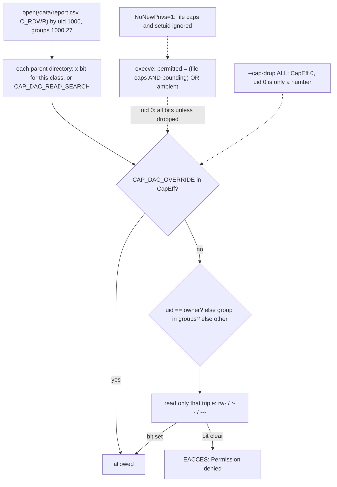

# Root Is a Bundle of 41 Bits: Permissions and Capabilities

*uid 0 is just a number: what a process may do is nine permission bits on each file plus 41 capability bits on the process, all readable.*

## Metadata

| Field | Value |
|---|---|
| Type | Build |
| Languages | Python, Bash |
| Prerequisites | [PID 1 & Signals](https://cloudcaptain.io/learn/linux/pid1-supervisor) |
| Time | 75 minutes |
| Tools | capsh, getpcaps, setcap, docker, kubectl |

<Quiz stage="pre" />

## The Problem

The security review asks the team to stop running the API container as root. Someone adds `USER app` to the Dockerfile, the deploy goes out, and the container crash-loops with `bind() to 0.0.0.0:80 failed (13: Permission denied)`. The first fix is `--cap-add NET_BIND_SERVICE`, which changes nothing. The second is `privileged: true` in the pod spec "until we work it out", and a review that asked for less root has produced a container with more of it than before: every capability, every host device, no seccomp filter.

The same week a batch job writes files into a shared volume and the sidecar that ships them fails with `Permission denied`, although both run as root inside their containers. The fix someone commits is `chmod -R 777` on the volume. A third ticket, from the audit team, lists a setuid binary in the image and asks what it can do and whether `no-new-privileges` would neutralise it. Nobody can answer from the manifest.

All three tickets are about two numbers. The uid of a process decides which three of the mode bits on a file are consulted. The 41 capability bits of a process decide whether that check happens at all, and whether the process may bind a low port, change an owner, mount, trace another process or load a module. "Root" is the process that holds all 41: `--cap-drop ALL` turns uid 0 into a number, and `--privileged` turns any uid into root. You are going to write `capcheck`, a tool that decodes capability masks into names, evaluates the permission check the kernel makes for a given user and file, and explains what a running process may do from `/proc/PID/status`. After that, `capsh`, `setcap`, `--cap-drop`, `securityContext` and the Pod Security Standards are views and knobs on two bitmaps you can read.

## The Concept

Two independent checks stand between a process and a file.

**Permission bits live on the file.** Twelve of them: read, write and execute for the owner, for the group and for everyone else, plus setuid, setgid and sticky. The kernel picks exactly one triple. If the process's uid equals the file's owner it uses the owner triple and looks no further; otherwise, if the file's group is among the process's groups, the group triple; otherwise the other triple. An owner facing mode `0070` is denied even though the group would be allowed. On a directory the same bits mean different things: `r` lists the names, `x` lets you reach an entry by name (traverse, `cd`), and creating or deleting an entry needs `w` and `x` together. Sticky on a writable directory limits deletion to the entry's owner, setgid on a directory makes new entries inherit its group, and setuid or setgid on an executable runs it with the owner's uid or the group's gid, which is how `passwd` writes `/etc/shadow`. Every directory on the path needs `x` before the file's own bits are even consulted. A failure here is `EACCES`, "Permission denied".

**Capabilities live on the process.** 41 bits, numbered from `CAP_CHOWN` (0) to `CAP_CHECKPOINT_RESTORE` (40), kept in five sets: *effective* is what the kernel checks; *permitted* is what the process may raise into effective; *bounding* is a ceiling that nothing can grow past; *inheritable* and *ambient* are what survives `execve`. A uid 0 process normally starts with everything in permitted and effective, bounded by the bounding set, so "root can read any file" is one bit, `CAP_DAC_OVERRIDE`, and "root can bind port 80" is another, `CAP_NET_BIND_SERVICE`. Drop the bit and uid 0 gets the same `EACCES` or `EPERM` as everyone else. A failed capability check that is not a file permission check is `EPERM`, "Operation not permitted".

`execve` is where the tickets come from. The new permitted set is the binary's file capabilities (`setcap`) masked by the bounding set, plus whatever is ambient. A non-root process with nothing ambient running a binary with no file capabilities therefore starts with zero effective capabilities, whatever its parent held. That is why `--user 1000 --cap-add NET_BIND_SERVICE` does not bind port 80: Docker puts the bit into the bounding set only. `no_new_privs` (Docker `--security-opt no-new-privileges`, Kubernetes `allowPrivilegeEscalation: false`) makes `execve` ignore setuid bits and file capabilities, so privilege can only go down. Docker gives a root container 14 of the 41 bits by default; `--privileged` gives all 41 plus every host device and removes the seccomp and AppArmor profiles.



`/proc/PID/status` shows all of it: `Uid`, `Gid`, `Groups`, the five `Cap*` masks as sixteen hex digits, `NoNewPrivs` and `Seccomp`. Everything `capsh`, `getpcaps` and `docker inspect` tell you comes from there and from `ls -l`.

## Build It

`code/main.py` is `capcheck`. The capability table is a tuple whose index is the bit number; the permission evaluator is a pure function over a mode, an owner, a group and an identity; the only system reads are `/proc/PID/status`, with the procfs root as an argument, and an optional `--path` that stats a real file. Every test runs on macOS and in CI without root.

### Step 1: the table is the bit number

The order comes from `include/uapi/linux/capability.h` and nowhere else; `capsh` and `getpcaps` carry the same table.

```python
CAPABILITIES = (
    "CAP_CHOWN",
    "CAP_DAC_OVERRIDE",
    "CAP_DAC_READ_SEARCH",
    "CAP_FOWNER",
    "CAP_FSETID",
    "CAP_KILL",
    "CAP_SETGID",
    "CAP_SETUID",
    "CAP_SETPCAP",
    "CAP_LINUX_IMMUTABLE",
    "CAP_NET_BIND_SERVICE",
    "CAP_NET_BROADCAST",
    "CAP_NET_ADMIN",
    "CAP_NET_RAW",
    "CAP_IPC_LOCK",
    "CAP_IPC_OWNER",
    "CAP_SYS_MODULE",
    "CAP_SYS_RAWIO",
    "CAP_SYS_CHROOT",
    "CAP_SYS_PTRACE",
    "CAP_SYS_PACCT",
    "CAP_SYS_ADMIN",
    "CAP_SYS_BOOT",
    "CAP_SYS_NICE",
    "CAP_SYS_RESOURCE",
    "CAP_SYS_TIME",
    "CAP_SYS_TTY_CONFIG",
    "CAP_MKNOD",
    "CAP_LEASE",
    "CAP_AUDIT_WRITE",
    "CAP_AUDIT_CONTROL",
    "CAP_SETFCAP",
    "CAP_MAC_OVERRIDE",
    "CAP_MAC_ADMIN",
    "CAP_SYSLOG",
    "CAP_WAKE_ALARM",
    "CAP_BLOCK_SUSPEND",
    "CAP_AUDIT_READ",
    "CAP_PERFMON",
    "CAP_BPF",
    "CAP_CHECKPOINT_RESTORE",
)
CAPABILITY_COUNT = len(CAPABILITIES)
ALL_CAPS = (1 << CAPABILITY_COUNT) - 1
DOCKER_DEFAULT = 0x00000000A80425FB
```

Decoding is a loop over the bits; anything above bit 40 is a kernel newer than the table and is shown as `bit41`:

```python
def decode(mask):
    names = []
    for bit in range(max(CAPABILITY_COUNT, mask.bit_length())):
        if mask >> bit & 1:
            names.append(CAPABILITIES[bit] if bit < CAPABILITY_COUNT else f"bit{bit}")
    return names
```

`0x00000000a80425fb` decodes to the 14 names of the Docker default set. `0x000001ffffffffff` is 2 to the 41st minus one: every bit, what `--privileged` and a host root shell hold. A `MEANINGS` table carries one line per capability and `ROOT_EQUIVALENT` marks the ones that are root by another name (`CAP_SYS_ADMIN`, `CAP_SYS_PTRACE`, `CAP_DAC_OVERRIDE`, `CAP_SETUID`, `CAP_SETFCAP`, `CAP_MKNOD` and friends), so the report says which bits in a set matter.

### Step 2: read any spelling of a mask

Masks arrive as hex from `/proc`, as `capsh --decode` output (`0x...=cap_a,cap_b`), as `getpcaps` output (`PID: cap_a,cap_b=ep`), as bare names with or without the `CAP_` prefix, or as an alias:

```python
def parse_mask(text):
    value = text.strip()
    if not value:
        raise ValueError("empty capability mask")
    if value.lower() in ALIASES:
        return ALIASES[value.lower()]
    if "=" in value:
        left, _, _ = value.partition("=")
        value = left.strip() if HEX_RE.match(left.strip()) else left.rpartition(":")[2].strip()
    if HEX_RE.match(value):
        return int(value, 16)
    mask = 0
    for part in re.split(r"[,\s]+", value):
        if part:
            mask |= 1 << INDEX[normalize_name(part)]
    return mask
```

`ALIASES` holds `all`, `none` and `docker-default`.

### Step 3: diff two sets

```python
def diff_masks(a, b):
    return {"only_a": decode(a & ~b), "only_b": decode(b & ~a), "both": decode(a & b)}
```

`--diff docker-default all` is the list `--privileged` adds; `--diff docker-default none` is what `--cap-drop ALL` removes; `--diff host.status container.status` with two `CapEff` values is the review you do before a deploy.

### Step 4: a mode from octal or from `ls -l`

`parse_mode()` accepts `0755`, `4755`, `1777`, or the ten-character string `ls -l` prints. The string is three triples; `s` and `t` are an execute bit plus a special bit, and capital `S` and `T` are the special bit without execute, the shape `ls` prints for a setuid file nobody can run:

```python
        for triple, shift, special in ((user, 6, stat.S_ISUID), (group, 3, stat.S_ISGID), (other, 0, stat.S_ISVTX)):
            if triple[0] == "r":
                perm |= 4 << shift
            if triple[1] == "w":
                perm |= 2 << shift
            if triple[2] in "xst":
                perm |= 1 << shift
            if triple[2] in "sStT":
                perm |= special
```

`format_mode()` goes the other way, so a parsed mode round-trips to the exact `ls` string, which is how the tests pin the parser down.

### Step 5: the check the kernel makes

Class selection first, and it stops at the first match:

```python
def permission_class(entry, who):
    if who.user == entry.owner:
        return "owner"
    if entry.group in who.groups:
        return "group"
    return "other"
```

Then the bits of that class, then the two capabilities that bypass them. `CAP_DAC_OVERRIDE` skips read and write, and skips execute on a regular file only if at least one execute bit is set anywhere; `CAP_DAC_READ_SEARCH` skips read on files and read plus traverse on directories, and never write:

```python
    if has_cap(caps, "CAP_DAC_OVERRIDE"):
        read = write = True
        execute = True if is_dir else (execute or bool(entry.mode.perm & 0o111))
        notes.append("CAP_DAC_OVERRIDE: read and write checks bypassed" + ("" if is_dir else "; execute needs at least one x bit on the file"))
    elif has_cap(caps, "CAP_DAC_READ_SEARCH"):
        read = True
        execute = True if is_dir else execute
        notes.append("CAP_DAC_READ_SEARCH: read" + (" and traverse" if is_dir else "") + " checks bypassed; write is still checked")
```

Directories get their own vocabulary. `x` is traverse, and modifying the directory needs `w` and `x` together:

```python
    if is_dir:
        traverse = execute
        if write and not execute:
            notes.append("w without x: cannot create or delete entries; both bits are needed")
```

The rest of `access()` adds notes for sticky (delete only your own entries unless you own the directory or hold `CAP_FOWNER`), setgid directories (new entries inherit the group), setuid and setgid executables (the effective uid or gid they run with, and that `nosuid`, scripts and `NoNewPrivs=1` all switch that off), execute without read (a binary runs, a script does not), and symlinks (the target's bits decide).

### Step 6: explain a process

`/proc/PID/status` is `Key:\tvalue` lines. `parse_status()` reads `Uid` (real, effective, saved, filesystem), `Gid`, `Groups`, the five masks, `NoNewPrivs` and `Seccomp`. The target can be a PID under an injectable root or a saved copy of the file, which is how a status captured inside a container is explained on your laptop:

```python
def read_status(target, root="/proc"):
    path = target if os.path.isfile(target) else os.path.join(root, target, "status")
```

`explain()` prints the five sets decoded, how many bits the bounding set rules out forever, what `NoNewPrivs` and the seccomp mode mean, and a verdict:

```python
    if euid == 0 and effective == ALL_CAPS:
        return "full root: every capability is effective (a host root shell or --privileged); file permission bits do not apply to it"
    if euid == 0 and effective == 0:
        return "uid 0 with no capabilities (--cap-drop ALL): root in name only; EACCES on files it does not own, EPERM on chown, mknod and ports below 1024"
```

The other verdicts cover uid 0 with a partial set (and which of its bits are root-equivalent), a non-root process with nothing effective (and whether the bounding set would still let a file capability grant something, or `NoNewPrivs` closes even that), and a non-root process that holds a bit it got from a file capability or the ambient set.

### Step 7: run it

Everything but `--explain PID` and `code/main.sh` runs anywhere:

```bash
python3 code/main.py docker-default                                   # 14 names with meanings, 8 marked ! as root-equivalent
python3 code/main.py 000001ffffffffff                                 # all 41: what --privileged grants
python3 code/main.py --diff docker-default 0000000000000400           # what --cap-drop ALL --cap-add NET_BIND_SERVICE removes
python3 code/main.py cap_net_bind_service,cap_chown --json
python3 code/main.py --perms 4755 --user alice --groups alice         # passwd: other r-x, "runs with effective uid root"
python3 code/main.py --perms drwxrwxrwt --user alice --groups alice   # /tmp: modify yes, sticky: delete only your own entries
python3 code/main.py --perms 0070 --owner alice --group dev --user alice --groups alice,dev   # denied: the owner triple wins
python3 code/main.py --perms 0600 --user app --groups app --caps docker-default              # read yes: CAP_DAC_OVERRIDE
python3 code/main.py --perms 0600 --user app --groups app --caps none                        # read no
python3 code/main.py --path /etc/shadow                               # you, against a real file
```

On Linux, against live processes:

```bash
python3 code/main.py --explain self
python3 code/main.py --explain 1                                      # sudo for another user's process
awk '/^Cap/ {print $2}' /proc/self/status | xargs -n1 python3 code/main.py
bash code/main.sh self /usr/bin/passwd /tmp                           # the same with grep, bash arithmetic, capsh, getpcaps and stat
```

And a status captured inside a container, explained outside it:

```bash
docker run --rm --user 1000 --cap-drop ALL --cap-add NET_BIND_SERVICE --security-opt no-new-privileges alpine:3.22 cat /proc/self/status > container.status
python3 code/main.py --explain container.status                       # effective 0x0, bounding 1 of 41, NoNewPrivs 1, verdict: unprivileged uid 1000
```

<RunTests />

## Use It

`capsh` and `getpcaps` are `capcheck` for the capability half; `ls`, `stat`, `namei` and `getcap` are the permission half; `setcap` is how a bit gets onto a binary. Run them against the same objects:

```bash
grep Cap /proc/$$/status                                     # five masks, sixteen hex digits each
capsh --decode=00000000a80425fb                              # the names, same table, same order
capsh --print                                                # your current sets, bounding set, securebits, uid and gid
getpcaps $$                                                  # the effective and permitted sets of a pid, as names
getcap -r / 2>/dev/null                                      # every binary with file capabilities (ping: cap_net_raw=ep)
ls -l /usr/bin/passwd; stat -c '%A %a %U %G %n' /usr/bin/passwd           # -rwsr-xr-x 4755 root root
namei -l /var/lib/app/data/report.csv                       # mode and owner of every path component: the traverse check by hand
sudo find / -xdev -perm -4000 -type f 2>/dev/null            # every setuid binary on the box
sudo setcap cap_net_bind_service=+ep /usr/bin/python3.12     # one bit on one binary; every user who runs it gets it
getcap /usr/bin/python3.12; sudo setcap -r /usr/bin/python3.12
capsh --keep=1 --user=app --inh=cap_net_bind_service --addamb=cap_net_bind_service -- -c 'python3 -m http.server 80'   # the ambient route
```

Docker exposes the same bits as flags, and `/proc/1/status` inside the container shows what was actually granted:

```bash
docker run --rm alpine:3.22 grep CapEff /proc/self/status                                # 00000000a80425fb: the 14 defaults
docker run --rm --cap-drop ALL alpine:3.22 grep CapEff /proc/self/status                 # 0000000000000000
docker run --rm --cap-drop ALL --cap-add NET_BIND_SERVICE alpine:3.22 grep CapEff /proc/self/status     # 0000000000000400
docker run --rm --user 1000 --cap-add NET_BIND_SERVICE alpine:3.22 grep Cap /proc/self/status           # CapEff 0, the bit only in CapBnd
docker run --rm --privileged alpine:3.22 grep CapEff /proc/self/status                   # 000001ffffffffff, plus /dev/* and no seccomp or AppArmor
docker run --rm --security-opt no-new-privileges alpine:3.22 grep NoNewPrivs /proc/self/status
docker inspect -f '{{.HostConfig.CapAdd}} {{.HostConfig.CapDrop}} {{.HostConfig.SecurityOpt}} {{.HostConfig.Privileged}}' CONTAINER
docker run --rm alpine:3.22 cat /proc/sys/net/ipv4/ip_unprivileged_port_start            # 0: Docker's default inside every container
docker run --rm --user 1000 --cap-drop ALL --sysctl net.ipv4.ip_unprivileged_port_start=0 python:3.12-alpine python3 -m http.server 80   # port 80 with zero capabilities
```

Read that sysctl before you debug a bind error. Docker Engine has set `net.ipv4.ip_unprivileged_port_start=0` in every container's network namespace since 20.10, so under a plain `docker run` any uid can bind port 80 and `CAP_NET_BIND_SERVICE` changes nothing. The capability decides on the host, under runtimes that keep the kernel default of 1024, and whenever the sysctl is set back to 1024, which is what the smoke test does with `--sysctl net.ipv4.ip_unprivileged_port_start=1024` to show each case.

Kubernetes spells the same knobs as a `securityContext`; the restricted Pod Security Standard is this block made mandatory per namespace (`pod-security.kubernetes.io/enforce: restricted`). PodSecurityPolicy, which used to enforce it, was removed; Pod Security Admission does it now:

```yaml
securityContext:
  runAsNonRoot: true
  runAsUser: 1000
  allowPrivilegeEscalation: false      # NoNewPrivs: 1
  readOnlyRootFilesystem: true
  seccompProfile:
    type: RuntimeDefault               # Seccomp: 2
  capabilities:
    drop: ["ALL"]                      # CapEff 0000000000000000
    add: ["NET_BIND_SERVICE"]          # the only add restricted allows; bounding set only for a non-root user
```

```bash
kubectl exec POD -- grep -E 'Uid|CapEff|CapBnd|NoNewPrivs|Seccomp' /proc/1/status
kubectl get pod POD -o jsonpath='{.spec.containers[0].securityContext}'
kubectl label ns team pod-security.kubernetes.io/enforce=restricted      # a violating pod is now rejected at admission
```

| What you built | Real tool | Note |
|---|---|---|
| decode a mask | `capsh --decode=MASK`, `getpcaps PID` | same table, same order; `capsh --print` adds the bounding set and securebits |
| `--diff A B` | `docker inspect -f '{{.HostConfig.CapAdd}} {{.HostConfig.CapDrop}}'` | inspect shows what you asked for; `/proc/1/status` inside shows what you got |
| `--perms`: class and triple | `ls -l`, `stat -c '%A %U %G'`, `namei -l PATH` | `namei -l` walks every component, the traverse check you do by hand |
| `--perms --caps` | `sudo`, `capsh --caps=... --` | the same check with a different `CapEff` |
| setuid and setgid notes | `find / -perm -4000`, `getcap -r /` | file capabilities are setuid with a scalpel; both are ignored under `NoNewPrivs` and `nosuid` |
| `--explain PID` | `cat /proc/PID/status`, `getpcaps`, `docker exec C grep Cap /proc/1/status`, `kubectl exec P -- grep Cap /proc/1/status` | `allowPrivilegeEscalation: false` is `NoNewPrivs: 1`; `RuntimeDefault` is `Seccomp: 2` |
| `docker-default` alias | `docker run --rm alpine:3.22 grep CapEff /proc/self/status` | 14 bits on current releases; `--privileged` is 41 bits plus devices and no seccomp or AppArmor |
| non-root verdict | `docker run --user 1000 --cap-add X` | the bit lands in the bounding set only; a file capability, the ambient set or a sysctl is how a non-root process gets it |

<Quiz stage="check" />

## Ship It

Two artifacts in `outputs/`:

- **`skill-least-privilege-container.md`**: a runbook that reads what a container holds now, starts it again from `--cap-drop ALL --user 1000 --security-opt no-new-privileges`, maps every `EACCES` and `EPERM` to the one change it needs (a port above 1024, ownership fixed in the image, a sysctl, exactly one capability, a file capability), freezes the result as `docker run` flags and a Kubernetes `securityContext`, and proves it with `--explain` on `/proc/1/status` and a negative test.
- **`prompt-explain-permission-denied.md`**: paste a `Permission denied` or `Operation not permitted` with `ls -ld`, `id` and `grep Cap /proc/PID/status`, and get back which check failed (permission bits, a named capability, `no_new_privs`, a mount flag, seccomp or an LSM), the evidence, three fixes ordered by least privilege, and the tempting fix to refuse.

<ShipIt />

## Exercises

### Easy

Add `--names` so `capcheck` prints a set in `capsh` spelling (`cap_chown,cap_kill`) that can be pasted into `capsh --caps=` or `--cap-add`, and make `--diff` accept two `/proc/PID/status` files directly by pulling `CapEff` out of each. Write the tests first: `--diff host.status container.status` on two fixtures must list exactly the dropped bits.

### Medium

A single entry is not the whole check. Extend `--path` (and `--perms` with a list of `ls -ld` lines) to walk a full path, evaluating traverse on every parent directory for the user, and report the first component that denies, the way `namei -l` lets you do by eye. Build the fixture as a real directory tree in a temp dir with `chmod` and assert that `/a/b/c` is denied when `/a` is `0700` owned by someone else even though `c` itself is `0644`.

### Hard

Implement the `execve` transformation from capabilities(7): inputs are the five sets of the caller, the binary's file capabilities as `getcap` prints them (`cap_net_bind_service=ep`), its setuid bit and owner, the caller's uid, `NoNewPrivs` and whether the mount is `nosuid`; output is the five sets of the new process. Unit-test it on the cases from this lesson (root with Docker defaults, `--user 1000 --cap-add`, a `setcap`'d binary with and without `no-new-privileges`), then verify on Linux by `setcap`-ing a copy of `sleep`, running it from a non-root shell inside Docker with and without `--security-opt no-new-privileges`, and comparing `getpcaps` of the child with your prediction.

<Quiz stage="post" />

## Key Terms

| Term | Common misconception | Precise definition |
|---|---|---|
| Capability | "A permission on a file." | One of 41 bits on a process (thread), numbered from `CAP_CHOWN` (0) to `CAP_CHECKPOINT_RESTORE` (40), each gating a family of privileged operations. The kernel checks the effective set. |
| Effective, permitted, bounding | "A process either has a capability or not." | Effective is checked; permitted is what the process may raise into effective; bounding is a ceiling that no `execve` can grow past. `/proc/PID/status` shows all three as hex masks. |
| Ambient set | "`--cap-add` gives the process the capability." | The set that survives `execve` for a non-root process. Without it (and without file capabilities) a non-root process starts with zero effective bits, which is what Docker's `--user` does. |
| `CAP_DAC_OVERRIDE` | "Root can read any file because it is root." | The single bit that bypasses read and write permission checks (and execute, if any x bit is set). Drop it and uid 0 is checked like any other user. `CAP_DAC_READ_SEARCH` is the read-only half. |
| Permission class | "If you are in the group you get the group's bits." | Exactly one of owner, group, other is selected, in that order, and a uid match stops the search. An owner with `0070` is denied what the group is allowed. |
| Directory bits | "`r` lets you read the files inside." | `r` lists names, `x` reaches an entry by name (traverse), `w` with `x` creates and deletes entries. Every component on a path needs `x` before the file's bits matter. |
| setuid bit | "A flag that makes a program run as root." | Runs the executable with the owner's uid as the effective uid (setgid: the group's gid). Ignored for scripts, on `nosuid` mounts and when `NoNewPrivs` is 1. File capabilities are the fine-grained replacement. |
| Sticky bit | "An old flag that keeps files in memory." | On a world-writable directory, limits deletion and renaming to the entry's owner, the directory's owner, or `CAP_FOWNER`. That is why `/tmp` is `drwxrwxrwt`. |
| `no_new_privs` | "It drops capabilities." | A per-process flag that makes `execve` ignore setuid bits and file capabilities, so privilege can only go down. Docker `--security-opt no-new-privileges`, Kubernetes `allowPrivilegeEscalation: false`. |
| `EACCES` vs `EPERM` | "Both mean the same thing." | `EACCES` (13, "Permission denied") is a permission-bit check on a file; `EPERM` (1, "Operation not permitted") is a missing capability or privilege. The errno tells you which half of this lesson to open. |
| `--privileged` | "A bit more access than normal." | All 41 capabilities, every host device, no seccomp filter, no AppArmor profile, writable `/sys`. It is the host's root with a different filesystem view; it is never the fix for one missing bit. |

## Further Reading

- [Linux Fundamentals](https://cloudcaptain.io/docs/tools/linux/fundamentals): the permissions chapter, `chmod`, `umask`, and the setuid, setgid and sticky bits in their everyday form.
- [Linux Security](https://cloudcaptain.io/docs/tools/linux/security): the hardening checklist this lesson's bits plug into: mandatory access control, audit, SSH.
- [Docker Security & Production](https://cloudcaptain.io/docs/tools/docker/security-production): `--cap-drop ALL`, `no-new-privileges`, read-only roots and the rest of the runtime hardening flags in production use.
- [Kubernetes Security](https://cloudcaptain.io/docs/tools/kubernetes/security): `securityContext`, the three Pod Security Standards and how admission enforces them per namespace.
- [capabilities(7)](https://man7.org/linux/man-pages/man7/capabilities.7.html): the 41 names, the five sets, and the `execve` transformation rules, the primary source for Step 6 and the Hard exercise.
- [inode(7)](https://man7.org/linux/man-pages/man7/inode.7.html): the exact semantics of the permission bits, setgid directories and the sticky bit.
- [path_resolution(7)](https://man7.org/linux/man-pages/man7/path_resolution.7.html): why every directory on the way needs `x`, in the kernel's own words.
- [No New Privileges Flag](https://www.kernel.org/doc/html/latest/userspace-api/no_new_privs.html): the kernel's one-page description of `no_new_privs` and why seccomp wants it.
- [setcap(8)](https://man7.org/linux/man-pages/man8/setcap.8.html) and [capsh(1)](https://man7.org/linux/man-pages/man1/capsh.1.html): the two libcap tools from Use It, with the `=ep` and `--addamb` syntax.
- [Docker: runtime privilege and Linux capabilities](https://docs.docker.com/engine/containers/run/#runtime-privilege-and-linux-capabilities): the default list, `--cap-add`, `--cap-drop` and what `--privileged` really sets.
- [Pod Security Standards](https://kubernetes.io/docs/concepts/security/pod-security-standards/): the field-by-field definition of baseline and restricted, including which capability adds and sysctls are allowed.
