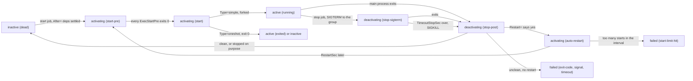

# A Service Is a Process With a Contract: systemd Units From Scratch

*A unit file is the contract between a process and its supervisor: what runs first, how it starts, when it restarts, how it stops.*

## Metadata

| Field | Value |
|---|---|
| Type | Build |
| Languages | Python |
| Prerequisites | [PID 1: Why Your Container Ignores Ctrl-C](https://cloudcaptain.io/learn/linux/pid1-supervisor) |
| Time | 90 minutes |
| Tools | systemctl, journalctl, systemd-analyze, systemd-run |

<Quiz stage="pre" />

## The Problem

The API node reboots after a kernel update. Postgres and the API are both enabled, both come up, and for ninety seconds the API crash-loops with `connection refused` while Postgres replays its write-ahead log. Then the restarts stop: `systemctl status api` says `failed (Result: start-limit-hit)`, the database is fine, and the on-call starts the API by hand. Someone proposes `sleep 20` at the top of the start script. On another service, a schema migration is glued into the start command with `&&`; when the migration fails the service never starts, and the error sits in a log file nobody reads because the migration was never a unit of its own. A third team measures every deploy at ninety seconds longer than it should be, because `systemctl stop` waits the full timeout before killing an application that ignores `SIGTERM`. And an `ExecStartPre` that worked in an engineer's shell fails on the server with `HOME: unbound variable`.

Every one of these is a clause in a contract the unit file was supposed to state and did not. Ordering (`After=`) and requirement (`Requires=`, `Wants=`) are two different axes, and "started" (`Type=simple`: the process was forked) is not "ready". The restart policy has a rate limit (`StartLimitBurst=`) that turns a loop into `failed`. The stop contract is `SIGTERM` to every process in the group, a timeout, then `SIGKILL`, and `ExecStopPost` runs either way. The environment of a service is not your shell's. systemd enforces all of it; the unit file is where you write it down, and the journal is where you read what happened.

You are going to write `miniunit`: a parser for the subset of unit files that matters, a dependency resolver, and a runner with the real unit state machine on top of the supervisor you built in the PID 1 lesson. After that, `systemctl status`, `list-dependencies`, `systemd-analyze verify`, drop-ins, transient units and Podman's Quadlet files read as views and knobs on something you have built yourself.

## The Concept

A unit is a named contract with four clauses:

- **Identity and neighbours** (`[Unit]`): a description, `After=` for ordering, `Requires=` and `Wants=` for what to pull in and what happens when the other side fails.
- **How to run** (`[Service]`): `Type=`, `ExecStartPre=`, `ExecStart=`, `Environment=`, `EnvironmentFile=`, `WorkingDirectory=`.
- **What to do when it ends**: `Restart=`, `RestartSec=`, and the rate limit `StartLimitBurst=` within `StartLimitIntervalSec=`. An end counts as clean when the exit status is 0 or the process died from `SIGHUP`, `SIGINT`, `SIGTERM` or `SIGPIPE`.
- **How to stop it**: `SIGTERM` to the whole control group, `TimeoutStopSec=`, then `SIGKILL`; `ExecStopPost=` runs afterwards with `$SERVICE_RESULT`, `$EXIT_CODE` and `$EXIT_STATUS`.

Two distinctions carry most of the production bugs. First, ordering and requirement are independent. `After=db.service` says only "if we are both being started in the same transaction, start me once db has finished activating". `Requires=db.service` says "pull db in when I start; if db fails to activate and I am `After=` it, do not start me; if db is stopped on purpose, stop me too". A `Requires=` without `After=` starts both at the same instant, which is the reboot bug above. `Wants=` pulls in but tolerates failure. And nothing in `Requires=` stops a unit when its dependency crashes later; that coupling is `BindsTo=`. Second, started is not ready. A `Type=simple` unit is active the moment its main process has been forked. A `Type=oneshot` unit finishes activating when its process exits, so dependents wait for the work. `Type=notify` waits for `READY=1` on `$NOTIFY_SOCKET`.

Everything else is one state machine per unit, driven by jobs (start, stop), process exits and the clock:



Every transition and every line a service writes to stdout or stderr goes into the journal, keyed by unit. `systemctl status` is a rendering of the unit's state record plus the last few journal lines for it.

## Build It

`code/main.py` is `miniunit`. Parsing, the dependency graph and the state machine are pure. The `Manager` takes `spawn`, `kill` and `now` as arguments, the same boundary as the PID 1 supervisor, so the tests drive it with fakes and a fake clock, and `ProcessBackend` wires in `subprocess.Popen`, process groups and reader threads for the real thing. One difference from the PID 1 lesson: exits arrive as `Popen` return codes, non-negative for an exit status and `-signal` for a kill.

### Step 1: parse the contract

Unit files look like INI but are not: a repeated key appends to a list, an empty assignment resets the list, a trailing `\` continues the line, `#` and `;` start comments, and an unknown key is a warning, not an error (systemd logs `Unknown key name` and carries on). The parser keeps that list rule in one place:

```python
values = sections.setdefault(section, {}).setdefault(key, [])
if (section, key) in LIST_KEYS:
    if value == "":
        values.clear()
    else:
        values.append(value)
else:
    values[:] = [value]
```

The rest of `parse_unit_text()` turns the lists into a `Unit` and refuses contracts that cannot be kept: no `ExecStart=`, two `ExecStart=` lines on a `Type=simple` unit, `Restart=always` on a `Type=oneshot` (a oneshot that exits 0 is finished; systemd refuses it too), an unsupported `Type=`.

### Step 2: time spans and Exec lines

`RestartSec=500ms`, `TimeoutStopSec=1min 30s` and `StartLimitIntervalSec=infinity` all have to parse, and `ExecStartPre=-/bin/check` means "run it, but a failure does not fail the unit":

```python
def parse_exec(value):
    ignore = value.startswith("-")
    if ignore:
        value = value[1:]
    if value and value[0] in "@:+!":
        raise UnitError(f"Exec prefix {value[0]!r} is not supported here (only '-')")
    argv = shlex.split(value)
    if not argv:
        raise UnitError("empty Exec line")
    return Exec(argv, ignore)
```

There is no shell in an Exec line unless you write one. `ExecStart=/bin/sh -c '...'` is the shell; `ExecStart=echo $HOME` is a program called `echo` with a literal `$HOME` argument in systemd's eyes, and `miniunit` behaves the same way.

### Step 3: the environment is not your shell

A service gets a small environment: `PATH`, a locale, and whatever the unit adds. `EnvironmentFile=` is read first and `Environment=` wins; a `-` prefix makes the file optional:

```python
def unit_environment(unit, read_file):
    env = {"PATH": DEFAULT_PATH, "LANG": os.environ.get("LANG", "C.UTF-8")}
    for path, optional in unit.environment_files:
        try:
            env.update(parse_environment_file(read_file(path)))
        except OSError as exc:
            if not optional:
                raise UnitError(f"{unit.name}: EnvironmentFile={path}: {exc.strerror or exc}")
    env.update(unit.environment)
    return env
```

A required file that is missing fails the unit at start with exit status `203/EXEC`, the same code systemd shows when `execve()` itself fails; `HOME: unbound variable` is what you get when nobody wrote `HOME` down.

### Step 4: who starts, in which order

Starting a unit builds a *transaction*: the unit plus everything it `Requires=` and `Wants=`, recursively. A missing `Requires=` target is an error; a missing `Wants=` target is ignored. Then only `After=` edges between members of the transaction decide the order, with Kahn's algorithm and alphabetical tie-breaks so the output is stable:

```python
def start_order(units, names):
    chosen = set(names)
    before = {n: set() for n in names}
    for name in names:
        for dep in units[name].after:
            if dep in chosen:
                before[name].add(dep)
    order = []
    remaining = dict(before)
    while remaining:
        ready = sorted(n for n, deps in remaining.items() if not deps)
        if not ready:
            cycle = find_cycle({n: {d for d in deps} for n, deps in remaining.items()})
            raise UnitError("ordering cycle: " + " -> ".join(cycle))
        for name in ready:
            order.append(name)
            del remaining[name]
        for deps in remaining.values():
            deps.difference_update(ready)
    return order
```

`After=network.target` on a unit in a directory that has no `network.target` is simply not an edge, which is what happens in systemd when the other unit is not part of the transaction. A `Requires=` without `After=` produces no edge either, so the two units land in the same round.

### Step 5: the state machine

`Manager.tick()` runs due restarts, then stop jobs, then start jobs, then stop timeouts. A start job waits while any `After=` dependency is still activating or has a pending start job, and is cancelled when a `Requires=` dependency failed:

```python
def _try_activate(self, state):
    for dep in state.unit.after:
        dep_state = self.states.get(dep)
        if dep_state is None:
            continue
        if dep_state.job == "start" or dep_state.active in ("activating",):
            return
        dep_failed = dep_state.active == "failed" or (dep_state.active == "inactive" and dep_state.result != "success")
        if dep_failed and dep in state.unit.requires:
            state.job = None
            state.active, state.sub, state.result = "inactive", "dead", "dependency"
            self._note(f"Dependency failed for {state.name}: {dep} failed to start")
            return
    state.job = None
    self._begin_activation(state)
```

Activation is a queue of steps, `ExecStartPre` lines first, then `ExecStart`. Each `start-pre` step is a *control process* that must exit 0 before the next step runs. The `start` step is where `Type=` matters:

```python
if step == "start" and state.unit.service_type == "simple":
    state.main_pid = pid
    state.active, state.sub = "active", "running"
    self._note(f"Started {state.name}")
elif step == "start":
    state.main_pid = pid
else:
    state.control_pid = pid
```

A simple unit is active as soon as the fork returned. A oneshot stays `activating (start)` until the process exits 0, so a `web.service` with `After=migrate.service` really waits for the migration, and `RemainAfterExit=yes` leaves it `active (exited)` afterwards.

### Step 6: when it ends: clean exits, restart, the rate limit

`handle_exit(pid, code)` finds the unit by main or control PID, records the result, runs the `ExecStopPost` steps, and then decides what the end means:

```python
def is_clean_exit(code):
    return code == 0 or (code < 0 and -code in CLEAN_SIGNALS)
```

```python
if unit.restart == "always" or (unit.restart == "on-failure" and failed):
    state.restarts += 1
    state.active, state.sub = "activating", "auto-restart"
    state.restart_at = self.now() + unit.restart_sec
    self._note(f"{state.name}: Scheduled restart job, restart counter is at {state.restarts}.")
    return
```

`on-failure` ignores clean exits, so a `kill -TERM` of the main process leaves the unit `inactive (dead)`; only `always` brings it back. A stop requested through the manager suspends the policy entirely, the rule your PID 1 supervisor had as `shutting_down`. Every activation, first or restarted, passes the rate limit:

```python
state.start_times = [t for t in state.start_times if now - t < interval]
state.start_times.append(now)
return len(state.start_times) > state.unit.start_limit_burst
```

More than `StartLimitBurst` starts inside `StartLimitIntervalSec` (systemd's defaults are 5 and 10 s) ends the loop as `failed (Result: start-limit-hit)` with the journal line `Start request repeated too quickly`. The attempts' exit codes are the bug; the limit only decides when to stop trying.

### Step 7: stop is a contract too

A stop job waits until every unit that `Requires=` or is `After=` this one and is also stopping has settled, so stops run in reverse order, and `stop(["db.service"])` adds the units that `Requires=` db to the job list on its own. Then:

```python
if state.main_pid is not None:
    self.kill(state.main_pid, int(signal.SIGTERM))
    state.active, state.sub = "deactivating", "stop-sigterm"
    state.stop_deadline = None if state.unit.timeout_stop_sec is None else self.now() + state.unit.timeout_stop_sec
```

```python
if state.sub == "stop-sigterm" and state.stop_deadline is not None and state.stop_deadline <= now and state.main_pid is not None:
    self._note(f"{state.name}: State 'stop-sigterm' timed out. Killing.")
    self.kill(state.main_pid, int(signal.SIGKILL))
    state.sub = "stop-sigkill"
    state.result = "timeout"
```

The real `kill` is `os.killpg()`: every service is spawned with `start_new_session=True`, so the whole process group gets the signal, a small version of systemd's `KillMode=control-group` (the cgroups lesson does the real one). A unit that ignored `SIGTERM` ends `failed (Result: timeout)`; one that handled it ends `inactive (dead)`. `ExecStopPost` runs in both cases with `SERVICE_RESULT`, `EXIT_CODE` and `EXIT_STATUS` in its environment.

### Step 8: journal and status

Reader threads turn each service's stdout and stderr into journal entries, and the manager writes its own transitions there too. One line of `journalctl -o short`, minus the hostname:

```python
def format_journal_line(entry):
    stamp = time.strftime("%b %d %H:%M:%S", time.localtime(entry.at))
    return f"{stamp} {entry.unit}[{entry.pid}]: {entry.line}"
```

`render_status()` prints the `systemctl status` shape: the glyph (`●` active, `○` inactive, `×` failed, `↻` in transition), `Loaded:`, `Active: active (running) since ...; 42s ago`, one `Process:` line per finished Exec step with `code=exited, status=1/FAILURE` or `code=killed, signal=15/TERM`, `Main PID:`, `Restarts:`, `Result:`, then the unit's last journal lines. The running manager keeps `state.json`, `journal.jsonl` and `manager.pid` in a state directory; `status` and `journal` read them, `stop` writes a command there and sends `SIGUSR1`. systemd keeps the same record in PID 1's memory and talks over D-Bus, but the shape of the data is this.

### Step 9: run it

`code/units/` holds four units: `db.service` (simple, with an `ExecStartPre`), `migrate.service` (oneshot, `RemainAfterExit=yes`), `web.service` (`Requires=db.service`, `Wants=migrate.service`, `After=` both, an `ExecStopPost`) and `flaky.service` (a oneshot that always exits 1 with `Restart=on-failure` and `StartLimitBurst=3`).

```bash
python3 code/main.py --units code/units verify                         # 4 unit(s), 0 error(s), 0 warning(s)
python3 code/main.py --units code/units graph web.service              # the tree, then: start order: db.service -> migrate.service -> web.service
python3 code/main.py --units code/units --state /tmp/mu start web.service flaky.service --for 8 --verbose
python3 code/main.py --state /tmp/mu status web.service flaky.service  # ○ web.service inactive (dead); × flaky.service failed (Result: start-limit-hit), Restarts: 3
python3 code/main.py --state /tmp/mu journal -u miniunit               # Starting, Started, Scheduled restart job, Start request repeated too quickly, Stopping, Stopped
```

In the journal, `migration done` comes before `hello from web on port 8080` because web is `After=` the oneshot; `db listening on 5432` and the web line can land in either order, because `Type=simple` promised a fork, not readiness. At shutdown `Stopped web.service` comes before `Stopping db.service`, and `web stopped: success killed TERM` is `ExecStopPost` reading the three variables. Now a live manager and a stop that propagates:

```bash
python3 code/main.py --units code/units --state /tmp/mu start web.service &
sleep 2; python3 code/main.py --state /tmp/mu status web.service          # manager: running, pid ...; Active: active (running)
python3 code/main.py --state /tmp/mu stop db.service                      # web.service is stopped first, because it Requires= db
python3 code/main.py --state /tmp/mu status --json | python3 -c 'import json,sys; d=json.load(sys.stdin); print({k: v["active"] for k, v in d.items()})'
python3 code/main.py --state /tmp/mu stop; wait                           # everything down, manager exits 0
```

`migrate.service` is still `active (exited)` after the first stop: `Wants=` pulls in on start and never propagates a stop.

<RunTests />

## Use It

The same contract in the real manager. These need a Linux machine with systemd; a VM, a cloud box or `systemd --user` on your laptop all work.

```bash
systemctl cat kubelet.service                      # the unit as loaded: the file plus every drop-in, each with its path
systemctl status kubelet.service                   # the state record plus the last journal lines; glyph, Active:, Main PID, CGroup tree
systemctl show kubelet.service -p Type -p Restart -p RestartUSec -p TimeoutStopUSec -p NRestarts -p Result -p ExecMainStatus
systemctl list-dependencies kubelet.service        # the transaction: Requires=/Wants= pulled in, recursively
systemctl list-dependencies --after kubelet.service   # the ordering axis on its own
systemd-analyze verify /etc/systemd/system/web.service   # parse errors, unknown keys, missing executables, missing units
systemd-analyze critical-chain web.service         # which After= chain decided when it started at boot, with the time each link took
journalctl -u web.service -f                       # the per-unit journal, following
journalctl -u web.service -b -p err -o json        # since this boot, errors only, as JSON: _SYSTEMD_UNIT, _PID, MESSAGE
```

Transient units are the fastest way to try a contract without writing a file. `systemd-run` creates one from `--property=` flags, which are the same keys:

```bash
sudo systemd-run --unit cc-demo --remain-after-exit -p Restart=no /bin/sh -c 'echo hello from a transient unit'
systemctl show cc-demo -p ActiveState -p SubState -p Result     # active / exited / success
sudo journalctl -u cc-demo -o cat                                # hello from a transient unit
sudo systemctl stop cc-demo                                      # a transient unit disappears when it stops
sudo systemd-run --unit cc-flaky -p Restart=on-failure -p RestartSec=1 /bin/false
sleep 8; systemctl status cc-flaky --no-pager                    # failed (Result: start-limit-hit) after 5 starts in 10 s
journalctl -u cc-flaky -o cat | grep -c 'Scheduled restart'      # the attempts; the exit status of each is the real story
sudo systemctl reset-failed cc-flaky                             # clear the record (and the rate-limit state)
```

Changing a packaged unit is done with a drop-in, never by editing the file under `/usr/lib/systemd/system`:

```bash
sudo systemctl edit web.service          # creates /etc/systemd/system/web.service.d/override.conf
# [Service]
# Restart=on-failure
# RestartSec=2s
# TimeoutStopSec=20
sudo systemctl daemon-reload && systemctl cat web.service       # the merged result, with the path of each fragment
```

The empty-assignment rule from Step 1 is what makes drop-ins able to replace list keys: a drop-in that says `ExecStart=` on its own line and then `ExecStart=/new/command` swaps the command instead of adding a second one.

Hardening keys live in the same `[Service]` section, and `systemd-analyze security` scores what is missing:

```bash
systemd-analyze security web.service      # exposure 0 (tight) to 10 (nothing); one line per key you could set
# [Service]
# NoNewPrivileges=yes
# ProtectSystem=strict
# ProtectHome=yes
# PrivateTmp=yes
# CapabilityBoundingSet=CAP_NET_BIND_SERVICE
# AmbientCapabilities=CAP_NET_BIND_SERVICE
# RestrictAddressFamilies=AF_INET AF_INET6 AF_UNIX
# DynamicUser=yes
```

A user manager runs the same machine for one account, without root: units in `~/.config/systemd/user/`, `systemctl --user start web.service`, `journalctl --user -u web.service`, and `loginctl enable-linger $USER` to keep it alive without a login session.

Containers do not have systemd inside by default: whatever `ENTRYPOINT` runs is PID 1 (the PID 1 lesson), and the restart policy lives in the engine (`docker run --restart`, `restartPolicy` in a pod). The engines themselves are units: on a Kubernetes node, `systemctl cat kubelet.service` shows the unit plus the `10-kubeadm.conf` drop-in with its `EnvironmentFile=` chain, `journalctl -u kubelet.service -u containerd.service` is where node problems appear, and `docker.service` declares `Requires=docker.socket containerd.service`. Podman goes one step further with Quadlet: a `~/.config/containers/systemd/web.container` file with a `[Container]` section (`Image=`, `PublishPort=`, `Volume=`) and an ordinary `[Service]` section (`Restart=always`) is turned into a `.service` unit on `systemctl --user daemon-reload`, so a container gets the full contract you just built. The older `podman generate systemd` command is deprecated in favour of Quadlet.

| What you built | Real tool | Note |
|---|---|---|
| `parse_unit_text()`, unknown-key warnings, refused contracts | `systemd-analyze verify`, `systemctl cat` | verify also checks executables, `[Install]` targets and unit references |
| `transaction()` + `start_order()` | `systemctl list-dependencies`, `--after`, `systemd-analyze critical-chain`, `systemctl list-jobs` | `Before=` is the reverse edge; `BindsTo=`, `PartOf=` are stronger couplings |
| `activating (start-pre)` to `active (running)` | `Active:` in `systemctl status`, `systemctl show -p ActiveState -p SubState` | `Type=notify` and `Type=exec` add readiness and exec-failure detection |
| `is_clean_exit()`, `Restart=`, `RestartSec=` | the same keys, `systemctl show -p NRestarts` | `on-abnormal`, `on-abort`, `on-watchdog`, `SuccessExitStatus=` refine the policy |
| `StartLimitBurst` to `start-limit-hit` | `StartLimitIntervalSec=`, `StartLimitBurst=` in `[Unit]`, `systemctl reset-failed` | the exit codes of the attempts are the bug |
| `SIGTERM` to the process group, `TimeoutStopSec`, `SIGKILL` | `KillMode=control-group` (default), `KillSignal=`, `TimeoutStopSec=` | systemd signals the cgroup, so double-forked children die too |
| `ExecStopPost` with `SERVICE_RESULT` | the same three variables | runs after failures too |
| `journal.jsonl`, `journal -u` | `journalctl -u UNIT -f -o json` | indexed by `_SYSTEMD_UNIT`, not by file |
| `state.json` and `stop` over a signal | the manager's memory over D-Bus (`systemctl`, `busctl`) | `systemctl daemon-reload` re-reads the files |
| `code/units/*.service` | `/etc/systemd/system` (admin), `/usr/lib/systemd/system` (packages), `/run/systemd/transient`, `~/.config/systemd/user` | later directories override earlier ones by unit name |

<Quiz stage="check" />

## Ship It

Two artifacts in `outputs/`:

- **`skill-unit-file-review.md`**: a review runbook for a unit file, drop-in or Quadlet file. It reads the unit as loaded, checks the two dependency axes against a table of red flags, then start and readiness, the restart contract including the rate limit, the stop contract, hardening with `systemd-analyze security`, and ends with the commands that prove each clause on the box and a report format.
- **`prompt-write-unit-file.md`**: describe a program (command, user, ports, dependencies, readiness, shutdown time) and get a reviewed unit file with a reason for every non-obvious line, the install and verification commands with expected output, and the assumptions that were made.

<ShipIt />

## Exercises

### Easy

Add `Before=` (the reverse edge of `After=`) and `SuccessExitStatus=` (extra exit codes that count as clean). Tests first: `a.service` with `Before=b.service` must come out of `start_order()` ahead of `b.service`; a unit with `SuccessExitStatus=75` and `Restart=on-failure` whose process exits 75 must end `inactive (dead)` rather than `activating (auto-restart)`.

### Medium

Implement `Type=notify`. Before spawning, create a Unix datagram socket, pass its path as `NOTIFY_SOCKET`, and move the unit from `activating (start)` to `active (running)` only when a datagram containing `READY=1` arrives, failing with `Result: timeout` after a `TimeoutStartSec=`. Then make `db.service` in `code/units/` sleep two seconds before it notifies and show in the journal that `web.service` now starts after `db listening on 5432` instead of racing it.

### Hard

Drop-ins and reload. Load `NAME.service.d/*.conf` in sorted order on top of the unit file with the empty-assignment reset rule, and add a `cat` command that prints the merged unit with the source file of each line, like `systemctl cat`. Then make `SIGHUP` a `daemon-reload`: re-read the directory, mark units whose on-disk contract differs from the loaded one (`NeedDaemonReload: yes` in `status`), and implement `restart NAME` as a stop-then-start transaction that picks up the new contract. Prove it with `systemd-analyze verify` on the merged output of a unit plus a drop-in.

<Quiz stage="post" />

## Key Terms

| Term | Common misconception | Precise definition |
|---|---|---|
| Unit | "A unit is a service." | A named object the manager tracks: service, socket, timer, target, mount, slice and more. A `.service` is one kind, and targets such as `network.target` are synchronisation points with no process. |
| `After=` | "After= makes the other unit start." | Ordering only: if both units have jobs in the same transaction, this one waits until the other has finished activating. On its own it pulls nothing in. |
| `Requires=` | "Requires= waits for the dependency." | Pull-in plus coupling: the dependency is started too; if it fails to activate and this unit is `After=` it, this unit is not started; if it is stopped on purpose, this unit stops. Without `After=` both start at once. |
| `Wants=` | "A weaker Requires that still waits." | Pull-in only: start it too, never fail or stop because of it, never order without `After=`. The right default for most dependencies. |
| `Type=simple` | "Active means ready." | Active the moment the main process has been forked. Readiness needs `Type=notify` (`READY=1` on `$NOTIFY_SOCKET`) or a oneshot that finishes the work before its dependents start. |
| Clean exit | "Any death by signal is a failure." | Exit status 0 (or one listed in `SuccessExitStatus=`), or death by `SIGHUP`, `SIGINT`, `SIGTERM` or `SIGPIPE`. `Restart=on-failure` ignores clean exits; `Restart=always` does not. |
| `StartLimitBurst=` | "Restart=always restarts forever." | More than `StartLimitBurst` starts within `StartLimitIntervalSec` (defaults 5 in 10 s) puts the unit in `failed (Result: start-limit-hit)` until `systemctl reset-failed`. |
| `TimeoutStopSec=` | "Stop waits for the process." | After `SIGTERM` to the control group the manager waits this long (default 90 s), then sends `SIGKILL` and records `Result: timeout`. `ExecStopPost=` runs either way. |
| Transient unit | "Units are files." | A unit created at runtime by `systemd-run` from `--property=` flags; it lives in the manager's memory and `/run/systemd/transient` and is gone once it stops. |
| Drop-in | "Edit the unit under /usr/lib." | A `NAME.service.d/*.conf` fragment merged over the unit at load time; `systemctl edit` creates one, `systemctl cat` shows the merge, `daemon-reload` applies it. |

## Further Reading

- [Linux System Administration](https://cloudcaptain.io/docs/tools/linux/administration): the service management section, `systemctl`, `journalctl` and timers, the day-to-day commands around what you built.
- [Linux Fundamentals](https://cloudcaptain.io/docs/tools/linux/fundamentals): processes, signals and the filesystem layout where unit files live.
- [Podman Cheat Sheet](https://cloudcaptain.io/docs/tools/podman/cheatsheet): the systemd integration section; `podman generate systemd` shown there is deprecated in favour of Quadlet, which writes units you can now read.
- [Kubernetes Production Operations](https://cloudcaptain.io/docs/tools/kubernetes/production-operations): node log collection that filters on `_SYSTEMD_UNIT=kubelet.service`, the journal field your `journal -u` imitates.
- [systemd.unit(5)](https://man7.org/linux/man-pages/man5/systemd.unit.5.html): `After=`, `Requires=`, `Wants=`, `BindsTo=`, `StartLimitBurst=` and the drop-in rules; the exact wording behind Step 4 and Step 6.
- [systemd.service(5)](https://man7.org/linux/man-pages/man5/systemd.service.5.html): `Type=`, `Restart=`, `RestartSec=`, `TimeoutStopSec=`, `ExecStopPost=` and the definition of a clean exit.
- [systemd.exec(5)](https://man7.org/linux/man-pages/man5/systemd.exec.5.html): `Environment=`, `EnvironmentFile=`, `WorkingDirectory=`, the exit status table (203 is `EXEC`) and every hardening key.
- [systemd-analyze(1)](https://man7.org/linux/man-pages/man1/systemd-analyze.1.html): `verify`, `critical-chain` and `security`, the three subcommands used in this lesson.
- [podman-systemd.unit(5)](https://docs.podman.io/en/latest/markdown/podman-systemd.unit.5.html): Quadlet's `.container` files and how they become `.service` units.
