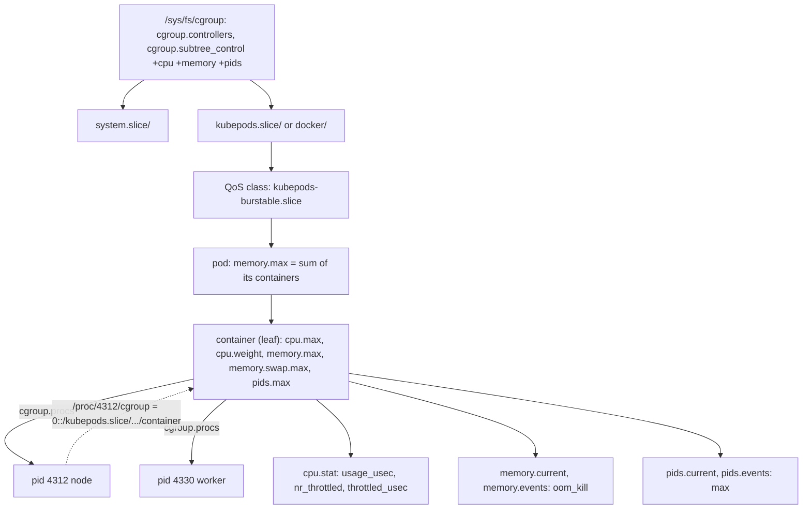

# Limits Are Files: cgroup v2 by Hand

*A CPU limit is two numbers in cpu.max and an OOM kill is a counter in memory.events; read the files before you guess.*

## Metadata

| Field | Value |
|---|---|
| Type | Build |
| Languages | Python, Bash |
| Prerequisites | [PID 1 & Signals](https://cloudcaptain.io/learn/linux/pid1-supervisor); [Process Isolation](https://cloudcaptain.io/learn/containers/process-isolation) is useful but not required |
| Time | 75 minutes |
| Tools | docker, systemd-run, systemd-cgtop, kubectl |

<Quiz stage="pre" />

## The Problem

The checkout API's p99 latency triples every evening. The dashboard says the pod uses 40% of its CPU limit, so the on-call adds replicas; latency does not move. On another node a worker restarts every few hours with exit code 137. The team doubles its memory request, and it keeps dying with 137, because the request is not the limit. A third ticket: a log-shipping sidecar logs `cannot fork: Resource temporarily unavailable` and the pod goes `NotReady`, although the node has memory and PIDs to spare.

All three answers were already written down by the kernel. The pod's `cpu.stat` said it was throttled in 70% of its scheduling periods: a 40% average made of bursts that hit the quota and waited. The worker's `memory.events` said `oom_kill 3` against a `memory.max` nobody had changed. The sidecar's `pids.events` counted every failed `fork()` against a `pids.max` of 64 set on the pod. Each of those limits is a number in a file under `/sys/fs/cgroup`, each has a counter sitting next to it, and `docker run --memory`, `MemoryMax=` and `resources.limits.memory` are three ways of writing the same file.

You are going to write `cgtool`: it creates groups with CPU, memory and PID limits by writing those files, runs a process inside one, reads the counters back into a verdict, walks the tree to find the busiest groups, and explains the whole chain of limits above any PID. After that, `docker stats`, `systemd-cgtop`, `kubectl top` and an `OOMKilled` pod are views on the same few files, and you will know which one to open.

## The Concept

A cgroup is a directory. Create it with `mkdir` and the kernel fills it with files of three kinds: knobs you write (`cpu.max`, `memory.max`, `pids.max`), gauges you read (`cpu.stat`, `memory.current`, `pids.current`), and event counters that record every time a limit bit (`memory.events`, `pids.events`, the throttling fields of `cpu.stat`). `cgroup.procs` lists the processes in the group, and writing a PID into it moves that process. `/proc/PID/cgroup` is the reverse lookup: one line, `0::/path`, saying where a process lives. The Process Isolation lesson wrote `memory.max` for one child; this lesson is about the whole tree.

Three rules make the tree behave:

- **Controllers are enabled downwards.** A group's `cgroup.controllers` lists what is available to it; its `cgroup.subtree_control` lists what its children get. A child only has a `cpu.max` if its parent wrote `+cpu` into `cgroup.subtree_control`. "No such file" where you expected `cpu.max` means the parent did not hand the controller down.
- **No internal processes.** Below the root, a group either holds processes or hands controllers to its children, never both; `EBUSY` is the kernel telling you that you tried. Runtimes therefore always put a container in a fresh leaf.
- **Limits compose downwards.** A child can never use more than any ancestor allows, so the effective limit for a process is the tightest `cpu.max`, `memory.max` or `pids.max` on its chain. Kubernetes stacks three levels (`kubepods`, the QoS class, the pod) above each container for exactly this reason.

Each controller fails in its own way. `cpu.max` holds `QUOTA PERIOD` in microseconds: `50000 100000` means 50 ms of CPU time per 100 ms period, half a CPU. A group that spends its quota before the period ends is throttled until the next one, and `cpu.stat` counts `nr_throttled` and `throttled_usec`. That is how a 40% average hides a bottleneck: the bursts hit the ceiling and wait while the mean looks fine. `cpu.weight` is the other CPU knob and only matters under contention; it divides a busy CPU, it never caps an idle one. `memory.max` is a ceiling: the kernel reclaims first, then kills a process in the group with `SIGKILL` (exit 137) and increments `oom_kill` in `memory.events`. `memory.high` slows a group with reclaim before any kill, and `memory.swap.max` decides whether a group may page out past `memory.max` instead of dying. `pids.max` makes `fork()` and `clone()` fail with `EAGAIN`, and `pids.events` counts each refusal under `max`.



cgroup v1 is legacy. It had one tree per controller (`/sys/fs/cgroup/memory/...`) with different file names (`memory.limit_in_bytes`, `cpu.cfs_quota_us`); v2 is a single tree with one set of files, and it is what current distributions, systemd and container runtimes use. Kubernetes moved its v1 support into maintenance mode in 1.31. If `/sys/fs/cgroup/cgroup.controllers` exists, you are on v2 and everything below applies.

## Build It

`code/main.py` is `cgtool`. Every function takes the cgroup root (default `/sys/fs/cgroup`) and, for `explain`, the procfs root, so the tests build a fake tree in a temporary directory and pass on macOS and in CI without root. Only `run` and the writes in `create` need Linux and root.

### Step 1: a limit is a string in a file

The whole translation layer between "half a CPU" and the kernel is one function:

```python
def cpu_max_setting(value, period=PERIOD_USEC):
    text = value.strip().lower()
    if text == "max":
        return f"max {period}"
    cpus = float(text)
    if cpus <= 0:
        raise ValueError(f"cpu limit must be above 0, got {value}")
    return f"{int(round(cpus * period))} {period}"
```

`0.5` becomes `50000 100000`. Docker's `--cpus 0.5`, systemd's `CPUQuota=50%` and a Kubernetes limit of `500m` all end as that string. `memory_setting("200M")` gives `209715200`, `pids_setting("50")` gives `50`, and `max` is the word the kernel itself uses for "no limit". `millicores_to_cpu_max(500)` and `shares_to_weight(1024)` do the two Kubernetes conversions, so you can check what the kubelet should have written.

### Step 2: is the controller even here?

Before writing anything, `plan_create()` walks from the root down to the parent of the new group and checks `cgroup.subtree_control` at every level:

```python
for ancestor in ancestors(root, group):
    enabled = set(read_words(os.path.join(ancestor, "cgroup.subtree_control")))
    missing = [controller for controller in needed if controller not in enabled]
    if not missing:
        continue
    procs = read_words(os.path.join(ancestor, "cgroup.procs"))
    if procs and ancestor != root:
        plan.problems.append(f"cannot enable {' '.join(missing)} in {relative_name(root, ancestor)}: ...")
        continue
    plan.enables.append((os.path.join(ancestor, "cgroup.subtree_control"), " ".join(f"+{controller}" for controller in missing)))
```

A controller the kernel does not offer at all (`cgroup.controllers` at the root) is one problem; a controller the parent has not handed down is a different one with a one-line fix, `echo +cpu > .../cgroup.subtree_control`, which the plan prints. A non-root ancestor that holds processes is refused with the no-internal-processes rule spelled out, instead of letting the kernel answer `EBUSY`.

### Step 3: create is mkdir plus four writes

```python
plan.writes.append((os.path.join(group, "cpu.max"), cpu_max_setting(limits.cpu)))
plan.writes.append((os.path.join(group, "memory.max"), memory_setting(limits.memory)))
plan.writes.append((os.path.join(group, "memory.swap.max"), "0"))
plan.writes.append((os.path.join(group, "pids.max"), pids_setting(limits.pids)))
```

`--dry-run` prints the plan and touches nothing. `apply_plan()` runs it and translates the errno into words: `EACCES` means run as root or delegate the parent, `EBUSY` is the rule from Step 2, `EINVAL` means the kernel rejected the value (quotas below 1 ms, for instance), and a missing `memory.swap.max` means swap accounting is off, so `memory.max` is already a hard ceiling.

### Step 4: run means the child moves itself

```python
def default_spawn(command, before_exec):
    pid = os.fork()
    if pid == 0:
        before_exec()
        os.execvp(command[0], list(command))
    return pid

pid = spawn(command, lambda: attach(root, name, os.getpid()))
_, status = waitpid(pid, 0)
```

The child writes its own PID into `cgroup.procs` between `fork` and `exec`. Memory charges do not follow a process when it moves, so anything the program allocated before a parent-side move would stay charged to the old group; moving while the child is still the small interpreter stub closes that window. `run` also reads `memory.events` before and after, and when `oom_kill` moved it says so next to the exit code, so a 137 is labelled as the kernel's decision rather than "the app crashed". Exit codes are `128 + signal` for signals, as with any supervisor.

### Step 5: stat reads the gauges and writes the verdict

`read_group()` loads about fifteen files into a `GroupStats`; `verdicts()` turns the counters into sentences:

```python
periods = stats.cpu_stat.get("nr_periods", 0)
throttled = stats.cpu_stat.get("nr_throttled", 0)
if throttled > 0 and periods > 0:
    waited = stats.cpu_stat.get("throttled_usec", 0) / 1e6
    lines.append(f"CPU: throttled in {throttled * 100 / periods:.0f}% of {periods} periods, {waited:.2f}s spent waiting for quota (cpu.max {stats.cpu_max}); ...")
```

`oom_kill` in `memory.events` becomes "an exit code 137 in this group was the kernel"; `max` without a kill becomes "reclaim kept the group alive"; `high` becomes "slowed by reclaim before any kill"; a non-zero `memory.swap.max` becomes "the group can page out past memory.max"; `max` in `pids.events` becomes "fork() failed N times with EAGAIN". `--json` returns the raw numbers with the same verdict list, and `--watch SECONDS` samples twice and prints CPU%, throttled periods, memory delta and new kills per interval.

### Step 6: explain a PID

```python
path, v1_lines = parse_proc_cgroup(text)
parts = [part for part in path.split("/") if part]
chain = [""] + ["/".join(parts[: index + 1]) for index in range(len(parts))]
```

For each level from the root down, `explain_pid()` reads `cpu.max`, `cpu.weight`, `memory.max`, `memory.high`, `memory.swap.max` and `pids.max`, then `effective_limits()` picks the tightest value per resource and names the level that set it. Legacy v1 lines in `/proc/PID/cgroup` produce a note, and a path that is not visible under your root produces another: inside a container `/proc/self/cgroup` says `0::/` because the container has its own cgroup namespace, and the real path is only visible from the host.

### Step 7: top walks the tree

`walk_groups()` descends from the root collecting every directory that has a `cgroup.procs`, `sample_tree()` reads them all, and `top_rows()` compares two samples to get CPU% and throttled% per group. `top --sort memory` needs one sample; `--sort cpu --interval 1` takes two.

### Step 8: run it

On a Linux box or the lab VM, as root:

```bash
sudo python3 code/main.py create demo/cpu --cpu 0.2 --dry-run        # the plan: mkdir, +cpu where missing, write '20000 100000'
sudo python3 code/main.py create demo/cpu --cpu 0.2
cat /sys/fs/cgroup/demo/cpu/cpu.max                                  # 20000 100000
sudo python3 code/main.py run demo/cpu -- python3 -c 'import time
end = time.time() + 2
while time.time() < end: pass'
python3 code/main.py stat demo/cpu                                   # usage ~0.4s, throttled in ~100% of 20 periods, 1.6s waiting
```

The loop ran for two seconds of wall clock and got 0.4 seconds of CPU: 20 periods, 20 ms each. Now the other two controllers:

```bash
sudo python3 code/main.py create demo/mem --memory 30M
sudo python3 code/main.py run demo/mem -- python3 -c 'x = b"x" * (100 << 20)'; echo "exit $?"   # 137, "OOM-killed 1 process(es)"
python3 code/main.py stat demo/mem                                   # memory.events oom_kill=1 and the verdict
sudo python3 code/main.py create demo/pids --pids 5
sudo python3 code/main.py run demo/pids -- sh -c 'for i in 1 2 3 4 5 6 7 8; do sleep 2 & done; wait'   # "can't fork" after four children
python3 code/main.py stat demo/pids                                  # pids.events max=N: fork() failed N times with EAGAIN
```

And the read-only commands, which need no root:

```bash
python3 code/main.py explain $$                                      # your shell's chain, level by level, with the effective limits
python3 code/main.py top --interval 1 --sort cpu --limit 10
python3 code/main.py stat demo/cpu --watch 1 --count 3
sudo python3 code/main.py delete demo                                # kills stragglers through cgroup.kill, rmdir deepest first
```

`code/main.sh` is the same tool with `mkdir`, `echo`, `cat` and `awk`, so you can see that there is nothing else underneath.

<RunTests />

## Use It

`systemd-run` writes the same four files into a transient unit's group and shows you where it put them:

```bash
sudo systemd-run --unit cc-demo -p CPUQuota=50% -p MemoryMax=200M -p TasksMax=50 sleep 300
systemctl show cc-demo -p ControlGroup -p MainPID -p CPUQuotaPerSecUSec -p MemoryMax -p TasksMax
cat /sys/fs/cgroup/system.slice/cc-demo.service/cpu.max             # 50000 100000: the string you wrote in Build It
python3 code/main.py explain "$(systemctl show -p MainPID --value cc-demo)"
systemd-cgtop -n 1 -b | head                                         # cgtool top for the whole machine, by systemd
systemd-cgls /system.slice/cc-demo.service                           # the tree view with processes
sudo systemctl set-property cc-demo MemoryMax=300M                   # rewrites memory.max on the running group
sudo systemctl stop cc-demo
```

Docker does the same from the container side. Inside, `/sys/fs/cgroup` is already the container's own group, and `/proc/self/cgroup` says `0::/` because the container has a private cgroup namespace:

```bash
docker run --rm --cpus 0.5 --memory 200m --pids-limit 50 alpine:3.22 \
  sh -c 'cat /sys/fs/cgroup/cpu.max /sys/fs/cgroup/memory.max /sys/fs/cgroup/memory.swap.max /sys/fs/cgroup/pids.max /proc/self/cgroup'
# 50000 100000 / 209715200 / 209715200 / 50 / 0::/
```

`memory.swap.max` is `209715200`, not `0`: without `--memory-swap`, Docker allows swap equal to the memory limit, so on a host with swap the limit is softer than the one you built. `--memory-swap 200m` (equal to `--memory`) gives swap 0. From the host, treat the container as a PID and read the real path:

```bash
docker run -d --name box --cpus 0.5 --memory 200m alpine:3.22 sh -c 'while :; do :; done'
PID=$(docker inspect -f '{{.State.Pid}}' box)
cat /proc/$PID/cgroup                                                # 0::/system.slice/docker-<id>.scope (or /docker/<id> with the cgroupfs driver)
python3 code/main.py explain $PID                                    # cpu.max 50000 100000 at the container level, nothing tighter above
python3 code/main.py stat "$(sed 's/^0:://' /proc/$PID/cgroup)" --watch 1 --count 3    # cpu ~50%, throttled every period
docker stats --no-stream box                                         # the same cpu.stat and memory.current, formatted
docker inspect -f '{{.State.OOMKilled}} {{.State.ExitCode}}' box     # after a 137: true 137 means memory.events moved
docker rm -f box
```

Kubernetes turns `resources` into the same files through the runtime, and adds a tree above the container:

```yaml
resources:
  requests: {cpu: 250m, memory: 128Mi}
  limits:   {cpu: 500m, memory: 200Mi}
```

`requests.cpu` becomes shares, which runc converts to `cpu.weight` (250m is 256 shares, weight 10); `limits.cpu` becomes `cpu.max 50000 100000`; `limits.memory` becomes `memory.max 209715200`; `requests.memory` writes nothing by default and only steers scheduling. Recent kubelets also set `memory.oom.group` to 1, so an OOM kill takes the whole container rather than one worker. The pod-level group gets the sum of the container limits, and the QoS class decides the path:

- Guaranteed (requests equal limits): `/kubepods.slice/kubepods-pod<uid>.slice/cri-containerd-<id>.scope`
- Burstable: `/kubepods.slice/kubepods-burstable.slice/kubepods-burstable-pod<uid>.slice/...`
- BestEffort (no requests or limits): `/kubepods.slice/kubepods-besteffort.slice/...`

Those are the systemd cgroup driver's paths; the cgroupfs driver uses `/kubepods/burstable/pod<uid>/<id>`. Either way `explain` on a container PID from the node shows every level, and the kubelet's own `--pod-max-pids` lands as `pids.max` on the pod group, which is where the sidecar's `cannot fork` came from. From `kubectl`:

```bash
kubectl get pod web -o jsonpath='{.status.qosClass}{"\n"}'                    # Burstable
kubectl exec web -c app -- cat /sys/fs/cgroup/cpu.max /sys/fs/cgroup/cpu.stat /sys/fs/cgroup/memory.events   # when the image has cat
kubectl describe pod web | grep -A4 'Last State'                             # Reason: OOMKilled, Exit Code: 137
kubectl top pod web --containers                                             # metrics-server, fed by the kubelet reading cpu.stat and memory.current
```

`OOMKilled` and CPU throttling are different failures with different files: throttling never kills and shows up as latency (`container_cpu_cfs_throttled_seconds_total` in cAdvisor is `throttled_usec`); the OOM killer never slows down first and shows up as `oom_kill` and exit 137. Raising the memory limit does nothing for the first; removing the CPU limit does nothing for the second.

| What you built | Real tool | Note |
|---|---|---|
| `create --cpu 0.5` writes `cpu.max` `50000 100000` | `docker run --cpus 0.5`, `systemd-run -p CPUQuota=50%`, `resources.limits.cpu: 500m` | three spellings of one string; the period stays 100 ms |
| `create --memory 200M` writes `memory.max` and `memory.swap.max 0` | `docker run --memory 200m --memory-swap 200m`, `MemoryMax=200M MemorySwapMax=0`, `resources.limits.memory: 200Mi` | Docker without `--memory-swap` allows swap equal to the limit; Kubernetes nodes run with swap off unless enabled |
| `create --pids 50` writes `pids.max` | `docker run --pids-limit 50`, `TasksMax=50`, kubelet `podPidsLimit` | Kubernetes has a per-pod limit and no per-container field |
| `run NAME -- cmd` writes the PID into `cgroup.procs` | `docker run`, `systemd-run`, the kubelet through containerd and runc | every runtime uses a fresh leaf group |
| `stat` verdicts from `cpu.stat`, `memory.events`, `pids.events` | `docker stats`, `systemd-cgtop`, `kubectl top`, cAdvisor `container_cpu_cfs_throttled_seconds_total`, `container_oom_events_total` | the tools show gauges; the event counters say why |
| `explain PID` walks `/proc/PID/cgroup` upwards | `cat /proc/PID/cgroup`, `systemctl status PID`, `systemd-cgls` | inside a container the path is `0::/`; read from the host |
| `top --sort cpu` | `systemd-cgtop`, `docker stats`, `kubectl top pod --sort-by=cpu` | same files, different windows |
| the `+cpu` plan for `cgroup.subtree_control` | `cat /sys/fs/cgroup/cgroup.subtree_control`, `echo +cpu > ...` | a missing `cpu.max` means the parent did not delegate the controller |

<Quiz stage="check" />

## Ship It

Two artifacts in `outputs/`:

- **`skill-cgroup-pressure-triage.md`**: a runbook for "is it throttled, OOM-killed or out of PIDs?". It finds the group from a PID, container, pod or unit, reads the three event sources next to the limits, decides with a table that says what each counter rules in and out, measures with `--watch` before anything is changed, and maps the fix to the Docker flag, systemd property or Kubernetes field that writes that file, at the level of the chain where the tightest limit sits.
- **`prompt-explain-cgroup-stats.md`**: paste `cpu.stat`, `memory.events`, `pids.events` and the limit files (or `cgtool stat`, `docker stats`, `kubectl top` output) and get a fixed-structure explanation: limits, CPU, memory, PIDs, a one-sentence verdict naming the file that proves it, and at most three fixes as exact flags with the resulting file values.

<ShipIt />

## Exercises

### Easy

Add `--cpu-weight` to `create` (writes `cpu.weight`, 1 to 10000) and a `--cpu-shares` alias that converts Docker-style shares through `shares_to_weight()`. Tests first: 1024 becomes 39, 2 becomes 1, 262144 becomes 10000, anything outside 1 to 10000 is rejected. Then prove the semantics with two busy loops in sibling groups at weights 100 and 300: under contention `cpu.stat` usage splits about 1:3, and with one loop stopped the other takes the whole CPU, which no `cpu.max` would allow.

### Medium

Add `--memory-high` to `create` and read `memory.pressure` (the `some avg10` field) in `stat`, with a verdict that separates "reclaim thrash" (`high` events rising, pressure rising, no `oom_kill`) from a kill. Write the fixtures and tests before the parser. Then prove it: a group with `memory.high 40M` and `memory.max 60M`, a script that allocates 50M slowly, and `--watch` showing pressure climbing while the process survives and slows down.

### Hard

Add `freeze`, `thaw` and `kill` subcommands (`cgroup.freeze`, polling `cgroup.events` for `frozen 1`, and `cgroup.kill`). Run `python3 -m http.server` in a group, freeze it, and show that `curl --max-time 2` hangs while `cgroup.events` says `frozen 1`; thaw it and show the queued request is answered without a restart. Then find the same file behind `docker pause`: `docker inspect -f '{{.State.Paused}}'` on a paused container and `cgroup.freeze` in its group from the host.

<Quiz stage="post" />

## Key Terms

| Term | Common misconception | Precise definition |
|---|---|---|
| cgroup | "A sandbox around a container." | A directory in the cgroup v2 tree whose files set limits, expose usage and count events for the processes listed in its `cgroup.procs`. It limits use; namespaces change what a process can see. |
| Controller | "Every group has every limit." | One resource type (cpu, memory, pids, io) whose files appear in a group only when the parent lists it in `cgroup.subtree_control`. `cgroup.controllers` says what could be enabled. |
| `cpu.max` | "A percentage of the machine." | `QUOTA PERIOD` in microseconds, the CPU time allowed per period. `50000 100000` is half a CPU; a group that spends its quota early is throttled until the next period. |
| Throttling | "High CPU usage." | Time a runnable group waited for its next quota period, counted as `nr_throttled` and `throttled_usec` in `cpu.stat`. It appears as latency, often with modest average utilisation. |
| `cpu.weight` | "Another CPU limit." | A relative share (1 to 10000, default 100) that divides contended CPU and never caps an idle machine. Kubernetes requests become weights; limits become `cpu.max`. |
| `memory.max` vs `memory.high` | "Both kill the process." | `memory.max` is a hard ceiling: reclaim, then an OOM kill (exit 137, `oom_kill` in `memory.events`). `memory.high` only slows the group with reclaim and counts `high` events. |
| `memory.swap.max` | "Swap is a node setting." | A per-group swap ceiling. Non-zero lets a group page out past `memory.max` instead of being killed; Docker defaults it to the memory limit, Kubernetes nodes usually have swap off. |
| `pids.max` | "A limit on processes only." | A ceiling on tasks (processes and threads) in the subtree. `fork()` and `clone()` fail with `EAGAIN`, and `pids.events` counts each failure under `max`. |
| No-internal-processes rule | "Any group can hold processes." | Below the root a group either contains processes or distributes controllers to children; writes that would break this return `EBUSY`, so runtimes keep processes in leaves. |
| Exit code 137 | "The application crashed." | `128 + SIGKILL`. The OOM killer when `oom_kill` in `memory.events` moved; something else sending `SIGKILL` (grace period, eviction, `kill -9`) when it did not. |
| cgroup v1 | "Still the default." | The legacy design with one tree per controller and different file names (`memory.limit_in_bytes`, `cpu.cfs_quota_us`). Current distributions, systemd and Kubernetes have moved to v2. |

## Further Reading

- [Linux Fundamentals](https://cloudcaptain.io/docs/tools/linux/fundamentals): processes, `/proc` and `/sys`, the surfaces this lesson reads and writes.
- [Docker Security & Production](https://cloudcaptain.io/docs/tools/docker/security-production): `--cpus`, `--memory`, `--memory-swap` and `docker stats` as they are used in production.
- [Kubernetes Workloads & Scheduling](https://cloudcaptain.io/docs/tools/kubernetes/workloads): requests, limits and QoS classes, which you can now read as `cpu.weight`, `cpu.max` and `memory.max`.
- [Control Group v2 (kernel documentation)](https://docs.kernel.org/admin-guide/cgroup-v2.html): every file in this lesson with its exact semantics, including the no-internal-processes rule and delegation.
- [cgroups(7)](https://man7.org/linux/man-pages/man7/cgroups.7.html): the shorter overview of the tree, `/proc/PID/cgroup` and what changed from v1.
- [systemd.resource-control(5)](https://www.freedesktop.org/software/systemd/man/latest/systemd.resource-control.html): `CPUQuota=`, `CPUWeight=`, `MemoryMax=`, `TasksMax=` and the cgroup file each one writes.
- [Resource Management for Pods and Containers](https://kubernetes.io/docs/concepts/configuration/manage-resources-containers/): how requests and limits reach the kernel and what `OOMKilled` means for a pod.
- [Docker: runtime options for memory, CPU and GPUs](https://docs.docker.com/engine/containers/resource_constraints/): the flags and their cgroup mapping, including `--memory-swap`.
