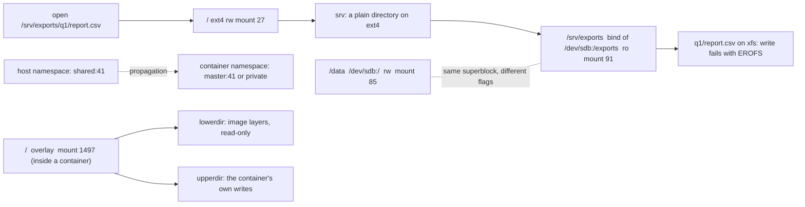

# A Path Is a Lookup Through a Mount Table

*Every path you open is resolved through a per-namespace mount table; ro, noexec, overlay layers and a full disk are all rows in it.*

## Metadata

| Field | Value |
|---|---|
| Type | Build |
| Languages | Python, Bash |
| Prerequisites | [File Descriptors](https://cloudcaptain.io/learn/linux/file-descriptors); [Image Layers](https://cloudcaptain.io/learn/containers/image-layers) is useful but not required |
| Time | 75 minutes |
| Tools | findmnt, mount, unshare, docker, kubectl |

<Quiz stage="pre" />

## The Problem

The exporter writes its nightly report to `/data` and dies with `OSError: [Errno 30] Read-only file system`. The directory on the host is `drwxrwxrwx`, the container runs as root, and `chmod -R 777` changes nothing, because nothing about permissions is wrong: the volume was mounted with `:ro`, and `ro` is a property of the mount point, not of the files. The same week a CI job downloads a binary into `/tmp` inside a container, marks it executable and gets `Permission denied` from the kernel on `execve()`. The mode bits are right there too; `/tmp` is a `--tmpfs` mount and Docker gives those `noexec` by default.

Then the database node pages at 02:00 with `No space left on device`. `df -h` says the data volume is 41% used. Someone deletes a few gigabytes of old backups and the error stays. `df -i` would have shown the real number: 100% of the inodes consumed by millions of tiny session files, with hundreds of free gigabytes that no new file can claim. Meanwhile a teammate wonders why a file edited on the host under `/var/lib/docker/overlay2` shows up in one container and not another, and why a disk mounted on the host after a pod started is invisible from inside it.

Every one of these is a lookup through the mount table that ended on a row the person did not know was there. You are going to write `mountlens`, a tool that reads `/proc/self/mountinfo`, builds the tree, tells you which mount a path resolves through and what that mount forbids, takes overlay mounts apart layer by layer, finds mounts hidden under later mounts, reports blocks and inodes, and diffs the table before and after a container or an `unshare -m`. After that, `findmnt`, `mount --bind`, `-v`, `--tmpfs`, `--read-only`, `readOnlyRootFilesystem` and `mountPropagation` are rows you can predict.

## The Concept

The kernel resolves a path one component at a time. At each directory it asks: in this process's **mount namespace**, is something mounted here? If so, the walk jumps to the root of that mounted filesystem (the topmost one, if several were stacked on the same directory) and continues there. So a path names a *mount*, and the mount, not the filesystem and not the file, carries the flags that decide `ro`, `noexec`, `nosuid` and `nodev`. The same filesystem can be mounted read-write at `/data` and, through a **bind mount**, read-only at `/srv/exports`; a `chmod` on the file changes neither.

`/proc/self/mountinfo` is that table, one row per mount, as the calling process sees it. Each row has these fields:

| Field | Example | Meaning |
|---|---|---|
| mount id, parent id | `91 27` | this row and the mount it was made on; together they form the tree |
| device | `8:16` | major:minor of the block device, or `0:N` for virtual filesystems |
| root | `/exports` | the subtree of the source filesystem this mount shows; anything but `/` means a bind mount |
| mount point | `/srv/exports` | where it appears; a space is escaped as `\040` |
| mount options | `ro,noatime` | per-mount flags: `ro`, `noexec`, `nosuid`, `nodev`, `relatime` |
| optional fields | `shared:41`, `master:64` | propagation: the peer group this mount shares events with, or the group it only receives from |
| `-` | | separator, because the number of optional fields varies |
| fstype, source | `xfs /dev/sdb` | what kind of filesystem and what backs it (`overlay overlay`, `tmpfs tmpfs`, `proc proc`) |
| superblock options | `rw,attr2,inode64` | options of the filesystem itself, shared by every mount of it; for overlayfs this is where `lowerdir`, `upperdir` and `workdir` live |

Three ideas follow from the table. **Namespaces are copies**: `unshare -m`, and every container, starts from a copy of the parent's table and then edits it; what you mount in one copy reaches another only if the two rows are in the same **peer group** (`shared:N`), or one is a **slave** (`master:N`) of the other; a `private` row tells nobody. **Stacking hides**: mounting on a directory that already is a mount point puts the new mount on top; the old one stays in the table, still consuming disk, unreachable by path until the top one is unmounted. **Overlay is a mount whose rows are directories**: an overlayfs mount names an ordered list of read-only `lowerdir`s and one writable `upperdir`; reads fall through the stack, writes land in the upper directory, and Docker's `/var/lib/docker/overlay2/ID/merged` is exactly that, with the image layers you dissected in [Image Layers](https://cloudcaptain.io/learn/containers/image-layers) as the lower directories.



Disk space is the fourth idea. `statvfs()` on any path inside a mount reports that filesystem's blocks *and* its inodes. A filesystem with free blocks and zero free inodes refuses every `creat()` with `ENOSPC`, and `df -h` will never show it; `df -i` will. ext4 fixes the inode count at `mkfs` time, XFS and tmpfs allocate inodes dynamically but still have a ceiling, so the symptom is common on root filesystems full of small files.

## Build It

`code/main.py` is `mountlens`. Reading happens in one place, `read_mounts(path)`, which defaults to `/proc/self/mountinfo` and accepts any saved copy through `--file`; `usage()` takes the `statvfs` function as an argument. Everything else is pure, so the tests run on macOS and in CI against three fixtures in `code/tests/fixtures/`: a host, the inside of a container started with `-v ...:ro --tmpfs /tmp --read-only`, and the same host after `unshare -m` plus a read-only bind.

### Step 1: one row

Fields are whitespace separated, but the number of optional fields varies, so the parser finds the `-` separator first and takes fstype, source and superblock options after it:

```python
def parse_line(line, order=0):
    fields = line.split()
    separator = fields.index("-", 6)
    mount_id, parent_id, device, root, mount_point, options = fields[:6]
    super_options = fields[separator + 3] if len(fields) > separator + 3 else ""
    return Mount(int(mount_id), int(parent_id), device, unescape(root), unescape(mount_point), options.split(","),
                 fields[6:separator], fields[separator + 1], unescape(fields[separator + 2]),
                 super_options.split(",") if super_options else [], order)
```

`unescape()` turns `\040` back into a space. `Mount.propagation` reads the optional fields: `shared:N` means shared, `master:N` means slave, nothing means private. `Mount.is_bind` is simply `root != "/"`.

### Step 2: the tree

Parent ids link the rows into a tree. A row whose parent is not in the table is a root; inside a container that is the overlay mount at `/`, whose parent lives in the host's namespace:

```python
def roots(mounts):
    ids = {m.mount_id for m in mounts}
    return [m for m in mounts if m.parent_id not in ids or m.parent_id == m.mount_id]
```

`walk()` yields `(depth, mount)` depth-first in mount order, and `render_tree()` prints the `findmnt`-style columns with a note for overlay mounts and for mounts that are shadowed.

### Step 3: which mount a path resolves through

A mount covers a path when its mount point is `/`, equals the path, or is a prefix that ends at a `/` boundary (`/data` covers `/data/x` but not `/datastore`). Among the covering mounts that are still reachable, the longest mount point wins; among equals, the later row:

```python
def covers(mount_point, path):
    return mount_point == "/" or path == mount_point or path.startswith(mount_point.rstrip("/") + "/")

def find_mount(mounts, path):
    path = normalize(path)
    candidates = [m for m in visible(mounts) if covers(m.mount_point, path)]
    if not candidates:
        raise LookupError(f"no mount covers {path}; is this mountinfo from the right namespace?")
    return max(candidates, key=lambda m: (len(m.mount_point), m.order))
```

`locate()` wraps the answer in a `Location`: the path inside the mount, the path on the *source* filesystem (for a bind of `/exports` at `/srv/exports`, the file `/srv/exports/q1/report.csv` is `/exports/q1/report.csv` on `/dev/sdb`), the four flags, the propagation and, for an overlay, its layers. The rendering adds the two sentences people need during an incident: `ro` is a per-mount flag when the superblock says `rw`, and `noexec` ignores mode bits.

### Step 4: shadowed mounts

A mount is hidden when a later row sits on the same path or on a path above it, unless that later row is one of its own ancestors in the tree. That exception matters: on most hosts the root mount is listed *after* `/sys`, `/proc` and `/dev`, which were mounted in the initramfs, and it must not count as covering them:

```python
def shadowed(mounts):
    by_id = {m.mount_id: m for m in mounts}
    hidden = []
    for mount in mounts:
        for later in mounts:
            if later.order <= mount.order or not covers(later.mount_point, mount.mount_point):
                continue
            if not is_tree_ancestor(later, mount, by_id):
                hidden.append((mount, later))
                break
    return hidden
```

`visible()` is everything else, and it is what `which`, `usage` and `diff` work on.

### Step 5: overlay layers

overlayfs keeps its directories in the superblock options. `lowerdir` is a colon-separated list, topmost layer first:

```python
def overlay_of(mount):
    if mount.fstype != "overlay":
        return None
    lower = mount.super_option("lowerdir")
    layers = [unescape(layer) for layer in lower.split(":") if layer] if lower else []
    return Overlay(mount.mount_point, layers, mount.super_option("upperdir"), mount.super_option("workdir"), mount.read_only)
```

An overlay without `upperdir` is read-only by construction. One with `upperdir` but an `ro` mount flag is what `docker run --read-only` produces: the writable layer exists, the mount refuses to use it.

### Step 6: blocks and inodes

```python
stat = statvfs(mount.mount_point)
unit = stat.f_frsize or stat.f_bsize
entry.size = stat.f_blocks * unit
entry.used = (stat.f_blocks - stat.f_bfree) * unit
entry.avail = stat.f_bavail * unit
entry.inodes = stat.f_files
entry.inodes_used = stat.f_files - stat.f_ffree
```

`usage()` skips pseudo filesystems and repeated devices unless `--all`, so a container's three `/etc/*` binds of the host disk do not print three times. `usage_warnings()` fires at 90% of either resource and says in words which one it is.

### Step 7: diff two tables

`diff()` keys the visible mounts of both snapshots by mount point and reports added and removed rows and changed `source`, `fstype`, `options` and `propagation`. Changes that hit many rows at once, such as `shared -> private` on every mount after `unshare -m`, collapse into one line with a count.

### Step 8: run it

On Linux the default file is your own table:

```bash
python3 code/main.py tree
python3 code/main.py which /proc/self/status         # mount /proc, fstype proc, noexec: yes
python3 code/main.py which "$PWD"                     # the filesystem your checkout lives on
python3 code/main.py usage                            # blocks and inodes per filesystem, warnings at 90%
python3 code/main.py overlay                          # empty unless a container is running
bash code/main.sh which /proc/self/status             # the same answer from findmnt -T
```

Anywhere, including macOS, against the fixtures:

```bash
F=code/tests/fixtures
python3 code/main.py tree --file $F/container.mountinfo                     # overlay root, masked /proc paths, the ro volume at /data
python3 code/main.py which /data/report.csv --file $F/container.mountinfo   # ro, bind of /exports on /dev/sdb, superblock rw
python3 code/main.py which /tmp/tool --file $F/container.mountinfo          # tmpfs, noexec: yes
python3 code/main.py overlay --file $F/container.mountinfo --json           # 3 lower layers, upperdir, mounted ro
python3 code/main.py shadowed --file $F/host.mountinfo                      # a tmpfs at /mnt/scratch hidden under a later bind
python3 code/main.py diff $F/host.mountinfo $F/host-unshare.mountinfo       # + /mnt/jail ro; propagation shared -> private on 28 mounts
python3 code/main.py diff $F/host.mountinfo $F/container.mountinfo          # everything a container runtime adds, removes and changes
```

<RunTests />

## Use It

`findmnt` is `tree` and `which` with more columns; `mount`, `umount`, `unshare` and `nsenter` edit the tables; `df` is `usage`. Reproduce the problems from the top as root on a Linux box (a VM or `docker run --privileged` is fine):

```bash
findmnt -o TARGET,SOURCE,FSTYPE,OPTIONS,PROPAGATION      # the tree; -J for JSON, --real to hide pseudo filesystems
findmnt -T /var/log/syslog                                # the mount a path resolves through (your `which`)
findmnt -o TARGET,PROPAGATION /                           # shared on a systemd host; --make-private and --make-rshared change it
mkdir -p /data/exports /srv/exports && mount --bind /data/exports /srv/exports
mount -o remount,bind,ro /srv/exports                    # the ro flag lives on this mount point only
touch /srv/exports/x                                      # Read-only file system; touch /data/exports/x still works
umount /srv/exports
```

Now a table of your own, and watch propagation decide what the host sees:

```bash
cat /proc/self/mountinfo > /tmp/before
unshare -m --propagation private bash                     # a copy of the table; new mounts stay in this shell
mount -t tmpfs -o size=1m,nr_inodes=64 tmpfs /mnt         # 64 inodes: 'No space left on device' after 63 files, with 1 MB free
i=0; while touch /mnt/f$i 2>/dev/null; do i=$((i+1)); done; echo "$i files"; df -h /mnt; df -i /mnt
cat /proc/self/mountinfo > /tmp/after; exit
python3 code/main.py diff /tmp/before /tmp/after         # + /mnt tmpfs; propagation shared -> private on every row
findmnt /mnt                                              # nothing: the mount died with the namespace
nsenter -t "$(docker inspect -f '{{.State.Pid}}' CONTAINER)" -m cat /proc/self/mountinfo   # a container's table, from the host
```

Docker's storage shapes are kinds of rows:

```bash
docker run --rm -v /data/exports:/data:ro --tmpfs /tmp --read-only alpine:3.22 cat /proc/self/mountinfo > /tmp/ctr
python3 code/main.py tree --file /tmp/ctr                # overlay / ro; /data bind ro; /tmp tmpfs noexec; /etc/hosts bind rw
python3 code/main.py overlay --file /tmp/ctr             # lowerdir count = image layers + 1 (Docker's init layer); upperdir = the container's writes
docker run --rm --tmpfs /tmp alpine:3.22 sh -c 'cp /bin/busybox /tmp/b && /tmp/b echo hi'       # Permission denied: noexec
docker run --rm --tmpfs /tmp:exec alpine:3.22 sh -c 'cp /bin/busybox /tmp/b && /tmp/b echo hi'  # hi
docker volume create app-data
docker run --rm -v app-data:/var/lib/app alpine:3.22 cat /proc/self/mountinfo | grep ' /var/lib/app '   # a bind of /var/lib/docker/volumes/app-data/_data
docker inspect -f '{{json .Mounts}}' CONTAINER | python3 -m json.tool          # Type bind|volume, Source, Destination, RW, Propagation
docker run --rm -v /mnt:/mnt:rslave alpine:3.22 grep ' /mnt ' /proc/self/mountinfo   # master:N appears: later host mounts under /mnt will show up
ls /var/lib/docker/overlay2/                              # one directory per layer and per container, plus l/ with the short names used in lowerdir=
```

Kubernetes writes the same rows from a pod spec. `emptyDir` is a directory on the node (or a tmpfs with `medium: Memory`) bind-mounted into every container of the pod; `hostPath` is a bind of a node path; a `persistentVolumeClaim` is whatever the CSI driver mounted on the node, bind-mounted into the container; `subPath` binds a subdirectory, which is why its `root` field is not `/`; `securityContext.readOnlyRootFilesystem: true` is the `ro` flag on the overlay root; `volumeMounts[].mountPropagation: HostToContainer` is `rslave` and `Bidirectional` is `rshared` (privileged containers only). The default is `None`, which is `rprivate`: a disk mounted on the node after the pod started is invisible to it.

```bash
kubectl exec POD -- cat /proc/self/mountinfo > /tmp/pod && python3 code/main.py tree --file /tmp/pod
kubectl get pod POD -o jsonpath='{.spec.containers[*].volumeMounts}' | python3 -m json.tool
kubectl exec POD -- df -i /var/lib/app                    # inodes, the number the dashboard does not show
```

| What you built | Real tool | Note |
|---|---|---|
| `tree` | `findmnt -o TARGET,SOURCE,FSTYPE,OPTIONS,PROPAGATION` | `findmnt --real` hides pseudo filesystems; `-J` gives JSON |
| `which PATH` | `findmnt -T PATH`, `stat -f PATH` | `df PATH` answers the same question with sizes |
| `overlay` | `docker inspect -f '{{json .GraphDriver.Data}}' CONTAINER` | `LowerDir`, `UpperDir`, `WorkDir`, `MergedDir` as seen from the host |
| `shadowed` | `findmnt` shows both rows; `umount` the top one to reach the bottom | `du` cannot see the hidden mount, `df` still counts it |
| `usage` | `df -h`, `df -i`, `df --output=itotal,iused,ipcent PATH` | ENOSPC with free blocks is inodes; also check deleted-but-open files (File Descriptors lesson) |
| `diff` | `nsenter -t PID -m cat /proc/self/mountinfo` against the host's | `findmnt -N PID` reads another process's table directly |
| `ro` per mount | `mount -o remount,bind,ro`, `-v src:dst:ro`, `readOnlyRootFilesystem` | the superblock stays `rw`; `chmod` is irrelevant |
| `noexec` | `--tmpfs /tmp` default, `/tmp:exec` to allow, `mount -o noexec` | `execve()` returns `EACCES` whatever the mode bits say |
| `shared:N` / `master:N` | `mount --make-rshared`, `--make-private`, `-v x:y:rslave`, `mountPropagation` | volumes default to `rprivate`: later host mounts stay invisible |

<Quiz stage="check" />

## Ship It

Two artifacts in `outputs/`:

- **`skill-disk-and-mount-triage.md`**: a runbook for `No space left on device`, `Read-only file system`, `Permission denied` on an executable, `df` versus `du` gaps and "the host sees it, the container does not". It finds the mount a path resolves through, reads its flags, checks blocks and inodes separately, looks for stacked and deleted-but-open space, reads propagation, and maps each finding to the Docker flag or Kubernetes field that set it.
- **`prompt-explain-mountinfo.md`**: paste `/proc/self/mountinfo` or `findmnt` output from a host, a container or a pod and get the table explained: what the root is and how many overlay layers it has, every bind mount with its source path and flags, what is read-only or noexec and why, how mounts propagate, what is masked or shadowed, and the answer to the question you asked about it.

<ShipIt />

## Exercises

### Easy

Add `--real` to `tree` (hide pseudo filesystems the way `findmnt --real` does) and `--fstype overlay,tmpfs` as a filter. Tests first, on the container fixture: `--real` leaves the overlay root, `/tmp`, `/data` and the three `/etc` binds; `--fstype tmpfs` leaves `/dev`, `/dev/shm`, `/tmp`, `/sys/firmware` and the three masked `/proc` files.

### Medium

Add `check POLICY.json`: a map of paths to required flags, such as `/` needing `ro`, `/tmp` needing `nosuid` and `nodev`, `/data` needing `ro`, that resolves each path with `locate()` and exits 1 listing every missing flag and the mount that lacks it. Write the tests on the container fixture (passes) and the host fixture (fails on `/`), then run it inside `docker run --read-only --tmpfs /tmp -v ...:ro` and inside a pod with `readOnlyRootFilesystem: true`.

### Hard

Take two tables, the host's and a container's via `nsenter -t PID -m`, and match their peer groups: for every host row with `shared:N`, find the container rows with `master:N` or `shared:N` and print which host paths a new mount would propagate into, and which would not. Prove it: start one container with `-v /mnt:/mnt:rslave` and one with the default, `mount -t tmpfs tmpfs /mnt/probe` on the host, and show with `mountlens diff` on each container's table that only the `rslave` one received the row.

<Quiz stage="post" />

## Key Terms

| Term | Common misconception | Precise definition |
|---|---|---|
| Mount point | "A directory where a disk is." | A row in a namespace's mount table: a source filesystem subtree (`root`) attached at a path with its own flags and propagation. Several rows can sit on one path; the latest wins the lookup. |
| Mount namespace | "Containers have their own disks." | A private copy of the mount table. `unshare -m` and every container runtime create one from the parent's table and edit it; the files are the same, the rows differ. |
| Bind mount | "A symlink made by root." | A mount whose `root` is a subtree of an already mounted filesystem, shown at a second path with possibly different flags. `-v /host:/ctr`, `hostPath`, `subPath` and `emptyDir` are all bind mounts. |
| Per-mount flags | "`ro` means the filesystem is read-only." | `ro`, `noexec`, `nosuid`, `nodev` live on the mount point (mount options), not on the superblock (superblock options). The same filesystem can be `rw` at one path and `ro` at another; `chmod` cannot override them. |
| Propagation | "A mount on the host shows up everywhere." | `shared:N` rows tell their peer group about new mounts beneath them, `master:N` rows only listen, `private` rows do neither. Runtimes default volumes to `rprivate`; `rslave` or `HostToContainer` is the opt-in. |
| overlayfs | "The container has a copy of the image." | A filesystem assembled from read-only `lowerdir` directories and one writable `upperdir`, with a `workdir` for atomic renames. Reads fall through the stack; writes and deletions land in the upper directory. |
| Shadowed mount | "`umount` is the only way space goes missing." | A mount hidden by a later mount on the same or a covering path. Its data is still allocated and still counted by `df`, but no path reaches it until the covering mount is removed. |
| Inode exhaustion | "No space left means the disk is full." | `ENOSPC` when the filesystem has no free inodes although blocks remain. `df -h` cannot show it; `df -i` or `statvfs().f_ffree` can. Common with millions of small files. |

## Further Reading

- [Linux System Administration](https://cloudcaptain.io/docs/tools/linux/administration): disk management, `mount`, `df` and `fstab`, the daily commands this lesson explains from underneath.
- [Docker Networking & Storage](https://cloudcaptain.io/docs/tools/docker/networking-storage): volumes, bind mounts, tmpfs and storage drivers as Docker documents them, now readable as rows in the table.
- [Kubernetes Storage](https://cloudcaptain.io/docs/tools/kubernetes/storage): volume types, PVCs and StorageClasses, the layer that produces the rows a pod sees.
- [proc_pid_mountinfo(5)](https://man7.org/linux/man-pages/man5/proc_pid_mountinfo.5.html): the fields of a mountinfo row, one by one, as the kernel documents them.
- [mount_namespaces(7)](https://man7.org/linux/man-pages/man7/mount_namespaces.7.html): shared subtrees, peer groups and the propagation rules behind `shared:` and `master:`.
- [Overlay Filesystem (kernel docs)](https://docs.kernel.org/filesystems/overlayfs.html): `lowerdir`, `upperdir`, `workdir`, whiteouts and the rules for multiple lower layers.
- [findmnt(8)](https://man7.org/linux/man-pages/man8/findmnt.8.html): `-T`, `-N`, `--real`, `-J` and the PROPAGATION column.
- [Kubernetes volumes: mount propagation](https://kubernetes.io/docs/concepts/storage/volumes/#mount-propagation): `None`, `HostToContainer` and `Bidirectional` mapped to `rprivate`, `rslave` and `rshared`.
