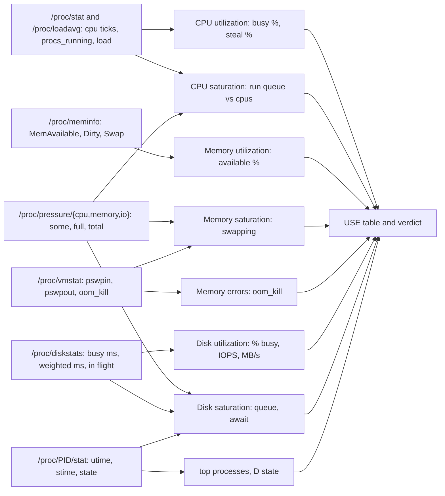

# USE Before You Guess: CPU, Memory, Disk and PSI From /proc

*Busy is not saturated: the run queue, the stall time and the memory you can still use are already in /proc; read them before you scale.*

## Metadata

| Field | Value |
|---|---|
| Type | Build |
| Languages | Python, Bash |
| Prerequisites | [File Descriptors](https://cloudcaptain.io/learn/linux/file-descriptors) |
| Time | 90 minutes |
| Tools | vmstat, mpstat, iostat, pidstat, top, docker, kubectl |

<Quiz stage="pre" />

## The Problem

Every evening the checkout API's p99 triples. The node dashboard shows CPU at 95%, so the on-call adds two replicas on the same node pool; the graph gets busier and latency does not move. On another team a ticket says "only 400 MB free on a 16 GB host" and a cron job now restarts the services every night to "free memory", which costs a minute of errors and changes nothing, because the 12 GB in question was page cache the kernel would have handed back on demand. A third team buys bigger instances for a nightly batch that got slow; the disk under it was 99% busy with nine requests queued the whole time, and two of its processes spent the night in `D` state waiting for it. A fourth sees 25% `st` in `top` and starts profiling the application, although the time is being taken by the hypervisor and no change to the code can bring it back.

All four read one number, utilization, and guessed. Utilization says how busy a resource was; it does not say whether anybody waited for it. A CPU at 95% with a run queue shorter than the CPU count is simply well used. A CPU at 60% average that hits 100% in bursts, with twelve runnable tasks on four cores, is saturated and the average hides it. Brendan Gregg's USE method turns this into a checklist: for every resource, check **U**tilization, **S**aturation and **E**rrors, in that order, before you form a theory. The kernel already publishes all three for CPU, memory and disks as plain text files under `/proc`: cumulative tick counters in `/proc/stat`, the run queue in `/proc/loadavg`, `MemAvailable` in `/proc/meminfo`, swap and OOM counters in `/proc/vmstat`, per-device busy and queue time in `/proc/diskstats`, per-process CPU time and state in `/proc/PID/stat`, and since kernel 4.20 the pressure stall information in `/proc/pressure/`, which measures saturation directly as the share of wall time tasks spent waiting.

You are going to write `usetop`: it samples those files twice, turns the differences into utilization, saturation and errors per resource, prints a USE table with the top processes and the ones stuck in `D` state, and ends with a verdict such as "CPU saturated: run queue 14 on 4 cpus, PSI cpu some 38%". After that, `top`, `vmstat`, `mpstat`, `iostat`, `free`, `docker stats` and `kubectl top` are views on files you have parsed yourself, and the 60-second checklist is something you can run and read with a purpose.

## The Concept

Think of each resource as a checkout counter. Utilization is the share of time the cashier was serving someone. Saturation is the length of the line and how long people stood in it. Errors are the transactions that failed. A cashier busy 100% of the time with nobody in line is fine; a cashier busy 60% with twelve people waiting has a problem that the average hides, because customers arrive in bursts. Utilization alone cannot tell those two apart, which is why the USE method asks three questions per resource and asks them for every resource before anyone proposes a fix.

Linux writes the answers as counters, and counters need two reads. `/proc/stat` has one `cpu` line per CPU plus an aggregate, each with ticks (`USER_HZ`, 100 per second) spent in `user nice system idle iowait irq softirq steal`. A single read is the total since boot; the difference between two reads, divided by the total difference, is utilization for that window. `iowait` is idle time while a disk request was outstanding, so it is a hint about disks, not CPU work. `steal` is time this virtual CPU was runnable but the hypervisor ran somebody else. For saturation the kernel gives you the instantaneous run queue (`procs_running` in `/proc/stat`, the `R/T` field of `/proc/loadavg`), the load averages (exponentially decayed counts of runnable tasks, which on Linux also include tasks in uninterruptible sleep, so a high load with idle CPUs points at disks), and `/proc/pressure/cpu`.

Pressure stall information (PSI) is saturation measured as time. `some` is the share of wall time in which at least one task was stalled waiting for the resource; `full` is the share in which every non-idle task was stalled. Each line has `avg10`, `avg60` and `avg300` running averages and a cumulative `total` in microseconds, so the delta of `total` between your two samples is the exact stall share for your own window. The same three files exist inside every cgroup (`cpu.pressure`, `memory.pressure`, `io.pressure`), which is how the [cgroups lesson](https://cloudcaptain.io/learn/linux/cgroups-by-hand) finds a throttled container while this lesson looks at the whole host.

Memory utilization is `MemAvailable`, the kernel's estimate of what a new workload could take without swapping; it counts free pages plus the page cache and slab it could reclaim. `MemFree` is only the part nobody has touched yet, and a healthy server keeps it small on purpose. Memory saturation is the kernel actively making room: `pswpin`/`pswpout` in `/proc/vmstat`, major page faults, `memory.pressure`. The error is `oom_kill` in the same file, and an OOM kill with plenty of `MemAvailable` means a cgroup limit ran out, not the host. Disks keep eleven counters per device in `/proc/diskstats`: completed reads and writes, sectors, milliseconds spent waiting per direction, requests in flight, milliseconds the device was busy and the weighted milliseconds of all queued requests. Busy time over elapsed time is utilization; weighted time over elapsed time is the average queue length; waiting time over completed requests is the average latency, what `iostat` calls `await`. Processes in `D` state are the human face of that queue.



The verdict is a set of thresholds over that table: a run queue longer than the CPU count or PSI cpu `some` at 10% or more is CPU saturation; 80% busy without a queue is "busy, not saturated"; steal at 5% or more is a hypervisor problem; `MemAvailable` below 10%, any swapping or PSI memory `full` at 5% or more is memory saturation; a disk 80% busy or PSI io `full` at 5% or more is disk saturation. The numbers are starting points you will tune, but the order of questions is the method.

## Build It

`code/main.py` is `usetop`. Reading happens in one function, `sample()`, which takes the procfs root as an argument; everything after it is pure and works on two `Sample` objects. `--replay DIR` feeds it recorded snapshots instead of the live `/proc`, so the tool and all tests run on macOS: `code/fixtures/idle` and `code/fixtures/saturated` are two complete `/proc` trees of the same 4-CPU, 16 GB host, each with a `t0` and a `t1` taken ten seconds apart.

### Step 1: one sample is eight files read once

`/proc/uptime` gives the timestamp so the elapsed time between snapshots comes from the kernel's own clock, in a replay as well as live:

```python
def sample(root="/proc", now=time.monotonic):
    stat_text = read_text(os.path.join(root, "stat"))
    if not stat_text:
        raise FileNotFoundError(f"{os.path.join(root, 'stat')} is missing or unreadable")
    cpus, counters = parse_stat(stat_text)
    load, _, _ = parse_loadavg(read_text(os.path.join(root, "loadavg")) or "0 0 0 0/0 0")
    pressure = {}
    for resource in RESOURCES:
        text = read_text(os.path.join(root, "pressure", resource))
        if text:
            pressure[resource] = parse_pressure(text)
    uptime = read_text(os.path.join(root, "uptime")).split()
    taken_at = float(uptime[0]) if uptime else now()
```

`meminfo`, `vmstat`, `diskstats` and every numeric `PID/stat` follow. A kernel without PSI simply has no `pressure` directory, and the report says so instead of failing.

### Step 2: ticks into percentages

Each `cpu` line is eight counters that only grow. Utilization is everything that is not idle and not waiting for I/O:

```python
def cpu_usage(before, after):
    total = after.total - before.total
    if total <= 0:
        return CpuUsage(0.0, 0.0, 0.0, 0.0, 0.0, 100.0, 0.0)

    def delta(*names):
        return sum(getattr(after, n) - getattr(before, n) for n in names)

    def share(*names):
        return round(delta(*names) / total * 100, 2)

    busy = round((total - delta("idle", "iowait")) / total * 100, 2)
    return CpuUsage(busy, share("user", "nice"), share("system"), share("iowait"), share("steal"), share("idle"), share("irq", "softirq"))
```

`total` deliberately leaves out `guest` and `guest_nice`, because the kernel already counts them inside `user` and `nice`. The same function runs per CPU, so one hot core shows up even when the average looks calm.

### Step 3: saturation is a queue, a load and a stall share

```python
def pressure_view(resource, before, after, elapsed):
    now_lines = after.pressure.get(resource)
    if not now_lines:
        return None
    then_lines = before.pressure.get(resource, {})

    def window(kind):
        stalled_us = now_lines.get(kind, {}).get("total", 0.0) - then_lines.get(kind, {}).get("total", 0.0)
        return round(max(stalled_us, 0.0) / (elapsed * 1_000_000) * 100, 2)

    return PressureView(resource, now_lines.get("some", {}).get("avg10", 0.0), now_lines.get("full", {}).get("avg10", 0.0), window("some"), window("full"))
```

The report shows both the kernel's `avg10` and the exact share for your window. The run queue comes from `procs_running` in `/proc/stat` and the load triple from `/proc/loadavg`; `ncpus()` counts the `cpuN` lines so "12 on 4 cpus" is computed, not assumed.

### Step 4: memory is available, swapping and OOM kills

```python
    total = info.get("MemTotal", 0)
    available = info.get("MemAvailable", info.get("MemFree", 0))
    swap_total = info.get("SwapTotal", 0)

    def rate(key):
        return (after.vmstat.get(key, 0) - before.vmstat.get(key, 0)) / elapsed
```

`memory_view()` turns `pswpin`/`pswpout` into kB/s (pages times the page size), `pgmajfault` into faults per second, and reports both the delta and the running total of `oom_kill`, because one kill during your window and three since boot are different stories.

### Step 5: disks are busy time, queue time and wait time

```python
def disk_usage(device, before, after, elapsed):
    reads = after.reads - before.reads
    writes = after.writes - before.writes
    waited_ms = (after.ms_reading - before.ms_reading) + (after.ms_writing - before.ms_writing)
    elapsed_ms = elapsed * 1000
    return DiskUsage(
        device,
        round(reads / elapsed, 1),
        round(writes / elapsed, 1),
        round((after.sectors_read - before.sectors_read) * SECTOR_BYTES / 1024 / elapsed, 1),
        round((after.sectors_written - before.sectors_written) * SECTOR_BYTES / 1024 / elapsed, 1),
        round(min(100.0, (after.ms_busy - before.ms_busy) / elapsed_ms * 100), 2),
        round((after.ms_weighted - before.ms_weighted) / elapsed_ms, 2),
        round(waited_ms / (reads + writes), 2) if reads + writes else 0.0,
        after.in_flight,
    )
```

Sectors in `/proc/diskstats` are always 512 bytes regardless of the device. `whole_disks()` drops partitions (`sda1`, `nvme0n1p2`), loop and ram devices, so the table shows real devices; `is_partition()` has to tell `dm-10` from `dm-1` and `sdaa` from `sda`, and the tests check that it does.

### Step 6: processes, and the ones that are stuck

`comm` may contain spaces and parentheses (`(tmux: server)`), so the line is split at the last `)` rather than on whitespace:

```python
def parse_pid_stat(text):
    head, sep, rest = text.rpartition(")")
    if not sep:
        raise ValueError("stat: missing (comm) field")
    pid_text, _, comm = head.partition("(")
    fields = rest.split()
    if len(fields) < 22:
        raise ValueError("stat: too few fields after comm")
    return ProcTimes(int(pid_text), comm, fields[0], int(fields[11]), int(fields[12]), int(fields[17]), int(fields[21]))
```

After the comm, field 0 is the state, fields 11 and 12 are `utime` and `stime` in ticks, 17 is the thread count and 21 the resident pages. `process_usage()` divides the tick delta by `hz` and the window to get a percentage, skips processes that did not exist in the first sample, and `blocked_processes()` collects the ones in `D`.

### Step 7: the table and the verdict

The verdict is a list of sentences, each naming the resource, the evidence and the numbers; nothing is said that a cell in the table does not back:

```python
    if report.run_queue > report.ncpu or (cpu_psi is not None and cpu_psi >= THRESHOLDS["psi_some_pct"]):
        text = f"CPU saturated: run queue {report.run_queue} on {report.ncpu} cpus"
        if cpu_psi is not None:
            text += f", PSI cpu some {cpu_psi:.0f}%"
        found.append(text)
    elif cpu.busy >= THRESHOLDS["cpu_busy_pct"]:
        found.append(f"CPU busy, not saturated: {cpu.busy:.0f}% utilization, run queue {report.run_queue} on {report.ncpu} cpus")
    if cpu.steal >= THRESHOLDS["steal_pct"]:
        found.append(f"CPU steal {cpu.steal:.0f}%: the hypervisor is not scheduling this VM when it is runnable; nothing inside the VM fixes that")
```

Memory and disk follow the same shape, `D`-state processes get their own sentence, and if nothing fired the verdict says "No saturation" with the three utilizations, so a quiet host is a positive result rather than silence.

### Step 8: run it

```bash
python3 code/main.py --replay code/fixtures/saturated     # the recorded host; works on macOS
python3 code/main.py --replay code/fixtures/idle
python3 code/main.py --interval 2 --count 3                # live, Linux: three 2-second windows
python3 code/main.py --json | python3 -m json.tool | head -40
python3 -c 'while True: pass' & python3 -c 'while True: pass' & sleep 1
python3 code/main.py --interval 2                          # utilization up, python3 at the top, run queue up by two
kill %1 %2
bash code/main.sh 1                                        # the same numbers by hand: cat, awk, ps, vmstat
```

The saturated replay prints (abridged):

```text
usetop: 10.0s window, 4 cpus, load 12.37 8.44 3.60, 18500 context switches/s
Resource       Utilization                                    Saturation                                                     Errors
CPU            98% (us 86 sy 9 wa 2 st 2)                     run queue 14 on 4 cpus, load 12.37; PSI some 38.2%             none in /proc; check dmesg, mcelog
Memory         96% used, 4% available of 15935 MB             swap in 2000 out 2400 kB/s, major faults 450/s; PSI full 12.1% oom_kill +1 (total 3)
Disk nvme0n1   99% busy (1850 r/s 620 w/s, 193.0 MB/s)        queue 9.3, await 3.8 ms, 31 in flight; PSI io full 8.7%; 2 in D state none in /proc; check dmesg, smartctl
top by CPU:
    31840 python3          R   99.0%      10.0 MB    1 thr
    31841 python3          R   97.8%      10.0 MB    1 thr
VERDICT: CPU saturated: run queue 14 on 4 cpus, PSI cpu some 38% | Memory saturated: 4% available, PSI memory full 12%, swap in/out 2000/2400 kB/s, 1 OOM kill(s) | Disk saturated: nvme0n1 99% busy, queue 9.3, await 3.8 ms, PSI io full 9% | 2 process(es) in D state waiting on I/O: postgres (2250), dd (31850)
```

<RunTests />

## Use It

The standard tools read the same files. Brendan Gregg's [60-second Linux performance checklist](https://www.brendangregg.com/Articles/Netflix_Linux_Perf_Analysis_60s.pdf), written with the Netflix performance team, is ten commands in a fixed order; run them on the box you just measured and map each column to a cell of your table:

```bash
uptime                               # load 1/5/15 against nproc: is the queue growing or shrinking
dmesg -T | tail                      # Errors: OOM killer, I/O errors, MCE, NIC resets
vmstat 1 5                           # r (run queue) b (blocked) | swpd free buff cache | si so (swap) | bi bo | us sy id wa st
mpstat -P ALL 1 3                    # per CPU: a single core at 100% hides in a 25% average
pidstat 1 5                          # per process %usr %system; pidstat -d 1 for I/O per process
iostat -xz 1 3                       # r/s w/s rkB/s wkB/s r_await w_await aqu-sz %util: your DiskUsage, column for column
free -m                              # read the "available" column, not "free"
sar -n DEV 1 3                       # network throughput per interface (not in usetop: Exercise Easy)
sar -n TCP,ETCP 1 3                  # connections/s and retransmits
top -bn1 | head -15                  # %Cpu(s): us sy ni id wa hi si st; load average; Tasks: N running
cat /proc/pressure/cpu /proc/pressure/memory /proc/pressure/io     # PSI, the newest line of the checklist
```

Read `top`'s header the way `usetop` does: `us`/`sy` are the user and system shares of the window since the last refresh, `ni` is niced user time, `id` idle, `wa` iowait (idle with a disk request pending), `hi`/`si` hardware and software interrupts, `st` steal. `load average` is `/proc/loadavg`; `Tasks: 14 running` is `procs_running`. The `%CPU` column per process is `utime + stime` ticks over the refresh window, so it can exceed 100 for a multithreaded process; `S` in the `S` column is sleeping, `R` runnable, `D` uninterruptible, `Z` zombie. `htop` shows the same with per-core bars and, in recent versions, PSI meters under Setup. Once the CPU row says "saturated" and the top list names the process, `perf top -p PID` tells you which functions; that is the step after USE, not instead of it.

Containers and clusters add a layer. `docker stats` is cgroup data (`cpu.stat` and `memory.current` of the container's group) compared against the host's `/proc/stat`, so it shows the container's share of the host, and a container hitting its `--cpus` cap shows throttling in `cpu.stat`, not a run queue in `/proc/loadavg`. Steal is invisible from inside a container and only visible from inside the VM, in `/proc/stat` field 8, because it comes from the hypervisor. In Kubernetes, `kubectl top node` and `kubectl top pod --containers` come from metrics-server, which reads the kubelet's cAdvisor numbers from the same cgroup files; `kubectl describe node` shows allocatable against requests, which is scheduling arithmetic and says nothing about saturation. Recent kubelets can expose PSI per node, pod and container behind a feature gate, and the pressure files exist in every pod cgroup today. Requests set `cpu.weight`, limits set `cpu.max` and `memory.max`, and a pod that is slow with the node at 30% is usually throttled against its own limit; the [cgroups lesson](https://cloudcaptain.io/learn/linux/cgroups-by-hand) reads those files.

```bash
docker run -d --name capped --cpus 0.5 python:3.12-alpine python3 -c 'while True: pass'
docker stats --no-stream capped                                   # ~50%: cgroup usage over host capacity
python3 code/main.py --interval 2                                 # the same python3 at ~50% in the host's top list
cat /sys/fs/cgroup/system.slice/docker-$(docker inspect -f '{{.Id}}' capped).scope/cpu.stat   # nr_throttled rises; path varies by cgroup driver
docker rm -f capped
kubectl top node; kubectl top pod -A --sort-by=cpu --containers    # metrics-server views of cpu.stat / memory.current
kubectl debug node/NODE -it --image=busybox -- cat /host/proc/pressure/cpu /host/proc/loadavg   # the node's own files
```

| What you built | Real tool | Note |
|---|---|---|
| `cpu_usage()` from two `/proc/stat` reads | `vmstat 1` (`us sy id wa st`), `top` `%Cpu(s)`, `mpstat -P ALL 1` | all subtract two reads; the first row of `vmstat` and `iostat` is the since-boot average, skip it |
| run queue, load, PSI cpu | `uptime`, `vmstat` column `r`, `sar -q`, `cat /proc/pressure/cpu` | Linux load counts `D`-state tasks too; `r` and PSI do not |
| `memory_view()`: `MemAvailable`, swap rate, `oom_kill` | `free -m` (available), `vmstat` `si so`, `sar -B`, `dmesg \| grep -i oom` | `MemFree` is not a shortage; `oom_kill` with memory available means a cgroup limit |
| `disk_usage()`: busy %, queue, await | `iostat -xz 1` (`%util`, `aqu-sz`, `r_await w_await`) | `%util` saturates at 100 on devices that take many requests in parallel; trust `aqu-sz` and `await` on NVMe and RAID |
| `top_processes()`, `blocked_processes()` | `top`, `pidstat 1`, `ps -eo pid,stat,comm \| awk '$2 ~ /^D/'` | `pidstat -d` adds per-process I/O; `D` state names who waits for the disk |
| `--replay` on recorded snapshots | `sar -f /var/log/sysstat/saNN` | sysstat records every ten minutes; the only way to see last night |
| the verdict | you, with the USE table in hand | the tools print numbers; the method decides which one matters |

<Quiz stage="check" />

## Ship It

Two artifacts in `outputs/`:

- **`skill-60-second-perf-triage.md`**: a runbook that runs Brendan Gregg's 60-second checklist in order, writes each column into a USE table for CPU, memory, disk and network, decides with a table of symptom patterns (busy but not saturated, saturated, steal, swapping, disk queue, cgroup throttling) which resource is the bottleneck and which tool to open next, covers containers and Kubernetes, lists the traps (`MemFree`, averages hiding a hot core, load including `D` state, `%util` on parallel devices) and ends with a report format.
- **`prompt-explain-top-output.md`**: paste `top`, `htop`, `vmstat`, `iostat` or `usetop` output and get a fixed-structure explanation: the window, a USE table with one row per resource, a one-sentence verdict that names the cell that proves it, the top consumers, and the single command that would confirm or refute it.

<ShipIt />

## Exercises

### Easy

Add network as a fourth resource. `/proc/net/dev` has cumulative bytes, packets, errors and drops per interface in both directions; write a fixture for the idle and the saturated host first, then a `parse_net_dev()` and a `NetUsage` row with MB/s and packets/s as utilization, drops as saturation and errors as errors, and extend `whole_disks()`-style filtering to skip `lo` and `veth*`. The tests for the parser and the row come before the code; the verdict gains "Network: eth0 drops 120/s".

### Medium

Make `usetop` container-aware. Given `--cgroup PATH` (root injectable, default `/sys/fs/cgroup`), read that group's `cpu.pressure`, `memory.pressure`, `io.pressure`, `cpu.stat` (`nr_throttled`, `throttled_usec`) and `memory.events` beside the host numbers, and add a verdict that separates "the host is saturated" from "this container is throttled against its own limit while the host is idle". Fixtures for both cases first. Then prove it on Linux with `docker run --cpus 0.5` and a busy loop: the host row says "No saturation", the container row says throttled, and `docker stats` agrees.

### Hard

Turn `usetop` into an exporter. Add `--listen 9101` that serves `/metrics` from `http.server` in Prometheus text format, naming the series like node_exporter does where one exists (`node_pressure_cpu_waiting_seconds_total`, `node_memory_MemAvailable_bytes`, `node_disk_io_time_seconds_total`) so existing dashboards work. Write the test for the text format with a fake sample. Then run Prometheus in Docker scraping it, write an alerting rule on `rate(node_pressure_cpu_waiting_seconds_total[2m]) > 0.2` and show it firing while two busy loops run and resolving when they stop.

<Quiz stage="post" />

## Key Terms

| Term | Common misconception | Precise definition |
|---|---|---|
| Utilization | "High utilization is the bottleneck." | The share of a window in which the resource was busy. On its own it says nothing about waiting; a CPU at 100% with an empty run queue is fully used, not saturated. |
| Saturation | "Another word for high load." | Work queued for a resource that cannot take it: runnable tasks beyond the CPU count, requests queued at a disk, the kernel reclaiming memory. PSI measures it directly as stall time. |
| Load average | "Average CPU utilization." | Exponentially decayed counts over 1, 5 and 15 minutes of tasks that are runnable or in uninterruptible sleep. Compare it with the CPU count, and remember that `D`-state tasks raise it without using a CPU. |
| `iowait` | "The CPU was busy doing I/O." | Idle time during which at least one outstanding disk request existed. It is a hint that something waited for a disk, counted on the CPU side; the disk's own queue and `await` are the measurement. |
| Steal | "A rounding error in `top`." | Time a virtual CPU had a runnable task and the hypervisor ran another guest instead. Field 8 of the `cpu` line in `/proc/stat`, `st` in `top` and `vmstat`; it is fixed outside the VM. |
| `MemAvailable` | "Free memory." | The kernel's estimate of memory a new workload could use without swapping: free pages plus reclaimable page cache and slab. `MemFree` excludes the cache and is small on any healthy server. |
| PSI (pressure stall information) | "A percentage of resource usage." | The share of wall time in which tasks stalled waiting for a resource: `some` for at least one task, `full` for all non-idle tasks, with `avg10`/`avg60`/`avg300` and a cumulative `total` in microseconds, per host and per cgroup. |
| `D` state | "A hung or zombie process." | Uninterruptible sleep, almost always a task blocked inside the kernel on I/O. It cannot be killed until the request completes, it counts toward the load average, and several of them name the saturated disk. |
| `await` and queue (`aqu-sz`) | "`%util` is enough for disks." | Average time a request waited and was served, and the average number of requests queued, both from `/proc/diskstats`. `%util` says the device was busy; queue and `await` say by how much the work exceeded it. |

## Further Reading

- [Linux Fundamentals](https://cloudcaptain.io/docs/tools/linux/fundamentals): processes, `/proc` and the shell tools this lesson leans on.
- [Linux System Administration](https://cloudcaptain.io/docs/tools/linux/administration): systemd, sysstat and the monitoring habits of a production host.
- [Kubernetes Production Operations](https://cloudcaptain.io/docs/tools/kubernetes/production-operations): `kubectl top`, metrics-server, requests and limits in daily operations.
- [Docker Security & Production](https://cloudcaptain.io/docs/tools/docker/security-production): `--cpus`, `--memory` and `docker stats` as they are used in production.
- [Limits Are Files: cgroup v2 by Hand](https://cloudcaptain.io/learn/linux/cgroups-by-hand): the per-group side of this lesson: `cpu.stat` throttling, `memory.events` and the cgroup pressure files.
- [The USE Method](https://www.brendangregg.com/usemethod.html): Brendan Gregg's original description, with the checklist of resources for Linux; read it once in full.
- [Linux Performance Analysis in 60,000 Milliseconds](https://netflixtechblog.com/linux-performance-analysis-in-60-000-milliseconds-accc10403c55): the ten commands and what to look for in each, by Gregg and the Netflix performance team; [Gregg's Linux performance page](https://www.brendangregg.com/linuxperf.html) collects the rest.
- [PSI: Pressure Stall Information](https://docs.kernel.org/accounting/psi.html): the kernel documentation for `/proc/pressure/*`, `some` versus `full`, and the trigger interface.
- [I/O statistics fields](https://docs.kernel.org/admin-guide/iostats.html): the exact meaning of every `/proc/diskstats` column, including the caveat on busy time.
- [proc(5)](https://man7.org/linux/man-pages/man5/proc.5.html): `/proc/stat`, `/proc/meminfo`, `/proc/loadavg` and `/proc/PID/stat`, field by field.
