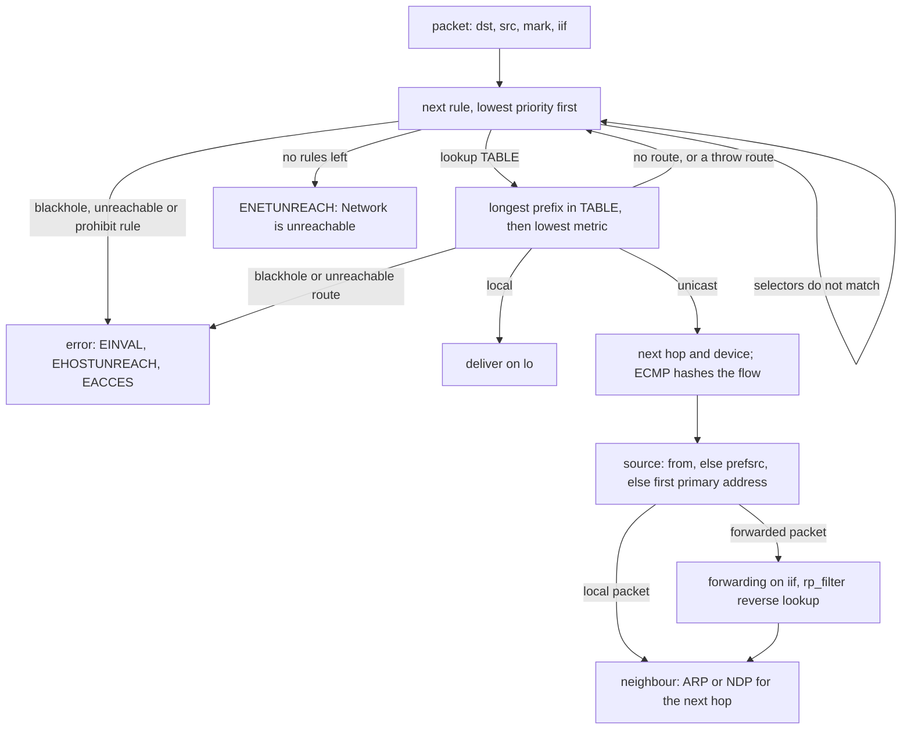

# A Route Is a Longest-Prefix Match Plus a Rule Table

*The kernel routes in two steps: policy rules pick a table, the table picks the longest matching prefix. Read both, guess neither.*

## Metadata

| Field | Value |
|---|---|
| Type | Build |
| Languages | Python, Bash |
| Prerequisites | [The Lab: One Command That Proves Your Machine Is Ready](https://cloudcaptain.io/learn/setup/lab-doctor) |
| Time | 75 minutes |
| Tools | ip, ping, tracepath, traceroute, sysctl, curl |

<Quiz stage="pre" />

## The Problem

The backup host sits behind a Linux router with two uplinks. To keep nightly backups off the main link, someone gives the host a second address, 10.0.1.20, and adds two lines to the router: a rule `from 10.0.1.20 lookup 100` and a table 100 with one route, a default via the second uplink. The offsite copy runs faster than ever. The next morning the backup job's health check fails: it cannot reach the monitoring server at 10.0.2.10, which sits on a network plugged straight into the router. `ping 10.0.2.10` from the router works. `ip route` on the router shows `10.0.2.0/24 dev eth1 proto kernel scope link`, so "the route is there". Someone adds a host route for 10.0.2.10 to the main table. Nothing changes. Someone else suspects the firewall and spends an hour on `nft list ruleset`.

The route was never consulted. Linux does not have one routing table, it has several, and an ordered list of rules decides which ones a packet sees. Rule 100 matches every packet from 10.0.1.20 and sends it to table 100 before the main table (rule 32766) is ever read. Table 100 holds a default route, a default route matches every destination, so packets for the directly connected 10.0.2.10 leave through the second uplink and vanish. The ping from the router worked because the router's own packets have a different source. One command would have shown it in a line: `ip route get 10.0.2.10 from 10.0.1.20 iif eth0` prints `table 100` and the wrong device.

Every routing question has an exact answer of that kind: which rule matched, which table it opened, which prefix in that table was the longest match, which metric broke the tie, which source address the kernel picked, and whether the next hop answers ARP. You are going to build `routelens`, which computes that answer from scratch: CIDR arithmetic for IPv4 and IPv6, parsers for `ip -j addr`, `ip -j route show table all`, `ip -j rule` and `ip -j neigh`, and an `ip route get` that prints every rule it looked at and why it moved on. Then you build a four-namespace lab by hand and check `routelens` against the kernel, destination by destination.

## The Concept

An IPv4 address is a 32-bit number and a prefix such as 10.0.1.0/24 is that number with a length: the first 24 bits name the network, the remaining 8 name a host in it. An address is inside the prefix when its first 24 bits are equal to the prefix's, which is one AND with a mask and one comparison. Two prefixes therefore either nest (10.0.0.0/16 contains 10.0.1.0/24) or do not touch at all; a partial overlap is impossible. IPv6 is the same with 128 bits.

Routing is a two-level lookup. Think of a mail room with several address books. A short list of sorting instructions, read top to bottom, says which book to open: "letters from the backup department, use book 100", "everything else, use the main book". Inside the book the most specific entry wins: a street address beats a city, a city beats "anywhere" (the default route). If the book has no entry at all, the clerk goes back to the instructions and tries the next one. When every instruction has been tried, the letter is returned as undeliverable.

In Linux the instructions are **policy rules** (`ip rule`), sorted by priority. Three exist on every host: priority 0 looks in table `local` (the host's own and broadcast addresses), 32766 in `main` (what `ip route` shows), 32767 in `default` (usually empty). A rule matches on selectors: `from` (source prefix), `to` (destination prefix), `fwmark` (a mark set by the firewall or by a socket), `iif` (the interface the packet arrived on, which is `lo` for packets the host generates itself) and `oif`. Its action is to look up a table, or to answer directly with `blackhole`, `unreachable` or `prohibit`. A packet the host sends without a bound source address has source 0.0.0.0 during the lookup, so `from` rules never match it; that is why `ip route get` needs `from` to show what a source rule does.

Inside a table the lookup is a **longest-prefix match**: of all prefixes containing the destination, the longest wins; among routes for the same prefix, the lowest **metric** wins. The winning route has a type. `unicast` gives a next hop (a gateway, or none when the destination is on the link) and a device; `local` means "deliver to this host"; `blackhole`, `unreachable` and `prohibit` fail the lookup with EINVAL, EHOSTUNREACH and EACCES; `throw` and an empty result send the kernel back to the next rule. When no rule produces a route the answer is ENETUNREACH, "Network is unreachable". A route with several next hops is **ECMP**: the kernel hashes each flow's addresses onto one of them, so one flow sticks to one path and different flows spread out.

Two more decisions follow. The **source address** comes from the route's `src` (prefsrc) if it has one; otherwise from the first primary address on the outgoing device that shares a subnet with the gateway, then any primary address on it, then any global address on the host. Secondary addresses are never picked. A packet that arrives from outside takes the **input path**: the same rules see the real source and `iif`, the input interface must have forwarding on, and **rp_filter** looks the source up in reverse; strict mode (1) drops the packet unless the route back to its source leaves through the interface it arrived on, loose mode (2) only requires that some route back exists. Finally the next hop must answer ARP (IPv4) or NDP (IPv6); a `FAILED` neighbour entry means the route is right and nothing is there.



## Build It

`code/main.py` is `routelens`. Everything after reading the input is pure functions over dataclasses: the CIDR commands take text, and `get` reads a snapshot directory written by `ip -j` (or the live kernel on Linux with `--netns`). `code/fixtures/` holds snapshots of the lab's client and router namespaces, so every step below runs on any machine. `code/main.sh` builds the same lab by hand with `ip` commands.

### Step 1: an address is an integer

IPv4 text is four decimal octets. Leading zeros are refused, because `inet_aton` and therefore `ping 010.0.0.1` read them as octal:

```python
def parse_ipv4(text: str) -> int:
    parts = text.split(".")
    if len(parts) != 4:
        raise InputError(f"not an IPv4 address: {text!r} (four decimal octets, e.g. 10.0.1.10)")
    value = 0
    for part in parts:
        if not OCTET.fullmatch(part) or int(part) > 255 or (len(part) > 1 and part[0] == "0"):
            raise InputError(f"not an IPv4 address: {text!r} (octet {part!r}; 0-255, no leading zeros, which inet_aton would read as octal)")
        value = value << 8 | int(part)
    return value
```

IPv6 is eight 16-bit groups. `::` stands for one run of zero groups, the last 32 bits may be written as dotted IPv4 (`64:ff9b::192.0.2.33`), and `%eth0` (a zone) is dropped. Printing follows RFC 5952, which is why `ip` and every other tool agree on one spelling: lowercase, no leading zeros, and only the longest run of two or more zero groups becomes `::` (the first one on a tie). The tests compare both directions with Python's `ipaddress` module on addresses chosen to hit every rule.

### Step 2: a prefix is a network and a mask

```python
def mask_for(version: int, length: int) -> int:
    bits = BITS[version]
    return ((1 << bits) - 1) ^ ((1 << (bits - length)) - 1)
```

```python
    def contains(self, version: int, address: int) -> bool:
        return version == self.version and address & self.mask == self.network

    def covers(self, other: "Prefix") -> bool:
        return other.version == self.version and other.length >= self.length and other.network & self.mask == self.network

    def overlaps(self, other: "Prefix") -> bool:
        return self.covers(other) or other.covers(self)
```

`overlaps()` is only `covers()` in both directions because CIDR blocks nest or are disjoint; a test checks that claim against `ipaddress` on hundreds of random pairs. The broadcast address is the last one of an IPv4 block, except for a /31 (RFC 3021: two hosts on a point-to-point link, no broadcast) and a /32; IPv6 has no broadcast at all. `parse_prefix(..., strict=True)` refuses `10.0.1.5/24`, as `ip route add` does, and says which network was meant.

### Step 3: summarise exactly, or with one route

Summarising answers two different questions. `collapse()` merges adjacent and overlapping blocks into the fewest prefixes that cover exactly the same addresses; `supernet()` finds the one prefix that covers them all, and the report says how many addresses it attracts that none of the inputs had. The exact half turns each merged range back into aligned blocks:

```python
def range_to_prefixes(version: int, first: int, last: int) -> List[Prefix]:
    bits = BITS[version]
    out: List[Prefix] = []
    while first <= last:
        length = bits
        while length > 0:
            size = 1 << (bits - length + 1)
            if first & (size - 1) or first + size - 1 > last:
                break
            length -= 1
        out.append(Prefix(version, first, length))
        first += 1 << (bits - length)
    return out
```

```bash
python3 code/main.py cidr 10.0.1.77/24 10.0.1.6/31 2001:db8::/64
python3 code/main.py summarise 10.0.0.0/24 10.0.1.0/24 10.0.3.0/24
# exact:    10.0.0.0/23, 10.0.3.0/24 (3 prefixes in, 2 out)
# one route: 10.0.0.0/22, which also attracts 256 addresses none of the inputs cover
python3 code/main.py contains 10.0.0.0/16 10.0.3.7; echo "exit $?"     # yes: 10.0.3.7 is in 10.0.0.0/16, exit 0
```

Those 256 extra addresses are 10.0.2.0/24. Advertise the /22 to a peer and traffic for 10.0.2.x arrives at a router that has nowhere to send it.

### Step 4: read the kernel's tables with `ip -j`

`ip -4 -j route show table all` prints every IPv4 route in every table as JSON, with a few habits the parser has to know: `type` is omitted for unicast routes, `table` is omitted for `main`, a host route's `dst` has no `/32`, `metric` is omitted when it is 0, `scope` is omitted for universe (gateway) routes, and a multipath route carries a `nexthops` list instead of `gateway` and `dev`:

```python
def parse_routes(text: str, version: Optional[int] = None) -> List[Route]:
    routes: List[Route] = []
    for order, item in enumerate(load_json_list(text, "ip -j route show table all")):
        family = route_version(item, version)
        hops = [NextHop(h.get("gateway"), h.get("dev"), int(h.get("weight", 1)), "dead" in (h.get("flags") or [])) for h in item.get("nexthops") or []]
        if not hops and (item.get("gateway") or item.get("dev")):
            hops = [NextHop(item.get("gateway"), item.get("dev"), 1, "dead" in (item.get("flags") or []))]
        routes.append(Route(parse_prefix(str(item.get("dst", "default")), family), normalise_table(item.get("table", "main")), str(item.get("type", "unicast")),
                            int(item.get("metric", 0)), str(item.get("scope", "global")), str(item.get("protocol", "")), item.get("prefsrc"), hops, order))
    return routes
```

`ip -j rule` has its own habits: `"src": "all"` for no source selector, `srclen` omitted for a host address, `fwmark` printed as a hex string, `"not"` present for an inverted rule, and `action` for the rules that answer by themselves. `parse_addr()` keeps each address's scope and its `secondary` flag (an address added to a subnet the interface already has an address in), `parse_neigh()` keeps the NUD state list, and `parse_sysctl()` reads `ip_forward`, `forwarding` and `rp_filter`. `routelens snapshot DIR --netns NS` writes all of it on Linux; `main.sh snapshot NS DIR` does the same with plain `ip` and `cat`.

### Step 5: rules in priority order

```python
def rule_matches(rule: Rule, flow: Flow) -> Tuple[bool, str]:
    misses: List[str] = []
    if rule.iif is not None and rule.iif != flow.iif:
        misses.append(f"iif is {flow.iif}, the rule wants {rule.iif}")
    if rule.oif is not None:
        misses.append(f"oif {rule.oif} matches only sockets bound to that device")
    if rule.fwmark is not None and (rule.fwmark ^ flow.mark) & rule.fwmask:
        misses.append(f"mark {hex(flow.mark)} is not {hex(rule.fwmark)}")
    if rule.src is not None and not rule.src.contains(flow.version, flow.src or 0):
        misses.append(f"source {flow.src_text} is not in {short(rule.src)}")
    if rule.dst is not None and not rule.dst.contains(flow.version, flow.dst):
        misses.append(f"destination {flow.dst_text} is not in {short(rule.dst)}")
```

The mark test is the kernel's: XOR the marks, AND with the mask, zero means equal under the mask. `flow.iif` is `lo` for locally generated traffic, so `ip rule add iif lo lookup 200` steers only the host's own packets. An unset source is 0.0.0.0 and fails every `from` selector. `walk()` runs the rules in order and records one trace line per rule, so the output says why each one was skipped. Selectors `routelens` does not model (`ipproto`, ports, `uidrange`) are reported and treated as no match rather than silently ignored.

### Step 6: longest prefix, then metric, and back to the rules on a miss

```python
def lookup_table(routes: List[Route], flow: Flow) -> Tuple[Optional[Route], List[Route]]:
    candidates = sorted((r for r in routes if r.prefix.contains(flow.version, flow.dst)), key=lambda r: (-r.prefix.length, r.metric, r.order))
    return next((r for r in candidates if usable(r)), None), candidates
```

A route whose next hops are all `dead` is skipped and a shorter prefix gets its chance, as in the kernel. Back in `walk()`, an empty result or a `throw` route continues with the next rule, a rule with `suppress_prefixlength 0` rejects a default route it found (the trick `wg-quick` uses to let the main table win for everything except the default), and a `blackhole`, `unreachable` or `prohibit` route ends the walk with its errno:

```python
        if route is None:
            result.trace.append(f"{label}: matched, table {rule.table} has no route for {flow.dst_text} ({len(routes)} routes in it), continue")
            continue
        if route.type == "throw":
            result.trace.append(f"{label}: matched, {route.describe()} hands the lookup back to the rules, continue")
            continue
```

When the loop runs out of rules the decision is `noroute`: ENETUNREACH, with the trace showing every table that was tried.

### Step 7: the source address

`ip route get` without `from` still prints a `src`. If the route carries one (every kernel-created connected route does, and so does `ip route add ... src`), that is the answer. Otherwise the kernel walks the outgoing device's addresses:

```python
def select_source_v4(snap: Snapshot, dev: Optional[str], gateway: Optional[str], scope: int) -> Optional[str]:
    gw = parse_ip(gateway)[1] if gateway else None
    iface = snap.interface(dev)
    fallback = None
    for address in iface.addresses if iface else []:
        if address.version != 4 or address.secondary or SCOPES.get(address.scope, 0) > scope:
            continue
        if gw is None or address.prefix.contains(4, gw):
            return address.text
        fallback = fallback or address.text
    if fallback:
        return fallback
```

Secondary addresses are skipped, addresses with a narrower scope than the route are skipped (a gateway route has scope universe, so only global addresses qualify), the first address in the gateway's subnet wins, then the first eligible one, then (in the lines after this excerpt) any global address on any interface. The local route of a secondary address carries the primary as its `src`, so `ip route get 10.0.1.20` on the client answers `src 10.0.1.10`. IPv6 uses RFC 6724; `routelens` implements its main rules (same address, matching scope, not deprecated, longest common prefix).

### Step 8: forwarded packets: forwarding and rp_filter

`--iif DEV --from SRC` takes the input path. The same rules run with the packet's real source and input interface, then two checks apply that never apply to the host's own traffic:

```python
    mode = max(snap.sysctl_value("net.ipv4.conf.all.rp_filter") or 0, snap.sysctl_value(f"net.ipv4.conf.{flow.iif}.rp_filter") or 0)
    if mode == 0:
        return None, f"rp_filter 0 on {flow.iif}: the source address is not checked"
    back = walk(snap, Flow(4, flow.src or 0, flow.dst, out_dev or "lo"))
```

Forwarding off on the input interface gives EHOSTUNREACH. The effective `rp_filter` is the larger of `conf.all` and `conf.IIF`, a detail that surprises everyone who sets the interface value to 0 and wonders why packets still drop. The reverse lookup swaps source and destination; strict mode fails with EXDEV ("Invalid cross-device link") when the way back leaves through another interface, loose mode accepts any way back, and a source that is one of the host's own addresses is a martian (EINVAL).

### Step 9: the neighbour, and the lab by hand

`check_neighbour()` looks up the next hop (the gateway, or the destination itself for an on-link route) on the outgoing device in `ip -j neigh`. `FAILED` and `INCOMPLETE` mean ARP or NDP asked and nobody answered; devices with `NOARP` (dummy, WireGuard, loopback) need no neighbour at all.

`main.sh up` builds the lab that the fixtures were taken from: a client, a router and two upstreams, each a network namespace, joined by veth pairs. The cable is one command, because `ip link add` can create both ends directly inside their namespaces:

```bash
cable() {
  local a_ns="$1" a_if="$2" b_ns="$3" b_if="$4"
  ip link add "$a_if" netns "$a_ns" type veth peer name "$b_if" netns "$b_ns"
  ip -n "$a_ns" link set "$a_if" up
  ip -n "$b_ns" link set "$b_if" up
}
```

Then addresses, and the routes this lesson is about, on the router:

```bash
  in_ns "$R" sysctl -qw net.ipv4.ip_forward=1
  ip -n "$R" route add default via 10.0.2.10 dev r-u1
  ip -n "$R" route add 203.0.113.0/24 via 10.0.3.10 dev r-u2
  ip -n "$R" route add 192.0.2.0/24 nexthop via 10.0.2.10 dev r-u1 weight 1 nexthop via 10.0.3.10 dev r-u2 weight 1
  ip -n "$R" route add blackhole 10.99.0.0/16
  ip -n "$R" route add default via 10.0.3.10 dev r-u2 table 100
  ip -n "$R" rule add from 10.0.1.20 lookup 100 priority 100
```

The client gets a second address (10.0.1.20, a secondary), a dummy device, two routes for 10.0.0.0/16 with metrics 50 and 100, a more specific 10.0.3.0/24 with `src 10.0.1.20`, a route through a gateway that does not exist (10.0.1.250), a blackhole, an unreachable route, and table 100 behind a `from` rule and a `fwmark` rule. Both upstreams own 198.51.100.1 on their loopback, so the path a packet takes decides which one answers.

### Step 10: run it

```bash
C=code/fixtures/client; R=code/fixtures/router
python3 code/main.py rules --dir $C                          # five IPv4 rules in lookup order, with table sizes
python3 code/main.py get 10.0.2.10 --dir $C                  # via 10.0.1.1 dev c0 src 10.0.1.10: /16 metric 50 beats metric 100
python3 code/main.py get 10.0.3.10 --dir $C                  # src 10.0.1.20: the more specific route carries its own src
python3 code/main.py get 10.0.3.10 --from 10.0.1.20 --dir $C # dev c-dum table 100: rule 100 runs before main
python3 code/main.py get 198.51.100.1 --mark 0x1 --dir $C    # table 100 through the fwmark rule
python3 code/main.py get 10.99.0.1 --dir $C; echo "exit $?"  # 10.99.0.1: Invalid argument (EINVAL), exit 1
python3 code/main.py get 10.0.5.1 --dir $C                   # the route is fine; neighbour 10.0.1.250 is FAILED
python3 code/main.py get 10.0.2.10 --from 10.0.1.20 --iif r-c --dir $R   # The Problem in one line: table 100, dev r-u2
python3 code/main.py get 192.0.2.7 --from 10.0.1.10 --iif r-c --dir $R   # ECMP over r-u1 and r-u2
python3 code/main.py get 198.51.100.1 --from 10.0.1.20 --dir $R --json   # exit 2: not a local address; add --iif
```

The trace for the first source-rule query reads like the explanation you would give a colleague:

```text
10.0.3.10 from 10.0.1.20 dev c-dum table 100
  why: rule 100 sent the lookup to table 100, where 10.0.3.0/24 dev c-dum table 100 scope link is the best match
  1. flow: to 10.0.3.10, locally generated (iif lo), source 10.0.1.20, mark 0x0
  2. rule 0: from all lookup local: matched, table local has no route for 10.0.3.10 (8 routes in it), continue
  3. rule 100: from 10.0.1.20 lookup 100: matched, table 100: 10.0.3.0/24 dev c-dum table 100 scope link (/24 is the longest of 2 matching prefixes: 10.0.3.0/24, default)
  neighbour: c-dum is NOARP, no link-layer address needed
```

Exit codes: 0 for a route, 1 when the kernel would refuse the lookup (the errno is in the output), 2 for input `routelens` cannot use.

<RunTests />

## Use It

Build the lab on a Linux machine or VM (the smoke test does exactly this), then ask the kernel the questions `routelens` answered. `ip -n NS` runs `ip` inside a namespace; `ip netns exec NS CMD` runs any command there.

```bash
sudo bash code/main.sh up
sudo bash code/main.sh status                          # addresses, rules and non-local routes of all four namespaces
C="sudo ip -n cc-rt-c"; R="sudo ip -n cc-rt-r"
$C -br addr                                            # c0 10.0.1.10/24 10.0.1.20/24 ...
$C addr show dev c0 | grep secondary                   # inet 10.0.1.20/24 scope global secondary c0
$C rule                                                # 0 local, 100 from 10.0.1.20, 110 fwmark 0x1, 32766 main, 32767 default
$C route                                               # the main table only
$C route show table 100                                # what rule 100 and rule 110 see
$C route show table all | grep -E '^(local|broadcast)' # the local table that rule 0 consults first
```

`ip route get` is the question "where would this packet go now", answered by the same kernel function that routes real packets:

```bash
$C route get 10.0.2.10                                 # 10.0.2.10 via 10.0.1.1 dev c0 src 10.0.1.10 uid 0
$C route get 10.0.3.10                                 # ... src 10.0.1.20: the route's own src
$C route get 10.0.3.10 from 10.0.1.20                  # 10.0.3.10 from 10.0.1.20 dev c-dum table 100 uid 0
$C route get 198.51.100.1 mark 0x1                     # table 100, chosen by fwmark
$C route get 10.0.1.20                                 # local 10.0.1.20 dev lo table local src 10.0.1.10
$C route get 10.99.0.1                                 # RTNETLINK answers: Invalid argument
$C route get 10.66.0.1                                 # RTNETLINK answers: No route to host
$C route get fibmatch 10.0.2.10                        # the matching table entry itself: 10.0.0.0/16 via 10.0.1.1 dev c0 metric 50
$R route get 10.0.2.10 from 10.0.1.20 iif r-c          # forwarded: ... via 10.0.3.10 dev r-u2 table 100 iif r-c
$R route get 192.0.2.7 from 10.0.1.10 iif r-c          # ECMP: one of the two next hops, chosen by the flow hash
$R -j route get 198.51.100.1 | python3 -m json.tool    # the same answer as JSON: dst, gateway, dev, prefsrc, table
sudo python3 code/main.py get 10.0.2.10 --from 10.0.1.20 --iif r-c --netns cc-rt-r   # routelens on the live router
```

Note what `ip route get` does not print: the rules it skipped, the shorter prefixes that lost and the metric that broke a tie. `fibmatch` shows the winning entry, and `routelens` shows the whole walk.

Now prove the paths with traffic. Both upstreams answer on 198.51.100.1 with their own name, so the reply says which path the packet took:

```bash
for u in u1 u2; do mkdir -p /tmp/$u && echo $u > /tmp/$u/who; done
sudo ip netns exec cc-rt-u1 python3 -m http.server 8080 --directory /tmp/u1 &
sudo ip netns exec cc-rt-u2 python3 -m http.server 8080 --directory /tmp/u2 &
sudo ip netns exec cc-rt-c curl -s http://198.51.100.1:8080/who                         # u1: main table, default via up1
sudo ip netns exec cc-rt-c curl -s --interface 10.0.1.20 http://198.51.100.1:8080/who   # u2: the router's rule 100
sudo ip netns exec cc-rt-c ping -c1 -W1 10.99.0.1                                      # ping: connect: Invalid argument
sudo ip netns exec cc-rt-c tracepath -n 198.51.100.1                                   # 1: 10.0.1.1, 2: 198.51.100.1 reached
sudo ip netns exec cc-rt-c traceroute -n 203.0.113.1                                   # if installed: the same hops, by UDP probes
```

`tracepath` and `traceroute` send probes with increasing TTL; every router that drops one at TTL 0 answers with ICMP time exceeded from its own address, which is how each hop introduces itself. They show the path of their own probes only: with ECMP or policy rules, a different source or port can take a different path.

Neighbours, forwarding and rp_filter:

```bash
sudo ip netns exec cc-rt-c ping -c1 -W1 10.0.5.1                     # 100% packet loss
$C neigh                                                             # 10.0.1.250 dev c0 FAILED; 10.0.1.1 ... REACHABLE
cat /proc/sys/net/ipv4/ip_forward                                    # the host's own value; each namespace has its own
sudo ip netns exec cc-rt-r sysctl net.ipv4.ip_forward net.ipv4.conf.all.rp_filter net.ipv4.conf.r-c.rp_filter
sudo ip netns exec cc-rt-r sysctl -w net.ipv4.conf.r-c.rp_filter=1
$R route get 198.51.100.1 from 10.0.2.10 iif r-c                     # RTNETLINK answers: Invalid cross-device link
sudo ip netns exec cc-rt-r sysctl -w net.ipv4.conf.all.log_martians=1   # dropped packets are logged as martian source
sudo ip netns exec cc-rt-r sysctl -w net.ipv4.conf.r-c.rp_filter=0
sudo bash code/main.sh down
```

Many distributions ship `rp_filter=2` (loose) for all interfaces through a sysctl file, and container and Kubernetes hosts often need it loose or off because traffic legitimately arrives on one interface and leaves on another. `rp_filter=1` is the safe default for a host with a single uplink.

**The same model in the cloud.** A VPC route table, which you will configure in the Cloud phase, is one table with longest-prefix match: a `local` route for the VPC's own CIDR that you cannot delete, more specific routes to a NAT gateway, a transit gateway, a peering connection or a network interface, and `0.0.0.0/0` to an internet gateway. There are no metrics to set and no `ip rule`: which table a packet sees is decided by the subnet the packet comes from (each subnet is associated with exactly one route table), which plays the role of a `from` rule. A route whose target was deleted shows the state `blackhole` and drops traffic, like `ip route add blackhole`. The source/destination check on an instance's network interface drops packets that are neither from nor to its own address, which is why a NAT or router instance needs it disabled, the cloud cousin of `ip_forward` and `rp_filter`.

| What you built | Real tool | Note |
|---|---|---|
| `parse_prefix()`, `cidr`, `contains` | `ipcalc`, Python `ipaddress`, subnet calculators | blocks nest or are disjoint; a /31 has two usable hosts |
| `collapse()`, `supernet()` | route summarisation in BGP and OSPF, VPC CIDR planning | a supernet attracts every address it covers, assigned or not |
| `parse_routes()`, `parse_rules()`, `parse_addr()`, `parse_neigh()` | `ip -j route show table all`, `ip -j rule`, `ip -j addr`, `ip -j neigh` | JSON omits default values: no `table` for main, no `type` for unicast |
| `walk()` over rules | `ip rule`, the kernel's fib rules | priority order; `from` never matches an unset source; `iif lo` is local traffic |
| `lookup_table()` | `ip route get fibmatch`, `ip route show table T` | longest prefix, then metric; dead next hops are skipped |
| errno per route type | `RTNETLINK answers: ...` from `ip route get`, `connect:` errors from `ping` | blackhole EINVAL, unreachable EHOSTUNREACH, prohibit EACCES, nothing ENETUNREACH |
| `select_source_v4()` | the `src` in `ip route get`, `ip route add ... src` | secondaries are never chosen; `prefsrc` overrides |
| ECMP next hops | `ip route add ... nexthop ... nexthop`, `fib_multipath_hash_policy` | the kernel picks one per flow; `routelens` lists all |
| `check_input()` | `ip route get ... iif`, `ip_forward`, `rp_filter`, `log_martians` | effective `rp_filter` is the larger of `all` and the interface |
| `check_neighbour()` | `ip neigh`, `arping` | `FAILED` means the route is right and the next hop is absent |
| `main.sh up` | VPC route tables and subnet associations | one table per subnet instead of rules; `blackhole` when a target disappears |

<Quiz stage="check" />

## Ship It

Two artifacts in `outputs/`:

- **`skill-routing-triage.md`**: a runbook for "host A cannot reach B" when the cause may be routing. It captures the decision with `ip route get` (with the real source, mark and input interface), walks the rules and the chosen table, checks the source address, forwarding, `rp_filter` and the neighbour entry, then follows the path hop by hop, with a decision table from each symptom to the layer and the fix, and a report format.
- **`prompt-explain-ip-route-get.md`**: paste the output of `ip route get` together with `ip rule`, `ip route show table all` and `ip addr`, and get the rule that matched, the table and prefix that won and why, where the source address came from, what would change with a different source or mark, and the one command that confirms the reading.

<ShipIt />

## Exercises

### Easy

Add `routelens split 10.0.0.0/16 --into 20`, the subnet planning step behind every VPC: list the /20 blocks of the parent in order, with their host ranges. Write the tests first: a /16 into /20 gives 16 blocks from 10.0.0.0/20 to 10.0.240.0/20, a /56 into /64 gives 256, `--into` shorter than the parent or longer than the address is refused with exit 2, and `--count 3` prints only the first three. Check the result with `ipaddress.ip_network(...).subnets(new_prefix=20)`.

### Medium

Add `--oif DEV` to `get`, as `ip route get ... oif DEV` and a socket bound with `SO_BINDTODEVICE` do. Tests first: with `oif` set, a rule with `oif DEV` matches, the table lookup ignores routes whose next hops are on other devices (so on the client `198.51.100.1 --oif c-dum` misses the default route), and when no route uses that device the kernel assumes the destination is on the link and picks a link-scope address on it. Then run `ip -n cc-rt-c route get 198.51.100.1 oif c-dum` in the lab and match its answer.

### Hard

Add `routelens diff OLD NEW --flows flows.txt`: two snapshots (before and after a change) and a file of flows (`DST [from SRC] [iif DEV] [mark N]` per line), reporting every flow whose decision changes in device, gateway, source, table or errno. This is the review you want before a routing change goes out. Test it with the router fixture and a copy without rule 100: exactly the flows from 10.0.1.20 change, and 10.0.2.10 from 10.0.1.20 moves from `r-u2 table 100` to `r-u1 main`. Add `--all-sources` that derives flows from every local address and every connected prefix, so a change can be checked without writing the flow file by hand.

<Quiz stage="post" />

## Key Terms

| Term | Common misconception | Precise definition |
|---|---|---|
| CIDR prefix | "10.0.1.5/24 is an address range starting at .5." | A network number and a length; the first `length` bits name the network and the rest a host. Two prefixes either nest or are disjoint. |
| Longest-prefix match | "The first matching route in the list wins." | Of all routes in the table whose prefix contains the destination, the one with the longest prefix wins, regardless of order; a default route (/0) wins only when nothing else matches. |
| Metric | "A lower metric beats a more specific route." | A tie-breaker between routes for the same prefix in the same table. It never competes with prefix length. |
| Policy rule | "`ip route` shows the routing table." | An entry in `ip rule`, checked in priority order, that selects a routing table (or answers directly) based on source, destination, mark and interfaces. `ip route` shows only the table `main`. |
| Routing table | "There is one per host." | A numbered set of routes; every host has at least `local` (255), `main` (254) and `default` (253), and policy routing adds more. A table with no match sends the lookup back to the rules. |
| Preferred source (prefsrc) | "The source address is the address of the outgoing interface." | The `src` of the winning route if it has one; otherwise the first primary address on the outgoing device that shares the gateway's subnet, then any eligible primary. Secondary addresses are never chosen. |
| ECMP | "Packets are spread round-robin over the next hops." | A route with several next hops; the kernel hashes each flow (addresses, optionally ports) onto one, so a flow stays on one path and the split is per flow. |
| rp_filter | "It is a firewall rule." | Reverse-path filtering: for a packet arriving on interface I, look up the route back to its source; strict (1) drops it unless that route uses I, loose (2) only requires a route. The effective value is the maximum of `conf.all` and `conf.I`. |
| Blackhole route | "It sends packets to a null interface where they are counted." | A route type that discards matching packets; the sender gets EINVAL locally, and forwarded packets are dropped silently. `unreachable` and `prohibit` answer with an ICMP error instead. |
| Neighbour entry | "If the route exists, the next hop is reachable." | The ARP (IPv4) or NDP (IPv6) mapping of a next hop to a link-layer address, with a state; `FAILED` or `INCOMPLETE` means the route was chosen but nothing answered at the next hop. |

## Further Reading

- [Linux Networking](https://cloudcaptain.io/docs/tools/linux/networking): interfaces, `ip`, routing and firewalls on a Linux host, the commands this lesson read as JSON.
- [Network Fundamentals](https://cloudcaptain.io/docs/tools/networking/fundamentals): subnetting, IPv4 and IPv6 addressing and the TCP/IP layers, for a second view of the arithmetic.
- [Routing and Switching](https://cloudcaptain.io/docs/tools/networking/routing-switching): OSPF and BGP, the protocols that fill routing tables on real routers, and where summarisation matters.
- [AWS Compute & Networking](https://cloudcaptain.io/docs/cloud/aws/compute-networking): VPCs, subnets and route tables, the cloud version of this lesson's lab.
- [ip-route(8)](https://man7.org/linux/man-pages/man8/ip-route.8.html): route types, `src`, `metric`, `nexthop`, `ip route get` and `fibmatch`.
- [ip-rule(8)](https://man7.org/linux/man-pages/man8/ip-rule.8.html): the rule selectors and actions, the three default rules and `suppress_prefixlength`.
- [ip-neighbour(8)](https://man7.org/linux/man-pages/man8/ip-neighbour.8.html): NUD states and how to read and flush the neighbour table.
- [IP Sysctl](https://docs.kernel.org/networking/ip-sysctl.html): `ip_forward`, `forwarding`, `rp_filter`, `log_martians` and `fib_multipath_hash_policy`, from the kernel documentation.
- [RFC 4632](https://www.rfc-editor.org/rfc/rfc4632): Classless Inter-Domain Routing, prefixes and aggregation.
- [RFC 5952](https://www.rfc-editor.org/rfc/rfc5952) and [RFC 6724](https://www.rfc-editor.org/rfc/rfc6724): how to write an IPv6 address, and how a host picks its IPv6 source address.
- [Amazon VPC route tables](https://docs.aws.amazon.com/vpc/latest/userguide/VPC_Route_Tables.html): longest-prefix match, the local route, subnet associations and blackhole routes.
