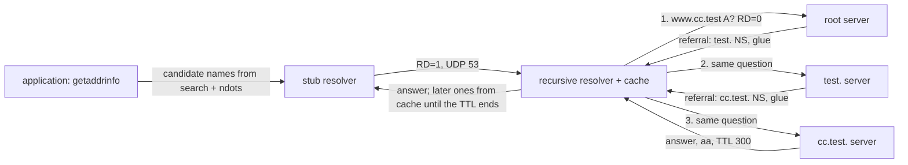

# DNS Is a Recursive Walk Over UDP

*A lookup is a walk from the root down a chain of referrals; every wrong, stale or slow answer is one step, one TTL or one search suffix.*

## Metadata

| Field | Value |
|---|---|
| Type | Build |
| Languages | Python |
| Prerequisites | [A Route Is a Longest-Prefix Match Plus a Rule Table](https://cloudcaptain.io/learn/networking/ip-routing) |
| Time | 90 minutes |
| Tools | dig, coredns, resolvectl, getent, docker, kubectl |

<Quiz stage="pre" />

## The Problem

Migration day for the payments team. At 09:57 a deploy job runs a smoke test against `ledger.payments.example.com`, a name nobody has created yet, and fails. At 10:02 someone adds the record at the DNS provider, `dig @ns1.provider.example ledger.payments.example.com` returns the new address, and the job is re-run. It fails again with "could not resolve host", and keeps failing for an hour. At the same time the old name `api.payments.example.com` is pointed at the new load balancer. Its TTL was lowered from 86400 to 60 "just before the change", at 09:30, yet half the fleet keeps sending traffic to the old address until the next morning. Someone restarts CoreDNS, which changes nothing, and then flushes the cache on one node, which fixes that node only.

The afternoon brings a third ticket: since the service moved to Kubernetes, CoreDNS CPU has doubled and lookups of `ledger.payments.example.com` take 20 to 40 milliseconds instead of one. The CoreDNS logs show `ledger.payments.example.com.payments.svc.cluster.local`, `ledger.payments.example.com.svc.cluster.local` and three more names nobody typed, each answered NXDOMAIN, each asked for twice.

None of these are DNS "being flaky". The resolver that answered the 09:57 query cached the NXDOMAIN for the zone's SOA minimum, one hour, exactly as RFC 2308 says. Resolvers that fetched the old record at 09:00 were told to keep it for 86400 seconds and did; lowering a TTL only helps once the old TTL has run out. And the pod's `/etc/resolv.conf` says `ndots:5`, so a name with fewer than five dots is tried with every search suffix before it is tried as written. You are going to build `minidig`: the wire format, a client that speaks UDP and falls back to TCP, an iterative resolver that walks from the root with a cache that counts TTLs down, and the stub resolver's search rules. Then you run it against CoreDNS servers you configure yourself and read `dig` output line by line against your own.

## The Concept

Think of finding someone's office in a city without a map. You ask at the central station; the clerk does not know the office but knows who runs each district and gives you the district office's address. The district office points you to the building, and the building's front desk knows the room. Each answer is either the thing you asked for or "ask them, here is where they are". Once you have walked it, you write down every step and how long each answer stays valid, so the next visit starts as deep as your notes allow.

DNS works the same way, with three different programs doing three different jobs:

- **The stub resolver** lives in your C library (`getaddrinfo()` in glibc or musl) or your runtime (Go, Java). It does no walking. It expands a short name with the `search` list and the `ndots` rule from `/etc/resolv.conf`, sends one question per candidate name with the Recursion Desired bit (RD) set to the `nameserver` listed there, and stops at the first answer.
- **The recursive resolver** (Unbound, BIND, Knot Resolver, the service behind 8.8.8.8) does the walk. It starts at the root servers it knows from its **root hints**, sends the full question with RD clear, and follows **referrals**: a response with no answer, the next zone's NS records in the authority section and, for name servers inside that zone, their addresses in the additional section (**glue**). It caches everything it learns for its TTL. Forwarders such as systemd-resolved and CoreDNS with the `forward` plugin sit between stub and recursive resolver: they cache, and pass every miss on to a recursive resolver.
- **The authoritative server** (CoreDNS with the `file` plugin, BIND, a cloud provider's DNS) answers only for its zones, sets the Authoritative Answer bit (AA) and never walks anything.



Every message, query or response, has the same shape: a 12-byte header (an ID, flags such as QR, AA, TC, RD and RA, a 4-bit response code, four counts), then the question, then three lists of resource records: answer, authority and additional. A record is an owner name, a type, a class, a TTL in seconds and type-specific data. Names are length-prefixed labels, and because the same suffix repeats all over a response, a name may end in a two-byte **compression pointer** to an earlier copy of that suffix.

What a response means depends on four things: the response code, whether the answer section holds the name you asked for, what the authority section holds, and the AA bit. NOERROR with your records is an **answer**. NOERROR with a CNAME and nothing else means the name is an alias, and the walk starts again for the target, possibly in another zone. NOERROR with no answer and NS records for a zone closer to your name is a **referral**. NXDOMAIN means the name does not exist at all, for any type. NOERROR with no answer and the zone's SOA record in the authority section is **NODATA**: the name exists, but has no records of that type. Both negative answers carry the SOA so the resolver can cache them: by RFC 2308, for the smaller of the SOA record's TTL and its MINIMUM field. That is the 09:57 incident.

Classic DNS over UDP was limited to 512 bytes. A server whose answer does not fit sends what fits and sets the **TC** (truncated) bit, and the client asks again over TCP, where a two-byte length prefix frames each message. **EDNS0** adds a pseudo-record (OPT) to the additional section in which the client advertises a larger UDP buffer; 1232 bytes is the common default since DNS Flag Day 2020 because it fits a 1280-byte IPv6 packet without fragmentation. TCP is not optional: RFC 7766 requires every implementation to support it, and a firewall that blocks TCP port 53 breaks exactly the large answers.

## Build It

`code/main.py` is `minidig`, with three subcommands: `query` sends one question like `dig @SERVER NAME TYPE`, `resolve` walks from root hints like a recursive resolver (`--trace` prints every step like `dig +trace`), and `search` shows the names a stub resolver really sends for a short name. Everything except the `Transport` class is pure functions over dataclasses. The tests run the transport against real UDP and TCP sockets on 127.0.0.1 and the resolver against a fake hierarchy built from `code/fixtures/lab/*.db`, the same zone files CoreDNS serves in Use It.

### Step 1: a header, a question and the bytes on the wire

The header's second 16-bit word packs every flag into fixed bit positions, high to low: QR, a 4-bit opcode, AA, TC, RD, RA, one reserved bit, AD, CD and the 4-bit RCODE:

```python
def pack_flags(m: Message) -> int:
    return (m.qr << 15) | ((m.opcode & 0xF) << 11) | (m.aa << 10) | (m.tc << 9) | (m.rd << 8) | (m.ra << 7) | (m.ad << 5) | (m.cd << 4) | (m.rcode & 0xF)
```

A query for `www.cc.test A` with RD set and no EDNS is 29 bytes, and the first test pins every one of them:

```text
12 34   01 00   00 01   00 00   00 00   00 00   03 77 77 77 02 63 63 04 74 65 73 74 00   00 01   00 01
id      flags   QD=1    AN=0    NS=0    AR=0    3 www 2 cc 4 test 0                     type A  class IN
```

`make_query()` draws the ID from `secrets.randbelow(65536)`. Together with the random source port the kernel picks for each socket, that is the only thing stopping an off-path attacker from guessing a response and planting a forged record in a cache.

### Step 2: names, labels and compression pointers

Writing, `Writer` remembers the offset of every suffix it has written and replaces a repeated suffix with a pointer: two bytes whose top two bits are `11` and whose other 14 bits are the offset from the start of the message. Matching is case-insensitive, because DNS names are:

```python
    def name(self, name: str, compress: bool = True) -> None:
        labels = name_to_labels(name)
        for i in range(len(labels)):
            suffix = tuple(label.lower() for label in labels[i:])
            if compress and self.compress and suffix in self.offsets:
                self.buf += struct.pack("!H", 0xC000 | self.offsets[suffix])
                return
            if len(self.buf) < 0x4000:
                self.offsets.setdefault(suffix, len(self.buf))
            self.buf.append(len(labels[i]))
            self.buf += labels[i]
        self.buf.append(0)
```

In a response the question name sits at offset 12, so the answer's owner name becomes `C0 0C`, and `ns1.cc.test.` becomes `03 n s 1 C0 10` because `cc.test.` started at offset 16. Reading is where the danger is: a pointer is an offset the sender chose. `read_name()` refuses a pointer that does not point backwards, and keeps a set of visited targets, because backwards-only is not enough (a label at offset 12 followed by a pointer back to 12 loops forever):

```python
        if length & 0xC0 == 0xC0:
            if pos + 1 >= len(data):
                raise WireError(f"compression pointer at offset {pos} is cut off")
            target = ((length & 0x3F) << 8) | data[pos + 1]
            if target >= pos:
                raise WireError(f"compression pointer at offset {pos} points forward to {target}; pointers must point to an earlier name")
            if target in visited:
                raise WireError(f"compression loop: offset {target} reached twice while reading the name at {offset}")
            visited.add(target)
            if end is None:
                end = pos + 2
            pos = target
            continue
```

The `end` it returns is just past the *first* pointer, which is where the next field starts. Labels are at most 63 octets (the two high bits of the length byte are taken by the pointer flag) and a whole name at most 255, which `name_to_labels()` enforces on the way in with messages that say which limit was hit.

### Step 3: records and their data

`read_rdata()` turns each type's bytes into a value, and `rdata_text()` prints it the way `dig` does, so the two can be compared field by field: `10 mail.cc.test.` for MX, `"v=spf1 -all"` for TXT (a list of length-prefixed strings of at most 255 octets each), `ns1.cc.test. hostmaster.cc.test. 2026110101 7200 3600 1209600 10` for SOA (primary server, responsible mailbox with the first dot meaning `@`, serial, refresh, retry, expire, minimum). Names inside RDATA are compressed only for the types RFC 1035 defined (`COMPRESSIBLE_RDATA` is NS, CNAME, PTR, MX and SOA); RFC 2782 forbids compressing the SRV target and RFC 3597 forbids it for every newer type, so a server that does not know a type can still copy its bytes. Reading is lenient where writing is strict: `minidig` follows a pointer inside an SRV target if a server sends one. A type `minidig` does not know is kept as bytes and printed in the RFC 3597 form `\# 4 0A000001`, which `parse_rdata()` also reads. A TTL with the top bit set is read as 0, as RFC 2181 asks.

### Step 4: EDNS0 is a record that is not a record

The OPT pseudo-record reuses the fields of a resource record for something else: the owner is the root, the CLASS field is the UDP payload size the sender can receive, and the 32-bit TTL holds 8 more bits of response code, the EDNS version and the DO bit (DNSSEC OK):

```python
def opt_record(edns: Edns, rcode: int) -> RR:
    ttl = ((rcode >> 4) << 24) | ((edns.version & 0xFF) << 16) | (0x8000 if edns.do else 0)
    return RR(".", OPT, edns.udp_size, ttl, list(edns.options))
```

`decode()` lifts it out of the additional section into `Message.edns`, rejects a second OPT (RFC 6891 makes that a FORMERR), and joins the extended bits to the header's RCODE, which is how BADVERS (16) exists in a 4-bit field. That is also why `dig` reports `ADDITIONAL: 1` for a response with an empty additional section: the count includes the OPT record. `--bufsize 0` (or `+noedns`) sends no OPT, which caps the answer at 512 bytes.

### Step 5: UDP with retries, TCP when truncated

```python
    def exchange(self, server: str, port: int, query: Message) -> Exchange:
        wire = encode(query)
        started = time.monotonic()
        if self.tcp:
            response, size = tcp_exchange(server, port, query, wire, self.timeout)
            return Exchange(response, server, port, "tcp", False, 1, size, elapsed_ms(started))
        response, attempts, size = udp_exchange(server, port, query, wire, self.timeout, self.tries)
        if response.tc and not self.ignore_tc:
            response, size = tcp_exchange(server, port, query, wire, self.timeout)
            return Exchange(response, server, port, "tcp", True, attempts, size, elapsed_ms(started))
        return Exchange(response, server, port, "udp", False, attempts, size, elapsed_ms(started))
```

`udp_exchange()` connects its UDP socket, which makes the kernel drop datagrams from any other address and report an ICMP port-unreachable as `ConnectionRefusedError` instead of a silent timeout. It sends the query, waits `timeout` seconds, and resends the same bytes up to `tries` times. While it waits it discards anything that does not decode, does not have the query's ID, or does not repeat the question: a late reply to an earlier try, or a forgery. `tcp_exchange()` writes a two-byte length and the message and reads the same framing back. The tests serve a TC reply over UDP and 40 A records over TCP from one local port and check that the client used both, kept only the TCP answer, and reports `truncated_udp`.

### Step 6: what kind of response is this?

`classify()` follows CNAMEs inside the answer section first (one response can carry `a CNAME b`, `b CNAME c` and `c A`), then decides between answer, CNAME, NXDOMAIN, error, referral and NODATA. For a referral it checks that the new zone is strictly below the zone of the server it asked and still above the name; anything else is a **lame delegation**, and the resolver tries the next server. Glue is accepted only for the referral's own NS names, and only when those names are inside the zone of the server that sent them:

```python
    delegations = [rr for rr in m.authority if rr.rtype == NS]
    if delegations and soa is None:
        child = normalize(delegations[0].name)
        if same_name(child, zone) or not is_subdomain(child, zone) or not is_subdomain(final, child):
            return Outcome("lame", NOERROR, zone=child, ns=delegations, note=f"lame delegation: a server for {zone} referred {final} to {child}, which is not below {zone}")
        ns = [rr for rr in delegations if same_name(rr.name, child)]
        glue = [
            rr
            for target in (normalize(n.data).lower() for n in ns)
            for rr in m.additional
            if rr.rtype in (A, AAAA) and rr.name.lower() == target and is_subdomain(rr.name, zone)
        ]
        return Outcome("referral", NOERROR, target=final, zone=child, ns=ns, glue=glue)
```

That last condition is the **bailiwick** rule. The server for `test.` has no business telling you the address of `ns.example.`, and before resolvers enforced it, an attacker who could make a resolver ask about their own zone could attach a forged address for anybody's name server to the reply.

### Step 7: the walk

`Resolver.walk()` starts at the deepest delegation it has cached for the name, or at the root hints, and loops: ask, and on a referral cache the NS and glue records and move one zone down:

```python
        zone, servers = self.cache.delegation(qname) or (".", self.hints)
        for _ in range(self.max_referrals):
            outcome = self.ask(zone, servers, qname, qtype, steps, depth)
            if outcome.kind == "referral":
                self.cache.put(outcome.ns + outcome.glue)
                servers = [(rr.name, rr.data) for rr in outcome.glue if rr.rtype == A] or self.lookup_ns(outcome, steps, depth)
                if not servers:
                    return Outcome("error", SERVFAIL, note=f"no address for any name server of {outcome.zone} ({', '.join(rr.data for rr in outcome.ns)}): glue missing and the names do not resolve")
                zone = outcome.zone
                continue
            if outcome.kind in ("answer", "cname"):
                self.cache.put(outcome.records)
                return outcome
            if outcome.kind in ("nxdomain", "nodata"):
                self.cache.put([rr for rr in outcome.records if rr.rtype == CNAME])
                outcome.ttl = self.cache.put_negative(outcome.target or qname, qtype, outcome.kind, outcome.soa)
            return outcome
```

A referral without glue (`ext.test. NS ns.example.` in the tests) makes `lookup_ns()` resolve the name server's own address first, a whole walk of its own that `--trace` labels `[name server lookup]`; the depth is capped so that a zone whose only name server lives inside itself and has no glue fails with a clear error instead of recursing forever. `ask()` tries each server of a zone in turn and moves on after a timeout, a SERVFAIL, a REFUSED or a lame answer. `Resolver.resolve()` wraps the walk: on a CNAME it restarts with the target, keeping the chain, and stops with SERVFAIL on a loop (`loop1 -> loop2 -> loop1`) or after eight CNAMEs in a row. Because the first walk cached the delegation for `test.`, resolving `alias.cc.test` (a CNAME to `web.test.`) costs four queries, not five: the second walk starts at the `test.` server.

### Step 8: the cache, positive and negative

`Cache.put()` groups records into RRsets by owner and type, gives each set the smallest TTL in it (RFC 2181), and stores an absolute expiry time from an injectable clock. `get()` returns copies whose TTL is the time left, which is why a cached answer's TTL counts down from one `dig` to the next. Negative answers are cached from the SOA:

```python
    def put_negative(self, name: str, qtype: int, kind: str, soa: Optional[RR]) -> Optional[int]:
        if soa is None:
            return None
        ttl = negative_ttl(soa)
        if ttl > 0:
            key = (normalize(name).lower(), 0 if kind == "nxdomain" else qtype)
            self.entries[key] = CacheEntry([], self.clock() + ttl, kind, replace(soa, ttl=ttl))
        return ttl
```

`negative_ttl()` is `min(soa.ttl, soa.data.minimum)`. NXDOMAIN is stored under type 0, so it answers every type for that name (the name does not exist); NODATA is stored under the type that was asked, because `www.cc.test` has no MX but does have an A record. A negative response without an SOA is not cached at all, as RFC 2308 recommends. `--cache-file` saves the cache as JSON with absolute expiry times, so two separate `minidig` runs share it, which the smoke uses to watch a negative entry expire against a real server.

### Step 9: the stub resolver's search list

`parse_resolv_conf()` reads the file the way glibc does: at most three `nameserver` lines, the last `search` or `domain` line wins, `ndots` is capped at 15, `timeout` at 30 and `attempts` at 5, and `LOCALDOMAIN` and `RES_OPTIONS` in the environment override the file (`--env`). Then:

```python
def plan_search(name: str, conf: ResolvConf) -> List[Candidate]:
    text = name.strip()
    if not text or text == ".":
        raise InputError("give a name to look up")
    name_to_labels(text)
    if text.endswith("."):
        return [Candidate(text, "trailing dot: an absolute name, the search list is skipped", "absolute")]
    dots = text.count(".")
    plan: List[Candidate] = []
    if dots >= conf.ndots:
        plan.append(Candidate(text + ".", f"as-is first: {dots} dot(s) >= ndots:{conf.ndots}", "as-is-first"))
    for domain in conf.search:
        fqdn = text + "." if domain == "." else f"{text}.{domain}."
        plan.append(Candidate(fqdn, f"search {domain}", "search"))
    if dots < conf.ndots and not (dots == 0 and "no-tld-query" in conf.options):
        plan.append(Candidate(text + ".", f"as-is last: {dots} dot(s) < ndots:{conf.ndots}", "as-is-last"))
```

`run_search()` sends the candidates in that order and stops at the first response with a non-empty answer section. Like glibc's `res_search()`, it moves on to the next search domain after NXDOMAIN, NODATA or SERVFAIL, but any other failure (REFUSED, no response) ends the search list early and only the as-is name is still tried. Note what is missing: `ndots` counts dots, not labels, and nothing in the rule knows that `api.example.com` "looks like" a public name.

### Step 10: run it

```bash
python3 -m unittest discover -s code/tests -v
python3 code/main.py query @1.1.1.1 example.com A                   # dig-style output, from your own encoder and decoder
python3 code/main.py query @8.8.8.8 google.com TXT +noedns +ignore  # flags: qr tc rd ra, ANSWER: 0
python3 code/main.py query @8.8.8.8 google.com TXT +noedns --json   # "transport": "tcp", "truncated_udp": true
python3 code/main.py resolve www.example.com --trace                # root, then com., then the zone's own servers
C=$(mktemp -d)/cache.json
python3 code/main.py resolve nope-$RANDOM.example.com www.github.com --cache-file "$C"; echo "exit $?"
python3 code/main.py resolve www.github.com --cache-file "$C" --trace   # two cache steps, no query sent
python3 code/main.py search api.example.com --resolv-conf code/fixtures/resolv-pod.conf
#   1  api.example.com.default.svc.cluster.local.  search default.svc.cluster.local
#   ...
#   5  api.example.com.                            as-is last: 2 dot(s) < ndots:5
# ; up to 5 queries for one lookup, 10 packets when the application asks for A and AAAA
```

The NXDOMAIN line of the cache run prints the SOA and the negative TTL (`negative-cached for 1800 s` for a zone whose SOA says so); `resolve` exits 1 when any name failed. `query` exits 0 whenever a response arrived, whatever its RCODE, and 1 when none did; bad input exits 2 with the reason.

<RunTests />

## Use It

Now the same questions against servers you configure yourself. On a Linux host or VM with Docker, start three authoritative CoreDNS servers that form a small hierarchy (a root zone delegating `test.`, a `test.` zone delegating `cc.test.`) and a fourth that plays the resolver a pod talks to: it answers `cluster.local` and `cc.internal` itself, forwards `cc.test.` and caches. All four use host networking and bind their own loopback address, since Linux routes all of 127.0.0.0/8 to `lo`:

```bash
L="$PWD/code/fixtures/lab"
for role in root test cc resolver; do
  docker run -d --name cc-dns-$role --network host -v "$L:/etc/coredns:ro" coredns/coredns:1.14.7 -conf /etc/coredns/$role.Corefile
done
cat code/fixtures/lab/resolver.Corefile        # file for cluster.local and cc.internal; forward + cache 30 for cc.test.
```

Walk it by hand, one referral at a time, the way the resolver does. `+norecurse` clears RD, so each server tells you only what it knows:

```bash
dig +norecurse @127.0.10.1 www.cc.test A     # flags: qr (no aa), ANSWER: 0, AUTHORITY test. NS ns1.test., ADDITIONAL ns1.test. A 127.0.10.2
dig +norecurse @127.0.10.2 www.cc.test A     # referral to cc.test. with glue 127.0.10.3
dig +norecurse @127.0.10.3 www.cc.test A     # flags: qr aa, the answer with TTL 300
dig -4 +trace @127.0.10.1 www.cc.test A      # dig does the walk itself: one ";; Received ... from" line per server
python3 code/main.py resolve www.cc.test --hints code/fixtures/lab/root.hints --trace     # the same three steps, the same TTLs
python3 code/main.py resolve alias.cc.test --root 127.0.10.1 --trace   # CNAME to web.test., the second walk starts at the cached test. delegation
```

The flags line is the first thing to read in any `dig` output. `qr` is a response, `aa` means an authoritative server answered (no `aa` on an answer means it came from a cache), `rd` echoes that you asked for recursion, and `ra` means the server is willing to recurse. `status:` is the RCODE. A response with `ANSWER: 0` and NS records in AUTHORITY is a referral, not a failure.

Truncation, EDNS and TCP, with 40 A records on `big.cc.test`:

```bash
dig +noedns +ignore +norecurse @127.0.10.3 big.cc.test   # flags: qr aa tc: the 512-byte limit, no retry
dig +noedns +norecurse @127.0.10.3 big.cc.test           # ";; Truncated, retrying in TCP mode." then all 40
dig +norecurse @127.0.10.3 big.cc.test                   # EDNS udp 1232: about 700 bytes fit, no TCP needed
dig +tcp +norecurse @127.0.10.3 big.cc.test              # TCP from the start
python3 code/main.py query @127.0.10.3 big.cc.test +noedns +norecurse --json   # "transport": "tcp", "truncated_udp": true
docker logs cc-dns-cc 2>&1 | grep big.cc.test            # "A IN big.cc.test. udp 29 false 512" then the same name over tcp
```

Negative caching, with two different caches reading the same NXDOMAIN:

```bash
dig +norecurse @127.0.10.3 nope.cc.test     # status: NXDOMAIN; AUTHORITY: cc.test. 3600 IN SOA ... 1209600 10
C=$(mktemp -d)/cache.json
python3 code/main.py resolve nope.cc.test --root 127.0.10.1 --cache-file "$C"    # negative-cached for 10 s: min(3600, 10)
dig @127.0.10.10 nope.cc.test               # through the CoreDNS resolver: the SOA comes back with TTL 30
dig @127.0.10.10 nope.cc.test               # from its cache: 29, 28, ...
docker logs cc-dns-cc 2>&1 | grep -c 'A IN nope.cc.test'   # 3: your dig, minidig, and the forwarder once
sleep 11
python3 code/main.py resolve nope.cc.test --root 127.0.10.1 --cache-file "$C"    # expired: minidig asks cc.test. again
dig @127.0.10.10 nope.cc.test               # still cached by CoreDNS, about 18 s left
```

That is the 09:57 incident with a 10-second minimum instead of an hour, and a lesson in reading the authority section. RFC 2308 defines the negative TTL as the smaller of the SOA record's TTL and its MINIMUM field, and asks the authoritative server to write that smaller value into the SOA's TTL in negative answers; BIND does. The CoreDNS `file` plugin sends the SOA with its own TTL (3600 here), and the CoreDNS `cache` plugin takes a negative answer's lifetime from the TTLs of the records in it, capped by its limit (`cache 30`), without reading MINIMUM. `minidig` computes `min(TTL, MINIMUM)` itself, so the same response lives 10 seconds in one cache and 30 in the other. In your own zones, keep the SOA record's TTL no higher than MINIMUM, and the answer is the same whichever cache reads it.

**What the host itself uses.** `dig` sends packets to a server and prints the reply; it never reads `/etc/hosts` or `/etc/nsswitch.conf`. Applications call `getaddrinfo()`, which follows the `hosts:` line of `nsswitch.conf` (`files dns`, or on systemd hosts something like `files resolve [!UNAVAIL=return] dns`). `getent` goes through that same path, so it is the honest test of what an application sees:

```bash
cat /etc/resolv.conf                       # on systemd-resolved hosts: nameserver 127.0.0.53, the local stub
grep '^hosts:' /etc/nsswitch.conf
getent ahosts www.example.com              # what getaddrinfo() returns: /etc/hosts first, then DNS
resolvectl status                          # the real upstream servers and search domains, per link
resolvectl query www.example.com           # resolved's own answer and which link served it
python3 code/main.py search www --resolv-conf /etc/resolv.conf       # what a short name expands to on this host
```

The stub resolver's rules, observed through glibc rather than predicted. Point a glibc container at the lab resolver with the pod-style `resolv.conf` and read the resolver's log:

```bash
docker run --rm --network host -v "$PWD/code/fixtures/resolv-pod.conf:/etc/resolv.conf:ro" debian:13-slim getent ahostsv4 www.cc.test
docker logs cc-dns-resolver 2>&1 | grep 'A IN www.cc.test' | tail -5
# A IN www.cc.test.default.svc.cluster.local.  NXDOMAIN
# A IN www.cc.test.svc.cluster.local.          NXDOMAIN
# A IN www.cc.test.cluster.local.              NXDOMAIN
# A IN www.cc.test.cc.internal.                NXDOMAIN
# A IN www.cc.test.                            NOERROR
python3 code/main.py search www.cc.test --resolv-conf code/fixtures/resolv-pod.conf --send   # the same five, stopping at the answer
```

`getent ahostsv4` asks for A records only. An application that asks for any address family (`AF_UNSPEC`, the default for most clients) makes glibc send A and AAAA in parallel for every candidate, so the five names become ten packets; `options single-request` serialises the pair. musl, the C library in Alpine images, queries every nameserver at once and in older releases never retried over TCP, which is why a large answer can work in a Debian image and fail in an Alpine one.

**CoreDNS in Kubernetes.** The cluster's DNS is CoreDNS behind the `kube-dns` Service, configured by a Corefile in a ConfigMap. The `kubernetes` plugin answers for `cluster.local` from the API (Services and their endpoints), `forward . /etc/resolv.conf` sends everything else to the node's resolvers, and `cache 30` caches both:

```bash
kubectl -n kube-system get configmap coredns -o jsonpath='{.data.Corefile}'
kubectl -n kube-system get svc kube-dns                          # the ClusterIP every pod's resolv.conf names
kubectl create namespace dns-lab
kubectl -n dns-lab run resolvconf --image=alpine:3.22 --restart=Never -- cat /etc/resolv.conf
kubectl -n dns-lab wait --for=jsonpath='{.status.phase}'=Succeeded pod/resolvconf --timeout=120s
kubectl -n dns-lab logs resolvconf > pod-resolv.conf             # search dns-lab.svc.cluster.local svc.cluster.local cluster.local ..., options ndots:5
python3 code/main.py search api.example.com --resolv-conf pod-resolv.conf
kubectl delete namespace dns-lab
```

`ndots:5` exists so that `my-svc.my-ns` (one dot) and `my-svc.my-ns.svc` (two) resolve through the search list without a fully qualified name. The price is paid by every external name with fewer than five dots: three cluster suffixes, plus whatever search domain the node inherited from its cloud network (`ec2.internal`, `c.PROJECT.internal`), plus the real name is five names, ten packets with AAAA, four of them guaranteed NXDOMAINs. The fixes, from cheapest: write external names with a trailing dot in configuration (`api.example.com.`), lower `ndots` for one workload with `spec.dnsConfig.options: [{name: ndots, value: "2"}]`, run NodeLocal DNSCache so the NXDOMAINs are answered on the node, or enable CoreDNS's `autopath` plugin, which answers the first search query with the final answer.

Real recursive resolvers do more than `minidig`: they choose among a zone's servers by measured round-trip time instead of in order, validate DNSSEC signatures, and many current ones (Unbound, BIND, Knot Resolver) use QNAME minimisation (RFC 9156), asking the root only about `test.` rather than revealing the full name to every server on the way down.

| What you built | Real tool | Note |
|---|---|---|
| `encode()`, `decode()`, `render_message()` | `dig` output: HEADER, flags, OPT PSEUDOSECTION, the three sections | `ADDITIONAL` counts the OPT record |
| `Writer.name()`, `read_name()` | every DNS implementation | pointers point backwards; a visited set still matters |
| `opt_record()`, `--bufsize` | `dig +bufsize=N`, `+noedns`, the `; EDNS: ... udp:` line | 1232 avoids IP fragmentation |
| `Transport`, TC to TCP | `dig` ";; Truncated, retrying in TCP mode", `+ignore`, `+tcp` | a firewall that blocks TCP 53 breaks only the large answers |
| `classify()` | reading `status:`, `aa` and the AUTHORITY section of `dig +norecurse` | a referral is NOERROR with ANSWER: 0 |
| `Resolver.walk()` | `dig +trace`, Unbound, BIND, the resolver behind 8.8.8.8 | real ones pick servers by RTT, validate DNSSEC, minimise QNAMEs |
| `Cache`, `--cache-file` | resolver caches, CoreDNS `cache`, `resolvectl flush-caches` | a cached answer has no `aa` and a TTL that counts down |
| `put_negative()` | RFC 2308 negative caching, CoreDNS `cache` denial entries | min(SOA TTL, MINIMUM) by the RFC; CoreDNS's cache uses the SOA's TTL as sent |
| `parse_resolv_conf()` | `/etc/resolv.conf`, `resolvectl status`, the kubelet's pod `resolv.conf` | three nameservers at most; last `search` wins |
| `plan_search()`, `run_search()` | glibc `res_search()`, `getent ahosts`, `dnsConfig` | `ndots:5` makes short external names cost five lookups |

<Quiz stage="check" />

## Ship It

Two artifacts in `outputs/`:

- **`skill-dns-triage.md`**: a runbook for "does not resolve", "resolves to the old address" and "DNS is slow". It starts from what the application sees (`getent`, `nsswitch.conf`, the search expansion), asks the configured resolver directly, walks the delegation with `+norecurse` and `+trace` to find lame or glueless delegations, separates cached from authoritative answers by the `aa` flag and the TTL, computes how long a negative or stale answer will live, checks truncation and TCP 53, and covers the Kubernetes `ndots` cost, with a symptom table and a fixed report.
- **`prompt-explain-dig-output.md`**: paste `dig`, `dig +trace` or `minidig` output and get the header decoded flag by flag, each section explained, the kind of response named (answer, referral, CNAME, NXDOMAIN, NODATA, truncated), how long the answer will be cached, and the next command to run.

<ShipIt />

## Exercises

### Easy

Add reverse lookups: `minidig query -x 127.0.20.1` builds `1.20.0.127.in-addr.arpa.` with type PTR, and `-x fd00:cc::1` builds the 32-nibble name under `ip6.arpa.`. Write the tests first (both families, an invalid address exits 2), then add a PTR record for `127.0.20.1` to a zone of your own under `in-addr.arpa.` in the lab and compare with `dig -x`.

### Medium

Replace "try the servers in order" with smoothed round-trip time, as BIND and Unbound do: keep an SRTT per server address, update it after every exchange with `srtt = 0.7 * srtt + 0.3 * sample`, add a large penalty after a timeout, decay penalties over time, and always pick the lowest. Test first with a fake transport that reports fixed delays and one server that times out: after a few lookups the slow and dead servers must stop being asked first, and must be retried once their penalty has decayed.

### Hard

Turn `minidig` into a caching recursive resolver: a `serve` subcommand that listens on UDP and TCP on 127.0.0.1, accepts queries with RD set, runs `Resolver.resolve()`, sets RA, answers with the decremented TTLs from the cache, answers NXDOMAIN and NODATA with the SOA in the authority section, and coalesces identical questions that arrive while one is in flight. Test it with real sockets, then point the lab's glibc container at it with a `resolv.conf` of your own and compare its query log with CoreDNS's for the same lookups.

<Quiz stage="post" />

## Key Terms

| Term | Common misconception | Precise definition |
|---|---|---|
| Recursive resolver | "The DNS server in resolv.conf knows every name." | The server that walks from the root on a client's behalf, following referrals, and caches what it learns. It is authoritative for nothing; its answers carry no `aa` flag. |
| Authoritative server | "Any server that answers is the source of truth." | A server that holds a zone's data, sets `aa` in its answers and never recurses. Only its answers reflect a change immediately. |
| Referral | "No answer means the lookup failed." | A NOERROR response with an empty answer section and the NS records of a zone closer to the name in the authority section, telling the resolver whom to ask next. |
| Glue | "Extra records a server adds to be helpful." | The A or AAAA records of a delegated zone's name servers, carried by the parent because those names are inside the child zone and could not otherwise be resolved. Resolvers accept it only within the sender's bailiwick. |
| TTL | "How long a change takes to propagate." | The number of seconds a resolver may cache a record from the moment it fetched it. A change reaches a resolver once that resolver's copy expires, so lowering a TTL helps only after the old TTL has passed. |
| Negative caching | "NXDOMAIN is not cached, so a new record works immediately." | Caching NXDOMAIN (for the name, every type) and NODATA (for one type) for the smaller of the SOA record's TTL and its MINIMUM field, per RFC 2308. |
| EDNS0 | "A DNS extension for DNSSEC only." | An OPT pseudo-record in the additional section that advertises the sender's UDP payload size, carries extended RCODE bits, the DO flag and options such as cookies. Without it a UDP response is limited to 512 bytes. |
| TC bit | "A truncated response is an error." | The flag a server sets when the answer did not fit the client's UDP buffer. The client is expected to repeat the question over TCP and use that answer instead. |
| Search list and ndots | "ndots is the number of labels a name needs." | Stub resolver rules from `resolv.conf`: a name with fewer dots than `ndots` is tried with each `search` suffix first and as written last; with at least `ndots` dots, as written first. A trailing dot skips the list. |
| Compression pointer | "DNS compresses messages like gzip." | Two bytes starting with the bits `11` that replace the rest of a name with a 14-bit offset to an earlier occurrence of that suffix in the same message. |

## Further Reading

- [Network Fundamentals](https://cloudcaptain.io/docs/tools/networking/fundamentals): the DNS resolution flow and record types in the Reference layer, now with the wire format underneath.
- [Networking Cheat Sheet](https://cloudcaptain.io/docs/tools/networking/cheatsheet): `dig`, `nslookup` and the other lookup commands on one page.
- [Kubernetes Networking & Services](https://cloudcaptain.io/docs/tools/kubernetes/networking-services): Services, cluster DNS names and where CoreDNS sits in a cluster.
- [RFC 1035: Domain Names, Implementation and Specification](https://www.rfc-editor.org/rfc/rfc1035): sections 4.1 (message format) and 4.1.4 (compression) are what `encode()` and `read_name()` implement.
- [RFC 2308: Negative Caching of DNS Queries](https://www.rfc-editor.org/rfc/rfc2308): why NXDOMAIN lives for the SOA minimum and how NODATA differs.
- [RFC 6891: EDNS(0)](https://www.rfc-editor.org/rfc/rfc6891) and [DNS Flag Day 2020](https://www.dnsflagday.net/2020/): the OPT record, and why 1232 bytes became the default buffer size.
- [RFC 7766: DNS Transport over TCP](https://www.rfc-editor.org/rfc/rfc7766): TCP is a requirement, not a fallback you may skip.
- [resolv.conf(5)](https://man7.org/linux/man-pages/man5/resolv.conf.5.html): every option `parse_resolv_conf()` reads, including `ndots`, `single-request`, `LOCALDOMAIN` and `RES_OPTIONS`.
- [DNS for Services and Pods](https://kubernetes.io/docs/concepts/services-networking/dns-pod-service/): pod `resolv.conf`, `dnsPolicy` and `dnsConfig`, the source of `ndots:5`.
- [CoreDNS plugins: file](https://coredns.io/plugins/file/), [forward](https://coredns.io/plugins/forward/) and [cache](https://coredns.io/plugins/cache/): the three plugins the lab's Corefiles use.
- [dig manual page](https://bind9.readthedocs.io/en/latest/manpages.html#dig-dns-lookup-utility): `+trace`, `+norecurse`, `+bufsize`, `+ignore` and the rest of the options used here.
