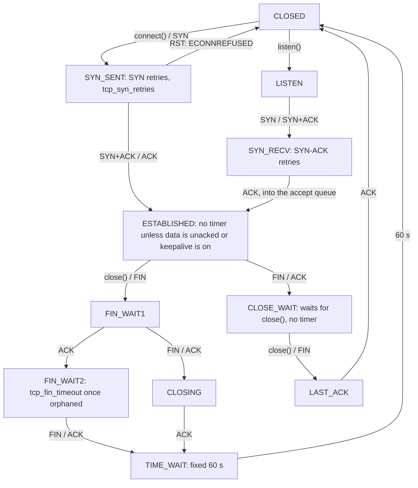

# Most Network Outages Are Timeouts You Did Not Set

*A hung connection is waiting on a kernel default: read its TCP state, then set connect, read and total timeouts yourself.*

## Metadata

| Field | Value |
|---|---|
| Type | Build |
| Languages | Python |
| Prerequisites | [IP Routing](https://cloudcaptain.io/learn/networking/ip-routing), [File Descriptors](https://cloudcaptain.io/learn/linux/file-descriptors) |
| Time | 90 minutes |
| Tools | ss, nstat, sysctl, curl, ip |

<Quiz stage="pre" />

## The Problem

Tuesday, 10:05. The checkout API's p99 latency climbs from 120 ms to 30 seconds, then the load balancer in front of it starts answering 504. CPU is idle, memory is flat, the logs show nothing but slow requests. Someone restarts the pods, the graphs drop back to normal, and the incident closes as "transient network issue". On Thursday it happens again. This time somebody runs `ss -tanp` inside a pod before restarting it: 900 sockets in `CLOSE-WAIT` owned by the API process, 40 worker threads blocked in `recv()` on connections to the payment provider that have not carried a packet for eleven minutes, and the API's listener showing a Recv-Q one larger than its Send-Q.

Every one of those lines is a TCP state with a precise meaning, and none of them is a network fault. The payment connections cross a NAT gateway that forgets idle flows after 350 seconds without telling either end. The HTTP client was created without a read timeout, so its threads wait for bytes that can never arrive, and without TCP keepalive nothing on the host will ever notice. Each stuck thread is one fewer worker calling `accept()`, so the listen queue fills, the kernel starts dropping new SYNs, and the load balancer reports connect timeouts. The `CLOSE-WAIT` pile is an error path that returns without closing its socket; the kernel has no timer for that state, so only a restart clears it. The restart worked for the same reason pulling the plug works.

You are going to build `tcpwatch`. It reads the socket table the kernel publishes in `/proc/net/tcp` and the same table as `ss -tanpi` prints it, names each failure shape with the process and the number behind it, walks the TCP state machine so you know which side owns which state, turns the retry sysctls into seconds, and ships a client that sets connect, read and total timeouts plus keepalive, next to lab servers that reproduce each failure on your machine. Afterwards `ss` output reads like a stack trace.

## The Concept

A TCP connection is two small state machines, one per host, that change state when the application calls something (`connect()`, `listen()`, `close()`) or when a segment arrives (SYN, ACK, FIN, RST). The useful question about any state is: **who ends it?** Some states end by themselves because the kernel runs a timer; others last exactly as long as an application decides, and the application may never decide.

| State | Ended by | How long, on default sysctls |
|---|---|---|
| `SYN_SENT` | kernel: SYN retransmissions | `tcp_syn_retries=6`: 1+2+4+8+16+32+64 = 127 s, then `connect()` fails with ETIMEDOUT |
| `SYN_RECV` | kernel: SYN-ACK retransmissions | `tcp_synack_retries=5`: about 63 s |
| `ESTABLISHED`, idle | nobody | forever, unless the application set SO_KEEPALIVE (then 7200 + 9 × 75 s) |
| `ESTABLISHED`, data unacknowledged | kernel: retransmission timer | `tcp_retries2=15`: at least 924.6 s, then the connection is aborted |
| `FIN_WAIT2`, socket closed | kernel | `tcp_fin_timeout=60` s |
| `TIME_WAIT` | kernel | fixed 60 s on Linux |
| `CLOSE_WAIT` | **the application, by calling `close()`** | forever |



Read the diagram as two columns. The side that calls `close()` first walks down the left: FIN_WAIT1, FIN_WAIT2, TIME_WAIT. The side that receives the FIN walks the right: CLOSE_WAIT until its application calls `close()`, then LAST_ACK. So a pile of TIME_WAIT means *this* host closed first, which is normal for a client; a pile of CLOSE_WAIT means *this* process stopped closing, which is always a bug; and a pile of FIN_WAIT2 means the *peer* has the CLOSE_WAIT pile.

Three more mechanisms explain the rest of the incident:

- **The kernel accepts connections, not your program.** The handshake completes in the kernel. A finished connection waits in the listener's **accept queue** until the application calls `accept()`. `connect()` returning on the client proves the server's kernel is alive, nothing more. The queue holds the `listen()` backlog plus one; when it is full, Linux drops new SYNs without answering, so to the client a busy server looks exactly like a firewall: a connect timeout, never a refusal.
- **A connection is a 4-tuple.** Source address, source port, destination address, destination port. To one destination from one source address, every connection needs its own local port from `ip_local_port_range` (28,232 ports by default), and a TIME_WAIT socket holds its port for 60 seconds. A client that opens a connection per request to one database runs out of ports at roughly 470 new connections per second, and `connect()` fails with EADDRNOTAVAIL.
- **There are three different timeouts.** A *connect* timeout bounds the handshake. A *read* timeout bounds each wait for the next byte, so a server that sends one byte every few seconds never trips it. Only a *total* timeout (a deadline) bounds the whole exchange. TCP keepalive is a fourth tool: the kernel probes an idle connection and drops it when the peer stops answering, but it is off per socket by default and its default idle time (two hours) is far longer than any load balancer's idle timeout.

## Build It

`code/main.py` is `tcpwatch`, standard library only. Parsing and diagnosis are pure functions over captured text, so they run anywhere; `scan` reads the live table on Linux; `probe` and `lab` use real sockets on any OS. `code/fixtures/` holds one incident host captured three ways: `proc-net-tcp.txt` and `proc-net-tcp6.txt`, `ss-tanpio.txt`, and the counters in `proc-net-netstat.txt`, `proc-net-snmp.txt` and `nstat-az.txt`.

### Step 1: `/proc/net/tcp` is hex in host byte order

Each row is one socket: `sl`, local and remote `ADDRESS:PORT`, the state, `tx_queue:rx_queue`, `timer:expires`, retransmits, uid, probes, inode. A listener on 127.0.0.1:8080 is `0100007F:1F90`. The port is plain hex, but the address is the 32-bit value printed in the CPU's byte order, so on x86 and arm64 the bytes of 127.0.0.1 come out reversed. IPv6 is four such words, each reversed on its own:

```python
def decode_address(text: str, byteorder: str = sys.byteorder) -> str:
    try:
        raw = bytes.fromhex(text)
    except ValueError:
        raw = b""
    if len(raw) not in (4, 16):
        raise InputError(f"not a /proc/net/tcp address: {text!r} (expected 8 or 32 hex digits)")
    if byteorder == "little":
        raw = b"".join(raw[i:i + 4][::-1] for i in range(0, len(raw), 4))
    return format_ip(ipaddress.ip_address(raw))
```

`format_ip()` prints IPv4-mapped addresses as `::ffff:10.0.0.5`, the way `ss` does, instead of Python 3.9's `::ffff:a00:5`. The rest of the row maps onto a `Sock`:

```python
    tx_queue, rx_queue = (int(x, 16) for x in fields[4].split(":"))
    timer, when = fields[5].split(":")
    return Sock(
        state=PROC_STATES.get(int(fields[3], 16), f"UNKNOWN_{fields[3]}"),
```

States are numbers (`01` ESTABLISHED, `06` TIME_WAIT, `08` CLOSE_WAIT, `0A` LISTEN). `rx_queue` is the unread bytes, except on a listener, where the kernel prints the accept queue's length. The timer column is `0` none, `1` retransmit, `2` keepalive, `3` TIME_WAIT, `4` zero-window probe, and `expires` is in hundredths of a second. TIME_WAIT and SYN_RECV rows come from small "mini sockets" the kernel uses for those states: they carry inode 0 and no process.

### Step 2: `ss -tanpi` is the same table with names attached

`ss` asks the kernel over netlink and prints a row per socket, with `-p` adding `users:(("python3",pid=4242,fd=4))` and `-i` adding a second line of `tcp_info` (`rto:`, `retrans:`, `backoff:`, `send 371Mbps`). `-o` adds `timer:(on,6sec,3)`: name, time left, retransmissions. The tokenizer keeps the two parenthesised groups whole, because process names may contain spaces:

```python
SS_TOKEN = re.compile(r"users:\(\(.*?\)\)(?=\s|$)|timer:\([^)]*\)|\S+")
```

A row starts with a state name (`ESTAB`, `CLOSE-WAIT`, `SYN-SENT`); an indented line belongs to the row above:

```python
        if line[:1].isspace():
            if current is not None:
                current.extend(tokens)
            continue
```

On a listener `ss` reports something `/proc` does not: Recv-Q is the accept queue's length and **Send-Q is the backlog**. Without `-o`, `ss_record()` still finds retransmissions in the `retrans:4/4` and `backoff:4` fields of `-i`. The test `test_proc_and_ss_fixtures_describe_the_same_sockets` holds the two parsers to the same answer on every socket.

### Step 3: who owns a socket

A socket's descriptor in `/proc/PID/fd` is a symlink to `socket:[INODE]`, the inode from Step 1. Walking every process gives the owner, which is what `ss -p` and `lsof -i` do:

```python
        for fd in fds:
            try:
                match = SOCKET_LINK.fullmatch(os.readlink(fd))
            except OSError:
                continue
            if match:
                owners.setdefault(int(match.group(1)), []).append(Process(name, int(pid_dir.name), int(fd.name)))
```

Inode 0 is information too: no descriptor exists. That is TIME_WAIT, SYN_RECV, an orphan after `close()`, or a finished connection still waiting in an accept queue, which is why `owner_label()` calls those "no process" and calls a non-zero inode it could not map "unknown process" (run as root to see every process).

### Step 4: the state machine you can run

The transitions from The Concept are a table of `(state, event) -> (next state, segment sent)`, plus two rules RFC 9293 states once for every synchronized state (an RST closes, an abort sends RST):

```python
    ("ESTABLISHED", "close"): ("FIN_WAIT1", "FIN"),
    ("ESTABLISHED", "FIN"): ("CLOSE_WAIT", "ACK"),
    ("FIN_WAIT1", "ACK"): ("FIN_WAIT2", ""),
    ("FIN_WAIT1", "FIN"): ("CLOSING", "ACK"),
    ("FIN_WAIT2", "FIN"): ("TIME_WAIT", "ACK"),
    ("CLOSE_WAIT", "close"): ("LAST_ACK", "FIN"),
```

```python
def step(state: str, event: str) -> Tuple[str, str]:
    if (state, event) in TRANSITIONS:
        return TRANSITIONS[(state, event)]
    if event == "RST" and state in SYNCHRONIZED:
        return "CLOSED", ""
    if event == "abort" and state in SYNCHRONIZED:
        return "CLOSED", "RST"
    raise InputError(f"{event} is not a valid event in {state}")
```

`simulate()` runs two endpoints and a wire through a scenario (`handshake`, `close`, `close-wait-leak`, `simultaneous-close`, `refused`, `reset`, `blackhole`), delivering each segment 10 ms later or dropping it, and prints both states after every event. Note what is missing from the table: `("CLOSE_WAIT", "timeout")`. Calling `step("CLOSE_WAIT", "timeout")` raises, which is the whole lesson in one line.

### Step 5: the diagnoses

Each finding groups sockets the way you would fix them. CLOSE_WAIT is grouped by owner and local port, and a Recv-Q above zero on every socket says the code has not even read the end of file (the FIN counts as one byte in Recv-Q until it is read):

```python
        summary = f"{count} CLOSE_WAIT on :{port} owned by {owner}: the peer closed and the process has not called close()"
        if all(s.recv_q > 0 for s in socks):
            summary += f"; Recv-Q > 0 on all {count}, so it has not even read to end of file (the FIN counts as one byte until read)"
```

The accept queue is full when Recv-Q exceeds the backlog, because the queue holds `backlog + 1`. From `ss` the backlog is Send-Q; from `/proc` you pass it with `--backlog PORT=N`:

```python
        backlog = sock.send_q if sock.source == "ss" else table.backlogs.get(sock.lport)
        queued = sock.recv_q
        owner = owner_label(sock, table.owners_known)
        if backlog is not None and queued > backlog:
```

SYN_RECV entries with SYN-ACK retransmits are handshakes the client never finished. SYN_SENT entries with retransmits are `connect()` calls nobody answers, not even with a RST. Established sockets with a retransmit timer and data in Send-Q are a silent peer or a lossy path; the `persist` timer is a peer whose application stopped reading (zero window). FIN_WAIT2 points at the peer's CLOSE_WAIT. Counters from `/proc/net/netstat` (`TcpExtListenOverflows`, `TcpExtTCPAbortOnTimeout`) become findings too, with the reminder that they count since boot.

### Step 6: ephemeral ports per destination

Ports are a per-destination budget, so the grouping key is the local address and the peer, and only local ports inside the range count:

```python
    outgoing = (s for s in table.socks if s.state not in ("LISTEN", "CLOSE") and s.rport and low <= s.lport <= high)
    for (local, peer), socks in grouped(outgoing, lambda s: (s.local, s.peer)).items():
        share = len(socks) / size
```

A share of 50% is a warning and 90% is critical, with the TIME_WAIT count in the summary because it tells you which side closed first.

### Step 7: kernel defaults in seconds

The kernel decides when to give up on retransmissions with a model: the timeout doubles from a base until it reaches `TCP_RTO_MAX` (120 s), then stays there. `tcp_model_timeout()` in `net/ipv4/tcp_timer.c` computes the total, and so does this:

```python
def model_timeout(boundary: int, rto_base: float, rto_max: float = TCP_RTO_MAX) -> float:
    threshold = int(math.log2(rto_max / rto_base))
    if boundary <= threshold:
        return round(((2 << boundary) - 1) * rto_base, 3)
    return round(((2 << threshold) - 1) * rto_base + (boundary - threshold) * rto_max, 3)
```

With a 1 s base and `tcp_syn_retries=6` that is 127 s; with the 200 ms minimum RTO and `tcp_retries2=15` it is 924.6 s, the figure the kernel's own sysctl documentation quotes. `tcpwatch sysctl` reads `/proc/sys/net` and prints each knob with its meaning. Very recent kernels add `net.ipv4.tcp_syn_linear_timeouts`, which changes the spacing of the first SYN retries; `sysctl` prints a note when that file exists, and `ss -tano` shows the real schedule.

### Step 8: a client that owns its timeouts

`probe()` computes a deadline from the total timeout and gives every blocking call the smaller of its own limit and the time left, so it can say which limit fired:

```python
    def budget(limit: Optional[float], kind: str) -> Tuple[Optional[float], str]:
        if deadline is None:
            return limit, kind
        remaining = deadline - clock()
        if limit is None or remaining < limit:
            return remaining, "total"
        return limit, kind
```

```python
            while True:
                wait, kind = budget(timeouts.read, "read")
                if wait is not None and wait <= 0:
                    return finish("total-timeout")
                sock.settimeout(wait)
                data = sock.recv(65536)
                if not data:
                    return finish("ok")
                result.received += len(data)
```

`socket.settimeout()` applies to each `connect()`, `send()` and `recv()` separately, which is exactly why the loop needs the deadline. Keepalive is three socket options with platform names; macOS calls the idle time `TCP_KEEPALIVE`:

```python
def keepalive_options(keepalive: Keepalive) -> List[Tuple[str, int, int]]:
    idle = getattr(socket, "TCP_KEEPIDLE", None)
    if idle is None and sys.platform == "darwin":
        idle = getattr(socket, "TCP_KEEPALIVE", DARWIN_TCP_KEEPALIVE)
```

`--user-timeout MS` sets `TCP_USER_TIMEOUT` on Linux, which bounds how long sent data may stay unacknowledged before the kernel aborts, the knob that shortens the 924.6 s above for one socket.

### Step 9: the lab and a run

`tcpwatch lab` starts the servers from The Problem: `leak` accepts and never closes, `backlog` listens and never accepts, `trickle` sends one byte per interval. `lab clients` opens N connections and reports how many connected. Run them and probe each:

```bash
python3 code/main.py lab leak --port 18081 &
python3 code/main.py lab backlog --port 18082 --backlog 1 &
python3 code/main.py lab trickle --port 18083 --interval 0.1 --duration 3 &
python3 code/main.py probe 127.0.0.1 18081 --read-timeout 0.5 --keepalive 5,2,3
# outcome read-timeout after 0.502 s (connected: yes, received 0 bytes) timeout: timed out
# socket options: SO_KEEPALIVE=1, TCP_KEEPIDLE=5, TCP_KEEPINTVL=2, TCP_KEEPCNT=3
python3 code/main.py probe 127.0.0.1 18083 --read-timeout 0.5 --max-time 1
# outcome total-timeout after 1.003 s (connected: yes, received 10 bytes)   the read timeout never fired
python3 code/main.py probe 127.0.0.1 18082 --read-timeout 0.5      # read-timeout: connected to a server that never accepted
python3 code/main.py probe 127.0.0.1 1                             # refused after 0.001 s: a RST, not a timeout
python3 code/main.py probe 127.0.0.1 18081 --no-timeouts           # waits until you kill the leak server
kill %1 %2 %3
```

Then the state machine and the incident host:

```bash
python3 code/main.py simulate close-wait-leak
#   60.050  client  timeout  -        CLOSED       CLOSE_WAIT   net.ipv4.tcp_fin_timeout frees the orphaned socket; the server is still in CLOSE_WAIT
python3 code/main.py simulate blackhole          # SYN at 0, 1, 3, 7, 15, 31, 63 s; ETIMEDOUT at 127 s
F=code/fixtures
python3 code/main.py diagnose --ss $F/ss-tanpio.txt --nstat $F/nstat-az.txt --port-range 40000-40009
# tcpwatch: 35 sockets: LISTEN 6, SYN_SENT 1, SYN_RECV 4, ESTABLISHED 8, FIN_WAIT2 2, TIME_WAIT 8, CLOSE_WAIT 6
# critical  ephemeral-ports  10.0.0.5 -> 10.0.0.9:5432 holds 9 of 10 ephemeral ports (90%), 8 in TIME_WAIT: ...
# critical  accept-queue     accept queue of 10.0.0.5:8082 is full: Recv-Q 2 > backlog 1; new SYNs are dropped, ...
# warning   close-wait       6 CLOSE_WAIT on :8081 owned by python3 (pid 4242): the peer closed and ...
# warning   syn-recv         4 half-open connection(s) on :443 (SYN-ACK resent up to 3 times): ...
# warning   retransmit       1 connection(s) to 10.0.0.9:6379 are retransmitting (up to 4 times, up to 1448 bytes ...
# warning   syn-sent         connect() to 10.0.0.30:5432 has resent its SYN up to 3 times on 1 socket(s): ...
# warning   zero-window      1 connection(s) to 10.0.0.10:9000 are probing a zero window ...
python3 code/main.py diagnose --proc $F/proc-net-tcp.txt --proc $F/proc-net-tcp6.txt --backlog 8082=1 --sockets
python3 code/main.py diagnose --ss $F/ss-tanpio.txt --json > report.json; echo "exit $?"   # 1: warnings found
sudo python3 code/main.py scan --sockets          # Linux: this network namespace, owners from /proc/*/fd
python3 code/main.py sysctl
# net.ipv4.tcp_syn_retries = 6                connect() to a host that never answers fails after 127.0 s (1 s first RTO, doubling)
# net.ipv4.tcp_retries2 = 15                  data nobody acknowledges: the connection is aborted after at least 924.6 s
# net.ipv4.tcp_keepalive_time = 7200          idle seconds before the first probe; a dead idle peer is found after 7875 s, ...
```

The fixture uses a ten-port range so the port arithmetic is visible; on a real host leave `--port-range` out and `scan` reads `ip_local_port_range`. `diagnose` and `scan` exit 1 when any finding is a warning or worse, 0 when the table is healthy, 2 for input they cannot parse.

<RunTests />

## Use It

`ss` is the real tool for every question `tcpwatch` answered, and the kernel's counters say what happened between two snapshots. Read the same table first:

```bash
ss -tanpi                                       # all TCP sockets, numeric, with owner and tcp_info
ss -tanpio                                      # plus timer:(name,left,retransmits)
ss -s                                           # totals per state, including timewait and orphaned
ss -tanp state close-wait                       # who is leaking; with one state, ss drops the State column
ss -tan state syn-sent '( dport = :5432 )'      # connect() attempts nobody answers
ss -tio dst 10.0.0.9                            # rtt, retrans, backoff, timer for one peer
ss -lnt                                         # listeners: Recv-Q waiting for accept(), Send-Q the backlog
ss -Htan state time-wait | awk '{print $4}' | sort | uniq -c | sort -rn | head   # TIME_WAIT per destination
```

Keep the full table (no single-state filter) when you capture for `tcpwatch`: `ss` hides the State column when only one state is selected. Then the counters, which `nstat` reads from the same files as `parse_proc_counters()`:

```bash
nstat -az TcpExtListenOverflows TcpExtListenDrops TcpExtTCPSynRetrans TcpExtTCPTimeouts TcpExtTCPAbortOnTimeout
nstat                                           # only the counters that changed since the last nstat run
grep -A1 '^TcpExt:' /proc/net/netstat           # the raw header and value lines
sysctl net.ipv4.tcp_syn_retries net.ipv4.tcp_synack_retries net.ipv4.tcp_retries2 net.ipv4.tcp_fin_timeout
sysctl net.ipv4.tcp_keepalive_time net.ipv4.tcp_keepalive_intvl net.ipv4.tcp_keepalive_probes
sysctl net.ipv4.ip_local_port_range net.ipv4.tcp_tw_reuse net.core.somaxconn net.ipv4.tcp_max_syn_backlog
```

`/proc/net/*` belongs to a network namespace, so inside a container or pod these are that pod's sockets and counters; `nsenter -t PID -n ss -tanp` reads them from the host. Build the smoke test's lab by hand to see each failure from both ends: two namespaces joined by a veth pair, with the servers on one side and the clients on the other.

```bash
sudo ip netns add cc-tcp-c; sudo ip netns add cc-tcp-s
sudo ip link add cc-tcps-c type veth peer name cc-tcps-s
sudo ip link set cc-tcps-c netns cc-tcp-c; sudo ip link set cc-tcps-s netns cc-tcp-s
sudo ip -n cc-tcp-c addr add 10.203.0.1/30 dev cc-tcps-c; sudo ip -n cc-tcp-s addr add 10.203.0.2/30 dev cc-tcps-s
for ns in cc-tcp-c cc-tcp-s; do sudo ip -n $ns link set lo up; done
sudo ip -n cc-tcp-c link set cc-tcps-c up; sudo ip -n cc-tcp-s link set cc-tcps-s up
sudo ip netns exec cc-tcp-s python3 code/main.py lab leak --host 10.203.0.2 --port 8081 &
sudo ip netns exec cc-tcp-s python3 code/main.py lab backlog --host 10.203.0.2 --port 8082 --backlog 1 &
sudo ip netns exec cc-tcp-c python3 code/main.py lab clients 10.203.0.2 8081 --count 8
sudo ip netns exec cc-tcp-s ss -tanp state close-wait          # 8 sockets, users:(("python3",pid=...))
sudo ip netns exec cc-tcp-c ss -tan state fin-wait-2           # the other half: 8 waiting for a FIN that will not come
sudo ip netns exec cc-tcp-c python3 code/main.py lab clients 10.203.0.2 8082 --count 6 --connect-timeout 1
sudo ip netns exec cc-tcp-s ss -lnt                            # :8082 Recv-Q 2, Send-Q 1: full
sudo ip netns exec cc-tcp-s nstat -asz TcpExtListenOverflows   # at least one per dropped SYN
sudo ip netns exec cc-tcp-s nft add table inet cc
sudo ip netns exec cc-tcp-s nft add chain inet cc input '{ type filter hook input priority 0 ; policy accept ; }'
sudo ip netns exec cc-tcp-s nft add rule inet cc input tcp dport 9 drop        # a silent firewall
sudo ip netns exec cc-tcp-c curl -s -o /dev/null --connect-timeout 2 --max-time 5 http://10.203.0.2:9/; echo "exit $?"   # 28 after 2 s
sudo ip netns exec cc-tcp-c curl -s -o /dev/null --max-time 2 http://10.203.0.2:8081/; echo "exit $?"   # 28: connected, no answer
sudo ip netns exec cc-tcp-c curl -s -o /dev/null -w '%{time_connect} %{time_starttransfer} %{time_total}\n' --max-time 2 http://10.203.0.2:8081/
sudo ip netns del cc-tcp-c; sudo ip netns del cc-tcp-s       # kill the lab processes first
```

`curl` exits 28 for both timeouts; `--connect-timeout` covers only the connect phase (its default is 300 seconds), `--max-time` the whole transfer (no default). The second `curl` is the payment-provider outage in miniature: the connection succeeded, so only a total timeout ended it. Libraries are worse than `curl`: Python's `requests` and Go's `http.DefaultClient` have no timeout at all unless you pass one, and a raw socket blocks forever.

**Idle timeouts in the middle.** Every stateful box between client and server keeps a flow table and forgets idle entries. An AWS Application Load Balancer closes connections idle for 60 seconds by default; a Network Load Balancer and a NAT gateway forget idle TCP flows after 350 seconds and answer later packets with RST; an Azure Load Balancer defaults to 4 minutes. Nobody tells the endpoints. A pooled database connection idle for six minutes looks ESTABLISHED on both hosts, and the next query either gets an RST (`ECONNRESET`) or, behind a firewall that drops silently, retransmits for the 924.6 s of `tcp_retries2` while the caller waits. Three fixes, used together: keepalive with an idle time below the shortest idle timeout on the path (for example `TCP_KEEPIDLE=60`, `TCP_KEEPINTVL=10`, `TCP_KEEPCNT=3`), or application pings such as HTTP/2 PING frames; a pool that retires connections before that idle time; and on servers behind a load balancer, a keep-alive timeout longer than the balancer's idle timeout, so the balancer is always the side that closes.

| What you built | Real tool | Note |
|---|---|---|
| `parse_proc_net_tcp()` | `cat /proc/net/tcp /proc/net/tcp6` | the kernel's own text; addresses in host byte order, no backlog for listeners |
| `parse_ss()` | `ss -tanpi`, `ss -tanpio` | netlink `inet_diag`; Send-Q of a listener is the backlog; one-state filters drop the State column |
| `socket_owners()` | `ss -p`, `lsof -i`, `/proc/PID/fd` | inode 0 means no descriptor: TIME_WAIT, SYN_RECV, accept queue, orphan |
| `close_wait_findings()` | `ss -tanp state close-wait` | a code bug; no sysctl ends CLOSE_WAIT |
| `accept_queue_findings()` | `ss -lnt`, `nstat TcpExtListenOverflows` | full means Recv-Q > Send-Q; the backlog is capped by `net.core.somaxconn` |
| `syn_sent_findings()`, `retransmit_findings()` | `ss -tio`, `nstat TcpExtTCPSynRetrans TcpExtTCPTimeouts` | silence, not refusal; a RST would end it at once |
| `port_findings()` | `ss -s`, `ss -tan state time-wait`, `ip_local_port_range` | per destination; `tcp_tw_reuse` helps outgoing connections only |
| `simulate()` | RFC 9293 section 3.3.2, `tcpdump` | the real kernel splits LISTEN and SYN_RECV into a listener and request sockets |
| `model_timeout()`, `sysctl` | `sysctl net.ipv4.tcp_*`, `tcp_model_timeout()` | per socket: `TCP_SYNCNT`, `TCP_USER_TIMEOUT` |
| `probe()` with a deadline | `curl --connect-timeout --max-time`, client library timeouts | a read timeout alone never bounds a trickle |
| `set_keepalive()` | `SO_KEEPALIVE`, `TCP_KEEPIDLE`, `TCP_KEEPINTVL`, `TCP_KEEPCNT`; `ss -o` shows `timer:(keepalive,...)` | off per socket by default; the 7200 s default outlives every idle timeout |
| `lab leak`, `lab backlog` | a service with a missing `close()`, a blocked event loop | reproduce before you fix |

<Quiz stage="check" />

## Ship It

Two artifacts in `outputs/`:

- **`skill-connection-timeout-triage.md`**: a runbook for "requests hang", "connect timed out", "connection reset by peer" and "cannot assign requested address". It captures the socket table and counters before anyone restarts, classifies the symptom by TCP state with a decision table (CLOSE_WAIT, full accept queue, SYN_SENT, retransmitting, zero window, port exhaustion, idle-timeout resets), confirms each with one command, separates the stop-gap from the fix, checks every client on the path for connect, read and total timeouts and keepalive, and ends with a fixed report.
- **`prompt-explain-ss-output.md`**: paste `ss -tanpi` or `ss -tanpio` output (optionally `ss -lnt`, `nstat` and the sysctls) and get the state histogram, each abnormal group with the process, peer and the side that owns it, the timer that will or will not end it, the single most likely cause, and the commands to confirm it.

<ShipIt />

## Exercises

### Easy

Add `tcpwatch rate --nstat before.txt --nstat after.txt --seconds 10` that prints the per-second change of every counter in `WATCHED_COUNTERS`, and make `diagnose` accept two netstat captures so `TcpExtListenOverflows` is reported as a rate instead of a total since boot. Write the tests first: a counter that went from 1873 to 1903 in 10 seconds is 3.0 per second, a counter missing from one file is reported as missing, and a counter that went down (a reboot or a namespace change) is an error, not a negative rate.

### Medium

A single snapshot cannot tell a CLOSE_WAIT leak from a connection that will be closed in the next millisecond. Use the `lastrcv:` field of `ss -i` (milliseconds since the last data arrived) to flag only CLOSE_WAIT sockets idle longer than `--min-age` seconds, and print the oldest age per group. Test first with fixture rows of ages 5 ms, 2 s and 900 s and a minimum age of 1 s; then run `lab leak` in the namespace lab, wait, and check that the age grows between two captures while the count stays the same.

### Hard

Add Happy Eyeballs (RFC 8305) to `probe`: resolve a name to both AAAA and A records, start the IPv6 connect, start IPv4 250 ms later if IPv6 has not finished, keep the first socket that connects, close the other, and let the connect timeout bound the whole race. Tests first, with a fake connector in which IPv6 is silent and IPv4 answers after 10 ms (IPv4 wins at about 260 ms) and one in which both answer (IPv6 wins). Then reproduce the silent family in the namespace lab with an `nft` drop rule for IPv6 only and compare with `curl -v`, which implements the same algorithm.

<Quiz stage="post" />

## Key Terms

| Term | Common misconception | Precise definition |
|---|---|---|
| CLOSE_WAIT | "A network state that will time out." | The peer sent FIN and the local application has not called `close()`. No kernel timer ends it; each one holds a descriptor until the process closes it or exits. |
| TIME_WAIT | "Leaked sockets that need `tcp_tw_recycle`." | The state of the side that closed first, held for 60 s on Linux so a delayed segment cannot be taken for part of a new connection on the same 4-tuple. It costs a port, not a descriptor. (`tcp_tw_recycle` was removed from the kernel.) |
| Accept queue | "The backlog is how many clients can connect." | Connections whose handshake the kernel completed and that wait for `accept()`. It holds the `listen()` backlog plus one, capped by `net.core.somaxconn`; when full, new SYNs are dropped silently. |
| SYN_RECV | "A slow client." | A request socket: the server answered SYN with SYN-ACK and waits for the final ACK, resending SYN-ACK up to `tcp_synack_retries` times. Many of them mean a SYN flood, a broken return path, or ACKs dropped by a full accept queue. |
| Ephemeral port | "A server has only 65,535 connections." | The local port the kernel picks for `connect()` from `ip_local_port_range`. The limit is per source address and destination address and port, because the 4-tuple must be unique. |
| Retransmission timeout (RTO) | "A fixed one-second timer." | The time a sender waits for an ACK before resending, computed from measured RTT (RFC 6298), at least 200 ms on Linux, doubled on every consecutive timeout up to 120 s. `tcp_syn_retries` and `tcp_retries2` count these doublings. |
| TCP keepalive | "TCP notices dead peers on its own." | Optional per socket (`SO_KEEPALIVE`): after `TCP_KEEPIDLE` seconds of silence the kernel sends probes every `TCP_KEEPINTVL` seconds and drops the connection after `TCP_KEEPCNT` unanswered ones. The defaults add up to over two hours. |
| Read timeout | "It bounds how long a request can take." | A limit on each single wait for data; every arriving byte restarts it. Only a total timeout, a deadline for the whole exchange, bounds a server that trickles. |
| Idle timeout | "Load balancers keep connections open as long as both ends do." | The time a load balancer, NAT gateway or firewall keeps an idle flow in its table before forgetting it without telling either endpoint; later packets get RST or are dropped. |

## Further Reading

- [Networking Fundamentals](https://cloudcaptain.io/docs/tools/networking/fundamentals): the TCP/IP model and transport layer that this lesson opens up one socket at a time.
- [Linux Networking](https://cloudcaptain.io/docs/tools/linux/networking): `ss`, `ip` and the host-side commands used throughout Use It.
- [Networking Interview Questions](https://cloudcaptain.io/docs/tools/networking/interview-questions): the three-way handshake and TCP versus UDP questions, which you can now answer with state names and timers.
- [tcp(7)](https://man7.org/linux/man-pages/man7/tcp.7.html): every socket option used here (`TCP_KEEPIDLE`, `TCP_USER_TIMEOUT`, `TCP_SYNCNT`) and the sysctls with their defaults.
- [ss(8)](https://man7.org/linux/man-pages/man8/ss.8.html) and [listen(2)](https://man7.org/linux/man-pages/man2/listen.2.html): the filter language, `-i` and `-o` fields, and what the backlog argument means on Linux.
- [The proc/net/tcp format](https://docs.kernel.org/networking/proc_net_tcp.html) and [IP sysctl](https://docs.kernel.org/networking/ip-sysctl.html): the kernel's own description of each column, and of `tcp_retries2`, `tcp_syn_retries`, `tcp_fin_timeout` and `ip_local_port_range`.
- [RFC 9293](https://www.rfc-editor.org/rfc/rfc9293) and [RFC 6298](https://www.rfc-editor.org/rfc/rfc6298): the TCP state machine as the standard defines it, and how the retransmission timer is computed.
- [AWS: Network Load Balancer idle timeout](https://docs.aws.amazon.com/elasticloadbalancing/latest/network/network-load-balancers.html) and [Application Load Balancer idle timeout](https://docs.aws.amazon.com/elasticloadbalancing/latest/application/application-load-balancers.html): the 350-second and 60-second defaults and the RST behaviour after a flow expires.
