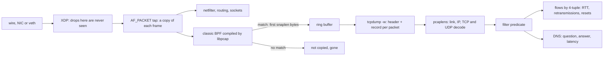

# tcpdump Is a Filter Over Bytes You Can Parse

*A capture file is a header and timestamped byte strings; a filter is a predicate over their offsets. Compute both and packets stop lying.*

## Metadata

| Field | Value |
|---|---|
| Type | Build |
| Languages | Python |
| Prerequisites | [Most Network Outages Are Timeouts You Did Not Set](https://cloudcaptain.io/learn/networking/tcp-states) |
| Time | 90 minutes |
| Tools | tcpdump, nsenter, kubectl, dig, curl, coredns, wireshark |

<Quiz stage="pre" />

## The Problem

Tuesday, 11:20. Since the move to the new cluster, the checkout service's p99 latency has been just over 5 seconds, but only for some requests. The payments team's dashboards show their API answering in 40 ms, so they say the problem is on your side. Someone runs `tcpdump -i any port 443` on a node; thousands of lines scroll past, none of them look wrong, and nobody can read that fast. Someone else writes two gigabytes to a file, copies it to a laptop and spends an afternoon in Wireshark looking for TLS retransmissions. There are almost none. The incident channel concludes that "the network is fine" and the ticket bounces back to payments.

The answer was never on port 443. Every slow request started with a DNS lookup for the payments API's name, and about one lookup in three hundred was a UDP query that never got a reply. The resolver in the pod sent the A and AAAA queries from the same socket at the same instant, a conntrack race on the node dropped one of them, and the resolver waited its 5-second timeout before asking again. In a capture that is four lines: two queries, one answer, and the unanswered question sent again exactly 5.0 s later. The capture filter `port 443` discarded those lines in the kernel before anything was written, and `-i any` showed every pod packet twice, once on the pod's veth and once on the node's uplink after NAT, which is why the packet counts never matched the request counts either.

tcpdump only looks like a firehose. A capture file is a 24-byte header followed by records: a timestamp, two lengths and the bytes. A filter such as `tcp port 443` is compiled into a short program that reads bytes at fixed offsets and compares them with numbers. Every line tcpdump prints is a handful of fixed-format reads. You are going to write `pcaplens`, which reads the same pcap and pcapng files, decodes Ethernet, Linux cooked captures, IPv4, IPv6, TCP, UDP and DNS, compiles the same filter subset with the same quirks, and turns a capture into verdicts per connection: handshake RTT, retransmissions, holes, duplicate ACKs, zero windows, resets, who closed first, and DNS questions that were never answered. Then you capture real traffic with tcpdump and check that both tools agree packet for packet.

## The Concept

Think of a packet capture as a tape recorder clipped onto a network interface. On Linux the clip is a packet socket (`AF_PACKET`): the kernel hands it a copy of every frame the device sends or receives. The copy of an incoming frame is taken before netfilter, routing and sockets have seen it; the copy of an outgoing frame is taken after NAT and queueing, just before the driver. Two consequences follow. A SYN in your capture proves the packet reached the interface, not that the firewall let it through or that an application accepted it. And an XDP program (Cilium, some load balancers) runs before the copy, so packets it drops are never recorded at all.

Copying everything would be expensive, so tcpdump hands libpcap a filter expression, libpcap compiles it into classic BPF (a tiny bytecode of loads, comparisons and jumps), and the kernel runs that program on every frame before copying. A frame that matches is copied, cut to the snapshot length (`-s`, the snaplen), and queued for tcpdump; a frame that does not match is never copied. That is why a capture filter is cheap, and why anything it excludes is gone for good. Display filters, the ones you type in Wireshark or pass to `tshark -Y`, run afterwards over a file and use a different language.

tcpdump writes each copy into a file. The classic pcap format is a 24-byte global header (a magic number that also gives the byte order and whether timestamps are in microseconds or nanoseconds, the snaplen, and the link type), then per packet a 16-byte record header (seconds, fraction, captured length, original length) and the captured bytes. pcapng, Wireshark's default, is a sequence of typed blocks: a section header, an interface description per interface (each with its own link type and timestamp resolution), and an enhanced packet block per packet. The link type says how to read the first bytes. Ethernet starts with 14 bytes of MAC addresses and an ethertype. `-i any` has no single link layer across interfaces, so the kernel synthesises a "cooked" header instead: `LINUX_SLL` (16 bytes) or `LINUX_SLL2` (20 bytes, with the interface index), each carrying the direction of the packet.

From there decoding is offset arithmetic. The ethertype says IPv4 or IPv6; the IPv4 header length is its low nibble times four; the protocol field says TCP; the TCP data offset times four says where the payload starts. Lengths come from those headers, never from the captured length, so a capture cut at 96 bytes still knows that a segment carried 1448 bytes. Sequence numbers count bytes, so you can read the health of a connection off them: a segment whose sequence number is behind what its sender already sent is a retransmission; one that starts ahead of it means a segment was lost before the capture point; a receiver that keeps acknowledging the same number is sending duplicate ACKs; a window of zero means its buffer is full because the application stopped reading.



Where you capture decides what you see. On the client, the gap between SYN and SYN-ACK is the network round trip plus the server kernel's reply time; on the server it is almost zero, and the client's final ACK arrives one round trip later. A packet missing on the client but present on the server was lost in between. A packet seen on `-i any` appears once per interface it crosses: a container's packet shows up on its veth, on the bridge and, after source NAT, on the uplink.

## Build It

`code/main.py` is `pcaplens`. Everything is standard library: `struct` for the fixed-format headers, `ipaddress` for addresses and networks, `re` for the filter tokenizer. It also contains small frame builders (`ip_packet()`, `tcp_segment()`, `dns_message()`, `write_pcap()`, `write_pcapng()`), which the tests use to construct exact captures and which `pcaplens demo` uses to write a sample capture you can open with tcpdump on any machine, without root.

### Step 1: a pcap file is a header and a list of records

The first four bytes are the magic number `a1b2c3d4` (microseconds) or `a1b23c4d` (nanoseconds), written in the byte order of the machine that captured. Reading it with both byte orders tells you which one the rest of the file uses:

```python
def pcap_byte_order(magic: bytes) -> Tuple[str, int]:
    for prefix in ("<", ">"):
        value = struct.unpack(prefix + "I", magic)[0]
        if value in (PCAP_MAGIC_MICRO, PCAP_MAGIC_NANO):
            return prefix, value
    if magic[:2] == b"\x1f\x8b":
        raise CaptureError("the file is gzip-compressed; run gunzip first")
    raise CaptureError(f"unknown magic number {magic.hex()}: not a pcap (a1b2c3d4, a1b23c4d in either byte order) or pcapng (0a0d0d0a) file")
```

After the 24-byte header, each record is four 32-bit numbers and the bytes. The record keeps two lengths: what was captured and what was on the wire. A file cut short (tcpdump killed with `-9`, a full disk) keeps every complete record, and pcaplens reports the damage in libpcap's words and exits 1 after printing what it could read:

```python
        seconds, fraction, caplen, origlen = record.unpack_from(data, offset)
        if caplen > MAX_SNAPLEN:
            capture.damage = f"packet {len(capture.packets) + 1} claims {caplen} captured bytes, more than the maximum {MAX_SNAPLEN}: the file is corrupt"
            break
        start = offset + record.size
        if start + caplen > len(data):
            capture.damage = f"truncated dump file; tried to read {caplen} captured bytes, only got {len(data) - start}"
            break
        capture.packets.append(Packet(len(capture.packets) + 1, seconds * NS + fraction * units, capture.linktypes[0], data[start:start + caplen], origlen))
```

Timestamps are kept as integer nanoseconds, so microsecond and nanosecond files compare exactly. The link type is the low 16 bits of the header's last field; the upper bits can carry flags about frame check sequences.

### Step 2: pcapng is a list of blocks

Every pcapng block is a type, a total length, a body and the total length again, so a reader can skip blocks it does not know. The section header carries its own byte-order magic (`1a2b3c4d`) and resets the interface list. Each interface description block gives a link type, a snaplen and optionally `if_tsresol`, the timestamp resolution, where the high bit chooses a power of two instead of a power of ten:

```python
def tsresol_units(value: Optional[bytes]) -> int:
    if not value:
        return 1_000_000
    exponent = value[0] & 0x7F
    return 2 ** exponent if value[0] & 0x80 else 10 ** exponent
```

An enhanced packet block names its interface by index and splits a 64-bit timestamp into two halves, counted in that interface's units:

```python
    if block_type == PCAPNG_EPB:
        interface, high, low, caplen, origlen = struct.unpack_from(prefix + "IIIII", body, 0)
        start, ticks = 20, (high << 32) | low
```

```python
    linktype, _snaplen, units = interfaces[interface]
    if start + caplen > len(body):
        return None
    return Packet(index, ticks * NS // units, linktype, body[start:start + caplen], origlen, interface)
```

Simple packet blocks (no timestamp, interface 0) are read too; name resolution, statistics and vendor blocks are skipped by their length. A packet block that names an interface no description block introduced is an error, not a guess.

### Step 3: the link type decides where IP starts

```python
    if linktype == LINKTYPE_ETHERNET:
        d.link = "ether"
        need(data, 14, "ether")
        offset, ethertype = 14, struct.unpack_from("!H", data, 12)[0]
        while ethertype in VLAN_ETHERTYPES:
            need(data, offset + 4, "vlan")
            ethertype = struct.unpack_from("!H", data, offset + 2)[0]
            offset += 4
    elif linktype == LINKTYPE_LINUX_SLL:
        d.link = "sll"
        need(data, 16, "sll")
        packet_type, ethertype = struct.unpack_from("!H", data, 0)[0], struct.unpack_from("!H", data, 14)[0]
        d.direction, offset = SLL_PACKET_TYPES.get(packet_type, str(packet_type)), 16
    elif linktype == LINKTYPE_LINUX_SLL2:
        d.link = "sll2"
        need(data, 20, "sll2")
        ethertype, _reserved, d.ifindex = struct.unpack_from("!HHI", data, 0)
        d.direction, offset = SLL_PACKET_TYPES.get(data[10], str(data[10])), 20
```

Linux loopback captures are Ethernet with all-zero MAC addresses. A capture on `-i any` is cooked: `LINUX_SLL` puts the packet type (0 to us, 4 outgoing, 1 broadcast, 2 multicast, 3 to another host) first and the protocol last; `LINUX_SLL2` puts the protocol first and adds the interface index, which is how tcpdump can print `eth0 In` on each line. pcaplens also reads `NULL` (BSD and macOS loopback, a 4-byte address family in the capturing host's byte order) and `RAW` (no link header; the IP version nibble decides). `need()` raises when the captured bytes end too early, and the decoder records tcpdump's marker, such as `[|tcp]`, instead of crashing.

### Step 4: IP and TCP lengths come from the headers

```python
def decode_ipv4(d: Decoded, data: bytes, offset: int) -> None:
    need(data, offset + 20, "ip")
    version_ihl, _tos, total, _ident, frag, ttl, proto = struct.unpack_from("!BBHHHBB", data, offset)
    header_len = (version_ihl & 0x0F) * 4
    d.version, d.ttl, d.proto = 4, ttl, proto
    d.src = ipaddress.IPv4Address(data[offset + 12:offset + 16])
    d.dst = ipaddress.IPv4Address(data[offset + 16:offset + 20])
    d.first_fragment = frag & 0x1FFF == 0
    d.fragment = bool(frag & 0x2000) or not d.first_fragment
    d.l4_len = max(0, total - header_len)
    if d.first_fragment:
        d.l4_offset = offset + header_len
```

Only the first fragment of a datagram carries the TCP or UDP header, so a later fragment has a protocol but no ports; that is why `port 80` misses it while `tcp` still matches. `l4_len` comes from the IP total length, which also ignores the padding Ethernet adds to frames shorter than 60 bytes. IPv6 has a fixed 40-byte header and a chain of extension headers; `decode_ipv6()` walks hop-by-hop, routing, destination options, authentication and fragment headers until it reaches the transport protocol.

```python
    if d.proto == IPPROTO_TCP:
        need(data, start + 20, "tcp")
        seq, ack, offset_byte, flags, window = struct.unpack_from("!IIBBH", data, start + 4)
        tcp = Tcp(seq, ack, flags, window, (offset_byte >> 4) * 4)
        d.tcp = tcp
        d.payload_len = max(0, d.l4_len - tcp.header_len)
        d.payload = data[start + tcp.header_len:start + tcp.header_len + d.payload_len]
        parse_tcp_options(tcp, data[start + 20:start + tcp.header_len], complete=len(data) >= start + tcp.header_len)
```

`payload_len` is what the headers say; `payload` is what the snaplen kept. With `-s 96` a 1448-byte segment still counts as 1448 bytes. `parse_tcp_options()` reads the options a SYN negotiates (MSS, window scale, SACK permitted, timestamps) and the SACK blocks a receiver sends when it holds data beyond a hole, and prints them the way tcpdump does: `options [mss 1460,sackOK,TS val 1000 ecr 0,nop,wscale 7]`. `summary()` assembles the line in tcpdump's `-nn -S` format: flags as letters in the order `F S R P . U E W`, `seq` only when the segment carries data, SYN, FIN or RST, and `ack` only when the ACK bit is set.

### Step 5: the filter is a predicate over offsets

The tokenizer splits the expression; a recursive descent parser turns primitives into Python closures over the decoded packet. Two rules from pcap-filter(7) surprise most people, and pcaplens follows both. First, `and` and `or` have equal precedence and group left to right, so `host A or host B and udp` means `(host A or host B) and udp`:

```python
    def parse_expression(self) -> Node:
        node = self.parse_not()
        while self.peek() in ("and", "&&", "or", "||"):
            both = self.take() in ("and", "&&")
            left, right = node, self.parse_not()
            if both:
                node = Node("and", lambda d, a=left, b=right: a.test(d) and b.test(d), children=[left, right])
            else:
                node = Node("or", lambda d, a=left, b=right: a.test(d) or b.test(d), children=[left, right])
        return node
```

Second, a value without a keyword inherits the previous primitive's qualifiers, so `port 53 or 853` is `port 53 or port 853` and `host A or B` is `host A or host B`. `parse_primitive()` collects up to three qualifiers (protocol `ip`, `ip6`, `arp`, `tcp`, `udp`; direction `src`, `dst`, `src or dst`, `src and dst`; type `host`, `net`, `port`, `portrange`) and remembers them:

```python
        if proto is None and direction is None and kind is None and self.last is not None:
            proto, direction, kind = self.last
        direction, kind = direction or "src or dst", kind or "host"
        self.last = (proto, direction, kind)
```

Byte access, the `tcp[tcpflags] & tcp-syn != 0` family, is where BPF shows through. libpcap computes the TCP header's offset from the IPv4 header length, so `tcp[...]`, `udp[...]` and `icmp[...]` only ever see IPv4 first fragments; an IPv6 SYN never matches `tcp[tcpflags] & tcp-syn != 0`. And a load past the captured bytes does not make one comparison false; it ends the BPF program with "reject", so the whole packet fails, even under `not`:

```python
def load(d: Decoded, base: str, offset: int, size: int) -> Optional[int]:
    if base == "ip":
        start = d.net_offset if d.version == 4 else None
    elif base == "ip6":
        start = d.net_offset if d.version == 6 else None
    else:
        start = d.l4_offset if d.version == 4 and d.proto == ACCESSOR_BASES[base] else None
    if start is None:
        return None
    end = start + offset + size
    if end > len(d.packet.data):
        raise OutOfPacket(f"{base}[{offset}:{size}] reads past the {len(d.packet.data)} captured bytes")
    return int.from_bytes(d.packet.data[start + offset:end], "big")
```

`None` (the protocol does not apply) makes that comparison false; `OutOfPacket` is caught once in `Filter.__call__` and rejects the packet. `host` without a protocol also matches ARP packets that name the address, as tcpdump's does, while `ip host` does not. `net 10.0.0.1/8` is an error, because the address has host bits set. pcaplens does not resolve names: tcpdump resolves a `host example.com` once, when it compiles the filter, which is rarely what you want for a service behind changing addresses. One deliberate difference: pcaplens walks IPv6 extension headers to find the transport header, while libpcap's `tcp` and `port` only look at the fixed header and a fragment header right after it, so the two can disagree on packets with hop-by-hop or routing headers.

### Step 6: connections from sequence numbers

`build_flows()` groups packets by protocol and the unordered pair of endpoints. The sender of a SYN without ACK is the client; when the capture started after the handshake, the side with the higher port is assumed to be the client and the flow says so. For each direction it remembers the next sequence number it expects, the last ACK and the last window, and classifies every segment:

```python
def classify_segment(half: Half, other: Half, t: Tcp, payload_len: int) -> None:
    seg_len = payload_len + (1 if t.flags & SYN else 0) + (1 if t.flags & FIN else 0)
    seq_end = (t.seq + seg_len) & MASK32
    if t.flags & RST:
        return
    if half.next_seq is None:
        half.next_seq = seq_end
    elif payload_len <= 1 and not t.flags & (SYN | FIN) and t.seq == (half.next_seq - 1) & MASK32:
        half.keepalives += 1
    elif seg_len > 0 and seq_lt(t.seq, half.next_seq):
        half.retransmissions += 1
        if seq_lt(half.next_seq, seq_end):
            half.next_seq = seq_end
    elif seg_len > 0:
        if t.seq != half.next_seq:
            half.gaps += 1
        half.next_seq = seq_end
    if t.flags & ACK:
        pure = payload_len == 0 and not t.flags & (SYN | FIN)
        if pure and half.last_ack == t.ack and half.last_window == t.window and other.next_seq is not None and seq_lt(t.ack, other.next_seq):
            half.dup_acks += 1
        half.last_ack, half.last_window = t.ack, t.window
```

SYN and FIN each consume one sequence number, which is why a repeated SYN counts as a retransmission. `seq_lt()` compares in 32-bit modular arithmetic, so a connection that wraps past 4 GiB still works. A keep-alive or zero-window probe deliberately reuses the last acknowledged byte (`seq = next - 1`, zero or one byte of data), so it is counted apart instead of as a retransmission. A duplicate ACK must repeat both the number and the window, and the other side must have unacknowledged data; otherwise it is a window update or an idle ACK. `track_tcp()` adds the handshake timestamps (SYN, SYN-ACK, and the client's ACK of the server's ISN plus one), the MSS, window scale and SACK permission each side offered, zero windows, FINs, RSTs and who sent the first FIN or RST. The state follows: `refused` (SYN answered by RST), `no answer` (SYNs only), `reset`, `closed`, `half-closed`, `open`, `mid-stream`.

### Step 7: DNS names with compression

DNS messages save space by replacing a name's tail with a two-byte pointer (the top two bits set) to an earlier copy in the same message. A reader follows pointers and must refuse loops:

```python
        if length & 0xC0 == 0xC0:
            pointer = unpack("!H", message, offset)[0] & 0x3FFF
            if end is None:
                end = offset + 2
            jumps += 1
            if jumps > 32:
                raise ValueError("compression pointer loop")
            offset = pointer
            continue
```

`end` is where the name ends in the original position, which is where parsing continues after the first pointer. `parse_dns()` reads the header flags (QR, opcode, AA, TC, RD, RA, rcode), the question and all three record sections, and `rdata_text()` decodes A, AAAA, CNAME, NS, PTR, MX, TXT, SRV, SOA and EDNS OPT records. `dns_transactions()` pairs each query with the response from the server's address and port to the client's, with the same ID; a second query with the same ID from the same socket is a retry, and the latency is measured from the first one, which is what the application waited.

### Step 8: run it

`demo` writes a deterministic capture: an HTTP download that loses one segment, a connection to a closed port, one to a host that never answers, a receiver that stops reading and then resets, four DNS lookups (one lost and retried), and an IPv6 connection. tcpdump reads it without root on Linux and macOS:

```bash
python3 code/main.py demo demo.pcap
# wrote demo.pcap: pcap, link type EN10MB, 48 packets, 13877 bytes
python3 code/main.py info demo.pcap
#   48 packets, 0 cut by the snaplen, 13085 bytes captured of 13085 on the wire
python3 code/main.py read demo.pcap 'port 80' -c 2
# 2026-11-01 09:00:00.000000 IP 10.0.0.1.43512 > 10.0.0.2.80: Flags [S], seq 1000, win 64240, options [mss 1460,sackOK,TS val 1000 ecr 0,nop,wscale 7], length 0
# 2026-11-01 09:00:00.020000 IP 10.0.0.2.80 > 10.0.0.1.43512: Flags [S.], seq 5000, ack 1001, win 65160, options [mss 1460,sackOK,TS val 9000 ecr 1000,nop,wscale 7], length 0
TZ=UTC tcpdump -r demo.pcap -nn -S -tttt 'port 80' -c 2      # the same two lines
diff <(TZ=UTC tcpdump -r demo.pcap -nn -S -tttt 2>/dev/null | sed 's/: HTTP.*$//') <(python3 code/main.py read demo.pcap) && echo identical
```

tcpdump also decodes HTTP on port 80, which pcaplens does not; with that annotation stripped, all 48 lines are identical. Now the filter rules from Step 5, checked against libpcap:

```bash
for f in 'tcp[tcpflags] & tcp-syn != 0' '(tcp[tcpflags] & tcp-syn != 0) or (ip6[6] = 6 and ip6[53] & tcp-syn != 0)' \
         'host 10.0.0.3 or host 10.0.0.53 and udp' 'not tcp[100] = 1'; do
  echo "$(tcpdump -r demo.pcap -nn "$f" 2>/dev/null | wc -l) $(python3 code/main.py read demo.pcap "$f" --count)  $f"
done
# 8 8  tcp[tcpflags] & tcp-syn != 0                 the two IPv6 SYNs are invisible to tcp[]
# 10 10  (tcp[tcpflags] ...) or (ip6[6] = 6 and ip6[53] & tcp-syn != 0)
# 9 9  host 10.0.0.3 or host 10.0.0.53 and udp      (A or B) and udp, not A or (B and udp)
# 23 23  not tcp[100] = 1                           short TCP packets are rejected, not negated
python3 code/main.py filter 'tcp[tcpflags] & (tcp-syn|tcp-ack) == tcp-syn and not port 53 or 853'
```

`ip6[53]` is byte 13 of a TCP header that starts right after the 40-byte IPv6 header, which is how you reach IPv6 TCP flags with a BPF filter. Then the verdicts:

```bash
python3 code/main.py flows demo.pcap tcp
# proto client                   server                   state         pkts  c>s bytes  s>c bytes   rtt ms  retx dupack  zwin  closed by
# tcp   10.0.0.1:43512           10.0.0.2:80              closed          18         81       6792   20.100     1      3     0  client FIN
#       - client sent 3 duplicate ACK(s): it is waiting for a segment from the other side
#       - server retransmitted 1 segment(s): loss or delay on the path from the server
#       - 1 server segment(s) arrived after a hole in the sequence space: lost before the capture point, or dropped by the capture itself
# tcp   10.0.0.1:43514           10.0.0.2:5432            refused          2          0          0        -     0      0     0  server RST
# tcp   10.0.0.1:43516           10.0.0.3:443             no answer        3          0          0        -     2      0     0  -
# tcp   10.0.0.1:43518           10.0.0.2:9000            reset           10          0       2896    0.600     0      0     2  client RST
#       - client advertised a zero window 2 time(s): its application stopped reading
python3 code/main.py dns demo.pcap
# ... 15437 10.0.0.1:53003   db.example.com. A    NOERROR    5010.000     1  A 203.0.113.20 ttl 30
python3 code/main.py flows demo.pcap --json | python3 -m json.tool | head -40
```

Read the lossy download as the capture shows it, taken on the client: the segment `6449:7897` never arrived, the next three did, and each one made the client repeat `ack 6449` with a SACK block (`sack 1 {7897:9345}` and so on) saying what it already holds. Three duplicate ACKs trigger the server's fast retransmit one round trip later. The DNS lookup for `db.example.com` waited 5010 ms: the first query got no answer and the resolver tried again after its 5-second timeout, the shape of the incident in The Problem. The connection to port 9000 shows a reader that stopped reading: the client's window fell to 11 bytes and then 0, the server probed, and the client finally closed with unread data in its buffer, which makes Linux send RST instead of FIN.

Exit codes: 0 for success, 1 when the file is damaged (everything before the damage is still printed), 2 for a file that is not a capture, a missing file or a filter that does not parse. Options go before the file or after the filter.

<RunTests />

## Use It

On a Linux machine, capture real traffic with tcpdump and read it with both tools. Start a server on loopback and record a fetch, a reset and a refused connection:

```bash
PCAPLENS="python3 $PWD/code/main.py"          # from the lesson folder
mkdir -p /tmp/cc && cd /tmp/cc && echo hello > hello.txt
python3 -m http.server 18080 --bind 127.0.0.1 &
sudo tcpdump -i lo -nn -s 0 -U -Z root -w lo.pcap 'port 18080 or port 18082'
# listening on lo, link-type EN10MB (Ethernet), snapshot length 262144 bytes
curl -s http://127.0.0.1:18080/hello.txt      # in another terminal
curl -s http://127.0.0.1:18082/ || true      # nothing listens there: SYN, then RST
# Ctrl-C in the tcpdump terminal: "N packets captured, N packets received by filter, 0 packets dropped by kernel"
tcpdump -r lo.pcap -nn -tttt
$PCAPLENS flows lo.pcap                        # closed, then refused with "nothing listens on 127.0.0.1:18082"
```

What each flag does: `-i lo` picks the interface (`-i any` for all of them); `-nn` prints addresses and ports as numbers instead of resolving them, which also stops tcpdump from sending its own DNS queries into your capture; `-s 0` keeps whole packets (262144 bytes on current builds; `-s 96` keeps just the headers); `-w` writes pcap instead of text; `-U` flushes after every packet so a reader or a crash does not lose the tail; `-c N` stops after N packets. Debian and Ubuntu builds give up root after opening the device and continue as the `tcpdump` user, and Ubuntu's AppArmor profile limits which files tcpdump may write (names ending in `.pcap` are allowed), so a rotated file or an unusual path can fail with `Permission denied`; `-Z root` keeps root, and naming files `*.pcap` keeps AppArmor out of the way. The last line tcpdump prints when it stops matters: `packets dropped by kernel` above zero means the ring buffer overflowed and the capture has holes that look exactly like packet loss. Narrow the filter, cut the snaplen or give it a bigger buffer with `-B 8192` (KiB).

Reading a file needs no privileges: `-r file` with `-tttt` for full dates, `-S` for absolute sequence numbers (by default tcpdump prints them relative to the first segment it saw), `-e` for the link header, `-v` for IP ID, TTL and checksums (outgoing packets often show `incorrect` checksums because the NIC computes them after the capture point), `-X` or `-A` for payload bytes. A filter after `-r` is a read filter: the same language, applied to the file.

**The compiled filter.** `tcpdump -d` prints the BPF program; `-dd` prints it as a C array and `-ddd` as decimal numbers, the form `iptables -m bpf` and `tc` accept. Against the Ethernet demo file:

```bash
tcpdump -r demo.pcap -d 'tcp[tcpflags] & tcp-syn != 0'     # demo.pcap from Step 8
# (000) ldh      [12]                              load the ethertype
# (001) jeq      #0x800           jt 2	jf 10     IPv4? otherwise reject: this is why IPv6 never matches
# (002) ldb      [23]                              IPv4 protocol field
# (003) jeq      #0x6             jt 4	jf 10
# (004) ldh      [20]
# (005) jset     #0x1fff          jt 10	jf 6      a fragment after the first: reject
# (006) ldxb     4*([14]&0xf)                      x = IPv4 header length
# (007) ldb      [x + 27]                          14 (Ethernet) + x + 13: the TCP flags byte
# (008) jset     #0x2             jt 9	jf 10
# (009) ret      #262144                           accept, keep up to 262144 bytes
# (010) ret      #0                                reject
tcpdump -r demo.pcap -d 'tcp port 443'         # two branches: IPv6 at fixed offsets 54 and 56, IPv4 relative to x
```

The program is the same arithmetic as `load()`: an ethertype check, a protocol check, a fragment check, an offset computed from the IHL nibble. Instruction numbers can differ between libpcap versions because the optimiser changes; the loads do not.

**`-i any` and cooked headers.** Capture on all interfaces and look at the link type:

```bash
sudo tcpdump -i any -nn -s 0 -U -Z root -w any.pcap 'port 18080'
# listening on any, link-type LINUX_SLL2 (Linux cooked v2), snapshot length 262144 bytes
sudo tcpdump -L -i any                         # the link types this device offers
sudo tcpdump -i any -y LINUX_SLL -w any-v1.pcap 'port 18080'   # ask for the older 16-byte header
tcpdump -r any.pcap -nn | head -3              # each line starts with the interface and In or Out
$PCAPLENS info any.pcap                         # link type LINUX_SLL2 (276), or LINUX_SLL (113) on older builds
$PCAPLENS read any.pcap --json | python3 -c 'import json,sys; print({(p["ifindex"], p["direction"]) for p in json.load(sys.stdin)})'
```

Recent tcpdump releases on Linux choose `LINUX_SLL2` for `-i any` when libpcap offers it; older ones wrote `LINUX_SLL`, and `-y` selects either. On a host with containers, `-i any` records a packet once on each interface it crosses, so count flows or filter on one interface before you trust packet counts.

**Rotation.** A capture that runs until an intermittent problem happens again must not fill the disk:

```bash
sudo tcpdump -i eth0 -nn -s 128 -Z root -C 100 -W 10 -w ring.pcap 'tcp port 443'     # ten files of 100 MB, oldest overwritten
sudo tcpdump -i eth0 -nn -Z root -G 3600 -w 'web-%Y%m%d-%H%M.pcap' 'tcp port 443'     # a new file every hour
```

`-C` is in millions of bytes; with `-W` the files are numbered `ring.pcap0` to `ring.pcap9` and reused in a ring, each one a complete pcap with its own global header, which is why every one of them opens on its own. `-z gzip` compresses each file after rotation.

**Inside a pod.** All containers of a pod share one network namespace, and on the node that namespace belongs to a process you can enter with `nsenter -n`, which switches only the network namespace: you keep the node's tcpdump binary and write the file on the node.

```bash
kubectl create namespace cc-lab
kubectl -n cc-lab run web --image=python:3.12-alpine --port=8000 -- python3 -m http.server 8000
kubectl -n cc-lab wait --for=condition=Ready pod/web --timeout=120s
PID=$(pgrep -f -n 'http.server 8000')        # on a kind node, pod processes are host processes
# on a real node: crictl ps --name web -q, then crictl inspect --output go-template --template '{{.info.pid}}' CONTAINER_ID
sudo nsenter -t "$PID" -n ip -br addr         # eth0 with the pod IP
sudo nsenter -t "$PID" -n tcpdump -i eth0 -nn -s 0 -U -Z root -c 40 -w pod.pcap 'tcp port 8000'
```

Without access to the node, an ephemeral debug container joins the same pod and brings its own tcpdump. Without `-t` the output stays binary-safe, so it can stream straight into a file or into pcaplens:

```bash
kubectl -n cc-lab debug -i web --image=nicolaka/netshoot:v0.16 --profile=netadmin -- \
  tcpdump -i eth0 -nn -U -c 40 -w - 'tcp port 8000' > pod.pcap
$PCAPLENS flows pod.pcap
```

`--profile=netadmin` adds `NET_ADMIN` and `NET_RAW`; a namespace that enforces the baseline or restricted Pod Security Standard refuses those capabilities, and then the node with `nsenter` is the way in.

**Wireshark and tshark.** When you need more protocols than six, or reassembled streams, open the same file in Wireshark, or use its command-line twin:

```bash
tshark -r lo.pcap -Y 'tcp.analysis.retransmission or tcp.analysis.duplicate_ack or tcp.analysis.zero_window'
tshark -r lo.pcap -q -z conv,tcp             # one row per connection, like pcaplens flows
tshark -r demo.pcap -Y 'dns.flags.rcode == 3 or dns.time > 1'
capinfos lo.pcap                              # like pcaplens info
editcap -A '2026-11-01 09:00:00' -B '2026-11-01 09:05:00' big.pcap window.pcap
mergecap -w both.pcap client.pcap server.pcap
```

Wireshark's display filters (`tcp.port == 443`) are a different language from capture filters (`tcp port 443`); its capture dialog takes BPF syntax, its filter bar does not.

| What you built | Real tool | Note |
|---|---|---|
| `read_pcap()`, `read_pcapng()` | libpcap's file readers, `capinfos` | both formats, both byte orders, µs and ns; libpcap writes only pcap, Wireshark's `dumpcap` writes pcapng by default |
| `decode_link()` with SLL and SLL2 | `tcpdump -i any`, `-y LINUX_SLL`, `tcpdump -L` | the cooked header carries direction and, in v2, the interface index |
| `summary()` | the `tcpdump -nn -S` line printer | tcpdump decodes hundreds of protocols; pcaplens decodes six and matches its lines for them |
| `compile_filter()` | libpcap's compiler to classic BPF, `tcpdump -d` | the kernel runs BPF before copying; pcaplens filters after reading, same answers |
| `load()` and `OutOfPacket` | `tcp[13]`, `ip6[53]` in pcap-filter(7) | IPv4-only transport loads, whole-packet reject on a short packet |
| `build_flows()` | Wireshark TCP analysis, `tshark -z conv,tcp` | Wireshark also separates spurious retransmissions, out-of-order segments and window-full |
| `dns_transactions()` | `dns.time` and `dns.response_in` in Wireshark | latency from the first query, retries counted |
| `read -` | `tcpdump -w - \| pcaplens read -` | streams from `nsenter` or `kubectl debug` |
| `demo`, `write_pcap()` | `text2pcap`, scapy's `wrpcap` | synthetic captures for tests and teaching |

<Quiz stage="check" />

## Ship It

Two artifacts in `outputs/`:

- **`skill-packet-capture-triage.md`**: a runbook for deciding whether a capture will answer the question, where to take it (client, server, node, inside a pod), how to take it safely (filter, snaplen, ring buffer, privilege drop, dropped-by-kernel check), and how to read it: a table from the symptom in the capture (SYN without reply, SYN answered by RST, retransmissions with duplicate ACKs, zero windows, RST after idle, DNS retries at 5 s) to the cause and the next command, ending in a fixed report.
- **`prompt-explain-tcpdump-line.md`**: paste one or more tcpdump lines and get every field explained (timestamp, interface and direction, addresses, flags, relative or absolute sequence numbers, window and its scale, options, length, DNS notation), what the sequence of lines says about the connection, and what tcpdump cannot know from them.

<ShipIt />

## Exercises

### Easy

Add the `less N` and `greater N` primitives: true when the packet's length on the wire is at most or at least N bytes (`orig_len`, not the captured length, so they still work on a capture taken with `-s 96`). Write the tests first: on the demo capture, the counts for `greater 1000`, `less 100` and `tcp and greater 1000` must equal what `tcpdump -r demo.pcap -nn 'greater 1000' | wc -l` prints, and `greater 1000` must match the same packets on a copy written with `snaplen=96`.

### Medium

Add `pcaplens stream FILE FILTER` that reassembles both directions of one TCP connection: order segments by sequence number, keep the first copy of retransmitted bytes, report holes as `[N bytes missing]`, and print the result as text with the direction marked, like Wireshark's "Follow TCP Stream". Tests first: the demo's port 80 connection reassembles to an 81-byte request and a 6792-byte response with no hole once the retransmission is placed, a copy of the capture with the retransmission removed reports `[1448 bytes missing]` at the right offset, and a segment duplicated by a second interface does not appear twice.

### Hard

Make `flows` correct for `-i any` captures on a container host. A packet that crosses a veth and a bridge is recorded twice with the same 4-tuple and sequence number; one that is source-NATed on the uplink is recorded again with a different 4-tuple. Add `--interface N` (keep one SLL2 interface index) and `--dedup` (drop a copy whose IP ID, addresses, ports, sequence number and payload hash match a packet seen on another interface within 1 ms), then show that neither turns copies into retransmissions. Build the test capture first: an SLL2 file in which every packet of the demo's lossy download appears on ifindex 7 (veth) and ifindex 3 (bridge); `flows --dedup` must report exactly the single-interface numbers (1 retransmission, 3 duplicate ACKs), and plain `flows` must not report fewer.

<Quiz stage="post" />

## Key Terms

| Term | Common misconception | Precise definition |
|---|---|---|
| Capture filter | "It is the same as the filter box in Wireshark." | A BPF program compiled by libpcap from a pcap-filter(7) expression and run in the kernel on every frame before it is copied. What it rejects is never recorded. Display filters run afterwards over a file, in another language. |
| Snaplen | "A small snaplen loses the packet." | The number of bytes kept from each matching frame (`-s`). The record still stores the original length, and the IP and TCP headers inside the kept bytes still give every length, so headers-only captures are complete for connection analysis. |
| Link type | "Every capture starts with an Ethernet header." | The field in the pcap header (or per interface in pcapng) that says how to read the first bytes: `EN10MB`, `LINUX_SLL`/`LINUX_SLL2` for `-i any`, `NULL` for BSD loopback, `RAW` for tunnels. |
| Cooked capture | "`-i any` is just all interfaces glued together." | A capture whose link header is synthesised by the kernel because the interfaces have different link layers. It carries the protocol, the packet direction and, in SLL2, the interface index, and shows a packet once per interface it crosses. |
| Retransmission | "Any repeated packet is a retransmission." | A segment carrying sequence space the sender had already sent. In a capture: its sequence number is behind the sender's highest sequence number so far. A copy of the same packet from a second interface looks identical and is not one. |
| Duplicate ACK | "A duplicate ACK means the ACK was sent twice by mistake." | A pure ACK repeating the same acknowledgement number and window while the other side has unacknowledged data. It tells the sender a later segment arrived but an earlier one did not; three of them trigger fast retransmit. |
| Zero window | "The network is congested." | A receiver advertising a window of 0 bytes because its socket buffer is full, almost always because the application is not reading. The sender then sends window probes until the window opens. |
| Handshake RTT | "SYN to SYN-ACK is always the round-trip time." | The time from the client's SYN to its ACK of the SYN-ACK. Captured on the client, SYN to SYN-ACK is the network round trip; captured on the server, the round trip is SYN-ACK to ACK. Which half you see depends on where you capture. |
| Capture point | "If tcpdump sees the packet, the firewall let it through." | On Linux the tap copies an incoming frame before netfilter and an outgoing one after NAT and queueing, and runs after XDP. A captured SYN proves arrival at the interface, nothing more. |

## Further Reading

- [Networking Cheatsheet](https://cloudcaptain.io/docs/tools/networking/cheatsheet): tcpdump, `ss`, `dig` and the other diagnostic commands this phase uses, in one page.
- [Linux Networking](https://cloudcaptain.io/docs/tools/linux/networking): interfaces, routes and firewall rules, the layers around the capture point.
- [Kubernetes Networking & Services](https://cloudcaptain.io/docs/tools/kubernetes/networking-services): pod networking, Services and DNS, where most pod captures end up.
- [pcap-filter(7)](https://www.tcpdump.org/manpages/pcap-filter.7.html): the filter language, including equal precedence for `and` and `or` and the IPv4-only note for `proto[expr:size]`.
- [tcpdump(1)](https://www.tcpdump.org/manpages/tcpdump.1.html): every flag used here, including `-Z`, `-C`, `-W`, `-G`, `-y` and `-d`.
- [PCAP Capture File Format](https://datatracker.ietf.org/doc/draft-ietf-opsawg-pcap/) and [PCAP Now Generic (pcapng)](https://datatracker.ietf.org/doc/draft-ietf-opsawg-pcapng/): the specifications `read_pcap()` and `read_pcapng()` follow.
- [Link-layer header types](https://www.tcpdump.org/linktypes.html) and [LINKTYPE_LINUX_SLL2](https://www.tcpdump.org/linktypes/LINKTYPE_LINUX_SLL2.html): the registry of link types and the cooked header's layout.
- [packet(7)](https://man7.org/linux/man-pages/man7/packet.7.html) and [Linux Socket Filtering (BPF)](https://docs.kernel.org/networking/filter.html): the socket tcpdump opens and the classic BPF it attaches.
- [RFC 9293](https://www.rfc-editor.org/rfc/rfc9293), [RFC 7323](https://www.rfc-editor.org/rfc/rfc7323) and [RFC 2018](https://www.rfc-editor.org/rfc/rfc2018): TCP sequence numbers, window scaling and timestamps, and selective acknowledgements.
- [Wireshark TCP Analysis](https://www.wireshark.org/docs/wsug_html_chunked/ChAdvTCPAnalysis.html): the exact rules behind Wireshark's retransmission, duplicate ACK and zero window flags, to compare with `classify_segment()`.
- [Debug Running Pods: ephemeral containers](https://kubernetes.io/docs/tasks/debug/debug-application/debug-running-pod/#ephemeral-container): `kubectl debug` and its profiles.
