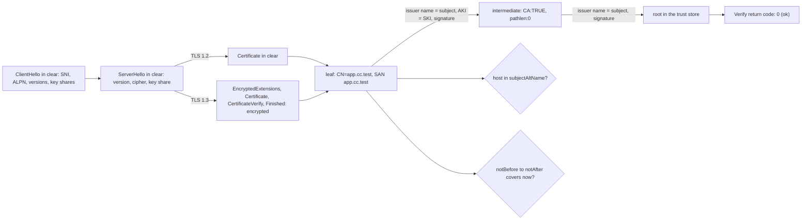

# TLS Is a Handshake and a Chain You Can Verify

*A TLS error is a hello the server refused or a chain the client could not build, and both are bytes you can read and check.*

## Metadata

| Field | Value |
|---|---|
| Type | Build |
| Languages | Python |
| Prerequisites | [Most Network Outages Are Timeouts You Did Not Set](https://cloudcaptain.io/learn/networking/tcp-states) |
| Time | 120 minutes |
| Tools | openssl, curl, python3 |

<Quiz stage="pre" />

## The Problem

Monday, 09:10. The certificate on the public load balancer was renewed over the weekend, and the payment partner's integration has been failing since. Their Java client logs `PKIX path building failed: unable to find valid certification path to requested target`. Your browser shows a padlock, so the first answer in the incident channel is "it works for us, it's their trust store". A CI job that calls the same API with `curl` starts failing too, with `SSL certificate problem: unable to get local issuer certificate`, and someone pushes a hotfix that adds `-k`. An hour later a second team "fixes" their Python client with `verify=False`. Two clients now accept any certificate from anyone who can get between them and the server.

The cause was one file. The renewal job uploaded `cert.pem` (the leaf) instead of `fullchain.pem` (the leaf followed by the intermediate). Browsers fill that gap on their own: Firefox ships the intermediates of public CAs, Chrome and Safari fetch the URL in the leaf's `authorityInfoAccess` extension. OpenSSL, curl, Python, Go and Java do neither, so they hold a leaf signed by an issuer they have never seen, and the error says exactly that: error 20, no local certificate for the issuer named in the leaf. A week later the same load balancer hands an old client that sends no SNI the default certificate of another site, and the error becomes `hostname mismatch`. Neither incident needed `-k`; both needed someone to read what the server sent.

TLS failures split into two halves, and both are inspectable. The handshake starts with a ClientHello that travels in clear: the name the client wants (SNI), the protocols it speaks (ALPN), the versions, cipher suites and key shares it offers. The server answers with a ServerHello and a certificate chain, and the client verifies that chain with a fixed procedure: find each issuer, check each signature, check the dates, the CA flags and the name. You are going to build `tlslens`, which records a real ClientHello with a small listener, reads the ServerHello and a TLS 1.2 chain off the wire, parses X.509 from DER, builds the chain, checks RSA and ECDSA signatures with `pow()`, matches hostnames and prints OpenSSL's verify codes. Then `openssl s_client`, `openssl verify`, `curl -v` and Python's `ssl` read like a log of steps you have written yourself.

## The Concept

Think of a border crossing. The traveller says where they are going and which languages they speak before anything else happens; that is the ClientHello, and anyone on the path can hear it. Then they hand over a passport. The guard does not know the traveller, but the passport carries the stamp of an issuing office, the office's authority is stamped by a ministry, and the ministry's seal is on the wall of the guard's booth. The guard checks every stamp, the expiry date, that each office was allowed to issue passports, and that the name on the passport is the traveller's. A single missing stamp, an expired date or a different name ends the conversation, and the guard can say which one.

TLS runs over TCP as **records**: five bytes of header (content type, a version, a length) and up to 16 KiB of payload. Handshake records carry **handshake messages**, each with a one-byte type and a three-byte length, and a message may span records. The first message is the **ClientHello**. Its `legacy_version` field is frozen at TLS 1.2 (`0x0303`) because middleboxes broke on anything else, so the real offer lives in extensions: `supported_versions`, `server_name` (SNI, the host the client wants, which lets one IP serve many certificates), `alpn` (`h2`, `http/1.1`), `supported_groups`, `key_share` (the client's half of a key exchange for the groups it guesses the server will pick) and `signature_algorithms`.

The **ServerHello** picks one version, one cipher suite and one key share. In TLS 1.3 both sides can derive keys right after it, so everything that follows is encrypted: `EncryptedExtensions` (including the chosen ALPN), `Certificate`, `CertificateVerify` and `Finished`. A passive observer of TLS 1.3 sees SNI and ALPN offers, the version and the cipher, and nothing about the certificate. TLS 1.2 sends `Certificate` and `ServerKeyExchange` in clear, which is why a client that offers only TLS 1.2 can read a chain without any cryptography. If the client guessed the wrong group, a TLS 1.3 server sends a **HelloRetryRequest** (a ServerHello whose random field is a fixed constant) and the handshake costs an extra round trip.



A certificate is a signed statement: "the key in this certificate belongs to this subject, valid between these dates, for these uses", signed by the issuer's private key. The client **builds a chain** from the leaf upwards: for each certificate it looks for one whose subject equals this certificate's issuer name (and whose subject key identifier equals the authority key identifier, when both are present), first among the trust anchors, then among the certificates the server sent and any it was given. It stops at a self-signed certificate. If that certificate is in the trust store the chain is anchored; if not, the error depends on where the walk stopped. Only then does it **verify**: every signature in the chain with the issuer's public key, every certificate's validity window, `basicConstraints CA:TRUE` and `keyCertSign` on every issuer, `pathlen` limits, the leaf's `extendedKeyUsage` for TLS servers, and the hostname against the `subjectAltName` DNS and IP entries (the CN is ignored by browsers and modern libraries).

OpenSSL numbers each failure. The numbers in its `x509_vfy.h` are stable, and every TLS stack built on OpenSSL (curl, Python, Ruby, nginx as a client, most Linux tools) reports them: 20 "unable to get local issuer certificate", 19 "self-signed certificate in certificate chain", 10 "certificate has expired", 62 "hostname mismatch". Each names the step that failed, which is why the fix for a verify error is almost never `-k`.

## Build It

`code/main.py` is `tlslens`, standard library only, with five subcommands: `hello` decodes captured TLS bytes, `listen` records what a client sends (and can relay to a real server to record both sides), `probe` asks a server for TLS 1.2 and reads the chain, `x509` prints certificate fields and `verify` builds and checks a chain like `openssl verify`. The fixtures in `code/fixtures/` are real: `pki/` holds certificates made with `openssl ca` (the keys were thrown away), the `.hex` files are bytes recorded from OpenSSL 4.1's `s_client` and `s_server` and from curl, and `openssl-verify.json` is what `openssl verify` printed for nineteen cases, which the tests compare against.

### Step 1: records, then handshake messages

A record header is five bytes. Before parsing, `parse_records()` names the two mistakes that produce the most confusing TLS errors: plaintext HTTP sent to a TLS port, and an SSLv2-format hello. `read_flight()` then reassembles handshake messages across records and counts what it cannot read:

```python
for record in records:
    kind, fragment = record.content_type, record.fragment
    if kind == 20:
        ccs += 1
    elif kind == 21 and len(fragment) == 2:
        alerts.append((fragment[0], fragment[1]))
    elif kind == 22 and (not ccs or plaintext_hello(fragment)):
        buffer += fragment
        while len(buffer) >= 4 and len(buffer) >= 4 + int.from_bytes(buffer[1:4], "big"):
            length = int.from_bytes(buffer[1:4], "big")
            messages.append(Handshake(buffer[0], buffer[4:4 + length]))
            buffer = buffer[4 + length:]
    else:
        encrypted += 1
```

ChangeCipherSpec (type 20) means "encrypted from here" in TLS 1.2. TLS 1.3 still sends one for middlebox compatibility and keeps going in clear after a HelloRetryRequest, so a handshake record after it counts as plaintext only if it parses as a complete ClientHello or ServerHello. A plaintext alert is exactly two bytes (level, description); an encrypted one is longer because of the authentication tag.

### Step 2: what the ClientHello and the ServerHello say

```python
def parse_client_hello(body: bytes) -> Hello:
    reader = Reader(body, "ClientHello")
    version = reader.uint(2)
    random = reader.take(32)
    session_id = reader.vector(1)
    suites = u16_list(reader.vector(2), "cipher_suites")
    compression = list(reader.vector(1))
    return Hello("client_hello", version, random, session_id, suites, compression, parse_extensions(reader))
```

Every variable-length field is a length prefix of one, two or three bytes and a payload, so `Reader.vector(n)` does all the work. SNI is a list inside a list (`server_names()`), ALPN is a list of one-byte-prefixed strings, and the ClientHello's `supported_versions` holds the real offer. `describe_hello()` turns the recorded OpenSSL 4.1 ClientHello into this:

```bash
python3 code/main.py hello code/fixtures/clienthello-openssl.hex
# client_hello  offers TLS 1.3, TLS 1.2 (legacy_version TLS 1.2)
#   sni            app.cc.test
#   alpn           h2, http/1.1
#   key shares     X25519MLKEM768 (1216 bytes), x25519 (32 bytes)
#   ja3            fe84d8d8100940fe056fd753a407ffb8  771,4866-4867-4865-...
```

Current OpenSSL guesses the hybrid post-quantum group `X25519MLKEM768` first and sends a classic `x25519` share as a fallback, which is why this ClientHello is 1592 bytes where curl's (LibreSSL) is 321. Values like `0x0a0a` and `0xfafa` are **GREASE**: browsers sprinkle reserved code points into every list so that servers which choke on unknown values break early. `ja3()` joins version, ciphers, extensions, groups and point formats with GREASE removed and hashes them; that string is how WAFs and bot detection tell `curl` from Chrome without decrypting anything. On the server side `parse_server_hello()` flags a HelloRetryRequest by its fixed random and reads the downgrade sentinel: a server that speaks TLS 1.3 but negotiated TLS 1.2 must end its random with `DOWNGRD\x01`, so a client that offered 1.3 can detect an attacker who stripped it.

### Step 3: a listener that records, a relay that watches, a probe that asks for TLS 1.2

To see what a client really sends, accept its connection, read until the ClientHello is complete and answer with a fatal alert, so the client fails fast with a clear message:

```python
with conn:
    if upstream:
        return relay(conn, upstream, timeout)
    client_bytes = read_client_hello(conn, timeout)
    with contextlib.suppress(OSError):
        conn.sendall(alert_record(alert))
    return client_bytes, b""
```

With `--upstream`, `relay()` copies bytes both ways between the client and a real server in two threads and records each direction, a man in the middle that can read only what TLS leaves in clear. Through the relay a TLS 1.3 handshake shows a ServerHello and then nothing but `application_data` records; a TLS 1.2 handshake shows the whole chain.

`probe` uses that difference. It builds a ClientHello by hand that offers only TLS 1.2 ECDHE and RSA suites, then reads until `ServerHelloDone` and hangs up before any key exchange:

```python
body = (0x0303).to_bytes(2, "big") + random + vec(1, b"") + vec(2, u16s(PROBE_SUITES)) + vec(1, b"\x00") + vec(2, extensions)
return b"\x16\x03\x01" + vec(2, b"\x01" + vec(3, body))
```

No cryptography is needed to get a server's chain this way, which is how scanners inventory certificates. A server that speaks only TLS 1.3 answers with alert `protocol_version` (70), and `tlslens` tells you to use `openssl s_client -showcerts` instead.

### Step 4: DER is tag, length, value

X.509 is ASN.1 encoded with DER: every element is a tag byte, a length (one byte below 128, otherwise `0x80 | n` followed by `n` length bytes) and the value. Constructed types (SEQUENCE `0x30`, SET `0x31`, context tags `0xa0` and up) contain more elements:

```python
if first < 0x80:
    length = first
else:
    count = first & 0x7F
    if count > 4 or cursor + count > len(data):
        raise DerError(f"offset {pos}: impossible length-of-length {count}")
    length = int.from_bytes(data[cursor:cursor + count], "big")
    cursor += count
```

`0x80` alone is BER's indefinite length, which DER forbids, and `read_tlv()` rejects it. An OBJECT IDENTIFIER packs its first two arcs into one number (`40 * a + b`) and writes the rest in base 128 with the high bit as "more follows". Times come in two forms: UTCTime with a two-digit year that means 19YY from 50 to 99 and 20YY below 50, and GeneralizedTime with four digits, which RFC 5280 requires from 2050 on. INTEGERs are two's complement, which is why serial numbers with a high first byte get a leading zero.

### Step 5: the certificate and its extensions

`parse_certificate()` walks `Certificate ::= SEQUENCE { tbsCertificate, signatureAlgorithm, signatureValue }`. It keeps the exact bytes of `tbsCertificate` because that is what the issuer signed; re-encoding them would break the signature on the first non-canonical byte. Extensions are an OID, an optional `critical` flag and an OCTET STRING that contains more DER:

```python
if ext.oid == EXT_SAN:
    for name in inner.children():
        if name.tag == 0x82:
            cert.dns_names.append(name.value.decode("ascii", "replace"))
        elif name.tag == 0x87:
            cert.ip_addresses.append(str(ipaddress.ip_address(name.value)))
```

`subjectAltName` entries are context-tagged: `[2]` is a DNS name, `[7]` an IP address as 4 or 16 raw bytes. `basicConstraints` says whether the subject is a CA and how many CAs may follow it (`pathlen`). `keyUsage` is a BIT STRING (`keyCertSign` is bit 5), `extendedKeyUsage` a list of OIDs (`serverAuth` is `1.3.6.1.5.5.7.3.1`). The subject and authority key identifiers are usually a SHA-1 of the public key and link a certificate to its issuer even when two CAs share a name. `authorityInfoAccess` holds the `caIssuers` URL that browsers use to fetch a missing intermediate. Names render the way OpenSSL prints them (`C=DE, O=CloudCaptain Lab, CN=...`) and as RFC 4514 strings (`CN=...,O=...,C=DE`, reversed and escaped), and compare case-insensitively with whitespace collapsed.

### Step 6: build the chain, trust store first

```python
def issued_by(child: Certificate, issuer: Certificate) -> bool:
    if child.issuer.key() != issuer.subject.key():
        return False
    if child.authority_key_id and issuer.subject_key_id and child.authority_key_id != issuer.subject_key_id:
        return False
    return child.authority_serial is None or child is issuer or child.authority_serial == issuer.serial
```

`build_chain()` starts at the leaf and asks `find_issuer()` for the next certificate, from the trust anchors first and then from the presented and `--untrusted` certificates, preferring one that is valid now. That order is OpenSSL's `trusted_first` default, and it matters: when Let's Encrypt's old DST Root CA X3 expired on 30 September 2021, servers still sent a cross-signed intermediate that pointed at it, and clients that searched the untrusted certificates first (OpenSSL 1.0.2 among them) walked into the expired root even though the trusted ISRG Root X1 was right there. Where the walk stops decides the error:

```python
if self_signed(top):
    code = 18 if depth == 0 else 19
    detail = f"the chain ends at {top.label!r}, which signs itself but is not in the trust store"
elif any(c.fingerprint in anchors for c in chain):
    code = 2
    detail = f"{top.label!r} is trusted, but its issuer {top.issuer.text()} is not; add the root or use --partial-chain"
else:
    code = 20
    detail = f"no certificate named {top.issuer.text()} among the presented, untrusted or trusted certificates"
```

Error 19 at depth 1 is the classic message behind a TLS-intercepting proxy: the proxy sends its own root along with a forged leaf. Error 20 at depth 0 is the server that forgot its intermediate.

### Step 7: signatures are pow() and a comparison

An RSA signature `s` verifies when `s^e mod n`, written out to the modulus length, equals the PKCS#1 v1.5 encoding of the hash: `00 01 FF ... FF 00` followed by a DER `DigestInfo` naming the hash algorithm:

```python
s = int.from_bytes(signature, "big")
if s >= n:
    return False
encoded = pow(s, e, n).to_bytes(k, "big")
t = digest_info(hash_name, hashlib.new(hash_name, message).digest())
if k < len(t) + 11:
    return False
expected = b"\x00\x01" + b"\xff" * (k - len(t) - 3) + b"\x00" + t
return hmac.compare_digest(encoded, expected)
```

Building the full expected encoding and comparing it, instead of parsing what `pow()` returned, is what closes the forgery attacks that hit lenient parsers. ECDSA on P-256 and P-384 is curve arithmetic from the published parameters: with `w = s^-1 mod n`, the point `(e*w)G + (r*w)Q` must have an x coordinate equal to `r` modulo the group order, where `e` is the hash cut to the order's bit length:

```python
e = int.from_bytes(digest, "big") >> max(0, len(digest) * 8 - n.bit_length())
w = pow(s, -1, n)
point = point_add(curve, scalar_mult(curve, e * w % n, curve.generator), scalar_mult(curve, r * w % n, public))
return point is not None and point[0] % n == r
```

The tests check `ecdsa_verify()` against the P-256 "sample" vector from RFC 6979 and against the fixture chain, where a P-384 intermediate signs a P-256 leaf with SHA-384 the way Let's Encrypt's ECDSA intermediates do. The test CA signs with 1024-bit RSA keys generated at run time to stay fast; production keys are 2048-bit RSA or larger, or P-256. This code is for reading, not for production: it is not constant time and does no RSA-PSS or Ed25519.

### Step 8: the checks OpenSSL runs, in its order

```python
chain, anchored, errors = build_chain(leaf, trusted, list(presented[1:]) + list(untrusted), policy)
errors += check_extensions(chain, policy)
matched = ""
if policy.host:
    matched, problem = match_host(leaf, policy.host, policy.cn_fallback)
    if problem:
        errors.append(problem)
errors += check_signatures_and_times(chain, anchored, policy.at)
```

The order is OpenSSL's: chain building, then extension checks per depth from the leaf up (unknown critical extension 34, issuer not a CA 79, no `keyCertSign` 32, wrong purpose 26, `pathlen` 25), then the hostname (62, or 64 for an IP), then signatures (7) and validity (9, 10) from the top of the chain down. A chain with several problems reports them in that order, and the first one is the verdict. `check_signatures_and_times()` also reproduces a detail of `s_client`, which keeps verifying after an error: a lone leaf whose issuer is missing gets error 20 and then 21 "unable to verify the first certificate", and `s_client`'s final `Verify return code` is the last one.

Hostnames follow RFC 6125 (updated by RFC 9525): DNS SANs only, case-insensitive, a trailing dot ignored, and a wildcard only as the whole left-most label, matching exactly one label:

```python
if "*" not in pattern:
    return pattern == host
if not pattern.startswith("*.") or "*" in pattern[2:] or "." not in pattern[2:]:
    return False
first, dot, rest = host.partition(".")
return bool(first) and bool(dot) and rest == pattern[2:]
```

So `*.api.cc.test` covers `orders.api.cc.test` but neither `api.cc.test` nor `eu.orders.api.cc.test`, and `*.test` covers nothing. An IP address matches only an IP SAN. The CN is used only with `--cn-fallback`, which mimics OpenSSL's own default and no browser.

### Step 9: run it

```bash
F=code/fixtures
python3 code/main.py x509 $F/pki/leaf.pem                     # fields, SANs, key ids, SHA-256 fingerprint
python3 code/main.py hello $F/server-tls12.hex                # ServerHello, Certificate, ServerKeyExchange, ServerHelloDone in clear
#   downgrade      TLS 1.2 chosen by a server that also speaks TLS 1.3
python3 code/main.py hello $F/server-tls13.hex                # one ServerHello, then 7 encrypted records
python3 code/main.py hello $F/server-hrr.hex                  # hello_retry_request for secp384r1, then the real server_hello
python3 code/main.py verify $F/pki/leaf.pem --untrusted $F/pki/inter.pem --CAfile $F/pki/root.pem --host app.cc.test --at 2026-11-01
# chain of 3 certificates, ends at a trust anchor ... OK
python3 code/main.py verify $F/pki/leaf.pem --CAfile $F/pki/root.pem --host app.cc.test --at 2026-11-01; echo "exit $?"
# CN=app.cc.test
# error 20 at 0 depth lookup: unable to get local issuer certificate
#   no certificate named C=DE, O=CloudCaptain Lab, CN=CloudCaptain Lab Intermediate among ...
# error 21 at 0 depth lookup: unable to verify the first certificate
# exit 1
python3 code/main.py verify $F/pki/evil-leaf.pem --untrusted $F/pki/evil-root.pem --CAfile $F/pki/root.pem --at 2026-11-01   # 19 at depth 1
python3 code/main.py verify $F/pki/deep-leaf.pem --untrusted $F/pki/inter.pem --untrusted $F/pki/sub-inter.pem --CAfile $F/pki/root.pem --at 2026-11-01   # 25 at depth 2
python3 code/main.py verify $F/pki/expired.pem --untrusted $F/pki/inter.pem --CAfile $F/pki/root.pem --json | head -12
```

Then point it at real servers. `listen` prints its port on stderr; connect any client to it:

```bash
python3 code/main.py listen --port 8443 --out hello.bin &
curl -s --resolve app.cc.test:8443:127.0.0.1 https://app.cc.test:8443/   # curl: (35) ... alert handshake failure
python3 code/main.py hello hello.bin                                      # what curl offered
python3 code/main.py verify --connect example.com:443 --servername example.com   # system CA bundle, TLS 1.2 probe
```

Exit codes are 0 for a verified chain, 1 for a verification failure and 2 for input that is not TLS, not DER, unreadable or unreachable.

<RunTests />

## Use It

Run the same checks with OpenSSL, curl and Python. `code/smoke.sh` does all of this on a Linux runner: it creates a root, an intermediate and leaves with `openssl ca` (valid, expired, wrong SAN, one under an untrusted root, a P-256 leaf under a P-384 intermediate), serves each with `openssl s_server`, and asserts that `openssl verify`, `openssl s_client`, Python's `ssl`, curl and `tlslens` agree on every verdict.

**`openssl s_client`** is a TLS client that prints everything:

```bash
openssl s_client -connect app.cc.test:443 -servername app.cc.test -alpn h2,http/1.1 -showcerts </dev/null
openssl s_client -connect app.cc.test:443 -servername app.cc.test -verify_hostname app.cc.test -CAfile root.pem -verify_return_error </dev/null
openssl s_client -connect app.cc.test:443 -servername app.cc.test -tls1_2 -msg </dev/null | head -40   # every handshake message in hex
openssl s_client -connect app.cc.test:443 -servername app.cc.test -brief </dev/null                     # protocol, cipher, peer, verification in a few lines
```

Read the output top down. `depth=2 ... verify return:1` lines are the chain as OpenSSL built it, root first. A `verify error:num=20:unable to get local issuer certificate` line names the code and the depth line above it the certificate. `New, TLSv1.3, Cipher is TLS_AES_256_GCM_SHA384` and `ALPN protocol: h2` are what the ServerHello and EncryptedExtensions chose. `Verify return code: 0 (ok)` at the end is the final result, and without `-verify_return_error` `s_client` completes the handshake even when verification failed, so the last code can be 21 after a first error of 20. `-servername` sets SNI and nothing else: hostname checking needs `-verify_hostname`. Without `-servername`, a server with several certificates sends its default one, which is the "old client gets the wrong certificate" incident.

**`openssl x509` and `openssl verify`** are the offline halves:

```bash
openssl x509 -in leaf.pem -noout -text                                    # every field tlslens x509 prints, and more
openssl x509 -in leaf.pem -noout -subject -issuer -serial -dates -nameopt RFC2253
openssl x509 -in leaf.pem -noout -fingerprint -sha256                     # in its own call: on OpenSSL 4.1 adding -ext changed the printed fingerprint
openssl x509 -in leaf.pem -noout -ext subjectAltName,basicConstraints,keyUsage,extendedKeyUsage
openssl x509 -in leaf.pem -noout -checkend 2592000 || echo "expires within 30 days"
openssl verify -CAfile root.pem -untrusted inter.pem -purpose sslserver -verify_hostname app.cc.test leaf.pem
openssl verify -CAfile root.pem -untrusted inter.pem -attime 1793491200 -show_chain leaf.pem
openssl verify -CAfile inter.pem -partial_chain leaf.pem                  # accept a trusted intermediate as the anchor
```

`openssl verify` stops at the first error for most codes and exits 2; the message text has changed between releases ("self signed" became "self-signed" in 3.0, error 9 gained "or the system clock is incorrect" in current releases, "invalid CA certificate" moved from 24 in 1.1.1 to 79), so scripts should match `error N at D depth lookup`, not sentences.

**curl** uses the same verification and reports it in two places:

```bash
curl -v https://app.cc.test/ 2>&1 | grep -E 'ALPN|SSL connection|subject|issuer|expire|SSL certificate'
curl --cacert root.pem --resolve app.cc.test:443:127.0.0.1 https://app.cc.test/      # test a name against an IP before DNS points there
curl -s -o /dev/null -w '%{ssl_verify_result} %{http_code}\n' https://app.cc.test/  # the OpenSSL verify code as a number
```

Exit code 60 means verification failed and 35 that the handshake itself failed (an alert, no common protocol). `-k` turns off both the chain and the hostname check, so it does not diagnose anything, it hides the answer.

**Python's `ssl`** exposes the code directly:

```python
import socket, ssl
context = ssl.create_default_context(cafile="root.pem")
try:
    with socket.create_connection(("127.0.0.1", 443)) as raw, context.wrap_socket(raw, server_hostname="app.cc.test") as tls:
        print(tls.version(), tls.cipher(), tls.selected_alpn_protocol())
except ssl.SSLCertVerificationError as exc:
    print(exc.verify_code, exc.verify_message)
```

`server_hostname` sets SNI and the hostname to verify at once. Since Python 3.13 the default context also sets `VERIFY_X509_STRICT` and `VERIFY_X509_PARTIAL_CHAIN`, so an intermediate placed in `cafile` becomes an anchor and sloppy certificates (no authority key identifier, a CA without critical `basicConstraints`) that 3.12 accepted now fail.

**TLS 1.3 against 1.2.** TLS 1.3 needs one round trip before the client can send data, TLS 1.2 two; a HelloRetryRequest adds one back, which is why servers and clients agreeing on a first-guess group (today `X25519MLKEM768` or `x25519`) matters for latency. TLS 1.3 removed RSA key exchange, CBC suites and renegotiation, encrypts the certificate, and offers 0-RTT data that an attacker can replay, so servers accept it only for idempotent requests. Forcing a version is a debugging tool: `-tls1_2` and `-tls1_3` on `s_client`, `--tls-max 1.2` on curl, `ssl_protocols` on nginx.

**SNI-based routing.** Because SNI and ALPN are in clear, a proxy can route TLS without terminating it, reading exactly the fields `tlslens hello` prints: nginx's `stream` module with `ssl_preread on` and `$ssl_preread_server_name`, HAProxy with `tcp-request inspect-delay` and `req.ssl_sni`, Envoy's `tls_inspector` listener filter with `filter_chain_match.server_names`, and the Gateway API `TLSRoute` you will meet in Orchestration. ACME's TLS-ALPN-01 challenge uses the same trick with the ALPN value `acme-tls/1`. Encrypted Client Hello (ECH) moves the real SNI into an encrypted inner hello and leaves only the provider's public name visible, which is why SNI-based filtering is losing ground.

**Issuing and renewing.** Nobody should run `openssl ca` in production. ACME automates what you did by hand: a client proves control of the name (HTTP-01 on port 80, DNS-01 with a TXT record, TLS-ALPN-01), the CA returns the leaf and the chain, and the client renews on a schedule. In Kubernetes, cert-manager does this from a `Certificate` resource and an `Issuer` or `ClusterIssuer`, writes `tls.crt` (leaf plus chain) and `tls.key` into a Secret and renews by default when two thirds of the lifetime have passed. Public lifetimes are shrinking in steps (the CA/Browser Forum has voted to cut them to 47 days by 2029), so manual renewal stops being an option. Check what a Secret really holds with the tool you built:

```bash
kubectl get certificate -A
kubectl -n shop describe certificate app-tls                    # Ready condition, renewal time, the failing challenge if any
kubectl -n shop get secret app-tls -o jsonpath='{.data.tls\.crt}' | base64 -d > chain.pem
python3 code/main.py verify chain.pem --host app.shop.example     # leaf first, intermediates after, against the system bundle
```

| What you built | Real tool | Note |
|---|---|---|
| `parse_records()`, `read_flight()` | Wireshark's TLS dissector, `openssl s_client -msg` | both decrypt nothing; Wireshark can with an `SSLKEYLOGFILE` |
| `parse_client_hello()`, `ja3()` | `s_client -msg`, JA3/JA4 fingerprints in WAFs | Chrome shuffles extension order, which is why JA4 sorts them |
| `listen` and `listen --upstream` | nginx `ssl_preread`, HAProxy `req.ssl_sni`, Envoy `tls_inspector` | read the hello without terminating TLS |
| `probe` (TLS 1.2 only) | `openssl s_client -showcerts` | `s_client` sees the TLS 1.3 chain because it completes the handshake |
| `parse_certificate()` | `openssl x509 -noout -text` | same fields; OpenSSL names them "TLS Web Server Authentication" and so on |
| `build_chain()` with trust store first | `openssl verify -untrusted`, `X509_verify_cert` | `trusted_first` is the default since OpenSSL 1.1.0 |
| `rsa_pkcs1_verify()`, `ecdsa_verify()` | OpenSSL's signature providers | constant time, plus RSA-PSS, Ed25519 and ML-DSA |
| `hostname_matches()`, `match_host()` | `-verify_hostname`, Python `check_hostname`, curl | OpenSSL falls back to the CN when there are no DNS SANs; browsers do not |
| `VerifyError` codes and wording | `Verify return code:`, `SSLCertVerificationError.verify_code`, curl `%{ssl_verify_result}` | the numbers come from `x509_vfy.h`; the sentences change between releases |
| `--at`, `--partial-chain`, `--purpose any` | `-attime`, `-partial_chain`, `-purpose` | Python 3.13 turns partial chains on by default |
| `chain_warnings()` | `openssl x509 -checkend`, cert-manager renewal | expiry is an alert, not an incident |

<Quiz stage="check" />

## Ship It

Two artifacts in `outputs/`:

- **`skill-tls-certificate-triage.md`**: a runbook for any TLS error report ("certificate verify failed", "PKIX path building failed", curl exit 60 or 35, a browser warning). It splits handshake failures from chain failures, collects the chain the server really sends with and without SNI, maps each OpenSSL verify code to the command that confirms it and the change that fixes it, checks expiry and renewal, and ends with a fixed report that never recommends `-k` or `verify=False`.
- **`prompt-explain-openssl-verify.md`**: paste the output of `openssl s_client`, `openssl verify`, `curl -v` or a Python traceback, and get the chain as the client built it, the first error with its code and depth in plain words, the single change that fixes it, and the fixes that only hide it.

<ShipIt />

## Exercises

### Easy

Add `--checkend SECONDS` to `verify`, like `openssl x509 -checkend`: the verdict stays OK but the exit code becomes 1 and the output names the certificate (at any depth) that expires within the window, with the date. Write the tests first with the fixture chain and fixed `--at` times: a window that ends before the leaf's `notAfter` passes, one that crosses it fails and names depth 0, and a window that also crosses the intermediate names depth 0 first.

### Medium

Implement `nameConstraints` (2.5.29.30) instead of reporting it as an unhandled critical extension: parse `permittedSubtrees` and `excludedSubtrees` for `dNSName` and `iPAddress`, apply each CA's constraints to every certificate below it, and report error 47 "permitted subtree violation" or 48 "excluded subtree violation" at the depth of the offending certificate. Write the tests first with the test CA in `test_main.py`: a CA limited to `.cc.test` that signs `app.cc.test` (passes) and `app.example.com` (47), and an excluded `10.0.0.0/8` against an IP SAN. Then record `openssl verify` for the same certificates and compare.

### Hard

Add revocation: parse a CRL (`CertificateList` with `tbsCertList`, `thisUpdate`, `nextUpdate` and `revokedCertificates`), verify its signature with the issuer's key, and report error 23 "certificate revoked" for a listed serial, 12 for an expired CRL and 3 when `--crl-check` is set and no CRL for the issuer was given. Test first against CRLs you generate with `openssl ca -revoke` and `openssl ca -gencrl`, and compare every verdict with `openssl verify -crl_check -CRLfile`. Then explain in the docs why browsers moved to pushed revocation lists and short lifetimes instead of fetching CRLs or OCSP on every connection.

<Quiz stage="post" />

## Key Terms

| Term | Common misconception | Precise definition |
|---|---|---|
| ClientHello | "The handshake is encrypted from the first byte." | The first handshake message, sent in clear: offered versions, cipher suites, key shares, SNI and ALPN. Only ECH hides parts of it. |
| SNI | "The server finds the hostname in the certificate request." | The `server_name` extension in the ClientHello. The server uses it to pick a certificate (and proxies to pick a backend); it does not make the client check the name. |
| ALPN | "HTTP/2 is negotiated after the TLS handshake." | The `alpn` extension: the client lists protocols, the server picks one in the ServerHello (TLS 1.2) or in the encrypted EncryptedExtensions (TLS 1.3). |
| Certificate chain | "The server only needs to send its own certificate." | The leaf plus every intermediate up to (not necessarily including) a root the client trusts. A missing intermediate is error 20 for every client that does not fetch it itself. |
| Trust anchor | "Any CA certificate in the bundle is equally trusted at any position." | A certificate in the client's trust store where chain building may stop. By default it must be self-signed; partial-chain mode also accepts a trusted intermediate. |
| subjectAltName | "The Common Name is the hostname." | The extension that lists DNS names and IP addresses a certificate is valid for. Browsers and current libraries ignore the CN for hostname checks. |
| Wildcard certificate | "`*.example.com` covers every subdomain and the apex." | A DNS SAN whose left-most label is `*`. It matches exactly one label: `a.example.com`, not `example.com` and not `a.b.example.com`. |
| basicConstraints | "Any certificate can sign another one if you have its key." | The extension that marks a CA (`CA:TRUE`) and limits how many CAs may follow it (`pathlen`). A verifier rejects an issuer without it (error 79) or beyond its path length (25). |
| HelloRetryRequest | "TLS 1.3 always completes in one round trip." | A ServerHello with a fixed random value that asks the client to resend its ClientHello with a key share for another group, costing an extra round trip. |
| OpenSSL verify code | "The error text is the error." | The number from `x509_vfy.h` (20, 19, 10, 62...) that OpenSSL, curl, Python and others report. The number is stable across releases; the wording is not. |

## Further Reading

- [Network Security](https://cloudcaptain.io/docs/tools/networking/security): where TLS sits next to firewalls, VPNs and IPsec in a defence-in-depth design.
- [nginx Fundamentals](https://cloudcaptain.io/docs/tools/nginx/fundamentals): TLS termination, `ssl_certificate` with the full chain, protocols and session settings on the server side.
- [Kubernetes Networking and Services](https://cloudcaptain.io/docs/tools/kubernetes/networking-services): where cert-manager and TLS Secrets meet Services and gateways.
- [Networking Cheat Sheet](https://cloudcaptain.io/docs/tools/networking/cheatsheet): `curl` and `openssl` one-liners to keep next to this lesson.
- [RFC 8446: TLS 1.3](https://www.rfc-editor.org/rfc/rfc8446): the handshake, every extension `tlslens` parses, HelloRetryRequest and the downgrade sentinel.
- [RFC 5280: X.509 certificate profile](https://www.rfc-editor.org/rfc/rfc5280): the certificate structure, every extension in Step 5 and the path validation algorithm.
- [RFC 9525: Service identity in TLS](https://www.rfc-editor.org/rfc/rfc9525): the successor of RFC 6125 and the wildcard rules `hostname_matches()` implements.
- [RFC 8017: PKCS #1](https://www.rfc-editor.org/rfc/rfc8017): RSASSA-PKCS1-v1_5 and the DigestInfo prefixes, plus PSS for the next step.
- [RFC 6979](https://www.rfc-editor.org/rfc/rfc6979): deterministic ECDSA and the P-256 test vectors the tests use.
- [OpenSSL verification options](https://docs.openssl.org/master/man1/openssl-verification-options/): how OpenSSL builds and checks chains, `-partial_chain`, `-attime`, `-purpose` and the trusted-first rule.
- [openssl-s_client](https://docs.openssl.org/master/man1/openssl-s_client/): every flag used in Use It and what each output line means.
- [Python ssl module](https://docs.python.org/3/library/ssl.html): default contexts, verify flags and `SSLCertVerificationError`.
- [The Illustrated TLS 1.3 Connection](https://tls13.xargs.org/): every byte of a real TLS 1.3 handshake, annotated, to compare with `tlslens hello`.
- [cert-manager documentation](https://cert-manager.io/docs/): Certificates, Issuers, ACME challenges and renewal in Kubernetes.
