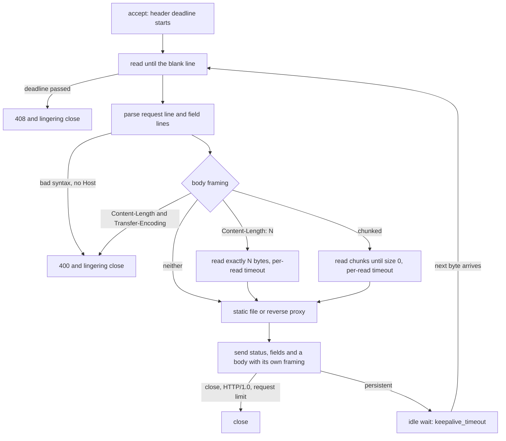

# HTTP/1.1 Is Text Over a Socket Until It Is Not

*HTTP/1.1 is bytes cut into messages by framing rules and guarded by deadlines; when two hops disagree on either, requests leak or stall.*

## Metadata

| Field | Value |
|---|---|
| Type | Build |
| Languages | Python |
| Prerequisites | [Most Network Outages Are Timeouts You Did Not Set](https://cloudcaptain.io/learn/networking/tcp-states) |
| Time | 90 minutes |
| Tools | curl, nginx, docker |

<Quiz stage="pre" />

## The Problem

Tuesday, the morning after the platform team upgraded nginx. About one POST to the checkout API in three hundred fails with `502 Bad Gateway`, and nginx's error log says `upstream prematurely closed connection while reading response header from upstream`. GETs never fail. The application did not change. What changed is a default: current nginx releases keep connections to upstreams open and reuse them. The Python app server behind it closes a connection after 5 idle seconds; nginx keeps idle upstream connections for 60. Every few minutes nginx writes a request onto a connection the app closed a millisecond earlier. nginx repeats such a request on a fresh connection only when the method is idempotent, so the GET is retried invisibly and the POST becomes a 502.

The same week a penetration test report lands. The CDN in front of the shop believes `Content-Length` when a request carries both `Content-Length` and `Transfer-Encoding: chunked`; the in-house authentication proxy behind it believes `Transfer-Encoding`. A crafted POST therefore carries a second, complete request to `/admin` inside its body: the CDN forwards one request, the proxy sees two, and the second arrives with the proxy's trusted source address. And an internal Python service fell over during the test because one laptop opened 200 connections and sent one header byte every ten seconds to each. Its socket timeout was 30 seconds, and every byte restarted it.

None of this is "the network". HTTP/1.1 is a stream of bytes on a TCP connection, and three things decide everything that happens on it: where each message ends (framing), how long the connection stays open and who closes it (persistence), and how long each phase may take (deadlines). You are going to build `minihttp`, an HTTP/1.1 server and reverse proxy on raw sockets that makes each of those rules explicit, and a probe that sends 32 carefully built requests to any server. Then nginx, configured with the same limits, answers the same 32 requests, and you read exactly where the two agree and where they differ.

## The Concept

Picture a conveyor belt with parcels packed end to end and no gaps between them. Nothing on the belt marks where one parcel stops; each parcel has a label that says how long it is. If two workers read the same label differently, the second one cuts the next parcel in the wrong place, and from then on every cut is wrong. A TCP connection is that belt. HTTP/1.1 places messages on it back to back, and every rule in RFC 9112 exists so that every reader of the stream cuts it in the same place.

A request is a start line (`GET /hello.txt HTTP/1.1`), field lines (`Host: shop.test`), an empty line, and maybe a body. The header section ends at the first empty line, so the parser can find it with nothing more than a search for a blank line, but the field lines have strict syntax for the same reason as the belt: no whitespace between a field name and its colon, no continuation lines that start with a space (obsolete line folding), exactly one `Host` in HTTP/1.1. A lenient parser that accepts `Transfer-Encoding : chunked` while the proxy in front ignores that line has just created two different readings of the stream.

The body is where the cuts happen, and the order of the rules matters:

- **Transfer-Encoding** whose last coding is `chunked`: the body is a series of chunks, each a hexadecimal size, CRLF, that many bytes, CRLF, ending with a zero-size chunk and an optional trailer section. A request that has `Transfer-Encoding` and `Content-Length` together is the classic request-smuggling shape; a server may reject it and must close the connection after answering. `minihttp`, like current nginx, rejects it with 400.
- **Content-Length**: exactly that many bytes. Two different values, a list, or a sign is a framing error.
- **Neither**: a request has no body. A response can also end by the server closing the connection, which is why only responses may omit both. Responses to `HEAD`, and every `1xx`, `204` and `304`, never have a body whatever their headers say.

Persistence is the second rule. HTTP/1.1 connections are persistent unless a side sends `Connection: close`; HTTP/1.0 connections close unless the client asks for `keep-alive`. A server also closes after a configured number of requests, after an idle period, and after any framing error, because once it has doubts about where a message ended it cannot trust the next byte. Closing well is its own mechanism: if the server calls `close()` while unread request bytes sit in its receive buffer, the kernel answers with a TCP reset, and a reset can destroy the error response the client has not read yet. A lingering close shuts down the write side first, sends the FIN, and drains incoming bytes for a moment before the final close.

Deadlines are the third rule, and they come in two kinds. A **per-read** timeout ("nothing arrived for N seconds") is reset by every byte, which is exactly what a slowloris client exploits. A **total** deadline ("the whole header section within N seconds of the first byte") is not. nginx uses a total deadline for the header (`client_header_timeout`), per-read timeouts for the request body (`client_body_timeout`), for sending (`send_timeout`) and for reading from an upstream (`proxy_read_timeout`), and an idle timeout between requests (`keepalive_timeout`). A proxy adds a connect timeout, and its two failure statuses mean different things: **502** says the upstream refused, reset or sent garbage; **504** says the upstream did not answer in time.

A proxy also has to know which fields belong to the connection rather than the message. `Connection`, `Keep-Alive`, `Proxy-Connection`, `TE`, `Trailer`, `Transfer-Encoding`, `Upgrade` and every field the `Connection` header names are **hop-by-hop**: they describe this one TCP connection and are removed before forwarding. Everything else is end-to-end. The proxy adds its own facts: `X-Forwarded-For` (the client address it saw), `Via` (the protocol and the proxy's name), and a fresh framing header for the body it forwards.



The title's "until it is not" is the line between two RFCs. RFC 9110 defines HTTP's **semantics**: methods, status codes, field meanings, validators such as `ETag` and `Last-Modified`, conditional requests, byte ranges. RFC 9112 defines HTTP/1.1's **framing**: the text lines, `Content-Length`, chunked coding, persistent connections. HTTP/2 and HTTP/3 keep the semantics and replace the framing with binary, length-prefixed frames, so a `304` and a `206` mean the same thing over all three; the text and the parsing hazards of this lesson belong to HTTP/1.1 alone.

## Build It

`code/main.py` is `minihttp`, standard library only, no `http.server`. A `Server` accepts on a raw socket and gives every connection a thread; `Wire` is the connection's receive buffer with timeouts; the parsing, framing, validator and range logic are pure functions; `Site` serves a directory and forwards path prefixes to upstreams. The same file holds the tools around it: `upstream` (an echo server that reports exactly what it received), `probe` (the request matrix), `parse` (a byte stream split into requests offline), `config` (the settings and their nginx equivalents) and `logstat` (a reader for the combined access-log format).

### Step 1: a connection is a buffer and a deadline

Every read goes through one method. It turns the socket's two ways of saying "no more" (a timeout, an empty read or a reset) into two exceptions the rest of the code can reason about:

```python
def fill(self, timeout: float) -> None:
    if timeout <= 0:
        raise Timeout()
    try:
        self.sock.settimeout(timeout)
        data = self.sock.recv(65536)
    except socket.timeout:
        raise Timeout() from None
    except OSError:
        raise Closed() from None
    if not data:
        raise Closed()
    self.buffer += data
```

The header section is read against an absolute deadline, not a per-read timeout. `exchange()` computes it once, when the connection is accepted (or, for the next request on a persistent connection, when its first byte arrives), and every `fill()` gets only the time that is left:

```python
deadline = started + config.header_timeout
try:
    raw = wire.read_head(lambda: deadline - self.clock(), config.max_request_line, config.max_header_bytes)
except Timeout:
    if bytes(wire.buffer).strip():
        self.refuse(wire, client, first_line(wire.buffer), HTTPError(408, f"header section not complete within {config.header_timeout:g}s"))
    return False
```

A client that dribbles one header line every half second never triggers a 2-second per-read timeout, but it hits this deadline at 2 seconds. A connection that sent nothing at all is closed silently, as nginx does: an idle connection from a browser's preconnect is not an error worth a response. `read_head()` also enforces the size limits while it waits: a first line longer than `--max-request-line` is `414`, a header section larger than `--max-header-bytes` is `431`.

### Step 2: the request line and field lines are strict on purpose

```python
parts = line.split(b" ")
if len(parts) != 3 or not all(parts):
    raise HTTPError(400, "request line must be METHOD SP request-target SP HTTP-version with single spaces")
method, target, version = parts
if not TOKEN.fullmatch(method):
    raise HTTPError(400, f"invalid method {method[:20]!r}")
match = VERSION.fullmatch(version)
if not match:
    raise HTTPError(400, f"invalid HTTP version {version[:20]!r}")
if match.group(1) != b"1":
    raise HTTPError(505, f"HTTP/{match.group(1).decode()} cannot arrive as an HTTP/1.x request line")
```

`parse_fields()` rejects a line that starts with whitespace (obsolete folding), a name that is not a token (which is how `Host : a` fails), and control characters in values; more than `--max-headers` fields is `431`. `check_host()` requires exactly one `Host` for HTTP/1.1 and takes the authority from an absolute-form target (`GET http://shop.test/x HTTP/1.1`) when there is one. The parser accepts a bare LF as a line end in the header section, which RFC 9112 allows, and rejects a bare CR, which it does not.

### Step 3: one function decides where the body ends

```python
if head.values("transfer-encoding"):
    if head.version < (1, 1):
        raise HTTPError(400, "Transfer-Encoding in an HTTP/1.0 request: the framing cannot be trusted")
    if lengths:
        raise HTTPError(400, "both Content-Length and Transfer-Encoding: refusing a request that two parsers could split differently")
    if codings.count("chunked") != 1 or codings[-1] != "chunked":
        raise HTTPError(400, f"Transfer-Encoding {', '.join(codings) or '(empty)'}: chunked must be the final coding, applied once")
    if codings != ["chunked"]:
        raise HTTPError(501, f"transfer coding {', '.join(codings[:-1])} is not implemented")
    return "chunked", 0
if lengths:
    if len(lengths) > 1 or not DIGITS.fullmatch(lengths[0]):
        raise HTTPError(400, f"Content-Length must be one decimal number, got {', '.join(lengths)[:40]!r}")
    length = int(lengths[0])
    if length > max_body:
        raise HTTPError(413, f"Content-Length {length} exceeds the {max_body}-byte limit")
    return ("length", length) if length else ("none", 0)
return "none", 0
```

Every `HTTPError` raised while reading a request ends the connection: `refuse()` sends the status with `Connection: close` and the connection thread ends with a lingering close. `parse` shows what that means for a smuggling attempt, offline:

```bash
printf 'POST /api/echo HTTP/1.1\r\nHost: shop.test\r\nContent-Length: 4\r\nTransfer-Encoding: chunked\r\n\r\n0\r\n\r\nGET /admin HTTP/1.1\r\nHost: shop.test\r\n\r\n' > smuggle.raw
python3 code/main.py parse smuggle.raw
# 1  POST /api/echo HTTP/1.1  400 Bad Request: both Content-Length and Transfer-Encoding: refusing a request that two parsers could split differently; the connection closes here
```

There is no request 2. A parser that believed `Content-Length: 4` would have read `0\r\n\r` as the body and then a garbled next request; one that believed `Transfer-Encoding` would have served `GET /admin`. Refusing and closing is the only answer that cannot disagree with anyone.

### Step 4: chunked bodies and 100-continue

```python
while True:
    line = wire.read_line(idle, CHUNK_LINE_LIMIT)
    size_text = line.split(b";", 1)[0].rstrip(b" \t")
    if not CHUNK_SIZE.fullmatch(size_text):
        raise HTTPError(400, f"invalid chunk size {size_text[:20]!r}")
    size = int(size_text, 16)
    if size == 0:
        break
    if len(body) + size > max_body:
        raise HTTPError(413, f"chunked body larger than {max_body} bytes")
    body += wire.read_exact(size, idle)
    if wire.read_exact(2, idle) != b"\r\n":
        raise HTTPError(400, "chunk data must be followed by CRLF")
```

Chunk extensions after `;` are ignored, the trailer section after the last chunk is read and discarded, and `read_line()` insists on CRLF here: current nginx releases also treat a bare LF inside chunked framing as an error, because LF-versus-CRLF disagreements in chunk lines are a known smuggling vector. The size limit applies while reading, so a chunked upload cannot slip past `--max-body` the way it could if the check looked only at `Content-Length`.

A client that sends `Expect: 100-continue` waits before sending its body, so the server can refuse a 2 GB upload by its headers alone. `read_body()` sends the interim response just before it starts reading, and skips it when the body is already arriving:

```python
if head.expect_continue and not wire.buffer:
    wire.sock.sendall(b"HTTP/1.1 100 Continue\r\n\r\n")
```

curl sends `Expect: 100-continue` for larger uploads, and a server that never answers it costs every such upload curl's one-second wait.

### Step 5: persistence and how to close

```python
def persistent(version: Tuple[int, int], connection: Sequence[str]) -> bool:
    if "close" in connection:
        return False
    if version >= (1, 1):
        return True
    return "keep-alive" in connection
```

After each response `exchange()` combines that with the server's own limits: `keep = head.keep_alive and not response.close and served + 1 < config.keepalive_requests`. The response that ends a connection carries `Connection: close`; an HTTP/1.0 response that keeps it carries `Connection: keep-alive`. Between requests `handle()` waits at most `--keepalive-timeout` for the next byte and then closes without a word. Every close goes through `linger_close()`:

```python
def linger_close(sock: Any, seconds: float = 1.0) -> None:
    try:
        sock.shutdown(socket.SHUT_WR)
        deadline = time.monotonic() + seconds
        drained = 0
        while drained < 262144:
            remaining = deadline - time.monotonic()
            if remaining <= 0:
                break
            sock.settimeout(remaining)
            data = sock.recv(65536)
            if not data:
                break
            drained += len(data)
    except OSError:
        pass
    finally:
        sock.close()
```

The test `test_413_and_501_reach_the_client_before_the_connection_closes` sends `Content-Length: 100000` followed by 30,000 body bytes the server will never read. Without the drain, the server's close with those bytes still unread makes the kernel send a reset, and the client can see `Connection reset by peer` instead of the `413`.

### Step 6: static files, validators and ranges

`normalize_path()` percent-decodes the path, merges slashes, resolves `.` and `..`, and answers `400` when `..` climbs above the root, so `/docs/../hello.txt` is served and `/../../etc/passwd` is refused before the filesystem is touched. A directory without a trailing slash gets a `301` to the slash form; a directory without `index.html` gets `403`.

The validators copy nginx's format, so the two servers produce the same `ETag` for the same file: the modification time and the size, in hexadecimal.

```python
def make_etag(mtime: float, size: int) -> str:
    return '"%x-%x"' % (int(mtime), size)
```

Conditional requests are evaluated in the order RFC 9110 prescribes, and `If-None-Match` takes precedence over `If-Modified-Since`:

```python
if_none_match = head.header("if-none-match")
if if_none_match:
    if etag_matches(if_none_match, etag, weak=True):
        return 304 if safe else 412
elif safe:
    since = parse_http_date(head.header("if-modified-since"))
    if since is not None and mtime <= since:
        return 304
```

`If-Match` and `If-Unmodified-Since` come first and answer `412`. A `304` carries `ETag` and `Last-Modified` and no body or `Content-Length`. `parse_range()` turns `bytes=0-4`, `bytes=10-` and `bytes=-5` into spans clamped to the file size; a start beyond the end gives no span, which `file_response()` turns into `416` with `Content-Range: bytes */SIZE`; malformed syntax and `last < first` make the whole header ignored (a `200`). `choose_range()` honours `If-Range` (a strong `ETag` or the exact `Last-Modified` date) and answers several ranges with the whole file, which RFC 9110 allows; nginx sends `multipart/byteranges` instead. Bodies go out with `socket.sendfile()`, the same system call nginx's `sendfile on` uses on Linux.

### Step 7: the reverse proxy

```python
dropped = HOP_BY_HOP | set(head.tokens("connection")) | {"content-length", "expect", "x-forwarded-for", "x-forwarded-proto", "via"}
headers = [(key, value) for key, value in head.headers if key.lower() not in dropped]
if not head.values("host"):
    headers.insert(0, ("Host", head.host or upstream.label))
prior = ", ".join(head.values("x-forwarded-for"))
headers.append(("X-Forwarded-For", f"{prior}, {client}" if prior else client))
headers.append(("X-Forwarded-Proto", "http"))
via = ", ".join(head.values("via"))
headers.append(("Via", f"{via}, 1.1 {name}" if via else f"1.1 {name}"))
if head.framing != "none":
    headers.append(("Content-Length", str(len(body))))
headers.append(("Connection", "close"))
```

The request body was already decoded, so a chunked upload reaches the upstream with a `Content-Length` and the upstream never has to agree with anyone about chunk boundaries. `proxy()` opens one connection per request and maps each failure to its status: a refused or reset connection is `502`, a connect that takes longer than `--upstream-connect-timeout` is `504`, an upstream that sends nothing for `--upstream-timeout` (a per-read timeout, like `proxy_read_timeout`) is `504`, and a malformed or truncated response is `502`. `read_response()` is shared with the probe: it skips `1xx` interim responses and frames the body by `HEAD` and status first, then `Transfer-Encoding`, then `Content-Length`, then the close. On the way back `backward_headers()` drops hop-by-hop fields and the upstream's `Date` and `Server`, which nginx also hides by default, and appends its own `Via`.

### Step 8: run it

```bash
mkdir -p www/docs
printf 'minihttp and nginx serve these exact bytes from the same file.\n' > www/hello.txt
printf '<p>docs</p>\n' > www/docs/index.html
python3 code/main.py upstream --port 9000 &
python3 code/main.py serve --root www --port 8080 --header-timeout 2 --keepalive-timeout 3 --keepalive-requests 3 \
  --upstream-timeout 2 --proxy /api/=http://127.0.0.1:9000 --proxy /dead/=http://127.0.0.1:9 > access.log &
B=http://127.0.0.1:8080
curl -s --http1.1 -o /dev/null -o /dev/null -w '%{num_connects} ' $B/hello.txt $B/hello.txt; echo   # 1 0: the second request reused the connection
curl -s -r 0-7 $B/hello.txt; echo                                                              # minihttp (206, Content-Range: bytes 0-7/63)
ETAG=$(curl -sI $B/hello.txt | tr -d '\r' | awk 'tolower($1)=="etag:" {print $2}')
curl -s -o /dev/null -w '%{http_code}\n' -H "If-None-Match: $ETAG" $B/hello.txt                # 304
printf 'chunked body sent by curl\n' > up.txt
curl -s -H 'Transfer-Encoding: chunked' --data-binary @up.txt $B/api/echo                      # "framing": "length", "body_length": 26
curl -s -o /dev/null -w '%{http_code} %{time_total}\n' "$B/api/slow?ms=4000"                   # 504 2.00
curl -s $B/dead/x                                                                              # 502 Bad Gateway: connecting to 127.0.0.1:9 failed: Connection refused
python3 code/main.py probe --target 127.0.0.1:8080 --header-timeout 2 --keepalive-timeout 3 --keepalive-requests 3 --upstream-timeout 2
python3 code/main.py logstat access.log
```

`probe` prints one line per case: the status it got, the status minihttp is built to answer, a verdict, and the facts it checked (`slow-header 408 ... closed_after=2.014 drips=4`, `both-lengths 400 ... closed=True responses=1`, `forwarding ... via=1.0 edge, 1.1 minihttp`). Against minihttp all 32 say `ok`. The access log is nginx's `combined` format, one line per answered request, including the `400` for the smuggling attempt and the `408` for the slow header sender:

```text
127.0.0.1 - - [02/Nov/2026:00:06:56 +0100] "GET /hello.txt HTTP/1.1" 206 8 "-" "curl/8.7.1"
127.0.0.1 - - [02/Nov/2026:00:06:58 +0100] "GET /api/slow?ms=4000 HTTP/1.1" 504 57 "-" "curl/8.7.1"
127.0.0.1 - - [02/Nov/2026:00:07:00 +0100] "GET /hello.txt HTTP/1.1" 408 59 "-" "-"
```

Exit codes: `probe --strict` returns 1 when any case differs from minihttp's expectations, and every command returns 2 for bad flags or unreadable input.

<RunTests />

## Use It

nginx does the same job, and `config` prints the settings you gave minihttp as the nginx directives that mean the same thing, so the comparison starts from one source of truth:

```bash
python3 code/main.py config --header-timeout 2 --keepalive-timeout 3 --keepalive-requests 3 --upstream-timeout 2
python3 code/main.py config --root www --header-timeout 2 --body-timeout 2 --keepalive-timeout 3 --keepalive-requests 3 \
  --max-body 65536 --upstream-connect-timeout 2 --upstream-timeout 2 \
  --proxy /api/=http://127.0.0.1:9000 --proxy /dead/=http://127.0.0.1:9 \
  --nginx --nginx-root /srv/www --nginx-listen 127.0.0.1:8081 > nginx.conf
```

The interesting part of the generated `nginx.conf`:

```nginx
client_header_timeout 2s;
client_body_timeout 2s;
keepalive_timeout 3s;
keepalive_requests 3;
client_max_body_size 65536;

map $http_via $via_chain {
    ""      "1.1 nginx";
    default "$http_via, 1.1 nginx";
}

server {
    listen 127.0.0.1:8081;
    root /srv/www;

    location /api/ {
        proxy_pass http://127.0.0.1:9000;
        proxy_http_version 1.1;
        proxy_set_header Host $http_host;
        proxy_set_header X-Forwarded-For $proxy_add_x_forwarded_for;
        proxy_set_header Via $via_chain;
        proxy_connect_timeout 2s;
        proxy_read_timeout 2s;
    }
}
```

`proxy_pass` without a URI forwards the request URI unchanged, as minihttp does. The echo upstream keeps idle connections for 75 seconds (`upstream --keepalive-timeout`), longer than nginx's 60-second upstream pool, for the reason the Problem described. nginx adds no `Via` header by default, hence the `map`. Run it from the official image, pinned to the stable branch (nginx numbers stable branches even and mainline branches odd). On a Linux host `--network host` lets nginx reach the upstream on 127.0.0.1; on Docker Desktop, publish the port instead, start the upstream with `--host 0.0.0.0` and point `--proxy` at `host.docker.internal`:

```bash
docker run --rm -v "$PWD/nginx.conf:/etc/nginx/nginx.conf:ro" nginx:1.30-alpine nginx -t      # syntax is ok, test is successful
docker run -d --name lab-nginx --network host -e NGINX_ENTRYPOINT_QUIET_LOGS=1 \
  -v "$PWD/www:/srv/www:ro" -v "$PWD/nginx.conf:/etc/nginx/nginx.conf:ro" nginx:1.30-alpine
N=http://127.0.0.1:8081
curl -v --http1.1 $N/hello.txt $N/hello.txt -o /dev/null -o /dev/null 2>&1 | grep -E '^[*<>]'   # the same ETag as minihttp, and a reuse note before the second request
curl -s -r 0-7 $N/hello.txt; echo
curl -s -o /dev/null -w '%{http_code}\n' -H "If-None-Match: $ETAG" $N/hello.txt               # 304: minihttp's ETag is valid here
curl -s -H 'Transfer-Encoding: chunked' --data-binary @up.txt $N/api/echo                     # the upstream sees Content-Length: 26
curl -s -o /dev/null -w '%{http_code} %{time_total}\n' "$N/api/slow?ms=4000"                  # 504 2.00
python3 code/main.py probe --target 127.0.0.1:8081 --header-timeout 2 --keepalive-timeout 3 --keepalive-requests 3 --upstream-timeout 2
docker logs lab-nginx 2>/dev/null | python3 code/main.py logstat -                            # the same parser reads nginx's access log
docker logs lab-nginx 2>&1 >/dev/null | grep -E 'client timed out|at the same time|upstream timed out|connect\(\) failed'
```

In `curl -v` output, lines starting with `*` are curl's own notes (connecting, reusing, TLS), `>` lines are the request it sent and `<` lines the response head it read; `--http1.1` keeps curl from negotiating HTTP/2, and `-r` is `Range: bytes=...`. nginx serves the bind-mounted file with the same modification time and size, so its `ETag` is byte for byte the one minihttp computed, and a validator from one server revalidates against the other.

Against nginx the probe agrees on 29 of the 32 cases, including the smuggling attempt (`400`, closed, one response), `TE: gzip, chunked` (`501`), the slow upstream (`504`), the dead one (`502`) and the hop-by-hop stripping of `Keep-Alive` and `TE`. Three cases differ, and each difference is a documented choice rather than a bug:

- `ims-later`: an `If-Modified-Since` one day after the file's date. RFC 9110 says "not modified since then", so minihttp answers `304`; nginx's default `if_modified_since exact` answers `304` only for the exact date and sends `200`. `if_modified_since before` gives the RFC behaviour.
- `range-multi`: `bytes=0-1,4-5`. minihttp sends the whole file (`200`), nginx a `206` with `multipart/byteranges`. `max_ranges 1` makes nginx ignore multi-range requests too.
- `slow-header`: both close the connection at the 2-second deadline. minihttp sends `408` first; nginx closes without a response and only logs the `408`, plus `client timed out` in its error log at `info` level.

The forwarding case shows one more: nginx strips its fixed list of hop-by-hop fields but forwards `X-Hop`, a field the client named in `Connection`, which RFC 9110 says a proxy must remove. Current nginx releases also speak HTTP/1.1 to upstreams and keep those connections open by default (earlier releases used HTTP/1.0 and closed after each request). That reuse is the Problem's 502: the upstream's own idle timeout must be longer than nginx's `keepalive_timeout` in the `upstream` block (60 seconds by default), or nginx will sooner or later write a request onto a connection the upstream is closing. Raise the application server's keep-alive timeout or lower nginx's, and do not "fix" it with `proxy_next_upstream non_idempotent`, which retries POSTs that may already have been processed.

**What HTTP/2 and HTTP/3 change.** HTTP/2 (RFC 9113) keeps every semantic you used above and replaces the text framing with binary frames, each with a length and a stream identifier. Many requests share one TCP connection as independent streams, so a slow response no longer blocks the ones behind it at the HTTP layer; HPACK compresses repeated header fields with a static and a dynamic table; `Host` becomes the `:authority` pseudo-header; and connection-specific fields are forbidden outright (nginx's mainline branch now rejects HTTP/2 and HTTP/3 requests that carry `Connection`, `Keep-Alive`, `Transfer-Encoding` or `Upgrade`). Request smuggling inside HTTP/2 has no `Content-Length` versus chunked ambiguity, but a proxy that downgrades HTTP/2 to HTTP/1.1 toward the upstream reintroduces it. HTTP/3 (RFC 9114) runs the same model over QUIC on UDP: TLS 1.3 is built into the transport, a lost packet stalls only its own stream instead of the whole TCP connection, QPACK replaces HPACK, and a connection survives a change of client IP address. What none of them change: methods, status codes, `ETag`, `Range`, caching rules and every timeout question in this lesson. nginx shows it on a cleartext port with a second `server` block (HTTP/2 without TLS needs a client that starts with the HTTP/2 preface, which is what curl's prior-knowledge mode does):

```nginx
server {
    listen 127.0.0.1:8082;
    http2 on;
    root /srv/www;
}
```

```bash
curl -s --http2-prior-knowledge -o /dev/null -w '%{http_version} %{http_code}\n' http://127.0.0.1:8082/hello.txt   # 2 200
curl -s --http2-prior-knowledge -r 0-7 http://127.0.0.1:8082/hello.txt; echo                                     # minihttp: the same 206
```

| What you built | Real tool | Note |
|---|---|---|
| `read_head()` with a total deadline | nginx `client_header_timeout` | both cut a slowloris client at the deadline; nginx closes silently and logs 408 |
| `read_body()` per-read timeout | `client_body_timeout` | a per-read timeout still lets a very slow body through; limit size and rate as well |
| `--keepalive-timeout`, `--keepalive-requests` | `keepalive_timeout`, `keepalive_requests` | the last allowed response carries `Connection: close` in both |
| `--max-request-line`, `--max-header-bytes`, `--max-headers` | `large_client_header_buffers`, `max_headers` | minihttp answers 414 and 431; nginx 414 and 400 |
| `--max-body` | `client_max_body_size` | 413 before reading when `Content-Length` is too large, during reading for chunked |
| `message_framing()` | nginx's request header checks | both reject `Content-Length` with `Transfer-Encoding` (400) and unknown codings (501) |
| `make_etag()`, `evaluate_preconditions()` | `etag on`, `if_modified_since` | same `ETag` format; nginx's default date check is `exact` |
| `parse_range()`, `choose_range()` | the range filter, `max_ranges` | nginx answers several ranges with `multipart/byteranges` |
| `forward_headers()` | `proxy_set_header`, `$proxy_add_x_forwarded_for` | nginx does not remove fields named in `Connection` |
| `proxy()` 502 and 504 | `proxy_connect_timeout`, `proxy_read_timeout` | nginx also pools upstream connections and retries idempotent requests |
| `linger_close()` | `lingering_close`, `lingering_timeout` | why a 413 arrives instead of a reset |
| `log_line()`, `logstat` | `access_log ... combined` | the same line format, so one parser reads both |
| `probe` | `curl -v --http1.1`, `curl -r`, `curl -H 'If-None-Match: ...'` | curl shows one exchange; the probe asserts 32 of them |

<Quiz stage="check" />

## Ship It

Two artifacts in `outputs/`:

- **`skill-http-error-triage.md`**: a runbook for HTTP errors at a proxy or server: decide which hop produced the status from the access log, `Server` and `Via`, then follow a decision table for 400, 408, 413, 414/431, 499, 502, 503 and 504 with the nginx error-log line that confirms each cause, the timeout ordering rule between client, load balancer, proxy and application, the reproduction with `curl -v --http1.1` and `minihttp probe`, and a fixed report.
- **`prompt-explain-curl-verbose.md`**: paste the output of `curl -v` (optionally with `--trace-time`) and get the connection story (DNS, connect, TLS, reuse), the request and response heads explained field by field, how the body was framed, what the validators and cache fields allow, which hop answered, and the next command to run.

<ShipIt />

## Exercises

### Easy

Answer multi-range requests the way nginx does. Write the tests first: `bytes=0-1,4-5` on the 63-byte file returns `206` with `Content-Type: multipart/byteranges; boundary=...`, two parts each with its own `Content-Type` and `Content-Range`, a `Content-Length` that matches the bytes sent, and overlapping ranges such as `bytes=0-5,3-8` still produce a valid body. Then change the `range-multi` expectation in `PROBE_EXPECT` and confirm the probe agrees with nginx.

### Medium

Give the proxy a keep-alive pool and reproduce the Problem's 502. Keep idle upstream connections per upstream with their own idle timeout, send `Connection: keep-alive` instead of `close`, and when a request fails on a reused connection before any response byte arrives, retry it once on a new connection only if the method is idempotent. Tests first: an upstream whose idle timeout is shorter than the pool's makes a POST fail with 502 and a GET succeed, and the fix (pool timeout below the upstream's) makes both succeed over many requests.

### Hard

Write a differential fuzzer for request framing. Generate variations of a request with a body: `Transfer-Encoding : chunked`, `Transfer-Encoding: chunked\t`, `Transfer-Encoding: xchunked`, a duplicate `Content-Length`, an obs-folded `Transfer-Encoding`, chunk sizes with leading zeros or a `0x` prefix, a bare LF after the chunk size, and each one followed by a second request in the same bytes. Send each variant through minihttp's proxy and through nginx to the echo upstream, record how many requests the upstream received and how the client connection ended, and print every variant where the two hops disagree. Test the generator and the comparison offline with `parse_stream()` first.

<Quiz stage="post" />

## Key Terms

| Term | Common misconception | Precise definition |
|---|---|---|
| Message framing | "The server reads until the client stops sending." | The rules that decide where a message ends on a persistent connection: the header section ends at the first empty line; the body is chunked, `Content-Length` bytes, or empty for a request (a response may also end at connection close). |
| Chunked transfer coding | "A way to compress the body." | Framing for a body of unknown length: hexadecimal size, CRLF, data, CRLF, repeated until a zero-size chunk and an optional trailer section. It is hop-by-hop and is removed by a proxy that re-frames the body. |
| Request smuggling | "An attack on the application's code." | Two HTTP processors on the same connection disagree about where a request ends (for example `Content-Length` versus `Transfer-Encoding`), so bytes one treats as a body the other treats as the next request. Rejecting ambiguous framing and closing the connection prevents it. |
| Persistent connection | "Keep-alive is TCP keepalive." | HTTP/1.1 sending several requests in sequence over one TCP connection, the default since HTTP/1.1, ended by `Connection: close`, a request limit, an idle timeout or a framing error. TCP keepalive is a separate kernel probe of an idle socket. |
| Hop-by-hop field | "Proxies forward every header." | A field that describes one connection: `Connection`, `Keep-Alive`, `Proxy-Connection`, `TE`, `Trailer`, `Transfer-Encoding`, `Upgrade` and any field named in `Connection`. A proxy removes them and writes its own. |
| Slowloris | "A flood of traffic." | A client that holds connections open by sending headers a few bytes at a time, defeating per-read timeouts. A total header deadline and a connection limit stop it. |
| Validator | "The ETag is a hash of the content." | A value that identifies a representation version (`ETag`, `Last-Modified`) so a client can ask "has it changed?" with `If-None-Match` or `If-Modified-Since` and get `304`. nginx derives its `ETag` from the modification time and size. |
| Range request | "Only for video." | `Range: bytes=first-last` (or `first-`, or `-suffix`) asking for part of a representation: `206` with `Content-Range`, `416` with `Content-Range: bytes */size` when no part exists, and `If-Range` to fall back to the full `200` when the representation changed. |
| 502 versus 504 | "Both mean the backend is down." | `502 Bad Gateway`: the proxy reached the upstream, or tried to, and got a refusal, a reset or an invalid response. `504 Gateway Timeout`: the upstream did not connect or answer within the proxy's timeout. |
| Lingering close | "close() is enough." | Shutting down the write side, then draining incoming bytes for a short time before closing, so unread request data does not make the kernel send a reset that destroys the response the client has not read yet. |

## Further Reading

- [Nginx Fundamentals](https://cloudcaptain.io/docs/tools/nginx/fundamentals): server blocks, reverse proxying and the configuration structure the generated `nginx.conf` uses.
- [Nginx Cheatsheet](https://cloudcaptain.io/docs/tools/nginx/cheatsheet): `nginx -t`, log formats, location matching and the common 502 causes in one page.
- [Networking Fundamentals](https://cloudcaptain.io/docs/tools/networking/fundamentals): where HTTP sits on top of TCP and what the lower layers do before the first request line.
- [RFC 9112: HTTP/1.1](https://www.rfc-editor.org/rfc/rfc9112): message parsing, the body-length rules in section 6.3, chunked coding and connection management; the source of every framing rule in this lesson.
- [RFC 9110: HTTP Semantics](https://www.rfc-editor.org/rfc/rfc9110): methods, status codes, hop-by-hop fields, `Via`, conditional requests and range requests, shared by HTTP/1.1, HTTP/2 and HTTP/3.
- [nginx core module](https://nginx.org/en/docs/http/ngx_http_core_module.html): `client_header_timeout`, `keepalive_timeout`, `lingering_close`, `if_modified_since`, `max_ranges` and `max_headers` with their defaults.
- [nginx proxy module](https://nginx.org/en/docs/http/ngx_http_proxy_module.html): `proxy_pass`, `proxy_read_timeout`, `proxy_next_upstream`, request buffering and the headers nginx hides from upstream responses.
- [curl man page](https://curl.se/docs/manpage.html): `-v`, `--http1.1`, `--http2-prior-knowledge`, `-r`, `-w` variables such as `num_connects` and `time_total`.
- [RFC 9113: HTTP/2](https://www.rfc-editor.org/rfc/rfc9113) and [RFC 9114: HTTP/3](https://www.rfc-editor.org/rfc/rfc9114): binary framing, streams, HPACK and QPACK, and the list of connection-specific fields they forbid.
