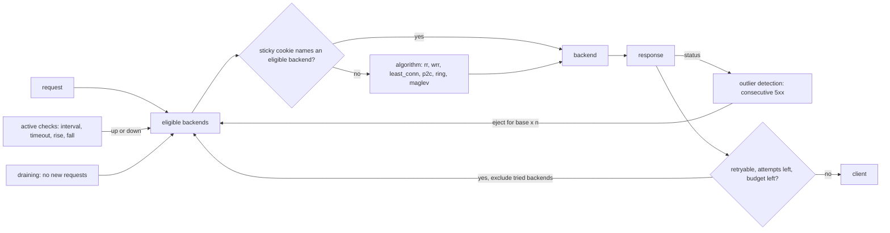

# A Load Balancer Is a Health Check and a Choice

*Every request is two decisions: which backends may take it (health checks) and which of those gets it (the algorithm).*

## Metadata

| Field | Value |
|---|---|
| Type | Build |
| Languages | Python |
| Prerequisites | [HTTP/1.1 Is Text Over a Socket Until It Is Not](https://cloudcaptain.io/learn/networking/http-server) |
| Time | 90 minutes |
| Tools | haproxy, nginx, envoy, curl, docker, kubectl |

<Quiz stage="pre" />

## The Problem

Monday, 09:10. Checkout runs on three instances behind a load balancer doing round robin with an HTTP health check on `/health`. A deploy leaves instance `c` with a broken connection pool to the payments database. `/health` still returns 200, because it only proves the process is running, while `/checkout` returns 500 in three milliseconds. The balancer sees a healthy backend and keeps sending it exactly a third of the traffic, so a third of all checkouts fail. Someone switches the algorithm to least connections "to route around the bad one". Instance `c` answers faster than anyone else because it does no work, so it always has the fewest requests in flight, and its share climbs above half. The error rate goes up, not down.

The next fix is retries: "retry on 5xx". The error rate drops, and the next morning finance finds two hundred duplicate orders. `POST /orders` had timed out on instance `b` after the order was written, and the balancer sent the same request to `a`. In the afternoon peak `b` slows down for unrelated reasons, every slow request is retried, and the retries add load to the two other instances until they time out too. The incident review lists four causes and none of them is a bug in the application: a health check that tested the wrong thing, an algorithm that rewards failing fast, retries on a request that was not safe to repeat, and no limit on how much extra load retries may create.

A load balancer makes two decisions for every request. First, which backends are allowed to take it: active health checks, passive outlier detection on real responses, and draining. Second, which one of those gets it: round robin, weights, least connections, two random choices, or a hash that keeps a user on one machine. Retries are a third decision that is only correct for requests that are safe to repeat and only within a budget. You are going to build `minilb` with every one of those mechanisms, measure the algorithms in a simulator, then put HAProxy and nginx in front of the same three backends and watch them make the same decisions.

## The Concept

Think of the checkout lanes in a supermarket. A manager who sends customers to lanes in strict turn (round robin) ignores that lane 3 has a trainee and a queue out the door. A manager who sends each customer to the shortest queue (least connections) does better, until one cashier starts waving people through without scanning anything: that lane is always empty, and everybody gets sent there. A manager who glances at two random lanes and picks the shorter one (power of two choices) gets almost all the benefit of looking at every lane while never piling everyone into the same one. Regulars with a loyalty card always go to the same cashier who knows them (hashing), and when a lane closes, only its regulars have to find a new cashier. The light above each lane is the health check, a customer complaint closes a lane for a while (outlier detection), and the "lane closing" sign means finish the current customers but accept no new ones (draining).

Every mechanism in this lesson belongs to one of those two halves.

- **Eligibility.** An **active health check** sends its own request (`GET /health`) to each backend every `interval`, with a `timeout`. One failure is not enough to act on: a backend goes down after `fall` consecutive failures and comes back after `rise` consecutive passes. That hysteresis stops a backend from flapping on one slow check, and it fixes your detection time at roughly `interval × fall`. A health check only knows what its endpoint tests. **Passive** checks (outlier detection) watch real responses instead: after `consecutive_5xx` errors in a row the backend is ejected for a base time multiplied by the number of times it has been ejected, so a backend that keeps failing stays out longer each time. A cap on the share of backends that may be ejected stops a shared failure (the database is down for everybody) from ejecting the whole pool. **Draining** removes a backend from new traffic while the requests it already holds finish.
- **Choice.** **Round robin** gives every backend the same number of requests whatever their speed. **Weighted round robin** gives shares in proportion to weights; nginx's smooth variant interleaves them instead of sending a burst to the heaviest backend. **Least connections** sends to the backend with the fewest requests in flight, divided by its weight, which adapts to slow backends and also rewards fast failures. **Power of two choices** samples two backends and takes the less loaded one; it never picks the most loaded backend, and many balancers with slightly stale counts do not all stampede to the same "least loaded" backend at once. **Hashing** maps a key (a user id, a cookie, a path, the client address) to a backend so the same key lands on the same backend. With **modulo hashing** most keys move when the backend count changes. A **ring** of many points per backend moves only the keys of the backend that left. **Maglev** fills a fixed lookup table from per-backend permutations and gets an almost perfect spread with almost the same stability.
- **Retries.** A retry is safe when the request never reached the backend (the connection failed) or when the method is **idempotent** (RFC 9110: `GET`, `HEAD`, `OPTIONS`, `TRACE`, `PUT`, `DELETE`). A retry should go to a different backend, and the number of retries in flight should be capped as a fraction of all requests in flight, a **retry budget**, so a slow backend cannot multiply the load on everyone else.

An L7 balancer (HAProxy, nginx, Envoy, an AWS Application Load Balancer) does this per HTTP request and can read status codes, cookies and headers. An L4 balancer (an AWS Network Load Balancer, Kubernetes' kube-proxy) chooses once per TCP connection and sees no HTTP at all: no status codes to eject on, no request to retry, and a keep-alive connection stays on one backend for its whole life.



## Build It

`code/main.py` is `minilb`. The algorithms, the health state machines, the retry rules and the simulator are pure functions over dataclasses, so the tests drive them with a fake clock and a fake forwarder. The data plane is a `ThreadingHTTPServer` that forwards with `http.client`, plus a small test backend (`minilb backend`) that echoes which backend answered and can be switched to fail or slow down at run time. HAProxy, nginx and Kubernetes use that same backend in Use It.

### Step 1: two questions per backend

A backend is eligible when the active checks say it is up, outlier detection has not ejected it, and it is not draining. Everything else is bookkeeping for those three flags and for the algorithms: `active` counts requests in flight, `passes` and `fails` count consecutive check results.

```python
def available(self, now: float) -> bool:
    return self.healthy and not self.draining and not self.ejected(now)
```

`Pool.acquire()` filters the eligible backends, honours a sticky cookie if it names one of them, and asks the algorithm otherwise. Requests the client is retrying pass the backends already tried in `exclude`, so a retry never lands on the backend that just failed:

```python
candidates = self.candidates(exclude)
if not candidates:
    return None, "no healthy upstream"
chosen = next((b for b in candidates if b.name == sticky), None) if sticky else None
how = "sticky" if chosen else self.algorithm.name
if chosen is None:
    chosen = self.algorithm.pick(candidates, key)
chosen.active += 1
```

### Step 2: round robin, and nginx's smooth weighted round robin

Plain round robin is a counter. Weighted round robin is where implementations differ. The naive version with weights 5, 1, 1 sends five requests in a row to `a`. nginx's smooth variant keeps a running score per backend: every pick adds each backend's weight to its score, takes the highest, and subtracts the total weight from the winner.

```python
def pick(self, candidates: Sequence[Backend], key: Optional[str] = None) -> Backend:
    total = 0
    best = candidates[0]
    for backend in candidates:
        self.current[backend.name] = self.current.get(backend.name, 0) + backend.weight
        total += backend.weight
        if self.current[backend.name] > self.current[best.name]:
            best = backend
    self.current[best.name] -= total
    return best
```

For 5, 1, 1 that produces `a a b a c a a`, the sequence quoted in a comment in nginx's own round-robin source, and the first test checks it exactly.

### Step 3: least connections and power of two choices

Least connections divides requests in flight by weight and rotates through ties, as nginx's `least_conn` does. `Fraction` keeps `2/1` and `4/2` equal without floating point:

```python
def pick(self, candidates: Sequence[Backend], key: Optional[str] = None) -> Backend:
    lowest = min(Fraction(b.active, b.weight) for b in candidates)
    tied = [b for b in candidates if Fraction(b.active, b.weight) == lowest]
    backend = tied[self.counter % len(tied)]
    self.counter += 1
    return backend
```

Power of two choices draws two distinct backends and keeps the less loaded one. Cross-multiplying compares `active / weight` without division:

```python
first, second = self.rng.sample(list(candidates), 2)
return first if first.active * second.weight <= second.active * first.weight else second
```

With three backends carrying 0, 5 and 9 requests, the busiest is never chosen (it loses every pair it is in) and the idlest wins two pairs out of three. That is the whole trick: you do not need the global minimum, only to avoid the maximum.

### Step 4: hashing that survives a backend leaving

A ring places 160 points per unit of weight for each backend (nginx's `hash ... consistent` uses the same ketama count) at `hash64(name-index)`, sorted. A key belongs to the first point at or after its own hash, wrapping around:

```python
def owner(self, candidates: Sequence[Backend], key: str) -> str:
    hashes, owners = self.ring(candidates)
    index = bisect.bisect_left(hashes, hash64(key))
    return owners[index % len(owners)]
```

Removing a backend removes only its points, so only the keys that landed on those points move; every other key still finds the same next point. The cost is balance: with 160 random points per backend the shares come out around 22% to 29% for four backends, not 25% each.

Maglev, from Google's load-balancer paper, trades a little stability for an even spread. Each backend gets an `offset` and a `skip` from two hashes, which define a permutation of a prime-sized table. Backends take turns claiming their next free slot until the table is full, so every backend owns the same number of slots to within one:

```python
while True:
    for index in range(len(names)):
        for _ in range(weights[index]):
            slot = (offsets[index] + following[index] * skips[index]) % size
            while entries[slot] >= 0:
                following[index] += 1
                slot = (offsets[index] + following[index] * skips[index]) % size
            entries[slot] = index
            following[index] += 1
            filled += 1
            if filled == size:
                return [names[e] for e in entries]
```

A lookup is `table[hash64(key) % size]`. The size has to be prime so every `skip` visits every slot; 65537 is Envoy's default. `minilb remap` measures all three schemes on the same keys:

```bash
python3 code/main.py remap --backends a,b,c,d,e --remove c --keys 20000
# scheme           moved   moved from a backend that stayed  share after
# modulo_hash      79.9%                              60.0%  a=25.3% b=24.9% d=25.4% e=24.5%
# ring_hash        21.3%                               0.0%  a=22.3% b=24.3% d=27.0% e=26.4%
# maglev           19.9%                               0.1%  a=25.0% b=25.1% d=25.0% e=24.9%
```

Twenty percent of the keys had to move, because `c` held them. Modulo hashing moved eighty percent, and sixty percent of all users lost their cache or session on a backend that never went anywhere.

### Step 5: active checks with rise and fall

The health state machine counts consecutive results only. A pass resets the failure count, a failure resets the pass count, and only a run of `fall` failures or `rise` passes changes state:

```python
def record_check(backend: Backend, ok: bool, policy: HealthPolicy) -> Optional[str]:
    if ok:
        backend.fails = 0
        backend.passes += 1
        if not backend.healthy and backend.passes >= policy.rise:
            backend.healthy = True
            return "up"
        return None
    backend.passes = 0
    backend.fails += 1
    if backend.healthy and backend.fails >= policy.fall:
        backend.healthy = False
        return "down"
    return None
```

`HealthChecker` runs `GET /health` against every backend each `interval` with `timeout`; a 2xx or 3xx passes, which is also HAProxy's default for `option httpchk`. The prober is injectable, so tests run the state machine without sockets and a second test runs it against a real backend. Every transition goes to the event log with its reason: `down: 3 consecutive failed checks (last: HTTP 500)`.

### Step 6: passive checks, an ejection time that grows, and a cap

Outlier detection looks at the status of every real response. A success resets the streak; `consecutive_5xx` errors in a row eject the backend for `base_ejection × ejections`, capped at `max_ejection` (or the base, if that is larger):

```python
def record_response(backend: Backend, status: int, now: float, policy: OutlierPolicy, ejected_now: int, pool_size: int) -> Optional[Tuple[str, float]]:
    if status < 500:
        backend.consecutive_5xx = 0
        return None
    backend.consecutive_5xx += 1
    if policy.consecutive_5xx <= 0 or backend.consecutive_5xx < policy.consecutive_5xx or backend.ejected(now):
        return None
    if not may_eject(ejected_now, pool_size, policy):
        return "refused", 0.0
    backend.ejections += 1
    backend.consecutive_5xx = 0
    duration = ejection_time(policy, backend.ejections)
    backend.ejected_until = now + duration
    return "ejected", duration
```

Ejection ends on its own: when `ejected_until` passes, the backend is back in rotation, and if it is still broken it is ejected again for twice as long. The cap counts the ejection about to happen, the way current Envoy releases do:

```python
def may_eject(ejected_now: int, pool_size: int, policy: OutlierPolicy) -> bool:
    if policy.always_eject_one_host and ejected_now == 0:
        return True
    return (ejected_now + 1) * 100 <= pool_size * policy.max_ejection_percent
```

With Envoy's default of 10% and three backends, ejecting one would make 33% ejected, so nothing is ever ejected. `minilb serve` prints a warning for that configuration, the simulator reports `ejections_refused`, and the fix is to raise the percentage (34 allows one of three) or set `always_eject_one_host`.

### Step 7: retries only when repeating is safe, and only within a budget

```python
def retry_reason(method: str, outcome: str, status: int, policy: RetryPolicy) -> Optional[str]:
    if outcome == "connect-failure":
        return "connect-failure" if "connect-failure" in policy.retry_on else None
    if method.upper() not in IDEMPOTENT_METHODS:
        return None
    if status in GATEWAY_ERRORS and "gateway-error" in policy.retry_on:
        return "gateway-error"
    if status >= 500 and "5xx" in policy.retry_on:
        return "5xx"
    return None
```

A refused connection is safe to retry for any method, because no byte of the request reached the backend. Anything after that is safe only for idempotent methods: a `POST` that timed out may well have been executed. The budget is Envoy's: retries in flight may not exceed `budget_percent` of requests in flight, with a floor of `min_retry_concurrency` so a quiet service can still retry:

```python
def limit(self) -> float:
    return max(float(self.minimum), self.active_requests * self.percent / 100.0)
```

`proxy_request()` ties it together: try a backend, release it with the status (which feeds outlier detection), then retry on another backend only if `retry_reason()` says so, attempts remain and `begin_retry()` gets a slot from the budget. Every response carries `x-minilb-backend`, `x-minilb-attempts` (`b2:500,b3:200`) and, when a retry was skipped, `x-minilb-note` with the reason, for example `not retried: POST is not idempotent`.

### Step 8: forwarding, sticky cookies and draining

The proxy removes hop-by-hop headers in both directions: the fixed list from RFC 9110 plus every header named in `Connection`. It appends the client address to `X-Forwarded-For` rather than replacing it, so a chain of proxies keeps the whole path:

```python
def upstream_headers(headers: Dict[str, str], client: str) -> Dict[str, str]:
    drop = HOP_BY_HOP | connection_tokens(headers)
    result = {name: value for name, value in headers.items() if name.lower() not in drop and name.lower() != "x-forwarded-for"}
    previous = next((v for k, v in headers.items() if k.lower() == "x-forwarded-for"), "")
    result["X-Forwarded-For"] = f"{previous}, {client}" if previous else client
    return result
```

With `--sticky-cookie MINILB`, a response from a backend the client is not pinned to sets `MINILB=<backend>`, and later requests carrying that cookie go back to that backend while it is eligible. When it is not, the algorithm picks again and the cookie is rewritten. Draining (`POST /_minilb/drain?backend=b2&timeout=30`) stops new requests at once, sticky ones included, and `reap()` removes the backend when its last request finishes or the deadline passes:

```python
if backend.active <= 0:
    self.backends.remove(backend)
    self.log(backend.name, "removed", "drained: no requests in flight")
elif now >= backend.drain_deadline:
    self.backends.remove(backend)
    self.log(backend.name, "removed", f"drain deadline passed with {backend.active} in flight")
```

### Step 9: a simulator for tail latency

Averages hide what load balancing is for. `simulate()` is a discrete-event simulation in virtual time: Poisson arrivals at `--rate`, each backend with `capacity` parallel workers and an exponential service time around its mean latency, and a queue in front of each. It reuses the same `Pool` and algorithms with a virtual clock, so ejection works there too:

```python
if kind == "arrive":
    chosen, _ = pool.acquire(arrivals[index][1])
    if chosen is None:
        dropped += 1
    elif busy[chosen.name] < specs_by_name[chosen.name].capacity:
        start(index, chosen)
    else:
        waiting[chosen.name].append(index)
    continue
```

Two fast backends and one five times slower, at 150 requests per second:

```bash
python3 code/main.py simulate
# algorithm                   p50      p95      p99      max  errors  share fast1/fast2/slow
# round_robin                27ms    6.22s    7.10s    7.65s       0  33%/33%/33%
# least_conn                 16ms    107ms    263ms    816ms       0  44%/43%/13%
# p2c                        16ms    112ms    278ms    810ms       0  42%/43%/15%
```

Round robin sends the slow backend 50 requests per second when it can serve 40, its queue grows for the whole run, and the p99 is seven seconds. The median looks fine, which is how this ships to production. Now the Problem's broken instance, a backend that fails in 2 ms:

```bash
python3 code/main.py simulate --backend a=20 --backend b=20 --backend broken=2,errors=1
# round_robin                 6ms     52ms     85ms    163ms    1666  33%/33%/33%
# least_conn                  3ms     44ms     80ms    164ms    2787  23%/22%/56%
# p2c                         4ms     47ms     82ms    201ms    2477  25%/25%/50%
python3 code/main.py simulate --backend a=20 --backend b=20 --backend broken=2,errors=1 --consecutive-5xx 5 --max-ejection-percent 34
# round_robin                14ms     61ms     97ms    162ms      10  50%/50%/0%
```

Least connections gives the failing backend 56% of the traffic. Outlier detection, not a smarter algorithm, is what takes it out: ten errors in five thousand requests instead of 1666.

### Step 10: run it against real backends

```bash
python3 code/main.py backend --name b1 --port 9001 &
python3 code/main.py backend --name b2 --port 9002 --delay 0.05 &
python3 code/main.py backend --name b3 --port 9003 &
python3 code/main.py serve --listen 127.0.0.1:8080 \
  --backend b1=127.0.0.1:9001 --backend b2=127.0.0.1:9002 --backend b3=127.0.0.1:9003 \
  --check-interval 0.2 --rise 2 --fall 3 --consecutive-5xx 3 --base-ejection 1 --max-ejection-percent 34 \
  --retries 0 --sticky-cookie MINILB &
for i in $(seq 9); do curl -s 127.0.0.1:8080/ -o /dev/null -D - | grep -i x-minilb-backend; done | sort | uniq -c   # 3 each
curl -s -X POST '127.0.0.1:9003/_backend/mode?status=500'                                                       # b3 fails requests and /health
for i in $(seq 12); do curl -s -o /dev/null -w '%{http_code} ' 127.0.0.1:8080/; done; echo                     # three 500s, then only 200s
curl -s 127.0.0.1:8080/_minilb/status                                                                           # b3 "unhealthy", the events below
curl -s -X POST '127.0.0.1:9003/_backend/mode?status=200'
```

```text
[minilb] t=1.608 b3 ejected: 3 consecutive 5xx; ejected for 1s (ejection 1)
[minilb] t=1.914 b3 down: 3 consecutive failed checks (last: HTTP 500)
[minilb] t=3.200 b3 up: 2 consecutive passed checks
```

Passive detection took `b3` out after exactly three client-visible errors; the active checks confirmed it 300 ms later and kept it out after the one-second ejection ended; two passing checks brought it back. `python3 code/main.py serve ... --print-config` prints the effective configuration as JSON, `pick --algorithm least_conn --backends a,b,c --active a=4,b=1,c=2` answers one choice without traffic, and exit codes are 0, 1 for a socket error such as a port in use, and 2 for bad input with the reason.

<RunTests />

## Use It

The same three backends, now behind the real tools. Start them as in Step 10, then HAProxy (pinned `haproxy:3.4.7-alpine`, the current long-term-support branch) with host networking so it can reach `127.0.0.1`:

```text
global
    log stdout format raw local0 info
    stats socket ipv4@127.0.0.1:9999 level admin

defaults
    mode http
    log global
    option httplog
    timeout connect 1s
    timeout client 10s
    timeout server 10s
    timeout check 500ms
    default-server inter 200ms rise 2 fall 3 observe layer7 error-limit 3 on-error mark-down

frontend fe_rr
    bind 127.0.0.1:8081
    default_backend be_rr

frontend fe_hash
    bind 127.0.0.1:8083
    default_backend be_hash

backend be_rr
    balance roundrobin
    option httpchk
    http-check send meth GET uri /health
    server b1 127.0.0.1:9001 check
    server b2 127.0.0.1:9002 check
    server b3 127.0.0.1:9003 check

backend be_hash
    balance hdr(X-User)
    hash-type consistent
    option httpchk
    http-check send meth GET uri /health
    server b1 127.0.0.1:9001 check
    server b2 127.0.0.1:9002 check
    server b3 127.0.0.1:9003 check
```

```bash
mkdir -p haproxy && cp haproxy.cfg haproxy/
docker run --rm -v "$PWD/haproxy:/usr/local/etc/haproxy:ro" haproxy:3.4.7-alpine haproxy -c -f /usr/local/etc/haproxy/haproxy.cfg   # Configuration file is valid
docker run -d --name lab-haproxy --network host -v "$PWD/haproxy:/usr/local/etc/haproxy:ro" haproxy:3.4.7-alpine
for i in $(seq 9); do curl -s 127.0.0.1:8081/ | grep -o '"backend": "b[0-9]"'; done | sort | uniq -c
printf 'show stat\n' | nc 127.0.0.1 9999 | cut -d, -f1,2,18                  # pxname, svname, status: UP, "UP 1/3", DOWN
curl -s -X POST '127.0.0.1:9003/_backend/mode?status=500'
for i in $(seq 12); do curl -s -o /dev/null -w '%{http_code} ' 127.0.0.1:8081/; done; echo   # at most three 500s
docker logs lab-haproxy 2>&1 | grep -i 'b3 is DOWN'
printf 'set server be_rr/b2 state drain\n' | nc 127.0.0.1 9999          # no new requests, persistence still honoured
printf 'set server be_rr/b2 state ready\n' | nc 127.0.0.1 9999
```

Line by line against `minilb`: `inter`, `rise` and `fall` are the active checks (HAProxy's defaults are 2 s, 2 and 3), and `timeout check` bounds each one. `observe layer7` turns on passive checking; only 100 to 499, 501 and 505 count as valid, so a 500 is an error, and after `error-limit` consecutive errors `on-error mark-down` takes the server down at once. Without `observe`, HAProxy learns only from its checks; with `observe layer7` but the defaults (`error-limit 10`, `on-error fail-check`), ten errors in a row count as one failed check, and the server keeps its share until `fall` checks have failed. HAProxy has no ejection timer: a marked-down server comes back through `rise` passing checks. `balance leastconn` is least connections; `balance random(2)` is power of two choices; `balance hdr(X-User)` hashes a header, and the default `hash-type` is `map-based`, which the manual itself says redistributes most connections when a server goes up or down: write `hash-type consistent` whenever the key means cache or session locality. Cookie persistence is `cookie SERVERID insert indirect nocache` in the backend plus `cookie b1` on each server. Retries default to `retry-on conn-failure`; adding status codes such as `retry-on 503 504` makes HAProxy buffer and replay requests, and its manual warns that this is dangerous unless replaying has no consequence. `option redispatch` lets the retry go to a different server. The runtime API's `drain` state differs from `minilb`'s on purpose: it still accepts new requests that arrive with a persistence cookie, which is how you let logged-in users finish while new users go elsewhere; `maint` stops everything.

nginx (pinned `nginx:1.30.6-alpine`, the stable branch) expresses the same ideas in `upstream` blocks:

```text
upstream app {
    zone app 64k;
    least_conn;
    server 127.0.0.1:9001 max_fails=3 fail_timeout=30s;
    server 127.0.0.1:9002 max_fails=3 fail_timeout=30s;
    server 127.0.0.1:9003 max_fails=3 fail_timeout=30s;
}
upstream byuser {
    zone byuser 64k;
    hash $http_x_user consistent;
    server 127.0.0.1:9001;
    server 127.0.0.1:9002;
    server 127.0.0.1:9003;
}
server {
    listen 127.0.0.1:8091;
    location / {
        proxy_pass http://app;
        proxy_next_upstream error timeout http_500 http_502 http_503 http_504;
        proxy_next_upstream_tries 2;
    }
}
```

Open-source nginx has no active health checks: the `health_check` directive belongs to the commercial NGINX Plus module. What it has is passive accounting: `max_fails` unsuccessful attempts within `fail_timeout` make a server unavailable for `fail_timeout` (defaults 1 and 10 s), and "unsuccessful" is whatever `proxy_next_upstream` lists, `error timeout` by default. So with the defaults a backend that answers 500 is not failing as far as nginx is concerned and keeps its full share; add `http_500` and nginx both retries the request on the next server and counts the failure. Non-idempotent requests (`POST`, `LOCK`, `PATCH`) are not passed to another server once they have been sent unless you add `non_idempotent`, which is `minilb`'s rule. Without `zone`, each worker process keeps its own failure counts and round-robin position, so `max_fails=3` with four workers can let twelve requests through. `random two least_conn` is power of two choices, `hash ... consistent` is a ketama ring, plain `hash` and `ip_hash` are not consistent, and `server ... down` takes a server out at the next `nginx -s reload`, whose old workers finish their requests before exiting. `sticky cookie` was commercial-only before nginx 1.29.6 and is part of open source since then.

Envoy is the reference for the passive half, and its names map one to one. It is not part of this lesson's lab; read the configuration against Steps 5 to 7:

```yaml
clusters:
  - name: checkout
    type: STATIC
    lb_policy: LEAST_REQUEST
    load_assignment:
      cluster_name: checkout
      endpoints:
        - lb_endpoints:
            - endpoint: {address: {socket_address: {address: 127.0.0.1, port_value: 9001}}}
            - endpoint: {address: {socket_address: {address: 127.0.0.1, port_value: 9002}}}
            - endpoint: {address: {socket_address: {address: 127.0.0.1, port_value: 9003}}}
    health_checks:
      - timeout: 0.5s
        interval: 0.2s
        unhealthy_threshold: 3
        healthy_threshold: 2
        http_health_check: {path: /health}
    outlier_detection:
      consecutive_5xx: 3
      interval: 1s
      base_ejection_time: 1s
      max_ejection_percent: 34
    circuit_breakers:
      thresholds:
        - retry_budget:
            budget_percent: {value: 20.0}
            min_retry_concurrency: 3
```

`LEAST_REQUEST` with equal weights is power of two choices (two random hosts by default), not a full scan. `MAGLEV` uses a 65537-entry table by default and `RING_HASH` is the ring. `unhealthy_threshold` and `healthy_threshold` are `fall` and `rise`, with one difference worth knowing: an HTTP health check that gets a status outside `expected_statuses` marks the host unhealthy immediately, and the threshold only applies to timeouts, connection failures and `retriable_statuses`. Outlier detection ejects for `base_ejection_time` times the number of ejections in a row (default 30 s, capped by `max_ejection_time`, default 300 s), lowers that multiplier again while the host stays healthy, which `minilb` does not, and refuses ejections beyond `max_ejection_percent` (default 10%) unless `always_eject_one_host` is set. The retry budget is `budget_percent` (default 20%) of active plus pending requests, never below `min_retry_concurrency` (default 3). Retries themselves live on the route (`retry_policy` with `retry_on: connect-failure,gateway-error`, `num_retries` defaulting to 1, and the `previous_hosts` predicate to avoid the host that just failed); Envoy does not look at the method, so restrict a route's retries with `retriable_request_headers` or separate routes when it serves `POST`. When fewer than 50% of hosts are healthy, Envoy enters panic mode and balances across all of them, betting that a sick pool is better than none.

Cloud load balancers make the L4 and L7 split concrete. An AWS Application Load Balancer balances requests: target-group health checks have a path, interval, timeout and healthy and unhealthy thresholds, the algorithm is `round_robin`, `least_outstanding_requests` or `weighted_random`, stickiness uses a load-balancer cookie (`AWSALB`) or your application's cookie, and the deregistration delay (300 s by default) is draining. If every target in a group is unhealthy, it fails open and sends traffic to all of them, the same bet as Envoy's panic mode. A Network Load Balancer balances TCP and UDP flows by a hash of the connection, can preserve the client's address, and cannot see HTTP, so it has no status codes to react to and nothing to retry. You will configure both in the Cloud phase.

A Kubernetes Service is an L4 balancer with no health checks of its own. kube-proxy programs iptables or nftables rules that pick one ready endpoint at random for each new connection. The only health signal is the pod's readiness probe, which the kubelet runs and which moves the pod's address in and out of the Service's EndpointSlice. There are no retries, no outlier detection, and a long-lived HTTP/2 or gRPC connection stays on one pod however unbalanced that gets, which is why meshes and Gateway API implementations put an L7 balancer in front of pods. You will meet Services again in the Orchestration phase:

```bash
kubectl get endpointslices -l kubernetes.io/service-name=lb-backend -o jsonpath='{range .items[*].endpoints[*]}{.targetRef.name}{" ready="}{.conditions.ready}{"\n"}{end}'
kubectl exec POD -- python3 -c 'import urllib.request; urllib.request.urlopen(urllib.request.Request("http://127.0.0.1:8080/_backend/mode?status=500", method="POST", data=b""))'
kubectl get endpointslices -l kubernetes.io/service-name=lb-backend -o wide    # the pod is ready=false within periodSeconds x failureThreshold
```

| What you built | Real tool | Note |
|---|---|---|
| `RoundRobin`, `SmoothWeightedRoundRobin` | HAProxy `balance roundrobin`, nginx default with `weight`, Envoy `ROUND_ROBIN` | nginx's smooth interleaving is the `a a b a c a a` sequence |
| `LeastConnections` | HAProxy `balance leastconn`, nginx `least_conn`, ALB `least_outstanding_requests` | rewards a backend that fails fast; pair it with outlier detection |
| `PowerOfTwoChoices` | Envoy `LEAST_REQUEST`, HAProxy `balance random(2)`, nginx `random two least_conn` | never picks the most loaded backend; resists herding |
| `RingHash`, `Maglev`, `ModuloHash` | HAProxy `hash-type consistent` versus the default `map-based`, nginx `hash ... consistent`, Envoy `RING_HASH` and `MAGLEV` | modulo moves most keys on any change |
| `record_check()` with `rise` and `fall` | HAProxy `check inter rise fall`, Envoy `healthy_threshold` and `unhealthy_threshold`, ALB thresholds, kubelet readiness probes | nginx open source has no active checks |
| `record_response()`, `may_eject()` | Envoy `outlier_detection`, HAProxy `observe layer7 error-limit on-error`, nginx `max_fails` and `fail_timeout` | ejection time grows; the percentage cap counts the new ejection |
| `retry_reason()`, `RetryBudget` | Envoy `retry_policy` and `retry_budget`, HAProxy `retries` and `retry-on`, nginx `proxy_next_upstream` | only nginx checks the method for you |
| `Pool.drain()`, `reap()` | HAProxy `set server state drain`, nginx `down` plus reload, ALB deregistration delay, Kubernetes terminating endpoints | HAProxy's drain still honours persistence |
| `--sticky-cookie` | HAProxy `cookie ... insert`, nginx `sticky cookie`, ALB stickiness | re-pick and rewrite the cookie when the backend is gone |
| `simulate()` | load tests with `wrk`, `vegeta` or `k6` against a staging pool | compare p99, not the mean |

<Quiz stage="check" />

## Ship It

Two artifacts in `outputs/`:

- **`skill-load-balancer-review.md`**: a runbook for reviewing a load balancer configuration (HAProxy, nginx, Envoy, an AWS target group or a Kubernetes Service) before an incident finds the gaps. It collects the configuration and the health endpoint's code, checks what the health check really tests and how long detection takes, whether passive detection exists and whether its percentage cap allows any ejection at all, which requests are retried and whether they are idempotent, whether a budget caps retries, how draining interacts with deploys, and whether the algorithm and hashing scheme fit the workload, then ends with a findings table and a fixed report.
- **`prompt-choose-lb-algorithm.md`**: describe a workload (request durations, backend sizes, number of balancer instances, whether you need cache or session locality, how often backends change) and get a recommended algorithm with the reasoning, the configuration for nginx, HAProxy and Envoy, the health and retry settings that must go with it, and the one measurement that proves the choice.

<ShipIt />

## Exercises

### Easy

Add `--check-expect STATUS` so the active check passes only on that exact status, as HAProxy's `http-check expect status 200` does, instead of any 2xx or 3xx. Write the tests first: an `EchoBackend` switched to answer `/health` with 302 passes by default and fails with `--check-expect 200`, and the `down` event's reason names the status it got.

### Medium

Add retries to the simulator. Give `SimBackend` a per-try timeout and let a backend become slow mid-run (`slow_after=SECONDS,slow_factor=N`). Requests that time out are retried on another backend through the same `RetryBudget`. Tests first: with a backend that turns twenty times slower, total attempts without a budget exceed 1.5 times the number of requests, with the default budget they stay under 1.2 times plus `min_retry_concurrency`, and the healthy backends' p99 is lower with the budget than without.

### Hard

Implement consistent hashing with bounded loads (HAProxy's `hash-balance-factor`, Envoy's `hash_balance_factor`): a key goes to its ring owner unless that backend already has more than `factor` times the average number of requests in flight, in which case the walk continues clockwise to the next backend under the bound. Add `--keys-zipf S` to the simulator so a few users send most of the traffic. Tests first: with a Zipf exponent of 1.2 and a factor of 1.25, no backend exceeds 1.25 times the average in-flight count at any arrival, the p99 drops compared with the plain ring, and with uniform keys at least 95% of keys still land on their ring owner.

<Quiz stage="post" />

## Key Terms

| Term | Common misconception | Precise definition |
|---|---|---|
| Active health check | "If `/health` returns 200, the backend is healthy." | A request the balancer sends to each backend every interval with a timeout; it only proves what the endpoint tests. `fall` consecutive failures take a backend out, `rise` consecutive passes bring it back. |
| Outlier detection | "Health checks already catch failing backends." | Passive checking of real responses: after a number of consecutive errors the backend is ejected for a base time multiplied by its ejection count, limited by a cap on the share of ejected backends. It catches backends whose health endpoint lies. |
| Least connections | "Always the smartest choice." | Send to the backend with the fewest requests in flight per unit of weight. It adapts to slow backends and also sends more traffic to a backend that fails fast. |
| Power of two choices | "Random, so worse than least connections." | Sample two backends and take the less loaded one. It never picks the most loaded backend and avoids every balancer stampeding to the same backend; Envoy's least-request balancer is this algorithm. |
| Consistent hashing | "Any hash of the user id keeps users on their backend." | A mapping where removing a backend moves only the keys it owned: a ring of many points per backend, or a Maglev lookup table. Modulo hashing, HAProxy's default `map-based` and nginx's plain `hash` move most keys on any change. |
| Idempotent method | "Any GET can be retried, nothing else can." | A method whose repeated effect equals one request: `GET`, `HEAD`, `OPTIONS`, `TRACE`, `PUT`, `DELETE` (RFC 9110). Any method may be retried after a failed connection, because nothing was sent. |
| Retry budget | "Three retries per request is a safe default." | A cap on retries in flight as a share of requests in flight (Envoy: 20%, at least 3), so a struggling backend cannot multiply the load on the rest of the pool. |
| Connection draining | "Removing a backend drops its requests." | Stopping new requests to a backend while the ones it holds finish, until they do or a deadline passes: ALB's deregistration delay, HAProxy's `drain` state, Kubernetes' terminating endpoints. |
| L4 versus L7 | "A load balancer is a load balancer." | L4 balances TCP or UDP connections and cannot see HTTP (NLB, kube-proxy); L7 balances each HTTP request and can read status codes, cookies and headers, eject on errors and retry (ALB, HAProxy in `mode http`, nginx, Envoy). |

## Further Reading

- [Nginx Fundamentals](https://cloudcaptain.io/docs/tools/nginx/fundamentals): reverse proxying and the `upstream` load-balancing methods in the Reference layer.
- [Network Fundamentals](https://cloudcaptain.io/docs/tools/networking/fundamentals): the TCP and HTTP layers that decide what an L4 and an L7 balancer can see.
- [AWS Compute and Networking](https://cloudcaptain.io/docs/cloud/aws/compute-networking): Elastic Load Balancing, ALB and NLB in the VPC picture you will build in the Cloud phase.
- [Kubernetes Networking & Services](https://cloudcaptain.io/docs/tools/kubernetes/networking-services): Services, kube-proxy modes and why readiness decides which pods get traffic.
- [nginx `ngx_http_upstream_module`](https://nginx.org/en/docs/http/ngx_http_upstream_module.html): every balancing method, `max_fails`, `fail_timeout`, `zone` and `sticky`, with which parts are open source.
- [HAProxy 3.4 configuration manual](https://docs.haproxy.org/3.4/configuration.html): `balance`, `hash-type`, `check`, `observe`, `on-error`, `retry-on` and the warning about replaying requests.
- [HAProxy 3.4 management guide](https://docs.haproxy.org/3.4/management.html): the runtime API, `show stat` columns and `set server ... state`.
- [Envoy outlier detection](https://www.envoyproxy.io/docs/envoy/latest/intro/arch_overview/upstream/outlier): ejection times, the multiplier and how detection interacts with health checks and panic mode.
- [Envoy load balancers](https://www.envoyproxy.io/docs/envoy/latest/intro/arch_overview/upstream/load_balancing/load_balancers): least request as P2C, ring hash and Maglev from the implementers.
- [Envoy circuit breakers and retry budgets](https://www.envoyproxy.io/docs/envoy/latest/api-v3/config/cluster/v3/circuit_breaker.proto): `budget_percent` and `min_retry_concurrency` exactly as `RetryBudget` models them.
- [Maglev: A Fast and Reliable Software Network Load Balancer](https://research.google/pubs/maglev-a-fast-and-reliable-software-network-load-balancer/): the lookup-table construction in Step 4 and why the table size is prime.
- [The Power of Two Choices in Randomized Load Balancing](https://www.eecs.harvard.edu/~michaelm/postscripts/mythesis.pdf): Mitzenmacher's analysis behind P2C.
- [RFC 9110, section 9.2.2: Idempotent Methods](https://www.rfc-editor.org/rfc/rfc9110#section-9.2.2): which methods may be retried automatically, and why.
- [AWS ALB target group health checks](https://docs.aws.amazon.com/elasticloadbalancing/latest/application/target-group-health-checks.html): thresholds, intervals and fail-open behaviour on the managed L7 balancer.
- [Kubernetes virtual IPs and Service proxies](https://kubernetes.io/docs/reference/networking/virtual-ips/): how kube-proxy chooses an endpoint per connection.
