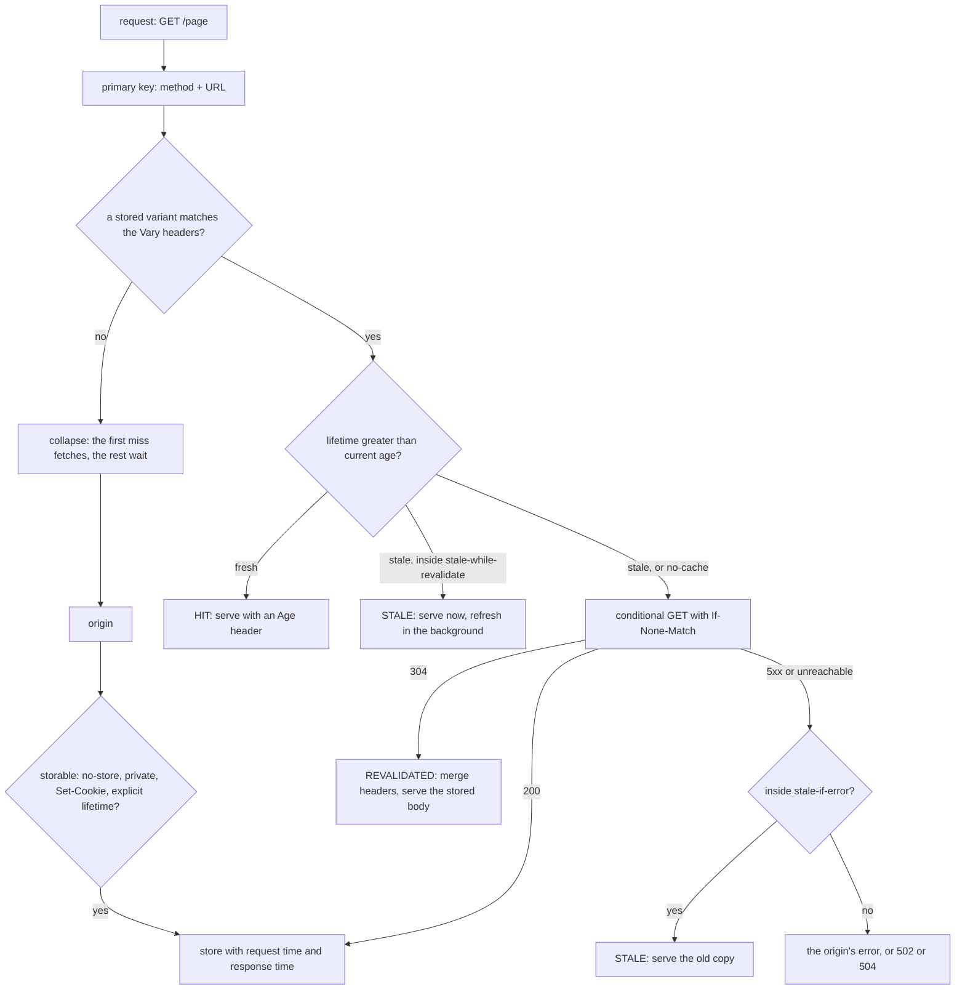

# A Cache Is a Key, a Lifetime and a Validator

*Every cache decision is three questions: which stored copy matches, is it still fresh after its Age, and can a 304 renew it cheaply.*

## Metadata

| Field | Value |
|---|---|
| Type | Build |
| Languages | Python |
| Prerequisites | [HTTP/1.1 Is Text Over a Socket Until It Is Not](https://cloudcaptain.io/learn/networking/http-server) |
| Time | 75 minutes |
| Tools | curl, nginx, docker |

<Quiz stage="pre" />

## The Problem

The catalogue team puts a CDN in front of `shop.example.com` a week before a sale. On day one the hit ratio is 4%. Every product page still carries `Vary: User-Agent` from an old mobile site, so the CDN keeps one copy per browser build and almost every request is a miss. The JSON API sets a tracking cookie on every response, so the nginx cache in front of the origin refuses to store any of it. Someone "fixes" both with `Cache-Control: public, max-age=86400` on everything. The hit ratio jumps to 90%, and then a price change takes a day to reach customers, every deploy leaves browsers running yesterday's `app.js` against today's API, and the account page, which got the same header, is stored by an office proxy together with one customer's session cookie.

On the sale morning the database fails over and the origin answers 503 for three minutes. Every page that expired in those minutes turns into an error page, although the CDN holds a copy of each one. When the origin comes back, the home page expires at the same second for 4,000 waiting clients, and the origin receives 4,000 identical requests at once and falls over again.

None of this is the cache being unpredictable. RFC 9111 fixes every decision a cache makes: which stored response may answer a request (the URL plus the request headers named by `Vary`), how long it stays fresh (`s-maxage`, `max-age`, `Expires` or a heuristic, measured against its `Age`), how to check it cheaply once it is stale (an `ETag` or `Last-Modified` and a 304), and when a stale copy may be served anyway (`stale-while-revalidate`, `stale-if-error`, never under `must-revalidate`). You are going to build `minicache`, a caching reverse proxy that applies exactly those rules and names the rule it applied in every response, plus a checker that reads a site's headers and says how a browser, a shared cache, a CDN and nginx will each treat them. Then nginx's `proxy_cache` runs the same scenarios against the same origin, and you will see where it follows the RFC and where it takes shortcuts.

## The Concept

A cache is a clerk with a filing cabinet of photocopies. For each request it asks three questions, in order.

**Which copy?** The primary key is the method and the full URL. A response may add a secondary key with `Vary`: `Vary: Accept-Language` means "this copy is only right for requests whose `Accept-Language` equals the one that fetched it". The cache stores the selecting request header values next to the copy and compares them on every lookup, so one URL can hold several variants. `Vary: *` matches nothing, and varying on a header with thousands of values (`User-Agent`, `Cookie`) stores thousands of copies that are almost never reused.

**Is it still good?** Every stored response has a freshness lifetime: `s-maxage` (shared caches only), else `max-age`, else `Expires` minus `Date`, else, if the response has no explicit lifetime at all, a heuristic such as 10% of the time since `Last-Modified`. Against that lifetime the cache measures the response's current age: how old it already was when it arrived (from the origin's `Date`, an `Age` header added by caches upstream, and the time the request took) plus how long it has been in this cache. Fresh means lifetime greater than age. A copy served from the cache carries `Age`, so the next cache downstream does not restart the clock.

**Can I check cheaply?** A stale copy is not deleted. If it has a validator (`ETag`, or `Last-Modified`), the cache sends a conditional request, `If-None-Match: "v1"`, and an unchanged resource comes back as `304 Not Modified` with headers and no body; the cache merges those headers into its copy, restarts its age and serves the stored body. Only a changed resource costs a full download.

Four rules sit on top of those three questions. Who may store: `no-store` means nobody; `private` means only the user's own browser cache, never a shared cache such as a CDN or proxy; `no-cache` means store it but revalidate before every use, which is not the same as `no-store`. When stale is acceptable: `stale-while-revalidate=N` lets a cache answer with a stale copy at once for N seconds past expiry while it refreshes in the background, `stale-if-error=N` lets it answer with a stale copy when the origin returns 500, 502, 503 or 504 or cannot be reached, and `must-revalidate`, `proxy-revalidate` and `s-maxage` forbid both. Concurrency: when many requests miss the same key at once, a good cache sends one of them to the origin and makes the rest wait for its answer (request collapsing). Removal: a successful `POST`, `PUT` or `DELETE` invalidates the stored copy of its URL, and an operator can purge by URL or by tag.



Browsers, corporate proxies, CDNs and nginx all run this same machine with different settings. A browser is a private cache: it may store `private` responses and ignores `s-maxage`. A CDN is a shared cache that may also read `CDN-Cache-Control` (RFC 9213) instead of `Cache-Control`, so the origin can give the edge a different lifetime from the browser. Most production surprises come from the gap between what the headers say and which of these caches is reading them.

## Build It

`code/main.py` is `minicache`. Everything that decides is a pure function over header lists, with the clock passed in, so the tests can move time forward without sleeping. Around those functions sit three small `http.server` programs: the proxy (`serve`), a test origin that counts requests and answers each scenario with known headers (`origin`), and the checker (`check`). The proxy reports each decision twice: `X-Cache-Status` with nginx's vocabulary, so you can compare the two caches line by line, and `Cache-Status` in the RFC 9211 format, which says why.

### Step 1: directives are a list, values may be quoted

`Cache-Control` is a comma-separated list where a value can be a quoted string containing commas (`no-cache="Set-Cookie, Set-Cookie2"`). `split_list()` splits outside quotes; the parser lowercases names and keeps the first occurrence of a duplicate, which RFC 9111 allows:

```python
def parse_cache_control(value: Optional[str]) -> Dict[str, Optional[str]]:
    directives: Dict[str, Optional[str]] = {}
    for item in split_list(value or ""):
        name, sep, raw = item.partition("=")
        name = name.strip().lower()
        if name and name not in directives:
            directives[name] = unquote(raw) if sep else None
    return directives


def delta_seconds(value: Optional[str]) -> Optional[int]:
    if value is None or not re.fullmatch(r"[0-9]+", value.strip()):
        return None
    return min(int(value.strip()), MAX_DELTA)
```

Seconds are digits only: `max-age=-1`, `max-age=1e3` and `max-age=soon` are invalid, and an invalid `max-age` means the response is already stale, not that the directive is ignored. `parse_http_date()` accepts the three date formats HTTP has ever used (`Sun, 06 Nov 1994 08:49:37 GMT`, the RFC 850 form and the asctime form) and returns `None` for anything else, including the `Expires: 0` that many servers send to mean "already expired". A request without `Cache-Control` that sends `Pragma: no-cache` is treated as `no-cache`; in a response, `Pragma` means nothing.

### Step 2: the key is the URL, Vary adds a second key

```python
def primary_key(method: str, url: str) -> str:
    parts = urllib.parse.urlsplit(url)
    target = (parts.path or "/") + (f"?{parts.query}" if parts.query else "")
    verb = "GET" if method.upper() == "HEAD" else method.upper()
    return f"{verb} {parts.scheme.lower()}://{parts.netloc.lower()}{target}"
```

`HEAD` shares the `GET` key, so a `HEAD` can be answered from a stored `GET`; on a miss minicache fetches with `GET`, stores the result and drops the body for the client, which is what nginx's `proxy_cache_convert_head` does by default. The query string is part of the key byte for byte: `?a=1&b=2` and `?b=2&a=1` are two entries. When a response is stored, `store()` records the value of every request header its `Vary` names, normalised by joining repeated lines and collapsing whitespace, and `None` for a header the request did not send:

```python
    def matches(self, request_headers: Headers) -> bool:
        return all(normalize_field(header(request_headers, name)) == value for name, value in self.vary.items())
```

A lookup walks the variants under the primary key and returns the first whose stored values all match. If variants exist but none match, the miss is a `vary-miss` in `Cache-Status`: the URL is cached, just not for this request.

### Step 3: storing is a list of refusals

Before anything is stored, `storable()` runs the RFC 9111 section 3 checks in order and returns the first reason that says no:

```python
    if "no-store" in request_directives(request_headers):
        return False, "the request said Cache-Control: no-store"
    cc = response_directives(response_headers, policy)
    if "no-store" in cc:
        return False, "no-store"
    if policy.shared and "private" in cc:
        return False, "private: only a browser's own cache may store it"
    if policy.shared and header(request_headers, "Authorization") is not None and not {"public", "s-maxage", "must-revalidate"} & set(cc):
        return False, "the request carried Authorization and the response does not say public, s-maxage or must-revalidate"
    if "*" in vary_names(response_headers):
        return False, "Vary: * never matches a later request"
    if policy.shared and policy.refuse_set_cookie and header(response_headers, "Set-Cookie") is not None:
        return False, "Set-Cookie: a shared copy would hand this cookie to the next user"
```

After the refusals, a response is storable if it has something explicit (`public`, `max-age`, `s-maxage` for a shared cache, `private` for a private one, `Expires`) or a status code that is cacheable by default (200, 203, 204, 206, 300, 301, 308, 404, 405, 410, 414, 501). A 500 without `max-age` is never stored; a 404 is. The RFC allows a shared cache to store a response with `Set-Cookie`; minicache, like nginx and most CDNs, refuses, because the one time that goes wrong is the account page from The Problem. The `Policy` dataclass switches between shared, private (`--private`) and CDN (`--cdn`) behaviour.

### Step 4: a lifetime from the headers, an age from four timestamps

```python
def freshness_lifetime(status: int, headers: Headers, policy: Policy, received: float) -> Tuple[float, str]:
    cc = response_directives(headers, policy)
    if policy.shared and "s-maxage" in cc:
        return float(delta_seconds(cc["s-maxage"]) or 0), "s-maxage"
    if "max-age" in cc:
        return float(delta_seconds(cc["max-age"]) or 0), "max-age"
    date = parse_http_date(header(headers, "Date"))
    base = date if date is not None else received
    expires_text = header(headers, "Expires")
    if expires_text is not None:
        expires = parse_http_date(expires_text)
        if expires is None:
            return 0.0, "Expires (invalid, so already expired)"
        return max(0.0, expires - base), "Expires - Date"
    last_modified = parse_http_date(header(headers, "Last-Modified"))
    if last_modified is not None and (status in HEURISTIC_STATUSES or "public" in cc):
        return max(0.0, (base - last_modified) * policy.heuristic_fraction), f"{policy.heuristic_fraction:.0%} since Last-Modified"
    return 0.0, "none"
```

`Expires` is compared with the origin's own `Date`, not with the cache's clock, so a skewed origin clock does not shift the lifetime. The heuristic applies only when there is no explicit lifetime; a logo last modified ten days ago gets one day. The age is RFC 9111 section 4.2.3, line for line:

```python
def current_age(entry: Entry, now: float) -> float:
    headers = entry.response.headers
    date = parse_http_date(header(headers, "Date"))
    date_value = date if date is not None else entry.response_time
    age_value = float(delta_seconds(header(headers, "Age")) or 0)
    apparent_age = max(0.0, entry.response_time - date_value)
    response_delay = entry.response_time - entry.request_time
    corrected_initial_age = max(apparent_age, age_value + response_delay)
    resident_time = now - entry.response_time
    return corrected_initial_age + resident_time
```

`request_time` and `response_time` are the cache's clock before and after the origin call. A response that arrives with `Age: 45` from a CDN and `max-age=60` has 15 seconds left, not 60. A response whose `Date` is 30 seconds behind the cache's clock is treated as 30 seconds old on arrival: the formula prefers to overestimate age, because serving something too old is worse than revalidating early.

### Step 5: fresh, stale, or ask the origin

`assess()` combines the stored response's directives with the request's own `Cache-Control` and returns one of three actions:

```python
    if "no-cache" in wants:
        return verdict("revalidate", "the request said no-cache", "request")
    if "no-cache" in cc:
        return verdict("revalidate", "the response said no-cache: revalidate before every use")
    max_age = delta_seconds(wants.get("max-age"))
    if max_age is not None and age > max_age:
        return verdict("revalidate", f"the request accepts max-age={max_age} and the copy is {age:.0f}s old", "request")
    min_fresh = delta_seconds(wants.get("min-fresh"))
    if min_fresh is not None and lifetime - age < min_fresh:
        return verdict("revalidate", f"the request wants min-fresh={min_fresh} and {lifetime - age:.0f}s are left", "request")
    if lifetime > age:
        return verdict("hit", f"fresh: {source} gives {lifetime:.0f}s, age {age:.0f}s")
    staleness = age - lifetime
    forbidden = staleness_forbidden(cc, policy)
    if forbidden:
        return verdict("revalidate", f"stale by {staleness:.0f}s and {forbidden} forbids serving it stale")
```

After that come the request's `max-stale` (a client that accepts stale copies) and the response's `stale-while-revalidate` window. `staleness_forbidden()` returns `no-cache`, `must-revalidate`, `proxy-revalidate` (shared only) or `s-maxage` (shared only, because it implies `proxy-revalidate`). The third value of `verdict()` becomes the `fwd` parameter of `Cache-Status`: `request` when the client forced the trip, `stale` when the copy did. A browser's reload typically sends `Cache-Control: max-age=0` for the page and a hard reload sends `no-cache`, so both end up in the first branches.

### Step 6: revalidation is a conditional GET and a header merge

```python
def validators(response: Response) -> Headers:
    found: Headers = []
    etag = header(response.headers, "ETag")
    if etag:
        found.append(("If-None-Match", etag))
    last_modified = header(response.headers, "Last-Modified")
    if last_modified:
        found.append(("If-Modified-Since", last_modified))
    return found
```

`revalidate()` sends those headers (after removing any conditionals the client sent, which are between the client and the cache). A 304 goes to `freshen()`, which replaces every stored header the 304 carries except `Content-Length` and `Content-Encoding`, and resets the request and response times so the age restarts:

```python
    def freshen(self, entry: Entry, not_modified: Response, request_time: float, response_time: float) -> None:
        updates = [(k, v) for k, v in end_to_end(not_modified.headers) if k.lower() not in NOT_UPDATED_BY_304]
        names = {k.lower() for k, _ in updates}
        merged = [(k, v) for k, v in entry.response.headers if k.lower() not in names] + updates
        with self.lock:
            entry.response = Response(entry.response.status, merged, entry.response.body)
            entry.request_time = request_time
            entry.response_time = response_time
            entry.tags = tags_of(merged)
```

That is how an origin extends a lifetime without resending a body: a 304 with `Cache-Control: max-age=120` makes the next two minutes hits. A 200 replaces the copy (`EXPIRED` in nginx's words), a 200 that is no longer storable removes it, and a 5xx goes to the error path in the next step. The client's own conditional is answered by the cache: `not_modified_for()` compares the client's `If-None-Match` with the stored `ETag` (weakly, so `W/"v1"` matches `"v1"`) and sends a 304 without a body.

### Step 7: stale on purpose, stale on error

`stale-while-revalidate` trades a few seconds of staleness for latency: the request that finds the copy inside the window gets it immediately (`STALE`), and one background thread revalidates. Requests that arrive while that refresh is running get the stale copy too, marked `UPDATING`:

```python
    def stale_while_revalidate(self, entry: Entry, method: str, url: str, headers: Headers, verdict: Assessment) -> Result:
        with self.lock:
            busy = id(entry) in self.refreshing
            if not busy:
                self.refreshing.add(id(entry))
        if not busy:
            self.spawn(self.refresh, entry, url, list(headers))
        word = "UPDATING" if busy else "STALE"
        return self.from_store(entry, method, headers, word, [("hit", True), ("ttl", round(verdict.ttl)), ("detail", "stale-while-revalidate")])
```

`stale-if-error` trades staleness for availability. RFC 5861 defines the errors as a 500, 502, 503 or 504 from the origin or a failure to reach it, and the window can come from the response or from the request:

```python
def stale_on_error(entry: Entry, request_headers: Headers, now: float, policy: Policy) -> Tuple[bool, str]:
    lifetime, _ = entry_lifetime(entry, policy)
    staleness = current_age(entry, now) - lifetime
    cc = response_directives(entry.response.headers, policy)
    forbidden = staleness_forbidden(cc, policy)
    if forbidden:
        return False, f"{forbidden} forbids serving it stale"
    windows = [w for w in (delta_seconds(cc.get("stale-if-error")), delta_seconds(request_directives(request_headers).get("stale-if-error"))) if w is not None]
    if not windows:
        return False, "no stale-if-error"
    if staleness <= max(windows):
        return True, f"stale by {staleness:.0f}s, within stale-if-error={max(windows)}"
    return False, f"stale by {staleness:.0f}s, beyond stale-if-error={max(windows)}"
```

When the directives conflict, the most restrictive wins: `must-revalidate, stale-if-error=60` never serves stale. Outside the window, an origin 5xx is passed through and an unreachable origin becomes a 502 (504 on a timeout, or when `must-revalidate` says the cache must not answer from a copy it could not validate).

### Step 8: concurrent misses collapse into one origin request

```python
    def miss(self, method: str, key: str, url: str, headers: Headers) -> Result:
        fwd = "vary-miss" if self.known(key) else "uri-miss"
        with self.lock:
            event = self.inflight.get(key)
            leader = event is None
            if event is None:
                event = threading.Event()
                self.inflight[key] = event
        if leader:
            try:
                return self.fetch_and_store(method, key, url, headers, "MISS", fwd)
            finally:
                with self.lock:
                    self.inflight.pop(key, None)
                event.set()
        event.wait(self.lock_timeout)
        entry = self.lookup(key, headers)
        if entry is not None:
            verdict = assess(entry, headers, self.clock(), self.policy)
            if verdict.action == "hit":
                return self.from_store(entry, method, headers, "HIT", [("fwd", fwd), ("collapsed", True), ("ttl", round(verdict.ttl))])
        return self.fetch_and_store(method, key, url, headers, "MISS", fwd)
```

The first miss for a key becomes the leader and fetches; the others wait on its `Event` for up to `--lock-timeout` seconds, then look up again. If the leader stored a usable copy they are hits (`collapsed` in `Cache-Status`, `HIT` in `X-Cache-Status`, as nginx reports them); if the response was `no-store` or the wait timed out, each follower fetches on its own. Collapsing therefore protects the origin only for storable responses, which is one more reason a `no-store` home page is expensive.

### Step 9: purge, invalidation and the status headers

Tags come from `Surrogate-Key` (space-separated) and `Cache-Tag` (comma-separated) response headers, are stored with the entry, and are stripped from the response the client sees. `PURGE /path` removes every variant of a URL; `PURGE /.minicache/tag/product-42` removes every entry carrying that tag; both answer loopback clients only:

```python
    def purge_tag(self, tag: str) -> int:
        removed = 0
        with self.lock:
            for key in list(self.entries):
                keep = [entry for entry in self.entries[key] if tag not in entry.tags]
                removed += len(self.entries[key]) - len(keep)
                if keep:
                    self.entries[key] = keep
                else:
                    del self.entries[key]
        return removed
```

A non-error answer to `POST`, `PUT`, `DELETE` or `PATCH` passes through (`BYPASS`) and invalidates the stored copy of its URL and of a same-host `Location` or `Content-Location`, as RFC 9111 section 4.4 requires. `GET /.minicache/entries` lists every entry with its key, variant values, age, remaining TTL, ETag, tags and hits. The status words:

| `X-Cache-Status` | Meaning | `Cache-Status` example |
|---|---|---|
| `MISS` | nothing usable stored; fetched from the origin | `minicache; fwd=uri-miss; fwd-status=200; stored; ttl=60` |
| `HIT` | fresh copy, origin not contacted (also collapsed followers) | `minicache; hit; ttl=50` |
| `REVALIDATED` | stale or `no-cache`; the origin answered 304 | `minicache; fwd=stale; fwd-status=304; ttl=60` |
| `EXPIRED` | stale; the origin sent a new response or an error | `minicache; fwd=stale; fwd-status=200; stored; ttl=60` |
| `STALE` | stale copy served under `stale-while-revalidate` or `stale-if-error` | `minicache; fwd=stale; fwd-status=503; ttl=-10; detail="stale-if-error"` |
| `UPDATING` | stale copy served while a background refresh runs | `minicache; hit; ttl=-5; detail="stale-while-revalidate"` |
| `BYPASS` | request `no-store`, or a method the cache does not store | `minicache; fwd=method; fwd-status=201` |

A negative `ttl` means stale by that many seconds. If the origin already sent a `Cache-Status` (from a shield cache behind it), minicache appends its entry, so the list reads from the cache nearest the origin to the one nearest the client.

### Step 10: the checker reads headers the way four caches would

`minicache check` takes a URL, a file of `curl -sI` or `curl -sv` output (the last response block wins, so redirects are skipped), or stdin. For each of `browser`, `shared` (what RFC 9111 allows any shared cache), `cdn` (shared, reads `CDN-Cache-Control`, refuses `Set-Cookie`) and `nginx`, it runs `storable()`, `freshness_lifetime()` and the stale rules and prints one row; then notes for the classic mistakes. The `nginx` row is a model of what nginx's source does with upstream headers, which differs from the RFC in useful ways:

```python
    if lifetime is None:
        if any(word in cc for word in ("no-cache", "no-store", "private")):
            return refuse("Cache-Control contains no-cache, no-store or private")
        for name in ("s-maxage", "max-age"):
            found = re.search(re.escape(name) + r"=([^,;\s]*)", cc)
            if found:
                if not found.group(1).isdigit():
                    return refuse(f"{name} is not a number")
                if int(found.group(1)) == 0:
                    return refuse(f"{name}=0")
```

```bash
python3 code/main.py check code/fixtures/account-cookie.txt --url https://shop.example.test/account
#   audience store     fresh  from        after expiry                    stale allowed
#   browser  yes        300s  max-age     download again, no validator    no
#   shared   yes        300s  max-age     download again, no validator    no
#   cdn      no            -  Set-Cookie: a shared copy would hand this cookie to the next user
#   nginx    no            -  Set-Cookie, unless proxy_ignore_headers Set-Cookie
#   - [set-cookie] Set-Cookie on a response a shared cache may store: ...
python3 code/main.py check code/fixtures/redirect-verbose.txt --json | python3 -m json.tool | grep -E '"remaining"'
#   browser 15 (Age: 45 of max-age=60), cdn 555 (CDN-Cache-Control max-age=600), nginx 60 (nginx ignores Age)
python3 code/main.py check code/fixtures/legacy-heuristic.txt --url https://shop.example.test/img/logo.png
#   RFC caches guess 86400s from Last-Modified; nginx does not store it; Pragma and Vary: User-Agent flagged
```

### Step 11: run it

```bash
python3 code/main.py origin --list                                   # the scenarios and their headers
python3 code/main.py origin --port 9000 &
python3 code/main.py serve --origin http://127.0.0.1:9000 --port 8080 --verbose &
curl -s -D - -o /dev/null 127.0.0.1:8080/demo/fresh | grep -iE '^(x-cache|cache-status|age)'
# Cache-Status: minicache; fwd=uri-miss; fwd-status=200; stored; ttl=2
# X-Cache-Status: MISS
curl -s -D - -o /dev/null 127.0.0.1:8080/demo/fresh | grep -iE '^(x-cache|cache-status|age)'
# Age: 0
# Cache-Status: minicache; hit; ttl=2
# X-Cache-Status: HIT
sleep 3; curl -s -D - -o /dev/null 127.0.0.1:8080/demo/fresh | grep -i '^x-cache'      # REVALIDATED
curl -s 127.0.0.1:9000/__origin/stats | python3 -m json.tool | grep -E '"(status|if_none_match)"'
# "status": 200, "if_none_match": null, then "status": 304, "if_none_match": "\"fresh-v1\""
curl -s -o /dev/null -w '%{http_code}\n' -H 'If-None-Match: "fresh-v1"' 127.0.0.1:8080/demo/fresh   # 304 from the cache
for l in en de en; do curl -s -H "Accept-Language: $l" 127.0.0.1:8080/demo/vary; done                # MISS, MISS, HIT
curl -s -D - -o /dev/null 127.0.0.1:8080/demo/cookie | grep -i '^cache-status'      # detail="Set-Cookie: ..."
curl -s -o /dev/null 127.0.0.1:8080/demo/tagged
curl -s -X PURGE 127.0.0.1:8080/.minicache/tag/product-42                          # {"tag": "product-42", "purged": 1}
curl -s 127.0.0.1:8080/.minicache/entries | python3 -m json.tool | head -30
curl -s -o /dev/null 127.0.0.1:8080/demo/sie                                       # max-age=1, stale-if-error=60
curl -s -X POST 127.0.0.1:9000/__origin/down                                        # every scenario now answers 503
sleep 2; curl -s -D - 127.0.0.1:8080/demo/sie | grep -iE '^x-cache|^sie'            # STALE, the old body
kill %1 %2
```

The `ttl=2` on a `max-age=2` response is rounded: the origin's `Date` has one-second resolution, so a copy can look up to a second old on arrival. Exit codes: 0 for success, 1 when a URL cannot be fetched or a port cannot be bound, 2 for input that is not headers, a bad `-H`, an unknown route field or conflicting flags.

<RunTests />

## Use It

Look at real headers first. `curl -sI` sends `HEAD`, which most caches answer from the stored `GET`; `-D - -o /dev/null` sends a real `GET` and prints only the headers:

```bash
curl -sI https://www.example.com/ | grep -iE '^(cache-control|age|etag|last-modified|vary|expires|cache-status|x-cache)'
curl -s -D - -o /dev/null https://www.example.com/
curl -s -D - -o /dev/null -H 'Cache-Control: no-cache' https://www.example.com/     # ask every cache on the path to revalidate
curl -s -o /dev/null -w '%{http_code}\n' -H 'If-None-Match: "ETAG-FROM-ABOVE"' https://www.example.com/   # 304 if unchanged
curl -sv -o /dev/null -L https://www.example.com/old-path 2> trace.txt; python3 code/main.py check trace.txt --url https://www.example.com/new-path/
```

`Age` above zero means a cache answered. `Cache-Status` (RFC 9211) is sent by a growing number of CDNs and proxies; older ones use their own headers (`X-Cache: HIT`, `CF-Cache-Status`, `X-Cache-Status`). In a browser, the DevTools Network panel shows `(disk cache)` or `(memory cache)` for hits and a 304 for revalidations, and "Disable cache" sends `no-cache` on every request. Current browsers also partition their HTTP cache by the top-level site, so the same CDN URL embedded by two different sites is stored twice.

Now nginx as the shared cache, in front of the same test origin. This is the configuration the smoke test runs, with `nginx:1.30-alpine` (the current stable branch) on the host network so it reaches the origin on 127.0.0.1:

```bash
python3 code/main.py origin --port 9000 &
cat > cache.conf <<'EOF'
proxy_cache_path /var/cache/nginx/cc keys_zone=cc:10m levels=1:2 max_size=100m inactive=10m use_temp_path=off;

server {
    listen 127.0.0.1:8081;

    location / {
        proxy_pass http://127.0.0.1:9000;
        proxy_http_version 1.1;
        proxy_set_header Connection "";
        proxy_cache cc;
        proxy_cache_revalidate on;
        proxy_cache_lock on;
        proxy_cache_lock_timeout 5s;
        proxy_cache_background_update on;
        add_header X-Cache-Status $upstream_cache_status always;
    }
}
EOF
docker run -d --name cc-cache --network host -v "$PWD/cache.conf:/etc/nginx/conf.d/default.conf:ro" nginx:1.30-alpine
for i in 1 2; do curl -s -D - -o /dev/null 127.0.0.1:8081/nginx/fresh | grep -i '^x-cache'; done   # MISS, HIT
sleep 3; curl -s -D - -o /dev/null 127.0.0.1:8081/nginx/fresh | grep -i '^x-cache'               # REVALIDATED
curl -s -D - -o /dev/null -H 'Cache-Control: no-cache' 127.0.0.1:8081/nginx/fresh | grep -i '^x-cache'   # HIT: nginx ignores it
for l in en de en de; do curl -s -H "Accept-Language: $l" 127.0.0.1:8081/nginx/vary; done           # two origin requests
seq 8 | xargs -P 8 -I{} curl -s -o /dev/null 127.0.0.1:8081/nginx/slow                             # eight at once, one origin request
curl -s -D - -o /dev/null 127.0.0.1:8081/nginx/nocache | grep -i '^x-cache'                       # MISS every time
docker exec cc-cache ls -R /var/cache/nginx/cc | head                                              # one file per key (and per extra Vary variant)
docker rm -f cc-cache
```

What each directive does: `proxy_cache_path` declares the store (a shared-memory zone for keys, files on disk, `inactive` evicts entries nobody read for that long whether fresh or not, `max_size` evicts least recently used); `proxy_cache` turns it on for a location; `proxy_cache_revalidate on` makes nginx send `If-None-Match` and `If-Modified-Since` for expired entries instead of refetching; `proxy_cache_lock on` is request collapsing, and `proxy_cache_lock_timeout` is how long followers wait before going to the origin themselves (uncached); `proxy_cache_background_update on` is what lets the response's `stale-while-revalidate` serve stale while a subrequest refreshes; `$upstream_cache_status` is the word minicache copies. Production configurations usually add:

```nginx
proxy_cache_key $scheme$proxy_host$request_uri;
proxy_cache_valid 200 301 10m;
proxy_cache_valid 404 1m;
proxy_cache_use_stale error timeout updating http_500 http_502 http_503 http_504;
proxy_cache_bypass $cookie_session;
proxy_no_cache $cookie_session;
```

`proxy_cache_valid` is the lifetime for responses that carry no caching headers of their own; headers from the origin take priority. `proxy_cache_use_stale` serves stale on the listed failures with no time limit, which is more than `stale-if-error` allows. `proxy_cache_bypass` skips the lookup and `proxy_no_cache` skips the store, here for logged-in users.

Reading nginx's source (`ngx_http_upstream.c`) against minicache shows where it departs from RFC 9111, and the smoke test checks each of these against a running nginx:

- `no-cache` and `private` in a response mean "do not store", not "store and revalidate"; `max-age=0` too. A `Set-Cookie` response is never stored unless `proxy_ignore_headers Set-Cookie`.
- Without `max-age`, `s-maxage`, `Expires` or `X-Accel-Expires`, nothing is stored unless `proxy_cache_valid` covers the status: no heuristic freshness.
- The lifetime counts from when nginx received the response. `Age` from upstream is ignored, and nginx does not add `Age` to what it serves.
- The client's `Cache-Control` is ignored: `no-cache` from the client is still a HIT, unless you map it into `proxy_cache_bypass`.
- `must-revalidate` is not read. `stale-while-revalidate=N` sets both the updating and the error window to N, and `stale-if-error=N` the error window.
- The header's `stale-if-error` applies to connection errors and timeouts only. An origin that answers 503 gets its 503 passed to the client unless `proxy_cache_use_stale http_503` is set, while an RFC 5861 cache serves stale.
- `Vary` is supported: the first variant lives under the main key, other variants under a second key that includes the varied header values, so `en, de, en, de` costs two origin requests, as with minicache.

CDNs add two kinds of header. Targeted cache control (RFC 9213): `CDN-Cache-Control: max-age=600` is read by CDNs that implement it instead of `Cache-Control`, so `Cache-Control: max-age=60` for browsers and ten minutes at the edge live side by side (`minicache serve --cdn` does the same); `Surrogate-Control` is an older edge-only header with the same idea. Tags: `Surrogate-Key: product-42 catalogue` (space-separated) or `Cache-Tag: product-42,catalogue` (comma-separated) label a response, and the CDN's purge API removes every URL with a tag in one call, so a price change on product 42 purges its page, the category pages and the search results that show it without listing their URLs. CloudFront works through cache policies instead: minimum, default and maximum TTLs clamp what the origin's headers say, and the cache key is whatever headers, cookies and query strings the policy includes.

Finally, cache busting. A file whose name carries a hash of its content (`app.3f9a1c2b.js`, as current bundlers name their output) never changes, so it can be `Cache-Control: public, max-age=31536000, immutable`; a new build produces a new name, and the HTML that references it is `no-cache` with an `ETag`, so every page load costs one 304 and picks up a deploy at once. `immutable` (RFC 8246) tells browsers that implement it not to revalidate even on reload. Deploy order matters: upload the new assets first, then the HTML that names them, and purge the HTML at the CDN.

| What you built | Real tool | Note |
|---|---|---|
| `primary_key()` and `Entry.matches()` | `proxy_cache_key`, CDN cache key settings | nginx keys on `$scheme$proxy_host$request_uri`; CDNs let you drop query strings and add headers or cookies |
| `storable()` | `proxy_no_cache`, `proxy_ignore_headers`, CDN "respect origin headers" | nginx refuses `no-cache`, `private`, `Set-Cookie` and `max-age=0` outright |
| `freshness_lifetime()` with `--cdn` | `proxy_cache_valid`, `CDN-Cache-Control`, CloudFront min/default/max TTL | nginx has no heuristic; CloudFront clamps origin values |
| `current_age()` and the `Age` header | browsers and RFC-compliant CDNs | nginx neither reads nor sends `Age` |
| `revalidate()`, `freshen()` | `proxy_cache_revalidate on`; `$upstream_cache_status` REVALIDATED | the origin sees `If-None-Match` and `If-Modified-Since` |
| `stale_while_revalidate()` | `proxy_cache_background_update` with the header, `proxy_cache_use_stale updating` | nginx answers STALE to the request that starts the refresh, UPDATING to the rest |
| `stale_on_error()` | the header's `stale-if-error`, `proxy_cache_use_stale error timeout http_5xx` | nginx applies the header only to connection failures and timeouts |
| `miss()` collapsing | `proxy_cache_lock`, `proxy_cache_lock_timeout` | followers that time out go to the origin and are not cached |
| `purge_url()`, `purge_tag()` | CDN purge APIs with `Surrogate-Key` or `Cache-Tag` | open-source nginx has no purge; deleting the cache file or a third-party module does it |
| `X-Cache-Status`, `Cache-Status` | `add_header X-Cache-Status $upstream_cache_status`, RFC 9211 `Cache-Status` | the same vocabulary, so the smoke test compares them line by line |
| `minicache check` | `curl -sI`, DevTools Network panel, CDN header debuggers | one row per cache that will read the headers |

<Quiz stage="check" />

## Ship It

Two artifacts in `outputs/`:

- **`skill-cache-header-review.md`**: a runbook for reviewing a site's caching headers before a CDN goes in front of it or after a stale-content incident. It sorts URLs into classes (HTML, hashed assets, unhashed static files, public API, personalised responses, errors), captures headers at each layer with `curl`, runs `minicache check` on each, applies a decision table of recommended headers per class, checks the classic mistakes (`Set-Cookie` on shareable responses, fragmenting `Vary`, missing validators, `no-cache` used as `no-store`, long lifetimes on unhashed URLs, no `stale-if-error`), verifies hits and 304s at the cache, plans purges and ends with a fixed report.
- **`prompt-explain-cache-miss.md`**: paste the request and response headers of a request that missed, was stale, or served the wrong variant (from `curl -sv`, DevTools or a CDN log), optionally the cache's configuration, and get the cache key that was looked up, which rule decided the outcome, the most likely cause with the header it comes from, the smallest header or configuration change and the commands that prove it.

<ShipIt />

## Exercises

### Easy

Implement the qualified `private` directive for shared caches: `Cache-Control: private="Set-Cookie", max-age=60` means a shared cache may store the response without the listed fields. Today `storable()` refuses it like an unqualified `private`. Write the tests first: the stored entry has no `Set-Cookie`, a later hit does not send it, an unqualified `private` is still refused, and `minicache check` reports the stripped field names in the `shared` row.

### Medium

Give the cache a size limit and an idle timeout like nginx's `max_size` and `inactive`: `--max-entries N` evicts the least recently used entry when the store is full, and `--inactive S` removes entries nobody has read for S seconds, fresh or not, during a periodic sweep. Tests first with the fake clock: eviction order follows reads rather than writes, a purge does not count as a read, an entry being refreshed in the background is not evicted mid-refresh, and `/.minicache/entries` reports the eviction counts.

### Hard

Serve `Range` requests from cached full responses: a `GET` with `Range: bytes=0-99` on a hit returns 206 with `Content-Range` from the stored body, an unsatisfiable range returns 416 with `Content-Range: bytes */LENGTH`, and `If-Range` with the stored `ETag` (strong comparison only) or `Last-Modified` decides between the range and the full 200. On a miss, fetch the full response without the client's `Range`, store it and answer the range. Write the tests over real sockets with `http.client`, then compare status codes and `Content-Range` with nginx's `proxy_cache` on the same origin by parsing the headers of both.

<Quiz stage="post" />

## Key Terms

| Term | Common misconception | Precise definition |
|---|---|---|
| Cache key | "The cache key is the URL." | The method and full URL form the primary key; a response's `Vary` adds a secondary key made of the named request headers' values, and caches such as nginx or a CDN may be configured to add or drop parts. |
| `Vary` | "Vary tells the cache to cache several versions, so it is always good." | A list of request headers whose values must equal those of the request that fetched the stored copy. Every distinct value is a separate variant; `Vary: User-Agent` or `Vary: Cookie` makes most requests misses, and `Vary: *` matches nothing. |
| Freshness lifetime | "max-age counts from when my cache stored the response." | How long a response may be reused without asking the origin: `s-maxage` (shared caches), else `max-age`, else `Expires` minus `Date`, else a heuristic. It is compared with the response's current age, which includes time spent in upstream caches. |
| `Age` | "Age is how long the object has been in this cache." | The estimated seconds since the origin generated or validated the response, computed from `Date`, any upstream `Age`, the request delay and the resident time, and sent with every response served from a cache. |
| Validator | "An ETag is a hash of the content." | An `ETag` (an opaque tag the origin chooses, strong or `W/` weak) or a `Last-Modified` date that a cache sends back in `If-None-Match` or `If-Modified-Since` so the origin can answer 304 without a body. |
| `no-cache` | "no-cache means do not cache." | Store the response but revalidate it with the origin before every use. `no-store` is the directive that keeps a response out of every cache; nginx treats `no-cache` as do-not-store, which is a deviation. |
| Shared cache | "private means encrypted or secret." | A cache that serves many users (proxy, CDN, nginx `proxy_cache`). `private` forbids shared caches from storing a response while allowing the user's browser to; `s-maxage` and `proxy-revalidate` apply to shared caches only. |
| `stale-while-revalidate` | "It extends max-age." | Permission (RFC 5861) to serve a stale copy for N seconds after expiry while the cache revalidates in the background; the copy is still stale, and `must-revalidate` overrides it. |
| `stale-if-error` | "It keeps the site up through any outage." | Permission to serve a stale copy for N seconds after expiry when the origin returns 500, 502, 503 or 504 or cannot be reached. nginx honours the header for connection failures and timeouts only. |
| Request collapsing | "A cache sends one request per client." | Holding concurrent misses for the same key behind the first one so the origin answers once (`proxy_cache_lock` in nginx); it helps only when that first response is storable. |
| Surrogate key | "Purging means listing every URL." | A tag in `Surrogate-Key` or `Cache-Tag` that the CDN indexes with each stored response, so one purge call removes every URL carrying the tag; minicache strips both headers before the client sees them. |

## Further Reading

- [Nginx Fundamentals](https://cloudcaptain.io/docs/tools/nginx/fundamentals): reverse proxying and the `proxy_cache` block this lesson's Use It extends.
- [Nginx Cheat Sheet](https://cloudcaptain.io/docs/tools/nginx/cheatsheet): `proxy_cache_path`, `proxy_cache_valid` and the other directives in one place.
- [Networking Fundamentals](https://cloudcaptain.io/docs/tools/networking/fundamentals): the HTTP and CDN background that sits under every cache decision.
- [AWS Compute and Networking](https://cloudcaptain.io/docs/cloud/aws/compute-networking): CloudFront, its cache behaviours and TTL settings, which you will configure in the Cloud phase.
- [RFC 9111: HTTP Caching](https://www.rfc-editor.org/rfc/rfc9111.html): the specification `minicache` implements; sections 3, 4.2 and 4.3 are the storing, freshness and validation rules.
- [RFC 9110, section 13: Conditional Requests](https://www.rfc-editor.org/rfc/rfc9110.html#section-13): `If-None-Match`, `If-Modified-Since`, weak and strong comparison and the 304 rules.
- [RFC 5861: stale-while-revalidate and stale-if-error](https://www.rfc-editor.org/rfc/rfc5861.html): the two extensions and what counts as an error.
- [RFC 9211: The Cache-Status HTTP Response Header Field](https://www.rfc-editor.org/rfc/rfc9211.html): the `hit`, `fwd`, `ttl`, `stored` and `collapsed` parameters minicache emits.
- [RFC 9213: Targeted HTTP Cache Control](https://www.rfc-editor.org/rfc/rfc9213.html): `CDN-Cache-Control` and how a cache picks the field meant for it.
- [RFC 8246: HTTP Immutable Responses](https://www.rfc-editor.org/rfc/rfc8246.html): why hashed assets can skip revalidation on reload.
- [nginx ngx_http_proxy_module](https://nginx.org/en/docs/http/ngx_http_proxy_module.html#proxy_cache): every `proxy_cache_*` directive and `$upstream_cache_status` from the project.
- [nginx ngx_http_upstream.c](https://github.com/nginx/nginx/blob/master/src/http/ngx_http_upstream.c): `ngx_http_upstream_process_cache_control()` and `ngx_http_upstream_test_next()` are where the deviations listed in Use It live.
