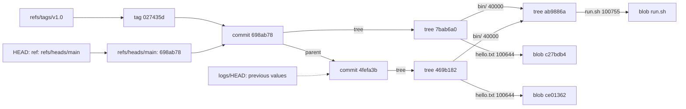

# Git Is a Content-Addressed Object Store

*Every object is named by the hash of its content, so a commit ID seals its whole history; a branch is a file that holds one.*

## Metadata

| Field | Value |
|---|---|
| Type | Build |
| Languages | Python |
| Prerequisites | [A Path Is a Lookup Through a Mount Table](https://cloudcaptain.io/learn/linux/filesystem-mounts) |
| Time | 90 minutes |
| Tools | git, sha1sum, zlib |

<Quiz stage="pre" />

## The Problem

Tuesday, 09:10. A developer's laptop had a kernel panic during `git commit` on a branch with two weeks of unpushed work. Now every command in that repository stops with `error: object file .git/objects/8b/1c4f... is empty` followed by `fatal: loose object 8b1c4f... (stored in .git/objects/8b/1c4f...) is corrupt`. The first advice in the team channel is "delete the folder and clone again". That would work for `main`, which is on the server, and destroy the local branch, which is not. A second engineer, trying to help, ran `git reset --hard HEAD~3` on the wrong branch an hour earlier and now believes three more commits are gone for good.

Neither problem is what it looks like. The empty file is one object out of thousands; the crash interrupted the write of a single blob, and every other object, including the commits of the local branch, is intact on disk. The "lost" commits after the reset were never touched: a reset moves a 41-byte text file called a ref, and the previous value of that ref is written down in the reflog. Both are fixed in minutes by someone who knows what `.git` holds, and both are made worse by someone who deletes things to see what happens.

What `.git` holds is small and regular. Every file, directory listing, commit and annotated tag is an object, stored compressed under a name that is the SHA-1 hash of its own bytes. A directory listing names files by their hashes, a commit names a directory listing by its hash, so one commit ID pins every byte of the snapshot and all the history behind it. A branch is a file containing one commit ID; `HEAD` is a file naming a branch. You are going to write `minigit`, which reads and writes exactly these files, and then check it against Git itself: `git fsck --strict` must accept every repository `minigit` creates, and `minigit` must read every object Git writes and compute the same IDs.

## The Concept

Think of a library where every book is shelved under a fingerprint of its text. Change one comma and the fingerprint changes, so the book moves to another shelf and the old one stays where it was. A catalogue card lists the books of one section by fingerprint, and the card itself is shelved under its own fingerprint. A "release" card names one catalogue card, the release card before it, who wrote it and when. Hand someone the fingerprint of the newest release card and they can check every book in the library: if any byte were different, some fingerprint along the way would not match.

Git's object store is that library. There are four object types:

- **blob**: the bytes of one file. No name, no mode, no timestamp; two files with the same content are one blob.
- **tree**: a directory listing. Each entry is a mode (`100644` file, `100755` executable, `120000` symlink, `40000` directory, `160000` a commit of another repository), a name and the ID of a blob, tree or commit.
- **commit**: text headers (`tree`, zero or more `parent`, `author`, `committer`), a blank line and the message. The author and committer lines carry a Unix time and the time zone the person was in.
- **tag**: an annotated tag: the ID and type of the object it points at, the tag name, the tagger and a message.

Every object is stored as `TYPE SIZE\0BODY`. Its ID is the SHA-1 of exactly those bytes, written as 40 hex characters, and the object is saved zlib-compressed at `.git/objects/` plus the first two hex characters as a directory and the other 38 as the file name. Because the name is the hash, objects are immutable, writing the same content twice is a no-op, and corruption is detectable by anyone: decompress, hash, compare with the file name.



Two commits share the unchanged `bin` tree: a new commit writes new objects only for what changed and reuses everything else by ID. The arrows only point backwards in time, because an object can only name objects that already exist; that makes the history a directed acyclic graph, and a hash at the top (a Merkle tree) authenticates everything below it.

Names live outside the object store, in plain files. `refs/heads/main` contains a commit ID and a newline; updating a branch replaces that file atomically through `refs/heads/main.lock`. `HEAD` usually contains `ref: refs/heads/main`, a **symbolic ref**; when it contains an ID instead, you have a detached HEAD. `packed-refs` holds many refs in one file once `git pack-refs` or `git gc` has run, and a loose ref file wins over a packed line. Every ref update under `refs/heads/` and every move of `HEAD` appends a line to `.git/logs/...`: old ID, new ID, who, when and why. That **reflog** is what turns "I reset the wrong branch" into a one-line fix. An object no ref or reflog entry reaches is **unreachable**; `git gc` deletes such objects only after a grace period (two weeks by default for loose objects; reflog entries last 90 days, or 30 once their commit is no longer reachable from the ref), which is why lost work is usually still there.

SHA-1 is no longer collision-resistant: the 2017 SHAttered attack produced two different PDFs with the same SHA-1. Git responded twice. It hashes with SHA-1DC, a SHA-1 that produces the normal result for normal input and refuses input that carries the fingerprint of a known collision attack. And it added a second object format, SHA-256, where IDs are 64 hex characters and tree entries carry 32-byte hashes; you choose it with `git init --object-format=sha256` and it is recorded as `extensions.objectFormat` in the repository config. A SHA-256 repository cannot yet exchange objects with a SHA-1 one and hosting support varies, so most repositories are still SHA-1. The Git project's plan for Git 3.0 changes the defaults for new repositories (SHA-256 objects and the reftable ref format), which is why every command in this lesson passes the formats explicitly.

## Build It

`code/main.py` is `minigit`, one file of standard-library Python organised as the steps below. Every function takes a `Repo` (the `.git` directory, the work tree and the hash algorithm), so the same code serves SHA-1 and SHA-256 repositories. There is no index: `write-tree` and `commit` snapshot the work tree directly, which is enough to show that the staging area is a cache in front of the object store, not part of it.

### Step 1: an object is a header, a body and a hash

```python
def frame(kind: str, body: bytes) -> bytes:
    return kind.encode() + b" " + str(len(body)).encode() + b"\0" + body


def hash_object(kind: str, body: bytes, algo: str = "sha1") -> str:
    return hashlib.new(algo, frame(kind, body)).hexdigest()
```

The type is part of the hashed bytes, so a blob and a tree with the same body have different IDs, and the size is part of it, so a reader knows where the body ends without a delimiter. `unframe()` is the strict inverse: it rejects a missing NUL, an unknown type, a size with a leading zero and a size that does not match the body. You can check the arithmetic without Python: `printf 'blob 6\0hello\n' | sha1sum` prints `ce013625030ba8dba906f756967f9e9ca394464a`, the ID `git hash-object` gives `hello` plus a newline.

### Step 2: loose objects are zlib files named by their hash

```python
def write_object(repo: Repo, kind: str, body: bytes) -> str:
    raw = frame(kind, body)
    oid = hashlib.new(repo.algo, raw).hexdigest()
    path = object_path(repo, oid)
    if os.path.exists(path):
        return oid
    os.makedirs(os.path.dirname(path), exist_ok=True)
    fd, tmp = tempfile.mkstemp(prefix="tmp_obj_", dir=os.path.dirname(path))
    try:
        with os.fdopen(fd, "wb") as handle:
            handle.write(zlib.compress(raw, LOOSE_COMPRESSION))
        os.chmod(tmp, 0o444)
        os.replace(tmp, path)
    except BaseException:
        if os.path.exists(tmp):
            os.unlink(tmp)
        raise
    return oid
```

The write goes to a temporary file in the same directory and is renamed into place, the same pattern Git uses (`tmp_obj_XXXXXX`), so a reader never sees half an object under its final name. A crash at the wrong moment on a filesystem that does not order data before the rename can still leave an empty file, which is exactly the laptop in The Problem; `read_raw()` reports `object file ... is empty` and `loose object ... is corrupt` in Git's words. `LOOSE_COMPRESSION` is 1, Git's default `core.looseCompression`. The compressed bytes depend on the zlib version and level, so two tools can store the same object as different files: compare IDs, never the files.

### Step 3: tree entries, modes and the sort rule

```python
def sort_key(entry: TreeEntry) -> bytes:
    return name_bytes(entry.name) + (b"/" if entry.mode == MODE_TREE else b"")


def encode_tree(entries: Iterable[TreeEntry], keep_order: bool = False) -> bytes:
    ordered = list(entries) if keep_order else sorted(entries, key=sort_key)
    return b"".join(e.mode.encode() + b" " + name_bytes(e.name) + b"\0" + bytes.fromhex(e.oid) for e in ordered)
```

An entry is the mode in ASCII octal, a space, the name, a NUL and the **binary** hash (20 bytes for SHA-1, 32 for SHA-256), with no separator between entries. Directories are written as `40000` without a leading zero; `git ls-tree` and `cat-file -p` print `040000` for alignment, and a tree that stores the padded form is flagged `zeroPaddedFilemode` by `git fsck`. Entries are sorted by name bytes **as if directory names ended with a slash**. For a directory `foo` and files `foo.c`, `foo-bar` and `foo0`, Git's order is `foo-bar`, `foo.c`, `foo`, `foo0`, because `-` and `.` sort before `/` and `0` after it. A plain name sort puts `foo` first, gives a different tree ID, and `git fsck` reports `treeNotSorted`. `parse_tree()` walks the same format back, and `tree_problems()` returns Git's fsck message IDs for bad trees: `emptyName`, `fullPathname`, `hasDot`, `hasDotdot`, `hasDotgit` (case-insensitive, because `.GIT` is `.git` on macOS and Windows), `duplicateEntries`, `treeNotSorted`, `badFilemode`, `zeroPaddedFilemode`.

### Step 4: snapshot a directory

```python
def snapshot(repo: Repo, path: str, keep_empty: bool) -> Optional[str]:
    entries = []
    for name in sorted(os.listdir(path)):
        if name == ".git":
            continue
        full = os.path.join(path, name)
        info = os.lstat(full)
        if stat.S_ISLNK(info.st_mode):
            entries.append(TreeEntry(MODE_LINK, name, write_object(repo, "blob", os.fsencode(os.readlink(full)))))
        elif stat.S_ISDIR(info.st_mode) and os.path.exists(os.path.join(full, ".git")):
            entries.append(TreeEntry(MODE_GITLINK, name, nested_head(full)))
        elif stat.S_ISDIR(info.st_mode):
            sub = snapshot(repo, full, keep_empty)
            if sub:
                entries.append(TreeEntry(MODE_TREE, name, sub))
        elif stat.S_ISREG(info.st_mode):
            mode = MODE_EXEC if info.st_mode & stat.S_IXUSR else MODE_FILE
            with open(full, "rb") as handle:
                entries.append(TreeEntry(mode, name, write_object(repo, "blob", handle.read())))
    if not entries and not keep_empty:
        return None
    return write_object(repo, "tree", encode_tree(entries))
```

This is `git add -A && git write-tree` without the index, and every branch matches a rule of Git's. `os.lstat` does not follow symlinks, and a symlink is stored as a blob whose content is the link target, with mode `120000`. Only the owner's execute bit matters: Git records `100755` or `100644` and nothing else of the permission bits, so `chmod 600` on a file changes nothing in the repository. A directory with a `.git` inside is an embedded repository and becomes a `160000` entry holding that repository's `HEAD` commit, which is all a submodule is at the object level (the URL lives in `.gitmodules`). A directory with nothing to store returns `None` and disappears: Git tracks files, not directories, which is why projects commit a `.gitkeep`. `--keep-empty-dirs` stores such a directory as the empty tree `4b825dc642cb6eb9a060e54bf8d69288fbee4904`, which Git accepts in a tree but never produces from `git add`.

### Step 5: commits and tags are text with identities

```python
def encode_commit(commit: Commit) -> bytes:
    lines = [f"tree {commit.tree}"] + [f"parent {p}" for p in commit.parents]
    lines += [f"author {commit.author.encode()}", f"committer {commit.committer.encode()}"]
    lines += [f"{key} {value.replace(chr(10), chr(10) + ' ')}" for key, value in commit.extra]
    return ("\n".join(lines) + "\n\n" + commit.message).encode("utf-8", "surrogateescape")
```

An identity is `Name <email> UNIXTIME +HHMM`. The time is absolute and the zone is only the author's offset, kept so `git log` can show the wall-clock time they saw. `make_ident()` takes the name, email and date from `GIT_AUTHOR_NAME`, `GIT_AUTHOR_EMAIL`, `GIT_AUTHOR_DATE` (and the `COMMITTER` variants) before `user.name` and `user.email` in the config, the precedence Git uses, and `parse_date()` accepts Git's internal form and ISO 8601:

```python
def parse_date(text: str) -> Tuple[int, str]:
    raw = text.strip()
    match = RAW_DATE.match(raw)
    if match:
        when = int(match["time"])
        return when, match["tz"] or "+0000"
    match = ISO_DATE.match(raw)
    if not match:
        raise GitError(f"cannot parse date {text!r} (examples: '@1767600000 +0100', '2026-01-05T09:00:00+01:00')")
    clock = match["clock"] if match["clock"].count(":") == 2 else match["clock"] + ":00"
    zone = match["tz"]
    naive = dt.datetime.fromisoformat(f"{match['date']}T{clock}")
    if zone is None:
        when = int(time.mktime(naive.timetuple()))
        return when, local_tz(when)
    tz = "+0000" if zone == "Z" else zone.replace(":", "")
    when = int((naive - dt.datetime(1970, 1, 1)).total_seconds()) - tz_seconds(tz)
    return when, tz
```

Because the dates are in the hashed bytes, the same tree, parents and message committed a second later is a different commit; setting both dates fixes the ID, which is how the tests and the smoke compare `minigit commit-tree` with `git commit-tree` byte for byte. `commit-tree -m` completes the last line with a newline, as Git does; `commit` and `tag -m` also apply Git's whitespace cleanup (trailing spaces removed, runs of blank lines collapsed). An annotated tag is the same shape with `object`, `type`, `tag` and `tagger` headers, and `refs/tags/NAME` then names the tag object, not the commit; `^{}` peels it.

### Step 6: refs, HEAD and the lock file

```python
def follow_symrefs(repo: Repo, name: str) -> Tuple[str, Optional[str]]:
    current = name
    for _ in range(SYMREF_MAXDEPTH + 1):
        value = read_ref(repo, current)
        if value is None:
            return current, None
        if not value.startswith("ref: "):
            if len(value) != repo.hex_len or not HEX.match(value):
                raise GitError(f"ref {current} holds {value!r}, which is neither an object ID nor 'ref: NAME'")
            return current, value
        current = value[len("ref: "):]
    raise GitError(f"symbolic ref {name} is a loop or a chain deeper than {SYMREF_MAXDEPTH}")
```

`read_ref()` reads the loose file and falls back to `packed-refs`. A fresh repository's `HEAD` resolves to `("refs/heads/main", None)`: an unborn branch, which is why `git log` in an empty repository complains that the branch has no commits rather than that `HEAD` is missing. Short names are resolved in Git's order, `NAME`, `refs/NAME`, `refs/tags/NAME`, `refs/heads/NAME`, `refs/remotes/NAME`, `refs/remotes/NAME/HEAD`, so a tag and a branch both called `release` resolve to the tag and `minigit rev-parse` warns that the name is ambiguous, as Git does. Writing a ref is a compare-and-swap:

```python
def update_ref(repo: Repo, name: str, new: str, ident: Ident, old: Optional[str] = None, message: str = "", deref: bool = True) -> str:
    target = follow_symrefs(repo, name)[0] if deref else name
    problem = check_ref_format(target)
    if problem:
        raise GitError(f"refusing to update ref with bad name: {problem}")
    before: List[Optional[str]] = [None]

    def verify() -> None:
        current = resolve_ref(repo, target)
        before[0] = current
        if old is None:
            return
        if old == repo.zero and current is not None:
            raise GitError(f"cannot lock ref '{target}': reference already exists")
        if old != repo.zero and current != old:
            raise GitError(f"cannot lock ref '{target}': is at {current or repo.zero} but expected {old}")

    write_locked(ref_path(repo, target), (new + "\n").encode(), verify)
    if should_log(repo, target):
        append_reflog(repo, target, before[0], new, ident, message)
    if target != "HEAD" and head_target(repo) == target:
        append_reflog(repo, "HEAD", before[0], new, ident, message)
    return target
```

`write_locked()` creates `NAME.lock` with `O_CREAT | O_EXCL`, which fails if the file exists, so two writers cannot both hold the lock; it checks the old value while holding it, writes the new value into the lock file and renames it over the ref. A leftover lock from a crashed process produces `Unable to create '.../main.lock': File exists.`, the same message Git prints for a stale `index.lock`, and the fix is the same: make sure no git process is running, then remove the lock. `check_ref_format()` applies the `git check-ref-format` rules (no `..`, no space or `~ ^ : ? * [ \`, no component starting with a dot or ending in `.lock`, no `@{`). A ref `refs/heads/a` and a ref `refs/heads/a/b` cannot coexist, because one is a file where the other needs a directory.

### Step 7: the reflog and revision syntax

`append_reflog()` writes one line per update, `OLD NEW Name <email> TIME ZONE`, then a tab and the message when there is one. Note the last two lines of `update_ref()`: when `HEAD` points at the branch being updated, `HEAD`'s log gets the same line, which is why `git reflog` (the log of `HEAD`) shows commits, resets and checkouts on every branch you were on. `commit` writes `commit (initial): SUBJECT` and `commit: SUBJECT`, Git's wording. `NAME@{N}` reads the log from the newest end:

```python
def reflog_value(repo: Repo, name: str, index: int) -> str:
    refs = dwim_refs(repo, name) if name != "HEAD" else ["HEAD"]
    if not refs:
        raise GitError(f"unknown revision {name!r}")
    ref = follow_symrefs(repo, refs[0])[0] if name != "HEAD" else "HEAD"
    entries = read_reflog(repo, ref)
    if index >= len(entries):
        raise GitError(f"log for '{name}' only has {len(entries)} entries")
    return entries[len(entries) - 1 - index].new
```

`rev_parse()` adds the rest of the syntax you use every day: `~N` follows first parents N times, `^N` takes the Nth parent of a merge, `^{tree}`, `^{commit}` and `^{}` peel tags and commits, `REV:path` walks the tree, and any unique prefix of four or more hex characters expands to a full ID. `HEAD~2` and `HEAD^^` are the same commit; `HEAD^2` is a different one, the branch that was merged in.

### Step 8: log walks first parents, checkout refuses dangerous names

`first_parent_log()` starts at a commit and follows `parents[0]` until a root commit, which is `git log --first-parent`: on a branch that merges pull requests, it lists the merges and skips the commits inside each pull request. `render_log()` prints Git's default format, including the `Merge:` line and the date in the author's own zone. `checkout REV DIR` writes a tree into a new or empty directory:

```python
def materialize(repo: Repo, tree: str, folder: str) -> int:
    kind, body = read_object(repo, tree)
    if kind != "tree":
        raise GitError(f"{tree} is a {kind}, not a tree")
    entries = parse_tree(body, repo.algo)
    unsafe = [d for check, d in tree_problems(entries) if check not in WARNING_CHECKS]
    if unsafe:
        raise GitError(f"refusing to check out tree {tree}: {'; '.join(unsafe)}")
    written = 0
    for entry in entries:
        path = os.path.join(folder, entry.name)
        if entry.mode == MODE_TREE:
            ensure_real_dir(path)
            written += materialize(repo, entry.oid, path)
        elif entry.mode == MODE_GITLINK:
            ensure_real_dir(path)
        elif entry.mode == MODE_LINK:
            os.symlink(os.fsdecode(read_object(repo, entry.oid)[1]), path)
            written += 1
        else:
            data = read_object(repo, entry.oid)[1]
            fd = os.open(path, os.O_WRONLY | os.O_CREAT | os.O_EXCL, 0o777 if entry.mode == MODE_EXEC else 0o666)
            with os.fdopen(fd, "wb") as handle:
                handle.write(data)
            written += 1
    return written
```

A tree is input from whoever pushed it. An entry named `.git` (or `.GIT`) would write a config file with hooks into the clone, `..` would escape the target, and a symlink followed by a directory of the same name would write through the link: real Git vulnerabilities came from each of these. The checkout runs the fsck name checks first, opens every file with `O_EXCL` (which also refuses to follow a symlink planted at that path) and `ensure_real_dir()` refuses to descend through a symlink. Modes come from the tree and the umask, as with Git: `0o777` or `0o666` minus your umask. A gitlink becomes an empty directory, which is what you see before `git submodule update`.

### Step 9: fsck rehashes every object and walks from every root

```python
def verify_loose(repo: Repo, oid: str) -> Tuple[Optional[Tuple[str, bytes]], List[Problem]]:
    try:
        raw = read_raw(repo, oid)
    except GitError as error:
        return None, [Problem(oid, "?", "corruptObject", str(error))]
    actual = hashlib.new(repo.algo, raw).hexdigest()
    if actual != oid:
        return None, [Problem(oid, "?", "hashMismatch", f"content hashes to {actual}, but the file is named {oid}")]
    try:
        kind, body = unframe(raw)
    except GitError as error:
        return None, [Problem(oid, "?", "badObjectHeader", str(error))]
    return (kind, body), [Problem(oid, kind, check, detail) for check, detail in object_problems(repo, kind, body)]
```

`fsck()` verifies every loose object, reachable or not, then walks from the roots: `HEAD`, every ref, and every old and new ID in every reflog. Each edge carries the type the parent expects (a tree entry with mode `100644` must lead to a blob, a `parent` header to a commit), so a missing object is reported as `missing blob ID` and a wrong one as `wrongObjectType`. Objects nothing reaches are unreachable; the ones no other unreachable object points to are **dangling**, the tips you would recover. Dangling objects are information, not errors, so they do not change the exit code. Warnings such as `zeroPaddedFilemode` fail only with `--strict`, as in Git. If the repository has packfiles, `minigit` says it did not check them: reading packs is the next lesson's job.

### Step 10: run it

```bash
export GIT_AUTHOR_NAME="Ada Lovelace" GIT_AUTHOR_EMAIL=ada@example.invalid GIT_AUTHOR_DATE="2026-01-05T09:00:00+01:00"
export GIT_COMMITTER_NAME="Grace Hopper" GIT_COMMITTER_EMAIL=grace@example.invalid GIT_COMMITTER_DATE="2026-01-05T09:30:00+01:00"
MG="python3 $PWD/code/main.py"
mkdir demo && cd demo && $MG init
echo hello | $MG hash-object -w --stdin                 # ce013625030ba8dba906f756967f9e9ca394464a
$MG cat-file -t ce01                                    # blob: a unique prefix is enough
mkdir bin && printf '#!/bin/sh\necho run\n' > bin/run.sh && chmod +x bin/run.sh
echo hello > hello.txt && ln -s hello.txt latest
$MG cat-file -p $($MG write-tree)
# 040000 tree ab9886a4a27110546a3771b2bfc93760bb25f679	bin
# 100644 blob ce013625030ba8dba906f756967f9e9ca394464a	hello.txt
# 120000 blob a5162f80d4a6782b7cb2a0a197f834e683cb9eb1	latest
$MG commit -m "First snapshot"                           # [main (root-commit) 4fefa3b] First snapshot
echo again >> hello.txt
GIT_AUTHOR_DATE="2026-02-01T08:00:00-05:00" GIT_COMMITTER_DATE="2026-02-01T08:05:00-05:00" $MG commit -m "Say hello twice"
$MG cat-file -p HEAD                                    # tree 7bab6a0..., parent 4fefa3b..., author ... 1769950800 -0500
$MG reflog                                              # 698ab78 HEAD@{0}: commit: Say hello twice / 4fefa3b HEAD@{1}: commit (initial): ...
$MG rev-parse HEAD~1 'HEAD^{tree}' HEAD:hello.txt 'main@{1}'
$MG tag -a v1.0 -m "First release"
$MG fsck                                                # 10 loose objects, 10 reachable from 3 root(s), 0 error(s)
$MG checkout HEAD~1 ../demo-out && ls -l ../demo-out    # bin/, hello.txt, latest -> hello.txt
echo junk | $MG hash-object -w --stdin && $MG fsck      # dangling blob a941931..., still exit 0
git fsck --strict && git log --oneline                  # the real Git accepts all of it
```

With the same dates you get the same IDs on any machine, which is the point of content addressing. Every command takes `--json` where the output is data (`cat-file`, `ls-tree`, `log`, `reflog`, `show-ref`, `fsck`, `count-objects`). Exit codes: 0 for success, 1 for a negative answer (`fsck` found errors, `cat-file -e` found nothing), 2 for a fatal error such as "not a git repository" or a corrupt object.

<RunTests />

## Use It

Now do the same with Git's plumbing, the low-level commands its everyday commands are built from. Start from a scratch repository with the formats pinned and no personal configuration:

```bash
export GIT_CONFIG_GLOBAL=/dev/null GIT_CONFIG_NOSYSTEM=1
export GIT_AUTHOR_NAME="Ada Lovelace" GIT_AUTHOR_EMAIL=ada@example.invalid GIT_AUTHOR_DATE="2026-01-05T09:00:00+01:00"
export GIT_COMMITTER_NAME="Grace Hopper" GIT_COMMITTER_EMAIL=grace@example.invalid GIT_COMMITTER_DATE="2026-01-05T09:30:00+01:00"
git -c init.defaultBranch=main -c init.defaultRefFormat=files init --object-format=sha1 plumbing && cd plumbing
ls .git                                   # HEAD config description hooks info objects refs
cat .git/HEAD                             # ref: refs/heads/main
git rev-parse --show-object-format --show-ref-format   # sha1, files
```

Objects by hand:

```bash
echo hello | git hash-object --stdin      # ce013625030ba8dba906f756967f9e9ca394464a, nothing written
printf 'blob 6\0hello\n' | sha1sum        # the same ID: the header is part of what is hashed
echo hello | git hash-object -w --stdin   # now .git/objects/ce/013625030ba8dba906f756967f9e9ca394464a exists
python3 -c 'import sys, zlib; print(zlib.decompress(open(sys.argv[1], "rb").read()))' .git/objects/ce/013625030ba8dba906f756967f9e9ca394464a
git cat-file -t ce01                      # blob
git cat-file -s ce01                      # 6
git cat-file -p ce01                      # hello
git cat-file --batch-all-objects --batch-check   # every object: ID, type, size
```

A tree and a commit without `git add` or `git commit`. `update-index --cacheinfo` puts an entry in the index directly, `write-tree` turns the index into tree objects, and `commit-tree` wraps a tree in a commit:

```bash
git update-index --add --cacheinfo 100644,ce013625030ba8dba906f756967f9e9ca394464a,hello.txt
T=$(git write-tree) && git ls-tree "$T"   # 100644 blob ce0136...	hello.txt
C1=$(git commit-tree "$T" -m "first")
git cat-file -p "$C1"                     # tree, author, committer, blank line, message
git update-ref refs/heads/main "$C1"      # the branch now exists: cat .git/refs/heads/main
git update-index --add --cacheinfo 100644,$(echo bye | git hash-object -w --stdin),bye.txt
C2=$(git commit-tree "$(git write-tree)" -p "$C1" -m "second")
git update-ref -m "manual: second" refs/heads/main "$C2" "$C1"   # compare-and-swap: fails if main moved
git update-ref refs/heads/main "$C1" "$C2" && git update-ref refs/heads/main "$C2"   # back and forth: both moves are logged
cat .git/logs/HEAD                        # one line per move, HEAD mirrored because it points at main
git log --oneline                         # second, first
```

Names, revisions and the reflog:

```bash
git symbolic-ref HEAD                     # refs/heads/main
git update-ref refs/heads/topic HEAD~1 && git symbolic-ref HEAD refs/heads/topic && git symbolic-ref HEAD refs/heads/main
git rev-parse HEAD HEAD~1 'HEAD^{tree}' HEAD:hello.txt 'main@{1}'
git rev-parse --abbrev-ref HEAD           # main
git tag -a v1.0 -m "First release" && git cat-file -p v1.0   # object, type, tag, tagger
git pack-refs --all && cat .git/packed-refs   # refs moved into one file; refs/heads/main is gone as a file
git check-ref-format refs/heads/a..b; echo $?  # 1
```

Health, counts and recovery:

```bash
git count-objects -v                      # count and size of loose objects, in-pack, size-pack
git fsck --strict                         # silent when clean; dangling objects are informational
git reset --hard HEAD~1                   # "lose" a commit
git reflog                                # HEAD@{0}: reset: moving to HEAD~1, HEAD@{1}: ...
git branch rescue 'HEAD@{1}'              # the commit was never gone; now it has a name again
git fsck --unreachable --no-reflogs       # what would become garbage if the reflog expired today
git fsck --lost-found                     # writes dangling commits and blobs to .git/lost-found/
git gc && git count-objects -v            # loose objects are now in a pack: count drops, in-pack rises
```

After `git gc`, `minigit` can still resolve every ref but reports the objects as not found as loose objects, naming the packfile; to inspect a packed repository with this lesson's tool, move the pack aside and explode it with `git unpack-objects < .git/objects/pack/pack-*.pack`.

For the corrupt object in The Problem, the sequence is: back up `.git` (`tar czf ../git-backup.tgz .git`), run `git fsck --full` to get the exact broken IDs, find what references them, and restore just those objects from any copy that has them. Because the name is the content's hash, any clone, a teammate's laptop or the server holds the identical bytes: `git -C ../other-clone cat-file blob ID > /tmp/obj` followed by `git hash-object -w /tmp/obj` writes it back, and the ID it prints proves it is the right content. An empty object file must be removed before `hash-object` can rewrite it. Only objects that exist nowhere else are truly lost, and then `git fsck` tells you which file at which path in which commit they were.

| What you built | Real tool | Note |
|---|---|---|
| `frame()`, `hash_object()` | `git hash-object`, `printf 'blob N\0...' \| sha1sum` | Git hashes with SHA-1DC, which refuses known collision patterns; IDs are the same for normal input |
| `write_object()`, `read_raw()` | `.git/objects/xx/yyyy`, `git cat-file -t/-s/-p` | Git also reads packfiles and alternates; the next lesson builds packs |
| `encode_tree()`, `sort_key()` | `git mktree`, `git ls-tree`, `git write-tree` | `ls-tree` prints `040000`; the object stores `40000`; names with special bytes are quoted unless `-z` |
| `snapshot()` | `git add -A` then `git write-tree` | Git goes through the index and honours `.gitignore`, attributes and filters; `minigit` has none of those |
| `make_commit()`, `parse_date()` | `git commit-tree`, `GIT_AUTHOR_DATE`, `GIT_COMMITTER_DATE` | same input, same commit ID; signatures add a `gpgsig` header |
| `make_tag()` | `git tag -a`, `git mktag` | lightweight tags are just refs, annotated tags are objects |
| `update_ref()`, `write_locked()` | `git update-ref NAME NEW OLD` | Git can also batch ref updates in one transaction (`update-ref --stdin`) |
| `follow_symrefs()`, `dwim_refs()` | `git symbolic-ref`, `git rev-parse`, `packed-refs` | the reftable backend stores refs in a binary format instead of files |
| `append_reflog()`, `reflog_value()` | `git reflog`, `NAME@{N}`, `git log -g` | `git reflog expire` and `gc.reflogExpire` decide how long it lasts |
| `rev_parse()` | `git rev-parse` and gitrevisions(7) | Git adds `@{upstream}`, `@{yesterday}`, `:/text` and ranges |
| `first_parent_log()` | `git log --first-parent` | without the flag Git walks every parent in date order |
| `checkout_tree()` | `git archive`, `git --work-tree=DIR checkout REV -- .` | Git updates the index and refuses to clobber local changes |
| `fsck()` | `git fsck --strict`, `--unreachable`, `--lost-found` | Git also checks packs, the index, `.gitmodules` and many more message IDs |
| `count_objects()` | `git count-objects -v` | same `count` and `size` for loose objects, read from the same files |

<Quiz stage="check" />

## Ship It

Two artifacts in `outputs/`:

- **`skill-git-plumbing-recovery.md`**: a runbook for a repository that looks broken: back up `.git` first, classify the symptom (lost commits after a reset, rebase or deleted branch; a dropped stash; `object file is empty` or `is corrupt` after a crash; a stale `.lock`; a ref file that is empty or holds garbage; `HEAD` pointing at a branch that does not exist), recover with the reflog, `git fsck --lost-found` and `update-ref`, restore single objects from another clone and prove them by their hash, and finish with a fixed report.
- **`prompt-explain-git-object.md`**: paste the output of `git cat-file -p`, `git ls-tree`, `git log --format=raw`, a decompressed loose object or a `git fsck` line and get every field explained: the type and what the ID covers, each mode and entry, the identities with their dates converted to UTC and the author's zone, what the object reaches, and for fsck messages what is wrong and how to repair it safely.

<ShipIt />

## Exercises

### Easy

Add `cat-file --batch`, which for each name on standard input prints `ID TYPE SIZE`, a newline, the raw content and another newline, and `NAME missing` for names it cannot resolve. Write the tests first: a blob that contains NUL bytes must come out byte-identical, a missing name must not stop the batch, and the output for a Git-created repository must equal `git cat-file --batch --batch-all-objects` once you feed it the same IDs in the same order.

### Medium

Teach `write-tree` and `commit` the `.gitignore` subset most projects use: blank lines and `#` comments, a trailing `/` for directories only, a leading `/` or a slash in the middle for anchored patterns, `*`, `?` and `**`, and `!` to re-include, with the last matching pattern winning and the rule that a file cannot be re-included if its parent directory is excluded. Tests first: build a table of paths and patterns, assert the decision for each, and in a test that runs the real `git`, assert your tree ID equals `git add -A && git write-tree` for the same directory.

### Hard

Write `.git/index` so that `git status` is clean right after a `minigit commit`, without `git reset`. Implement index version 2: the `DIRC` header with version and entry count, one entry per file with the stat fields (ctime, mtime, dev, ino, mode, uid, gid, size), the object ID, the flags with the path length, the path, NUL padding to a multiple of eight bytes, and the trailing hash of everything before it. Tests first: the entries must be sorted by path bytes, `git ls-files -s` must list your entries with the right modes and IDs, `git status --porcelain` must be empty, and touching a file without changing it must still give a clean status after Git refreshes the stat data.

<Quiz stage="post" />

## Key Terms

| Term | Common misconception | Precise definition |
|---|---|---|
| Object ID | "The commit ID is a random number or a counter." | The hash (SHA-1 or SHA-256) of the object's type, size, a NUL and its body. Equal content gives an equal ID everywhere, and any change gives a different one. |
| Blob | "Git stores files with their names and permissions." | The bytes of one file and nothing else. Names and modes live in the tree that points at the blob, so a rename does not create a new blob. |
| Tree | "Git stores diffs between versions." | A directory listing of mode, name and ID entries, sorted with directory names compared as if they ended in `/`. Each commit points at a full tree; unchanged subtrees are shared by ID. |
| Commit | "A commit is a set of changes." | A text object naming one tree, its parents, an author and a committer with Unix times and zones, and a message. A diff is computed on demand by comparing two trees. |
| Ref | "Deleting a branch deletes its commits." | A file or `packed-refs` line holding one object ID. Deleting or moving a ref changes only the name; the objects stay until `git gc` prunes them after the grace period. |
| Symbolic ref | "HEAD is the latest commit." | A ref whose content is `ref: OTHER`. `HEAD` normally names the current branch; it holds an ID directly only in the detached state. |
| Reflog | "The reflog is shared history on the server." | A local, per-ref append-only file of previous values with who, when and why. It is never pushed, and it is what `NAME@{N}` and recovery after a bad reset read. |
| Dangling object | "fsck found dangling objects, the repository is corrupt." | An unreachable object that no other unreachable object points to: typically a tip of lost work. It is informational and the first place to look when recovering. |
| Loose object | "Every object is a separate file forever." | An object stored as its own zlib file under `objects/xx/`. `git gc` and fetches move objects into packfiles, which hold many objects with delta compression. |
| Object format | "Git switched to SHA-256 because SHA-1 is broken." | The hash a repository uses, fixed at `git init` (`--object-format`) and recorded in `extensions.objectFormat`. SHA-1 with collision detection is still the common default; SHA-256 repositories exist but interoperate poorly today. |

## Further Reading

- [Git Fundamentals](https://cloudcaptain.io/docs/tools/git/fundamentals): the everyday commands this lesson takes apart, with the workflow they serve.
- [Git Advanced](https://cloudcaptain.io/docs/tools/git/advanced): reflog recovery, rebasing and history rewriting, which are ref and object operations once you have built them.
- [Git Cheat Sheet](https://cloudcaptain.io/docs/tools/git/cheatsheet): the porcelain commands next to the plumbing you used here.
- [Pro Git: Git Objects](https://git-scm.com/book/en/v2/Git-Internals-Git-Objects): the canonical walk-through of blobs, trees and commits with `hash-object` and `cat-file`.
- [gitrepository-layout](https://git-scm.com/docs/gitrepository-layout): what every file and directory under `.git` is for, including `packed-refs`, `logs/` and `objects/info/alternates`.
- [git-fsck](https://git-scm.com/docs/git-fsck): reachability, dangling and unreachable objects, `--lost-found`, and the `fsck.*` message IDs this lesson's checks mirror.
- [gitrevisions](https://git-scm.com/docs/gitrevisions): the full revision syntax behind `~`, `^`, `@{N}`, `^{type}` and `REV:path`.
- [git-check-ref-format](https://git-scm.com/docs/git-check-ref-format): the exact rules for valid ref names.
- [Hash function transition](https://git-scm.com/docs/hash-function-transition): the design of the SHA-256 object format and the interoperability plan.
- [SHAttered](https://shattered.io/): the first practical SHA-1 collision and why Git moved to collision-detecting SHA-1.
