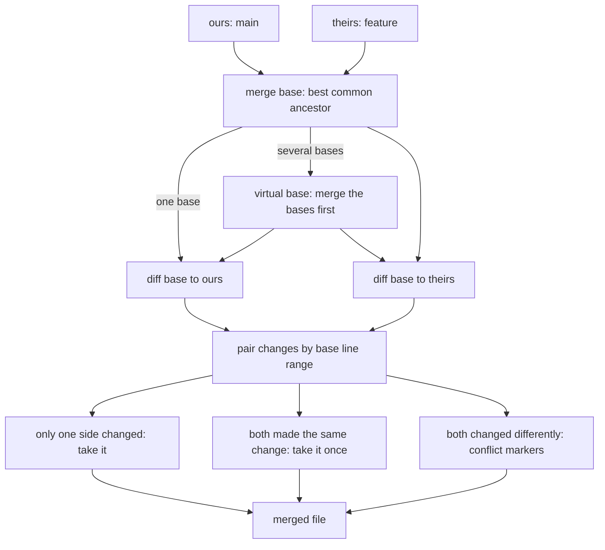

# A Merge Is a Three-Way Diff Against a Common Ancestor

*A merge compares each side with the ancestor they share; only lines both sides changed, in different ways, become a conflict.*

## Metadata

| Field | Value |
|---|---|
| Type | Build |
| Languages | Python |
| Prerequisites | [Git Is a Content-Addressed Object Store](https://cloudcaptain.io/learn/git/object-store) |
| Time | 90 minutes |
| Tools | git, patch |

<Quiz stage="pre" />

## The Problem

Friday, 16:40. The release branch of the checkout service has to merge back into `main` before the freeze. Two teams touched `deploy/checkout.yaml` during the week: one raised `replicas` from 3 to 4, the other moved the image from `1.4.2` to `1.4.3`. The lines are next to each other, so Git stops with a conflict. The engineer on duty sees two blocks that both look plausible, picks "theirs" for the whole file in the merge tool, and pushes. The image bump is gone. On Monday the security team asks why the patched image never reached production.

The same merge produced no conflict at all in `config/feature-flags.json`: one team added `"retries": 3` near the top, the other added `"retries": 5` at the end. Git merged both lines. The file is still valid JSON syntax, with the key twice, and the parser in the service silently keeps the last one. `package-lock.json` merged cleanly too and now describes a dependency tree that `npm ci` rejects. And because the release branch had been merged into `main` and `main` into the release branch twice during the week, the merge had two merge bases, and someone asked in the channel why Git said "merged common ancestors" in a conflict block.

None of this is Git being clever or random. A merge is a mechanical procedure: find the commit both sides started from, diff that ancestor against each side line by line, keep every change only one side made, and stop where both sides changed the same lines differently. Once you know the procedure, you know why adjacent lines conflict, why JSON merges "cleanly" into nonsense, which side a conflict block shows first, and when a different diff algorithm or conflict style would have made the decision obvious. You are going to write `minimerge`, the procedure from diff to merge base to conflict markers, and check it against Git: its patches must apply with `patch`, its diffs must change the same lines as `git diff`, its merge bases must equal `git merge-base --all`, and its merges must equal `git merge-file` byte for byte.

## The Concept

Two people get a copy of the same contract. One fixes a typo on page 2, the other changes a price on page 7. To combine their work you do not compare their copies with each other: that only tells you the copies differ on pages 2 and 7, not who changed what. You compare each copy with the original. The original says page 2 had the typo, so the fix is a change by the first person; the original says page 7 had the old price, so the new price is a change by the second. Take both. If both changed page 7 to the same new price, take it once. If they changed page 7 to different prices, nobody can decide mechanically: that is a conflict, and the honest output is both versions plus, ideally, the original.

That is a **three-way merge**, and the original is the **merge base**. It needs two ingredients.

The first is a **diff**: the shortest list of line insertions and deletions that turns one file into another, which is the same problem as finding the longest common subsequence of lines. Myers' algorithm (1986) solves it in O(ND) time, where N is the total length and D the size of the edit script, by exploring diagonals of an edit graph from both ends until the two searches meet. The shortest script is not always the most readable: in code, the lines most likely to match by accident are blank lines and lone braces. **Patience diff** first matches only lines that occur exactly once in both files (function headers, unique statements), takes the longest increasing chain of those as anchors and recurses between them. **Histogram diff**, Git's refinement of the same idea, anchors on the region around the rarest common line, so it also works when no line is unique. All three are correct diffs; they differ in which equal lines they decide to keep.

The second is the **merge base**: the best common ancestor of the two commits, one that is an ancestor of both and not an ancestor of another common ancestor. In a simple branch there is one. When two branches have merged each other (a **criss-cross**), there can be several equally good ones. Picking one at random gives spurious conflicts; Git's `ort` strategy (the default since Git 2.34) merges the merge bases first into a **virtual merge base** and uses that.



Pairing works on base line ranges. Each change from the ours-diff and the theirs-diff covers a range of base lines (an insertion covers an empty range at a position). Two changes whose ranges overlap or touch belong to one region. A region changed only by ours takes the ours lines, only by theirs takes the theirs lines, and one changed by both becomes a conflict unless both replaced it with identical lines. Touching counts: a change ending at base line 3 and another starting at line 4 conflict, because neither side's edit says what the line between them should look like next to the other edit. That is the `replicas` and `image` conflict from The Problem.

Everything works on lines, never on meaning. Two additions of `"retries"` at different places do not touch, so they merge. A reordered list conflicts in every line. A lockfile is a derived file: merging two lockfiles line by line can produce one that no resolver would ever write. Those files need either a custom merge driver or regeneration after the merge.

## Build It

`code/main.py` is `minimerge`, one file of standard-library Python. It follows Git's `xdiff` library closely enough that its output can be compared with Git's byte for byte: the same diff algorithms with the same heuristics, the same hunk format, the same merge-base search and the same conflict regions.

### Step 1: lines are compared as small integers

```python
def split_lines(text: str) -> List[str]:
    parts = text.split("\n")
    lines = [part + "\n" for part in parts[:-1]]
    if parts[-1]:
        lines.append(parts[-1])
    return lines
```

Every line keeps its newline, so a last line without one (`b` instead of `b\n`) is a different line, which is exactly how Git treats it and why a diff shows `\ No newline at end of file`. `classify()` then maps every distinct line to an integer with one dictionary shared by both files, so the algorithms compare integers instead of strings.

### Step 2: Myers searches the edit graph from both ends

```python
def myers(a: Sequence[int], b: Sequence[int]) -> Tuple[Marks, Marks]:
    changed_a, changed_b = [False] * len(a), [False] * len(b)
    start, end_a, end_b = common_ends(a, b)
    kept_a = discard_unmatched(a, start, end_a, Counter(b), changed_a)
    kept_b = discard_unmatched(b, start, end_b, Counter(a), changed_b)
    ha, hb = [a[i] for i in kept_a], [b[i] for i in kept_b]
    boxes = [(0, len(ha), 0, len(hb))]
    while boxes:
        off1, lim1, off2, lim2 = boxes.pop()
        while off1 < lim1 and off2 < lim2 and ha[off1] == hb[off2]:
            off1 += 1
            off2 += 1
        while off1 < lim1 and off2 < lim2 and ha[lim1 - 1] == hb[lim2 - 1]:
            lim1 -= 1
            lim2 -= 1
        if off1 == lim1:
            for k in range(off2, lim2):
                changed_b[kept_b[k]] = True
        elif off2 == lim2:
            for k in range(off1, lim1):
                changed_a[kept_a[k]] = True
        else:
            mid1, mid2 = middle_snake(ha, off1, lim1, hb, off2, lim2)
            boxes.append((mid1, lim1, mid2, lim2))
            boxes.append((off1, mid1, off2, mid2))
    return changed_a, changed_b
```

The result is not a list of edits but two arrays of flags: `changed_a[i]` is true when line `i` of the old file is deleted, `changed_b[j]` when line `j` of the new file is inserted. Every later step works on those flags. Picture a grid with the old file on one axis and the new one on the other: moving right deletes a line, moving down inserts one, and a diagonal step is free where the two lines are equal. The shortest edit script is the path with the fewest non-diagonal steps. `middle_snake()` extends the furthest-reaching path on each diagonal `d` from the top-left and from the bottom-right, one edit at a time, until a forward and a backward path overlap; that meeting point splits the box into two smaller boxes, solved the same way. Before the search, `discard_unmatched()` drops lines that do not occur in the other file at all (they must be changes) and very frequent lines surrounded by such noise, the same preprocessing Git applies, which keeps the search small on large files. The worked example from Myers' paper, `ABCABBA` to `CBABAC`, needs five edits, and a test checks exactly that.

### Step 3: patience anchors on lines that occur once

```python
def unique_lcs(pairs: Sequence[Tuple[int, int]]) -> List[Tuple[int, int]]:
    tails: List[int] = []
    previous: List[int] = []
    for index, (_, line2) in enumerate(pairs):
        low, high = -1, len(tails)
        while low + 1 < high:
            middle = low + (high - low) // 2
            if pairs[tails[middle]][1] > line2:
                high = middle
            else:
                low = middle
        previous.append(tails[low] if low >= 0 else -1)
        if low + 1 == len(tails):
            tails.append(index)
        else:
            tails[low + 1] = index
    chain = []
    k = tails[-1] if tails else -1
    while k >= 0:
        chain.append(pairs[k])
        k = previous[k]
    return chain[::-1]
```

`patience_range()` collects every line that occurs exactly once in the old range and exactly once in the new range, as `(old position, new position)` pairs in old order. The longest chain of pairs whose new positions also increase is found by patience sorting (the binary search above), which gives the algorithm its name. Those pairs are anchors: the diff matches them, extends each anchor over equal neighbouring lines, and recurses into the gaps between anchors. A gap with no unique common line falls back to Myers. On `code/fixtures/patience/`, where `fact()` below `frobnitz()` is replaced by `fib()` above it, Myers keeps the lone `{` and `}` lines in place and interleaves the functions into nine small changes; patience anchors on `int frobnitz(int foo)` and reports four: `fib()` added as one block, `fact()` removed as one block, and two one-line edits.

### Step 4: histogram anchors on the rarest common region

```python
def histogram_range(a: Sequence[int], b: Sequence[int], start1: int, end1: int, start2: int, end2: int, changed_a: Marks, changed_b: Marks) -> None:
    while True:
        if start1 >= end1 or start2 >= end2:
            mark(changed_a, start1, end1)
            mark(changed_b, start2, end2)
            return
        status, region = rarest_common_region(a, b, start1, end1, start2, end2)
        if status == "fallback":
            classic_range(a, b, start1, end1, start2, end2, changed_a, changed_b)
            return
        if region is None:
            mark(changed_a, start1, end1)
            mark(changed_b, start2, end2)
            return
        begin1, begin2, stop1, stop2 = region
        histogram_range(a, b, start1, begin1, start2, begin2, changed_a, changed_b)
        start1, start2 = stop1 + 1, stop2 + 1
```

`rarest_common_region()` counts how often each line occurs in the old range, walks the new range, and for every common line grows the matching region in both directions while tracking the lowest occurrence count inside it. A region replaces the best one so far when it is longer or contains a rarer line. When even the rarest common line occurs more than 64 times (`MAX_CHAIN`), the function gives up and Myers runs on that range, as Git does. Histogram behaves like patience when unique lines exist, and still finds good anchors when they do not, for example in a file of repeated `}` and blank lines.

### Step 5: compaction slides each change to a canonical place

```python
def diff(old: Sequence[str], new: Sequence[str], algorithm: str = "myers", rediff: bool = True) -> List[Change]:
    if algorithm not in ALGORITHM:
        raise MergeError(f"unknown diff algorithm {algorithm!r} (choose from {', '.join(ALGORITHMS)})")
    a, b = classify(old, new)
    changed_a, changed_b = ALGORITHM[algorithm](a, b)
    rediff = rediff and algorithm == "histogram"
    compact(a, changed_a, b, changed_b, rediff)
    compact(b, changed_b, a, changed_a, rediff)
    return build_script(changed_a, changed_b)
```

Inserting a second `b` into `a b c` can be shown as "after the first `b`" or "before it"; both are minimal. `compact()` makes the choice deterministic. A `Group` is a run of changed lines; `slide_down()` moves it one line later when the line after it equals its first line, and `slide_up()` does the reverse. Each group is slid as far down as possible, then back up to line up with a change on the other side if there is one, which is what Git's `xdl_change_compact()` does. Git 2.54 added one more step for histogram only: a group that moved is diffed again with Myers, because the slide can leave a needlessly long change behind. `diff --no-rediff` keeps the older behaviour, and the smoke test accepts either, because the Git on an Ubuntu runner can be older than 2.54. `build_script()` turns the flags into `Change(old_start, old_count, new_start, new_count)` records, zero-based.

### Step 6: a unified diff that `patch` accepts

```python
def hunk_range(start: int, count: int) -> str:
    if count == 0:
        return f"{start},0"
    if count == 1:
        return str(start + 1)
    return f"{start + 1},{count}"
```

`hunks()` groups changes that are at most twice the context apart, so their context lines would overlap, into one hunk. `unified()` writes `--- a` and `+++ b`, then for each hunk a header `@@ -OLD +NEW @@` and the lines prefixed with a space, `-` or `+`. The header ranges are one-based `start,count`, a count of 1 is left out, and an empty range names the line before it (`-0,0` for an insertion at the top of an empty file). A line without a final newline is followed by `\ No newline at end of file`. Git adds the nearest function name after the second `@@` and the `diff --git` and `index` lines; `patch` ignores both. `minimerge diff` exits 1 when the files differ and 0 when they do not, like `diff` and `git diff --exit-code`.

### Step 7: merge bases by painting the commit graph

```python
def merge_bases(graph: Graph, one: str, two: str) -> List[str]:
    for commit in (one, two):
        if commit not in graph:
            raise MergeError(f"{commit} is not in the commit graph")
    depth = generations(graph)
    flags: Dict[str, int] = {one: PARENT1}
    flags[two] = flags.get(two, 0) | PARENT2
    queue = [(-depth[one], 0, one), (-depth[two], 1, two)]
    heapq.heapify(queue)
    order = 2
    candidates: List[str] = []
    while any(not flags[c] & STALE for _, _, c in queue):
        _, _, commit = heapq.heappop(queue)
        paint = flags[commit] & (PARENT1 | PARENT2 | STALE)
        if paint == PARENT1 | PARENT2:
            if not flags[commit] & RESULT:
                flags[commit] |= RESULT
                candidates.append(commit)
            paint |= STALE
        for parent in graph.get(commit, ()):
            if flags.get(parent, 0) & paint == paint:
                continue
            flags[parent] = flags.get(parent, 0) | paint
            heapq.heappush(queue, (-depth.get(parent, 1), order, parent))
            order += 1
    return independent(graph, candidates, depth)
```

This is Git's `paint_down_to_common()`. A graph is a dictionary from commit to parents, loaded from `git rev-list --parents --all` or from a JSON file. Commits reachable from the first tip are painted `PARENT1`, from the second `PARENT2`, walking newest first by generation number (one more than the deepest parent). A commit carrying both colours is a common ancestor; it becomes a candidate, and everything below it is painted `STALE`, because an ancestor of a common ancestor is never the best one. The walk ends when only stale commits are left in the queue. `independent()` then removes any candidate that is an ancestor of another candidate. For `X3` and `Y3` in `code/fixtures/criss-cross.json`, where `X2` merged `Y1` and `Y2` merged `X1`, both `X1` and `Y1` survive: neither is an ancestor of the other, and both are "best". Unrelated histories give an empty list, and `minimerge merge-base` exits 1, as `git merge-base` does.

### Step 8: the three-way merge

```python
def merge3(base: Sequence[str], ours: Sequence[str], theirs: Sequence[str], style: str = "merge", algorithm: str = "myers", labels: Sequence[Optional[str]] = ("ours", "base", "theirs"), favor: str = "", level: str = "zealous-alnum", marker_size: int = MARKER_SIZE, rediff: bool = True) -> MergeResult:
    if style not in STYLES:
        raise MergeError(f"unknown conflict style {style!r} (choose from {', '.join(STYLES)})")
    if level not in LEVELS or favor not in FAVORS:
        raise MergeError(f"unknown level {level!r} or favor {favor!r}")
    left, right = diff(base, ours, algorithm, rediff), diff(base, theirs, algorithm, rediff)
    if not left:
        return MergeResult(list(theirs), 0, [])
    if not right:
        return MergeResult(list(ours), 0, [])
    rank = LEVELS.index(level)
    if style != "merge":
        rank = min(rank, LEVELS.index("eager"))
    regions = pair_changes((len(base), len(ours), len(theirs)), ours, theirs, left, right, rank)
    if style == "zdiff3":
        trim_conflicts(ours, theirs, regions)
    elif rank >= LEVELS.index("zealous"):
        regions = refine_conflicts(ours, theirs, regions, algorithm, rediff)
        simplify_conflicts(ours, regions, rank > LEVELS.index("zealous"))
    lines, conflicts = render(base, ours, theirs, regions, style, labels, FAVORS[favor], marker_size)
    return MergeResult(lines, conflicts, regions)
```

`pair_changes()` walks the two change lists in base order, which is Git's `xdl_do_merge()`. A change that ends before the other one starts becomes an `ours` or `theirs` region; overlapping or touching changes become one `conflict` region spanning the union of their base ranges, unless both replaced the same base lines with the same lines. `append_region()` joins a new region with the previous one when they touch, so a chain of overlapping changes becomes one conflict. Argument order is `git merge-file`'s: ours, base, theirs, and the result is built by copying ours and splicing in theirs, which is why "ours" always comes first in a conflict block.

### Step 9: levels, styles and markers

```python
def trim_conflicts(ours: Sequence[str], theirs: Sequence[str], regions: Sequence[Region]) -> None:
    for region in regions:
        if region.mode != CONFLICT:
            continue
        while region.ours_count and region.theirs_count and ours[region.ours_start] == theirs[region.theirs_start]:
            region.ours_start += 1
            region.theirs_start += 1
            region.ours_count -= 1
            region.theirs_count -= 1
        while region.ours_count and region.theirs_count and ours[region.ours_start + region.ours_count - 1] == theirs[region.theirs_start + region.theirs_count - 1]:
            region.ours_count -= 1
            region.theirs_count -= 1
```

A raw conflict region often contains lines both sides added identically. The **level** decides how much of that Git removes. `eager` only resolves regions that are completely identical. `zealous` diffs the two sides of each conflict against each other (`refine_conflicts()`), keeps equal lines outside the markers and splits the conflict into smaller ones, then joins conflicts that are three lines or less apart. `zealous-alnum`, the default of `git merge-file`, also joins conflicts separated only by lines without letters or digits, such as `}` and blank lines, because a conflict split by a lone brace is harder to read than one block. The **style** decides what a conflict shows: `merge` shows ours and theirs, `diff3` adds the base section after `|||||||` (and turns the level down to `eager`, because shrinking the sides would make them no longer match the base section), and `zdiff3` keeps the base section but moves the common prefix and suffix out of the block with `trim_conflicts()`. `render()` writes `<<<<<<<`, `|||||||`, `=======` and `>>>>>>>` lines with the labels, adding a newline to a side that lacks one so a marker never ends up on the same line as content. `--favor ours|theirs|union` resolves every conflict without markers, like `git merge-file --ours`, `--theirs` and `--union`.

### Step 10: a virtual merge base for criss-cross histories

```python
def merge_commits(graph: Graph, ours: str, theirs: str, store: Store, algorithm: str = "histogram", style: str = "merge", names: Tuple[str, str] = ("ours", "theirs"), depth: int = 0, steps: Optional[List[str]] = None, rediff: bool = True) -> Tuple[MergeResult, List[str]]:
    steps = [] if steps is None else steps
    bases = merge_bases(graph, ours, theirs)
    indent = "  " * depth
    steps.append(f"{indent}merge {short(ours)} and {short(theirs)}: {len(bases)} merge base(s) {' '.join(short(b) for b in bases) or '(none)'}")
    if not bases:
        base, base_label = [], "empty tree"
    elif len(bases) == 1:
        base, base_label = store(bases[0]), short(bases[0])
    else:
        current = bases[0]
        for other in bases[1:]:
            inner, _ = merge_commits(graph, current, other, store, algorithm, style, VIRTUAL_NAMES, depth + 1, steps, rediff)
            virtual = f"virtual-{depth + 1}-{len(store.cache)}"
            graph[virtual] = (current, other)
            store.cache[virtual] = inner.lines
            steps.append(f"{indent}  {virtual} = merge of {short(current)} and {short(other)}, {inner.conflicts} conflict(s) left in it")
            current = virtual
        base, base_label = store(current), "merged common ancestors"
    result = merge3(base, store(ours), store(theirs), style, algorithm, (names[0], base_label, names[1]), level="zealous", marker_size=MARKER_SIZE + 2 * depth, rediff=rediff)
    return result, bases
```

This is the recursive idea that `git merge -s recursive` introduced and `ort` keeps: with several merge bases, merge the bases with each other (recursively, since they can have several bases themselves) and use the result as the base. Conflicts inside the virtual base are left in it with longer markers (`<<<<<<<<<` and the labels `Temporary merge branch 1` and `2`), which is harmless as long as neither side touched those lines, and why you sometimes see "merged common ancestors" in a `diff3` block. The smoke test builds a history where `X1` changed line 2 and `Y1` changed line 7, both branches merged both, and each then changed its own line again: merging with `X1` alone as the base conflicts on line 7, because from `X1`'s point of view both sides changed it; the virtual base already contains both edits, so the merge is clean, exactly as `git merge -s ort` decides. `merge-recursive` does this for one file at a time; the real `ort` also merges trees, which is where rename detection comes in.

### Step 11: renames by content similarity

```python
def similarity(source: bytes, target: bytes, minimum: int, cache: Optional[Dict[bytes, Dict[int, int]]] = None) -> int:
    largest, smallest = max(len(source), len(target)), min(len(source), len(target))
    if not target or largest * (MAX_SCORE - minimum) < (largest - smallest) * MAX_SCORE:
        return 0
    cache = {} if cache is None else cache
    for blob in (source, target):
        if blob not in cache:
            cache[blob] = spans(blob)
    theirs = cache[target]
    copied = sum(min(count, theirs.get(key, 0)) for key, count in cache[source].items())
    return copied * MAX_SCORE // largest
```

Git stores no renames: a commit only has trees, and a rename is a path that disappeared plus a path that appeared with similar content. `spans()` is Git's `diffcore-delta` fingerprint: it cuts a file into chunks at each newline or every 64 bytes, hashes each chunk and counts bytes per hash (ignoring the `\r` of `\r\n` in text). The score is the number of bytes the target shares with the source, scaled to 60000 (`MAX_SCORE`, 100 percent) by the larger size; files whose sizes differ too much for the threshold are skipped without hashing. `find_renames()` then pairs in Git's order: identical content first (preferring the same file name), then files with the same basename on both sides at a stricter threshold, then the best remaining pairs above the threshold (50 percent by default, `-M50%`), each source used once. `ort` uses these pairs so that an edit to `util.py` on one branch lands in `lib/util.py` when the other branch moved it.

### Step 12: run it

```bash
MM="python3 code/main.py"
$MM diff code/fixtures/patience/old.c code/fixtures/patience/new.c                       # myers: braces kept, functions interleaved, 9 changes
$MM diff --algorithm patience code/fixtures/patience/old.c code/fixtures/patience/new.c  # fib() added and fact() removed as whole blocks, 4 changes
$MM diff --json --algorithm histogram code/fixtures/patience/old.c code/fixtures/patience/new.c
$MM diff -U1 a.txt b.txt > fix.patch; patch -o out.txt a.txt < fix.patch && cmp out.txt b.txt   # diff exits 1 when the files differ
$MM merge-file code/fixtures/config/ours.yaml code/fixtures/config/base.yaml code/fixtures/config/theirs.yaml    # 1 conflict: replicas next to image
$MM merge-file --zdiff3 -L main -L base -L release code/fixtures/config/{ours,base,theirs}.yaml
$MM merge-file --json code/fixtures/json/ours.json code/fixtures/json/base.json code/fixtures/json/theirs.json   # clean, and "retries" twice
$MM merge-base X3 Y3 --graph code/fixtures/criss-cross.json                              # X1 and Y1
$MM merge-base --repo . main HEAD --json
$MM merge-recursive --repo . main feature path/to/file                                   # steps on stderr, virtual bases included
$MM renames old-tree/ new-tree/                                                          # R100 docs/a.md handbook/a.md, D ..., A ...
```

`diff`, `merge-file`, `merge-base` and `renames` take `--json`. Exit codes: `diff` 1 when the files differ, `merge-file` and `merge-recursive` 1 when conflicts remain, `merge-base` 1 when there is no common ancestor, and 2 for errors such as a missing file or a name that is not a commit.

<RunTests />

## Use It

The same jobs with Git. Start with a scratch directory and no personal configuration, so `diff.algorithm` or `merge.conflictStyle` from your own `~/.gitconfig` do not change the results:

```bash
export GIT_CONFIG_GLOBAL=/dev/null GIT_CONFIG_NOSYSTEM=1
git diff --no-index --diff-algorithm=myers old.c new.c      # the default
git diff --no-index --patience old.c new.c                  # same as --diff-algorithm=patience
git diff --no-index --histogram old.c new.c
git -c diff.indentHeuristic=false diff --no-index old.c new.c   # without the indent heuristic: what minimerge matches position for position
git config diff.algorithm histogram                         # per repository; many teams set this globally
git log -p --diff-algorithm=histogram -- src/               # the option works for log and show too
git diff --stat --minimal old..new                          # --minimal spends more time to find the smallest diff
```

`git diff` slides changes with one more rule than `minimerge`: the indent heuristic (on by default since Git 2.14) chooses among equally short placements the one whose boundaries sit at blank lines and lower indentation, so a diff of an added function starts at the function, not at the closing brace of the one before. It moves changes but never changes which lines are added or removed, so the smoke test compares the added and removed lines with it on and the exact positions with it off.

Merge bases and three-way merges of single files:

```bash
git merge-base main feature                                 # one best base (Git picks one if there are several)
git merge-base --all main feature                           # every best base: two or more means criss-cross
git merge-base --is-ancestor main feature && echo fast-forward possible
git log --oneline --graph --boundary main...feature         # the commits on each side since the base
git merge-file -p ours.yaml base.yaml theirs.yaml           # prints the merge; exit code = number of conflicts
git merge-file -p --diff3 -L main -L base -L release ours.yaml base.yaml theirs.yaml
git merge-file -p --zdiff3 ours.yaml base.yaml theirs.yaml  # zdiff3 since Git 2.35
git merge-file -p --diff-algorithm=histogram ours.yaml base.yaml theirs.yaml   # since Git 2.44
git merge-file -p --union CHANGELOG.ours CHANGELOG.base CHANGELOG.theirs       # keep both sides, no markers
```

Real merges, conflict styles and resolution:

```bash
git config merge.conflictStyle zdiff3                       # every conflict shows the base, trimmed
git merge -s ort feature                                    # the default strategy since Git 2.34
git merge -X patience feature                               # use patience for the content merge
git merge -X find-renames=70% feature                       # stricter rename detection
git merge -X ours feature                                   # resolve only the conflicting hunks in favour of ours
git status                                                  # "both modified: deploy/checkout.yaml"
git diff                                                    # combined diff: two columns of +/- against ours and theirs
git log --merge -p -- deploy/checkout.yaml                  # the commits on both sides that touched the file
git checkout --conflict=diff3 deploy/checkout.yaml          # re-create the markers with the base shown
git show :1:deploy/checkout.yaml > base.yaml                # stage 1 base, :2 ours, :3 theirs
git checkout --ours deploy/checkout.yaml                    # take one side for this file only
git merge --abort                                           # back to the state before the merge
git merge-tree --write-tree main feature                    # a merge without touching the work tree, as merge queues do
```

`-X ours` and `-s ours` are different things: the first resolves only the conflicting hunks with our side and keeps every clean change from theirs, the second ignores the other branch's content entirely and only records the merge. Git 2.50 removed the old `recursive` backend; `-s recursive` now runs `ort`, which uses the same virtual-base idea with a faster rename detection.

Reuse a resolution with `rerere` (reuse recorded resolution). After you resolve a conflict once, Git replays your resolution whenever the same conflict appears again, for example when a long-lived branch is rebased or merged repeatedly:

```bash
git config rerere.enabled true
git merge feature                     # Recorded preimage for 'app.yaml'
# fix app.yaml by hand, then
git add app.yaml && git commit        # Recorded resolution for 'app.yaml'
git reset --hard HEAD~1 && git merge feature   # Resolved 'app.yaml' using previous resolution.
git rerere diff                       # what rerere did; check it before you commit
git rerere forget app.yaml            # drop a bad recorded resolution
```

Files that line merges get wrong:

```bash
printf 'package-lock.json merge=npm-lockfile\n*.json merge=json3\n' >> .gitattributes
git config merge.npm-lockfile.name "regenerate the lockfile"
git config merge.npm-lockfile.driver true                  # keep ours (%A untouched) and report success
git config merge.json3.driver 'my-json-merge %O %A %B %P'   # a structural merge tool you trust
```

A **merge driver** replaces the line merge for matching paths: Git calls it with the base (`%O`), ours (`%A`, where the result must be written) and theirs (`%B`), and a non-zero exit means "conflict". For lockfiles the honest driver is "keep one side, then regenerate": `true` leaves ours in place, and after the merge you run `npm install`, `go mod tidy` or `poetry lock` and commit the result. For JSON and YAML configuration, check the merged file with a parser in CI (duplicate keys are legal JSON syntax but almost never intended) and keep lists one item per line, sorted, with trailing commas where the format allows, so edits do not touch neighbouring lines.

The resolution workflow that avoids The Problem: set `merge.conflictStyle zdiff3` so every block shows the base; read each block as "what did each side change relative to the base" rather than "which block looks right"; resolve block by block, never a whole file with `--ours` or `--theirs` unless you checked every block; run the tests; and for derived files regenerate instead of merging.

| What you built | Real tool | Note |
|---|---|---|
| `myers()`, `middle_snake()` | `git diff --diff-algorithm=myers`, `xdiff/xdiffi.c` | Git adds `--minimal` (no cost cutoff) and the indent heuristic |
| `patience_range()`, `unique_lcs()` | `--patience`, `xdiff/xpatience.c` | the same anchors and the same fallback to Myers |
| `histogram_range()` | `--histogram`, `xdiff/xhistogram.c` | Git 2.54 and later also re-diff groups that compaction moved |
| `compact()`, `Group` | `xdl_change_compact()` | Git also scores slide positions with the indent heuristic |
| `unified()`, `hunk_range()` | `git diff -U`, `diff -u`, `patch` | Git adds `diff --git`, `index` and the function name after the hunk header |
| `merge_bases()` | `git merge-base --all` | Git uses commit-graph generation numbers and the same paint walk |
| `merge3()`, `pair_changes()` | `git merge-file`, `xdiff/xmerge.c` | the same levels, styles, `--ours`, `--theirs`, `--union` |
| `trim_conflicts()` | `--zdiff3`, `merge.conflictStyle=zdiff3` | |
| `merge_commits()` | `git merge -s ort` | ort merges whole trees, handles modes, binaries, directory renames |
| `find_renames()`, `similarity()` | `git diff -M`, `diffcore-rename.c`, `-X find-renames=` | Git also detects copies (`-C`) and directory renames |
| (none) | `git rerere`, merge drivers in `.gitattributes` | resolution reuse and per-path merge logic |

<Quiz stage="check" />

## Ship It

Two artifacts in `outputs/`:

- **`skill-merge-conflict-resolution.md`**: a runbook for an agent or a person resolving a merge or rebase conflict: back up the state, list the conflicted paths and classify each (content, delete against modify, rename, binary, lockfile, generated file), show every block in `zdiff3` style with the base, decide block by block with a decision table, regenerate derived files instead of merging them, validate with parsers and tests, use `rerere` for repeated merges, and end with a fixed report that names every block and how it was resolved.
- **`prompt-explain-merge-conflict.md`**: paste a conflicted file (ideally `diff3` or `zdiff3` style), `git status` and the output of `git log --merge --oneline`, and get each block explained: what the base said, what each side changed, whether the changes are compatible, a proposed resolution with its reasoning, and what to test, without inventing code that is not in the input.

<ShipIt />

## Exercises

### Easy

Add `minimerge diff --stat` that prints one line per file with the number of inserted and deleted lines and a bar of `+` and `-`, the format of `git diff --stat`. Write the tests first: a pure insertion, a pure deletion, a file with a missing final newline (it counts as a changed line), identical files (no output, exit 0), and a check that the totals equal the length of `removed` and `added` in `--json` for every file in `code/fixtures`.

### Medium

Implement the indent heuristic so that `minimerge diff` equals `git diff` position for position with the default configuration. Each candidate slide position of a group is scored from the indentation of the lines around the group's two boundaries and whether they are blank, using the weights in Git's `xdiff/xdiffi.c` (`measure_split()` and `score_add_split()`), and the best-scoring position wins. Tests first: a function added after another function must start at its signature line, not at the previous function's closing brace; and over the smoke corpus, extend the comparison to `git diff` without `-c diff.indentHeuristic=false`.

### Hard

Turn `merge-recursive` into a tree merge: given two commits in a repository, merge every path, not one file. Read both trees and the merge base tree with `git ls-tree -r`, detect renames between the base and each side with `find_renames()`, apply a side's content change to the path the other side renamed it to, report delete against modify and rename against rename (both sides renamed the same file to different names) as conflicts, and write the result with `git hash-object -w` and `git mktree`. Tests first: build histories with `git` in a temporary directory and assert your result tree equals `git merge-tree --write-tree` for a clean merge, a rename with an edit on the other side, and that both report the same conflicted paths for a delete against modify.

<Quiz stage="post" />

## Key Terms

| Term | Common misconception | Precise definition |
|---|---|---|
| Merge base | "Git merges the two branch tips by comparing them with each other." | A best common ancestor of the two commits: an ancestor of both that is not an ancestor of another common ancestor. Each side is diffed against it, so Git can tell which side made a change. |
| Three-way merge | "A conflict means the two files differ." | Combining base, ours and theirs: changes made by only one side are taken, identical changes are taken once, and only overlapping or touching changes that differ become conflicts. |
| Shortest edit script | "There is exactly one correct diff of two files." | A minimal list of insertions and deletions turning one sequence into another. There are usually many of the same length; algorithms and heuristics decide which one you see. |
| Myers diff | "Myers is outdated because it is not the default in some tools." | The O(ND) algorithm that finds a shortest edit script by searching the edit graph's diagonals from both ends. It is Git's default and the fallback inside patience and histogram. |
| Patience and histogram diff | "They find smaller diffs than Myers." | Variants that anchor on lines that are unique (patience) or rarest (histogram) in both files. Their scripts can be longer than Myers', but they keep moved and rewritten blocks together. |
| Criss-cross merge | "Two merge bases mean the history is broken." | A history where each branch merged the other, leaving several best common ancestors. `ort` merges those bases into a virtual merge base first. |
| Conflict style | "diff3 shows a third version from somewhere else." | How a conflict is written: `merge` shows ours and theirs, `diff3` also the base between `\|\|\|\|\|\|\|` and `=======`, `zdiff3` the base with the lines common to both sides moved outside the block. |
| Rename detection | "Git records that a file was renamed." | Git stores only trees. A rename is inferred by pairing a deleted path with an added path whose content is similar enough (50 percent by default), each time a diff or merge runs. |
| rerere | "rerere resolves conflicts automatically with AI or heuristics." | Reuse recorded resolution: Git stores the conflict and your resolution, keyed by the conflict text, and replays the same resolution when the identical conflict appears again. |

## Further Reading

- [Git Advanced](https://cloudcaptain.io/docs/tools/git/advanced): rebasing, cherry-picking and conflict handling, which all run the three-way merge built here.
- [Git Fundamentals](https://cloudcaptain.io/docs/tools/git/fundamentals): branches and merges in everyday use, the workflow this lesson explains from the inside.
- [Git Cheat Sheet](https://cloudcaptain.io/docs/tools/git/cheatsheet): the merge, diff and conflict commands in one place.
- [An O(ND) Difference Algorithm and Its Variations](http://www.xmailserver.org/diff2.pdf): Eugene Myers' 1986 paper; the edit graph, the greedy search and the middle snake.
- [git-merge-file](https://git-scm.com/docs/git-merge-file): the argument order, labels, `--diff3`, `--zdiff3`, `--ours`, `--theirs`, `--union` and the exit code.
- [git-merge](https://git-scm.com/docs/git-merge): the `ort` strategy, its `-X` options (`patience`, `diff-algorithm`, `find-renames`, `ours`) and how conflicts are presented.
- [git-merge-base](https://git-scm.com/docs/git-merge-base): `--all`, `--is-ancestor`, `--octopus` and a worked criss-cross example.
- [git-rerere](https://git-scm.com/docs/git-rerere): how recorded resolutions are keyed and when they are replayed.
- [gitattributes: defining a custom merge driver](https://git-scm.com/docs/gitattributes#_defining_a_custom_merge_driver): the `merge` attribute, `%O %A %B` and the built-in `text`, `binary` and `union` drivers.
- [Git's xdiff sources](https://github.com/git/git/tree/master/xdiff): `xdiffi.c`, `xpatience.c`, `xhistogram.c` and `xmerge.c`, the code `minimerge` follows.
