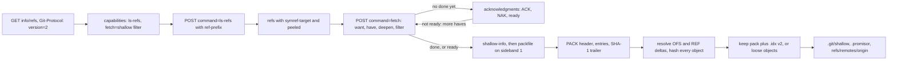

# Cloning Is a Negotiation Plus a Packfile

*A clone is ls-refs, a want and have negotiation, and one packfile of zlib streams and deltas; shallow and partial clones just ask for less.*

## Metadata

| Field | Value |
|---|---|
| Type | Build |
| Languages | Python |
| Prerequisites | [Git Is a Content-Addressed Object Store](https://cloudcaptain.io/learn/git/object-store), [HTTP/1.1 Is Text Over a Socket Until It Is Not](https://cloudcaptain.io/learn/networking/http-server) |
| Time | 120 minutes |
| Tools | git, git http-backend, git-lfs |

<Quiz stage="pre" />

## The Problem

Monday, 08:10. The CI fleet starts 400 jobs an hour, and every job begins with `git clone` of the monorepo. The working tree is 900 MB; each clone downloads 6 GB and spends four minutes on `Counting objects`, `Compressing objects` and `Resolving deltas` before the first test runs. The Git server's CPUs are pegged, runner disks fill up by noon, and the platform team's first fix is to add `--depth 1` everywhere. Clones drop to forty seconds. Then the release job fails: `git describe --tags` says `fatal: No names found, cannot describe anything.`, the changelog generator finds no previous tag, and a job that reuses a cached workspace runs `git fetch` and pulls 2 GB again.

The second fix is `--filter=blob:none`, which a blog post promised was "a clone without the files". Clones are fast and tags work, but the lint job runs `git log -p` over the last hundred commits and makes hundreds of small HTTP requests while it runs, each one a separate fetch the job never asked for. A third team discovers that a 300 MB demo video committed in 2019 and deleted a month later is still in every full clone, and nobody can explain why deleting a file does not make the repository smaller.

None of this is mysterious once you see the mechanism. A clone is three exchanges: the client reads the server's ref list, tells the server which commits it **wants** and which it already **has**, and receives one **packfile** with every object reachable from the wants and not from the haves, many of them stored as deltas against similar objects. `--depth` and `--filter` are two more lines in that request; the deleted video is reachable from history, so it is in the pack. You are going to write `minipack`: the packfile format with its deltas, the `.idx` index, and a client for Git's smart HTTP protocol v2 that clones full, shallow and partial repositories from a real `git http-backend`. Git is the oracle throughout: `git index-pack` must compute the same index as you, `git fsck` must accept what you write, and `git rev-list` must list the same objects as in Git's own clone.

## The Concept

Think of ordering spare parts from a warehouse. First you read the catalogue (which part numbers exist and what they are called). Then you send an order: "I want these assemblies; I already have these older ones". The warehouse ships one box that holds exactly the missing parts, and for parts that are almost identical to something already in the box it ships a slip saying "same as part X, but replace bytes 488 to 491". You unpack the box and write your own packing list, so you can find any part later without opening every bag.

Git's smart protocol is that order form. Everything travels as **pkt-lines**: four hex digits giving the length of the line including those four digits, then the payload; `0000` (flush) ends a message, `0001` (delim) separates its sections, and no line may be longer than 65520 bytes. Over HTTP, protocol v2 uses two endpoints:

- **Discovery.** `GET /info/refs?service=git-upload-pack` with the header `Git-Protocol: version=2` returns the server's capabilities: the commands it offers (`ls-refs`, `fetch`), the fetch features (`shallow`, `filter`), the hash (`object-format=sha1`). Without the header the server falls back to v0 and immediately sends every ref it has, which for a monorepo with 100,000 refs is megabytes before you asked for anything.
- **ls-refs.** A `POST /git-upload-pack` with `command=ls-refs` and `ref-prefix` lines returns only the refs you asked about, with `symref-target:` for HEAD and `peeled:` for annotated tags.
- **fetch.** Another POST with `command=fetch`: `want` lines for the tips you need, `have` lines for commits you already have, optionally `deepen N` and `filter blob:none`, and finally `done`. HTTP is stateless, so each POST starts a fresh `upload-pack` process on the server and the client repeats its wants and the haves already known to be common. Until `done`, the server answers with an `acknowledgments` section (`ACK` for haves it also has, `NAK`, `ready` when it has enough). After `done` or `ready` it sends `shallow-info` (for shallow requests) and a `packfile` section whose pkt-lines carry a sideband byte: 1 for pack data, 2 for progress, 3 for a fatal error.

The server packs the objects reachable from the wants minus those reachable from the common haves. `deepen 1` stops the commit walk one commit below each want and reports the cut commits as `shallow`; the client records them in `.git/shallow` and every later history walk stops there. `filter blob:none` leaves blobs out; the client marks the pack with a `.promisor` file, so a missing blob referenced from it is "promised" by the remote and fetched on demand instead of being corruption.

The pack is `PACK`, a version and an object count, then one entry per object (a type and size packed into a varint, then a zlib stream) and a 20-byte SHA-1 trailer. A **delta** entry names a base, either by its offset earlier in the same pack (`OFS_DELTA`) or by its object ID (`REF_DELTA`), and holds copy and insert instructions that rebuild the object from that base. The server never sends an index: the client computes the `.idx` itself, which means inflating every entry, applying every delta and hashing every result. That is the `Resolving deltas` phase on your laptop.



## Build It

`code/main.py` is `minipack`, standard library only. It reads and writes the same files Git does: loose objects, `objects/pack/*.pack` and `*.idx`, loose refs, `packed-refs`, `.git/shallow` and `.git/config`. The tests build packs in memory, talk to a fake protocol v2 server, and, when `git` is installed, compare against `git index-pack`, `git verify-pack`, `git fsck` and `git clone` over a real `git http-backend`.

### Step 1: pkt-lines frame every message

```python
def pkt_line(payload: object) -> bytes:
    data = payload.encode() if isinstance(payload, str) else bytes(payload)
    if len(data) > MAX_PKT_PAYLOAD:
        raise ProtocolError(f"pkt-line payload of {len(data)} bytes is over the limit of {MAX_PKT_PAYLOAD}")
    return b"%04x" % (len(data) + 4) + data
```

`pkt_line("version 2\n")` is `000eversion 2\n`: 14 bytes in total, counted in hex. `PktReader.read()` turns the lengths 0, 1 and 2 into flush, delim and response-end packets, rejects 3 and anything that is not four hex digits, and names the byte position in every error, because a truncated HTTP body is the most common way this goes wrong. A `Trace` object logs every packet in the format `GIT_TRACE_PACKET` uses (`packet: minipack> want ...`), and `parse_trace()` turns both Git's log and minipack's into the same list of requests.

### Step 2: a pack entry is a type, a size and a zlib stream

```python
def encode_entry_header(type_code: int, size: int) -> bytes:
    byte = (type_code << 4) | (size & 0x0F)
    size >>= 4
    out = bytearray()
    while size:
        out.append(byte | 0x80)
        byte = size & 0x7F
        size >>= 7
    out.append(byte)
    return bytes(out)
```

The first byte holds a continuation bit, three bits of type (1 commit, 2 tree, 3 blob, 4 tag, 6 `OFS_DELTA`, 7 `REF_DELTA`) and the low four bits of the size; each following byte adds seven more bits. A 300-byte blob starts `bc 12`. The size is the inflated size of the entry's data, which for a delta is the size of the instructions, not of the object they rebuild.

The pack does not record how long each compressed stream is. The only way to find the next entry is to inflate this one and see where zlib stops:

```python
while not stream.eof:
    if cursor >= len(buf):
        raise PackError(f"the zlib stream that starts at byte {pos} is truncated")
    piece = view[cursor:cursor + chunk]
    parts.append(stream.decompress(piece))
    cursor += len(piece)
    chunk = max(chunk * 2, 4096)
```

```python
end = cursor - len(stream.unused_data)
```

`unused_data` is what zlib was given past the end of its stream: subtract it and you have the offset of the next entry. This is why a pack can only be read front to back until an index exists, and why `git index-pack` cannot be parallelised over the raw bytes.

### Step 3: a delta is copy and insert instructions

A delta starts with two base-128 sizes (the base it expects and the result it builds), then instructions. An insert is a byte from 1 to 127 followed by that many literal bytes; 0 is reserved. A copy has the high bit set: bits 0 to 3 say which offset bytes follow, bits 4 to 6 which size bytes, all little-endian, and missing bytes are zero:

```python
op = 0x80
args = bytearray()
for i in range(4):
    byte = (offset >> (8 * i)) & 0xFF
    if byte:
        op |= 1 << i
        args.append(byte)
stored = 0 if size == COPY_MAX else size
for i in range(2):
    byte = (stored >> (8 * i)) & 0xFF
    if byte:
        op |= 0x10 << i
        args.append(byte)
return bytes([op]) + bytes(args)
```

Copy 6 bytes from offset 5 is `91 05 06`; copy 6 bytes from offset 0 is `90 06`. A copy with no size bytes at all means 0x10000 bytes, which is why Git's encoder never emits a single copy larger than 64 KiB even though the format could say up to 16 MiB. `apply_delta()` checks that the base has the size the delta expects, that no copy runs past the base, and that the result has the promised size; any of those failing means a corrupt pack, not a bug to work around.

### Step 4: the delta encoder looks for shared 16-byte blocks

```python
while pos < len(target):
    offset, length = longest_match(index, base, target, pos) if pos + DELTA_BLOCK <= len(target) else (-1, 0)
    if offset < 0:
        literal.append(target[pos])
        pos += 1
        continue
    while literal and offset > 0 and base[offset - 1] == literal[-1]:
        literal.pop()
        offset -= 1
        pos -= 1
        length += 1
    out += insert_ops(bytes(literal))
    literal.clear()
    done = 0
    while done < length:
        size = min(COPY_MAX, length - done)
        out += copy_op(offset + done, size)
        done += size
    pos += length
```

`delta_index()` records where each aligned 16-byte block of the base occurs (up to 64 places per block, as repeated text has many). For each position in the target, `longest_match()` tries every place the next 16 bytes occur and keeps the longest forward match; the backward loop then reclaims bytes that were already queued as literals. Git's `diff-delta.c` does the same with a rolling Rabin fingerprint over 16-byte windows. Changing one line in a 300-line file:

```bash
seq 1 300 > a.txt
(seq 1 300 | sed 's/^150$/one hundred fifty/'; echo 301) > b.txt
python3 code/main.py delta a.txt b.txt
# base 1092 bytes, target 1110 bytes, delta 35 bytes (3% of the target)
#   copy       488 bytes from base offset 0
#   insert      17 bytes b'one hundred fifty'
#   copy       601 bytes from base offset 491
#   insert       4 bytes b'301\n'
```

Two compressed videos share almost no 16-byte blocks, so their delta is all inserts and larger than the object; the packer then stores the object whole. That is the whole case for Git LFS in one sentence.

### Step 5: OFS_DELTA points back, REF_DELTA names its base

```python
def encode_ofs(distance: int) -> bytes:
    out = [distance & 0x7F]
    distance >>= 7
    while distance:
        distance -= 1
        out.append(0x80 | (distance & 0x7F))
        distance >>= 7
    return bytes(reversed(out))
```

An `OFS_DELTA` stores how many bytes back its base starts, big-endian in seven-bit groups with one added to every group but the last, so that no number has two encodings: 127 is `7f`, 128 is `80 00`, 16512 is `80 80 00`. It costs two or three bytes instead of the 20 of a `REF_DELTA` and requires the base to come earlier in the same pack; clients ask for it with `ofs-delta`. A `REF_DELTA` can name any object, even one that is not in the pack at all: that is a **thin pack**, which only makes sense when the receiver already has the base.

`index_pack()` resolves a pack in rounds. Whole objects are hashed first; then every delta whose base is known (by offset, by ID, or through an external lookup into the local repository for thin packs) is applied and hashed, its depth set to the base's depth plus one, until a round makes no progress:

```python
raise PackError(f"{len(waiting)} deltas cannot be resolved; bases not in the pack: {', '.join(missing[:5]) or 'none'} (a thin pack needs them from the local repository)")
```

### Step 6: the .idx v2 index is a sorted table with a fanout

```python
counts = [0] * 256
for oid, _, _ in rows:
    counts[int(oid[:2], 16)] += 1
total = 0
for count in counts:
    total += count
    out += struct.pack(">I", total)
for oid, _, _ in rows:
    out += bytes.fromhex(oid)
for _, crc, _ in rows:
    out += struct.pack(">I", crc)
large: List[int] = []
for _, _, offset in rows:
    if offset > OFFSET32_LIMIT:
        out += struct.pack(">I", 0x80000000 | len(large))
        large.append(offset)
    else:
        out += struct.pack(">I", offset)
```

After the magic `\377tOc` and version 2 come 256 cumulative counts: entry `b` is the number of objects whose ID starts with a byte up to `b`, so a lookup binary-searches only between `fanout[b-1]` and `fanout[b]`. Then the sorted IDs, the CRC32 of each entry's raw bytes in the pack (header and compressed data, so `git repack` can copy an entry into a new pack without inflating it and still detect corruption), the offsets (anything past 2 GiB moves to a table of 64-bit offsets), the pack's checksum and the index's own SHA-1. Everything in it follows from the pack, so the index is deterministic: the smoke test checks that minipack's `.idx` is byte for byte the one `git index-pack` writes, for packs minipack wrote and for packs Git wrote.

### Step 7: writing a pack means choosing delta bases

```python
rest = sorted((p for p in plans if p.type not in ("commit", "tag")), key=lambda p: (TYPE_ORDER[p.type], os.path.basename(p.path), p.path, -len(p.data), p.oid))
recent: Dict[str, List[PackPlan]] = {}
for plan in rest:
    candidates = recent.setdefault(plan.type, [])
    if use_delta and window > 0:
        best: Optional[Tuple[PackPlan, bytes]] = None
        for candidate in reversed(candidates[-window:]):
            if candidate.depth >= max_depth:
                continue
            if candidate.index is None:
                candidate.index = delta_index(candidate.data)
            delta = make_delta(candidate.data, plan.data, candidate.index)
            if len(delta) < len(plan.data) // 2 and (best is None or len(delta) < len(best[1])):
                best = (candidate, delta)
```

`walk_objects()` collects every object reachable from the tips the way `git rev-list --objects` does, with the path each blob and tree was found at. Git's packer sorts candidates by type, then by file name, then by size, largest first, and tries each object against the previous `pack.window` objects (10 by default) as bases, up to a chain of `pack.depth` (50 by default; minipack uses 10). The effect: the versions of `numbers.txt` sit next to each other, the largest is stored whole, and the smaller ones become deltas of a few bytes. Deltas follow similarity, not history; a delta base can be a newer version or a different file with the same name in another directory.

### Step 8: discovery and ls-refs

`Remote.discover()` sends the GET with `Git-Protocol: version=2`, checks the content type (`text/plain` means a dumb HTTP server), skips the `# service=git-upload-pack` preamble some servers still send, and refuses a v0 answer with the reason rather than misparsing it. `Remote.request()` writes a command the same way Git does, and the trace shows it line by line:

```bash
packet: minipack> command=ls-refs
packet: minipack> agent=minipack/1.0
packet: minipack> object-format=sha1
packet: minipack> 0001
packet: minipack> peel
packet: minipack> symrefs
packet: minipack> unborn
packet: minipack> ref-prefix refs/heads/
packet: minipack> ref-prefix refs/tags/
packet: minipack> ref-prefix HEAD
packet: minipack> 0000
packet: minipack< 9cd7ece44d77359f2608a3506eb215c77fa65c81 HEAD symref-target:refs/heads/main
packet: minipack< 8aeeacfde38610311913cb0495dd33a2a8f15ea0 refs/tags/v1 peeled:19794c8035884d837517310db27502772af5c740
```

`unborn` is sent only when the server advertises `ls-refs=unborn`; it makes an empty repository report which branch HEAD will be.

### Step 9: fetch is wants, haves and done

```python
def fetch_arguments(args: FetchArgs) -> List[str]:
    out = ["no-progress"]
    if args.include_tag:
        out.append("include-tag")
    out.append("ofs-delta")
    out += [f"shallow {oid}" for oid in args.shallow]
    if args.depth:
        out.append(f"deepen {args.depth}")
    if args.filter_spec:
        out.append(f"filter {args.filter_spec}")
    out += [f"want {oid}" for oid in args.wants]
    out += [f"have {oid}" for oid in args.haves]
    if args.done:
        out.append("done")
    return out
```

A clone has nothing to offer, so it sends its wants and `done` in one request: every branch and tag tip for a full clone, only HEAD's branch plus `include-tag` (send annotated tags that point into what you pack) for `--depth`, as `git clone` does. A later `minipack fetch` has local commits, and the negotiation starts:

```python
while len(rounds) < max_rounds:
    fresh = [] if acked or walker.exhausted() else walker.next_batch(batch)
    done = acked or walker.exhausted()
    result = remote.fetch(dataclasses.replace(args, haves=common + fresh, done=done))
    new = [oid for oid in result.acks if oid not in common]
    common += new
    walker.mark_common(new)
    acked = acked or bool(result.acks)
```

`HaveWalker` yields local commits newest first, 16 in the first round and twice as many in each next one. Commits the server advertised that you already have are common for free (`known`), and once a commit is common its ancestors are common too, so `mark_common()` stops them from being sent at all. Every round repeats the wants and the common haves because each POST reaches a new server process. `parse_fetch_response()` reads the sections in order: `acknowledgments` (stop if there is no `ready`), `shallow-info`, then `packfile`, demultiplexing the sideband and raising on channel 3. minipack sends `done` as soon as it has no more haves to offer, so a small fetch is one POST whose answer is the pack with no `acknowledgments`. Git sends `done` only in a round that adds no new haves, so its first request never carries it: the server answers with `ACK` lines, then `ready` once the common commits are enough, and the pack follows in the same response. Both are valid protocol v2; the smoke test shows the two traces side by side.

### Step 10: storing what arrived

```python
if keep:
    base = os.path.join(repo.objects_dir, "pack", f"pack-{indexed.checksum}")
    write_file(base + ".pack", pack, 0o444)
    write_file(base + ".idx", write_idx(indexed.records(), indexed.checksum), 0o444)
    if promisor:
        write_file(base + ".promisor", "".join(f"{line}\n" for line in promisor_lines).encode(), 0o444)
    repo.reload_packs()
    summary.update(storage="pack", pack_file=base + ".pack")
else:
    for type_name, data in indexed.objects.values():
        repo.write(type_name, data)
    summary.update(storage="loose", pack_file="")
```

By default minipack explodes the pack into loose objects, the layout the object-store lesson reads; `--keep-pack` keeps it with its index, as `git clone` always does (Git's `fetch` unpacks only when fewer than `fetch.unpackLimit` objects arrive, 100 by default). A partial clone must keep its pack: loose objects have no way to say "my missing children are promised", so minipack writes `.promisor` next to it and sets `core.repositoryformatversion = 1`, `remote.origin.promisor = true` and `remote.origin.partialclonefilter` in the config. The `shallow` lines go to `.git/shallow`. Branches become `refs/remotes/origin/*`, the default branch becomes a local branch with HEAD pointing at it, and a tag ref is written only if its object arrived.

### Step 11: run it

Make a repository with five versions of a growing file and an annotated tag, serve it through `git http-backend`, and clone it three ways:

```bash
export GIT_AUTHOR_DATE="1700000000 +0000" GIT_COMMITTER_DATE="1700000000 +0000"
git init -q -b main demo
for i in 1 2 3 4 5; do seq 1 $((i * 400)) > demo/numbers.txt; echo "v$i" > demo/VERSION; git -C demo add -A; git -C demo -c user.name=Dev -c user.email=dev@example.invalid commit -qm "release $i"; done
git -C demo -c user.name=Dev -c user.email=dev@example.invalid tag -a v1 -m v1 HEAD~3
mkdir srv && git clone -q --bare demo srv/demo.git && git -C srv/demo.git config uploadpack.allowFilter true
python3 code/main.py serve srv --port 8418 &
python3 code/main.py clone http://127.0.0.1:8418/demo.git full
#   fetch: no-progress, ofs-delta, want x2, done
#   pack: 21 objects (5 commit, 1 tag, 5 tree, 10 blob), 4 deltas, 5594 bytes; unpacked into loose objects
python3 code/main.py clone http://127.0.0.1:8418/demo.git shallow --depth 1
#   fetch: no-progress, include-tag, ofs-delta, deepen, want x1, done
#   pack: 4 objects (1 commit, 1 tree, 2 blob), 0 deltas, 4480 bytes; unpacked into loose objects
#   shallow: 9cd7ece
python3 code/main.py clone http://127.0.0.1:8418/demo.git blobless --filter blob:none
#   pack: 11 objects (5 commit, 1 tag, 5 tree), 0 deltas, 1253 bytes; kept as .../pack-ea212d3....pack
git -C full fsck --strict && git -C blobless rev-list --objects --all --missing=print | grep -c '^?'   # 10 promised blobs
```

The shallow clone is 4 objects but 4480 bytes: the newest `numbers.txt` is the largest version and is now stored whole, where the full pack stored it once and the older versions as tiny deltas. Now write a pack yourself and let Git judge it:

```bash
python3 code/main.py pack-objects --repo demo --all --out packs
python3 code/main.py verify-pack -v packs/pack-*.idx | tail -10
# 7972c09aa90a9b3d8519064681f2cca009f8777c blob   8893 4209 1293
# f8762335b695c9f30c25ecb0ea59b21651ec6b1a blob   7 18 5502 1 7972c09aa90a9b3d8519064681f2cca009f8777c
# 351abbe24667c1b071faf6d23f24ea4020c80eef blob   7 17 5520 2 f8762335b695c9f30c25ecb0ea59b21651ec6b1a
# f35f7045be9d195b48c312cf831a141f3861f1bc blob   7 17 5537 3 351abbe24667c1b071faf6d23f24ea4020c80eef
# 7b5d34d5cf4229e05f566b7e2b9f8ea113e2efba blob   7 17 5554 4 f35f7045be9d195b48c312cf831a141f3861f1bc
# non delta: 17 objects
# chain length = 1: 1 object
# chain length = 2: 1 object
# chain length = 3: 1 object
# chain length = 4: 1 object
git verify-pack -v packs/pack-*.idx | tail -1          # packs/pack-....pack: ok
GIT_TRACE_PACKET=1 python3 code/main.py fetch full     # after a push to srv/demo.git: want, have lines and done in one request, a pack of only the new objects
```

The columns are Git's: ID, type, size (of the delta for deltified entries), size in the pack, offset, chain depth and base. `ls-remote`, `index-pack`, `unpack-objects` and `parse-trace` complete the CLI; every command takes `--json`. Exit codes: 0 success, 1 a corrupt pack, a failed verification or an error from the server, 2 bad input (a missing file, a URL that is not http(s), an unreachable server, a non-empty clone target).

<RunTests />

## Use It

The same jobs with Git itself. Keep `minipack serve` running from Step 11 (or serve any bare repository through `git http-backend` behind a web server) and watch the real client:

```bash
GIT_TRACE_PACKET=$PWD/trace.txt git clone --no-checkout --depth 1 http://127.0.0.1:8418/demo.git traced
grep -E 'packet: +clone[<>]' trace.txt | sed 's/.*packet: *//' | grep -v '^clone< [0-9a-f]\{40\} refs'
python3 code/main.py parse-trace trace.txt              # the same requests minipack sends, plus thin-pack
GIT_TRACE_CURL=1 git ls-remote http://127.0.0.1:8418/demo.git 2>&1 | grep -iE '^=> Send header|git-protocol'
git -c protocol.version=0 ls-remote http://127.0.0.1:8418/demo.git    # the v0 advertisement: every ref, capabilities after a NUL
```

Git's clone sends `thin-pack` (a clone has no bases to be thin against, so it changes nothing there) and repeats a want when HEAD and `refs/heads/main` are the same commit; otherwise the requests are the ones minipack sends, line for line. In the trace, `clone>` is what the client wrote, `git<` is the HTTP helper (`git-remote-http`) relaying it, and `sideband<` is the demultiplexed pack.

**Shallow history.** `git clone --depth N` implies `--single-branch` and tag following, which is why the tag on an old commit is missing:

```bash
git clone --depth 1 http://127.0.0.1:8418/demo.git d1 && cat d1/.git/shallow && git -C d1 log --oneline | wc -l
git -C d1 describe --tags || true                       # fatal: No names found: v1 is below the boundary
git -C d1 fetch --deepen 3 && git -C d1 log --oneline | wc -l
git -C d1 fetch --unshallow --tags && git -C d1 describe --tags
git clone --shallow-since=2023-11-01 --no-single-branch http://127.0.0.1:8418/demo.git since
```

In GitHub Actions, `actions/checkout` defaults to `fetch-depth: 1` and `fetch-tags: false`; jobs that compute versions or changelogs need `fetch-depth: 0` (or a partial clone, below), not a bigger depth guessed to reach the last tag.

**Partial clone and sparse checkout.** A blob-less clone has every commit and tree, so `log`, `describe` and `merge-base` work; blobs arrive when a command needs them:

```bash
git clone --filter=blob:none http://127.0.0.1:8418/demo.git bl
git -C bl config --get-regexp '^remote\.origin\.(promisor|partialclonefilter)$'
ls bl/.git/objects/pack/                                # the clone pack, its .promisor, and a second pack fetched for the checkout
git -C bl rev-list --objects --all --missing=print | grep -c '^?'
git -C bl log -p -3 > /dev/null                         # each command that reads old blobs fetches them on demand
git clone --filter=tree:0 http://127.0.0.1:8418/demo.git treeless     # commits only; trees on demand too
git clone --filter=blob:none --sparse http://127.0.0.1:8418/demo.git sp && git -C sp sparse-checkout set --cone services/api
```

The server decides whether filters are allowed: `git config uploadpack.allowFilter true` on the bare repository (GitHub and GitLab enable it). Without it the client prints `warning: filtering not recognized by server, ignoring` and does a full clone. Recent Git releases also ship `git backfill` to download the missing blobs of a partial clone in batches instead of one command at a time.

**Packs on disk.** The tools minipack mirrors, plus the indexes it does not build:

```bash
git -C demo count-objects -vH
git -C demo gc && git verify-pack -v demo/.git/objects/pack/pack-*.idx | sort -k3 -n | tail -3
git -C demo rev-list --objects --all | git -C demo cat-file --batch-check='%(objecttype) %(objectname) %(objectsize) %(rest)' | sort -k3 -n | tail -5
git -C demo repack -adf --window=250 --depth=50         # what gc --aggressive does: wider search, longer chains
git -C demo repack -adb && ls demo/.git/objects/pack/   # .bitmap: reachability bitmaps make "Counting objects" fast for servers
git -C demo commit-graph write --reachable && git -C demo multi-pack-index write
git index-pack --stdin --fix-thin < thin.pack           # how a fetch completes a thin pack from local objects
```

The `cat-file` pipeline finds the largest blobs anywhere in history, including deleted ones: they stay in every full clone until history is rewritten, because they are reachable from old commits.

**Git LFS for large binaries.** LFS keeps the content out of Git's object graph. A clean filter replaces the file with a pointer blob of about 130 bytes; the content goes to a separate HTTP store and is downloaded per checkout, only for the versions you check out:

```bash
git lfs install --local
git lfs track "*.mp4" && cat .gitattributes             # *.mp4 filter=lfs diff=lfs merge=lfs -text
git add .gitattributes demo.mp4 && git commit -m "Add: demo video through LFS"
git cat-file -p HEAD:demo.mp4                           # version https://git-lfs.github.com/spec/v1, oid sha256:..., size ...
git lfs ls-files
git lfs migrate import --include="*.mp4" --everything   # rewrites history: every collaborator must re-clone
```

Use it for files that are large and compressed (video, images, models, archives, binaries): their versions share no 16-byte blocks, so the packer cannot delta them, every version is stored whole, and every full clone carries all of them.

| What you built | Real tool | Note |
|---|---|---|
| `pkt_line()`, `PktReader`, `Trace` | pkt-lines in every Git protocol, `GIT_TRACE_PACKET` | `GIT_TRACE_CURL` adds the HTTP headers |
| `Remote.discover()` | `GET info/refs` with `Git-Protocol: version=2` | without the header, v0 advertises every ref first |
| `Remote.ls_refs()` | `git ls-remote`, the ls-refs command | `ref-prefix` keeps a 100,000-ref listing small |
| `negotiate()`, `HaveWalker` | fetch-pack negotiators | `fetch.negotiationAlgorithm=skipping` jumps further back each round |
| `deepen`, `.git/shallow` | `--depth`, `--deepen`, `--shallow-since`, `--unshallow` | depth implies single-branch and tag following |
| `filter`, `.promisor` | `--filter=blob:none`, `tree:0`, `blob:limit=1m`, sparse checkout | the server needs `uploadpack.allowFilter` |
| `store_pack()` keep or loose | `git index-pack --keep`, `git unpack-objects` | fetch unpacks below `fetch.unpackLimit` (100) |
| `make_delta()` | `diff-delta.c` (Rabin fingerprint over 16 bytes) | copies of at most 64 KiB |
| `plan_pack()` | `git pack-objects`, `pack.window`, `pack.depth`, `gc --aggressive` | bitmaps and delta reuse make servers fast |
| `write_idx()` | `git index-pack`, `.idx` v2 | `.rev`, `.bitmap` and the multi-pack-index are further indexes |
| `verify_pack()` | `git verify-pack -v` | same columns and histogram |
| `serve` | `git http-backend` behind Apache or nginx with fcgiwrap | the same CGI environment variables |
| not built | thin packs, bitmaps, `packfile-uris`, Git LFS | Exercises 2 and 3 |

<Quiz stage="check" />

## Ship It

Two artifacts in `outputs/`:

- **`skill-large-repo-tuning.md`**: a runbook for a repository whose clones and fetches are slow or wrong. It measures first (clone phases from a packet trace, `count-objects`, the largest blobs in history, the ref count, the server's filter and bitmap settings), classifies each consumer (CI build, release job, developer, mirror), picks depth, filter, sparse checkout, LFS or server maintenance from a decision table, verifies the change in a trace and with object counts, and ends with a fixed report.
- **`prompt-explain-git-trace-packet.md`**: paste a `GIT_TRACE_PACKET` log and get the requests it contains, the negotiation round by round, what the server sent, the problems it shows (a v0 fallback, an ignored filter, a negotiation that found nothing common, a missing tag after a shallow clone) and the one change that fixes each.

<ShipIt />

## Exercises

### Easy

Add `minipack count-objects REPO [--json]` that reports what `git count-objects -v` reports: `count` and `size` for loose objects (size in KiB of the files on disk), `in-pack`, `packs`, `size-pack` and `garbage` (files in `objects/pack` without a matching `.idx` or `.pack`). Write the tests first: a fresh minipack clone has only loose objects, a `--keep-pack` clone has one pack and no loose objects, and the field values equal those of `git count-objects -v` on the same repository, parsed into a dictionary.

### Medium

Support thin packs. Send `thin-pack` in `fetch`, and when the received pack has `REF_DELTA` entries whose bases are not in it, complete it the way `git index-pack --fix-thin` does: append each missing base as a whole object, rewrite the object count in the header and the trailing checksum, then index the result. Test it with a fake server that returns a pack whose only entry is a delta against a blob the client has: the stored pack must pass `git verify-pack`, and `git fsck` must accept the repository with the pack kept.

### Hard

Write the server half: an `upload-pack` that answers `ls-refs` and `fetch` itself (wants, haves with `ACK`, `NAK` and `ready`, `done`, `deepen` with `shallow-info`, and `filter blob:none`) and plug it into `serve` instead of `git http-backend`. The pack is every object reachable from the wants minus everything reachable from the common haves, cut at the depth. Prove it with the real client: `git clone`, `git clone --depth 1` and `git clone --filter=blob:none` from your server must produce the same `git rev-list --objects --all --missing=print` as clones from `git http-backend`.

<Quiz stage="post" />

## Key Terms

| Term | Common misconception | Precise definition |
|---|---|---|
| Packfile | "A zip of the working tree." | A `PACK` header and object count, one entry per object (type and size varint, an optional delta base, a zlib stream) and a SHA-1 trailer. It holds history, not files: every version of every object reachable from the wanted refs. |
| pkt-line | "Git sends plain text lines." | Four hex digits of length (including themselves) followed by the payload, at most 65520 bytes; `0000` flush, `0001` delim and `0002` response-end are the special lengths. Every protocol message is a sequence of them. |
| Delta (`OFS_DELTA`, `REF_DELTA`) | "Git stores diffs between commits." | A storage detail inside a pack: copy and insert instructions that rebuild one object from another similar object of the same type, chosen by size and file name, not by history. Git's object model stores snapshots. |
| Pack index (`.idx`) | "The server sends it with the pack." | A file the receiver computes (`git index-pack`): a 256-entry fanout, sorted object IDs, CRC32s, offsets, and two checksums. Building it means resolving every delta, which is the "Resolving deltas" phase. |
| want and have negotiation | "Fetch downloads whatever changed on the server." | The client names tips it wants and commits it has; the server ACKs common commits and packs objects reachable from the wants minus those reachable from the common haves. Over HTTP every round repeats the state because the server keeps none. |
| Shallow clone | "A smaller copy of the same repository." | A history cut at the commits listed in `.git/shallow`; their parents are absent, so walks stop there. `describe`, `merge-base` and tags below the cut fail until you deepen or unshallow. |
| Partial clone | "A clone with missing objects is corrupt." | A clone whose pack is marked `.promisor`, with `remote.<name>.promisor` set: objects referenced from it but absent (blobs for `blob:none`) are promised by the remote and fetched when a command needs them. |
| Thin pack | "A pack with fewer objects." | A pack whose `REF_DELTA` entries use bases the receiver already has but the pack does not contain; the receiver completes it (`index-pack --fix-thin`) before keeping it. |
| Sideband | "Progress output is part of the pack." | The first byte of each pkt-line in the `packfile` section: 1 carries pack data, 2 progress text for stderr, 3 a fatal error message. |

## Further Reading

- [Git Advanced](https://cloudcaptain.io/docs/tools/git/advanced): the internals section on objects, refs and the `.git` layout that this lesson moves over the wire.
- [Git Fundamentals](https://cloudcaptain.io/docs/tools/git/fundamentals): clone, fetch, remotes and refspecs from the user's side.
- [Git Cheat Sheet](https://cloudcaptain.io/docs/tools/git/cheatsheet): `verify-pack`, `count-objects`, `gc` and the rest of the maintenance commands in one place.
- [CI/CD Fundamentals](https://cloudcaptain.io/docs/tools/cicd/fundamentals): where checkout depth and caching decide how long every pipeline takes.
- [gitformat-pack](https://git-scm.com/docs/gitformat-pack): the authoritative description of pack entries, delta instructions and `.idx` versions 1 and 2.
- [gitprotocol-v2](https://git-scm.com/docs/gitprotocol-v2): every command, capability and response section, including `ls-refs`, `fetch`, `shallow-info` and `packfile-uris`.
- [gitprotocol-http](https://git-scm.com/docs/gitprotocol-http) and [gitprotocol-common](https://git-scm.com/docs/gitprotocol-common): the smart HTTP endpoints, content types and pkt-line framing.
- [Partial clone](https://git-scm.com/docs/partial-clone): promisor remotes and packs, filters and lazy fetching as Git's design document describes them.
- [git-http-backend](https://git-scm.com/docs/git-http-backend): serving repositories over HTTP, the CGI variables and `uploadpack.allowFilter`-style settings.
- [Git LFS specification](https://github.com/git-lfs/git-lfs/blob/main/docs/spec.md): the pointer file format and how the clean and smudge filters use it.
