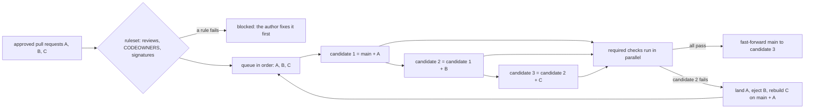

# Trunk-Based Development Is a Queue of Short Branches

*Main stays green only if each change is tested on top of everything queued ahead of it; short branches keep that cheap.*

## Metadata

| Field | Value |
|---|---|
| Type | Build |
| Languages | Python |
| Prerequisites | [Git Is a Content-Addressed Object Store](https://cloudcaptain.io/learn/git/object-store) |
| Time | 75 minutes |
| Tools | git, gh, GitHub rulesets, GitHub merge queue, GitLab merge trains |

<Quiz stage="pre" />

## The Problem

The shop team is forty engineers on one repository. After a bad week someone turned on "Require branches to be up to date before merging". On Monday morning twelve pull requests are approved and green, and CI takes 25 minutes. The first one merges; the other eleven are now out of date. Their authors click "Update branch", CI starts again, the first to finish merges, and ten branches are out of date once more. By lunch five have landed, one author has updated the same branch four times, and people start merging at seven in the evening because the race is shorter then.

On Tuesday the setting is switched off, and that afternoon main goes red. Pull request 4101 renamed `prices.total()` to `prices.sum_prices()` and updated every caller. Pull request 4107 added an invoice module that calls `prices.total()`. Each was green on its own branch, they touched different files, Git merged them ten minutes apart without a conflict, and the result does not import. Deploys are blocked for three hours while someone bisects. In the same week the `payments-v2` branch, open for seven weeks, reports conflicts in 140 files, and an audit finds that `app/billing/migrations/0042_refunds.sql` was merged without anyone from payments reviewing it, although CODEOWNERS has `/app/billing/ @acme/payments`. Three lines further down it also has `*.sql @acme/dba`, and the last matching line wins.

Every one of these is the same question asked badly: what exactly was tested before it landed on main, and who had to approve it? The fixes are mechanisms, not discipline. Branch protection is data that a program can evaluate. CODEOWNERS is a pattern file with exact semantics. A merge queue tests each pull request on top of main plus everything queued ahead of it, several candidates at once, ejects the one that breaks the combination and retests the rest. And branches that live for hours instead of weeks make conflicts rare enough for all of this to be fast. You are going to build `mergequeue`: a CODEOWNERS matcher checked line for line against `git check-ignore`, a ruleset evaluator in the shape GitHub's API returns, a speculative queue with batching that lands real branches in a real repository with Git's plumbing, and a simulator that shows how team size and branch lifetime drive conflicts and queue wait.

## The Concept

Start with what "tested" has to mean. After your merge, main is one specific tree: the commit you branched from, plus everything that landed since, plus your change. CI on your branch tested a different tree, the commit you branched from plus your change. When nothing landed in between they are the same; on a busy repository they almost never are. A change that is fine alone can break in combination: a rename on one side and a new caller of the old name on the other merge without a textual conflict, and the result is broken. That is a **semantic conflict**. No three-way merge can see it, because the merge only compares lines; only running the checks on the combined tree can.

There are two honest ways to test the combined tree. The **serial** way: merge the first approved pull request onto main in a scratch commit, run the checks, move main there if they pass, then take the next one. It is correct, and it lands one change per CI run: with 25-minute CI, about nineteen a day, however large the team. The **speculative** way assumes the entries ahead will pass. Candidate 1 is main + A, candidate 2 is candidate 1 + B, candidate 3 is candidate 2 + C, and all three are tested at the same time. If all pass, main moves to candidate 3 and three changes landed in one CI run. If B's candidate fails while A's passed, B broke the combination: A lands, B is ejected with its log, and C's result is thrown away because C's candidate contained B; C is rebuilt on main + A. **Batching** is the cheaper variant: one candidate for A + B + C + D and one CI run; if it fails, split it in halves and test again. Batching saves runs when failures are rare and costs runs when they are not.



The queue only works if it is the only thing that writes to main, and that is what branch protection is for. GitHub's **rulesets** describe it as data: a list of rules applied to the refs a condition selects. `pull_request` holds the review requirements, `required_status_checks` names the checks, `required_linear_history`, `required_signatures` and `non_fast_forward` constrain the history, and `merge_queue` configures the queue. The review rule leans on **CODEOWNERS**, a file of gitignore-style patterns where the last matching line decides whose approval each changed file needs. These rules are checked before a pull request may enter the queue; the queue then runs the required checks again on the candidate, which is the tree that will become main.

Last, branch lifetime. A branch conflicts when it touches code that someone else changed and landed while the branch was open. What you touch grows with how long you work; what others land grows with how long you work times the size of the team. So the chance that one branch conflicts grows roughly with the square of its lifetime, and the conflict cost per hour of work grows with the lifetime itself. **Trunk-based development** keeps branches to hours and merges unfinished features behind **feature flags**, so that deploying code and releasing a feature become separate decisions. The price is a queue entry every few hours per developer. With N developers, branches of L hours, CI of T hours and a queue that tests c candidates at once, the queue's load is N × T / (L × c). Below 1 a change waits about one CI run; at 1 and above the queue grows without bound. Short branches and a speculative queue come as a pair.

## Build It

`code/main.py` is `mergequeue`, with five subcommands: `owners`, `protect`, `queue`, `simulate` and `demo`. Patterns, rules and the queue engine are pure functions over dataclasses; `GitBackend` drives a real repository with Git's plumbing commands, and the queue engine does not know which backend it talks to, so the tests run it against an in-memory fake as well. `code/fixtures/` holds a CODEOWNERS file with the traps from The Problem, a ruleset in the shape GitHub's API returns, team membership, and two pull requests as JSON.

### Step 1: CODEOWNERS patterns are gitignore patterns, compiled to regular expressions

A pattern with a slash at the start or in the middle is anchored at the repository root; a pattern without one matches at any depth; a trailing slash matches directories only. `*` and `?` never cross a `/`, a leading `**/` matches any number of directories, a trailing `/**` everything inside, and `a/**/b` zero or more directories in between. `compile_rule()` turns each line into one regular expression over the path and remembers the two flags that change matching:

```python
def compile_rule(line: int, pattern: str, owners: Sequence[str], gitignore: bool) -> Rule:
    text = pattern
    negated = gitignore and text.startswith("!")
    if negated:
        text = text[1:]
    dir_only = text.endswith("/")
    body = text.rstrip("/") if dir_only else text
    anchored = "/" in body
    if body.startswith("/"):
        body = body[1:]
    regex = ("" if anchored else "(?:.*/)?") + glob_to_regex(body, classes=gitignore)
    return Rule(line, pattern, list(owners), negated, dir_only, body.split("/")[-1] == "*", re.compile(regex))
```

`glob_to_regex()` handles `**/`, `/**`, runs of asterisks, `?`, backslash escapes and, for `.gitignore` only, character classes such as `[ab]` and `[!a]`. The `(?:.*/)?` prefix is what makes `apps/` match `src/apps/z.go` while `/apps/` does not.

### Step 2: the last matching line wins, and that is not how .gitignore decides

A CODEOWNERS line matches a file if its pattern matches the path or one of the path's directories. Every line is tried and the last one that matches is the owner line, even if it names nobody:

```python
def codeowners_matches(rule: Rule, path: str) -> bool:
    if hits(rule, path, False):
        return True
    return not rule.final_star and any(hits(rule, directory, True) for directory in parents(path))


def owner_rule(rules: Sequence[Rule], path: str) -> Optional[Rule]:
    found = None
    for rule in rules:
        if codeowners_matches(rule, path):
            found = rule
    return found
```

`.gitignore` uses the same patterns and decides differently. Git walks down the directories of a path, and as soon as one directory is excluded it stops: nothing below can be re-included, and `git check-ignore -v` names the line that excluded the directory. Only when no directory is excluded does the last matching line for the file itself decide, and a `!` line can re-include it:

```python
def gitignore_rule(rules: Sequence[Rule], path: str) -> Optional[Rule]:
    for directory in parents(path):
        found = last_hit(rules, directory, True)
        if found is not None and not found.negated:
            return found
    return last_hit(rules, path, False)
```

Three more differences come from GitHub's documentation. A `docs/*` line owns `docs/getting-started.md` but not `docs/build-app/troubleshooting.md`, while in `.gitignore` the same line ignores both; `mergequeue` implements that as "a pattern whose last segment is a lone `*` does not extend to subdirectories" (`final_star`). Negation with `!` and character ranges with `[ ]` do not work in CODEOWNERS, so `parse_codeowners()` skips those lines and reports them, the way GitHub skips lines it cannot parse. Owners are `@user`, `@org/team` or an email address, and a `#` after the pattern starts a comment. GitHub reads the first of `.github/CODEOWNERS`, `CODEOWNERS` and `docs/CODEOWNERS` it finds on the pull request's base branch, which is why `find_codeowners()` takes a reader function and why a pull request cannot change who must approve it.

```bash
F=code/fixtures
python3 code/main.py owners --codeowners $F/CODEOWNERS app/billing/refunds.py app/billing/migrations/0042_refunds.sql \
    docs/internal/oncall.md tools/lint.sh tools/ci/run.sh
# app/billing/refunds.py                   @acme/payments     line 6: /app/billing/
# app/billing/migrations/0042_refunds.sql  @acme/dba          line 7: *.sql
# docs/internal/oncall.md                  (no owners)        line 12: /docs/internal/
# tools/lint.sh                            @acme/tooling      line 16: /tools/*
# tools/ci/run.sh                          @acme/maintainers  line 2: *
# line 19 skipped: negation (`!`) is not supported in CODEOWNERS: !/app/legacy/
# line 20 skipped: character ranges (`[...]`) are not supported in CODEOWNERS: /app/[ab]*.py  @acme/backend
python3 code/main.py owners --codeowners $F/CODEOWNERS --compare app/billing/refunds.py docs/internal/oncall.md
# app/billing/refunds.py: CODEOWNERS line 6, .gitignore line 5: .gitignore stops at the directory matched by line 5; ...
```

The migration belongs to the DBAs alone: that is the audit finding from The Problem, reproduced by the rule "last match wins". `owners --gitignore` prints the same evaluation the way `git check-ignore -v -n` does, so the tests can compare the two line for line.

### Step 3: branch protection is data

A ruleset is JSON with a list of typed rules. `code/fixtures/ruleset.json` is the lesson's, in the shape `gh api repos/OWNER/REPO/rulesets/ID` returns; abridged:

```json
{
  "name": "protect-main",
  "enforcement": "active",
  "rules": [
    {"type": "required_linear_history"},
    {"type": "pull_request", "parameters": {"required_approving_review_count": 1, "dismiss_stale_reviews_on_push": true,
                                            "require_code_owner_review": true, "allowed_merge_methods": ["squash", "rebase"]}},
    {"type": "required_status_checks", "parameters": {"strict_required_status_checks_policy": false,
                                                      "required_status_checks": [{"context": "test"}]}},
    {"type": "merge_queue", "parameters": {"merge_method": "SQUASH", "max_entries_to_build": 3, "check_response_timeout_minutes": 10}}
  ]
}
```

`load_policy()` reads each rule type it knows into a `Policy` and lists the others under `not_evaluated`, so a verdict never silently ignores a rule. `deletion` and `non_fast_forward` are recorded but need no evaluation: the queue only ever fast-forwards. `enforcement: "evaluate"` is GitHub's dry-run mode, and `protect` then reports violations without blocking.

### Step 4: reviews are a state machine per reviewer

Each reviewer's latest *decisive* review counts. A comment does not change their state, a dismissal clears it, the author's own review never counts, and with `dismiss_stale_reviews_on_push` an approval of an older commit than the current head is dismissed:

```python
def review_state(pr: PullRequest, policy: Policy) -> Tuple[Set[str], Set[str], Set[str]]:
    decisions: Dict[str, str] = {}
    stale: Set[str] = set()
    for review in pr.reviews:
        state = review.state.upper()
        if review.user == pr.author:
            continue
        if state == "DISMISSED":
            decisions.pop(review.user, None)
        elif state == "APPROVED" and policy.dismiss_stale and review.commit_id and pr.head and review.commit_id != pr.head:
            decisions.pop(review.user, None)
            stale.add(review.user)
        elif state in DECISIONS:
            decisions[review.user] = state
            stale.discard(review.user)
```

`evaluate()` builds on that. Code owner review means: for every changed file whose owner line names owners, at least one approver is one of them, with teams expanded through `teams.json`. An author who is the only owner of a file can therefore never satisfy the rule alone. A required check passes on `success`, `neutral` or `skipped`; one that never reported is "expected", the state a workflow left out by a path filter leaves behind forever. The strict policy demands that the branch contains the latest base commit, which is the Monday treadmill from The Problem; a merge queue makes it unnecessary because it tests the combination itself. Linear history forbids the merge method, and required signatures reject any commit without a verified signature.

```bash
python3 code/main.py protect --ruleset $F/ruleset.json --pr $F/pr-412.json --codeowners $F/CODEOWNERS --teams $F/teams.json; echo "exit $?"
# 412: blocked by ruleset protect-main with squash
#   codeowners         app/billing/refunds.py needs an approval from @acme/payments (CODEOWNERS line 6: /app/billing/); the approval of raj was dismissed as stale
#   codeowners         docs/billing.md needs an approval from @acme/docs (CODEOWNERS line 11: docs/)
# exit 1
```

Pull request 412 has three approvals and still is not mergeable: the author's own does not count, raj approved before the last push, and dan is a DBA, which covers the migration but nothing else. The failing `lint` check does not block, because only `test` is required.

### Step 5: the queue builds candidates on top of each other

The engine takes entries in order, groups them into batches, and builds up to `concurrency` candidates, each on top of the previous one. An entry that does not merge textually is ejected at build time and costs no CI run:

```python
        window: List[Tuple[List[str], str]] = []
        parent = tip
        while todo and len(window) < concurrency:
            kept, head = build_group(backend, parent, todo.popleft(), report)
            if kept:
                window.append((kept, head))
                report.events.append({"round": report.rounds, "event": "build", "prs": kept, "candidate": head, "parent": parent})
                parent = head
        if not window:
            continue
        with ThreadPoolExecutor(max_workers=len(window)) as pool:
            results = list(pool.map(lambda item: backend.test(item[1], item[0]), window))
```

Results are read in queue order. A pass moves main to that candidate. The first failure ends the round: if the failing candidate held one entry, that entry is ejected, because everything ahead of it passed; if it held a batch, the batch is split in halves and both go back to the front. Every candidate behind the failure contained the failing change, so its result is discarded and it is rebuilt next round:

```python
            rest = [g for g, _ in window[index + 1:]]
            if len(group) == 1:
                report.ejected[group[0]] = "check failed: " + result.detail
                report.events.append({"round": report.rounds, "event": "eject", "prs": group, "reason": "check failed: " + result.detail})
                front = rest
            else:
                half = (len(group) + 1) // 2
                front = [group[:half], group[half:]] + rest
                report.events.append({"round": report.rounds, "event": "split", "prs": group, "into": [group[:half], group[half:]]})
            todo.extendleft(reversed(front))
            break
```

If landing fails because main moved (someone pushed past the queue), the engine reads the new tip and rebuilds instead of overwriting: that is `BaseMoved`, tested with a fake backend that moves main once.

### Step 6: candidates are commits made with plumbing

`GitBackend` never touches a working tree to merge. `git merge-tree --write-tree` (Git 2.38 and later) runs the same ort merge as `git merge` entirely in the object database and prints the resulting tree, or exits 1 and lists the conflicted files:

```python
    def merge_tree(self, *args: str) -> Tuple[Optional[str], List[str]]:
        code, out, err = self.repo.run("merge-tree", "--write-tree", "--name-only", "--no-messages", *args)
        lines = out.splitlines()
        if code == 0 and lines:
            return lines[0], []
        if code == 1:
            return None, sorted({line for line in lines[1:] if line})
        raise QueueError(f"git merge-tree failed (exit {code}): {err.strip()}")
```

`git commit-tree` then wraps the tree in a commit: two parents for `--method merge`, one parent and the branch's subjects for `squash` (titled with the pull request's `title` from the facts file, else the branch's newest commit subject), and for `rebase` one new commit per original commit, each a three-way merge with `--merge-base` set to the original parent, which is what a rebase is; a commit whose result changes nothing is dropped, as `git rebase` drops a commit that is already upstream. Re-creating a commit this way drops any signature it had, which is why a signed-commits rule and a rebase merge pull against each other. Each candidate is kept under `refs/mergequeue/main/BRANCH` while the queue runs, the way GitHub creates `gh-readonly-queue/main/pr-NUMBER-SHA` branches. The check runs in a throwaway `git worktree add --detach` of the candidate with `MERGEQUEUE_HEAD_SHA` set. Landing is a compare-and-swap:

```python
    def land(self, old: str, new: str) -> None:
        if self.dry_run:
            return
        code, _, err = self.repo.run("update-ref", "-m", "mergequeue: fast-forward", f"refs/heads/{self.base}", new, old)
        if code != 0:
            raise BaseMoved(err.strip())
```

`git update-ref REF NEW OLD` refuses unless the ref still holds `OLD`, so the queue can never overwrite a commit it did not test. For the same reason `queue` refuses to move a branch that is checked out in a non-bare repository; run it against a bare clone, as a server would.

### Step 7: the simulator is a queue plus an overlap count

`simulate` generates branches for N developers over working days. Each branch lives about L hours (between half and one and a half times L) and touches code regions drawn from a skewed distribution, so a few hot files are touched far more often than the rest. Every branch enters a queue that tests `concurrency` candidates at once, each CI run taking `--ci-minutes`, and a failing entry restarts the ones behind it:

```python
        now = head_done
        ident, _, broken, arrived = window.pop(0)
        outcome[ident] = (now - arrived, not broken)
        if broken:
            for entry in window:
                entry[1] = now
                runs += 1
```

A branch has a conflict for every region it touched that another developer's branch changed and landed between the branch's start and the moment it left the queue; each one costs `rework_minutes` to resolve:

```python
        window = landed[bisect.bisect_right(times, branch.start):bisect.bisect_left(times, left_at[branch.ident])]
        result[branch.ident] = sum(len(branch.regions & by_id[other].regions) for _, other in window if by_id[other].developer != branch.developer)
```

It is a model, not a forecast: regions, hotness and rework time are guesses you can change. What it shows reliably is the shape: conflicts rise steeply with lifetime and team size, and a queue whose load passes 1 turns short branches into long waits.

### Step 8: run it

`demo` creates the scenario from The Problem with plain `git`: a bare `origin.git` with a small Python shop, a `check.py` that imports every module and runs its `selftest()`, nine branches, the ruleset, `teams.json` and the review facts per branch:

```bash
python3 code/main.py demo /tmp/mq
python3 code/main.py queue --repo /tmp/mq/origin.git --ruleset /tmp/mq/ruleset.json --prs /tmp/mq/prs.json \
    --teams /tmp/mq/teams.json --check 'python3 check.py' \
    rename-total docs-guide invoice timeout-60 timeout-45 bad-tax readme workers-8 stale-approval; echo "exit $?"
```

```text
queue for main: method squash, concurrency 3, batch 1
  blocked  workers-8        codeowners: config/settings.ini needs an approval from @acme/sre (CODEOWNERS line 3: /config/)
  blocked  stale-approval   approvals: 0 of 1 required approvals; dismissed as stale after a newer push: bo
round 1: build rename-total             eca936e on 0ad8d27
round 1: build docs-guide               502fc84 on eca936e
round 1: build invoice                  3bf2259 on 502fc84
round 1: land  rename-total             main -> eca936e
round 1: land  docs-guide               main -> 502fc84
round 1: fail  invoice                  FAIL app.invoice: AttributeError: module 'app.prices' has no attribute 'total'
round 2: build timeout-60               6d0dfce on 502fc84
round 2: eject timeout-45               conflict in config/settings.ini
round 2: build bad-tax                  b64908a on 6d0dfce
round 2: build readme                   01de199 on b64908a
round 2: land  timeout-60               main -> 6d0dfce
round 2: fail  bad-tax                  FAIL app.tax: AssertionError
round 3: build readme                   307072b on 6d0dfce
round 3: land  readme                   main -> 307072b
merged 4, ejected 3, blocked 2 in 3 round(s) and 7 CI run(s); main 0ad8d27 -> 307072b
exit 1
```

(The output is shortened and your hashes will differ.) `invoice` passed on its own branch and fails on top of `rename-total`: the semantic conflict from The Problem, caught before main. `timeout-45` changes the same line as `timeout-60` and is ejected without a CI run. `readme` was tested once on top of `bad-tax`; that result was thrown away and `readme` was rebuilt and tested again. Run the same queue on a fresh `demo` with `--concurrency 1` (6 rounds, 6 runs) and with `--concurrency 1 --batch 4` (8 rounds, 8 runs: batching loses when three of seven changes fail) and compare. `git -C /tmp/mq/origin.git log --oneline main` shows four squash commits, each titled with its branch's newest commit subject and the branch name, and no merge commit. Then the simulator:

```bash
python3 code/main.py simulate
python3 code/main.py simulate --developers 30 --branch-hours 2,4,8 --concurrency 4
```

```text
devs  branch h  queue  PRs   conflicts  rework  wait p50  wait p90  CI runs/PR  load
   4         4      1   184         0%    0.0%      20m      34m        1.00  0.34
   4        40      1    20        20%    0.4%      20m      20m        1.00  0.04
  12         4      1   541         3%    0.5%     102m     135m        1.00  1.00
  12        40      1    56        61%    2.8%      20m      20m        1.00  0.10
  30         4      1  1360        30%   10.4%    8184m   14743m        1.00  2.52
  30        40      1   137        82%    6.5%      20m      32m        1.00  0.25
```

Twelve developers on week-long branches conflict on 61% of their pull requests; on four-hour branches, 3%. Thirty developers on four-hour branches with a serial queue wait days, and the waiting itself raises conflicts to 30%; with `--concurrency 4` the same team waits 20 minutes and conflicts on 6% of pull requests. Exit codes are 0 when everything landed, 1 when anything was blocked or ejected (or a `protect` verdict blocks), and 2 for unreadable input or a Git failure.

<RunTests />

## Use It

**Rulesets and branch protection on GitHub.** Rulesets are the newer layer: several can apply to one branch and they stack, `bypass_actors` names who may skip them, and `enforcement: evaluate` reports without blocking. Classic branch protection rules still exist side by side. Read both with `gh`:

```bash
MQ=$PWD/code/main.py                                           # in the lesson folder; then cd into your repository
gh api repos/OWNER/REPO/rulesets                               # every ruleset: id, name, target, enforcement
gh api repos/OWNER/REPO/rulesets/ID > ruleset.json             # one ruleset, the shape load_policy() reads
gh api repos/OWNER/REPO/rules/branches/main                    # the rules that apply to main from every ruleset
gh api repos/OWNER/REPO/branches/main/protection               # classic branch protection, if any
gh api --method POST repos/OWNER/REPO/rulesets --input ruleset.json   # create one from a file you reviewed
python3 $MQ protect --ruleset ruleset.json --pr pr.json --codeowners .github/CODEOWNERS --teams teams.json
```

The facts for `pr.json` come from the pull request endpoints: `gh api repos/OWNER/REPO/pulls/N/reviews` (user, state, `commit_id`), `gh api repos/OWNER/REPO/pulls/N/files`, and `gh api repos/OWNER/REPO/commits/SHA/check-runs`. GitHub adds one condition `mergequeue` does not model: an approval counts only from someone with write access to the repository.

**CODEOWNERS.** GitHub requests reviews from the owners of the changed files when a pull request opens, and with "Require review from Code Owners" (`require_code_owner_review`) it blocks until one owner per matched line has approved. It lists the lines it could not use:

```bash
gh api repos/OWNER/REPO/codeowners/errors                      # unknown owners, invalid patterns, with line numbers
git ls-files | python3 $MQ owners --stdin --strict             # every tracked file, exit 1 if one has no owner
git ls-files | python3 $MQ owners --stdin --compare            # where .gitignore semantics would answer differently
```

`git check-ignore -v -n --no-index` on a copy of the patterns is a quick sanity check for a single pattern, as long as you remember the three places it disagrees: an excluded directory hides later lines, `dir/*` reaches every level, and `!` and `[ ]` work. The smoke test checks exactly that: every shared pattern agrees with Git path by path, and `owners --gitignore` reproduces `git check-ignore` line for line.

**The GitHub merge queue.** Turn it on with a `merge_queue` rule in a ruleset (or "Require merge queue" in branch protection). When a pull request is added, GitHub creates a branch `gh-readonly-queue/main/pr-NUMBER-SHA` holding main plus the entries ahead plus this one, and triggers the `merge_group` event on it. A required check that only runs on `pull_request` never reports for that branch, so every entry waits until `check_response_timeout_minutes` and is removed. The workflow needs both triggers:

```yaml
name: ci
on:
  pull_request:
  merge_group:
    types: [checks_requested]
jobs:
  test:
    runs-on: ubuntu-latest
    steps:
      - uses: actions/checkout@v5
      - run: python3 check.py
```

The job name `test` is the context the ruleset requires. Inside the job, `github.event.merge_group.head_sha` is the candidate, the value `mergequeue` passes as `MERGEQUEUE_HEAD_SHA`. `max_entries_to_build` is `--concurrency`; `merge_method` is `--method`; `min_entries_to_merge`, `max_entries_to_merge` and the wait time decide how many entries land in one push, which is GitHub's form of batching. With "Only merge non-failing pull requests" switched off, an entry whose own group failed can still merge when a later group containing it passes, a trade that hides flaky tests and occasionally hides real failures. From the command line, `gh pr merge NUMBER` on a branch that requires a merge queue needs no merge method: it adds the pull request to the queue, or enables auto-merge until its checks pass, and only `--admin` bypasses the queue. GitHub offers the merge queue on public repositories owned by organizations and on private ones in GitHub Enterprise Cloud.

**Stacked pull requests.** A large change becomes a stack of small branches, each based on the one below, reviewed and merged bottom first. When the bottom branch changes, the whole stack has to move, and `git rebase --update-refs` (Git 2.38 and later) moves every branch that points into the rebased range:

```bash
git switch part3                          # part1 <- part2 <- part3, each a pull request
git rebase --update-refs main             # replays the stack onto main and moves part1 and part2 too
git config --global rebase.updateRefs true
git log --oneline --graph --decorate main..part3
git push --force-with-lease origin part1 part2 part3
```

Each layer goes through the queue like any other pull request, bottom first; when the bottom one lands as a squash commit, rebasing the rest onto main drops the commits that are already there.

**GitLab merge trains.** The same idea under another name, on GitLab's paid tiers: with merged results pipelines and merge trains enabled, each merge request added to the train runs a pipeline on main plus every merge request ahead of it plus itself, several in parallel; a failure removes it and restarts the pipelines behind it. The pipeline knows it is on a train through a predefined variable:

```yaml
test:
  script: python3 check.py
  rules:
    - if: $CI_MERGE_REQUEST_EVENT_TYPE == "merge_train"
    - if: $CI_PIPELINE_SOURCE == "merge_request_event"
```

Speculative gating is older than both: OpenStack's Zuul tested dependent changes on top of each other for years, Rust's bors made "never merge anything that has not been tested as it will exist on main" famous as the Not Rocket Science Rule (the bors-ng project has since been deprecated in favour of GitHub's merge queue), and Kubernetes' Prow Tide merges batches.

| What you built | Real tool | Note |
|---|---|---|
| `parse_codeowners()`, `owner_rule()` | GitHub CODEOWNERS | last match wins, read from the base branch; `!` and `[ ]` are not supported |
| `gitignore_rule()`, `owners --gitignore` | `git check-ignore -v -n --no-index` | an excluded directory hides every later line |
| `load_policy()` | rulesets (`gh api .../rulesets`), classic branch protection | rulesets stack and have bypass actors and an evaluate mode |
| `review_state()`, code owner approvals | required reviews, stale dismissal, code owner review | GitHub counts approvals only from users with write access |
| required checks in `evaluate()` | required status checks | a skipped job passes; a workflow that never runs leaves the check "expected" |
| `run_queue()` with `--concurrency` | merge queue `max_entries_to_build`, GitLab merge trains | the queue is the only writer to main |
| `--batch` with splitting | merge limits, bors-style batches, Prow Tide | batching pays only when failures are rare |
| `refs/mergequeue/main/BRANCH` | `gh-readonly-queue/main/pr-NUMBER-SHA` | GitHub's are real branches that trigger `merge_group` |
| `merge-tree --write-tree` + `commit-tree` | the merge, squash and rebase buttons | same tree, different history |
| `land()` with the old value | protected `main`, no direct pushes | `update-ref REF NEW OLD` is a compare-and-swap |
| `simulate` | DORA's trunk-based development capability | a model: change the regions, hotness and rework time |

<Quiz stage="check" />

## Ship It

Two artifacts in `outputs/`:

- **`skill-branch-protection-review.md`**: a runbook for auditing how changes reach a protected branch. It collects the rulesets, classic protection, CODEOWNERS and merge queue settings with `gh api`, lints CODEOWNERS (skipped lines, unknown owners, unowned paths, later lines that steal ownership), checks that every required check also runs on `merge_group`, measures queue health from recent pull requests, maps each finding to a fix in a decision table and ends with a fixed report.
- **`prompt-design-merge-strategy.md`**: describe a team (size, pull requests per day, CI duration and flake rate, branch lifetime, compliance needs, hosting) and get a merge strategy back: merge method and history rules, the ruleset as JSON, a CODEOWNERS layout, queue settings with the load calculation, how to shorten branches with flags or stacks, and what to measure in the first month.

<ShipIt />

## Exercises

### Easy

Report owners GitHub would reject: given `teams.json`, `owners --lint` lists every owner on a valid line that is neither a known team, nor a user that appears in some team, nor a mapped email, with the line number, the way `gh api .../codeowners/errors` reports "Unknown owner". Write the tests first: a typo in `@acme/bakend` is reported on its line, `@acme/backend` is not, and a line whose only owner is unknown makes its files effectively unowned in `owners --strict`.

### Medium

Add `--grouping headgreen` to `run_queue()`: when a candidate fails but a later candidate in the same round passes, treat the failure as flaky and land everything up to the passing candidate, recording a `flaky` event instead of an ejection. Test it with a fake backend whose check fails once per candidate for one entry (the flake) and always for another (a real bug), and show in the test that `headgreen` lands the flaky entry with fewer runs while the real bug is still ejected, and that it also lands a real bug that a later entry happens to fix.

### Hard

Replace the simulator's overlap model with real merges. Generate the simulated branches as real commits in a temporary repository (each region is a numbered block of lines in one of a few hundred files, a branch edits its regions), land them in the simulated order with `git merge-tree --write-tree`, and count the conflicts Git reports. Write a test that runs both models on the same seed for a small team and asserts that the conflict rates agree within a tolerance you justify, then explain in the test's name which effect the overlap model misses (adjacent-line edits conflict in Git, distant edits to one file do not).

<Quiz stage="post" />

## Key Terms

| Term | Common misconception | Precise definition |
|---|---|---|
| Trunk-based development | "Everyone pushes straight to main." | Everyone integrates into one branch at least daily through short-lived branches or small direct commits, keeping that branch releasable; unfinished work is hidden behind flags, not kept on long branches. |
| Merge queue | "A queue that merges pull requests one after another." | A service that tests each queued change on top of the base branch plus every change ahead of it, usually several candidates at once, and fast-forwards the base only to tested candidates. |
| Semantic conflict | "If Git merges without conflicts, the result works." | Two changes that merge cleanly as text but break together, such as a rename and a new caller of the old name; only checks on the combined tree find it. |
| Speculative candidate | "The queue tests each pull request against main." | A commit that assumes every entry ahead will pass: main plus all of them plus this entry. Its result is discarded if an entry ahead fails. |
| Batching | "Testing several pull requests at once is always faster." | One candidate and one CI run for a group of entries; a failure splits the group and costs extra runs, so it saves CI only when failures are rare. |
| Ruleset | "Branch protection is a set of checkboxes." | Typed rules (reviews, checks, history, signatures, queue) applied to the refs a condition selects; several can stack, some actors may bypass them, and they can run in evaluate mode. |
| CODEOWNERS | "The most specific line decides the owner." | A file of gitignore-style patterns and owners in which the last matching line decides; a matching line with no owners leaves the file unowned. |
| Stale review dismissal | "An approval stays valid until the reviewer withdraws it." | With the rule on, an approval given to an older head commit is dismissed by the next push, so the approved code is the code that merges. |
| Linear history | "Linear history means no branches." | No merge commits on the protected branch: changes land by squash or rebase, so `git log --first-parent` and `git log` show the same commits. |
| Feature flag | "A flag is a config option." | A runtime switch that keeps merged but unfinished code inactive, so code can be deployed long before the feature is released and branches can stay short. |

## Further Reading

- [Git Advanced](https://cloudcaptain.io/docs/tools/git/advanced): interactive rebase, cherry-pick and bisect, the operations a queue and a stack of branches are built from.
- [Git Fundamentals](https://cloudcaptain.io/docs/tools/git/fundamentals): branches, merges and remotes, if a term in this lesson felt shaky.
- [GitHub Actions Fundamentals](https://cloudcaptain.io/docs/tools/github-actions/fundamentals): workflow triggers and job names, which are what required checks and `merge_group` refer to.
- [CI/CD Fundamentals](https://cloudcaptain.io/docs/tools/cicd/fundamentals): where the queue sits between review and deployment.
- [Managing a merge queue](https://docs.github.com/en/repositories/configuring-branches-and-merges-in-your-repository/configuring-pull-request-merges/managing-a-merge-queue): build concurrency, merge limits, the `merge_group` requirement and the temporary branches.
- [About code owners](https://docs.github.com/en/repositories/managing-your-repositorys-settings-and-features/customizing-your-repository/about-code-owners): file locations, the syntax examples behind `docs/*` and the unsupported gitignore features.
- [About rulesets](https://docs.github.com/en/repositories/configuring-branches-and-merges-in-your-repository/managing-rulesets/about-rulesets) and the [rules REST API](https://docs.github.com/en/rest/repos/rules): every rule type and the JSON `load_policy()` reads.
- [gitignore](https://git-scm.com/docs/gitignore) and [git merge-tree](https://git-scm.com/docs/git-merge-tree): the pattern rules, including the excluded-directory rule, and the merge that needs no working tree.
- [GitLab merge trains](https://docs.gitlab.com/ci/pipelines/merge_trains/): how trains restart pipelines and how they relate to merged results pipelines.
- [The Not Rocket Science Rule of Software Engineering](https://graydon2.dreamwidth.org/1597.html): the original argument for testing exactly what will land.
- [Trunk-based development (DORA)](https://dora.dev/capabilities/trunk-based-development/): the research link between short-lived branches and delivery performance.
- [Patterns for Managing Source Code Branches](https://martinfowler.com/articles/branching-patterns.html) and [Feature Toggles](https://martinfowler.com/articles/feature-toggles.html): integration frequency, release branches and how flags let unfinished work merge.
