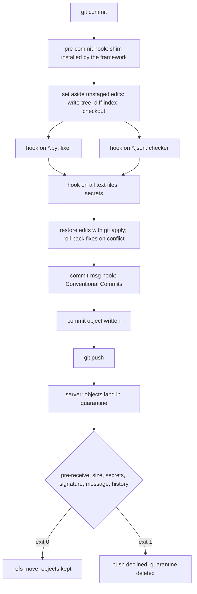

# Hooks Are Programs Git Runs at the Right Moment

*A hook is any program Git runs at a fixed moment; client hooks are a convenience, the server and CI are where policy holds.*

## Metadata

| Field | Value |
|---|---|
| Type | Build |
| Languages | Python |
| Prerequisites | [Git Is a Content-Addressed Object Store](https://cloudcaptain.io/learn/git/object-store) |
| Time | 75 minutes |
| Tools | git, pre-commit, lefthook, husky, ssh-keygen |

<Quiz stage="pre" />

## The Problem

The payments team copied a `pre-commit` script from the wiki into `.git/hooks/`. It ran the formatter over the whole working tree and then `git add -A`, so that the formatted files would be part of the commit. On Tuesday Lena staged a two-line fix for a rounding bug and committed it. The hook formatted and staged everything, including the half-finished refactoring she had not staged on purpose, and the commit that went out as "fix rounding" carried 400 lines nobody reviewed. Her colleague had the opposite problem: his hook checked the files on disk, not the staged ones, so it passed while the staged version still had the bug.

Two weeks later a new engineer cloned the repository. `.git/hooks/` is not part of what Git clones, so he had no hooks at all, and his first commit added `config/local.ini` with an AWS access key. It was pushed to the shared remote within the minute. Removing it in the next commit did nothing for the key: it was in the history, in every clone and in the CI cache, and it had to be revoked and rotated. When the team asked why the "secret check" had not stopped it, the answer was that the check only ever existed on four laptops, and two of those people used `git commit --no-verify` because the hook took 40 seconds.

Every one of these failures has a mechanism behind it. A hook is just a program Git runs at a fixed moment, with fixed inputs; what it checks is up to you, and checking the working tree instead of the index is a bug. Hooks are not cloned, so they need an installer and a configuration file that is versioned. A hook that rewrites files must not silently stage them. And anything that is a rule rather than a convenience must run where the developer cannot skip it: in a server-side `pre-receive` hook and in CI. You are going to build `minihooks`, a hook manager that reads the same configuration file as the pre-commit framework, runs hooks on exactly the staged content with unstaged edits set aside and restored, runs independent hooks in parallel, validates Conventional Commits in `commit-msg`, and enforces size, secret, signature and message rules in a `pre-receive` hook on a bare repository. The smoke test runs it side by side with pre-commit itself.

## The Concept

Git defines a set of moments and, at each one, looks for an executable file with the moment's name in the hooks directory: `.git/hooks/` by default, or wherever `core.hooksPath` points. If the file exists and is executable, Git runs it with documented arguments and standard input. For the hooks whose names start with `pre-` and for `commit-msg`, a non-zero exit status stops the operation. `pre-commit` gets no arguments and runs before the commit object is written, so the only thing it can inspect is the index. `commit-msg` gets the path of the file holding the proposed message and may reject or rewrite it. `pre-push` gets the remote's name and URL and one line per ref being pushed on standard input. On the server, `pre-receive` gets one line `<old> <new> <ref>` per updated ref on standard input and decides for the whole push at once; `update` runs once per ref; `post-receive` runs after the refs have moved and cannot stop anything.

The key detail of `pre-commit` is that a commit is made from the index, not from the files on disk. If you staged half of your edits, the files on disk are a mix of what will be committed and what will not. A hook that reads the disk checks the wrong thing. The pre-commit framework solves it with plumbing: `git write-tree` names the tree the index holds, `git diff-index --binary TREE` writes the difference between that tree and the working tree as a patch, `git checkout -- .` makes the working tree equal the index, the hooks run, and `git apply` puts the unstaged edits back. If a hook fixed a line that the unstaged patch also touches, the patch no longer applies; the framework then throws the hook's fixes away, applies the patch to the clean index state, and the user loses nothing they typed.

A hook that fixes files (a formatter, a whitespace trimmer) has a second rule: the fix is never staged behind the user's back. The hook's exit status is not enough to judge it, because many fixers exit 0. The framework compares the files before and after the hook, and if they changed the hook fails, the commit stops, and the user reviews the fix and stages it. Hooks that touch different files cannot interfere, so they can run at the same time; hooks whose file sets overlap must run in configuration order, so that a checker sees the fixer's output. That ordering is a dependency graph over file sets.

Client hooks are optional by construction: they are not cloned, any of them can be skipped with `--no-verify`, and commits made in a web editor never see them. On the server, Git receives a push into a quarantine directory, runs `pre-receive`, and only moves the refs and keeps the new objects if the hook exits 0. A rejected push leaves nothing behind.



## Build It

`code/main.py` is `minihooks`, with the subcommands `run`, `install`, `check-msg`, `pre-receive`, `tags` and `demo`. It reads the pre-commit framework's `.pre-commit-config.yaml` (local hooks only, with a YAML subset parser), so the same file drives both tools. Git is driven through one small `Git` class around `subprocess`; everything else is pure functions over dataclasses, and the tests run against real temporary repositories. `code/fixtures/sample/` holds the sample project the `demo` subcommand copies: the configuration and two hook scripts, a whitespace fixer and a JSON checker.

### Step 1: the configuration is YAML, and a subset is enough

`.pre-commit-config.yaml` uses block mappings, block sequences, flow lists like `[python, markdown]`, quoted regular expressions and comments. `parse_yaml()` turns lines into `(number, indent, text)` triples after stripping comments outside quotes, then parses recursively by indentation. A sequence item that starts a mapping (`- id: x`) is rewritten as a mapping at the item's content column, which is the one rule that makes YAML's compact notation work:

```python
def parse_sequence(lines: List[Line], index: int, indent: int) -> Tuple[List[Any], int]:
    items: List[Any] = []
    while index < len(lines) and lines[index].indent == indent and is_item(lines[index].text):
        line = lines[index]
        rest = line.text[1:].lstrip(" ")
        if rest:
            child = indent + len(line.text) - len(rest)
            lines[index] = Line(line.number, child, rest)
            value, index = parse_node(lines, index, child)
        elif index + 1 < len(lines) and lines[index + 1].indent > indent:
            value, index = parse_node(lines, index + 1, lines[index + 1].indent)
        else:
            value, index = None, index + 1
        items.append(value)
    return items, index
```

Anything outside the subset (block scalars, anchors, flow mappings, tabs) is an error with a line number instead of a silent misread. `load_config()` then validates the shape: only `repo: local`, the required keys `id`, `name`, `entry` and `language`, regular expressions that compile, known stage names (with the old aliases `commit` and `push` mapped to `pre-commit` and `pre-push`), and a warning for every key it does not know. Languages are `system` and `script` (which recent pre-commit releases call `unsupported` and `unsupported_script`; both names are accepted), plus the two that run without any process: `pygrep`, a regular expression applied to every line, and `fail`, which always fails and prints the file names.

### Step 2: choose the files the way pre-commit does

In the `pre-commit` stage the candidates are the staged paths, from `git diff --staged --name-only -z --diff-filter=ACMRTUXB` (everything except deletions); with `--all-files` they are `git ls-files`. Each hook narrows them with the top-level `files`/`exclude`, its own `files`/`exclude` (Python regular expressions searched anywhere in the path), and type tags. `tags_for()` reproduces the tagging of the `identify` library that pre-commit uses: `file`, `executable` or `non-executable`, tags from the extension or file name, the interpreter from a shebang line for executables without an extension, and `text` or `binary` from the first 1024 bytes:

```python
        if set(hook.types) <= found and (not hook.types_or or found & set(hook.types_or)) and not found & set(hook.exclude_types):
            chosen.append(name)
```

`types` must all match, `types_or` needs one, `exclude_types` must not match. The default `types: [file]` excludes symlinks and directories. `python3 code/main.py tags PATH` prints the tags, which is the fastest way to debug a hook that never runs.

### Step 3: set the unstaged edits aside, and get them back

`unstaged_changes_set_aside()` is a context manager around the hook run. It does exactly what Step 2's commit needs: make the working tree equal the index, and afterwards restore the user's edits byte for byte:

```python
    tree = git.out("write-tree").strip()
    diff = git.run("diff-index", "--ignore-submodules", "--binary", "--exit-code", "--no-color", "--no-ext-diff", tree, "--")
    ...
    with open(report.patch, "wb") as handle:
        handle.write(diff.stdout)
    git.out("-c", "submodule.recurse=0", "checkout", "--", ".")
    try:
        yield report
    finally:
        if git.run("apply", "--whitespace=nowarn", report.patch).returncode != 0:
            report.conflicted = True
            log("[WARNING] Stashed changes conflicted with hook auto-fixes... Rolling back fixes...")
            git.out("-c", "submodule.recurse=0", "checkout", "--", ".")
            git.out("apply", "--whitespace=nowarn", report.patch)
```

Why not `git stash --keep-index`? It records the index and the working tree as commits on `refs/stash` and resets the files, and putting back exactly the unstaged part on top of a file a hook has just fixed is harder to control than applying one patch. A patch file is explicit: it is kept under `.git/minihooks/` after the run, so if anything goes wrong in between (a crash, a killed process) the user's edits are still on disk and `git apply` restores them. Untracked files are not in the patch and are not touched; they are also never passed to a hook, because only staged paths are candidates. `run_hooks()` refuses to start while there are unmerged paths or while the configuration file itself has unstaged changes, since the hooks would otherwise run with a configuration nobody will commit.

### Step 4: a fixer that changed files has failed

`run_job()` takes a fingerprint (SHA-256 of each file) of the hook's files before and after it runs. A hook fails if it exits non-zero or if anything changed:

```python
def run_job(job: Job, git: Git, root: str, env: Dict[str, str], timeout: float) -> HookResult:
    before = fingerprint(job, git, root)
    started = time.monotonic()
    code, output = execute(job.hook, job.files, root, env, timeout)
    duration = round(time.monotonic() - started, 3)
    after = fingerprint(job, git, root)
    modified = sorted(name for name in set(before) | set(after) if before.get(name) != after.get(name))
    status = "Failed" if code or modified else "Passed"
```

The sample's `hooks/fix_whitespace.py` always exits 0, so this is the only reason the commit stops. The fix stays in the working tree, unstaged, and the user decides with `git diff` and `git add`. Hooks that do not receive file names (`pass_filenames: false`) or that set `always_run` or `require_serial` may touch anything, so their fingerprint is every file that differs from the index, which is the comparison pre-commit makes with `git diff` around each hook. `execute()` runs `shlex.split(entry) + args + files` from the repository root with `MINIHOOKS=1` in the environment, merges stdout and stderr, and turns a missing executable or a timeout into a failure with a message instead of a crash.

### Step 5: parallel without races, a graph over file sets

Two hooks conflict if either may touch any file or their file sets overlap. Each hook depends on every earlier hook it conflicts with, which keeps configuration order wherever order can matter:

```python
def conflicts(first: Job, second: Job) -> bool:
    return first.hook.exclusive or second.hook.exclusive or bool(set(first.files) & set(second.files))


def dependencies(jobs: Sequence[Job]) -> Dict[int, Set[int]]:
    return {later.index: {earlier.index for earlier in jobs[:position] if conflicts(earlier, later)}
            for position, later in enumerate(jobs)}
```

`schedule()` submits every hook whose dependencies have finished to a thread pool, waits for the first to complete, and repeats. A hook that is ready never conflicts with one that is running: if they conflicted, the earlier one would be in the later one's dependencies. Output is collected per hook and printed in configuration order when everything has finished, so parallel runs read exactly like serial ones. `run --dry-run` prints the plan:

```text
trailing-whitespace: start at once; 1 file(s): app.py
check-json: start at once; 1 file(s): settings.json
no-secrets: after trailing-whitespace, check-json; 2 file(s): app.py settings.json
no-env-files: skipped (no files to check)
```

pre-commit itself runs hooks one after another and parallelises inside a hook instead, by splitting long file lists into chunks for several processes unless `require_serial` is set. The graph gives the same results as pre-commit's serial order, because only hooks with disjoint file sets ever overlap in time.

### Step 6: install a shim, wherever Git looks

Hooks are not cloned, so a framework installs a small script under each hook name and keeps the real configuration in the repository. `install()` asks Git where hooks live, so `core.hooksPath` is respected, and refuses to overwrite a hook it did not write:

```python
def install(repo: str, hook_types: Sequence[str], config: str = CONFIG_FILE, overwrite: bool = False) -> List[str]:
    git = Git(repo)
    hooks_dir = git.path("hooks")
```

`git.path("hooks")` is `git rev-parse --git-path hooks`, which answers `.githooks` when `core.hooksPath=.githooks` and `hooks` in a bare repository. The shim for `pre-commit` is `exec python3 /path/to/main.py run --hook-stage pre-commit --config .pre-commit-config.yaml`; for `commit-msg` it adds `--commit-msg-file "$1"`; for `pre-receive` it runs the server policy.

### Step 7: commit-msg checks Conventional Commits

The `commit-msg` hook receives the path of the message file. The sample configuration runs `minihooks check-msg` as a `system` hook in the `commit-msg` stage, so both frameworks call it with that path. `clean_message()` first does what Git's default cleanup does: drop comment lines and everything below the scissors line `# ------------------------ >8 ------------------------`. `check_message()` then applies the Conventional Commits 1.0.0 grammar, `type(scope)!: description`, an optional body after one blank line, and footers such as `BREAKING CHANGE: ...` or `Refs: #12`:

```python
HEADER = re.compile(r"^(?P<type>[^\s(!:]+)(?P<scope>\([^()]*\))?(?P<bang>!)?: (?P<description>.*)$")
```

Types are compared case-insensitively, as the specification requires, against the list commitlint's conventional configuration uses (`build`, `chore`, `ci`, `docs`, `feat`, `fix`, `perf`, `refactor`, `revert`, `style`, `test`). `!` or a `BREAKING CHANGE` footer marks a breaking change; the footer token must be upper case. Messages Git writes itself (`Merge ...`, `Revert "..."`, `fixup! ...`, `squash! ...`) are exempt. Every rule produces a sentence that says what to change, because a hook that only says "invalid" teaches people to use `--no-verify`.

### Step 8: pre-receive, the server's last word

On the server the hook reads `<old> <new> <ref>` lines. The commits a push introduces are the ones reachable from the new value and from no existing ref. While `pre-receive` runs, the refs have not moved yet and Git exposes the quarantined objects to the hook's own `git` commands, so one `rev-list` finds them:

```python
def new_commits(git: Git, new: str) -> List[str]:
    return git.out("rev-list", "--topo-order", "--reverse", new, "--not", "--all").split()
```

`check_commit()` compares each new commit with its first parent. `git diff-tree -r -z --raw` lists the blobs it adds or changes, and one `git cat-file --batch-check` call returns their sizes; `git diff-tree -p -U0` gives the added lines, which are matched against patterns for AWS access key IDs, private key headers, GitHub and Slack tokens and quoted `password = "..."` assignments, reporting `path:line`. Only added lines are scanned, so an old secret already in the history does not block every later push (it needs rotating and a history rewrite, which is a different job). On protected refs (glob patterns such as `refs/heads/main` and `refs/heads/release/*`) the hook also requires a good signature (`git log --format=%G?` must print `G`, which for SSH signatures needs `gpg.ssh.allowedSignersFile` on the server) and a Conventional Commits subject, refuses non-fast-forward updates with `git merge-base --is-ancestor OLD NEW`, and refuses deletion. The policy lives in the bare repository's own configuration:

```bash
git -C origin.git config minihooks.maxBytes 1m
git -C origin.git config --add minihooks.protect refs/heads/main
git -C origin.git config --add minihooks.protect 'refs/heads/release/*'
git -C origin.git config minihooks.requireSigned true
python3 code/main.py install --repo origin.git -t pre-receive
```

The hook writes one line per violation to stderr, which Git relays to the pusher prefixed with `remote:`, and exits 1. The whole push is declined, because `pre-receive` decides for all refs at once.

### Step 9: run it

`demo` copies the sample project into a new repository, creates a bare `origin.git` with the pre-receive policy, pushes the first commit and installs the `pre-commit` and `commit-msg` shims:

```bash
python3 code/main.py demo /tmp/hd
export PATH=/tmp/hd/bin:$PATH; cd /tmp/hd/work
printf 'def total(items):   \n    return sum(items)\n' > app.py && git add app.py
printf 'def total(items):   \n    return sum(items)  # draft\n' > app.py
printf '{"workers": 8,}\n' > settings.json && git add settings.json
git commit -m "feat: count items"
```

```text
[WARNING] Unstaged files detected.
[INFO] Stashing unstaged files to /tmp/hd/work/.git/minihooks/patch1794390924-93184.
[WARNING] Stashed changes conflicted with hook auto-fixes... Rolling back fixes...
[INFO] Restored changes from /tmp/hd/work/.git/minihooks/patch1794390924-93184.
trim trailing whitespace.................................................Failed
- hook id: trailing-whitespace
- files were modified by this hook

Fixing app.py

check json syntax........................................................Failed
- hook id: check-json
- exit code: 1

settings.json: Expecting property name enclosed in double quotes: line 1 column 15 (char 14)

block secrets............................................................Passed
forbid .env files....................................(no files to check)Skipped
```

The fixer trimmed the first line of the staged `app.py`, but the unstaged edit changed the neighbouring line, so the patch did not apply over the fix: the fix was rolled back and `app.py` on disk is exactly what you typed. Trim it yourself, fix the JSON, `git add` both and commit with `-m "counted items"`, and the `commit-msg` hook fails with `the header 'counted items' is not` followed by the expected form. A commit made with `--no-verify` that adds a key gets as far as the server:

```text
remote: minihooks: push rejected, 1 problem(s)
remote: minihooks: refs/heads/main 3b4aee0 secret: creds.ini:1 looks like a aws-access-key-id
remote: minihooks: fix the commits (git commit --amend, git rebase -i) and push again; a pushed secret must be revoked, not just deleted
 ! [remote rejected] main -> main (pre-receive hook declined)
```

`git -C /tmp/hd/origin.git cat-file -e 3b4aee0` fails afterwards: the rejected objects were deleted with the quarantine. Exit codes are 0 when every hook passed (or the push is acceptable), 1 when a hook failed, a message is invalid or a push is rejected, and 2 for configuration, usage or Git errors.

<RunTests />

## Use It

**Plain Git.** Every hook name and its inputs are in `man githooks`. A hooks directory in the repository makes hooks reviewable and versioned, at the price of one configuration command per clone:

```bash
git rev-parse --git-path hooks                 # where Git looks right now
git config core.hooksPath .githooks            # use a versioned directory instead of .git/hooks
git hook run pre-commit                        # run a hook by hand (Git 2.36 and later)
git commit --no-verify -m "..."                # skips pre-commit and commit-msg: hooks are advisory
GIT_TRACE=1 git commit -m "..."                # shows each hook Git starts
```

**The pre-commit framework.** It reads the same `.pre-commit-config.yaml`. Install it like any tool you run in CI, pinned and hash-checked (the smoke installs 4.7.0 from `code/requirements-pre-commit.txt`, every dependency pinned with its sha256):

```bash
python3 -m venv .venv && .venv/bin/pip install --require-hashes -r code/requirements-pre-commit.txt
.venv/bin/pre-commit install --hook-type pre-commit --hook-type commit-msg
.venv/bin/pre-commit run --all-files                 # every tracked file: what CI should run
.venv/bin/pre-commit run check-json --files a.json   # one hook, chosen files
SKIP=no-secrets git commit -m "docs: notes"          # skip one hook by id, visibly
.venv/bin/pre-commit autoupdate --freeze             # remote hooks: bump `rev:` to a commit SHA, not a tag
```

Most real configurations use remote hook repositories (`repo: https://github.com/pre-commit/pre-commit-hooks` with a `rev:`); pre-commit clones each one at that revision into its cache and builds an isolated environment for its language, which is the part `minihooks` leaves out. Pin `rev:` to a full commit SHA, because a tag can be moved. pre-commit refuses to install while `core.hooksPath` is set (`Cowardly refusing to install hooks with core.hooksPath set`), because its hooks would land where Git never looks; `minihooks` installs into the configured path instead. The smoke test checks both behaviours.

**lefthook and husky.** lefthook is a single Go binary configured with `lefthook.yml`; commands in one hook can run in parallel, `{staged_files}` expands to the staged paths matching `glob`, and `stage_fixed: true` re-stages a fixer's changes so the commit proceeds with them, a different policy from pre-commit's "review the fix first":

```yaml
pre-commit:
  parallel: true
  commands:
    whitespace:
      glob: "*.{py,md}"
      run: python3 hooks/fix_whitespace.py {staged_files}
      stage_fixed: true
    json:
      glob: "*.json"
      run: python3 hooks/check_json.py {staged_files}
commit-msg:
  commands:
    conventional:
      run: minihooks check-msg {1}
```

husky is the usual choice in JavaScript repositories: `npx husky init` sets `core.hooksPath` to a directory under `.husky/` and writes `.husky/pre-commit` as a plain shell script, and the `prepare` script in `package.json` re-installs it on `npm install`. On its own husky does not select staged files or set unstaged edits aside; it is commonly paired with lint-staged for that.

**Server-side hooks.** On a bare repository you control (a self-hosted Git server, Gitea or Forgejo, GitLab self-managed, GitHub Enterprise Server), `pre-receive` is installed exactly as in Step 8. Read `man git-receive-pack` for the quarantine and for `receive.fsckObjects`, which makes the server reject corrupt objects before any hook runs. Hosted services do not run your scripts on their servers: GitHub.com offers push rulesets (restrictions on file paths, extensions and file sizes) and secret scanning push protection, and GitLab offers push rules; check which of them your plan includes.

**CI is the enforcement.** A client hook can be missing, skipped with `--no-verify` or bypassed by an edit in the web UI. Run the same checks in a required CI job, on every pull request, so that the rule holds even when the hook did not run:

```yaml
name: hooks
on: [pull_request, merge_group]
jobs:
  hooks:
    runs-on: ubuntu-latest
    steps:
      - uses: actions/checkout@v5
      - uses: actions/setup-python@v6
        with:
          python-version: "3.12"
      - run: python3 -m venv .venv && .venv/bin/pip install --require-hashes -r requirements-pre-commit.txt
      - run: .venv/bin/pre-commit run --all-files --show-diff-on-failure
```

| What you built | Real tool | Note |
|---|---|---|
| `parse_yaml()`, `load_config()` | pre-commit's config loader (PyYAML and cfgv) | full YAML and remote repositories with per-language environments |
| `select_files()`, `tags_for()` | `files`, `exclude`, `types`, `types_or`, `exclude_types` with the identify library | identify knows hundreds of extensions; `minihooks tags` covers the common ones |
| `unstaged_changes_set_aside()` | pre-commit's `staged_files_only`, lint-staged's backup stash | same patch, checkout and apply sequence, same rollback on conflict |
| `run_job()` fingerprints | pre-commit's `git diff` before and after each hook | lefthook's `stage_fixed` re-stages instead of failing |
| `dependencies()`, `schedule()` | lefthook `parallel: true`; pre-commit chunks files per hook | only hooks with disjoint files overlap |
| `install()` shims | `pre-commit install`, `lefthook install`, `husky` | pre-commit refuses when `core.hooksPath` is set |
| `check_message()` | commitlint with the conventional config | commitlint adds case, length and body rules |
| `check_push()` | GitHub Enterprise Server pre-receive hooks, GitLab server hooks and push rules, push rulesets | hosted services enforce their own rule types instead of scripts |
| `SECRET_PATTERNS` | secret scanning push protection, gitleaks, detect-secrets | real scanners verify tokens with the issuer and know hundreds of formats |
| `run --all-files` in CI | `pre-commit run --all-files --show-diff-on-failure` | the only check a developer cannot skip |

<Quiz stage="check" />

## Ship It

Two artifacts in `outputs/`:

- **`skill-hook-rollout.md`**: a runbook for rolling hooks out to a team without slowing it down or annoying people into `--no-verify`. It inventories existing hooks and CI checks, picks the framework, writes the configuration with pinned revisions, runs a baseline over all files, measures hook time, rolls out in stages, mirrors every rule in a required CI job and in server-side or hosted push rules, and ends with a fixed report.
- **`prompt-write-hook-config.md`**: describe a repository (languages, layout, existing linters, the problems you want to catch, how long a commit may take) and get back a `.pre-commit-config.yaml` with pinned revisions and correct `files`/`types` filters, the matching CI job, the `commit-msg` policy, and what belongs in a server-side or hosted push rule instead.

<ShipIt />

## Exercises

### Easy

Add the `pre-push` stage. Git runs `pre-push REMOTE URL` with lines `<local ref> <local sha> <remote ref> <remote sha>` on standard input; the candidates are the files changed between the remote sha and the local sha (`git diff --name-only REMOTE...LOCAL`, or every file of the pushed commits when the remote ref is new). Write the tests first: a hook with `stages: [pre-push]` receives exactly the files of the two commits being pushed, a push that deletes a ref runs nothing, and `install -t pre-push` writes a shim that passes standard input through.

### Medium

Implement pre-commit's file partitioning: split a hook's file list into chunks whose command line stays under a limit (pre-commit derives it from the platform's maximum argument length), run the chunks in parallel processes unless `require_serial` is set, and combine their exit codes and output. Test it with a fake hook script that writes its `argv` length to a file, a list of 50,000 generated file names and a small limit, and assert that every file is passed exactly once, no command exceeds the limit, and `require_serial: true` gives exactly one process.

### Hard

Make `pre-receive` fast for a push of thousands of commits. Instead of two `diff-tree` calls per commit, list every new object once with `git rev-list --objects NEW --not --all`, read the new blobs' sizes and contents in one `git cat-file --batch` stream, and map each blob back to the first commit and path that introduced it. Write a test that generates a repository with 2,000 commits in which some commits re-add a blob that already exists, and assert that the fast path reports the same violations as `check_push()` (same rule, path and commit), scans each blob once, and runs at least five times faster; then explain in the test's name why scanning blobs instead of added lines changes what an edit to a file with an old secret reports.

<Quiz stage="post" />

## Key Terms

| Term | Common misconception | Precise definition |
|---|---|---|
| Hook | "Hooks are a Git configuration setting." | An executable file named after an event in the hooks directory; Git runs it at that moment with documented arguments and stdin, and for `pre-*` and `commit-msg` hooks a non-zero exit stops the operation. |
| `core.hooksPath` | "Hooks in the repository are installed automatically." | A setting that points Git at another hooks directory, often one under version control; every clone still has to set it, and the hooks never travel with `git clone` on their own. |
| Staged-only run | "A pre-commit hook checks my files." | Running hooks against the index, the content that will be committed, by setting unstaged edits aside as a patch and restoring them afterwards. |
| Auto-fixer | "A formatter hook fixes and commits the file." | A hook that rewrites files; the framework detects the change and fails the commit so that the user reviews and stages the fix. |
| `--no-verify` | "Hooks enforce our rules." | The flag that skips `pre-commit` and `commit-msg`; it is why client hooks are a convenience and CI and the server are the enforcement. |
| `pre-receive` | "It checks each pushed commit separately and can accept some refs." | A server-side hook that reads `<old> <new> <ref>` lines on stdin and accepts or rejects the whole push; `update` is the per-ref variant. |
| Quarantine | "Rejected pushes leave garbage objects on the server." | The temporary object directory a push is received into; objects move into the repository only after `pre-receive` exits 0, and are deleted otherwise. |
| Conventional Commits | "It is a list of allowed commit types." | A specification for messages of the form `type(scope)!: description`, an optional body and footers, in which `!` or a `BREAKING CHANGE` footer marks a breaking change, so tools can derive versions and changelogs. |

## Further Reading

- [Git Advanced](https://cloudcaptain.io/docs/tools/git/advanced): rebase, cherry-pick and history rewriting, which you need to fix commits a server hook rejected.
- [DevSecOps Fundamentals](https://cloudcaptain.io/docs/tools/devsecops/fundamentals): where secret scanning and pre-commit checks sit among the other controls of a pipeline.
- [GitHub Actions Fundamentals](https://cloudcaptain.io/docs/tools/github-actions/fundamentals): writing the required CI job that enforces what the hooks only suggest.
- [githooks](https://git-scm.com/docs/githooks): every hook Git runs, its arguments, its stdin and whether its exit status matters.
- [git-receive-pack](https://git-scm.com/docs/git-receive-pack): the quarantine environment, `pre-receive`, `update` and `post-receive` on the server.
- [pre-commit](https://pre-commit.com/): the configuration reference, hook stages, file filtering and the languages, including how remote hook repositories are installed.
- [Conventional Commits 1.0.0](https://www.conventionalcommits.org/en/v1.0.0/): the grammar `check_message()` implements, with the rules for scopes, `!` and footers.
- [lefthook configuration](https://lefthook.dev/configuration/) and [husky](https://typicode.github.io/husky/): the two common alternatives, with their parallelism and staging choices.
- [git config: gpg.ssh.allowedSignersFile](https://git-scm.com/docs/git-config#Documentation/git-config.txt-gpgsshallowedSignersFile): what a server needs to verify SSH-signed commits.
