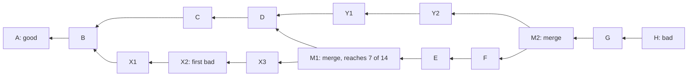

# git bisect Is Binary Search Over a Graph

*Bisect keeps halving the commits that could hold the bug; blame hands each line back to the parent that already had it.*

## Metadata

| Field | Value |
|---|---|
| Type | Build |
| Languages | Python |
| Prerequisites | [A Merge Is a Three-Way Diff Against a Common Ancestor](https://cloudcaptain.io/learn/git/merge-algorithms) |
| Time | 75 minutes |
| Tools | git |

<Quiz stage="pre" />

## The Problem

Tuesday, 09:10. Since Monday's release the payment service retries failed card authorisations only twice instead of five times, and the declined-payment rate has doubled. Between the last good release tag and the bad one there are 340 commits: three feature branches merged with merge commits, a dependency bump that broke the build for a dozen commits, and a repository-wide formatter run. The on-call engineer starts reading `git log -p`, gives up after forty commits, and asks in the channel who touched the retry code.

Someone runs `git blame` on the retry module. Every line in the file points at the formatter commit from three weeks ago, authored by the platform team, who have never seen the retry logic. Someone else remembers that a teammate had a fix for exactly this on a branch called `retry-cap`, but the branch was deleted during a cleanup on Friday and nobody pushed it. The incident channel fills with guesses.

Each of these questions has a mechanical answer that does not depend on reading code. Which commit introduced the behaviour is a search: test the commit that cuts the remaining suspects in half and keep the half that must contain the change, about nine tests for 340 commits, skipping the ones that do not build. Who last changed a line is a walk down the history: hand every line to the parent that already contained it, and the lines that no parent had belong to that commit, with formatting commits passed through as if they never happened. The deleted branch is still in the object store and in `HEAD`'s reflog until garbage collection removes it. You are going to build `minibisect`, which does all four, and check it against Git: the same commit to test at every step as `git bisect`, line for line the same answer as `git blame --porcelain`, the same commits as `git log -S` and `-G`, and the same lost commits as `git fsck`.

## The Concept

Binary search on a sorted list works because one comparison tells you which half holds the answer. Bisecting a history works the same way once you state the assumption it rests on: every commit that contains the bad commit is bad, and every commit that does not is good. "Contains" means "has it as an ancestor". Marking one commit good therefore clears all of its ancestors at once, and marking one bad clears everything that is not its ancestor.

So the commits that can still be the first bad one are the **candidates**: the ancestors of the bad commit, itself included, minus the ancestors of every good commit. In a straight line, testing the middle candidate halves the set. In a graph with merges there is no middle, so Git computes for every candidate how many candidates it can reach (its **weight**, itself included). If that commit turns out bad, those are the candidates left; if it turns out good, the others are. The best commit to test is the one where the smaller of the two numbers is largest. In the diagram, the history from `code/fixtures/history.json`, there are 14 candidates above the good commit `A`, and the merge `M1` reaches exactly 7 of them, so it splits the set in half even though it is not in the middle of any single line.



Testing `M1` and finding it bad leaves `M1`, `X3`, `X2`, `X1`, `D`, `C` and `B`. A commit that cannot be tested (it does not build) is **skipped**: Git picks a commit near it in the ranking instead, and if only skipped commits are left between the last good and the first bad, it says so and lists all of them rather than guessing.

**Blame** answers a different question: for each line of a file, which commit last changed it. It starts by suspecting the newest commit of every line and diffs the file against the file in the commit's parent. Lines that the diff says are unchanged are handed to the parent, which becomes their new suspect; the rest stay, because this commit wrote them. Repeating that down the history ends with every line at the commit where it appeared. A merge offers its lines to each parent in turn. An **ignored revision**, such as a formatter run, hands even its changed lines to the most similar line of its parent, so the blame skips over it; a line it added from nothing stays with it and is marked unblamable. With `-M`, a block that moved within the file is found in the parent by content, not position.

**Pickaxe** search (`git log -S` and `-G`) answers "which commits changed this string": `-S` counts occurrences before and after each commit, `-G` looks for the pattern in the lines the diff added or removed. And nothing in Git is lost when a branch is deleted: the commits stay in the object database, `HEAD`'s reflog remembers every commit you checked out, and `git fsck` lists the commits no reference points to.

## Build It

`code/main.py` is `minibisect`, one file of standard-library Python. It reads histories through `git log`, `git ls-tree` and `git cat-file` (or from a JSON file and in-memory trees in the tests), and follows Git's `bisect.c`, `blame.c` and `diffcore-pickaxe.c` closely enough that every result can be compared with Git's.

### Step 1: the candidates and the order Git walks them in

```python
def ancestors(commits: Dict[str, Commit], tips: Iterable[str]) -> Set[str]:
    seen: Set[str] = set()
    stack = list(tips)
    while stack:
        sha = stack.pop()
        if sha in seen or sha not in commits:
            continue
        seen.add(sha)
        stack.extend(commits[sha].parents)
    return seen
```

A history is a dictionary from commit to `Commit(parents, date, subject, ...)`. `bisect_step()` takes the bad commit, the good ones and the skipped ones, and computes the candidates as `ancestors([bad]) - ancestors(goods)`. Git walks the history newest first by committer date and then reverses the list, so ties between equally good commits go to the oldest one; `date_order()` reproduces that walk with a heap keyed by date and insertion order. If the bad commit is itself an ancestor of a good one, the answer is the error Git gives: it was both good and bad.

### Step 2: weights, and the commit that halves the graph

```python
def find_bisection(commits: Dict[str, Commit], order: Sequence[str], find_all: bool) -> Tuple[Optional[str], Dict[str, int]]:
    nr = len(order)
    candidates = set(order)
    weight: Dict[str, int] = {}
    counted = 0
    for sha in order:
        interesting = sum(1 for parent in commits[sha].parents if parent in candidates)
        weight[sha] = 1 if interesting == 0 else -1 if interesting == 1 else -2
        counted += interesting == 0
    for sha in order:
        if weight[sha] != -2:
            continue
        weight[sha] = len(ancestors(commits, [sha]) & candidates)
        if not find_all and approx_halfway(weight[sha], nr):
            return sha, weight
        counted += 1
    while counted < nr:
        for sha in order:
            if weight[sha] >= 0:
                continue
            known = next((p for p in commits[sha].parents if p in candidates and weight[p] >= 0), None)
            if known is None:
                continue
            weight[sha] = weight[known] + 1
            counted += 1
            if not find_all and approx_halfway(weight[sha], nr):
                return sha, weight
```

This is Git's `do_find_bisection()`. A commit with no candidate parent reaches only itself. A commit with exactly one candidate parent reaches one more than that parent, which is cheap. Only merges with several candidate parents need a real count, because their parents share ancestors and adding their weights would count those twice. As soon as a commit reaches half of the candidates (within one, `approx_halfway()`), Git stops counting and takes it. Otherwise the best commit is the one with the largest `min(weight, nr - weight)`, the first one in walk order on a tie. `next` reports what `git bisect` prints: `Bisecting: 6 revisions left to test after this (roughly 3 steps)`, where the step estimate is `estimate_steps()`, a port of `estimate_bisect_steps()`, about `log2` of the candidates. `next --all` prints every candidate with its distance, the format of `git rev-list --bisect-all`.

### Step 3: skipping untestable commits the way Git does

```python
def skip_away(filtered: Sequence[str], bad: str) -> str:
    count = len(filtered)
    prn = get_prn(count)
    index = (count * prn // PRN_MODULO) * sqrti(prn) // sqrti(PRN_MODULO)
    if index >= count:
        return filtered[0]
    if filtered[index] != bad:
        return filtered[index]
    return filtered[index - 1] if index > 0 else filtered[0]
```

Once any commit has been skipped, Git ranks every candidate by distance (best first, ties by object name). If the best one is not skipped it is tested. If it is, Git does not take the next one, which would usually sit right next to the untestable commit and be broken for the same reason: `skip_away()` jumps to a position drawn from a fixed pseudo-random sequence that favours the front of the list. `get_prn()` is the textbook linear congruential generator from `man 3 rand` seeded with the number of remaining commits, and `sqrti()` is Git's integer square root, computed in 32-bit floats (`f32()`) because that is what the C code does and the results must match. The skipped commits are remembered; when everything between the last good and the first bad commit is skipped, `bisect_step()` returns `only-skipped` with the list of commits that could be the first bad one.

### Step 4: an automated run and its exit codes

```python
def verdict_of(code: int) -> str:
    if code < 0 or code >= 128:
        raise BisectError(f"bisect run failed: exit code {code} is < 0 or >= 128")
    return SKIP if code == 125 else GOOD if code == 0 else BAD
```

`minibisect run --repo R --bad main --good v1.0 -- ./test.sh` checks out each commit with `git checkout --detach`, runs the command in the work tree and maps its exit code: 0 good, 125 skip, any other code from 1 to 127 bad, and anything else (a signal, or 128 and above) stops the run, because it means the test itself broke. Exit codes 126 and 127 are what a shell returns when the script is not executable or not found; the first time one appears, `bisect_run()` runs the command on a known-good commit too, and if that gives the same code it stops with `bogus exit code` instead of marking the whole history bad. At the end the original branch is checked out again. Before the first step the run also checks that every good commit is an ancestor of the bad one; for a good commit on a side branch, the merge base must be tested first, because the "good" side branch may contain a fix the bad line never got.

### Step 5: blame hands unchanged lines to the parent

```python
    def chunk(self, pending: List[Entry], kept: List[Entry], moved: List[Entry], tlno: int, offset: int, same: int, parent_len: int, fingerprints: Optional[Tuple[List[Fingerprint], List[Fingerprint]]]) -> List[Entry]:
        rest: List[Entry] = []
        while pending and pending[0].s_lno < tlno:
            entry = pending.pop(0)
            if entry.s_lno + entry.count > tlno:
                rest.append(split_at(entry, tlno - entry.s_lno))
            entry.s_lno += offset
            moved.append(entry)
        pending = rest + pending
```

A blame `Entry` is a run of lines of the final file (`lno`, `count`) together with their current suspect commit and their line number in that commit's version of the file (`s_lno`). `Blame.run()` starts with one entry for the whole file, suspected on the starting commit, and processes commits newest first. `pass_to_parent()` diffs the parent's file against the suspect's file with the Myers diff from the previous lesson, and `chunk()` handles one hunk at a time: entries that end before the hunk are unchanged, so they move to the parent with their line numbers shifted by the hunk offset; an entry that straddles the hunk boundary is split; entries inside the hunk stay with the suspect. After the last hunk everything left is unchanged and moves too. `pass_blame()` first checks whether a parent has exactly the same file (then all lines go to it, which is how merges that took one side whole are skipped), and then offers the lines to each parent in order. What no parent takes is final: that commit wrote those lines. Root commits are marked `boundary`, as `git blame --porcelain` does.

### Step 6: ignored revisions match lines by character pairs

```python
def fingerprint(line: str) -> Fingerprint:
    data = line.encode("utf-8", "surrogateescape")
    counts: Fingerprint = {}
    previous = 0
    for position in range(len(data) + 1):
        byte = 0 if position == len(data) or data[position] in GIT_SPACE else data[position]
        current = byte + 32 if 65 <= byte <= 90 else byte
        key = previous | (current << 8)
        previous = current
        if key:
            counts[key] = counts.get(key, 0) + 1
    return counts
```

For a commit in the ignore list (`--ignore-rev`, `--ignore-revs-file`), the lines it changed are handed to the parent too, but to which parent line? Git compares lines by **fingerprint**: the multiset of lower-cased adjacent character pairs, with whitespace turned into a separator, so `TIMEOUT=30` and `TIMEOUT = 30` share most pairs. `guess_line_blames()` runs Git's fuzzy matcher (`FuzzyMatcher`) over each changed hunk: for every new line it scores the old lines near the proportional position, commits first to the line whose best match is most certain, and recurses on both sides so matches stay in order. A line with no match inside the hunk is compared with the whole parent file and needs a similarity of at least 10 pairs. Lines that found a parent line move there marked `ignored`; a line with nothing similar, such as a blank line the formatter inserted, stays with the ignored commit marked `unblamable`. `read_ignore_revs()` reads the file format GitHub and `blame.ignoreRevsFile` use: one full object name per line, `#` comments.

### Step 7: moves within the file

```python
    def find_move(self, parent: str, entries: List[Entry], blamed: List[Entry], small: List[Entry]) -> List[Entry]:
        parent_lines = self.lines_of(parent)
        leftover: List[Entry] = []
        unblamed = entries
        while unblamed:
            pieces: List[Entry] = []
            for entry in unblamed:
                split = self.find_copy(entry, parent, parent_lines)
                if split[1] is not None and MOVE_SCORE < self.score(split[1]):
                    blamed.append(split[1])
                    pieces.extend(piece for piece in (split[0], split[2]) if piece is not None)
                else:
                    leftover.append(entry)
            small.extend(e for e in pieces if self.score(e) <= MOVE_SCORE)
            unblamed = [e for e in pieces if self.score(e) > MOVE_SCORE]
        return leftover
```

A diff sees a moved function as deleted in one place and added in another, so plain blame credits the commit that moved it. With `-M`, every run of lines still suspected on a commit is diffed against the whole parent file, `find_copy()` keeps the matching stretch with the most letters and digits, and if that stretch has more than 20 (`MOVE_SCORE`, Git's default) it moves to the parent at the matching position. The rest of the run is searched again. Runs of braces and blank lines never pass the score, which is why `-M` does not credit a `}` to a random older commit.

### Step 8: pickaxe

```python
            if regex is None:
                if occurrences(old, needle or "") != occurrences(new, needle or ""):
                    hits.append(path)
                continue
            old_lines, new_lines = split_lines(old), split_lines(new)
            changes = diff(old_lines, new_lines)
            touched = [line for c in changes for line in old_lines[c.old_start:c.old_start + c.old_count] + new_lines[c.new_start:c.new_start + c.new_count]]
            if any(regex.search(line) for line in touched):
                hits.append(path)
```

`pickaxe()` walks the commits newest first and compares each non-merge commit with its parent, file by file (the root commit with an empty tree). `-S STRING` matches when the number of occurrences changed, so a commit that only moves a line containing the string does not match; `-G REGEX` matches when an added or removed line matches, so that move does. Merges are not searched, because `git log` does not diff them unless you ask for `-m` or `--cc`; the commit that brought a bug in through a merge is the one on the branch.

### Step 9: lost commits

```python
def lost_commits(commits: Dict[str, Commit], roots: Iterable[str], reflog: Sequence[ReflogEntry]) -> List[Dict[str, object]]:
    reachable = ancestors(commits, roots)
    unreachable = set(commits) - reachable
    has_child = {parent for sha in unreachable for parent in commits[sha].parents}
    tips = sorted((sha for sha in unreachable if sha not in has_child), key=lambda sha: (-commits[sha].date, sha))
    from_reflog = ancestors(commits, [sha for entry in reflog for sha in (entry.old, entry.new)])
```

`repo_lost()` lists every commit object in the repository (`git cat-file --batch-all-objects`), the references (`git for-each-ref`, plus `HEAD`) and the reflogs, which it reads straight from `.git/logs/`: one line per reference update, `old new author time zone<TAB>message`, newest last, so the last line is `HEAD@{0}`. A commit no reference reaches is unreachable; an unreachable commit no other commit has as a parent is a **tip**, the thing to recover. Each tip is reported with the reflog entries that mention it and whether `git fsck` would call it dangling: `git fsck` counts reflogs as references, so a deleted branch you once checked out is not dangling, while a dropped stash or a commit made with `git commit-tree` and never referenced is. `--no-reflogs` makes `git fsck` report all tips.

### Step 10: run it

```bash
MB="python3 code/main.py"
$MB next --graph code/fixtures/history.json --bad H --good A             # Bisecting: 6 revisions left ... [M1]
$MB next --graph code/fixtures/history.json --bad H --good A --all       # M1 (dist=7), E (dist=6), ...
$MB next --graph code/fixtures/history.json --bad H --good A --skip M1   # skip_away() picks X2
$MB next --repo . --bad main --good v1.4.0 --verify-bases --json
$MB run --repo . --bad main --good v1.4.0 -- sh ./check-retries.sh      # 0 good, 125 skip, 1-127 bad
$MB blame --repo . src/retry.py                                          # ^ boundary, ? ignored, * unblamable
$MB blame --repo . -M --ignore-revs-file .git-blame-ignore-revs --line-porcelain src/retry.py
$MB pickaxe --repo . -S "MAX_RETRIES = 5" --json
$MB pickaxe --repo . -G "retr(y|ies)" HEAD src/
$MB lost --repo .                                                       # recover with: git branch rescued <sha>
```

Exit codes: `run` 0 when the first bad commit was found, 1 when only skipped commits are left; `pickaxe` 1 when nothing matched; 2 for errors such as a name that is not a commit or a test command that exits with 128 or more.

<RunTests />

## Use It

Start every experiment in a scratch clone without personal configuration, so aliases and `diff.*` settings do not change the results: `export GIT_CONFIG_GLOBAL=/dev/null`.

A manual bisect session. Git stores its state in `.git/BISECT_*` and `refs/bisect/*` and checks out each commit to test:

```bash
git bisect start                       # or: git bisect start <bad> <good>...
git bisect bad                         # the current commit has the bug
git bisect good v1.4.0                 # Bisecting: 170 revisions left to test after this (roughly 8 steps)
make test && git bisect good || git bisect bad
git bisect skip                        # this commit does not build; Git picks another one
git bisect skip v1.4.3..v1.4.5         # skip a whole range you know is broken
git bisect visualize --oneline         # the candidates that are left
git bisect log > bisect.log            # every decision so far
git bisect reset                       # back to the branch you started from
git bisect replay bisect.log           # redo a session, for example after fixing a wrong verdict in the file
```

Automated, with a script whose exit code follows the convention minibisect implements:

```bash
cat > /tmp/check-retries.sh <<'EOF'
#!/bin/sh
make build >/dev/null 2>&1 || exit 125      # cannot test this commit: skip it
./bin/payments selftest --retries | grep -q 'max_retries=5'
EOF
git bisect start main v1.4.0
git bisect run sh /tmp/check-retries.sh      # ends with "<sha> is the first bad commit" (Git 2.55+ quotes the term: 'bad')
git bisect reset
```

Keep the test script outside the repository (or untracked), because every checkout changes the work tree. Make it exit 125 for "cannot tell", never 1. Other useful forms: `git bisect start --first-parent` only tests the commits of the main line, so a merge is blamed as a whole instead of searching inside the branch; `git bisect start --term-old=fast --term-new=slow` (or `git bisect terms`) when you are looking for the commit that fixed something or changed a property rather than broke it; `git rev-list --bisect-all main ^v1.4.0` shows every candidate with its distance, which is what minibisect's `next --all` prints.

Blame, without and with the formatter commit:

```bash
git blame -L 40,60 src/retry.py                    # a range of lines
git blame -w -M src/retry.py                       # ignore whitespace changes, follow moved lines
git blame -C -C src/retry.py                       # also lines copied from other files
git blame --line-porcelain src/retry.py            # machine-readable: one header per line
echo "# Format with black" >> .git-blame-ignore-revs
git rev-parse 3f9c2e1 >> .git-blame-ignore-revs    # full object names only
git blame --ignore-revs-file .git-blame-ignore-revs src/retry.py
git config blame.ignoreRevsFile .git-blame-ignore-revs
git config blame.markIgnoredLines true             # "?" before lines handed past an ignored commit
git config blame.markUnblamableLines true          # "*" before lines only the ignored commit has
git log -L '/def authorize/,+20:src/retry.py'      # the history of one function, commit by commit
```

GitHub's blame view reads a `.git-blame-ignore-revs` file in the root of the repository automatically; editors and IDEs that run `git blame` locally honour `blame.ignoreRevsFile`. Commit the file in the same pull request as the formatter run, with the formatter commit's full object name, so the history stays readable for everyone.

Pickaxe:

```bash
git log -S'MAX_RETRIES = 5' --oneline              # commits that added or removed that string
git log -S'MAX_RETRIES' --pickaxe-regex -p         # -S with a regex, and the patches
git log -G'retr(y|ies)' --oneline -- src/          # commits whose diff touches a matching line
git log -S'MAX_RETRIES = 5' -m --first-parent      # also diff merges against their first parent
```

Lost work:

```bash
git reflog                                         # HEAD@{n}: every commit HEAD pointed at
git reflog show retry-cap                          # gone with the branch: a branch's own reflog is deleted too
git log -g --format='%h %gd %gs' | grep retry-cap  # but HEAD's reflog still says "checkout: moving from retry-cap"
git branch rescued HEAD@{4}                        # recover the tip you found
git fsck --no-reflogs | grep 'dangling commit'     # everything no branch, tag or HEAD reaches
git fsck --lost-found                              # writes dangling commits to .git/lost-found/commit/
git log --graph --oneline $(git fsck --no-reflogs | awk '/dangling commit/ {print $3}')   # e.g. dropped stashes
git cat-file -p <sha>                              # check it really is the commit you want
```

Recovery has a deadline. `git gc` expires reflog entries of unreachable commits after `gc.reflogExpireUnreachable` (30 days by default) and other entries after `gc.reflogExpire` (90 days), and then prunes unreachable objects older than `gc.pruneExpire` (two weeks). A fresh clone never contains the deleted branch at all: the reflog and the dangling objects are local to the repository where the branch existed.

| What you built | Real tool | Note |
|---|---|---|
| `bisect_step()`, `find_bisection()` | `git bisect`, `git rev-list --bisect-vars`, `bisect.c` | the same candidates, weights and choice, including the halfway shortcut |
| `managed_skipped()`, `skip_away()` | `git bisect skip` | the same pseudo-random jump away from skipped commits |
| `bisect_run()`, `verdict_of()` | `git bisect run` | 0 good, 125 skip, 1 to 127 bad, the 126 and 127 check on a good commit |
| `check_merge_bases()` | "a merge base must be tested" | Git does this once per session, at the start |
| (none) | `git bisect log`, `replay`, `visualize`, `terms`, `--first-parent` | state, replay and custom terms |
| `Blame`, `pass_to_parent()` | `git blame`, `blame.c` | Git also follows whole-file renames and supports `-C` copies from other files |
| `guess_line_blames()`, `FuzzyMatcher` | `--ignore-rev`, `--ignore-revs-file`, `blame.ignoreRevsFile` | the same fingerprints and fuzzy matching |
| `find_move()`, `MOVE_SCORE` | `git blame -M` | Git also accepts a score, `-M30` |
| `diff()` | Git's xdiff | blame in Git also applies the indent heuristic, which can place an ambiguous change differently |
| `pickaxe()` | `git log -S`, `-G`, `--pickaxe-regex` | Git adds rename detection and history simplification with paths |
| `lost_commits()`, `read_reflogs()` | `git reflog`, `git fsck --lost-found`, `--no-reflogs` | Git also finds dangling blobs and trees |

<Quiz stage="check" />

## Ship It

Two artifacts in `outputs/`:

- **`skill-regression-hunt.md`**: a runbook for an agent or a person hunting a regression: confirm a reliable good and bad commit, write a test script with the 0, 125 and 1 exit codes (and a timeout), run `git bisect run`, read the log, handle "only skipped commits left" by fixing the build or testing with a patch, check the result by reverting it on the bad commit, then use `git blame` with the ignore list and `git log -S` to explain the change, recover any lost branch from the reflog, and end with a fixed report.
- **`prompt-explain-blame.md`**: paste `git blame --line-porcelain` output (or the default output) for a range of lines, optionally with `git log` of the commits it names, and get an explanation of who changed what and why, which lines came through ignored or moved commits, what is unblamable, and which commits to read next, without inventing intent the commit messages do not state.

<ShipIt />

## Exercises

### Easy

Add `--first-parent` to `next` and `run`, as `git bisect start --first-parent` does: only the first parent of every commit is followed, so the candidates are the main line and a merge is tested as one commit. Write the tests first: on `code/fixtures/history.json` with `--bad H --good A`, the candidates are `B C D M1 E F M2 G H` and the first bad commit for a bug planted in `X2` is `M1`; on a real repository, compare the next commit with `git rev-list --bisect-vars --first-parent`.

### Medium

Make blame follow whole-file renames, Git's second pass in `pass_blame()`: when the path does not exist in a parent, look for a file in the parent that the commit deleted and that is at least 50 percent similar (reuse the similarity score from the merge lesson), and continue the blame under the old path. Tests first: a file renamed with a small edit must be blamed line for line like `git blame --line-porcelain`, including the `filename` and `previous` lines that name the old path, and a rename to a completely different file must not be followed.

### Hard

Implement `-C`: lines that were copied from another file modified in the same commit (`-C`), from any file in the parent (`-C -C`), or from any file in any commit (`-C -C -C`). Follow `find_copy_in_parent()` in Git's `blame.c`: it uses the same `find_copy()` search as `-M` but over other files, with a copy score of 40. Tests first: move a function from `a.py` to `b.py` in one commit and assert that `blame -C b.py` credits its original author and line in `a.py`, equal to `git blame -C --line-porcelain` line by line, and that without `-C` the moving commit owns the function.

<Quiz stage="post" />

## Key Terms

| Term | Common misconception | Precise definition |
|---|---|---|
| Bisection candidates | "Bisect searches the commits between two dates." | The ancestors of the bad commit, itself included, minus the ancestors of every good commit. A merge can make commits on a side branch candidates even if they are older than the good commit. |
| Weight and distance | "Bisect tests the commit in the middle of `git log`." | The weight of a candidate is the number of candidates it reaches; its distance is `min(weight, candidates - weight)`. Git tests the candidate with the largest distance, which can be a merge. |
| First bad commit | "It is the commit that wrote the buggy line." | The bad commit all of whose parents are good under the bisect assumption. It is where the behaviour changed, which may be a merge or a dependency bump rather than an edit to the code you suspect. |
| Skip (exit 125) | "Skipping a commit treats it as good." | Marking a commit untestable. Git tests a commit near it instead; if the answer depends on skipped commits, it lists all of them as possible first bad commits. |
| Blame suspect | "Blame reads each commit's diff and records who touched each line." | The commit currently held responsible for a run of lines. Blame passes unchanged lines from each suspect to its parents; what no parent has stays with the suspect for good. |
| Ignored revision | "`--ignore-rev` deletes the commit from the blame output." | A commit whose changed lines are handed to the most similar parent lines instead of being kept. Lines with no similar parent line stay with it and are marked unblamable. |
| Pickaxe `-S` versus `-G` | "Both find every commit whose diff mentions the string." | `-S` matches commits that change the number of occurrences of a string; `-G` matches commits whose added or removed lines match a regular expression, including moves that keep the count. |
| Reflog | "Deleting a branch deletes its commits." | A per-repository log of every value a reference held. `HEAD`'s reflog keeps commits you checked out after their branch is gone, until gc expires the entries. |
| Dangling commit | "`git fsck` reports corruption when it prints dangling objects." | A commit no reference, reflog entry or other commit points to, such as a dropped stash. It is normal and recoverable until gc prunes it. |

## Further Reading

- [Git Advanced](https://cloudcaptain.io/docs/tools/git/advanced): bisect, reflog and recovery in everyday use, the commands this lesson builds from the inside.
- [Git Cheat Sheet](https://cloudcaptain.io/docs/tools/git/cheatsheet): blame, log and reflog commands in one place.
- [git-bisect](https://git-scm.com/docs/git-bisect): `run` and its exit codes, `skip`, `terms`, `--first-parent`, `replay` and the merge-base check.
- [Fighting regressions with git bisect](https://git-scm.com/docs/git-bisect-lk2009): Christian Couder's paper on how bisect chooses commits in a graph and why skipping jumps away.
- [git-blame](https://git-scm.com/docs/git-blame): porcelain format, `-M`, `-C`, `--ignore-rev`, `--ignore-revs-file` and the `blame.*` options.
- [Ignore commits in the blame view](https://docs.github.com/en/repositories/working-with-files/using-files/viewing-and-understanding-files#ignore-commits-in-the-blame-view): how GitHub reads `.git-blame-ignore-revs`.
- [gitdiffcore: diffcore-pickaxe](https://git-scm.com/docs/gitdiffcore#_diffcore_pickaxe_for_detecting_addition_deletion_of_specified_string): the exact definitions of `-S`, `-G` and `--pickaxe-all`.
- [git-reflog](https://git-scm.com/docs/git-reflog) and [git-fsck](https://git-scm.com/docs/git-fsck): reflog syntax and expiry, dangling and unreachable objects, `--lost-found`.
- [Git's bisect.c and blame.c](https://github.com/git/git/blob/master/bisect.c): the code `minibisect` follows; `blame.c` sits next to it.
