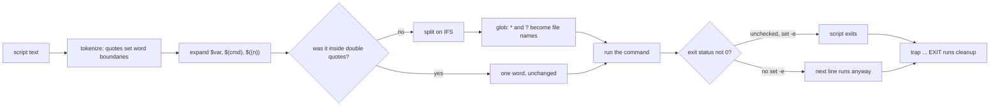

# A Bash Script Is Only Safe With Strict Mode and Quotes

*Bash splits and globs every unquoted expansion and carries on after a failure; strict mode, quotes and a trap make it fail safely.*

## Metadata

| Field | Value |
|---|---|
| Type | Build |
| Languages | Python, Bash |
| Prerequisites | [Every Error Message Is a System Call That Failed](https://cloudcaptain.io/learn/linux/syscalls-strace) |
| Time | 75 minutes |
| Tools | bash, shellcheck, shfmt, bats |

<Quiz stage="pre" />

## The Problem

The release pipeline uploads `release 2.tgz` as a build artifact; someone renamed the job and the space came with it. The deploy script on the target host has worked for two years. Tonight `cd $target` fails with `too many arguments`, the script does not notice, and every following line runs in whatever directory the caller happened to be in. `tar -xzf $release` gets three arguments instead of one and fails. `for f in $(ls)` lists the caller's files and `chmod 0644` makes a private key world-readable. The last line prints `deployed release 2.tgz`, the script exits 0, the pipeline is green, and production still runs the old version.

A cron job cleans a cache with `rm -rf "$cache_dir/"*`. A config change renames the variable that fills `cache_dir`, so it is now empty, and the command Bash runs is `rm -rf /*`. In 2015 the Steam client for Linux shipped exactly this line (`rm -rf "$STEAMROOT/"*`) and deleted every file the user could write when the variable came out empty. A third script runs `curl -s "$url" | tar -xz` and reports success when the download failed, because a pipeline's exit status is the status of its last command.

None of these are exotic bugs. They are the defaults: Bash splits every unquoted expansion on whitespace and expands the pieces as globs, it ignores a failed command unless told otherwise, it treats an unset variable as an empty string, and it never cleans up after itself. In this lesson you write `bashlint`, a tokenizer for the Bash that scripts actually use plus the checks that catch these patterns, mapped to the ShellCheck codes they mirror, and a template script that shows the safe idioms and passes both linters.

## The Concept

Bash does not run a line the way it looks. It processes every command in stages. First it **tokenizes**: quotes and operators decide where words begin and end, and here-documents are read as data. Then it **expands** each word: `$var`, `${var:-default}`, `$(command)`, `$((arithmetic))`. Then comes the step that causes most bugs: if the result of an expansion was **not inside double quotes**, Bash **splits** it on the characters in `IFS` (space, tab, newline) and runs **pathname expansion** on each piece, so a `*` or `?` in the value becomes a list of file names. Only then does it remove the quotes and run the command. Double quotes switch off splitting and globbing for what they contain; that is the whole reason to write `"$var"`. Some places never split, because Bash knows they hold one value: the right side of an assignment, the inside of `[[ ]]`, the word after `case`, arithmetic, and the body of a here-document. `[ ]` is not one of them; it is an ordinary command, so `[ $v = x ]` with an empty `v` becomes `[ = x ]` and fails with `unary operator expected`.

The second half is what happens after the command runs. By default the exit status goes into `$?` and the next line runs anyway. `set -e` (errexit) exits the script when a command fails and nothing checks its status; a command is "checked" when it is the condition of `if`/`while`/`until`, any part of an `&&` or `||` list except the last, or negated with `!`. `set -u` (nounset) makes expanding an unset variable an error instead of an empty string. `set -o pipefail` makes a pipeline fail when any of its commands fails, not just the last one. Together they are "strict mode". The last piece is `trap cleanup EXIT`: a function Bash runs on every exit path, including `exit 1`, a failure under `set -e` and the end of the script, which is the only reliable place to remove what `mktemp` created.



A linter is a set of patterns over the *tokens*, not over the text. `grep '\$[a-z]'` cannot tell `echo $x` from `echo "$x"`, from `x=$y` (an assignment, never split), from `[[ $x == y ]]` or from a here-document line. Once the script is a list of commands whose words know which parts were quoted and in which context they appear, every check in this lesson is a few lines: an unquoted parameter part in a split context is SC2086; a command named `cd` that is not followed by `||` or `&&` in a script without `set -e` is SC2164; a `cat` with one file argument that feeds a pipe is SC2002.

## Build It

`code/main.py` is `bashlint`: a lexer that turns text into tokens whose words remember their quoting, a parser that turns tokens into commands with context, thirteen checks with stable ids (`BL001` to `BL013`) each mapped to the ShellCheck code it mirrors, and a CLI with `--json` and exit codes. It reads no files except the ones you pass and runs nothing.

### Step 1: words are lists of parts that remember their quoting

A Bash word such as `"$dir/"*` is three things glued together: a parameter expansion inside double quotes, a literal `/` inside the same quotes, and an unquoted `*`. The lexer keeps them apart, because the checks need to know which parts Bash will split:

```python
@dataclass
class Part:
    kind: str
    text: str
    quoted: bool
    line: int
    col: int
    name: str = ""
    op: str = ""
    index: str = ""
    inner: List["Token"] = field(default_factory=list)
```

`kind` is `lit`, `sq` (single-quoted), `esc` (a backslash escape), `param`, `cmdsub`, `backtick`, `arith`, `procsub` or `array`. `read_word()` loops until an unquoted space or operator character (`| & ; < > ( )`), and each quote style has its own reader: single quotes run to the next `'` with no escapes, double quotes produce parts with `quoted=True` and still expand `$` and backticks inside.

### Step 2: expansions, and command substitutions as scripts of their own

`read_dollar()` recognises `$((...))`, `$(...)`, `${...}` and `$name`. A `${...}` body is split into an optional `#` (length), the name, an optional `[index]` and the operator, so `${dir:?}` is name `dir` with op `:?` and `${args[@]}` is name `args` with index `@`. A command substitution is a script inside a word, so the lexer starts a second lexer on the rest of the text that stops at the matching `)`:

```python
def read_subshell(self, line: int) -> Tuple[List[Token], str]:
    sub = Lexer(self.s[self.i:], self.line, self.col, stop_at_paren=True)
    try:
        tokens = sub.run()
    except LexError as exc:
        raise LexError(str(exc).split(": ", 1)[-1], line) from None
    text = self.s[self.i:self.i + sub.stopped_at]
    self.advance(sub.stopped_at + 1)
    return tokens, text
```

The inner lexer keeps its own count of `(` and of `case ... esac`, so a `)` that closes a case pattern inside `$(...)` does not end the substitution. Because the inner tokens are kept on the part, `"$(basename $path)"` reports the unquoted `$path` inside the quoted substitution at its own line and column, as ShellCheck does.

### Step 3: here-documents and `[[ ]]` change how the next characters are read

After `<<EOF` the delimiter is read as a word, and the body starts at the *next* newline, not right after the operator, so `cat <<EOF | grep x` is a pipeline whose here-document comes after the line. The lexer queues the operator and reads bodies when it reaches the newline:

```python
if (text.lstrip("\t") if strip else text) == tok.heredoc:
    break
body.append(text)
```

`<<-` strips leading tabs, which is why indented here-documents must use tabs. The body is data: no word splitting happens there, so no check looks inside it. `[[` switches the lexer into a mode where words end only at whitespace or `;`, because `[[ $x =~ ^(a|b)$ ]]` contains `(`, `|` and `)` that are part of a regex, not operators:

```python
def word_ends(self) -> bool:
    c = self.peek()
    if c == "":
        return True
    if self.dbracket:
        return c in " \t\n;"
    return c in WORD_END
```

### Step 4: from tokens to commands with context

The parser walks the tokens and cuts them into commands at newlines and the operators `; & && || | ( ) ;;`. Each `Command` records what the checks need: its `kind` (`simple`, `dbracket`, `for`, `case`, `arith`), leading assignments, words, redirections, the operator before and after it (`preceded_by`, `followed_by`), whether it is the condition of an `if`/`while`/`until`, and the function it belongs to. Reserved words at the start of a command (`if`, `then`, `do`, `{`, `!`) are skipped; `for NAME in WORDS` becomes a `for` command whose words are the list; `case WORD in` records the subject and skips the patterns up to `)`; `name() {` and `function name {` record a function. Command substitutions are parsed recursively and their commands are added with `nested=True`.

### Step 5: which words does Bash split?

This function is the lesson's concept in code. It yields only the words in which an unquoted expansion is split and globbed, with a context the checks use to pick the message:

```python
def split_contexts(cmd: Command) -> Iterator[Tuple[Word, str]]:
    if cmd.kind == "for":
        for word in cmd.words:
            yield word, "forlist"
        return
    if cmd.kind != "simple":
        return
    name = cmd.name()
    if cmd.words:
        context = "test" if name in ("[", "test") else "arg"
        for word in cmd.words[1:]:
            if name in DECLARATIONS and ASSIGNMENT.match(word.raw):
                continue
            if context == "test" and word.bare() == "]":
                continue
            yield word, context
    for redirect in cmd.redirects:
        if redirect.op not in ("<<", "<<-") and redirect.target is not None:
            yield redirect.target, "redirect"
```

Assignments (`x=$y`, `local x=$y`), `[[ ]]`, the `case` subject and arithmetic never appear. The command name itself is skipped too: `$SUDO apt-get update` is a deliberate idiom. A redirection target is included because `> $file` with a space in `file` is `ambiguous redirect`.

### Step 6: the per-word checks

Every unquoted part in a split context is classified:

```python
if part.kind == "param":
    star = part.name == "*" or part.index == "*"
    at = part.name == "@" or part.index == "@"
    if part.op == "#len" or part.op.startswith(("+", ":+")):
        continue
    if star:
        add(part.line, part.col, "BL010", f"{part.text} joins the arguments and splits them again; use \"$@\"")
    elif at:
        add(part.line, part.col, "BL011", f"{part.text} re-splits each argument; quote it: \"{part.text}\"")
    elif context == "forlist" or part.name in SPECIAL_SAFE or part.name in constants:
        continue
    elif context == "test":
        add(part.line, part.col, "BL005", f"quote {part.text} inside [ ]: an empty value leaves the test with a missing operand")
    else:
        add(part.line, part.col, "BL001", f"quote {part.text}: unquoted, it is split on spaces and expanded as a glob")
```

The exemptions are the ones ShellCheck makes, found by running both on the same scripts: `${#x}` and `$#`, `$?`, `$$` are numbers; `${arr[@]+"${arr[@]}"}` and `${ns:+-n "$ns"}` are the idioms for "these words, or nothing"; a `for` list is split on purpose; and a variable whose every assignment in the file is a literal without spaces or glob characters (`mode=0644`) cannot split. `constant_variables()` collects those, and a single `read`, `for` or computed assignment disqualifies the name. Command substitutions follow the same logic: `for f in $(ls)` is `BL002` (SC2045), any other unquoted `$(...)` or backtick in a split context is `BL012` (SC2046), except `$(seq ...)`, whose output is known to be numbers. Backticks anywhere are `BL009` (SC2006).

### Step 7: checks that need the whole script

Some findings depend on more than one command. `strict_mode()` reads every `set` command (`-euo pipefail`, `-Eeuo pipefail`, `-o errexit -o nounset -o pipefail`, split across lines) and the shebang (`#!/bin/bash -e`), and `BL004` names what is missing. ShellCheck has no such check; it is the most valuable one here. `cd`, `pushd` and `popd` are only flagged (`BL003`, SC2164) when errexit is off, the command is not a condition, and it is not followed by `||` or `&&`; ShellCheck makes the same decision, because under `set -e` a failed `cd` already stops the script. `BL013` flags `mktemp` when no `trap ... EXIT` exists anywhere in the file. `BL008` (SC2115) looks for a recursive `rm` whose argument is a parameter that is not guarded with `:?` followed by exactly `/` or `/*`:

```python
tail = "".join(p.text for p in rest)
if tail in ("/", "/*"):
    add(word.line, word.col, "BL008", f"if {head.name} is empty this is rm -r {tail}; write \"${{{head.name}:?}}{tail}\"")
```

`${dir:?}` makes Bash stop with `dir: parameter null or not set` before `rm` ever runs. Finally `directives()` honours `# shellcheck disable=SC2046` and `# bashlint disable=BL012`: on the line before a command it applies to that line, before the first command it applies to the whole file, and ShellCheck codes are translated to every `BL` check that mirrors them.

### Step 8: the CLI is a script contract too

`bashlint check PATH...` takes files and directories (it walks directories for `*.sh` and files whose shebang names `sh` or `bash`), prints `file:line:col: severity: ID name [SCxxxx]: message` on stdout, the summary on stderr, and exits 0 when clean, 1 with findings and 2 on a usage error or a file it cannot parse. `--json` prints the findings as a list of objects with the mapped `shellcheck` code; `--disable` and `--severity` filter; `checks` lists the table; `explain` shows what the tokenizer saw.

```bash
python3 code/main.py checks                                   # 13 checks, their ShellCheck codes and severities
python3 code/main.py check code/fixtures/bad                  # 21 findings in 4 files, exit 1
python3 code/main.py check code/fixtures/good code/main.sh    # nothing on stdout, exit 0
python3 code/main.py check --json code/fixtures/bad/deploy.sh | python3 -m json.tool | head -20
python3 code/main.py explain code/fixtures/good/report.sh     # one line per command: kind, words, the operator after it
```

`code/fixtures/bad/` holds four scripts with 21 planted problems (every check at least once) and `code/fixtures/expected.json` lists each one by line, column and id; `code/fixtures/good/` holds the fixed versions. On the 100 smoke scripts in this repository, bashlint and ShellCheck agreed on every finding of the ten mapped codes when this lesson was written.

### Step 9: the template script

`code/main.sh` is the shape every script in this course follows, and it does a real job: the five checks that `grep` can do, reported with bashlint's ids. Read it top to bottom:

```bash
set -euo pipefail
...
cleanup() {
  if [[ -n "$STAGED" && -e "$STAGED" ]]; then
    rm -f -- "$STAGED"
  fi
  if [[ -n "$WORK" ]]; then
    rm -rf -- "${WORK:?}"
  fi
}
...
main() {
  [[ "$(uname -s)" == "Linux" ]] || die "written for Linux with bash 4 or later; run it in a Linux container or VM"
  parse_args "$@"
  trap cleanup EXIT
  WORK="$(mktemp -d)"
```

The trap is installed *before* `mktemp`, so there is no moment when the directory exists and nothing will remove it. `log`, `debug` and `die` write to stderr, so stdout carries only the report and can be piped. `parse_args` is a `while (( $# ))` loop over a `case` with `--` and a usage error that exits 2. `-o FILE` writes the report atomically: a `mktemp` next to the target, then `mv`, so a reader never sees half a file. `main` ends with `publish` instead of `exit`, so its status becomes the script's status. Run it:

```bash
bash code/main.sh code/fixtures/bad/*.sh        # 6 findings: BL002, BL004 x2, BL006, BL007, BL009; exit 1
bash code/main.sh -q -o /tmp/report.txt code/fixtures/bad/deploy.sh; echo $?   # 1, and /tmp/report.txt
bash code/main.sh --bogus; echo $?               # usage on stderr, 2
```

Grep sees 6 of the 21 problems. It cannot see quoting, so it cannot find SC2086 at all, and it cannot tell a command from a string: the first draft of this script flagged its own line `die "cannot read $file"` as `read` without `-r`. That is the argument for a tokenizer in one line.

<RunTests />

## Use It

The real linter is ShellCheck. Install a pinned release and verify it. The GitHub release page lists a SHA-256 digest for every asset; the smoke pins the ones for `v0.11.0`:

```bash
V=v0.11.0
curl -fsSLO "https://github.com/koalaman/shellcheck/releases/download/$V/shellcheck-$V.linux.x86_64.tar.gz"
echo "b7af85e41cc99489dcc21d66c6d5f3685138f06d34651e6d34b42ec6d54fe6f6  shellcheck-$V.linux.x86_64.tar.gz" | sha256sum -c
tar -xzf "shellcheck-$V.linux.x86_64.tar.gz" && sudo install "shellcheck-$V/shellcheck" /usr/local/bin/
shellcheck code/fixtures/bad/deploy.sh                       # the same lines and columns bashlint reports
shellcheck -f json1 code/fixtures/bad/*.sh | jq -r '.comments[] | "\(.file):\(.line) SC\(.code) \(.level)"'
shellcheck --list-optional                                   # opt-in checks, e.g. useless-use-of-cat (SC2002), require-variable-braces
shellcheck --enable=useless-use-of-cat -S warning script.sh  # enable one, report warning and above
shellcheck -x -P SCRIPTDIR deploy.sh                         # follow `source` into other files
```

Current releases make SC2002 opt-in, which is why the smoke passes `--enable=useless-use-of-cat`. A `.shellcheckrc` next to the scripts holds the same settings (`enable=useless-use-of-cat`, `disable=SC2312`) for every run. A directive comment `# shellcheck disable=SC2046` on the line before a command silences one finding with the reason visible in the code; prefer it to a global disable. ShellCheck 0.11 also has one quirk you can meet in a template like `main.sh`: if the function that installs `trap cleanup EXIT` ends with `exit`, it reports SC2329 ("never invoked") on `cleanup`; returning a status instead of calling `exit` avoids it.

`shfmt` formats Bash the way `gofmt` formats Go, and its diff mode is the CI check:

```bash
shfmt -i 2 -ci -d code/main.sh         # print a diff of what it would change: 2-space indent, indented case branches
shfmt -i 2 -ci -w scripts/             # rewrite in place
```

`bats-core` runs tests written in Bash; each `@test` is a function and `run` captures status and output:

```bash
#!/usr/bin/env bats
@test "an unknown flag exits 2 with the usage" {
  run bash code/main.sh --bogus
  [ "$status" -eq 2 ]
  [[ "$output" == *"unknown option"* ]]
}
@test "the fixed fixtures are clean" {
  run bash code/main.sh code/fixtures/good/deploy.sh
  [ "$status" -eq 0 ]
}
```

When a script misbehaves, trace it. `bash -x` prints every command after expansion, prefixed with `PS4`; the default `+ ` says nothing about where you are, so set one that does:

```bash
PS4='+ ${BASH_SOURCE##*/}:${LINENO}:${FUNCNAME[0]:-main}: ' bash -x code/main.sh code/fixtures/good/deploy.sh
# + main.sh:121:main: trap cleanup EXIT
# ++ main.sh:122:main: mktemp -d
# + main.sh:39:cleanup: rm -rf -- /tmp/tmp.k3J9...
exec 3>/tmp/trace.log; BASH_XTRACEFD=3; set -x    # inside a script: trace to a file, keep stderr clean
```

Each extra `+` is one level of command substitution or subshell. Bash does not import `PS4` from the environment when it runs as root, so under `sudo` set it inside the script instead. `bash -n script.sh` parses without running, which is the cheapest check in CI.

Strict mode has edges that both linters only partly see. `set -e` is ignored for everything inside a function called as an `if` condition or on the left of `&&`/`||` (ShellCheck's optional SC2310). `local out=$(cmd)` returns the status of `local`, not of `cmd` (SC2155); declare first, then assign. `(( count++ ))` returns 1 when `count` was 0 and kills a strict script; use `count=$((count + 1))`. `grep` exits 1 when nothing matches, so a `grep | wc -l` under `pipefail` fails on an empty input; add `|| true` where "no match" is fine. Command substitutions do not inherit `-e` unless you `shopt -s inherit_errexit`. Read [BashFAQ/105](https://mywiki.wooledge.org/BashFAQ/105) once.

Know when to stop. Bash is the right tool for gluing commands together in under a hundred lines. Switch to Python when the script needs data structures (a list of records, a map of maps), parses JSON beyond one `jq` call, retries HTTP calls with timeouts, has to clean up several resources in the right order on failure, needs unit tests of its logic, or must run on macOS, whose `/bin/bash` is still 3.2 without `mapfile` or associative arrays. The prompt you ship in this lesson does that conversion.

| What you built | Real tool | Note |
|---|---|---|
| `Lexer`, `Parser` | ShellCheck's Parsec parser of the full Bash, `sh`, `dash` and `ksh` grammars | ShellCheck also reports parse errors with their own codes (SC1xxx) and checks `sh` scripts for bashisms |
| `split_contexts()` and `BL001`, `BL005` | SC2086 | same exemptions; ShellCheck's data-flow analysis knows more constants than "every assignment is a literal" |
| `BL002`, `BL003`, `BL006` to `BL012` | SC2045, SC2164, SC2002, SC2162, SC2115, SC2006, SC2048, SC2068, SC2046 | same lines and columns on the fixtures; SC2002 is opt-in in ShellCheck |
| `BL004` missing strict mode, `BL013` mktemp without trap | none | a policy, not a bug pattern; enforce it in review or with a CI grep |
| `directives()` | `# shellcheck disable=...`, `.shellcheckrc` | ShellCheck scopes a directive to the whole next command, including a function or loop body |
| `check --json`, exit 0/1/2 | `shellcheck -f json1`, exit 0 clean, 1 findings, 2 or more for errors | `-f diff` prints patches for the findings it can fix |
| `code/main.sh` by hand | `shfmt -d`, `bats`, `bash -n`, `bash -x` | formatting, tests, syntax and tracing are separate tools |

<Quiz stage="check" />

## Ship It

Two artifacts in `outputs/`:

- **`skill-bash-script-review.md`**: a review runbook for a Bash script or a `run:` block in CI. It runs `bash -n`, a pinned ShellCheck with JSON output and `shfmt -d`, then walks the strict-mode header, quoting, failure handling, temporary files and cleanup, destructive commands, argument parsing and logging, with a table of red flags and fixes, a "should this be Python" decision, and a report format.
- **`prompt-convert-bash-to-python.md`**: paste a Bash script and get a Python 3 program that keeps its interface (arguments, exit codes, stdout versus stderr, environment variables), uses `subprocess.run` with argument lists and timeouts instead of a shell, cleans up in `finally`, and comes with tests and a list of every behaviour that changed.

<ShipIt />

## Exercises

### Easy

Add `BL014`, mirroring SC2155: `local`, `export`, `declare` or `readonly` with an assignment whose value contains a command substitution (`local out=$(cmd)`), because the status of `cmd` is lost. Tests first: `local out=$(false)` and `export PATH=$(cat p)` are flagged at the line and column of the word; `local out` followed by `out=$(false)` on the next line is not; `readonly X=1` is not. Run ShellCheck on the same lines and check the codes match.

### Medium

Scope directives the way ShellCheck does. A `# shellcheck disable=SC2086` comment before a function definition, a `for`/`while` loop or an `if` block applies to the whole compound command, not just the next line. Record the line span of each compound command in the parser (from `{` to `}`, `do` to `done`, `if` to `fi`), and write tests with a directive above a five-line function that contains two unquoted expansions: both are silenced, and one after the function is not. Compare with ShellCheck on the same file.

### Hard

Add `check --fix`, which rewrites the findings that have one safe fix: wrap an unquoted `$var`, `${...}` or `$(...)` in double quotes when it is the whole word or a prefix of a word, replace backticks with `$(...)` (removing the backslashes that escaped backticks and dollar signs inside them), turn `read` into `read -r` and `"$dir/"*` into `"${dir:?}/"*`. Never touch `BL002`, `BL003`, `BL004` or `BL013`, which need a human. Tests: running `--fix` on each bad fixture produces a file that `bash -n` accepts and that has no findings except those four ids, and running it twice changes nothing. Then compare with `shellcheck -f diff` on the same file and explain each place where the two patches differ.

<Quiz stage="post" />

## Key Terms

| Term | Common misconception | Precise definition |
|---|---|---|
| Word splitting | "Bash splits variables on spaces." | After an expansion that was not inside double quotes, Bash splits the result on the characters in `IFS` (default space, tab, newline). It does not happen in assignments, `[[ ]]`, `case` subjects, arithmetic or here-documents. |
| Pathname expansion | "Globs only expand when I type `*`." | Every unquoted word that contains `*`, `?` or `[` after expansion is matched against file names, so a variable holding `*` expands to the directory listing. Quotes or `set -f` prevent it. |
| `set -e` (errexit) | "The script stops on any error." | The shell exits when a command fails and its status is not checked: not in an `if`/`while` condition, not on the left of `&&`/`||`, not after `!`, and not anywhere inside a function called in one of those places. |
| `set -u` (nounset) | "It catches empty variables." | Expanding a variable that was never set is an error. A variable set to the empty string is fine; use `${var:?message}` to reject empty values too. |
| `pipefail` | "A pipeline fails when a command in it fails." | Without it the pipeline's status is that of the last command. With it, the status is the last non-zero status in the pipeline, so `curl ... \| tar -x` fails when `curl` does. |
| `trap ... EXIT` | "It runs when the script ends normally." | A handler that runs whenever the shell exits: normal end, `exit N`, a failure under `set -e`; Bash also runs it when `SIGINT` or `SIGTERM` ends the script, and nothing runs after `SIGKILL`. It is where `mktemp` files and background processes are cleaned up. |
| Here-document | "It is a multi-line string argument." | A redirection: the lines up to the delimiter become the command's stdin. With an unquoted delimiter the body is expanded but not split; with `<<'EOF'` it is literal; `<<-` strips leading tabs. |
| `[[ ]]` versus `[ ]` | "They are the same test." | `[` is an ordinary command whose arguments are split and globbed, so its operands must be quoted. `[[` is shell syntax: no splitting or globbing inside, `=~` regex matching and `&&`/`\|\|` between tests. |

## Further Reading

- [Bash Fundamentals](https://cloudcaptain.io/docs/tools/bash/fundamentals): variables, quoting, conditionals and loops, the reference behind every check in this lesson.
- [Advanced Bash Scripting](https://cloudcaptain.io/docs/tools/bash/advanced): strict mode, traps, functions and arrays in longer scripts, the patterns `main.sh` uses.
- [DevOps Scripting with Python](https://cloudcaptain.io/docs/tools/python/devops-scripting): where a script goes when it outgrows Bash, with `subprocess`, `argparse` and error handling.
- [Bash Reference Manual: Shell Expansions](https://www.gnu.org/software/bash/manual/html_node/Shell-Expansions.html): the exact order of expansions, word splitting and filename expansion, straight from the GNU manual.
- [Bash Reference Manual: The Set Builtin](https://www.gnu.org/software/bash/manual/html_node/The-Set-Builtin.html): the precise rules for `-e`, `-u`, `-x` and `-o pipefail`, including every exception to errexit.
- [POSIX Shell Command Language](https://pubs.opengroup.org/onlinepubs/9699919799/utilities/V3_chap02.html): the standard's tokenizing rules, here-documents and field splitting, which Bash extends.
- [ShellCheck wiki: SC2086](https://www.shellcheck.net/wiki/SC2086): the canonical explanation of the most common finding, with the cases where splitting is intended.
- [BashFAQ/105: Why doesn't set -e do what I expected?](https://mywiki.wooledge.org/BashFAQ/105): a catalogue of the surprises in errexit, worth reading before trusting it.
- [bats-core documentation](https://bats-core.readthedocs.io/): writing and running tests for shell scripts, `run`, `setup` and `teardown`.
