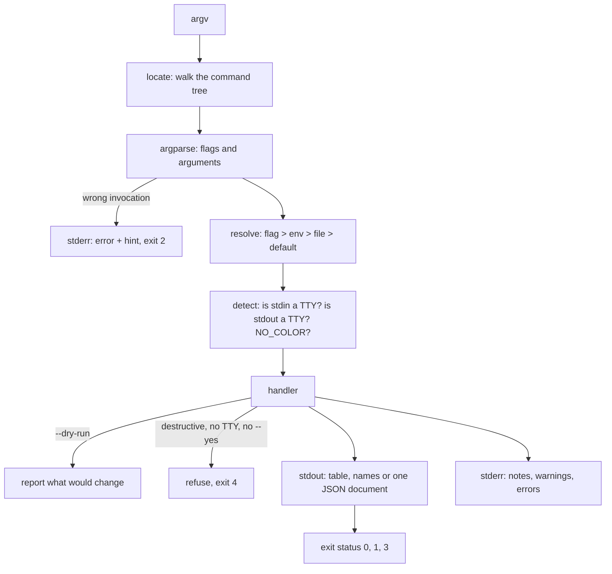

# A Good CLI Is a Contract: Flags, Exit Codes, Output

*Scripts and people both call your tool; flags, exit codes, stdout and stderr are the API they depend on, so design them on purpose.*

## Metadata

| Field | Value |
|---|---|
| Type | Build |
| Languages | Python |
| Prerequisites | [Robust Bash](https://cloudcaptain.io/learn/scripting/robust-bash) |
| Time | 75 minutes |
| Tools | python3, bash, jq, groff, kubectl |

<Quiz stage="pre" />

## The Problem

The platform team's inventory script started as forty lines that printed a table. A year later a deploy pipeline runs `inventory list | awk '{print $4}'` to find the IP addresses, a cron job runs `inventory prune` every night, and three other teams have wrapped it in their own scripts. Then someone adds a colour to the state column. The table now contains escape codes when it is piped through `script` in the CI wrapper, the `awk` column shifts, and the pipeline deploys to an empty list of hosts. Nobody notices for a day, because the script exited 0 the whole time.

The prune job is worse. `prune` asks "Remove 12 hosts? [y/N]" and reads the answer from stdin. In cron, stdin is empty, `input()` raises `EOFError`, the traceback goes to a mail spool nobody reads, and the exit code is 1, the same code the script uses for "nothing to prune". Someone fixes it by piping `yes |` into it, so the next time the filter is wrong, it removes every host in production without asking anyone. When people debug it they find that `INVENTORY_FILE` in the environment is ignored whenever `~/.inventoryrc` exists, which it does on exactly one build agent, and there is no way to ask the tool which value it used.

None of these are bugs in the business logic. They are breaches of a contract the tool never wrote down: what goes to stdout and what to stderr, what each exit code means, when it is allowed to ask a question, when it may use colour, and which source wins for each setting. You are going to build `cliforge`, a small framework on `argparse` that makes those decisions once, and `ccops`, an inventory CLI built with it, then hold them in place with golden-file tests, generated Bash completion and a man page.

## The Concept

A command-line tool has two audiences that call it the same way. A person types at a terminal and wants a readable table, colour, a question before anything destructive, and an error that says what to type next. A program runs it in a pipe and wants stable output on stdout, nothing else mixed in, a precise exit status, and no prompts that wait forever. A good CLI serves both by detecting which one it is talking to and by keeping a few promises regardless.

**Streams.** stdout is the data channel: what the caller asked for, in a format they can parse. stderr is for people: progress, warnings, errors, prompts. If a warning goes to stdout, the next program in the pipe parses it as data. `--json` turns stdout into exactly one JSON document; `--quiet` reduces text output to what a pipe needs, such as one name per line.

**Exit status.** The only signal a shell, `make`, CI or `set -e` reads. 0 means success, including "nothing to do". Every other number is a promise that must stay stable: `ccops` uses 1 for a failure while running, 2 for a wrong invocation (the same as `argparse`, Bash builtins and most Unix tools), 3 for a named object that does not exist, 4 for a refused confirmation. A process killed by signal N shows up in the shell as 128 + N, so 130 is Ctrl-C and 141 is SIGPIPE.

**Precedence.** Each setting can come from four places, and the most specific wins: a flag on this invocation, then an environment variable for this session, then a config file for this user, then the built-in default. An empty environment variable counts as unset. The tool must be able to say where every value came from, because "which config is it using?" is the first question in every incident.

**Interactivity.** A prompt is only allowed when stdin is a terminal. Without one, a destructive command refuses with a distinct exit code and says how to proceed (`--yes`, or `--dry-run` to preview). Colour is only allowed when stdout is a terminal, `NO_COLOR` is not set and `TERM` is not `dumb`; an explicit `--color always` overrides, as the `NO_COLOR` convention allows for per-invocation flags.



**One model, many outputs.** If commands and flags are declared once as data, then parsing, `--help`, the man page and the shell completion are all generated from the same declaration and cannot drift apart. Golden-file tests then snapshot the help text and the outputs, so a change to the contract shows up as a diff in review instead of as a broken pipeline a week later.

## Build It

`code/cliforge.py` is the framework: settings, flags, commands, the `Console` that owns the three streams, precedence, confirmation, help, completion and the man page. `code/main.py` is `ccops`, an inventory of hosts in a JSON file, built with it. Everything that touches the outside world goes through an injectable `Console(stdin, stdout, stderr, environ)`, so the tests feed fake terminals and environments and never read your real `~/.config`.

### Step 1: declare the tool as data

Settings are values with a precedence chain; flags are per-command switches; commands form a tree. `ccops` declares itself in `build_app()`:

```python
app = cliforge.App(
    "ccops", VERSION, "a small host inventory CLI built with cliforge",
    settings=[
        Setting("inventory", "inventory file", "inventory.json", metavar="PATH", kind="path", short="-i", complete="file"),
        Setting("lock_timeout", "seconds to wait for another writer's lock", "5", metavar="SECONDS", kind="seconds"),
    ],
)
app.add(Command(("hosts", "remove"), "remove hosts; asks first, refuses without a terminal unless --yes", hosts_remove,
                changes=True, destructive=True,
                args=(Arg("names", "NAME", "host names", many=True, complete=("hosts", "list", "--quiet")),),
                flags=(Flag(("--missing-ok",), "exit 0 when a host is already absent"),)))
```

`changes=True` adds `-n, --dry-run`; `destructive=True` adds `-y, --yes`. Every command also gets the global flags: `-o/--output`, `--json`, `--color`, `--config`, `-q/--quiet`, `-v/--verbose`, `-h/--help`. Each `Setting` derives its flag (`--lock-timeout`), its environment variable (`CCOPS_LOCK_TIMEOUT`) and its config key (`lock_timeout`) from one name, so the three can never be spelled differently.

`App.locate()` walks argv to find the command before `argparse` sees it, so global flags work before or after the subcommand (`ccops --json hosts list` and `ccops hosts list --json`). The parser is built with `allow_abbrev=False`: by default `argparse` accepts `--inv` for `--inventory`, and the day you add `--invert` every script that used `--inv` breaks.

### Step 2: precedence you can explain

`resolve()` walks the four sources in order and records which one answered and where exactly:

```python
for setting in settings:
    env_name = setting.env(prefix)
    base = None
    if setting.key in flags:
        raw, origin = flags[setting.key]
        source = "flag"
    elif environ.get(env_name, ""):
        raw, origin, source = environ[env_name], env_name, "env"
    elif setting.key in file_values:
        raw, origin = file_values[setting.key]
        source, base = "file", file_dir
    else:
        raw, origin, source = setting.default, "built-in default", "default"
    resolved[setting.key] = Resolved(setting.key, setting.convert(raw, origin, base), source, origin)
```

The origin of a file value is `path:line`, so `ccops config --explain` can point at the exact line. A relative path in the config file is relative to the file, not to wherever the command runs. The config file itself is found by `--config`, then `CCOPS_CONFIG`, then `$XDG_CONFIG_HOME/ccops/config` (default `~/.config/ccops/config`). An unknown key is a usage error with a suggestion, because a typo that is silently ignored is a setting that silently does not apply:

```python
if key not in keys:
    raise UsageError(f"{source}:{number}: unknown key {key!r}{did_you_mean(key, keys)}", hint=f"known keys: {', '.join(sorted(keys))}")
```

`convert()` validates every value with its origin in the message: `invalid lock_timeout 'soon' from CCOPS_LOCK_TIMEOUT: not a number of seconds`.

### Step 3: exit codes as a table, errors as exceptions

The exit codes are data, printed in `--help` and the man page from the same tuple:

```python
EXIT_CODES: Tuple[Tuple[int, str, str], ...] = (
    (OK, "ok", "the command did what was asked, or there was nothing to do"),
    (FAILURE, "failure", "the command ran and failed: unreadable data, a conflict, a lock timeout"),
    (USAGE, "usage", "the invocation was wrong: unknown command or flag, bad value, bad config file"),
    (NOT_FOUND, "not found", "a named object does not exist"),
    (REFUSED, "refused", "a destructive change was not confirmed"),
    (INTERRUPTED, "interrupted", "Ctrl-C (128 + SIGINT)"),
    (BROKEN_PIPE, "broken pipe", "the reader of stdout went away (128 + SIGPIPE)"),
)
```

Handlers never call `sys.exit()`. They raise `UsageError`, `NotFound`, `Refused` or `CliError`, each carrying its code, and `App.run()` is the one place that turns an outcome into a status and a message on stderr:

```python
try:
    code = self.dispatch(argv, console)
    console.stdout.flush()
    return code
except CliError as exc:
    console.error(exc.message, exc.hint)
    return exc.code
except KeyboardInterrupt:
    console.stderr.write("\n")
    console.error("interrupted; changes are only written after confirmation, so nothing was half-written")
    return INTERRUPTED
except BrokenPipeError:
    console.silence_stdout()
    return BROKEN_PIPE
```

`argparse` normally prints its own message and calls `sys.exit(2)`; `cliforge.Parser.error()` raises `UsageError` instead, so usage errors get the same `ccops: error:` prefix and a `hint:` line that says what to run. Python ignores SIGPIPE, so `ccops hosts list | head -1` would end in a `BrokenPipeError` traceback; `silence_stdout()` points the descriptor at `/dev/null` so the interpreter's final flush is quiet, and the exit code is the 141 a shell expects.

### Step 4: a terminal or a pipe

Colour is decided per stream:

```python
def color_decision(mode: str, stream: Any, environ: Mapping[str, str], name: str = "stdout") -> Tuple[bool, str]:
    if mode == "always":
        return True, "color is always"
    if mode == "never":
        return False, "color is never"
    if environ.get("NO_COLOR", ""):
        return False, "NO_COLOR is set"
    if environ.get("TERM") == "dumb":
        return False, "TERM is dumb"
    if not is_tty(stream):
        return False, f"{name} is not a terminal"
    return True, f"{name} is a terminal"
```

The reason string is shown by `config --explain`, so "why is there no colour?" has an answer. `--json` output never goes through `paint()` at all. Confirmation checks stdin, not stdout, because that is where the answer would come from:

```python
def confirm(self, question: str) -> None:
    if not is_tty(self.stdin):
        raise Refused(f"refusing to {question} without confirmation: stdin is not a terminal",
                      hint="pass --yes to confirm, or --dry-run to preview")
    self.stderr.write(f"{self.prog}: {question}? [y/N] ")
    self.stderr.flush()
    answer = self.stdin.readline()
    if answer.strip().lower() not in ("y", "yes"):
        raise Refused("not confirmed; nothing was changed")
```

The prompt goes to stderr, so `ccops hosts remove web-9 > out.txt` still asks. The default is No. `echo y | ccops hosts remove web-9` refuses, which is the point: a pipe is not a person.

### Step 5: changes that can be previewed and repeated

Every change has `--dry-run`, and every change is idempotent: running the same `add` twice changes nothing the second time and says so (`"changed": false` in JSON). A conflicting add is a failure with the differences spelled out:

```python
hosts = load_inventory(path, create=True)
existing = hosts.get(host.name)
if existing == host:
    report(ctx, "add", "unchanged", [host.name], False, {"host": host.to_json()})
    return cliforge.OK
if existing is not None:
    raise CliError(f"host {host.name!r} already exists with different values: {'; '.join(differences(existing, host))}",
                   hint="remove it first, or repeat the add with the same values")
```

Writes happen under an `flock(2)` on `inventory.json.lock`, with a timeout (`--lock-timeout`) instead of waiting forever, and they are atomic: write a temporary file next to the target, `fsync`, then `os.replace()` over the original, so a reader sees the old file or the new one and never half of one. `remove` asks before it takes the lock, reloads under the lock, and removes only what is still there. It refuses the whole batch with exit 3 when a name is missing, unless `--missing-ok` makes "already absent" count as success, which is what an idempotent cleanup job wants.

### Step 6: help, completion and a man page from the same model

`render_help()` prints usage, commands, arguments, command flags, global flags with their environment variable and config key, examples and the exit-code table. `bash_completion()` generates a function for `complete -F`. Bash calls it with `COMP_WORDS` (the words on the line) and `COMP_CWORD` (the index being completed) and reads candidates from `COMPREPLY`. The function walks the words to find the subcommand path, skips flag values, and answers from a table generated per command:

```bash
case "$path" in
    "ccops hosts")
        commands="list show add remove"
        flags="-o --output --json --color -i --inventory --lock-timeout --config -q --quiet -v --verbose -h --help"
        ;;
    "ccops hosts remove")
        commands=""
        flags="--missing-ok -n --dry-run -y --yes -o --output --json --color -i --inventory --lock-timeout --config -q --quiet -v --verbose -h --help"
        dynamic="hosts list --quiet"
        ;;
esac
```

Flag values with choices complete from the choices (`--state m` becomes `maintenance`), path flags complete file names, and host names are dynamic: the function runs `ccops hosts list --quiet` with the same `-i` and `--config` you already typed, which is why `--quiet` has to print exactly one name per line and nothing else. `man_page()` writes roff (`.TH`, `.SH`, `.TP`), escaping `-` as `\-` so `--dry-run` survives copy and paste from the rendered page.

### Step 7: golden files hold the contract still

Help text, table output, JSON output, `config --explain`, the completion script and the man page are compared byte for byte with files in `code/tests/golden/`:

```python
def assert_golden(self, name, text):
    path = GOLDEN / name
    if UPDATE:
        GOLDEN.mkdir(exist_ok=True)
        path.write_text(text, encoding="utf-8")
    self.assertTrue(path.exists(), f"missing golden file {path}; run with UPDATE_GOLDEN=1 once and review the diff")
    self.assertEqual(path.read_text(encoding="utf-8"), text, f"{name} changed; if intended, rerun with UPDATE_GOLDEN=1 and review the diff")
```

A change to a flag's help or a column in the table now fails a test; `UPDATE_GOLDEN=1 python3 -m unittest discover -s code/tests` rewrites the files and the diff in review shows exactly what users of the tool will see change. Golden tests compare text on purpose; the other tests parse JSON and compare values.

### Step 8: run it

```bash
cd code
cp fixtures/inventory.json /tmp/inventory.json
export CCOPS_INVENTORY=/tmp/inventory.json
python3 main.py hosts list                                  # a table; colour only on a terminal
python3 main.py hosts list --json | jq -r '.hosts[].ip'     # data for a program
python3 main.py hosts list --quiet --env prod               # one name per line
python3 main.py hosts add web-3 --env prod --role web --ip 10.0.1.13 --dry-run
python3 main.py hosts add web-3 --env prod --role web --ip 10.0.1.13 && python3 main.py hosts add web-3 --env prod --role web --ip 10.0.1.13
echo y | python3 main.py hosts remove web-3; echo "exit $?"  # refused: stdin is not a terminal, exit 4
python3 main.py hosts remove web-3 --yes
python3 main.py hosts shwo web-1; echo "exit $?"             # unknown command 'shwo'; did you mean 'show'? exit 2
CCOPS_LOCK_TIMEOUT=3 python3 main.py --config fixtures/config config --explain --color always
source <(python3 main.py completion bash)                   # completes for a command named ccops on PATH
python3 main.py man > /tmp/ccops.1 && man /tmp/ccops.1
```

<RunTests />

## Use It

There is no single tool for "CLI design"; there are guidelines, frameworks that encode them, and big CLIs you use every day that get them right or wrong. Read the [Command Line Interface Guidelines](https://clig.dev/) once end to end: almost every decision in `cliforge` is a paragraph there.

**Click and Typer** are the Python frameworks most tools use. The same `remove` in Click:

```python
import click

@click.command()
@click.argument("names", nargs=-1, required=True)
@click.option("--dry-run", "-n", is_flag=True)
@click.option("--yes", "-y", is_flag=True)
@click.option("--inventory", envvar="CCOPS_INVENTORY", default="inventory.json", show_envvar=True)
def remove(names, dry_run, yes, inventory):
    if not dry_run and not yes:
        click.confirm(f"remove {len(names)} host(s)?", abort=True, err=True)
    click.echo(f"removed {' '.join(names)}")
```

Click exits 2 on usage errors, writes them to stderr, strips ANSI codes when the output is not a terminal, and generates completion when the program runs with `_CCOPS_COMPLETE=bash_source ccops`. It does not refuse a prompt when stdin is a pipe; `click.confirm` reads whatever is there, so `echo y |` confirms. Typer builds the same thing from type hints. Config-file precedence is not built in to either; `auto_envvar_prefix` gives you the environment layer and the file is yours to add.

**Go's cobra** (with viper for configuration) is what `kubectl`, `gh`, `helm` and `hugo` are built on. It generates help, man pages (`cobra/doc`) and completion for Bash, Zsh, fish and PowerShell; its completion calls a hidden `__complete` subcommand at runtime, the same idea as `ccops`'s dynamic host names. viper's documented precedence is the one you built: explicit `Set`, flag, env, config file, key/value store, default.

**`NO_COLOR` and terminals.** Try the convention on the real tools:

```bash
ls --color=auto | cat                      # no escapes: stdout is a pipe
NO_COLOR=1 gh pr list                       # gh honours NO_COLOR; GH_FORCE_TTY=1 forces terminal output in a pipe
gh pr list | cat                            # tab-separated, no truncation, no colour: gh changes format for pipes
test -t 0 && echo "stdin is a terminal"     # the shell's isatty(); test -t 1 for stdout
```

**Completion with `complete -F`.** Bash asks a function you register:

```bash
_greet() { mapfile -t COMPREPLY < <(compgen -W "hello help hosts" -- "${COMP_WORDS[COMP_CWORD]}"); }
complete -F _greet greet
complete -p greet                           # complete -F _greet greet
source <(kubectl completion bash)           # the same mechanism, generated by cobra
source <(python3 code/main.py completion bash)
```

**How the big CLIs score.**

```bash
kubectl get pods -o json | jq '.items | length'   # -o json|yaml|jsonpath: stdout is data
kubectl delete deploy web --dry-run=server -o yaml  # dry run checked by the API server, including admission
kubectl definitely-not-a-command; echo $?           # 1: kubectl does not separate usage errors from failures
aws configure list                                  # each value with its TYPE: env, config-file, shared-credentials-file
aws ec2 describe-instances --output json --no-cli-pager --query 'Reservations[].Instances[].PrivateIpAddress'
git config --show-origin --show-scope --get-all user.email   # config --explain, the git way
gh help exit-codes                                  # 0, 1, 2 cancelled, 4 authentication required
```

`kubectl` has machine output, server-side dry run and generated completion, but `kubectl delete` does not ask by default (recent releases add an opt-in `--interactive`) and a typo exits 1 like a real failure. The AWS CLI documents its return codes (252 for a bad command line, 254 for a service error, 255 as the catch-all) and its precedence (command line, then environment, then the config and credentials files), but version 2 sends terminal output through a pager by default, so a script run from a terminal stops at the first screen until someone presses `q`; scripts pass `--no-cli-pager` or set `AWS_PAGER=""`. `gh` is the closest to the guidelines: it detects pipes and changes format, refuses to prompt without a terminal, and documents its exit codes.

| What you built | Real tool | Note |
|---|---|---|
| `Setting` + `resolve()` | viper, Click `envvar=`/`auto_envvar_prefix` | the file layer and "where did this come from" are usually missing; `aws configure list` and `git config --show-origin` have it |
| `config --explain` | `aws configure list`, `git config --show-origin --show-scope` | one row per setting with its source |
| `EXIT_CODES` + exception classes | `argparse` and Click exit 2 on usage errors; `gh help exit-codes`; AWS CLI return codes | `kubectl` uses 1 for both |
| `Console.confirm()` refusing without a TTY | `gh` prompts only on a terminal; `click.confirm` reads a pipe | `kubectl delete` never asks unless `--interactive` |
| `color_decision()` | `ls --color=auto`, Click's ANSI stripping, `NO_COLOR` | `--color always` beats `NO_COLOR`, as the convention allows for explicit flags |
| `--dry-run` on every change | `kubectl --dry-run=client\|server`, `terraform plan`, `rsync -n` | server-side dry run also runs admission checks |
| `bash_completion()` | cobra `completion bash`, Click `_PROG_COMPLETE=bash_source` | cobra and Click call the binary at runtime for every completion |
| `man_page()` | cobra `doc.GenManTree`, `help2man`, `click-man` | generate from the same model as `--help` |
| golden files | `go test -update` patterns, `pytest-regressions`, snapshot tests | review the diff, never regenerate blind |

<Quiz stage="check" />

## Ship It

Two artifacts in `outputs/`:

- **`skill-cli-review.md`**: a runbook for reviewing a command-line tool (new or changed) against the contract: run a table of invocations and record exit codes and which stream each line went to, check `--json` with `jq`, check behaviour in a pipe and without a terminal, check precedence and whether the tool can explain it, check destructive commands for `--dry-run` and confirmation, check completion and help, and write the review in a fixed shape.
- **`prompt-design-cli.md`**: describe what a tool must do and get a CLI design back: the command tree, flags with environment variables and config keys, the exit-code table, what goes to stdout and stderr in each mode, which commands change state and how they are previewed and confirmed, and the golden tests to write first.

<ShipIt />

## Exercises

### Easy

Add `ccops hosts set-state NAME... --state STATE`. It changes state, so it must get `--dry-run` from `changes=True`; moving a host to `retired` is destructive and must ask, while moving to `active` or `maintenance` must not. Write the tests first: a dry run that leaves the file's bytes unchanged, a repeated call that reports `"changed": false`, a refusal with exit 4 when retiring from a pipe without `--yes`, and the new golden help text.

### Medium

Add `ccops hosts import FILE` where `FILE` may be `-` for stdin. The import is all-or-nothing: validate every record first and report every problem with its line number (JSON Lines input) before changing anything, then apply under one lock in one atomic write. `--dry-run` prints a plan of added, unchanged and conflicting hosts in text and in JSON. Test that one bad line among a hundred leaves the inventory byte-identical and exits 1 with that line's number, and that importing the same file twice is a no-op.

### Hard

Make the contract machine-checkable. Add `ccops contract --json` that prints every command, flag, environment variable, config key and exit code from the `App` model, commit its output as a golden file, and write a checker that compares two contract files and classifies each difference: removing or renaming a flag, changing an exit code's meaning or a JSON field's type is breaking; adding a command, a flag or an optional JSON field is not. Run it in a test against a hand-edited contract with one change of each kind, and decide which version bump (major, minor, patch) each one forces.

<Quiz stage="post" />

## Key Terms

| Term | Common misconception | Precise definition |
|---|---|---|
| Exit status | "Anything non-zero means the same thing." | The integer a process returns to its parent. 0 is success; other values are part of the tool's interface and must stay stable. Usage errors are conventionally 2; a process killed by signal N shows as 128 + N in the shell. |
| stdout and stderr | "stderr is for errors only." | stdout carries the data the caller asked for; stderr carries everything meant for a person: progress, warnings, prompts, errors. Pipes and `$(...)` capture stdout only. |
| Configuration precedence | "The config file is the source of truth." | The order in which sources are consulted for each setting, most specific first: flag, environment, config file, default. A good tool can print the winning source for every value. |
| TTY detection | "If there is output, someone is reading it." | `isatty()` on a file descriptor tells whether it is connected to a terminal. stdin decides whether a prompt is allowed; stdout decides colour and human formatting. |
| `NO_COLOR` | "Only disables colour if set to 1." | An informal standard: when the variable is present and non-empty, regardless of its value, software should not add ANSI colour by default. Explicit flags and per-tool settings may override it. |
| Idempotent command | "It never fails." | Running it again with the same input leaves the same state and reports that nothing changed. `add` with identical values is a no-op; with different values it is a conflict. |
| Dry run | "A dry run is a guess." | The same code path as the real change, up to the point of writing, reporting exactly what would change and changing nothing, including lock files. |
| Programmable completion | "The shell parses `--help`." | Bash calls a function registered with `complete -F`, passing the words in `COMP_WORDS` and the position in `COMP_CWORD`; the function puts candidates in `COMPREPLY`, often with `compgen -W`. |
| Golden-file test | "It just compares output, so it is brittle." | A test that compares output byte for byte with a reviewed file. It is deliberately strict for user-facing text; the update is an explicit step whose diff is reviewed. |

## Further Reading

- [Bash Advanced](https://cloudcaptain.io/docs/tools/bash/advanced): `getopts`, `trap` and process substitution, the Bash side of argument parsing and the `<(...)` used to load completion.
- [DevOps Scripting with Python](https://cloudcaptain.io/docs/tools/python/devops-scripting): subprocess, logging and data parsing, the pieces a tool like `ccops` is built from.
- [Command Line Interface Guidelines](https://clig.dev/): the reference for nearly every decision in this lesson, from output and errors to configuration and interactivity.
- [NO_COLOR](https://no-color.org/): the one-paragraph convention and the list of tools that follow it.
- [GNU Bash manual: Programmable Completion](https://www.gnu.org/software/bash/manual/html_node/Programmable-Completion.html): how `complete`, `compgen`, `COMP_WORDS` and `COMPREPLY` work, which `bash_completion()` generates against.
- [POSIX Utility Conventions](https://pubs.opengroup.org/onlinepubs/9799919799/basedefs/V1_chap12.html): the rules for options, operands and `--` that every argument parser descends from.
- [argparse](https://docs.python.org/3/library/argparse.html): `allow_abbrev`, `exit_on_error` and why `error()` exits 2.
- [isatty(3)](https://man7.org/linux/man-pages/man3/isatty.3.html) and [flock(2)](https://man7.org/linux/man-pages/man2/flock.2.html): the two system calls behind terminal detection and the writer lock.
- [XDG Base Directory Specification](https://specifications.freedesktop.org/basedir-spec/latest/): where `~/.config/ccops/config` comes from and what `XDG_CONFIG_HOME` changes.
- [AWS CLI return codes](https://docs.aws.amazon.com/cli/latest/userguide/cli-chap-returncodes.html): a large CLI that documents its exit codes, worth comparing with the table you wrote.
