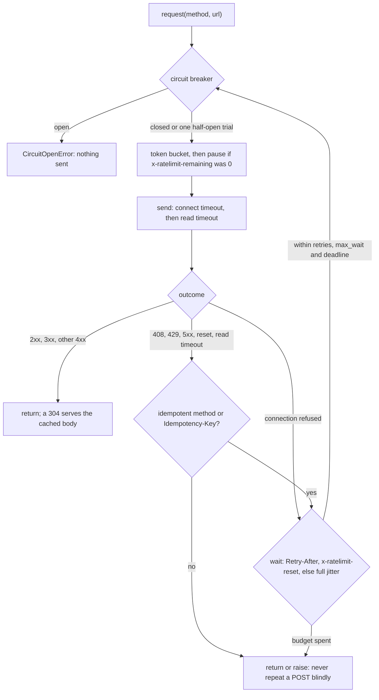

# Automating an API Is Pagination, Retries and Rate Limits

*Retry only what is safe to repeat, wait as long as the server asks, follow the next link, and stop calling a service that is down.*

## Metadata

| Field | Value |
|---|---|
| Type | Build |
| Languages | Python |
| Prerequisites | [HTTP/1.1 Is Text Over a Socket Until It Is Not](https://cloudcaptain.io/learn/networking/http-server) |
| Time | 90 minutes |
| Tools | curl, urllib3, gh |

<Quiz stage="pre" />

## The Problem

The migration script ran on a Friday night: read 40,000 tickets from the old tracker's REST API, create each one in the new tracker with a `POST`, then archive the old one. Somebody had wrapped every call in "try three times", because the old API was flaky. At 23:10 the new tracker's load balancer timed out a few `POST`s after the backend had already written them. The script retried, and 312 tickets now exist twice, with comments split between the copies. Nobody can tell which copy customers have been answering.

The read side was quieter and worse. The script asked for `per_page=100`, divided the total by 100 and requested pages 1 to 400. The server caps pages at 30 items and ignored the larger number, so the script read 12,000 tickets, saw no error and reported success. When the old API answered `403` with `x-ratelimit-remaining: 0` and a reset time 41 minutes away, the retry loop tried again immediately, three times, for every remaining ticket, and the API key was flagged for abuse. On Monday the vendor's status page showed a 20-minute outage at 02:00, during which twelve copies of a second cron job, started at the same minute on twelve hosts, retried in lockstep every second and kept the recovering service down.

None of this needs a better library. It needs answers to four questions on every call: may I send this now, did it work, may I send it again (and when), and is there more to read. Those answers have names: timeouts, idempotency, backoff with jitter, `Retry-After`, rate limits, circuit breakers and pagination. You are going to build `apiclient`, which answers all four with the standard library, and a fault server that misbehaves on request, then drive the same scenarios through urllib3 and `curl --retry` and count, on the server, what each one actually sent.

## The Concept

Think of a courier delivering parcels to a busy warehouse. Before leaving, the courier checks whether the warehouse is accepting deliveries at all (if it was on fire the last five times, there is no point driving there) and whether the daily delivery quota allows another trip. At the gate the courier waits a bounded time for the gate to open (the connect timeout) and a bounded time for a signature (the read timeout). If the gate never opened, the parcel never got in, and trying again is always safe. If the parcel was handed over but no signature came back, the courier does not know whether it was booked. Delivering it again is safe only if the warehouse would recognise a duplicate: either because the delivery is the kind that has the same effect twice (a replacement, a deletion), or because the parcel carries a unique reference the warehouse checks. If the warehouse says "come back at 14:00", the courier comes back at 14:00, not in one second. And when the warehouse says "this is lorry 3 of 9, next is at bay 4", the courier goes to bay 4 instead of guessing bay numbers.

In HTTP terms:

**Idempotency decides whether a retry is allowed.** RFC 9110 defines `GET`, `HEAD`, `OPTIONS`, `TRACE`, `PUT` and `DELETE` as idempotent: sending them twice has the same intended effect as once. `POST` and `PATCH` are not. A request that failed after it was sent (a reset, a read timeout, a `502` from a proxy) may or may not have been processed, so it is retried only if repeating it is harmless. An **idempotency key** makes a `POST` safe: the client generates one unique key per logical operation, sends it in an `Idempotency-Key` header on every attempt, and the server stores the first result under that key and replays it for repeats. A connection that was never established (connection refused, connect timeout) carried nothing, so it is safe to retry for any method.

**Backoff with full jitter decides when.** Waiting a fixed second between retries makes every failed client come back at the same moment. Exponential backoff spreads attempts out in time (0.5 s, 1 s, 2 s...) but clients that failed together still retry together. Full jitter picks a random wait between zero and the exponential ceiling, which spreads a crowd evenly over the window; in AWS's simulation of the variants it needed the fewest calls to get every client through.

**The server's word beats your formula.** `429 Too Many Requests` and `503 Service Unavailable` often carry `Retry-After` (seconds or an HTTP date). GitHub and many others publish `x-ratelimit-remaining` and `x-ratelimit-reset` (a UTC epoch second) on every response. A client that reads them waits exactly as long as needed and never spends a request that is certain to fail. A client that also limits itself with a **token bucket** rarely sees the `429` at all.

**A circuit breaker decides whether to call at all.** After N consecutive failures the breaker opens and calls fail immediately, without touching the network, for a cool-down period. Then it lets one trial request through (half-open): success closes it, failure opens it again. This turns a retry storm against a dead service into one probe per period.

**The server owns pagination.** A `Link` header (RFC 8288) carries the URL of the `next` page, or the body carries an opaque cursor. Either way the client follows what it is given until there is no next, and never computes page numbers itself.



## Build It

`code/main.py` is `apiclient`. The decisions are pure functions (`decide`, `server_wait`, `full_jitter`, `parse_link_header`) and small classes (`TokenBucket`, `CircuitBreaker`), and `Client` ties them together over an injectable transport, clock, sleep and random source, so the tests can script "503, 502, 200" and check the waits without sleeping. The same file holds `FaultServer`, a `ThreadingHTTPServer` you can tell to fail. The CLI has three commands: `request`, `paginate` and `serve`.

### Step 1: two timeouts, not one

`urllib.request.urlopen(url, timeout=...)` takes one number and applies it to every socket operation, so establishing the connection and waiting for a slow report share the same budget. `apiclient` goes one level down, to the `http.client` connection that `urllib` uses internally, and sets the two separately:

```python
    connection = connection_class(parts.hostname, parts.port, timeout=timeouts.connect)
    target = (parts.path or "/") + (f"?{parts.query}" if parts.query else "")
    try:
        try:
            connection.connect()
        except ssl.SSLError as err:
            raise TransportError("tls", describe(err)) from None
        except OSError as err:
            raise TransportError("connect", describe(err)) from None
        connection.sock.settimeout(timeouts.read)
        try:
            connection.request(method, target, body=body, headers=headers)
            reply = connection.getresponse()
            data = reply.read()
        except socket.timeout:
            raise TransportError("timeout", f"no response within the {timeouts.read:g}s read timeout") from None
        except (OSError, http.client.HTTPException) as err:
            raise TransportError("read", describe(err)) from None
```

The connect timeout is short (3.05 s by default, slightly more than a multiple of 3 s, the classic TCP retransmission window, as the requests documentation suggests) because a healthy server accepts a connection in milliseconds. The read timeout is as long as the slowest legitimate response. The error **kind** is the point: `connect` means nothing was sent, `read` and `timeout` mean the request may have been processed, and `tls` (a bad certificate) will not get better by trying again. The read timeout limits each wait for data, not the whole response; a server that sends one byte every 29 seconds never trips it, which is why the client also has a total `deadline`.

### Step 2: decide whether a retry is safe

```python
def retry_safe(method: str, has_key: bool) -> bool:
    return method.upper() in IDEMPOTENT_METHODS or has_key


def decide(policy: RetryPolicy, method: str, has_key: bool, attempt: int, outcome: Outcome, now: float, rng: random.Random) -> Decision:
    if outcome.error is None and outcome.status not in policy.statuses:
        return Decision(False, 0.0, "done")
    if outcome.error in NEVER_RETRIED_ERRORS:
        return Decision(False, 0.0, f"{outcome.error} errors are not retried")
    if outcome.error != "connect" and not retry_safe(method, has_key):
        return Decision(False, 0.0, f"{method.upper()} without {IDEMPOTENCY_HEADER} is not retried")
    if attempt > policy.retries:
        return Decision(False, 0.0, f"retries exhausted ({policy.retries})")
    hint = server_wait(outcome.headers, now) if outcome.error is None else None
    if hint is not None:
        wait, source = hint
        if wait > policy.max_wait:
            return Decision(False, wait, f"{source} asks for {wait:.1f}s, more than max_wait {policy.max_wait:g}s")
        return Decision(True, wait, source)
    return Decision(True, full_jitter(policy, attempt - 1, rng), "backoff")
```

Retryable statuses are `408`, `429`, `500`, `502`, `503` and `504`. A `400`, `401`, `403` (without rate-limit headers), `404` or `422` describes the request itself, and sending it again only produces the same answer. `501 Not Implemented` is a `5xx` that will never change, so it is not in the list either. Every decision carries a `reason`, which ends up in the log: "why did it not retry?" is the first question in every incident.

### Step 3: back off with full jitter

```python
    def ceiling(self, retry_number: int) -> float:
        return min(self.backoff_cap, self.backoff_base * (2 ** retry_number))
```

```python
def full_jitter(policy: RetryPolicy, retry_number: int, rng: random.Random) -> float:
    return rng.random() * policy.ceiling(retry_number)
```

With the defaults the ceilings are 0.5 s, 1 s, 2 s, 4 s... capped at 30 s, and each actual wait is uniform below its ceiling. Twelve cron jobs that failed at 02:00:00.000 now come back spread over the whole window instead of in one spike. The random source is injected: the tests pass a fixed one and assert exact sleeps, and `--seed` makes a CLI run reproducible.

### Step 4: let the server set the wait

```python
def server_wait(headers: Dict[str, str], now: float) -> Optional[Tuple[float, str]]:
    retry_after = (headers.get("retry-after") or "").strip()
    if retry_after.isdigit():
        return float(retry_after), "retry-after"
    if retry_after:
        try:
            when = parsedate_to_datetime(retry_after)
        except (TypeError, ValueError, IndexError):
            when = None
        if when is not None:
            if when.tzinfo is None:
                when = when.replace(tzinfo=timezone.utc)
            return max(0.0, when.timestamp() - now), "retry-after"
    remaining = (headers.get("x-ratelimit-remaining") or "").strip()
    reset = (headers.get("x-ratelimit-reset") or "").strip()
    if remaining == "0" and reset.isdigit():
        value = int(reset)
        wait = value - now if value >= EPOCH_THRESHOLD else value
        return max(0.0, float(wait)), "x-ratelimit-reset"
    return None
```

`Retry-After` has two legal forms in RFC 9110: delay seconds, or an HTTP date. `x-ratelimit-reset` is not standardised: GitHub sends a UTC epoch second, others send seconds from now, so a value below one billion (September 2001 as an epoch) is read as a delay. The reset is used only when `remaining` is `0`; on a `429` with `remaining: 12` the problem is something else. When the server asks for longer than `max_wait` (60 s by default), the client gives up at once with the reason in the log instead of holding a cron slot for 41 minutes.

The same headers also arrive on successful responses. When a `200` says `x-ratelimit-remaining: 0`, `observe_rate_limit()` records the reset time, and the next request pauses until then instead of spending an attempt on a guaranteed `429`.

### Step 5: limit yourself before the server does

```python
    def reserve(self, amount: float = 1.0) -> float:
        now = self.clock()
        self.tokens = min(self.capacity, self.tokens + (now - self.updated) * self.rate)
        self.updated = now
        self.tokens -= amount
        return 0.0 if self.tokens >= 0 else -self.tokens / self.rate
```

`--rate 5 --burst 2` allows two requests at once and then one every 0.2 s. `reserve()` takes the token immediately and returns how long to wait for it, so the balance can go negative: three callers in a row get waits of 0, 0 and 0.2 s, and the debt is repaid by the refill. Every attempt goes through the bucket, retries included, because a retry costs the server exactly as much as a first try.

### Step 6: stop calling a service that is down

```python
    def allow(self) -> None:
        with self.lock:
            state = self._current()
            if state == "open":
                raise CircuitOpenError(self.reset_after - (self.clock() - self.opened_at))
            if state == "half-open":
                if self.trial_in_flight:
                    raise CircuitOpenError(0.0)
                self.trial_in_flight = True

    def record(self, failed: bool) -> None:
        with self.lock:
            self.trial_in_flight = False
            if not failed:
                self.state = "closed"
                self.failures = 0
                return
            self.failures += 1
            if self.state == "half-open" or self.failures >= self.threshold:
                self.state = "open"
                self.opened_at = self.clock()
```

A failure for the breaker is a transport error or a `5xx`. A `429` is not: the server is healthy and answering deliberately, and rate limits have their own mechanism. `_current()` moves an open breaker to half-open once `reset_after` has passed, and only one trial is let through; a failed trial reopens the breaker immediately rather than after another N failures. The breaker is checked before every attempt, so a retry loop that is still running when the breaker opens stops there.

### Step 7: the loop, and a log line per attempt

`Client.request()` runs the steps in order for each attempt: budget, breaker, transport, record, decide, log, sleep. An idempotency key is set once, before the loop, so every attempt carries the same one; generating a fresh key per attempt would defeat it. `--auto-idempotency-key` generates a UUID4 for you. Each attempt writes one JSON line to stderr (or `--log FILE`), with stdout reserved for the response body:

```text
{"attempt": 1, "breaker": "closed", "decision": "retry", "delay_s": 0.162, "error": null, "error_kind": null, "event": "attempt", "idempotency_key": false, "method": "GET", "ms": 3.2, "ratelimit_remaining": null, "reason": "backoff", "status": 503, "url": "http://127.0.0.1:8080/s/flaky"}
{"attempt": 3, "breaker": "closed", "decision": "stop", "delay_s": 0.0, "error": null, "error_kind": null, "event": "attempt", "idempotency_key": false, "method": "GET", "ms": 1.3, "ratelimit_remaining": null, "reason": "done", "status": 200, "url": "http://127.0.0.1:8080/s/flaky"}
```

A retry that would push the total past `--deadline` is not made, so a caller that has a 2-minute window gets an answer within it.

### Step 8: follow the server's pages

```python
def parse_link_header(value: str, base: str = "") -> Dict[str, str]:
    links: Dict[str, str] = {}
    for target, params in re.findall(r"<([^>]*)>([^<]*)", value or ""):
        match = re.search(r'rel\s*=\s*"([^"]*)"|rel\s*=\s*([^\s;,"]+)', params, re.IGNORECASE)
        if not match:
            continue
        for rel in (match.group(1) or match.group(2)).split():
            links.setdefault(rel.lower(), urljoin(base, target) if base else target)
    return links
```

A naive `split(",")` breaks on URLs that contain commas; matching `<...>` first does not. `rel` can hold several space-separated relation types, and a relative target is resolved against the page it came from. `paginate_links()` follows `next` until there is none, refuses a `next` it has already visited (a buggy server must not make the script loop forever), and stops at `max_pages`. `paginate_cursor()` does the same with a cursor in the body (`next_cursor` by default) passed back as a query parameter; the cursor is opaque, so the client never decodes or increments it. Both are generators: a million items are never in memory at once, and the caller can stop early.

### Step 9: ask "has it changed?" instead of "send it again"

```python
    def finish(self, method: str, url: str, response: Response, cached: Optional[Response]) -> Response:
        if response.status == 304 and cached is not None:
            merged = dict(cached.headers)
            merged.update(response.headers)
            return Response(cached.status, merged, cached.body, url, response.attempts, True)
        if method == "GET" and response.status == 200 and response.header("etag"):
            self.etags[url] = response
        return response
```

A `GET` for a URL the client has seen sends `If-None-Match` with the stored `ETag`. If nothing changed, the server answers `304 Not Modified` with no body, and the client returns the cached one marked `from_cache`. GitHub does not count a `304` to an authorized request against the primary rate limit, so a poller that checks 500 repositories every minute spends its budget only on the ones that changed.

### Step 10: run it against the fault server

The fault server answers on `/s/<name>` according to a plan you post to `/__plan/<name>` (statuses with headers, `delay`, `reset` for a TCP reset, `reset_in` for rate-limit headers, `times` to repeat a step) and records every hit, with a monotonic timestamp and the `Idempotency-Key` it carried, at `/__hits/<name>`. It also serves 23 items under `/items` (Link pagination, `per_page` capped at 10) and `/cursor`, and an ETag-protected `/conditional` with GitHub-style rate-limit headers.

```bash
python3 code/main.py serve --port 8080 &
U=http://127.0.0.1:8080
curl -s -X POST -d '{"plan": [{"status": 503, "times": 2}]}' $U/__plan/flaky
python3 code/main.py request GET $U/s/flaky --seed 7
curl -s -X POST -d '{"plan": [{"status": 503}]}' $U/__plan/orders
python3 code/main.py request POST $U/s/orders -d '{"sku": "cc-1"}'
curl -s -X POST -d '{"plan": [{"status": 503}]}' $U/__plan/orders2
python3 code/main.py request POST $U/s/orders2 -d '{"sku": "cc-1"}' --auto-idempotency-key --quiet
curl -s $U/__hits/orders2
curl -s -X POST -d '{"plan": [{"status": 429, "headers": {"Retry-After": "120"}}]}' $U/__plan/slow
python3 code/main.py request GET $U/s/slow
python3 code/main.py request --dry-run POST $U/s/orders
python3 code/main.py paginate "$U/items?per_page=100" --quiet | wc -l
python3 code/main.py paginate "$U/cursor?limit=7" --cursor > /dev/null
kill %1
```

The flaky `GET` succeeds on the third attempt. The plain `POST` stops after one attempt with exit code 1 and `reason: POST without Idempotency-Key is not retried`; with `--auto-idempotency-key` it succeeds on the second, and `__hits` shows both attempts carrying the same UUID. The `Retry-After: 120` request gives up immediately because 120 s exceeds `max_wait`. `--dry-run` prints the plan without sending anything (`retry-safe: no`, at most 1 attempt, the backoff ceilings). `paginate` prints 23 items although the server ignored `per_page=100`, and the cursor run logs four `page` events of 7, 7, 7 and 2 items. Exit codes: 0 for a final status below 400, 1 for an HTTP error, a transport error or an open circuit, 2 for a usage error, with the message on stderr.

<RunTests />

## Use It

Now the same scenarios with the tools you would actually use, judged by the same fault server. `code/fixtures/scenarios.json` is the table: eight scenarios, the plan for each, and the number of attempts each client is expected to make. `code/smoke.sh` runs it for `apiclient`, for `curl --retry` and for urllib3, and counts attempts on the server side, which is the only count none of the clients can get wrong.

**urllib3**, the HTTP library under `requests` and pip, has the closest `Retry` object. Pin it with a hash, as the smoke does (`urllib3==2.8.0` with the wheel and sdist SHA-256 values from PyPI and `pip install --require-hashes`), and configure it to match:

```python
from urllib3.util import Retry, Timeout
import urllib3

retry = Retry(total=2, backoff_factor=0.1, status_forcelist=[408, 429, 500, 502, 503, 504],
              allowed_methods=Retry.DEFAULT_ALLOWED_METHODS, respect_retry_after_header=True, raise_on_status=False)
http = urllib3.PoolManager(retries=retry)
response = http.request("GET", "http://127.0.0.1:8080/s/flaky", timeout=Timeout(connect=1, read=5))
```

`DEFAULT_ALLOWED_METHODS` is `DELETE`, `GET`, `HEAD`, `OPTIONS`, `PUT` and `TRACE`, the same idempotent set; it applies to status retries and to read errors, while connect errors are retried for any method, exactly the split in `decide()`. Reading `urllib3/util/retry.py` in the pinned version shows three differences: the first retry has no backoff at all (`get_backoff_time()` returns 0 for a single error, then `backoff_factor * 2 ** (n - 1)`), jitter is optional and additive (`backoff_jitter` adds up to that many seconds), not full jitter, and `Retry-After` is honoured only for `413`, `429` and `503`. urllib3 knows nothing about idempotency keys or `x-ratelimit-reset`; you would add `POST` to `allowed_methods` yourself, per call, when a key is present.

**curl** retries with `--retry N`, and its rules are worth knowing because so many scripts use it:

```bash
curl -sS --retry 2 --connect-timeout 3 --max-time 10 https://api.example.com/v1/things
curl -sS --retry 2 --retry-all-errors --retry-max-time 60 https://api.example.com/v1/things
curl -sS --etag-save etag.txt -o thing.json https://api.example.com/v1/things/42
curl -sS --etag-compare etag.txt -o thing.json -w '%{http_code}\n' https://api.example.com/v1/things/42
```

`--retry` treats timeouts and the statuses `408`, `429`, `500`, `502`, `503` and `504` as transient, honours `Retry-After`, and otherwise waits one second and doubles up to ten minutes. It does not look at the method: it repeats a `POST` on a `503`. A connection reset in the middle of a response (curl exit code 56) is not on its transient list; `--retry-all-errors` retries every failure, `POST`s included. `--max-time` applies to each attempt and `--retry-max-time` to the whole run. `--etag-save` and `--etag-compare` make curl send `If-None-Match`, and a `304` leaves the output file alone.

The smoke's scenario table, counted on the server (attempts, final status, wait before the retry):

| Scenario | apiclient | urllib3 2.8.0 | curl `--retry 2` |
|---|---|---|---|
| `GET`: 503, 503, 200 | 3, 200 | 3, 200 (first retry immediate) | 3, 200 (1 s, 2 s) |
| `GET`: 500 five times | 3, 500 | 3, 500 | 3, 500 |
| `GET`: 429 with `Retry-After: 2` | 2, 200, waited 2 s | 2, 200, waited 2 s | 2, 200, waited 2 s |
| `GET`: 429 with `x-ratelimit-remaining: 0` and a reset 2 s ahead | 2, 200, waited until the reset | 2, 200, retried at once | 2, 200, waited its default 1 s |
| `GET`: connection reset | 2, 200 | 2, 200 | 1, exit 56 (2 with `--retry-all-errors`) |
| `GET`: response delayed 1.5 s, read timeout 0.5 s | 2, 200 | 2, 200 | 2, 200 |
| `POST`: 503 without a key | 1, 503 | 1, 503 | 2, 200: the `POST` ran twice |
| `POST`: 503 with `Idempotency-Key` | 2, 200, same key | 1, 503 | 2, 200 |

**GitHub's REST API** is the model most APIs copy. Every response carries `x-ratelimit-limit`, `x-ratelimit-remaining`, `x-ratelimit-used`, `x-ratelimit-reset` (UTC epoch seconds) and `x-ratelimit-resource`. Exceeding the primary limit returns `403` or `429` with `remaining: 0`; secondary limits (too many concurrent requests or too much content creation) return `403` or `429`, sometimes with `retry-after`, and GitHub's guidance is to honour `retry-after`, else wait until the reset when `remaining` is `0`, else wait at least a minute and back off exponentially. Pages are linked with `Link: <...?page=2>; rel="next", <...?page=34>; rel="last"`, `per_page` tops out at 100 on most endpoints, and some endpoints switch to cursor parameters (`before`, `after`) in the same `Link` header. Conditional requests with `If-None-Match` or `If-Modified-Since` that return `304` do not count against the primary limit when the request is authorized. `gh` does all of this for you:

```bash
gh api rate_limit --jq '.resources.core'
gh api -i 'repos/cli/cli/releases?per_page=5' > page.txt; grep -i -E '^(link|x-ratelimit-remaining):' page.txt
gh api --paginate 'repos/cli/cli/releases?per_page=100' --jq '.[].tag_name' | wc -l
gh api --paginate --slurp 'repos/cli/cli/releases?per_page=100' | jq 'map(length) | add'
```

`--paginate` follows `rel="next"` exactly as `paginate_links()` does, and `--slurp` (in recent releases) collects the pages into one array. The smoke does not call GitHub (no network, no token in CI); it walks the fault server's `Link` headers with `curl -D` and `sed` instead, the shell version of the same loop.

**httpx** has a different split: `httpx.HTTPTransport(retries=3)` retries only connection failures (`ConnectError`, `ConnectTimeout`), never a status, and `httpx.Timeout(10.0, connect=3.0)` sets connect, read, write and pool timeouts separately, with a 5-second default for each. `requests` has no default timeout at all, which is why a script that calls `requests.get(url)` can hang forever on a half-open connection; pass `timeout=(3.05, 30)` every time.

**Idempotency keys as Stripe defines them**: the client sends `Idempotency-Key: <unique value>` on a `POST`, Stripe saves the status code and body of the first request that started executing under that key, including `500`s, and returns the saved result for any repeat. A repeat with the same key but different parameters is an error, keys expire after at least 24 hours, and a request that failed validation or conflicted with a concurrent one is not saved and may be retried. The IETF HTTPAPI working group is standardising the same header as `Idempotency-Key`. On the server side this means a unique constraint on the key and a stored response; on the client it means one key per logical operation, reused on every attempt, which is what `--idempotency-key` and `--auto-idempotency-key` do.

| What you built | Real tool | Note |
|---|---|---|
| `Timeouts(connect, read)` | urllib3 `Timeout(connect=, read=)`; httpx `Timeout`; requests `timeout=(3.05, 30)`; curl `--connect-timeout`, `--max-time` | `urllib.request` and requests without `timeout=` are the traps |
| `decide()` idempotency rule | urllib3 `allowed_methods`; httpx retries connects only | curl `--retry` ignores the method and repeats `POST`s |
| `Idempotency-Key`, `--auto-idempotency-key` | Stripe idempotent requests; IETF Idempotency-Key header draft | the server must store and replay the first result |
| `full_jitter()` | urllib3 `backoff_factor` plus optional `backoff_jitter`; curl doubles from 1 s | only full jitter de-synchronises a crowd well |
| `server_wait()`: `Retry-After` | urllib3 `respect_retry_after_header` (413, 429, 503); curl honours it | both forms, seconds and HTTP date |
| `server_wait()`: `x-ratelimit-reset`, `observe_rate_limit()` | GitHub's documented client behaviour; `gh` handles it | urllib3 and curl ignore it |
| `TokenBucket` | provider-side buckets; client libraries rarely ship one | throttle before the server has to |
| `CircuitBreaker` | resilience libraries (pybreaker, Resilience4j), service meshes' outlier detection | none of urllib3, httpx or curl has one |
| `paginate_links()`, `paginate_cursor()` | `gh api --paginate`, provider SDK paginators | follow `next`, never compute page numbers |
| ETag cache, `If-None-Match` | curl `--etag-save`/`--etag-compare`; GitHub conditional requests | a `304` is free on GitHub's primary limit |
| one JSON line per attempt | urllib3 logs retries at debug level; `curl -v` | the reason field answers "why did it stop?" |

<Quiz stage="check" />

## Ship It

Two artifacts in `outputs/`:

- **`skill-api-integration-review.md`**: a runbook for reviewing a script, job or service that calls an HTTP API, or for writing a new one: list every call with its method and side effect, check timeouts, classify retries by idempotency, find the API's rate-limit and pagination conventions, add idempotency keys where a `POST` must be retried, add jitter and a deadline, add a breaker where calls fan out, prove each rule with the fault server and `apiclient request --dry-run`, and report findings in a fixed structure.
- **`prompt-explain-retry-policy.md`**: paste a retry configuration (urllib3 `Retry`, curl flags, a tenacity decorator, an SDK's settings, or hand-written code) and the API's documented limits; get back, for each failure case, whether it is retried, after how long and how many times, what happens to a `POST`, the worst-case total time, and the concrete risks (duplicate writes, retry storms, unbounded waits).

<ShipIt />

## Exercises

### Easy

GitHub's secondary rate limit answers `403`, which `decide()` treats as final. Make a `403` retryable only when it carries `retry-after` or `x-ratelimit-remaining: 0`, and otherwise keep it final. Write the tests first: a `403` with `retry-after: 5` is retried after 5 s, a `403` with `x-ratelimit-remaining: 0` and a reset 30 s ahead waits 30 s, a plain `403` (a permission problem) is returned after one attempt, and a `403` asking for more than `max_wait` gives up with the reason in the log.

### Medium

Make pagination resumable. Add `--state FILE` to `paginate`: after each page, write the next URL (or cursor) and the count of items emitted to the file atomically (write a temporary file, then `os.replace`), and on start continue from the saved position. Tests first: a run that raises after the second page of `/items?per_page=5` leaves a state file pointing at page 3; a second run emits exactly items 11 to 23, with no duplicates and none missing; a finished run removes the state file; and a state file whose URL belongs to a different base URL is rejected with exit code 2.

### Hard

Retries multiply load exactly when a service is weakest: three layers that each retry three times turn one request into 64. Add a **retry budget** shared by all requests of one `Client`: retries are allowed only while they are below 10% of the requests made in the last 10 seconds (plus a small floor so a quiet client can still retry), as Envoy's retry budgets and gRPC's retry throttling do. Make `Client` safe to share between threads (the bucket and the budget behind a lock) and write the test that runs 20 threads against a fault server path returning `503` for its first 200 hits: assert that the server receives at most 1.1 times the number of logical requests plus the floor, and compare with the same run without a budget. Then explain in two sentences how the budget and the circuit breaker divide the work.

<Quiz stage="post" />

## Key Terms

| Term | Common misconception | Precise definition |
|---|---|---|
| Idempotent method | "Idempotent means it has no side effects." | A method whose intended effect is the same whether it is sent once or several times (RFC 9110: `GET`, `HEAD`, `OPTIONS`, `TRACE`, `PUT`, `DELETE`); `DELETE` has a side effect, but repeating it does not add another. |
| Idempotency key | "Any request id makes a `POST` safe to retry." | A unique value per logical operation, sent unchanged on every attempt, that the server stores with the first result and uses to replay that result for repeats; it only works if the server implements it. |
| Full jitter | "Jitter is a few random milliseconds added to the backoff." | Choosing each wait uniformly between zero and the exponential ceiling (`random() * min(cap, base * 2^n)`), which spreads clients that failed together across the whole window. |
| `Retry-After` | "It is advice; a fixed backoff is fine." | A response header, in delay seconds or an HTTP date, telling the client the earliest useful moment to retry; retrying sooner wastes an attempt and the rate limit. |
| Rate-limit headers | "A `429` is the first sign of a limit." | Headers such as `x-ratelimit-remaining` and `x-ratelimit-reset` that report the budget on every response, so a client can pause before it receives a `429`. |
| Token bucket | "It limits requests per calendar minute." | A balance with a capacity (the burst) that refills continuously at a fixed rate; each request takes a token, and the wait for a missing token is the shortfall divided by the rate. |
| Circuit breaker | "A breaker is just a retry limit." | A per-dependency state machine (closed, open, half-open) that fails calls immediately after N consecutive failures, then lets one trial through after a cool-down to decide whether to close again. |
| Link pagination | "Pages can be computed from the total and `per_page`." | Following the URL in the `Link` header's `rel="next"` (RFC 8288) until it is absent; servers cap and change page sizes, and only the links are authoritative. |
| Conditional request | "Caching needs `Cache-Control` and a proxy." | A request with `If-None-Match` (an `ETag`) or `If-Modified-Since` that the server answers with `304 Not Modified` and no body when nothing changed. |
| Connect timeout versus read timeout | "One timeout covers the whole request." | The connect timeout bounds establishing the connection, after which nothing has been sent; the read timeout bounds each wait for response data, after which the request may already have run. |

## Further Reading

- [Python for DevOps scripting](https://cloudcaptain.io/docs/tools/python/devops-scripting): the scripting patterns this client slots into, from argument parsing to calling APIs.
- [Networking fundamentals](https://cloudcaptain.io/docs/tools/networking/fundamentals): TCP connection setup and resets, the layer the connect and read timeouts sit on.
- [Advanced Bash](https://cloudcaptain.io/docs/tools/bash/advanced): for the curl loops in Use It, and for knowing when to move them to Python.
- [RFC 9110, HTTP Semantics](https://www.rfc-editor.org/rfc/rfc9110): idempotent methods (section 9.2.2), `Retry-After` (10.2.3), `ETag` and `If-None-Match` (8.8.3, 13.1.2), and the status codes the client classifies.
- [RFC 8288, Web Linking](https://www.rfc-editor.org/rfc/rfc8288): the `Link` header grammar `parse_link_header()` implements, including multiple relation types.
- [Exponential Backoff And Jitter (AWS Architecture Blog)](https://aws.amazon.com/blogs/architecture/exponential-backoff-and-jitter/): the simulation that compares full, equal and decorrelated jitter.
- [GitHub REST API: rate limits](https://docs.github.com/en/rest/using-the-rest-api/rate-limits-for-the-rest-api), [pagination](https://docs.github.com/en/rest/using-the-rest-api/using-pagination-in-the-rest-api) and [best practices](https://docs.github.com/en/rest/using-the-rest-api/best-practices-for-using-the-rest-api): the headers, the secondary-limit guidance and conditional requests used in Use It.
- [Stripe: idempotent requests](https://docs.stripe.com/api/idempotent_requests): what a server stores under an idempotency key and when it replays it.
- [The Idempotency-Key HTTP header field (IETF draft)](https://datatracker.ietf.org/doc/draft-ietf-httpapi-idempotency-key-header/): the header being standardised, with the server's obligations.
- [urllib3 `Retry` reference](https://urllib3.readthedocs.io/en/stable/reference/urllib3.util.html): every parameter of the configuration in Use It.
- [curl man page](https://curl.se/docs/manpage.html): `--retry`, `--retry-all-errors`, `--retry-max-time`, `--etag-save` and `--etag-compare`.
- [CircuitBreaker (Martin Fowler)](https://martinfowler.com/bliki/CircuitBreaker.html): the pattern's states and why the half-open trial matters.
