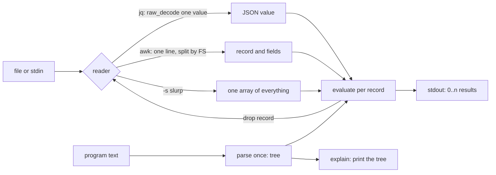

# jq and awk Are Stream Processors You Can Write

*jq and awk read one record, run a small program on it and forget it; write both and pipelines stop being magic or memory-hungry.*

## Metadata

| Field | Value |
|---|---|
| Type | Build |
| Languages | Python |
| Prerequisites | [Robust Bash](https://cloudcaptain.io/learn/scripting/robust-bash) |
| Time | 90 minutes |
| Tools | jq, awk, sed, sort, xargs, yq |

<Quiz stage="pre" />

## The Problem

At 02:10 the checkout error rate jumps and the on-call engineer has 4 GB of JSON Lines access logs on a bastion host. The first attempt is a Python script that calls `json.load()` on the whole file; it dies with `MemoryError` after two minutes. The second is `grep '"status":5'`, which misses every line where the logger put a space after the colon and matches a `"status":5` inside a request body. The third is a jq one-liner copied from a chat: `jq -s 'map(select(.status >= 500)) | group_by(.path)'`. It works on the 10 MB sample and swaps the box to death on the real file, because `-s` reads every value into one array before the filter runs.

Meanwhile a colleague has a CSV export and an awk one-liner that sums latency per endpoint. It prints the endpoints in a different order on their Mac than on the server, one filter silently drops rows because `$6 > "100"` compared text instead of numbers, and nobody can explain why `$5 = int($5 / 1024)` suddenly changed the separators in every printed line.

None of this is about the tools being obscure. jq and awk are the same machine: read one record, run a small program against it, write zero or more results, forget the record. Memory stays flat no matter how large the input is, unless you ask for the whole input at once. The surprises come from three places: what counts as a record, how the program is parsed, and what the values are (jq's generators and type order, awk's numeric strings). In this lesson you build `ministream`, a jq subset and an awk subset with a shared streaming core and an `explain` command, check them against the real `jq` and `awk` on generated logs, and then use the real tools knowing what they do.

## The Concept

A stream processor has three parts. A **reader** turns bytes into records: jq's reader decodes one JSON value at a time (newlines mean nothing to it, so JSON Lines and pretty-printed files both work), awk's reader splits on the record separator, a newline by default. A **program** is parsed once into a tree. An **evaluator** runs the tree against each record and writes what it produces. The record is then dropped, so peak memory is one record plus whatever the program deliberately keeps (awk arrays, jq `reduce` state), never the file.

jq programs are **generators**. Every expression takes one input and produces zero, one or many outputs. `.items[]` produces one output per element, `select(f)` produces its input or nothing, `,` concatenates two output streams and `|` feeds every output on the left into the right. That is why `.[] | select(.status >= 500) | .path` needs no loop: the pipe is the loop. Values compare in a fixed type order, `null < false < true < numbers < strings < arrays < objects`, which is what `sort`, `group_by` and `unique` use.

awk programs are **pattern-action rules**. For each line awk splits fields with `FS`, then runs every rule whose pattern is true. Text read from input becomes a **numeric string**: `$4 >= 500` compares as numbers when both sides look numeric, but a string constant such as `"10"` forces a string comparison. Juxtaposition is concatenation, so `$1 " " $2` needs no operator, which is also why the parser must know where one operand ends and the next begins.



The slurp edge is the only path where memory grows with the input. Aggregation does not need it: awk keeps one array entry per distinct key, and `sort | uniq -c` spills to temporary files. The question to ask of any pipeline is "what does this step hold on to?"

## Build It

`code/main.py` is `ministream`: `jq`, `awk` and `explain` subcommands over one reader per language. Parsers are recursive descent written by hand, one method per precedence level, and the trees are plain tuples such as `("pipe", left, right)` so `explain` can print them. Errors carry the line and column of the program; exit codes are 0 for success, 1 for a runtime or input error, 2 for a usage or syntax error.

### Step 1: read JSON values one at a time

`json.JSONDecoder.raw_decode()` decodes the first value in a string and says where it ended. The reader keeps a 64 KB buffer, decodes values from it, and reads more only when a value is cut off at the end of the buffer:

```python
try:
    value, end = decoder.raw_decode(buffer, position)
except json.JSONDecodeError as error:
    if finished:
        raise InputError(f"invalid JSON input at byte {consumed + error.pos}: {error.msg}") from None
    more = stream.read(max(chunk_size, len(buffer) - position))
    consumed += position
    buffer = buffer[position:] + more
    position = 0
    finished = not more
    continue
if end == len(buffer) and not finished and is_number(value):
    more = stream.read(chunk_size)
```

Two details matter. A number at the very end of the buffer may continue in the next chunk (`123` then `45`), so it is not trusted until more input arrives. And the reader advances a position instead of slicing the buffer after every value, which would copy 64 KB per record. The test `test_decoder_handles_values_split_across_tiny_reads` feeds the reader 3 characters at a time.

### Step 2: parse jq by precedence

From loosest to tightest: `|`, `,`, `//`, `or`, `and`, comparisons, `+ -`, `* / %`, unary minus, then postfix terms (`.a`, `[0]`, `[]`, `[1:3]`, `?`). Each level is a method that calls the next tighter one:

```python
def parse_comma(self) -> tuple:
    left = self.parse_alternative()
    while self.accept(","):
        left = ("comma", left, self.parse_alternative())
    return left

def parse_alternative(self) -> tuple:
    left = self.parse_or()
    if self.accept("//"):
        return ("alternative", left, self.parse_alternative())
    return left
```

So `.a, .b | length` is `(.a, .b) | length`, and `.x // "none" | ascii_upcase` applies the default before the pipe. Function calls are checked against the builtin table by name and arity at parse time, which gives jq's `lenght/0 is not defined` instead of a failure on the millionth record. Variables are checked the same way: `$x` must be bound by `as $x` or `--arg`.

### Step 3: evaluate as generators

Every node evaluates to a Python generator. The pipe and the comma are three lines each:

```python
def eval_pipe(self, node: tuple, value: Any, env: Dict[str, Any]) -> Iterator[Any]:
    for left in self.evaluate(node[1], value, env):
        yield from self.evaluate(node[2], left, env)

def eval_comma(self, node: tuple, value: Any, env: Dict[str, Any]) -> Iterator[Any]:
    yield from self.evaluate(node[1], value, env)
    yield from self.evaluate(node[2], value, env)
```

`select` is not a filter in the SQL sense; it is a generator that yields its input once for every truthy output of its argument:

```python
def builtin_select(program: JqProgram, args: List[tuple], value: Any, env: Dict[str, Any]) -> Iterator[Any]:
    for condition in program.evaluate(args[0], value, env):
        if truthy(condition):
            yield value
```

`?` wraps a generator in `try`/`except JqError` and stops quietly, and `a // b` yields the truthy outputs of `a` or, if there were none, the outputs of `b`. Object construction is a cartesian product: `{a: (1, 2)}` yields two objects.

### Step 4: jq's type order, arithmetic and aggregation

Sorting, grouping, `unique`, `min` and `max` all rely on one comparison:

```python
def jq_compare(left: Any, right: Any) -> int:
    left_rank, right_rank = jq_rank(left), jq_rank(right)
    if left_rank != right_rank:
        return -1 if left_rank < right_rank else 1
    if left_rank in (3, 4):
        return (left > right) - (left < right)
```

Arrays compare element by element; objects compare their sorted key lists first, then values. Arithmetic follows the types: `null + x` is `x`, `+` concatenates strings and arrays and merges objects, `-` on arrays removes elements, `/` on strings splits. `group_by(f)` sorts by the list of `f`'s outputs and cuts runs of equal keys. These are the functions that need the whole array, which is where `-s` comes in, and why the smoke measures it.

### Step 5: parse awk, where juxtaposition is an operator

awk's precedence is assignment, `?:`, `||`, `&&`, `in`, `~ !~`, comparisons, concatenation, `+ -`, `* / %`, unary `! -`, `^`, `++ --`, `$`. Concatenation has no symbol, so the parser keeps concatenating while the next character can only start an operand:

```python
def parse_concatenation(self) -> tuple:
    left = self.parse_additive()
    while self.starts_operand():
        left = ("concat", left, self.parse_additive())
    return left
```

`starts_operand()` accepts a quote, `$`, `(`, a digit or a name that is not a keyword. A `-` does not start an operand, so `$1 -$2` is subtraction, as in every awk. A `/` in operand position starts a regular expression, in operator position it divides. Inside `print`, a bare `>` would be output redirection; ministream does not support redirection and says so instead of silently comparing.

### Step 6: numeric strings

Field values are `StrNum`, a `str` subclass that remembers it came from input. Comparison is numeric only when both sides are numbers or numeric-looking `StrNum`s:

```python
def awk_compare(left: Any, right: Any, convfmt: str) -> int:
    left_number, right_number = awk_numeric_view(left), awk_numeric_view(right)
    if left_number is not None and right_number is not None:
        return (left_number > right_number) - (left_number < right_number)
    left_text, right_text = awk_string(left, convfmt), awk_string(right, convfmt)
    return (left_text > right_text) - (left_text < right_text)
```

That is how `$1 > $2` compares `10` and `9` as numbers while `$1 > "9"` compares strings and is false, because `"1"` sorts before `"9"`. An unset variable is `Uninitialized`, a `StrNum` that is both `""` and `0`. Numbers print as integers when they are integral and through `OFMT` (`%.6g`) otherwise, which is why `print 0.1 + 0.2` prints `0.3`.

### Step 7: records, lazy fields and rebuilding `$0`

`set_record()` stores the line and the `FS` in force; fields are split only when a rule asks for one, so `/error/ { print }` never splits at all. Assigning a field rebuilds the record with `OFS`:

```python
def set_field(self, index: int, value: Any) -> None:
    if index == 0:
        self.set_record(awk_string(value, self.convfmt()))
        return
    if index < 0:
        raise AwkError(f"attempt to access field {index}")
    fields = self.get_fields()
    while len(fields) < index:
        fields.append("")
    fields[index - 1] = awk_string(value, self.convfmt())
    self.record = awk_string(self.variables["OFS"]).join(fields)
```

That is the whole explanation of `$5 = int($5 / 1024)` turning a CSV line into a space-separated one: `OFS` defaults to a space. It is also the `$1 = $1` idiom for converting separators. `next`, `exit`, `break` and `continue` are exceptions caught at the right level; `exit` still runs the `END` rules, as POSIX requires.

### Step 8: run it

```bash
cd code
python3 - > /tmp/access.jsonl <<'EOF'
import json, random
r = random.Random(1)
for i in range(20000):
    print(json.dumps({"path": r.choice(["/", "/api/users", "/api/orders"]), "status": r.choice([200, 200, 200, 404, 500, 503]), "ms": round(r.uniform(1, 400), 1)}))
EOF
python3 main.py jq -c 'select(.status >= 500) | {path, status}' /tmp/access.jsonl | head -3
python3 main.py jq -r '"\(.status) \(.path)"' /tmp/access.jsonl | sort | uniq -c | sort -rn | head -5
python3 main.py jq -s -c 'group_by(.path) | map({path: .[0].path, n: length, worst: (map(.ms) | max)})' /tmp/access.jsonl
python3 main.py jq -r '[.path, .status, .ms] | @tsv' /tmp/access.jsonl > /tmp/access.tsv
python3 main.py awk -F '\t' '{ sum[$1] += $3; n[$1]++ } END { for (p in sum) printf "%s %.1f\n", p, sum[p] / n[p] }' /tmp/access.tsv
python3 main.py --stats awk -F '\t' '$2 >= 500 { bad++ } END { print bad }' /tmp/access.tsv   # {"records": 20000, "max_rss_kb": ...} on stderr
python3 main.py explain jq '.[] | select(.status >= 500) | .path'
python3 main.py explain awk '$2 >= 500 { bad[$1]++ }'
python3 main.py jq '.path |' /tmp/access.jsonl; echo "exit $?"   # syntax error at line 1, column 8: unexpected end of program; exit 2
```

<RunTests />

## Use It

Everything above is what `jq` and `awk` do, faster and with the corners filled in. The commands below are the ones the smoke runs against the same generated logs.

```bash
jq -c 'select(.status >= 500) | {ts, path, status}' access.jsonl      # stream: constant memory
jq -r '"\(.method) \(.path) \(.status)"' access.jsonl                 # -r: raw strings, ready for cut, sort, grep
jq -r '[.method, .path, .user] | @tsv' access.jsonl                   # @tsv and @csv do the quoting for you
jq -s 'group_by(.status) | map({status: .[0].status, count: length})' access.jsonl   # -s: whole file in memory
jq -n 'reduce inputs as $r ({}; .[$r.path] += 1)' access.jsonl         # aggregate without -s: one entry per key
jq --stream -c 'select(length == 2)' huge-single-document.json        # [path, leaf] events for one huge value
jq -e '.ready' status.json && echo ready                              # -e: exit status from the last output
```

Two jq behaviours worth knowing before you put it in a script. Its exit status reflects only the **last** input: a filter that fails on record 15 and succeeds on the last record exits 0 (the smoke prints this). Use `-e`, count lines on stderr, or validate in a separate pass when a partial failure must fail the job. And current releases keep the literal text of numbers they do not change, so `1.000` stays `1.000`; ministream normalises it to `1`, which is equal after parsing but not as text.

awk is everywhere and comes in three common flavours: mawk (the default `awk` on Debian and Ubuntu), GNU awk (`gawk`, a package away, with extensions such as `asort` and `--csv`) and the BWK "one true awk" on macOS and the BSDs. Stick to POSIX features and they agree, which the smoke checks against whichever `awk` the runner has.

```bash
awk -F, 'NR > 1 && $4 >= 500 { print $1, $3, $4 }' access.csv
awk -F, 'NR > 1 { sum[$3] += $6; n[$3]++ } END { for (p in sum) printf "%s %.3f %d\n", p, sum[p] / n[p], n[p] }' access.csv | sort
awk '!seen[$0]++' urls.txt                                            # dedupe, keep first occurrence, one entry per distinct line
awk -v limit=250 -F, '$6 > limit { slow++ } END { print slow + 0 }' access.csv
sed 's/,/\t/g' access.csv                                             # sed: line edits; no fields, no arithmetic
jq -r .path access.jsonl | sort | uniq -c | sort -rn | head           # the counting idiom; LC_ALL=C sort is faster and bytewise
find parts -name 'chunk-*' -print0 | xargs -0 -P 4 -I{} sh -c 'jq -r "select(.status >= 500) | .path" "$1" > "$1.paths"' _ {}
parallel -j 4 --keep-order "jq -r .path {}" ::: parts/chunk-*         # GNU parallel, when installed: ordered output, retries, progress
yq -o=json '.' services.yaml | jq '.services[].name'                  # mikefarah yq: YAML in, JSON out, then the same jq
```

`for (k in arr)` visits keys in an unspecified order, and mawk, gawk and ministream all choose differently, so pipe that output through `sort` before comparing or diffing it. With `xargs -P`, never let parallel workers share one stdout: their buffered writes interleave in the middle of lines. Give each worker its own output file and merge, which is map-reduce with a shell.

When should a pipeline become a Python script? When it needs state across records beyond one key-to-number map, joins between two files that do not fit `join(1)`, error handling per record that must fail the job, timestamps parsed into time zones, more than one screen of jq, or tests. ministream is that script: the same streaming loop, a parser and an evaluator, with unit tests.

| What you built | Real tool | Note |
|---|---|---|
| `iter_json_values()` with `raw_decode` | jq's parser reading a stream of values | jq also has `--stream` for one huge value and `--seq` for RFC 7464 record separators |
| `JqParser`, precedence methods | jq's yacc grammar | jq adds `def`, `reduce`/`foreach`, `try`/`catch`, `\|=` update assignment, `..`, `$__loc__`, modules |
| generators per node | jq's backtracking bytecode interpreter | same semantics: every expression is a stream of outputs |
| `jq_compare()` type order | jq's `jv_cmp` | identical ranks; jq sorts strings by bytes, which is code point order for UTF-8 |
| `-s` slurp | `jq -s`, `jq -n '[inputs]'` | both hold the whole input; `reduce inputs` does not |
| `AwkParser`, concatenation by juxtaposition | POSIX awk grammar | real awks add `getline`, user functions, output redirection, range patterns, `printf > file` |
| `StrNum`, `awk_compare()` | POSIX numeric strings | the rule that makes `$3 > 9` numeric and `"10" > "9"` a string comparison |
| lazy fields, `set_field()` rebuild | every awk | gawk adds `FPAT` and `--csv` for quoted CSV fields, which `-F,` does not handle |
| `--stats` peak RSS | `/usr/bin/time -v`, `getrusage` | the smoke measures both tools with `RUSAGE_CHILDREN` |
| `explain` | `jq --debug-dump-disasm`, `gawk --dump-variables`, `gawk --profile` | look at what was parsed when a program surprises you |

<Quiz stage="check" />

## Ship It

Two artifacts in `outputs/`:

- **`skill-log-oneliners.md`**: a runbook for answering questions from logs on a box you cannot install things on: identify the format and size, choose the tool by the question (filter, count, aggregate, join), keep memory flat, a table of tested one-liners for JSON Lines, CSV and space-separated logs, parallelism with per-worker outputs, the pitfalls that give wrong numbers, and a report format that includes the exact commands.
- **`prompt-write-jq.md`**: give a model one or two sample records and a question in plain words and get a jq filter that streams when it can, an explanation of each stage, the expected output for the sample, the memory profile (`streams` or `holds all input`), and the awk or Python alternative when jq is the wrong tool.

<ShipIt />

## Exercises

### Easy

Add `--arg`-style `$ENV` to ministream's jq: `$ENV.HOME` reads the process environment, and an unknown variable is still a syntax error. Write the tests first with an injected environment dict so they do not depend on the machine, then check `jq -n '$ENV.HOME'` against `python3 main.py jq -n '$ENV.HOME'`.

### Medium

Implement `foreach` and `inputs` so `jq -n 'reduce inputs as $r ({}; ...)'` style aggregation works without `-s`. `inputs` must pull from the same streaming reader that `run_jq()` uses, so peak memory stays flat; extend `test_streaming_keeps_memory_flat_while_slurp_does_not` with a `reduce inputs` program that counts statuses over 30,000 generated records and asserts the same bound as plain streaming.

### Hard

Add gawk's `--csv` mode to the awk subset: fields may be double-quoted, contain commas and doubled quotes, and (with the input reader's cooperation) newlines inside quotes, which means a record is no longer a line. Write the tests first from RFC 4180 examples, then compare with `gawk --csv` in a container on a generated file that has every quoting case, and measure that memory stays flat on a 100 MB input.

<Quiz stage="post" />

## Key Terms

| Term | Common misconception | Precise definition |
|---|---|---|
| Stream processor | "A tool that reads the file." | A program that reads one record at a time, evaluates a fixed program against it and drops it, so memory is bounded by one record plus deliberate state, not by input size. |
| JSON Lines | "A JSON array with one element per line." | A file of independent JSON values separated by newlines. jq reads any whitespace-separated sequence of values; JSON Lines is the case where each value fits on one line. |
| Slurp (`-s`) | "A faster way to read input." | Collecting every input value into one array before the program runs. Required for `group_by` or `sort_by` across records; costs memory proportional to the input, several times its size in an interpreter. |
| Generator (jq) | "A jq filter returns one value." | Every jq expression produces a stream of zero or more outputs per input. `,` concatenates streams, `\|` feeds each output into the next filter, `select` produces its input or nothing, `empty` produces nothing. |
| jq type order | "Comparing different types is an error." | jq orders all values: `null < false < true < numbers < strings < arrays < objects`; arrays compare element-wise, objects by sorted keys and then values. `sort`, `group_by`, `unique`, `min` and `max` use it. |
| Numeric string (strnum) | "awk values are either numbers or strings." | Input-derived text (fields, `split` results, `-v` values) that looks like a number. Two of them, or one and a number, compare numerically; a string constant forces a string comparison. An unset variable is both `""` and `0`. |
| `OFS` rebuild | "Changing `$3` only changes that field." | Assigning any field (or `NF`) rebuilds `$0` by joining all fields with `OFS`. With `-F,` and the default `OFS` of a space, the CSV line becomes space-separated; `$1 = $1` is the idiom that uses this on purpose. |
| `for (k in a)` order | "Keys come out in insertion or sorted order." | The order is unspecified and differs between mawk, gawk and BWK awk. Sort the output, or keep a separate index array, when order matters. |

## Further Reading

- [Advanced Bash Scripting](https://cloudcaptain.io/docs/tools/bash/advanced): the Reference page for text processing in shell scripts, including awk, sed and pipelines.
- [DevOps Scripting with Python](https://cloudcaptain.io/docs/tools/python/devops-scripting): where to go when a pipeline outgrows jq and awk, with log parsing in Python.
- [Linux Command Cheat Sheet](https://cloudcaptain.io/docs/tools/linux/cheatsheet): `sort`, `uniq`, `cut`, `xargs` and friends in one place.
- [jq manual](https://jqlang.org/manual/): every builtin, the exact semantics of `-s`, `-n`, `--stream`, `-e` and `reduce`/`foreach`.
- [POSIX awk specification](https://pubs.opengroup.org/onlinepubs/9799919799/utilities/awk.html): the grammar, numeric strings, field splitting and the rules all three awks agree on.
- [The GNU Awk User's Guide](https://www.gnu.org/software/gawk/manual/gawk.html): the best explanation of awk's model, plus the gawk extensions (`--csv`, `FPAT`, `asort`) and how to avoid them for portability.
- [sort(1)](https://man7.org/linux/man-pages/man1/sort.1.html) and [xargs(1)](https://man7.org/linux/man-pages/man1/xargs.1.html): external sorting with temporary files, `-P` parallelism and `-0` for safe file names.
- [JSON Lines](https://jsonlines.org/): the one-page format definition your reader implements.
