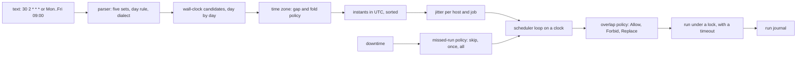

# cron Is a Clock, a Parser and a Missed-Run Policy

*A schedule is a set of wall-clock times; turning them into instants and deciding what to do with the missed ones is the real job.*

## Metadata

| Field | Value |
|---|---|
| Type | Build |
| Languages | Python |
| Prerequisites | [A Service Is a Process With a Contract: systemd Units From Scratch](https://cloudcaptain.io/learn/linux/systemd-unit-runner) |
| Time | 75 minutes |
| Tools | crontab, systemd-analyze, systemd-run, flock, kubectl |

<Quiz stage="pre" />

## The Problem

A billing export runs from root's crontab on a server in Frankfurt as `30 2 * * *`. On the last Sunday of March finance asks why the file arrived at 03:00 instead of 02:30, and on the last Sunday of October the same job, moved to an in-house Python scheduler built on a cron library, runs twice and the export contains every invoice two times. The team then rewrites it as a systemd timer with `OnCalendar=*-*-* 02:30`, and next March the export does not arrive at all. Three tools, three different answers to the same question: what happens to a wall-clock time that does not exist, or that exists twice?

Meanwhile a `*/5` inventory sync starts taking seven minutes on Mondays. Cron does not care: it starts the next copy on time, and two copies write the same output file. Someone adds a lock file that the script creates at start and deletes at exit; the first time the job is killed by the OOM killer, the lock stays behind and the sync never runs again until somebody notices. The fix after that deletes the lock in a `trap`, which reopens a race between two copies. In the same week a host is down for maintenance from 01:00 to 04:00, the nightly backup simply does not happen, and nobody knows for six days because cron has no memory of the runs it missed. And when the fleet's `0 0 * * *` cleanup job fires on 2,000 machines in the same second, the artifact server falls over.

None of this is exotic. A scheduler is a parser that turns text into sets of minutes, hours and days, a clock that turns wall-clock times in a time zone into real instants, and a set of policies: what to do when a run would overlap the previous one, what to do with the runs that were due while nothing was running, and how to spread a fleet out. You are going to build `minicron`, which makes each of those decisions explicit, and then read `crontab`, systemd timers, `flock` and the Kubernetes CronJob as different choices for the same questions.

## The Concept

A cron expression is five sets: minutes, hours, days of the month, months and days of the week. Matching is set membership, with one irregular rule that every implementation carries for compatibility: if both day fields are restricted, a day matches when **either** matches (`0 0 13 * 5` is "the 13th and every Friday", not "Friday the 13th"); if one of them is `*`, only the other one counts. What counts as `*` is where implementations part ways: Vixie cron and its descendants (cronie, Debian's cron) look at the first character of the field, so `*/2` is a star and the rule becomes AND, while the Go library behind the Kubernetes CronJob controller (robfig/cron) and Python's croniter treat a stepped star as a restriction and use OR. The same line can run on different days in a crontab and in a CronJob.

The sets describe **wall-clock** times. A time zone turns a wall-clock time into an instant, and twice a year that mapping breaks. In spring an hour is skipped: in Berlin 02:30 on the last Sunday of March does not exist. In autumn an hour repeats: 02:30 happens at 00:30 UTC and again at 01:30 UTC. Every scheduler needs a **gap policy** (shift the run to the end of the gap, or skip it) and a **fold policy** (run at the first occurrence only, or at both). The real tools do not agree:

| Scheduler | Skipped time (gap) | Repeated time (fold) |
|---|---|---|
| cronie and Debian cron, fixed-time job such as `30 2 * * *` | runs once, right after the change | runs once |
| cronie and Debian cron, job with `*` in the minute or hour field | not run | runs again |
| systemd `OnCalendar=` | not run | first occurrence only |
| croniter | runs once at the end of the gap | runs at both |

The safest schedule avoids the question: run in UTC, or pick a time outside 01:00 to 03:00 local time.

After the clock come the policies. **Overlap**: a run that is still going when the next one is due can be allowed, the new one skipped (`flock -n`, Kubernetes `concurrencyPolicy: Forbid`) or the old one killed (`Replace`). **Missed runs**: when the scheduler was not running at a due time, it can skip them (cron), run once on start (systemd `Persistent=true`, a Kubernetes CronJob), or run all of them (a backfill), usually with a deadline after which a late run is pointless. **Jitter**: a delay per host and job so a fleet does not fire in the same second (`RandomizedDelaySec=`).



## Build It

`code/main.py` is `minicron`, standard library only, with `zoneinfo` for the time zone database. Parsing and next-run computation are pure functions; the scheduler runs on a `VirtualClock`, so a week of schedules is simulated in milliseconds; only `run` touches real processes and locks.

### Step 1: five fields become five sets

Each field is a comma list of items; an item is `*`, a value, a range `a-b`, and optionally a step `/n`. `5/20` means "from 5 to the end, every 20", and month and weekday names are accepted. The parser also records the two ideas of "this field is a star":

```python
base, slash, step_text = item.partition("/")
step = 1
if slash:
    if not step_text.isdigit() or int(step_text) == 0:
        raise ScheduleError(f"{name}: step {step_text!r} must be a positive number")
    step = int(step_text)
if base == "*":
    start, end = lo, open_end
    robfig_star = robfig_star or step == 1
elif "-" in base:
    first, _, last = base.partition("-")
    start, end = cron_value(first, name, lo, hi, names), cron_value(last, name, lo, hi, names)
    if start > end:
        raise ScheduleError(f"{name}: range {base} runs backwards")
else:
    start = cron_value(base, name, lo, hi, names)
    end = open_end if slash else start
values.update(range(start, end + 1, step))
```

The function returns the set, `text.startswith("*")` (the Vixie rule) and `robfig_star`. Day-of-week 7 is folded into 0, both meaning Sunday. Errors name the field and the bound (`minute: 60 is outside 0-59`), and six fields get a hint: either a Quartz-style seconds field or an `/etc/cron.d` line with its user column.

### Step 2: the day rule and the dialect

```python
def matches_date(self, day: date) -> bool:
    if day.month not in self.months:
        return False
    in_month = day.day in self.days
    in_week = cron_weekday(day) in self.weekdays
    if self.day_rule == "and":
        return in_month and in_week
    return in_month or in_week
```

`day_rule` is `"and"` when either day field counts as a star in the chosen dialect. `--dialect vixie` (the default) reproduces cronie; `--dialect robfig` reproduces the Kubernetes CronJob controller and croniter. `minicron explain '0 0 */2 * 1'` prints both sets, the rule in effect and a warning that the other dialect disagrees.

### Step 3: wall-clock candidates, a day at a time

Iterating minute by minute would take five million steps to prove that `0 0 30 2 *` never runs. Walking days and expanding only matching days is cheap, and the walk gives up after ten years without a match, which is longer than the longest gap between two leap days (2096 to 2104):

```python
def wall_times(self, start: date) -> Iterator[datetime]:
    day = last_match = start
    while day - last_match <= MAX_GAP:
        if self.matches_date(day):
            last_match = day
            for hour in self.hours:
                for minute in self.minutes:
                    yield datetime(day.year, day.month, day.day, hour, minute)
        day += timedelta(days=1)
```

These are naive datetimes: times on a wall clock, not yet instants.

### Step 4: from wall time to instants, gap and fold

PEP 495 gave Python's datetimes a `fold` attribute: for a repeated time, `fold=0` is the first occurrence and `fold=1` the second; for a skipped time the two folds give the offsets from before and after the change. Converting both and back is enough to classify a wall time:

```python
first = wall.replace(tzinfo=zone, fold=0).astimezone(UTC)
second = wall.replace(tzinfo=zone, fold=1).astimezone(UTC)
if first == second:
    return [(first, "")]
first_real = first.astimezone(zone).replace(tzinfo=None) == wall
second_real = second.astimezone(zone).replace(tzinfo=None) == wall
if first_real and second_real:
    clock = wall.strftime("%H:%M")
    if fold == "first":
        return [(first, f"fold: {clock} happens twice, first one only")]
    return [(first, f"fold: {clock} happens twice, first"), (second, f"fold: {clock} happens twice, second")]
if gap == "skip":
    return []
instant = transition_instant(min(first, second), max(first, second), zone)
return [(instant, f"gap: {wall:%H:%M} does not exist, run at the end of the gap")]
```

`transition_instant()` bisects between the two candidate instants for the second at which the UTC offset changes; that is 03:00 CEST for any time in Berlin's skipped hour. `--gap` and `--fold` choose the policy; `auto` applies cronie's rule for cron expressions (a job with `*` at the start of the minute or hour field is a wildcard job: skip the gap, run both folds; otherwise shift and run once) and systemd's rule for `OnCalendar`.

### Step 5: put the instants in order

Folds make the mapping non-monotonic: 02:30 CEST (00:30 UTC) comes after 02:00 CEST but before 02:00 CET (01:00 UTC), and a shifted gap run can land on the same instant as the real 03:00. `iter_runs()` keeps a heap and only releases an instant once no later wall time can produce an earlier one; no UTC offset is larger than 14 hours, so 26 hours of look-ahead is safe:

```python
for wall in schedule.wall_times((start_wall - timedelta(days=1)).date()):
    for instant, note in resolve_wall(wall, zone, gap, fold):
        if instant <= after:
            continue
        if instant in pending:
            if not note:
                pending[instant] = (wall, note)
            continue
        pending[instant] = (wall, note)
        heapq.heappush(heap, instant)
    horizon = wall.replace(tzinfo=UTC) - SAFE_MARGIN
    while heap and heap[0] < horizon:
        yield release(heapq.heappop(heap))
```

Duplicates collapse to one run, and the real 03:00 wins over a shifted 02:00, so `0 * * * *` with `--gap shift` still runs once at 03:00.

### Step 6: the systemd OnCalendar subset

`OnCalendar=` is `[weekdays] [year-month-day] [hour:minute[:second]] [zone]`, with `..` for ranges, `/` for repetition, `~` for "days before the end of the month" and shorthands such as `daily` and `quarterly`. Two differences from cron matter: the weekday and the date are combined with AND, and there are seconds. `parse_calendar()` builds the same kind of sets plus the normalized form that `systemd-analyze calendar` prints, including its quirks: a range with a step is clipped to the last value it reaches (`0..23/6` becomes `00..18/6`) and three or more consecutive weekdays become a range:

```python
if repeat == 1 and stop is None:
    stop = hi
if repeat == 1:
    repeat = None
if stop is not None and repeat is not None:
    stop = start + ((stop - start) // repeat) * repeat
    if stop == start:
        stop = repeat = None
components.add(Component(start, stop, repeat))
```

`Persistent=true` is a statement about the past: systemd stores the time a timer last triggered, and when the timer starts (at boot, or after `daemon-reload`) it fires once immediately if at least one elapse was due in between. `timer_activation()` computes exactly that: the missed elapses since `last_trigger`, whether the timer fires on activation, and the next regular elapse.

### Step 7: jitter that is stable per host and job

A random delay per run spreads load but makes a run's start unpredictable. Hashing the host name and the job name gives every machine its own fixed offset, the idea behind systemd's `FixedRandomDelay=`:

```python
def jitter_seconds(key: str, max_seconds: int) -> int:
    if max_seconds <= 0:
        return 0
    digest = hashlib.sha256(key.encode("utf-8")).digest()
    return int.from_bytes(digest[:8], "big") % max_seconds
```

### Step 8: the scheduler loop on a virtual clock

`Scheduler.run_until()` expands every job's schedule in the window into fire events (scheduled instant plus jitter), adds a restart event at the end of each downtime window and processes the heap in time order: finishes before restarts before fires at the same instant. A fire while the scheduler is down is only remembered. Everything else goes through the overlap policy:

```python
def _attempt(self, job: Job, scheduled: datetime, reason: str) -> None:
    active = self.running[job.name]
    if active and job.concurrency == "Forbid":
        self._log("skip", job.name, scheduled, "previous run still active (Forbid)")
        return
    if active and job.concurrency == "Replace":
        for run in active:
            self._log("kill", job.name, run.scheduled, "replaced by a newer run (Replace)")
        active.clear()
```

At restart `_catch_up()` applies the missed-run policy: `skip` journals every missed run, `once` starts only the latest, `all` starts each one; with a `deadline`, a run that is older than the deadline is journaled as missed instead, which is what `startingDeadlineSeconds` does for a CronJob. Every decision lands in the journal with the time it was taken, the scheduled time it belongs to and the reason.

### Step 9: one run, under a lock, with a timeout

`minicron run` is the wrapper you put in a crontab line. It waits for its jitter, takes an `flock(2)` lock without blocking, and gives up with exit code 75 (`EX_TEMPFAIL`) if another copy holds it:

```python
descriptor = os.open(path, os.O_RDWR | os.O_CREAT, 0o644)
try:
    fcntl.flock(descriptor, fcntl.LOCK_EX | fcntl.LOCK_NB)
except OSError as exc:
    os.close(descriptor)
    if exc.errno in (errno.EWOULDBLOCK, errno.EAGAIN, errno.EACCES):
        return None
    raise
os.ftruncate(descriptor, 0)
os.write(descriptor, f"{os.getpid()} {int(time.time())}\n".encode())
return descriptor
```

The file is truncated only after the lock is held, and it is never deleted: deleting a lock file lets a third process create a new file with a new inode and lock that while the second still holds the old one. The descriptor is passed to the child (`pass_fds`), as `flock(1)` does, so the lock lives as long as the job even if the wrapper is killed, and the kernel drops it when the last holder exits, crash or not. That is why a flock lock cannot go stale. The `--pidfile` mode shows the alternative that can: an `O_EXCL` file with a PID, which needs `pidfile_state()` to decide whether the owner is dead or the file is older than `--stale-after`. The command runs in its own session; after `--timeout` seconds its whole process group gets `SIGTERM`, then `SIGKILL`, and the exit code is 124 like `timeout(1)`. `--journal` appends one JSON line per run.

### Step 10: run it

```bash
cd code
python3 main.py explain '0 0 */2 * 1'
python3 main.py next '30 2 * * *' --tz Europe/Berlin --from 2026-03-27T12:00Z -n 3
python3 main.py next '30 2 * * *' --tz Europe/Berlin --from 2026-10-24T12:00Z -n 3 --fold both
python3 main.py next '*/30 * * * *' --tz America/New_York --from 2026-11-01T04:50Z -n 5 --json
python3 main.py calendar 'Mon..Fri 09:00 Europe/Berlin' --base-time 2026-11-11T08:00Z --iterations 3
python3 main.py calendar daily --base-time 2026-05-04T08:00Z --last-trigger 2026-05-01T00:00Z --persistent
python3 main.py simulate --jobs fixtures/jobs.json --from 2026-03-27T23:00Z --to 2026-03-28T04:00Z --down 2026-03-28T00:10Z/2026-03-28T03:05Z
python3 main.py run --name backup --lock /tmp/backup.lock --timeout 600 --jitter 120 --dry-run --json -- /usr/local/bin/backup
```

The first `next` prints 02:30 CET on Saturday, then `2026-03-29T03:00:00+02:00` with the note `gap: 02:30 does not exist, run at the end of the gap`, then 02:30 CEST on Monday. With `--fold both` the October Sunday shows 02:30 twice, an hour apart in UTC. The simulation journal shows `sync` skipping every other run because seven minutes do not fit in five, `refresh` killing its predecessor, and at 03:05 the restart: `backup` caught up once, `rollup` started three times, `sync` and `refresh` journaling their misses.

<RunTests />

## Use It

**crontab.** `crontab -e` edits the current user's table, `crontab -l` lists it. A user crontab line is five fields and a command; files in `/etc/cron.d/` and `/etc/crontab` have a user column between them. The command runs through `/bin/sh` with a minimal environment, and `%` is a newline unless escaped, which is why `date +%F` in a crontab silently breaks.

```bash
crontab -l
cat /etc/cron.d/e2scrub_all 2>/dev/null
grep CRON /var/log/syslog | tail -5              # or: journalctl -u cron -n 20
echo '17 3 * * * root flock -n -E 75 /run/lock/backup.lock timeout 3600 /usr/local/bin/backup' | sudo tee /etc/cron.d/backup
```

That last line is `minicron run --lock ... --timeout ...` with the real tools: `flock -n` refuses to wait, `-E 75` sets the exit code on conflict, `timeout` sends `SIGTERM` and exits 124. cron runs in the system time zone; cronie also reads a `CRON_TZ=` line, but check `man 5 crontab` on your distribution before relying on it.

**systemd timers.** `systemd-analyze calendar` is the parser and clock you built, with the same output shape:

```bash
systemd-analyze calendar --iterations=5 'Mon..Fri 09:00 Europe/Berlin'
TZ=Europe/Berlin systemd-analyze calendar --iterations=3 --base-time='2026-03-28 12:00 UTC' '*-*-* 02:30'
systemctl list-timers --all
sudo systemd-run --unit cc-demo --on-calendar='*:0/15' --timer-property=RandomizedDelaySec=5min /bin/true
systemctl show cc-demo.timer -p NextElapseUSecRealtime -p LastTriggerUSec
sudo systemctl stop cc-demo.timer
```

The second command shows systemd skipping the March gap: the next elapse after Saturday is Monday. A timer unit is a pair: `backup.timer` with `[Timer] OnCalendar=*-*-* 02:30`, `Persistent=true`, `RandomizedDelaySec=15min` and `[Install] WantedBy=timers.target`, and the `backup.service` it starts (the unit you wrote in the prerequisite lesson). systemd never starts a second copy of a running service, so `Forbid` is built in. `Persistent=true` keeps the last trigger time under `/var/lib/systemd/timers/` and fires once at the next activation if an elapse was missed. `AccuracySec=` (one minute by default) lets systemd coalesce wake-ups, so a timer can fire up to a minute late on purpose; set it lower only when that matters.

**Kubernetes CronJob.** The controller evaluates the schedule with the robfig rules from Step 2, in the controller's zone unless `spec.timeZone` names an IANA zone (`CRON_TZ=` inside `schedule` is rejected):

```yaml
apiVersion: batch/v1
kind: CronJob
metadata:
  name: report
spec:
  schedule: "30 2 * * *"
  timeZone: "Europe/Berlin"
  concurrencyPolicy: Forbid
  startingDeadlineSeconds: 3600
  successfulJobsHistoryLimit: 3
  failedJobsHistoryLimit: 1
  jobTemplate:
    spec:
      backoffLimit: 2
      activeDeadlineSeconds: 1800
      template:
        spec:
          restartPolicy: Never
          containers:
            - name: report
              image: alpine:3.22
              command: ["sh", "-c", "echo report && sleep 5"]
```

```bash
kubectl get cronjob report -o wide
kubectl get jobs -o custom-columns=NAME:.metadata.name,OWNER:.metadata.ownerReferences[0].name   # report-29907450: the suffix is the scheduled time in Unix minutes
kubectl get events --field-selector involvedObject.name=report  # JobAlreadyActive when Forbid skipped a run
kubectl create job report-manual --from=cronjob/report          # a run outside the schedule, ignoring concurrencyPolicy
kubectl patch cronjob report -p '{"spec":{"suspend":true}}'
```

`concurrencyPolicy` is the overlap policy (`Allow` is the default). Missed runs are always "run once": after downtime or a suspension the controller starts the most recent missed schedule, and with `startingDeadlineSeconds` only if it is younger than the deadline. The documentation also warns that more than 100 missed schedules since the last run are treated as an error, so set a deadline and the controller only looks back that far. It also says a CronJob creates a Job "approximately once" per schedule: two or zero are possible, so the job itself must be idempotent, and a lock or a unique key in its output is still your job.

| What you built | Real tool | Note |
|---|---|---|
| `parse_cron()`, `--dialect vixie` | cronie, Debian cron | first character `*` decides the day rule |
| `--dialect robfig` | Kubernetes CronJob, croniter | `*/2` in a day field is a restriction, so OR applies |
| `resolve_wall()` with `auto` | cron(8) daylight-saving rules | fixed-time jobs shift and run once, wildcard jobs follow the new clock |
| `parse_calendar()`, `normalized` | `systemd-analyze calendar`, `OnCalendar=` | weekday AND date, seconds, `~`, zone suffix |
| `timer_activation()` | `Persistent=true`, `/var/lib/systemd/timers/` | fires once on activation, never a backfill |
| `jitter_seconds()` | `RandomizedDelaySec=`, `FixedRandomDelay=` | cron has none; add it in the wrapper |
| `concurrency` Allow, Forbid, Replace | `concurrencyPolicy`, `flock -n`, one instance per systemd unit | Forbid is the safe default for anything that writes |
| `missed` skip, once, all and `deadline` | cron, systemd, CronJob, `startingDeadlineSeconds` | only backfill tools such as Airflow's catchup run all |
| `run --lock`, `--timeout`, exit 75 and 124 | `flock -n -E 75`, `timeout`, `activeDeadlineSeconds` | the lock file is never deleted |
| run journal | `journalctl -u backup.service`, `kubectl get jobs`, events | cron itself keeps none: log from the wrapper |

<Quiz stage="check" />

## Ship It

Two artifacts in `outputs/`:

- **`skill-scheduled-job-review.md`**: a review runbook for a scheduled job in a crontab, a systemd timer or a Kubernetes CronJob. It checks the expression and its dialect, the time zone and the DST behaviour of the scheduler in use, overlap and locking, missed runs and deadlines, jitter, timeouts, idempotence and how failures become visible, with commands for each and a report format.
- **`prompt-explain-cron-expression.md`**: paste a cron expression or an `OnCalendar=` line and the scheduler that runs it, and get the fields in plain words, the next runs, the day-rule and DST traps for that scheduler, and the equivalent line for the other two schedulers.

<ShipIt />

## Exercises

### Easy

Add robfig's `@every <duration>` (`@every 90s`, `@every 1h30m`): runs at a fixed interval counted from the scheduler's start, independent of the wall clock and therefore of DST. Tests first: `next_runs()` for `@every 90s` from `10:00:00Z` gives `10:01:30Z`, `10:03:00Z`, `10:04:30Z`; a day containing the Berlin spring gap still has exactly 960 runs; `@every 0s` and `@every 5x` are rejected with exit code 2.

### Medium

Read real crontab files. Parse a user crontab and an `/etc/cron.d` file (with its user column) into `simulate` jobs: skip comments, honour `SHELL=`, `MAILTO=` and `CRON_TZ=` lines in the order they appear, reject a `%` that is not escaped with the line number, and support `@reboot` as a job that runs only at scheduler start. Tests first: a fixture file with six entries yields the right schedules and users, and a simulation across a downtime window reports the misses per line.

### Hard

Model the Kubernetes CronJob controller instead of a generic scheduler: keep `lastScheduleTime`, compute the missed schedules between it and now (or since `now - startingDeadlineSeconds`) on every sync, flag more than 100 of them the way the CronJob documentation describes, start only the most recent one, and journal the events `SuccessfulCreate` and `JobAlreadyActive`. Then check it against kind: suspend a CronJob with a `* * * * *` schedule for three minutes, resume it, and assert that the controller and your model both start exactly one Job, for the latest minute.

<Quiz stage="post" />

## Key Terms

| Term | Common misconception | Precise definition |
|---|---|---|
| Day rule | "`0 0 13 * 5` means Friday the 13th." | When both day-of-month and day-of-week are restricted, a day matches if either matches; when one counts as `*`, only the other applies. Whether `*/2` counts as `*` depends on the implementation. |
| DST gap | "The job just runs an hour later." | Wall-clock times that do not exist because the clock jumped forward. A scheduler shifts the run to the end of the gap (cronie for fixed times, croniter) or skips it (systemd, cronie for wildcard jobs). |
| DST fold | "A time zone maps every wall time to one instant." | Wall-clock times that happen twice because the clock went back. PEP 495's `fold=0` and `fold=1` name the two instants; a scheduler runs at the first only or at both. |
| Missed-run policy | "cron catches up after a reboot." | What happens to runs that were due while the scheduler was down: skip them (cron), run once (systemd `Persistent=true`, CronJob), or run each (backfill), optionally only within a deadline. |
| `concurrencyPolicy` | "A CronJob never runs twice at once." | The overlap policy of a CronJob: `Allow` (default) starts the new Job anyway, `Forbid` skips it while a previous Job is active, `Replace` deletes the active Job and starts the new one. |
| `flock -n` | "A lock file is a file that exists." | An advisory lock on an open file description, taken without waiting; the kernel releases it when the last descriptor closes, so a crashed holder never leaves a stale lock. Deleting the file breaks it. |
| `Persistent=` | "Persistent timers run every missed elapse." | systemd records the last trigger time on disk; at activation, if one or more elapses were missed, the service is started once, immediately. |
| Jitter | "Random delay makes runs unpredictable." | A delay added to each run's start so many hosts do not fire at once; a hash of host and job name makes it fixed per host (`FixedRandomDelay=`), a fresh draw per run makes it vary (`RandomizedDelaySec=` alone). |
| `startingDeadlineSeconds` | "It is a timeout for the job." | How late a CronJob run may start; a schedule older than this when the controller gets to it is counted as missed. The job's run time limit is `activeDeadlineSeconds`. |

## Further Reading

- [Bash Advanced: Cron Automation](https://cloudcaptain.io/docs/tools/bash/advanced): crontab syntax and wrapper habits for scripts run from cron.
- [Linux System Administration](https://cloudcaptain.io/docs/tools/linux/administration): the crontab, `/etc/crontab` and anacron sections, the system side of what you simulated.
- [Kubernetes Workloads](https://cloudcaptain.io/docs/tools/kubernetes/workloads): Jobs and CronJobs, the controller you compared against in the smoke test.
- [crontab(5)](https://man7.org/linux/man-pages/man5/crontab.5.html) and [cron(8)](https://man7.org/linux/man-pages/man8/cron.8.html): the day-of-month or day-of-week rule, `CRON_TZ`, and the daylight-saving paragraph behind the `auto` policy.
- [systemd.time(7)](https://man7.org/linux/man-pages/man7/systemd.time.7.html) and [systemd.timer(5)](https://man7.org/linux/man-pages/man5/systemd.timer.5.html): the full `OnCalendar=` grammar, `Persistent=`, `RandomizedDelaySec=`, `FixedRandomDelay=` and `AccuracySec=`.
- [flock(2)](https://man7.org/linux/man-pages/man2/flock.2.html): lock lifetime, open file descriptions and why the lock survives `fork` and `exec`.
- [Kubernetes CronJob](https://kubernetes.io/docs/concepts/workloads/controllers/cron-jobs/): `concurrencyPolicy`, `startingDeadlineSeconds`, `timeZone`, the 100-missed-schedules rule and the "approximately once" warning.
- [PEP 495: Local Time Disambiguation](https://peps.python.org/pep-0495/): the `fold` attribute that Step 4 uses to find gaps and folds.
