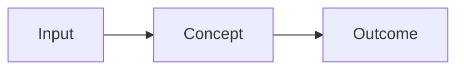

# A Tool Is Not Done Until Someone Else Can Install It

*TODO: one line that states the core idea.*

## Metadata

| Field | Value |
|---|---|
| Type | Build |
| Languages | Python |
| Prerequisites | None |
| Time | 75 minutes |
| Tools | TODO |

<Quiz stage="pre" />

## The Problem

TODO: two or three paragraphs. A concrete scenario of what goes wrong without this concept.

## The Concept

TODO: the intuition, then a diagram. No code here.



## Build It

TODO: the from-scratch implementation, step by step, standard library only.

```bash
python3 code/main.py --help
```

<RunTests />

## Use It

TODO: the same job with the real tool. Compare it with what you built.

<Quiz stage="check" />

## Ship It

TODO: what the learner takes away, saved in outputs/.

<ShipIt />

## Exercises

### Easy

TODO

### Medium

TODO

### Hard

TODO

<Quiz stage="post" />

## Key Terms

| Term | Common misconception | Precise definition |
|---|---|---|
| TODO | TODO | TODO |
| TODO | TODO | TODO |
| TODO | TODO | TODO |
| TODO | TODO | TODO |
| TODO | TODO | TODO |

## Further Reading

- [TODO Reference page](https://cloudcaptain.io/docs/tools/docker/fundamentals) — why to read it.
