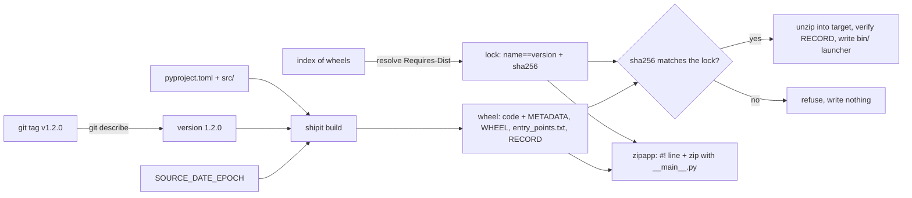

# A Tool Is Not Done Until Someone Else Can Install It

*A wheel is a zip plus a hash manifest: build it byte for byte from a tag, lock what it needs, and install nothing whose hash is wrong.*

## Metadata

| Field | Value |
|---|---|
| Type | Build |
| Languages | Python |
| Prerequisites | [CLI Design](https://cloudcaptain.io/learn/scripting/cli-design) |
| Time | 75 minutes |
| Tools | python -m build, pip, flit_core, uv, pipx, zipapp, PyInstaller |

<Quiz stage="pre" />

## The Problem

The platform team's `envcheck` script started as one file in a repository. The README says "clone the repo, `pip install -r requirements.txt`, run `python envcheck.py`". `requirements.txt` says `colorama` with no version. On Monday a new `colorama` release changes an import, and every CI job that installs fresh fails while every laptop keeps working. On Tuesday someone copies the script into a container image with an older Python, and it dies on a syntax error nobody saw locally. On Wednesday a bug is fixed and released as 1.4, but `envcheck --version` still prints 1.3 because the version lives in three places and only two were edited.

Then the questions get harder. Security asks which exact files were installed on the release runner last month, and nobody can say, because pip downloaded "whatever matched" and kept no record. A contractor asks for a build of 1.4 to verify it matches what is in production, and the rebuilt archive has a different checksum every time, so "matches" cannot be checked at all. A mirror serves a modified copy of a dependency, and the install succeeds, because nothing compared the file with anything.

A tool is finished when someone who is not you can install it, on a machine that is not yours, and get the same bytes you tested. That is a handful of mechanisms, not a ceremony: a file format (the wheel), metadata that installers read, a version derived from one source of truth, a lock that names exact files by hash, and an installer that checks the hash before it writes anything. You are going to build `shipit`, which does each of these from scratch, and then do the same job with `python -m build`, pip, uv and pipx and see that they agree with you field for field.

## The Concept

A **wheel** is a zip archive with a fixed layout. Installing a pure-Python wheel is, almost literally, unzipping it into `site-packages` and writing a small launcher for each command. Its file name is data: `cc_envcheck-1.2.0-py3-none-any.whl` is the distribution name (lower case, runs of `-_.` turned into `_`), the version, and three compatibility tags: the Python tag (`py3`: any Python 3), the ABI tag (`none`: no compiled extension) and the platform tag (`any`). A wheel with C extensions says `cp312-cp312-manylinux_2_28_x86_64` instead, and pip picks the file whose tags match the interpreter.

Inside, next to the code, sits one `<name>-<version>.dist-info/` directory. **`METADATA`** is the core metadata in email-header format: `Name`, `Version`, `Summary`, `Requires-Python`, one `Requires-Dist` per dependency, `License-Expression`, and the README as the message body. **`WHEEL`** says which version of the wheel format this is and whether the files go to purelib. **`entry_points.txt`** has a `[console_scripts]` section, `cc-envcheck = cc_envcheck.cli:main`, from which the installer writes an executable `bin/cc-envcheck` that imports `main` and calls it. **`RECORD`** lists every file with `sha256=` plus the URL-safe base64 of its digest without padding, and its size; RECORD lists itself with empty fields, because a file cannot contain its own hash.

**Reproducible** means the same source gives the same bytes. A zip stores a timestamp, permission bits and an order for every entry, so a naive build differs every second. Fix all three: timestamps come from `SOURCE_DATE_EPOCH` (the commit time, by convention), entries are sorted, modes are fixed, and the compression level is pinned. Then the sha256 of the wheel is a fact anyone can check by rebuilding.

The **version** has one source of truth: the Git tag. `git describe` reports the latest tag, how many commits came after it and the abbreviated commit. On the tag the version is the tag; three commits later it is `1.2.1.dev3+gabc1234`, a PEP 440 development release that sorts after 1.2.0 and before 1.2.1, with a local label naming the commit. PyPI refuses local labels, which is the point: such builds are for testing, not for release.

A **lock** turns ranges into facts. `pyproject.toml` says what the tool can work with (`cc-colors>=1.1,<2`); the lock says what this release uses (`cc-colors==1.1.0`) and which file, by hash. A resolver walks the graph: for each requirement, the highest version that satisfies every constraint so far, skipping pre-releases, then that version's own `Requires-Dist`. The installer then refuses any file whose sha256 is not in the lock. Note the difference from RECORD: RECORD is written by whoever built the wheel, so it catches corruption, not tampering; a rebuilt malicious wheel carries a perfectly consistent RECORD. The hash in your lock is the one thing an attacker cannot rewrite.



A **zipapp** is the other way to ship: Python can run a zip file that contains `__main__.py`, and because a zip's directory is at its end, a `#!/usr/bin/env python3` line can sit in front of it. One file, no installation, but it needs a Python on the target and only pure-Python dependencies (compiled extensions cannot load from inside a zip). When the target has no Python at all, a freezer such as PyInstaller bundles an interpreter into an executable per operating system and architecture.

## Build It

`code/main.py` is `shipit`, standard library only. Everything that touches Git goes through a `runner` callable, so the tests fake `git describe`; everything else works on bytes and temporary directories. The sample tool it ships is in `code/sample/`: `cc-envcheck`, a 40-line CLI that checks environment variables and colours its output through a dependency, `cc-colors`, which depends on `cc-term`. Those two live in a fixture index that `shipit index` builds from `code/fixtures/index.json`.

### Step 1: read pyproject.toml

Python 3.9 has no TOML parser, and the project table is the contract every build tool reads, so `shipit` parses the subset `pyproject.toml` files use: tables, dotted keys, strings, integers, booleans, arrays across lines, inline tables and arrays of tables. Arrays are the one place a value spans lines:

```python
def array(self) -> list:
    self.pos += 1
    items = []
    while True:
        self.skip_blank()
        if self.peek() == "]":
            self.pos += 1
            return items
        items.append(self.value())
        self.skip_blank()
        if self.peek() == ",":
            self.pos += 1
        elif self.peek() != "]":
            raise self.fail("expected ',' or ']' in array")
```

Every error carries the file and line (`pyproject.toml:2: duplicate key name`). The smoke compares the parse of the sample with `tomllib` on Python 3.12.

### Step 2: load the project and refuse what you cannot ship

`load_project()` reads the PEP 621 `[project]` table and turns mistakes into messages that say what to change: a name that is not a valid distribution name, a version that is both static and dynamic, a `readme` that points nowhere, a `license = { text = ... }` table instead of an SPDX expression, or an import package it cannot find under `src/` or the root:

```python
if version is None and "version" not in dynamic:
    raise ConfigError(f"{path}: set project.version or list \"version\" in project.dynamic")
```

`[tool.shipit] version-source = "git"` says where a dynamic version comes from. Keys `shipit` does not implement are collected and printed as warnings, because silently dropping metadata is how a package loses its dependencies.

### Step 3: versions that sort correctly

PEP 440 versions are parsed into epoch, release, pre, post, dev and local parts, and compared by a key in which a development release sorts before its pre-releases, which sort before the final release, which sorts before post-releases:

```python
if self.pre is None and self.post is None and self.dev is not None:
    pre_key: tuple = (0,)
elif self.pre is None:
    pre_key = (3,)
else:
    pre_key = (1, PRE_RANK[self.pre[0]], self.pre[1])
post_key = (0,) if self.post is None else (1, self.post)
dev_key = (1,) if self.dev is None else (0, self.dev)
return (self.epoch, tuple(release), pre_key, post_key, dev_key)
```

Trailing zeros are dropped first, so `1.0` equals `1.0.0`. The version itself comes from `git describe --tags --long --dirty --match "v[0-9]*"`; a tag with distance 0 is the release, anything else is the next development version:

```python
if distance == 0 and not dirty:
    return GitVersion(str(tag_version), tag, 0, sha, False)
local = f"g{sha}" + (".dirty" if dirty else "")
return GitVersion(f"{next_dev_version(tag_version, distance)}+{local}", tag, distance, sha, dirty)
```

`next_dev_version()` bumps the last release number (`1.2.0` gives `1.2.1.devN`) or, after a pre-release tag, the pre-release number (`2.0.0rc1` gives `2.0.0rc2.devN`), the same scheme setuptools-scm calls guess-next-dev. With no tag at all the version is `0.1.devN` with N the commit count. If the module also has a `__version__` line that disagrees with the tag, `shipit` warns, because that is the "1.4 that says 1.3" bug.

### Step 4: METADATA, WHEEL, entry points and RECORD

`metadata_text()` writes core metadata 2.5 headers (2.5 added `Import-Name`, which flit_core 4 writes too) and the README as the message body. RECORD hashes use the URL-safe alphabet with the padding stripped:

```python
def record_hash(data: bytes) -> str:
    return "sha256=" + base64.urlsafe_b64encode(hashlib.sha256(data).digest()).rstrip(b"=").decode("ascii")
```

`wheel_entries()` assembles the archive: the code sorted by path, then the dist-info files, with RECORD computed over everything before it and placed last:

```python
def wheel_entries(project: Project, version: str, files: List[Tuple[str, bytes]]) -> List[Tuple[str, bytes]]:
    info = dist_info_dir(project.name, version)
    entries = sorted(files)
    entries.append((f"{info}/METADATA", metadata_text(project, version).encode("utf-8")))
    entries.append((f"{info}/WHEEL", wheel_text().encode("utf-8")))
    if project.scripts:
        entries.append((f"{info}/entry_points.txt", entry_points_text(project.scripts).encode("utf-8")))
    record_path = f"{info}/RECORD"
    entries.append((record_path, record_text(entries, record_path).encode("utf-8")))
    return entries
```

`package_files()` skips `__pycache__`, `.pyc` and dotfiles, so a build does not depend on what you happened to run before it.

### Step 5: make the zip reproducible

Every entry gets the same timestamp, the same permission bits and a Unix "made by" system, and the compression level is fixed:

```python
def zip_info(name: str, epoch: int, mode: int = 0o644) -> zipfile.ZipInfo:
    info = zipfile.ZipInfo(name, date_time=time.gmtime(max(epoch, ZIP_EPOCH_MIN))[:6])
    info.compress_type = zipfile.ZIP_DEFLATED
    info.create_system = 3
    info.external_attr = (stat.S_IFREG | mode) << 16
    return info
```

`source_date_epoch()` takes `SOURCE_DATE_EPOCH` from the environment, else the last commit time from `git log -1 --format=%ct`, else 1980-01-01, the earliest date a zip can store. Building the same commit twice now gives the same sha256, on your laptop and on the CI runner.

### Step 6: read a wheel back and verify it

`read_wheel()` is the installer's first step and `shipit inspect`'s whole job: parse the file name, find exactly one `.dist-info`, check that every archive entry is in RECORD with a matching hash and size, that every RECORD row exists, that no path is absolute or contains `..`, and that METADATA agrees with the file name. Problems are collected, not raised, so one run reports all of them.

### Step 7: lock with hashes

`scan_index()` reads every wheel in a find-links directory (name and version from the file name, `Requires-Dist` from METADATA, sha256 of the file). `resolve()` walks the requirements breadth first, picks the highest candidate that satisfies every constraint seen so far, and explains a conflict instead of guessing; it does not backtrack, which the Hard exercise fixes. `lock_text()` writes pip's own requirements format, so the same file works with `pip install --require-hashes`:

```text
cc-colors==1.1.0 \
    --hash=sha256:a827bf...
    # via cc-envcheck
cc-term==0.3.1 \
    --hash=sha256:212952...
    # via cc-colors
```

`cc-colors` 1.2.0rc1 and 2.0.0 are in the index; the pre-release is skipped because nothing asked for one, and 2.0.0 is outside `<2`. `cc-term~=0.3.0` means `>=0.3.0, ==0.3.*`, so 0.3.1 wins over 0.4.0.

### Step 8: install only what matches

The installer checks every hash before it writes a single file, so a mismatch leaves the target untouched:

```python
def verify_hashes(located: List[Tuple[LockEntry, Path]]) -> None:
    bad = []
    for entry, path in located:
        actual = file_sha256(path)
        if actual not in entry.hashes:
            bad.append(f"{entry.name}=={entry.version}: hash mismatch for {path.name}: expected {', '.join(entry.hashes)}, got {actual}")
    if bad:
        raise ShipitError("refusing to install, nothing was written:\n  " + "\n  ".join(bad))
```

`install_wheel()` then verifies RECORD, compares the installed RECORD with the new one (equal means `unchanged`, so a re-run is a no-op), removes the files of an older version listed in its RECORD, unzips, writes `INSTALLER`, and creates `bin/<script>` with a launcher that puts the target directory on `sys.path` and calls the entry point.

### Step 9: one file to copy

`build_zipapp()` puts the project's code, the locked dependencies' files and a generated `__main__.py` into one sorted, timestamp-fixed zip, and writes `#!/usr/bin/env python3` in front of it:

```python
buffer = io.BytesIO()
buffer.write(f"#!{interpreter}\n".encode("utf-8"))
write_zip(buffer, sorted(entries.items()), epoch)
```

The dist-info directories go in too, so `importlib.metadata.version("cc-envcheck")` still answers inside the zip.

### Step 10: run it

```bash
cd "$(mktemp -d)" && cp -R "$OLDPWD/code/sample" repo && S="python3 $OLDPWD/code/main.py"
git -C repo init -q && git -C repo add -A && git -C repo commit -qm "feat: first release" && git -C repo tag -a v1.2.0 -m v1.2.0
$S version --project repo --json                 # {"version": "1.2.0", "tag": "v1.2.0", "distance": 0, ...}
$S index "$OLDPWD/code/fixtures/index.json" --out index
$S lock --project repo --find-links index --out shipit.lock && cat shipit.lock
$S build --project repo --out dist               # built dist/cc_envcheck-1.2.0-py3-none-any.whl sha256=...
$S build --project repo --out dist2 --quiet && cmp dist/*.whl dist2/*.whl && echo identical
$S inspect dist/cc_envcheck-1.2.0-py3-none-any.whl
$S install --lock shipit.lock --find-links index dist/*.whl --target t   # installed x3; run it again: unchanged x3
t/bin/cc-envcheck HOME NOT_SET; echo "exit $?"   # ok HOME, missing NOT_SET, exit 1
$S zipapp --project repo --lock shipit.lock --find-links index --out cc-envcheck.pyz && ./cc-envcheck.pyz --version
echo x >> repo/README.md && git -C repo commit -qam docs && $S version --project repo   # 1.2.1.dev1+g<sha>, with a __version__ warning
```

<RunTests />

## Use It

The real build chain splits the job in two. A **build frontend** (`python -m build`, pip, uv) reads `[build-system]` from `pyproject.toml`, creates an isolated environment, installs the backend named in `requires`, and calls the PEP 517 hooks `build_sdist` and `build_wheel`. A **build backend** (flit_core, hatchling, setuptools, pdm-backend, uv_build) does what `shipit build` did. The sample names flit_core:

```bash
python3 -m venv .venv && . .venv/bin/activate
pip install build
python -m build code/sample                       # dist/cc_envcheck-1.2.0.tar.gz, then the wheel built from that sdist
python -m zipfile -l code/sample/dist/cc_envcheck-1.2.0-py3-none-any.whl
SOURCE_DATE_EPOCH=$(git log -1 --format=%ct) python -m build --wheel code/sample   # flit_core and hatchling honour it
pip hash code/sample/dist/*.whl                   # --hash=sha256:... for a requirements file
```

Without `SOURCE_DATE_EPOCH`, flit_core stamps the code files with their modification times, so two checkouts give two different wheels; with it, the wheel is byte-identical, which the smoke checks. Versions from Git are a backend plugin: setuptools-scm, hatch-vcs or the uv and pdm equivalents compute what `version_from_git()` computed.

Locks and hash checking:

```bash
uv pip compile pyproject.toml --generate-hashes -o requirements.txt    # the lock, in the format shipit writes
pip install --require-hashes -r requirements.txt                      # every requirement must be pinned with == and hashed
pip install --require-hashes --no-deps -r requirements.txt            # also refuse anything the lock forgot
uv lock && uv sync --locked                                            # uv.lock: cross-platform, hashes included
pip lock -e . -o pylock.toml                                          # recent pip, experimental: the PEP 751 standard lock format
```

`--require-hashes` turns on automatically as soon as one line carries `--hash`, and from then on an unhashed or unpinned requirement is an error. On a mismatch pip prints `THESE PACKAGES DO NOT MATCH THE HASHES FROM THE REQUIREMENTS FILE` with the expected and actual digests and installs nothing, exactly like `verify_hashes()`.

Installing tools rather than libraries is a separate problem: a CLI should not share an environment with your project's dependencies. pipx and uv give every tool its own virtual environment and put only its console scripts on `PATH`:

```bash
pipx install ./dist/cc_envcheck-1.2.0-py3-none-any.whl     # ~/.local/bin/cc-envcheck, its own venv
uv tool install cc-envcheck==1.2.0                          # the same with uv
uvx --from cc-envcheck==1.2.0 cc-envcheck --version         # run once in a cached throwaway environment
python -m zipapp stage -m cc_envcheck.cli:main -p "/usr/bin/env python3" -o cc-envcheck.pyz   # stage/ = an installed tree
pyinstaller --onefile --paths code/sample/src -n cc-envcheck code/sample/src/cc_envcheck/cli.py   # in a venv with cc-colors installed; one build per OS and CPU
```

PyInstaller is the answer when the target has no Python: it freezes the interpreter, your code and its dependencies into one executable. Build it on the oldest Linux you support (a binary linked against a newer glibc will not start on an older one) and expect one artifact per platform.

Publishing closes the loop. PyPI's trusted publishing lets a GitHub Actions job prove its identity with an OIDC token instead of a stored API token: the job requests `permissions: id-token: write`, `pypa/gh-action-pypi-publish` exchanges the token for a short-lived upload credential scoped to one project, and PyPI checks the repository, workflow file and environment you registered. The CI OIDC lesson later in the course builds that exchange from scratch. Upload the files you built and hashed; never rebuild in the publish job.

| What you built | Real tool | Note |
|---|---|---|
| `parse_toml()` subset | `tomllib` (Python 3.11+), `tomli` | multi-line strings, dates and floats are the parts you skipped |
| `load_project()` | PEP 621 validation in every backend | `python -m build` fails with the backend's message; `validate-pyproject` checks the schema alone |
| `version_from_git()` | setuptools-scm, hatch-vcs | same guess-next-dev scheme; they also write the version into a file at build time |
| `build_wheel()` | flit_core, hatchling, setuptools behind `python -m build` | same METADATA fields and RECORD; the smoke compares them field by field |
| `zip_info()` and `SOURCE_DATE_EPOCH` | backends that honour `SOURCE_DATE_EPOCH` | without it, file mtimes leak into the archive |
| `read_wheel()` | `pip install` RECORD checks, `wheel unpack`, `twine check` | twine checks the metadata renders on PyPI |
| `resolve()` + `lock_text()` | pip's resolver, `uv pip compile --generate-hashes`, `uv lock`, `pip lock` | real resolvers backtrack and evaluate markers such as `python_version` |
| `verify_hashes()` | `pip install --require-hashes` | both refuse before writing; pip prints `Expected sha256 ... Got ...` |
| `install_wheel()` + `bin/` launcher | pip, `pip install --target`, pipx, `uv tool install` | pip adds `INSTALLER`, `REQUESTED`, `direct_url.json` and compiles `.pyc` files |
| `build_zipapp()` | `python -m zipapp`, shiv, pex | shiv and pex unpack compiled dependencies to a cache so they can load |

<Quiz stage="check" />

## Ship It

Two artifacts in `outputs/`:

- **`skill-tool-release-checklist.md`**: a runbook for releasing an internal Python tool: check `pyproject.toml`, derive the version from the tag and stop on drift, build twice and compare hashes, verify the wheel and its metadata, lock dependencies with hashes, install into a clean environment and run the command, choose wheel, zipapp, pipx or a frozen binary from a decision table, publish with trusted publishing, and report in a fixed shape.
- **`prompt-review-pyproject.md`**: paste a `pyproject.toml` (and optionally the output of `python -m build` or `unzip -l` on the wheel) and get a review: metadata a user and an installer need, the build backend and its pin, dependency ranges versus a lock, version source, entry points, what will be in the wheel, and the fixes as a diff.

<ShipIt />

## Exercises

### Easy

Add optional dependencies. `[project.optional-dependencies] color = ["cc-colors>=1.1,<2"]` must produce `Provides-Extra: color` and `Requires-Dist: cc-colors>=1.1,<2; extra == "color"` in METADATA. Write the tests first: the METADATA lines for one and for two extras, a name that needs normalising (`Fancy_Colors` becomes `fancy-colors`), and the smoke's comparison with flit_core extended to `provides_extra`.

### Medium

Build a source distribution: `shipit sdist` writes `cc_envcheck-1.2.0.tar.gz` containing `cc_envcheck-1.2.0/PKG-INFO` (the same text as METADATA), `pyproject.toml`, the README and `src/`, reproducibly (sorted members, `mtime` from `SOURCE_DATE_EPOCH`, uid and gid 0, empty owner names, mode 0644, and a gzip header with no file name and a fixed mtime). Test that two builds are identical, then that `python -m build --wheel` run on the unpacked sdist produces a wheel whose RECORD matches the one `shipit build` makes from the repository.

### Hard

Make the resolver real: evaluate environment markers (`python_version`, `sys_platform`, `platform_machine`, `extra`, with `and`, `or` and parentheses) against a given environment, and backtrack when a later constraint rules out a version already picked. Start with a fixture index where the greedy walk fails: the app requires `cc-colors>=1` and `cc-term<0.4`, the newest `cc-colors` needs `cc-term>=0.4`, and only an older `cc-colors` works. Assert the backtracking resolver finds it, that an impossible set produces an error naming the chain of requirements, and that the lock is identical to what `uv pip compile --generate-hashes` writes for the same index.

<Quiz stage="post" />

## Key Terms

| Term | Common misconception | Precise definition |
|---|---|---|
| Wheel | "A compiled binary package." | A zip archive with a fixed layout and a file name that carries the distribution, version and compatibility tags (`py3-none-any` for pure Python). Installing it is unpacking plus writing launchers; nothing is built on the target. |
| Core metadata (`METADATA`) | "The same as `pyproject.toml`." | The email-header file in `.dist-info/` that installers and PyPI read: `Name`, `Version`, `Requires-Python`, `Requires-Dist`, `License-Expression` and the README as the body. The backend writes it from `[project]`; `pyproject.toml` is not in the wheel. |
| RECORD | "A signature that proves the wheel is genuine." | A CSV of every file's sha256 (URL-safe base64, no padding) and size, written by whoever built the wheel. It detects corruption and is checked on install; it does not detect a rebuilt malicious wheel, which carries a consistent RECORD. |
| Build backend (PEP 517) | "pip builds the package." | The library named in `[build-system] build-backend` (flit_core, hatchling, setuptools) that turns a source tree into an sdist and a wheel. Frontends such as `python -m build`, pip and uv only create the environment and call its hooks. |
| Reproducible build | "The same version number means the same file." | The same source and toolchain produce the same bytes. For zips that requires fixed timestamps (`SOURCE_DATE_EPOCH`), sorted entries, fixed permissions and a fixed compression level; then anyone can rebuild and compare sha256 digests. |
| Lock file with hashes | "`requirements.txt` with `==` pins." | Exact versions of the whole dependency graph plus the sha256 of each allowed file. `pip install --require-hashes` refuses any file whose digest is not listed, which pins the bytes, not only the version number. |
| Local version label | "Fine for releases, it just adds the commit." | The `+gabc1234` part of a PEP 440 version. It identifies a build, sorts after the same public version, and PyPI rejects uploads that carry one, so it marks development builds. |
| Console script entry point | "A shell script in the repository." | A `name = module:function` line under `[project.scripts]`, written to `entry_points.txt`; the installer generates a launcher in `bin/` that imports the module and calls the function with the right interpreter. |
| Zipapp | "A standalone executable." | A zip with `__main__.py` that Python runs directly, optionally prefixed with a `#!` line. It still needs a Python on the target and cannot load compiled extensions from inside the archive. |

## Further Reading

- [Python for DevOps Scripting](https://cloudcaptain.io/docs/tools/python/devops-scripting): the Reference page for virtual environments, dependencies and turning scripts into tools.
- [Binary distribution format](https://packaging.python.org/en/latest/specifications/binary-distribution-format/): the wheel specification: file name escaping, tags, `.dist-info`, RECORD and what installers must check.
- [Core metadata specifications](https://packaging.python.org/en/latest/specifications/core-metadata/): every METADATA field, which version introduced it, and the rules for `Requires-Dist` and `License-Expression`.
- [pyproject.toml specification](https://packaging.python.org/en/latest/specifications/pyproject-toml/): the `[project]` table from PEP 621, including `dynamic`, `scripts` and the SPDX `license` string.
- [PEP 517: a build-system independent format for source trees](https://peps.python.org/pep-0517/): the frontend and backend split and the hooks `python -m build` calls.
- [pip: secure installs](https://pip.pypa.io/en/stable/topics/secure-installs/): hash-checking mode, why every requirement must be pinned, and `--no-deps` with a complete lock.
- [SOURCE_DATE_EPOCH specification](https://reproducible-builds.org/specs/source-date-epoch/): the convention every reproducible build tool reads, and how to derive it from the last commit.
- [zipapp: manage executable Python zip archives](https://docs.python.org/3/library/zipapp.html): the interpreter line, `__main__.py`, and the limits on compiled extensions.
- [PyPI trusted publishers](https://docs.pypi.org/trusted-publishers/): publishing from CI with an OIDC token instead of a long-lived API token.
