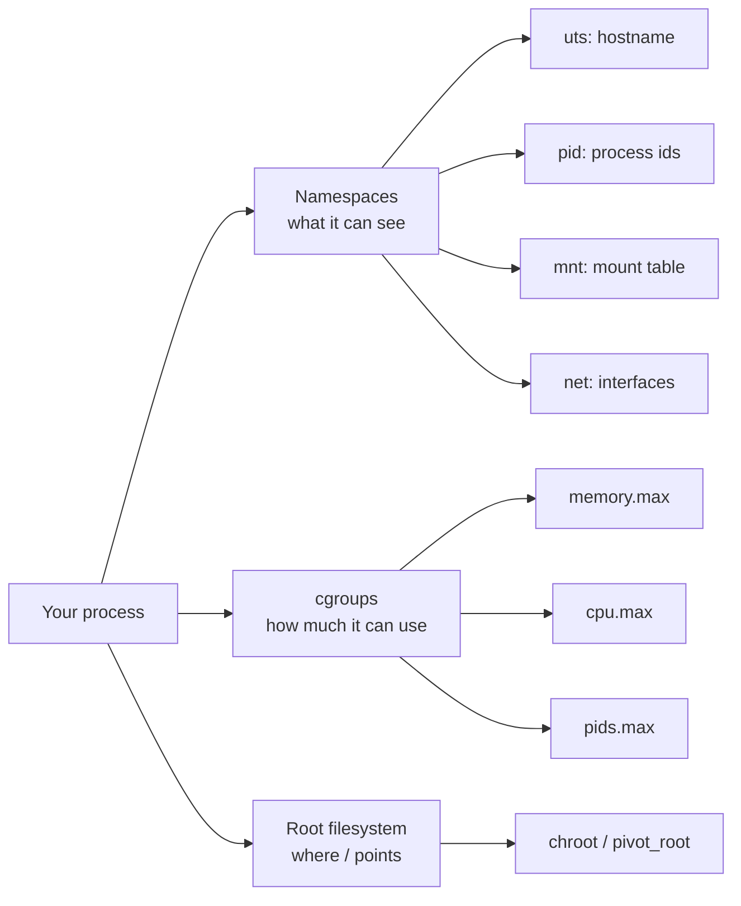

# Process Isolation: A Container Is Just a Process

*A container is an ordinary Linux process that has been told a careful set of lies.*

## Metadata

| Field | Value |
|---|---|
| Type | Build |
| Languages | Python, Bash |
| Prerequisites | None |
| Time | 90 minutes |
| Tools | docker, unshare, lsns, nsenter |

<Quiz stage="pre" />

## The Problem

Your service runs fine on your laptop. In production it keeps dying with exit code 137, the hostname in its logs is a twelve-character hash, and when you exec into it `ps` shows two processes on a machine that is running three hundred. A teammate asks whether a container is "a small VM". You say yes, then no, then "sort of".

Every one of those observations is a different kernel feature doing its job, and if you cannot name the feature you cannot debug it. Exit code 137 is a cgroup memory limit, not your code. The hash hostname is a UTS namespace. The two-process `ps` is a PID namespace plus a fresh `/proc` mount. None of it is virtualization: there is no second kernel and no hypervisor, only one process with a restricted view of the machine it shares with everything else.

In this lesson you build that restricted view yourself, in a few dozen lines of Python, so that every Docker flag you meet afterwards maps to something you have already typed.

## The Concept

A container is a process plus three kinds of restriction:

1. **Namespaces** decide what the process can *see*: hostnames (uts), process ids (pid), mount points (mnt), network interfaces (net), IPC objects (ipc), user ids (user).
2. **Control groups (cgroups)** decide how much it can *use*: memory, CPU time, number of processes, IO bandwidth.
3. **A root filesystem** decides where `/` *points*: a directory unpacked from an image, switched into with `chroot` or, in real runtimes, `pivot_root`.



Each restriction is independent. You can give a process its own hostname but let it see every host process, or limit its memory without changing what it sees at all. Docker, Podman and Kubernetes compose these pieces for you and add defaults (seccomp filters, dropped capabilities, read-only paths) on top. The pieces themselves are kernel features that any root process can request with two system calls, `unshare(2)` and `mount(2)`, and a handful of writes into `/sys/fs/cgroup`.

## Build It

You need a Linux machine or VM with root. On macOS or Windows, use the Setup phase lab VM or any small cloud instance; the `--explain` mode of the Python tool runs anywhere.

### Step 1: ask the kernel for the lies with util-linux

`unshare` from util-linux calls `unshare(2)` for you. This is `code/main.sh`:

```bash
sudo unshare --uts --pid --mount --fork --mount-proc /bin/sh
```

Inside the new shell:

```bash
hostname box
hostname          # box; in another terminal on the host: still the host's name
ps -eo pid,comm   # only sh and ps; you are PID 1
exit
```

Three flags, three namespaces. `--fork` exists because a new PID namespace only applies to *children* of the process that called `unshare`, and `--mount-proc` remounts `/proc` so `ps` reads the new namespace instead of the host's.

### Step 2: the same calls from Python

`code/main.py` does the same thing without util-linux, which is the point: you see every call. The flags are plain constants from `<sched.h>`:

```python
CLONE_NEWNS  = 0x00020000
CLONE_NEWUTS = 0x04000000
CLONE_NEWPID = 0x20000000

def unshare_flags(namespaces):
    flags = 0
    for namespace in namespaces:
        flags |= NAMESPACE_FLAGS[namespace]
    return flags
```

The parent unshares, then forks; the child becomes PID 1 of the new namespace, sets the hostname, makes the mount tree private so nothing leaks back to the host, mounts a fresh `/proc` and finally `exec`s your command:

```python
libc = ctypes.CDLL(None, use_errno=True)
libc.unshare(unshare_flags(spec.namespaces))
pid = os.fork()
if pid == 0:
    libc.sethostname(b"box", 3)
    libc.mount(None, b"/", None, MS_REC | MS_PRIVATE, None)
    libc.mount(b"proc", b"/proc", b"proc", 0, None)
    os.execvp(spec.command[0], spec.command)
os.waitpid(pid, 0)
```

Run it:

```bash
sudo python3 code/main.py --hostname box -- /bin/sh -c 'hostname; ps -eo pid,comm'
```

### Step 3: give it a root filesystem

A rootfs is just a directory. Borrow one from an image (this is the only time we touch Docker before Use It):

```bash
mkdir -p /tmp/alpine
docker export "$(docker create alpine:3.22)" | tar -C /tmp/alpine -xf -
ls /tmp/alpine
```

Now `chroot` into it from inside the namespaces:

```bash
sudo python3 code/main.py --hostname box --rootfs /tmp/alpine -- /bin/sh -c 'cat /etc/os-release; ls /; ps'
```

The process sees Alpine's `/`, its own hostname and only itself in `ps`. It is not in a VM; `uname -r` still prints the host kernel.

### Step 4: a memory budget with cgroup v2

Namespaces never limit anything. For that, the parent creates a cgroup, writes the limit and puts the child's PID in it. `cgroup_files()` computes exactly which two files to write:

```python
def cgroup_files(spec, pid):
    group = os.path.join(spec.cgroup_base, spec.name)
    return {
        os.path.join(group, "memory.max"): str(parse_memory(spec.memory)),
        os.path.join(group, "cgroup.procs"): str(pid),
    }
```

Prove the limit is real by allocating more than it allows:

```bash
sudo python3 code/main.py --name demo --memory 50M --rootfs /tmp/alpine -- \
  /bin/sh -c 'head -c 200m /dev/zero | tail'
echo "exit code: $?"            # 137 = 128 + SIGKILL, the OOM killer
cat /sys/fs/cgroup/demo/memory.events   # oom_kill 1
```

That exit code 137 is the one from The Problem.

### Step 5: dry run anywhere

`--explain` prints what would happen without touching the kernel, which is what the tests exercise:

```bash
python3 code/main.py --explain --memory 100M --rootfs /tmp/alpine -- /bin/sh
```

<RunTests />

## Use It

Docker composes the same three pieces, with better defaults, in one command:

```bash
docker run --rm -d --name box --hostname box --memory 100m --pids-limit 50 alpine:3.22 sleep 600
docker exec box sh -c 'hostname; ps -eo pid,comm; cat /sys/fs/cgroup/memory.max; cat /sys/fs/cgroup/pids.max'
```

From the host, look at the container as what it is, a process:

```bash
PID=$(docker inspect -f '{{.State.Pid}}' box)
sudo lsns -p "$PID"                      # one line per namespace; compare ids with: sudo lsns -p 1
cat /proc/"$PID"/cgroup                  # the cgroup Docker created for it
sudo nsenter -t "$PID" -u -p -m ps -eo pid,comm   # enter its namespaces without docker exec
docker rm -f box
```

Every flag you used maps onto something from Build It:

| What you built | Docker flag | What it changes |
|---|---|---|
| `--ns uts` + `sethostname` | `--hostname box` (uts namespace is always on) | Hostname inside the container |
| `--ns pid` + fresh `/proc` | default; `--pid=host` turns it off | Which processes are visible |
| `--ns mnt` + `chroot` | image layers + `-v` mounts | What `/` contains |
| `--ns net` | default bridge; `--network host` turns it off | Interfaces and ports |
| `memory.max` | `--memory 100m` | OOM kill threshold |
| `pids.max` | `--pids-limit 50` | Fork bombs |

Remove a lie to feel the difference:

```bash
docker run --rm --pid=host alpine:3.22 ps -eo pid,comm | head   # host processes, visible
docker run --rm --network host alpine:3.22 ip -brief addr        # host interfaces, visible
```

What Docker adds that you did not build: `pivot_root` instead of `chroot` (a chroot can be escaped by a root process), a default seccomp profile, dropped capabilities, a read-only `/proc/sys`, user-namespace remapping when enabled, and copy-on-write image layers instead of an exported directory. All of it sits on the same three pillars.

<Quiz stage="check" />

## Ship It

Two artifacts come out of this lesson, both in `outputs/`:

- **`prompt-explain-container-isolation.md`**: paste `docker inspect` and `lsns` output into any assistant and get back, layer by layer, what the container does and does not isolate, with the inspect field that proves each claim.
- **`skill-container-isolation-triage.md`**: a step-by-step skill for coding agents (and for you at 3 a.m.) that walks namespaces, cgroups and the root filesystem in order and ends with "layer → evidence → fix". Drop it into `.claude/skills/container-isolation-triage/SKILL.md` or the equivalent folder for your agent.

<ShipIt />

## Exercises

### Easy

Add `net` to the namespace list (`--ns uts,pid,mnt,net`) and run `ip -brief addr` inside. Explain why only `lo` appears and why it is down. Then bring it up with `ip link set lo up` and ping `127.0.0.1`.

### Medium

Add a `--cpu` option that writes `cpu.max`. `--cpu 0.5` should produce `50000 100000`. Write the tests first: a pure function from a float to the two-number string, with cases for `0.5`, `1`, `2` and an invalid `0`. Prove the throttle with `sha256sum /dev/zero` and `cpu.stat`.

### Hard

Replace `chroot` with `pivot_root`. You need to bind-mount the rootfs onto itself, `pivot_root(new_root, new_root/old_root)`, `chdir("/")`, then unmount `/old_root` with `MNT_DETACH`. Then demonstrate the escape that `chroot` allows and `pivot_root` prevents: from inside a chroot as root, create a directory, `chroot` into it, and `chdir("..")` repeatedly.

<Quiz stage="post" />

## Key Terms

| Term | Common misconception | Precise definition |
|---|---|---|
| Namespace | "Namespaces sandbox a process." | A kernel feature that gives a process its own instance of one global resource (hostname, PID table, mount table, network stack). It restricts visibility, not resource use or privilege. |
| cgroup | "cgroups isolate containers." | A hierarchy under `/sys/fs/cgroup` whose controllers account for and limit resources (memory, CPU, PIDs, IO) for the processes placed in a group. It limits use, not visibility. |
| PID 1 | "PID 1 is special only on the host." | The first process in a PID namespace. It reaps orphans and receives signals differently; a container whose main process is not signal-aware will ignore `SIGTERM`, which is why `docker stop` waits ten seconds and kills. |
| Root filesystem | "An image is a VM disk." | A directory tree (unpacked image layers) that a process is switched into with `chroot` or `pivot_root`. The kernel is still the host's. |
| chroot vs pivot_root | "chroot is how containers change /." | `chroot` changes a process's idea of `/` but can be escaped by root; `pivot_root` swaps the mount namespace's root mount and detaches the old one, which is what real runtimes use. |
| OOM kill (exit 137) | "The app crashed." | The kernel killed the process with `SIGKILL` because its cgroup exceeded `memory.max`; `memory.events` records it. 137 is 128 + 9. |
| Mount propagation | "A new mount namespace is a copy." | Mounts can be shared, slave or private between namespaces; new namespaces inherit shared propagation on systemd hosts, so runtimes mark the tree private first. |

## Further Reading

- [Docker Fundamentals](https://cloudcaptain.io/docs/tools/docker/fundamentals): the Reference-layer guide to images, containers and the Docker Engine, now that you know what sits underneath.
- [Linux Fundamentals](https://cloudcaptain.io/docs/tools/linux/fundamentals): processes, signals and the filesystem hierarchy, which this lesson leans on everywhere.
- [namespaces(7)](https://man7.org/linux/man-pages/man7/namespaces.7.html) and [cgroups(7)](https://man7.org/linux/man-pages/man7/cgroups.7.html): the authoritative descriptions, shorter than you expect.
- [Containers From Scratch, Liz Rice (GOTO 2018)](https://www.youtube.com/watch?v=8fi7uSYlOdc): the same build in Go, live, in forty minutes.
- [Kubernetes: pivot_root in runc](https://github.com/opencontainers/runc/blob/main/libcontainer/rootfs_linux.go): read `pivotRoot()` to see the Hard exercise done for real.
