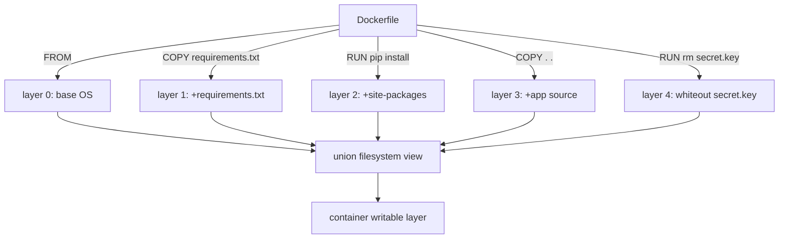

# Images Are Just Layers

*An image is a stack of tarballs and a JSON file; every byte you ship was put there by one line of a Dockerfile.*

## Metadata

| Field | Value |
|---|---|
| Type | Learn |
| Languages | Python |
| Prerequisites | [Process Isolation](https://cloudcaptain.io/learn/containers/process-isolation) |
| Time | 45 minutes |
| Tools | docker |

<Quiz stage="pre" />

## The Problem

The API image is 1.4 GB. Every deploy pulls it onto twelve nodes, CI spends four minutes on `docker pull`, and the security scanner flags a private key that a teammate swears they deleted "in the next line of the Dockerfile". Someone suggests `docker image prune`. Someone else suggests a bigger runner.

None of that helps because none of it touches the actual object. An image is not a disk snapshot you can clean up afterwards. It is an ordered list of read-only layers, each one a tarball produced by one Dockerfile instruction, plus a small JSON config that says how to stack them. Deleting a file in a later instruction adds a marker that hides the file; the bytes stay in the earlier layer and ship forever. Changing one line of source invalidates the cache for every instruction after it, which is why "we only changed a comment" rebuilds the dependency install.

Once you can read the layer stack, image size and leaked files stop being mysteries and become arithmetic.

## The Concept

Three objects make up an image:

1. **Layers**: each a tar archive of filesystem changes (added or modified files, plus *whiteout* markers for deletions), identified by the SHA-256 of its content.
2. **A config**: JSON with the environment, entrypoint, and a `history` list that records which instruction created each layer.
3. **A manifest**: the ordered list of layer digests plus the config digest, which is what a tag points to.

At run time a union filesystem (overlayfs on Linux) stacks the layers lowest-first and adds one thin **writable layer** for the container. Reads fall through the stack to the first layer that has the file; a whiteout stops the fall-through, so the file looks deleted.



Two consequences follow directly. **Cache is a prefix match**: a layer is reused only if its instruction and every layer before it are unchanged, so order your Dockerfile from least to most frequently changing. **Deletion is additive**: removing a file in a later instruction never shrinks the image; only never writing the file does.

## Build It

You are going to read a saved image byte by byte and account for every layer, without the Docker daemon's help. `docker save` writes an image as a tarball containing `manifest.json`, the config, and one tar per layer. `code/main.py` opens that archive and answers three questions: how big is each layer, which instruction made it, and which bytes are wasted.

### Step 1: list the layers and their instructions

The manifest gives the layer order; the config's `history` gives the instruction that produced each one. Entries marked `empty_layer` (like `CMD` or `ENV`) create no filesystem layer, so they are skipped when the two lists are zipped together:

```python
def history_instructions(config):
    instructions = []
    for entry in config.get("history", []):
        if entry.get("empty_layer"):
            continue
        text = entry.get("created_by", "")
        if text.startswith("/bin/sh -c #(nop) "):
            text = text[len("/bin/sh -c #(nop) "):]
        elif text.startswith("/bin/sh -c "):
            text = "RUN " + text[len("/bin/sh -c "):]
        instructions.append(" ".join(text.split()))
    return instructions
```

### Step 2: read one layer

Each layer is itself a tar. Regular files add to the layer's size; a member named `.wh.<name>` is a whiteout for `<name>`; `.wh..wh..opq` hides a whole directory from the layers below:

```python
def parse_layer(ref, data):
    layer = Layer(ref=ref)
    with open_layer(data) as tar:
        for member in tar.getmembers():
            name = normalize(member.name)
            directory, _, base = name.rpartition("/")
            if base == ".wh..wh..opq":
                layer.whiteouts.append(f"{directory}/*" if directory else "*")
            elif base.startswith(".wh."):
                layer.whiteouts.append(f"{directory}/{base[4:]}" if directory else base[4:])
            elif member.isfile():
                layer.files[name] = member.size
                layer.size += member.size
    return layer
```

### Step 3: find the bytes that are shipped but invisible

Walk the layers in order, remembering every file seen so far. A whiteout that matches a remembered file is a *deleted* file: its bytes are still in the image. A file written again in a later layer is *overwritten*: the earlier copy is also still in the image.

```python
def deleted_files(layers):
    seen, deleted = {}, []
    for index, layer in enumerate(layers):
        for target in layer.whiteouts:
            if target in seen:
                deleted.append((target, seen.pop(target), index))
        seen.update(layer.files)
    return deleted
```

### Step 4: run it

```bash
docker pull python:3.12-slim
docker save python:3.12-slim -o python.tar
python3 code/main.py python.tar
python3 code/main.py python.tar --top 3
python3 code/main.py python.tar --json | head -40
```

The tests build a tiny fake image in memory, with a secret that is copied in one layer and whited out in the next, so they run anywhere without Docker.

<RunTests />

## Use It

Docker exposes the same information through three commands. Compare them with what you just computed:

```bash
docker history --no-trunc --format 'table {{.Size}}\t{{.CreatedBy}}' python:3.12-slim
docker image inspect python:3.12-slim --format '{{json .RootFS.Layers}}' | python3 -m json.tool
docker image inspect python:3.12-slim --format '{{.Size}}'
```

`docker history` is `history_instructions()` with sizes. `RootFS.Layers` is the list of content digests, the same values a registry uses to skip layers it already has.

Now reproduce the leaked-secret problem on purpose:

```bash
mkdir -p /tmp/leak && cd /tmp/leak
echo "hunter2" > secret.key
cat > Dockerfile <<'EOF'
FROM alpine:3.22
COPY secret.key /secret.key
RUN rm /secret.key
EOF
docker build -t leak:1 .
docker run --rm leak:1 ls /          # no secret.key: the whiteout works
docker save leak:1 -o leak.tar
python3 ~/CloudCaptain/curriculum/phases/05-containers/02-image-layers/code/main.py leak.tar
```

The audit prints `deleted in layer 1: secret.key (8 B)`: still in the image, still in every registry copy. The fix is a build that never writes it:

```bash
cat > Dockerfile <<'EOF'
FROM alpine:3.22
RUN --mount=type=secret,id=key cat /run/secrets/key > /dev/null
EOF
docker build --secret id=key,src=secret.key -t leak:2 .
docker save leak:2 -o leak2.tar
python3 ~/CloudCaptain/curriculum/phases/05-containers/02-image-layers/code/main.py leak2.tar
```

Finally, watch the cache invalidate top-down. Edit one application file in any project with `COPY . .` before `RUN pip install`, rebuild, and read which steps say `CACHED`. Move the dependency `COPY` and `RUN` above the source `COPY`, rebuild twice, and compare.

| What you computed | Docker command | What it tells you |
|---|---|---|
| layer sizes + `created_by` | `docker history` | which instruction is expensive |
| layer digests | `docker image inspect` → `RootFS.Layers` | what a registry can skip |
| deleted / overwritten files | no built-in; `dive` or this tool | bytes you pay for but cannot see |
| the thin writable layer | `docker diff CONTAINER` | what a running container has changed |

<Quiz stage="check" />

## Ship It

One artifact in `outputs/`:

- **`prompt-image-layer-audit.md`**: paste `docker history` and the audit report into an assistant and get back a ranked rewrite plan (multi-stage build, cache mounts, secret mounts, `.dockerignore`, smaller base) with estimated savings taken from the real numbers, plus an explicit "rotate this" line if a deleted file looks like a credential.

<ShipIt />

## Exercises

### Easy

Run the audit against `nginx:alpine` and against `nginx:latest`. Which single layer accounts for most of the difference, and which Dockerfile instruction created it?

### Medium

Add `--min-size 1M` to `main.py` so small layers are hidden from the table, and make `--json` include each layer's digest from the config's `rootfs.diff_ids`. Write the tests first.

### Hard

Overwritten files are only counted once per path. Extend `shadowed_files()` so a file rewritten in three layers reports the bytes of every superseded copy, then handle `.wh..wh..opq` opaque whiteouts so that deleting a whole directory counts every file under it. Verify with an image that runs `apt-get install` and `rm -rf /var/lib/apt/lists/*` in **separate** instructions, then in the **same** instruction.

<Quiz stage="post" />

## Key Terms

| Term | Common misconception | Precise definition |
|---|---|---|
| Layer | "A layer is a snapshot of the whole filesystem." | A tar archive of the changes made by one instruction (added or modified files plus whiteouts), addressed by the digest of its content. |
| Whiteout | "`rm` in a Dockerfile removes the file from the image." | A marker file (`.wh.name`, or `.wh..wh..opq` for a directory) in a higher layer that hides a path from lower layers in the merged view. The lower bytes remain. |
| Digest | "Tags identify images." | The SHA-256 of a manifest, config or layer. Tags are mutable pointers to a digest; registries dedupe and verify by digest. |
| Build cache | "Docker caches by timestamp." | A layer is reused when its instruction and all previous layers are identical; the first change invalidates everything after it. |
| Writable layer | "Containers modify the image." | A per-container copy-on-write layer on top of the read-only stack, discarded on `docker rm`, frozen into a new image only by `docker commit`. |
| Multi-stage build | "Multi-stage builds are an optimisation for compiled languages." | A Dockerfile with several `FROM` stages where only files copied into the final stage ship; build tools, caches and secrets stay in earlier stages. |

## Further Reading

- [Dockerfile Deep Dive](https://cloudcaptain.io/docs/tools/docker/dockerfile-guide): instruction-by-instruction guide to ordering, cache mounts and multi-stage builds.
- [Docker Fundamentals](https://cloudcaptain.io/docs/tools/docker/fundamentals): images, containers and the Engine, now that you know what an image physically is.
- [Docker Cheat Sheet](https://cloudcaptain.io/docs/tools/docker/cheatsheet): `history`, `inspect`, `save`, `diff` and friends in one place.
- [OCI Image Layer Filesystem Changeset](https://github.com/opencontainers/image-spec/blob/main/layer.md): the specification for layer tars and whiteouts you just implemented.
- [dive](https://github.com/wagoodman/dive): an interactive version of this lesson's tool, worth keeping installed.
