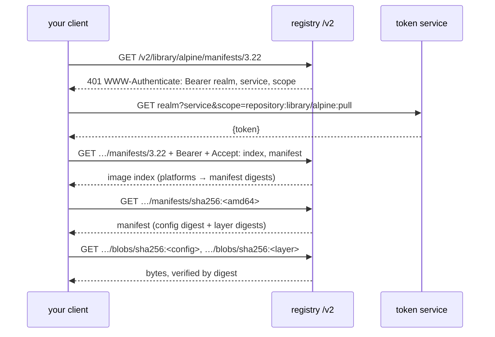

# Pull an Image With Plain HTTP: Registries Are Content-Addressed

*A registry is a web server that answers by hash; pull an image with nothing but HTTP and every layer becomes a request you can see.*

## Metadata

| Field | Value |
|---|---|
| Type | Build |
| Languages | Python |
| Prerequisites | [Images Are Just Layers](https://cloudcaptain.io/learn/containers/image-layers) |
| Time | 75 minutes |
| Tools | docker, crane, skopeo, curl |

<Quiz stage="pre" />

## The Problem

`ImagePullBackOff`. The event says `manifest unknown`. The image exists; you pushed it ten minutes ago from your laptop and ran it there. A different pod says `unauthorized: authentication required` even though the secret is "definitely configured". A third fails with `toomanyrequests` at 3 a.m. during a node rollout, and a fourth starts but dies with `exec format error`.

Four errors, one protocol. Every one of them is a specific HTTP request to the registry failing in a specific way: the token request, the manifest lookup, the platform selection in a multi-arch index, the blob download. People who have seen the requests read these errors in seconds. People who have only used `docker pull` see a black box.

In the previous lesson you took an image apart on disk. Now you fetch one from the network with nothing but HTTP, verify every byte by its hash, and turn the layers into a root filesystem you can run.

## The Concept

A registry implements the OCI Distribution API: a handful of HTTP endpoints under `/v2/`. Everything is **content-addressed**: blobs (layers, configs) are named by the SHA-256 of their bytes, a manifest lists blobs by digest, and a tag is a mutable pointer to a manifest digest. An **image index** (Docker: manifest list) maps platforms to manifests, which is how one tag serves amd64 and arm64.



Three consequences: pulls are incremental because digests the client already has are skipped; a tag can change but a digest cannot, so `image@sha256:…` is the reproducible reference; and any cache, mirror or proxy in between can be trusted exactly as far as the digests let it.

## Build It

`code/main.py` is `registry_pull`, a client with no dependencies beyond the standard library. The HTTP function is injected, so the tests run against an in-memory fake registry that implements the token challenge, an index, a manifest and blobs.

### Step 1: parse a reference

`alpine:3.22` means `registry-1.docker.io/library/alpine:3.22`; `ghcr.io/org/app@sha256:…` pins a digest. The rules are small but easy to get wrong, which is why they get tests:

```python
def parse_reference(text):
    digest = None
    if "@" in text:
        text, digest = text.split("@", 1)
    first, _, rest = text.partition("/")
    if rest and ("." in first or ":" in first or first == "localhost"):
        registry, path = first, rest
    else:
        registry, path = "registry-1.docker.io", text
    tag = None
    if ":" in path.rsplit("/", 1)[-1]:
        path, tag = path.rsplit(":", 1)
    if registry == "registry-1.docker.io" and "/" not in path:
        path = f"library/{path}"
    return Reference(registry, path, tag or ("latest" if not digest else None), digest)
```

### Step 2: the token dance

The first request comes back `401` with a `WWW-Authenticate` header. Parse `realm`, `service` and `scope`, fetch a token, retry with `Authorization: Bearer`:

```python
def parse_challenge(header):
    params = dict(re.findall(r'(\w+)="([^"]*)"', header))
    realm = params.get("realm")
    query = {k: v for k, v in params.items() if k in ("service", "scope")}
    return realm + "?" + urllib.parse.urlencode(query)
```

Anonymous pulls use the same flow; the token simply has an anonymous subject with `pull` scope on one repository.

### Step 3: manifest, index, platform

Ask for every media type you understand in `Accept`. If what comes back has a `manifests` list, it is an index: pick the entry for your platform and fetch that manifest by digest, verifying the body against the digest you asked for:

```python
def select_platform(index, os_name="linux", arch="amd64"):
    for entry in index.get("manifests", []):
        platform = entry.get("platform") or {}
        if platform.get("os") == os_name and platform.get("architecture") == arch:
            return entry
    raise LookupError(f"no manifest for {os_name}/{arch}")
```

### Step 4: blobs, verified

```python
def fetch_blob(self, ref, digest):
    status, _, body = self._get(ref, f"blobs/{digest}", ["*/*"])
    verify_digest(body, digest)
    return body
```

`verify_digest` raises on mismatch. The test suite includes a tampering registry that appends one byte to a layer; the pull must fail.

### Step 5: layers to a root filesystem, safely

Apply the layers in order with the whiteout rules from the previous lesson, and refuse any entry whose normalised path escapes the target directory. This is where real runtimes have had CVEs:

```python
def _safe_join(root, name):
    target = os.path.normpath(os.path.join(root, name))
    if not target.startswith(os.path.abspath(root)):
        raise ValueError(f"layer entry escapes rootfs: {name}")
    return target
```

### Step 6: run it

```bash
python3 code/main.py manifest alpine:3.22 --verbose              # watch the 401, the token, the index, the manifest
python3 code/main.py manifest alpine:3.22 --platform linux/arm64  # a different digest
python3 code/main.py rootfs alpine:3.22 --dest /tmp/alpine --json
ls /tmp/alpine/rootfs; cat /tmp/alpine/rootfs/etc/os-release
```

Then prove the rootfs is real by running it, with the container runtime from the first lesson or with Docker's import:

```bash
tar -C /tmp/alpine/rootfs -c . | docker import - hand-pulled:alpine
docker run --rm hand-pulled:alpine /bin/busybox echo "hello from a hand-pulled rootfs"
```

<RunTests />

## Use It

The tools people reach for are the same requests with better ergonomics:

```bash
docker pull alpine:3.22
docker manifest inspect alpine:3.22 | head -40          # the index: one entry per platform
docker image inspect alpine:3.22 --format '{{index .RepoDigests 0}}'
crane manifest alpine:3.22 | jq '.mediaType'              # crane: github.com/google/go-containerregistry
crane digest alpine:3.22
skopeo inspect --raw docker://alpine:3.22 | jq '.manifests[].platform'
skopeo inspect docker://alpine:3.22 | jq '{Architecture, Os, Layers}'
```

Do one request by hand to make it concrete:

```bash
TOKEN=$(curl -s "https://auth.docker.io/token?service=registry.docker.io&scope=repository:library/alpine:pull" | python3 -c 'import json,sys; print(json.load(sys.stdin)["token"])')
curl -s -H "Authorization: Bearer $TOKEN" \
  -H "Accept: application/vnd.oci.image.index.v1+json, application/vnd.docker.distribution.manifest.list.v2+json" \
  https://registry-1.docker.io/v2/library/alpine/manifests/3.22 | python3 -m json.tool | head -30
```

Now the four errors from The Problem, each reproduced on purpose:

| Error | Reproduce | Which request failed |
|---|---|---|
| `manifest unknown` | `crane manifest alpine:no-such-tag` | manifest GET: the tag does not exist in that repository |
| `unauthorized` | `crane manifest ghcr.io/some-org/private-image` | token has no pull scope, or the pull secret is missing on the pod |
| `toomanyrequests` | many anonymous pulls from one IP | the token or manifest GET; anonymous pulls are rate-limited, authenticate or mirror |
| `exec format error` | `docker run --platform linux/arm64 alpine uname -m` on an amd64 host without emulation | nothing failed: the index pick was for the wrong architecture |

In Kubernetes the same protocol runs inside containerd on each node, which is why `kubectl describe pod` events quote these exact messages, why `imagePullSecrets` matter per service account, and why pinning `image@sha256:…` turns a mutable tag into a verifiable artifact.

<Quiz stage="check" />

## Ship It

One artifact in `outputs/`:

- **`skill-registry-triage.md`**: a skill that maps every `ImagePullBackOff` message to the request that failed (token, authorization, manifest, platform, blob, TLS), replays it with `crane`, `skopeo` or three `curl` calls, and fixes it at the right layer (pull secrets, digest pinning, multi-platform builds, mirrors).

<ShipIt />

## Exercises

### Easy

Add `--platform` auto-detection from `platform.machine()` (`x86_64` → `amd64`, `arm64`/`aarch64` → `arm64`) so `python3 main.py rootfs alpine:3.22` does the right thing on any laptop. Tests first.

### Medium

Add a local blob cache: before downloading, check `~/.cache/registry_pull/<digest>`; after verifying, store it. Then pull `alpine:3.22` and `alpine:latest` and show which blobs were skipped. This is what makes layer sharing real.

### Hard

Implement the `push` side: `POST /v2/<repo>/blobs/uploads/`, `PATCH`/`PUT` the bytes with the digest, then `PUT` the manifest, against a local registry (`docker run -d -p 5000:5000 registry:2`). Verify with `crane manifest localhost:5000/...` that what you pushed is byte-identical to what you pulled, then explain in one paragraph why a registry can deduplicate across repositories without trusting the client.

<Quiz stage="post" />

## Key Terms

| Term | Common misconception | Precise definition |
|---|---|---|
| Digest | "A checksum for error detection." | `sha256:` of a blob or manifest's bytes; the blob's *name* in the registry, so content cannot change without its reference changing. |
| Manifest | "The image." | A JSON document listing the config digest and the layer digests (with sizes and media types) for one platform. |
| Image index | "An extra manifest Docker Hub adds." | A JSON document mapping platforms to manifest digests; what a multi-arch tag points to. |
| Tag | "A version." | A mutable name for a manifest digest; it can move. Pin digests when reproducibility matters. |
| Bearer token flow | "Only for private images." | The 401-challenge, token, retry sequence every pull performs; anonymous pulls get an anonymous token scoped to one repository. |
| Pull-through cache / mirror | "A speed optimisation." | A registry that fetches and stores upstream blobs by digest; it removes rate limits and upstream outages from your critical path. |
| Path traversal in layers | "Only a problem for tar." | An archive entry whose normalised path leaves the extraction root; runtimes must reject it, as yours does. |

## Further Reading

- [Docker Fundamentals](https://cloudcaptain.io/docs/tools/docker/fundamentals): images, tags and registries as the CLI presents them.
- [Docker Cheat Sheet](https://cloudcaptain.io/docs/tools/docker/cheatsheet): `pull`, `manifest inspect`, `login`, `buildx --platform`.
- [Docker Security & Production](https://cloudcaptain.io/docs/tools/docker/security-production): digest pinning, image signing and supply-chain controls that build on content addressing.
- [OCI Distribution Specification](https://github.com/opencontainers/distribution-spec/blob/main/spec.md): the endpoints you just called.
- [crane](https://github.com/google/go-containerregistry/blob/main/cmd/crane/README.md) and [skopeo](https://github.com/containers/skopeo): the two CLIs that speak this protocol without a daemon.
