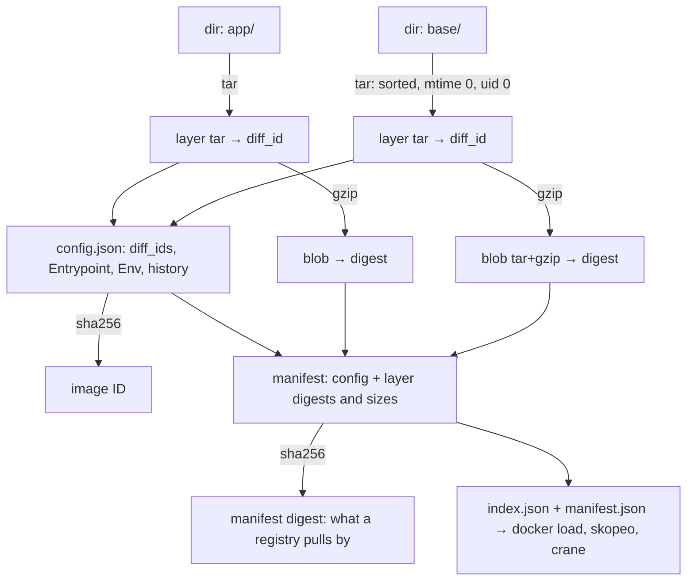

# Build an Image Without a Dockerfile: Layers, Config and Manifest by Hand

*A Dockerfile is a convenience; an image is three tar-and-JSON objects you can write yourself, and the daemon will load them.*

## Metadata

| Field | Value |
|---|---|
| Type | Build |
| Languages | Python |
| Prerequisites | [Image Layers](https://cloudcaptain.io/learn/containers/image-layers) |
| Time | 90 minutes |
| Tools | docker, skopeo, crane, buildah |

<Quiz stage="pre" />

## The Problem

The security team asks for reproducible images: build the same commit twice, get the same image ID, so a signature on one build vouches for the other. CI builds the release twice and gets two different IDs, because every `COPY` stamps the files with the current time. The platform team asks for a smaller attack surface, and the Go service that needs nothing but its binary still ships a shell, a package manager and `apk` metadata, because the Dockerfile started `FROM alpine` for the sake of being able to `COPY`. And the build pipeline runs Docker-in-Docker, with a privileged container, so that a daemon can assemble a tarball.

Every one of those is a Dockerfile problem, and none of them is an image problem. From the previous lesson you know what an image is: an ordered list of layers, each a tar of filesystem changes, plus a JSON config that says how to run them, plus a manifest that lists both by digest. Nothing in that description needs a daemon, a build context or a `FROM` line. BuildKit, buildah, ko, Jib, apko, Nix and `crane append` all produce those objects directly, and every one of them was written by someone who understood this lesson.

You are going to write `mkimage`: a tool that turns directories into layers, writes the config and manifest, packages everything so `docker load` and a registry both accept it, and re-derives every digest to prove the result is intact. Afterwards `docker build` is a program that produces a tar, image IDs are arithmetic, and "reproducible" is a property you can test.

## The Concept

Each layer has **two digests**. The `diff_id` is the SHA-256 of the uncompressed tar; it lives in the config and is what the daemon uses to identify the layer on disk. The blob digest is the SHA-256 of the compressed tar; it lives in the manifest and is what a registry stores and serves. Compress the same tar twice with different settings and the blob digest changes while the `diff_id` does not. Stacked layers are identified by **chain IDs**: the first chain ID is the first `diff_id`, and each next one is the SHA-256 of `"<previous chain id> <diff_id>"`, which is why a cache can tell "alpine plus my app" from "debian plus my app" even when the app layer is identical.

The **image ID** that `docker images` shows is the SHA-256 of the config file. The config embeds the `diff_ids`, so any byte that changes in any layer changes the ID; so does any change to the entrypoint, the environment or the timestamp. The **manifest digest** is what `docker pull name@sha256:…` addresses; it covers compressed blobs and the config, so the same image ID can have several manifest digests (one per compression or per registry re-push) and a multi-platform tag points at an index of manifests rather than at a config.



Reproducibility follows from the arithmetic. A tar records the modification time, owner and order of every entry, and gzip records a timestamp in its header; if any of those vary between builds, every digest varies. Build tools that promise reproducible images (BuildKit with `SOURCE_DATE_EPOCH` and `rewrite-timestamp`, apko, Nix, Bazel) all do the same three things you are about to do: sort the entries, pin the timestamps, drop the owner names.

## Build It

`code/main.py` is `mkimage`. Each `--layer DIR` becomes one layer; the config, manifest and index are derived from them; `write_archive()` packages the result; `verify_archive()` reads it back and recomputes every digest. The tests build a two-layer image from temporary directories and never touch Docker.

### Step 1: a deterministic layer

Walk the directory in sorted order, parents before children, and normalise every entry: fixed timestamp, root ownership, no user names. Symlinks and hard links are kept; devices and sockets are skipped.

```python
def normalise(info, epoch, keep_owners):
    info.mtime = epoch
    info.pax_headers = {}
    if not keep_owners:
        info.uid = info.gid = 0
        info.uname = info.gname = ""
    return info
```

A whiteout is just one more entry: `--delete etc/motd` adds an empty `etc/.wh.motd` to the last layer, exactly what `RUN rm /etc/motd` would have produced.

### Step 2: two digests

```python
def build_layer(source, epoch=0, keep_owners=False, deletes=()):
    raw = layer_tar(source, epoch, keep_owners, deletes)
    gz = gzip_bytes(raw)
    return Layer(source, raw, gz, sha256_digest(raw), sha256_digest(gz), ...)
```

`gzip_bytes()` opens the stream with `mtime=0`, otherwise the gzip header would carry the build time and the blob digest would change on every run while the `diff_id` stayed the same.

### Step 3: chain IDs

```python
def chain_ids(diff_ids):
    chain = []
    for diff_id in diff_ids:
        chain.append(diff_id if not chain else sha256_digest(f"{chain[-1]} {diff_id}".encode()))
    return chain
```

This is the value the daemon's layer store is keyed by and the reason `docker image inspect` can show the same `RootFS.Layers` for two images that share a base.

### Step 4: the config

```python
config = {
    "architecture": arch,
    "os": os_name,
    "created": rfc3339(epoch),
    "config": {"Entrypoint": [...], "Cmd": [...], "Env": [...], "WorkingDir": "...", "Labels": {...}},
    "rootfs": {"type": "layers", "diff_ids": [layer.diff_id for layer in layers]},
    "history": [{"created": rfc3339(epoch), "created_by": layer.created_by} for layer in layers],
}
```

`history` is what `docker history` prints. In a Dockerfile build every instruction writes one entry here; `mkimage` writes `mkimage --layer app` so the provenance is just as visible.

### Step 5: manifest and index

The manifest lists the config and the compressed layers with media types, digests and sizes. The index points at the manifest and carries the tag as an annotation, the same way `docker save` does since Docker 25:

```python
{"mediaType": MANIFEST_TYPE, "digest": sha256_digest(manifest), "size": len(manifest),
 "annotations": {"io.containerd.image.name": "docker.io/library/hand:1", "org.opencontainers.image.ref.name": "1"}}
```

### Step 6: one archive, two indexes

`write_archive()` emits an OCI image layout (`oci-layout`, `index.json`, `blobs/sha256/…`) and adds the legacy `manifest.json` that older daemons read, pointing at the same blobs. One tarball therefore works with `docker load` on any version, with `podman load`, and after `tar -x` with `skopeo` and `crane`. `verify_archive()` reads it back the way a daemon would: index to manifest to config to layers, checking every size and digest and decompressing each layer to confirm its `diff_id`.

### Step 7: run it

```bash
mkdir -p /tmp/hand/base /tmp/hand/app/app
CID=$(docker create alpine:3.22) && docker export "$CID" | tar -x -C /tmp/hand/base && docker rm "$CID"
echo "hello from a hand-built image" > /tmp/hand/app/app/hello.txt
printf '#!/bin/sh\ncat /app/hello.txt\n' > /tmp/hand/app/app/run.sh && chmod +x /tmp/hand/app/app/run.sh

python3 code/main.py build --layer /tmp/hand/base --layer /tmp/hand/app --tag hand:1 \
  --entrypoint /app/run.sh --env GREETING=hi --label org.opencontainers.image.title=hand \
  --delete etc/motd --out /tmp/hand/img.tar --oci-dir /tmp/hand/oci
python3 code/main.py verify /tmp/hand/img.tar
docker load -i /tmp/hand/img.tar
docker run --rm hand:1                                           # hello from a hand-built image
docker run --rm --entrypoint sh hand:1 -c 'test ! -e /etc/motd && echo motd whited out'
docker image inspect hand:1 --format '{{.Id}}'                   # equals "image id" printed by mkimage
docker image inspect hand:1 --format '{{json .RootFS.Layers}}'   # equals the diff_ids
docker history hand:1                                            # your created_by lines
```

Build twice and compare the archives with `cmp`: identical. Build once more with `--epoch 1700000000`: every digest moves.

<RunTests />

## Use It

`docker build` produces exactly these objects, so compare them. Write a Dockerfile that does what the two `--layer` directories did, save the result and look inside:

```bash
cd /tmp/hand && cat > Dockerfile <<'EOF'
FROM alpine:3.22
COPY app/app /app
RUN rm /etc/motd
ENV GREETING=hi
ENTRYPOINT ["/app/run.sh"]
EOF
docker build -t hand:dockerfile .
docker save hand:dockerfile -o df.tar && tar -tf df.tar          # index.json, oci-layout, blobs/sha256/…, manifest.json: the same shape
docker image inspect hand:dockerfile --format '{{.Id}} {{json .RootFS.Layers}}'
docker history hand:dockerfile                                   # one history row per instruction; ENV and ENTRYPOINT are empty_layer rows
```

Three layers where you made two (`COPY` and `RUN rm` are separate layers, so the whiteout is a layer of its own), and a different image ID every build, because `COPY` keeps the files' modification times. BuildKit can fix that the way `mkimage` does:

```bash
SOURCE_DATE_EPOCH=0 docker buildx build --output type=oci,dest=repro.tar,rewrite-timestamp=true -t hand:repro .
SOURCE_DATE_EPOCH=0 docker buildx build --output type=oci,dest=repro2.tar,rewrite-timestamp=true -t hand:repro .
cmp repro.tar repro2.tar && echo reproducible
```

Then the tools that skip the Dockerfile and the daemon entirely, each of which is `mkimage` with more features:

```bash
crane append -b alpine:3.22 -f <(tar -C /tmp/hand/app -c .) -t ttl.sh/hand-$RANDOM:1h     # add one layer to a base, push, no daemon
buildah from --name b scratch && buildah add b /tmp/hand/base / && buildah config --entrypoint '["/app/run.sh"]' b && buildah commit b hand:buildah
skopeo copy oci:/tmp/hand/oci:1 docker-daemon:hand:oci && docker run --rm hand:oci           # the OCI layout you wrote, imported by a registry tool
skopeo inspect --raw oci:/tmp/hand/oci:1 | python3 -m json.tool                              # your manifest, byte for byte
```

| What you built | Real tool | What it adds |
|---|---|---|
| `layer_tar()` from a directory | `COPY` / `ADD` in BuildKit, `buildah add`, `crane append -f` | build context, `.dockerignore`, cache mounts |
| normalised timestamps and owners | `SOURCE_DATE_EPOCH` + `rewrite-timestamp=true` in BuildKit, apko, Nix `dockerTools` | reproducibility as a build option instead of the default |
| config with `Entrypoint`, `Env`, `Labels` | `ENTRYPOINT`, `ENV`, `LABEL`; `buildah config`; `crane mutate` | `HEALTHCHECK`, `USER`, `EXPOSE`, `STOPSIGNAL` |
| `history` entries | `docker history` | one row per instruction, `empty_layer` for metadata-only ones |
| OCI layout + `manifest.json` in one tar | `docker save` (Docker 25+), `buildx --output type=oci` | multi-platform indexes, attestations |
| `verify_archive()` | `docker load` validation, `cosign verify`, `crane validate` | signatures and SBOM attestations over the same digests |

<Quiz stage="check" />

## Ship It

Two artifacts in `outputs/`:

- **`skill-reproducible-image.md`**: a skill that makes an existing image build reproducible and proves it: pin the base by digest, set `SOURCE_DATE_EPOCH`, rewrite timestamps, separate the metadata-only layers, build twice, compare image IDs and manifest digests with `crane` or `skopeo`, and report what still differs and why.
- **`prompt-review-image-config.md`**: paste `docker image inspect` output and get a review of the config the way a platform team reads it: entrypoint form, user, environment secrets, labels, layer count and history, platform, and reproducibility markers, with the fix for each finding.

<ShipIt />

## Exercises

### Easy

Add `--annotation KEY=value` to `mkimage build` so the manifest carries OCI annotations, and default the labels `org.opencontainers.image.created`, `org.opencontainers.image.source` and `org.opencontainers.image.revision` from the epoch and from `git` when it is available. Tests first.

### Medium

Add `--from image.tar`: start from an existing archive (one `mkimage` or `docker save` produced), keep its layers, `diff_ids` and `history`, and append the new `--layer` directories on top, the way `crane append` does. Verify with the audit tool from the Image Layers lesson that the base layers are byte-identical.

### Hard

Push the OCI layout to a registry over plain HTTP from Python: `POST /v2/<name>/blobs/uploads/` and a monolithic `PUT` per blob, then `PUT /v2/<name>/manifests/<tag>` with the right `Content-Type`. Test against `docker run -d -p 5000:5000 registry:3`, then `docker pull localhost:5000/<name>:<tag>` and compare the image ID with what `mkimage` printed. The Registry Pull lesson has the client half of this protocol.

<Quiz stage="post" />

## Key Terms

| Term | Common misconception | Precise definition |
|---|---|---|
| `diff_id` | "The layer's digest." | SHA-256 of the *uncompressed* layer tar. Listed in the config's `rootfs.diff_ids`; what the daemon identifies layers by on disk. |
| Layer digest | "The same as the diff_id." | SHA-256 of the *compressed* blob as stored by a registry. Listed in the manifest; changes if the compression changes, even when the content does not. |
| Chain ID | "Layers are cached by diff_id alone." | Recursive hash of the stack: the first `diff_id`, then `sha256("<previous chain id> <diff_id>")`. Identifies a layer *in position*, so the same app layer on two bases has two chain IDs. |
| Image ID | "The manifest digest." | SHA-256 of the config JSON. Since the config embeds the `diff_ids`, any change in any layer or in the runtime settings changes it. |
| Manifest digest | "The image ID." | SHA-256 of the manifest JSON, which lists compressed blobs. What `name@sha256:…` addresses; the same image ID can have several, and a multi-platform tag points at an index of them. |
| Media type | "Just a MIME type." | The string in each descriptor that tells a client how to parse the blob: image manifest, image index, config, `tar+gzip` layer, `tar+zstd` layer, or a signature or attestation. |
| Reproducible build | "Pin the base image." | Same inputs produce byte-identical outputs: sorted entries, fixed timestamps (`SOURCE_DATE_EPOCH`), fixed owners, deterministic compression, pinned base by digest. Verified by comparing digests, not by inspection. |

## Further Reading

- [Dockerfile Deep Dive](https://cloudcaptain.io/docs/tools/docker/dockerfile-guide): what each instruction does to the objects you just built, and how to order them for cache hits.
- [Docker Fundamentals](https://cloudcaptain.io/docs/tools/docker/fundamentals): images, containers and the Engine, now from the file format up.
- [Docker Cheat Sheet](https://cloudcaptain.io/docs/tools/docker/cheatsheet): `save`, `load`, `history`, `inspect`, `buildx` in one place.
- [DevSecOps Fundamentals](https://cloudcaptain.io/docs/tools/devsecops/fundamentals): signing and attestations, which are statements about the digests you computed.
- [OCI Image Manifest](https://github.com/opencontainers/image-spec/blob/main/manifest.md) and [Image Configuration](https://github.com/opencontainers/image-spec/blob/main/config.md): the two specifications `mkimage` implements, including the `diff_id` and chain ID definitions.
- [Reproducible Builds: SOURCE_DATE_EPOCH](https://reproducible-builds.org/docs/source-date-epoch/): the convention every build tool in this lesson honours.
- [crane](https://github.com/google/go-containerregistry/blob/main/cmd/crane/README.md): `append`, `mutate`, `validate` and `digest`, a daemonless toolbox for these objects.
