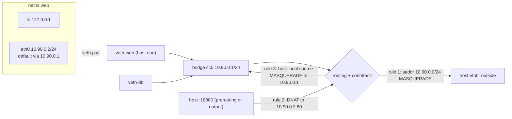

# A Container's Network Is a veth Pair, a Bridge and Three NAT Rules

*A container's eth0 is one end of a virtual cable; the other end is plugged into a bridge on the host, and NAT rules do the rest.*

## Metadata

| Field | Value |
|---|---|
| Type | Build |
| Languages | Bash, Python |
| Prerequisites | [Process Isolation](https://cloudcaptain.io/learn/containers/process-isolation) |
| Time | 90 minutes |
| Tools | docker, ip, nft, iptables, nsenter, bridge, curl |

<Quiz stage="pre" />

## The Problem

`docker run -d -p 8080:80 nginx` works on every laptop in the team. On the new server `curl localhost:8080` hangs, `docker ps` says the container is healthy and `docker logs` is empty, because no request ever arrived. Someone adds `--network host`, the page loads, and the ticket closes with "Docker networking is flaky". Two weeks later a security review asks why nginx is listening on every interface of the host. On another machine the hardening playbook ran `nft flush ruleset`, and every published port went dark at once while every container kept running. On a third, a sysctl baseline set `net.ipv4.ip_forward=0`, and containers could reach each other but nothing beyond the host.

None of those are Docker problems, and none of them are inside the container. A container's network is four kernel objects you can list, create and delete by hand: a network namespace (an empty network stack), a veth pair (a virtual cable with one end in each namespace), a bridge (a software switch in the host namespace that doubles as the containers' default gateway), and NAT rules in netfilter that rewrite addresses on the way in (a published port) and on the way out (so replies find their way back). `docker run -p` and a Kubernetes CNI plugin arrange exactly these objects. `--network host` skips all of them, which is why it "fixes" everything and explains nothing.

You are going to build that network as `ccnet`: a Bash script that creates the bridge, one namespace and veth pair per container, addresses, routes, DNS and the NAT rules (with `nft`, falling back to `iptables`), and a Python tool that hands out addresses, prints the exact commands before you run them, and verifies a running container's plumbing from `ip -j` and `nft -j` output. Afterwards `docker network inspect`, `nsenter -n`, `iptables -t nat -L DOCKER`, CNI and kube-proxy are all views on objects you have made yourself.

## The Concept

A new network namespace is a machine with no network card: it has a loopback interface, down, and nothing else. No routes, no firewall rules, no way to reach anything. To connect it you need a cable, and the kernel's cable is a **veth pair**: two interfaces created together, where a frame sent into one comes out of the other. One end moves into the namespace and is renamed `eth0`; the other end stays on the host and is plugged into a **bridge**, a layer-2 switch in software. Two containers on the same bridge talk to each other like two laptops on the same switch. Giving the bridge an address (10.90.0.1) makes the host a member of that segment, and turning on `ip_forward` makes it a router between the bridge and the outside world. That is the whole data path; everything else is addressing.

Private addresses do not travel, so the host rewrites them. Three NAT rules are enough:

1. **MASQUERADE for egress.** A packet from 10.90.0.0/24 leaving through any interface other than the bridge gets the host's address as its source. The reply comes back to the host, and conntrack rewrites it to the container.
2. **DNAT for a published port.** A packet for host port 18080 has its destination rewritten to 10.90.0.2:80 before routing. The rule sits in one chain, `publish`, that is reached from two hooks: `prerouting` for packets arriving from other machines, and `output` for packets the host itself sends, which never pass prerouting.
3. **MASQUERADE for host-local sources going onto the bridge.** After rule 2 a packet from `curl localhost:18080` still carries source 127.0.0.1. The container would answer its own loopback. Rewriting the source to the bridge address makes the container answer 10.90.0.1, and conntrack hands the reply back to `curl`. The kernel also refuses to route a loopback source out of a real interface until `route_localnet` is set on the bridge. Docker does both of these when its userland proxy is disabled; by default it runs a `docker-proxy` process for the loopback case instead.

**Conntrack** is what makes three rules sufficient. NAT is decided on the first packet of a flow, recorded in the connection tracking table, applied to every later packet of that flow and reversed for replies. A single DNAT rule therefore carries a whole TCP connection, and a rule flushed in the middle of a flow keeps working until the flow ends, which is why firewall breakage shows up as "new connections fail, old ones are fine".



NAT rewrites addresses; it does not grant passage. Whether a routed packet may continue is decided at the **forward hook** of the filter table, and every base chain registered at that hook sees the packet. Docker sets the `FORWARD` policy to `DROP` and accepts only its own bridges, so a second bridge on a Docker host (yours, libvirt's, a CNI bridge) is cut off until you add an accept in the `DOCKER-USER` chain, the one chain Docker promises not to rewrite. An accept in your own nft table cannot override a drop in Docker's.

Each namespace also sees its own `/etc/resolv.conf`: `ip netns exec` bind-mounts whatever is in `/etc/netns/NAME/` over `/etc/` for the command it runs. Docker writes a `resolv.conf` per container and, on user-defined networks, points it at an embedded resolver on 127.0.0.11 that knows container names. Kubernetes scales the same picture: a pod is one network namespace shared by all its containers, a CNI plugin performs the steps below once per pod (the `bridge` plugin does them literally; Cilium replaces bridge and NAT with eBPF programs), and a Service is a DNAT entry maintained by kube-proxy or by the CNI's datapath.

## Build It

`code/main.sh` is `ccnet`, the by-hand version: every line is an `ip`, `nft`, `iptables` or `sysctl` command you could type at a shell. `code/main.py` is the pure part: it hands out addresses from a JSON state file, renders the exact commands for a plan so that `--dry-run` and the tests can pin them, and verifies a running container from `ip -j` and `nft -j` JSON. You need a Linux machine or VM with root for `up`, `exec`, `down` and `purge`; `plan`, `explain --from-dir` and the tests run anywhere.

### Step 1: a bridge with an address, and forwarding on

```bash
ip link add cc0 type bridge
ip addr add 10.90.0.1/24 dev cc0
ip link set cc0 up
sysctl -qw net.ipv4.ip_forward=1
sysctl -qw net.ipv4.conf.cc0.route_localnet=1
```

The bridge is the switch; the address makes the host a member of the segment and the containers' gateway; `ip_forward` lets the host route between `cc0` and its other interfaces. `route_localnet` is for Step 4. `ensure_bridge()` in `main.sh` runs these only when `cc0` does not exist yet, so `up` is safe to repeat.

### Step 2: a namespace and a cable

```bash
ip netns add web
ip link add veth-web type veth peer name ceth-web
ip link set ceth-web netns web
ip -n web link set ceth-web name eth0
ip link set veth-web master cc0 up
```

The namespace starts with `lo` only, down. The veth pair is born in the host namespace; one end is moved into `web` and renamed `eth0`, the other stays and becomes a port of `cc0` (`master`). Interface names are limited to fifteen characters, which is why `validate_name()` in `main.py` caps container names at ten: `veth-` plus the name must fit.

### Step 3: an address, a loopback and a default route

```bash
ip -n web addr add 10.90.0.2/24 dev eth0
ip -n web link set lo up
ip -n web link set eth0 up
ip -n web route add default via 10.90.0.1
```

`ip -n web` is shorthand for `ip netns exec web ip`. Nothing in the container works without the loopback; nothing outside the subnet works without the default route pointing at the bridge address.

### Step 4: three NAT rules, with nft or iptables

`main.sh` chooses the dialect once:

```bash
detect_backend() {
  if command -v nft >/dev/null 2>&1; then echo nft
  elif command -v iptables >/dev/null 2>&1; then echo iptables
  else die "neither nft nor iptables found; install the nftables package"
  fi
}
```

With `nft`, the table holds three base chains hooked into the nat stage, a plain chain for published ports, and the two masquerades:

```bash
nft add table ip ccnet
nft "add chain ip ccnet prerouting { type nat hook prerouting priority -100; policy accept; }"
nft "add chain ip ccnet output { type nat hook output priority -100; policy accept; }"
nft "add chain ip ccnet postrouting { type nat hook postrouting priority 100; policy accept; }"
nft add chain ip ccnet publish
nft add rule ip ccnet prerouting fib daddr type local jump publish
nft add rule ip ccnet output fib daddr type local jump publish
nft add rule ip ccnet postrouting ip saddr 10.90.0.0/24 oifname != cc0 masquerade
nft add rule ip ccnet postrouting oifname cc0 fib saddr type local masquerade
```

`fib daddr type local` asks the routing table whether the destination is one of the host's own addresses, so only traffic aimed at the host is examined for published ports. The last two lines are rules 1 and 3 from The Concept. The `iptables` fallback says the same thing in the older dialect, using `addrtype` where nft uses `fib`:

```bash
iptables -t nat -N CCNET
iptables -t nat -A PREROUTING -m addrtype --dst-type LOCAL -j CCNET
iptables -t nat -A OUTPUT -m addrtype --dst-type LOCAL -j CCNET
iptables -t nat -A POSTROUTING -s 10.90.0.0/24 ! -o cc0 -j MASQUERADE
iptables -t nat -A POSTROUTING -o cc0 -m addrtype --src-type LOCAL -j MASQUERADE
```

On current distributions `iptables` is `iptables-nft`, a translator that writes nftables rules through the old syntax; both backends end in the same kernel subsystem. The ruleset is the only place where `ccnet` has to speak two languages.

### Step 5: the published port, and the Docker trap

Rule 2 is added per container, tagged with a comment so `down` can find it again (`nft` deletes rules by handle, not by content):

```bash
publish_port() {
  local name="$1" ip="$2" spec="$3" proto="tcp"
  if [[ "$spec" == */* ]]; then proto="${spec##*/}"; spec="${spec%/*}"; fi
  local hport="${spec%%:*}" cport="${spec##*:}"
  case "$BACKEND" in
    nft) nft add rule ip "$TABLE" publish "$proto" dport "$hport" dnat to "$ip:$cport" comment "\"ccnet:$name\"" ;;
    iptables) ipt -A "$CHAIN" -p "$proto" --dport "$hport" -m comment --comment "ccnet:$name" -j DNAT --to-destination "$ip:$cport" ;;
  esac
}
```

Then the trap. If Docker is installed, its `FORWARD` policy is `DROP`, and packets routed between `cc0` and the outside die there, NAT or no NAT. `main.sh` adds two accepts to `DOCKER-USER` when that chain exists and removes them on `purge`:

```bash
open_forward_on_docker_hosts() {
  command -v iptables >/dev/null 2>&1 || return 0
  iptables -w -nL DOCKER-USER >/dev/null 2>&1 || return 0
  iptables -w -C DOCKER-USER -i "$BRIDGE" -j ACCEPT 2>/dev/null || iptables -w -I DOCKER-USER -i "$BRIDGE" -j ACCEPT
  iptables -w -C DOCKER-USER -o "$BRIDGE" -j ACCEPT 2>/dev/null || iptables -w -I DOCKER-USER -o "$BRIDGE" -j ACCEPT
}
```

`-C` checks whether the rule already exists so repeated `up` calls do not stack duplicates.

### Step 6: DNS inside the namespace

```bash
mkdir -p /etc/netns/web
echo "nameserver 1.1.1.1" > /etc/netns/web/resolv.conf
```

`ip netns exec web ...` bind-mounts `/etc/netns/web/resolv.conf` over `/etc/resolv.conf` for the process it starts. Copying the host's file is the usual mistake: on systemd-resolved hosts it points at 127.0.0.53, the host's loopback, which does not exist inside the namespace. `CCNET_DNS` overrides the resolver.

### Step 7: addresses and the plan, in Python

`allocate()` is the IPAM: the lowest free host address in the subnet, never the gateway, never a name or host port that is already taken. The state is a JSON file, `/var/lib/ccnet/state.json` by default:

```python
def allocate(net, name, publish=()):
    validate_name(name)
    if name in net.containers:
        raise ValueError(f"{name} already has {net.containers[name].ip}; run down {name} first")
    taken = {(p.host_port, p.proto): c.name for c in net.containers.values() for p in c.publish}
    for p in publish:
        if (p.host_port, p.proto) in taken:
            raise ValueError(f"host port {p.host_port}/{p.proto} is already published by {taken[(p.host_port, p.proto)]}")
    container = Container(name, next_free(net), list(publish))
    net.containers[name] = container
    return container
```

`plan_container()` renders Steps 2, 3, 5 and 6 for one container as the exact shell lines `main.sh` runs, and `plan_network()` does the same for Steps 1 and 4 in either dialect:

```python
def plan_container(net, container, backend, dns=DEFAULT_DNS):
    name = container.name
    lines = [
        f"ip netns add {name}",
        f"ip link add veth-{name} type veth peer name ceth-{name}",
        f"ip link set ceth-{name} netns {name}",
        f"ip -n {name} link set ceth-{name} name eth0",
        f"ip link set veth-{name} master {net.bridge} up",
        f"ip -n {name} addr add {container.ip}/{net.prefixlen} dev eth0",
        f"ip -n {name} link set lo up",
        f"ip -n {name} link set eth0 up",
        f"ip -n {name} route add default via {net.gateway}",
        f"mkdir -p /etc/netns/{name}",
        f"echo 'nameserver {dns}' > /etc/netns/{name}/resolv.conf",
    ]
    return lines + [publish_rule(container, p, backend) for p in container.publish]
```

`main.sh up web --publish 18080:80 --dry-run` prints `plan network` followed by `plan up`, so you can read the whole recipe before anything touches the kernel. The tests pin every line for both backends.

### Step 8: explain, from `ip -j` and `nft -j`

`explain` collects `ip -n web -j addr`, `ip -n web -j route`, `ip -j addr` on the host and `nft -j list ruleset` (or `iptables-save -t nat`), parses them, and runs eight checks. The NAT parser walks each rule's expression list:

```python
            elif "dnat" in expr:
                target = expr["dnat"] or {}
                found.kind, found.to_ip, found.to_port = "dnat", str(target.get("addr")), target.get("port")
            elif "masquerade" in expr:
                found.kind = "masquerade"
```

The cable check is the one you cannot do with `docker inspect`. In `ip link` output the container's `eth0@if7` means "my peer is interface 7 in the other namespace"; in JSON that is `link_index`, and `explain` joins it against the host's interface list to find the veth and its `master`:

```python
    peer = None
    if eth0 is not None and eth0.link_index is not None:
        peer = next((i for i in host_ifaces.values() if i.ifindex == eth0.link_index), None)
    if peer is None:
        checks.append(Check(False, "veth peer: not found on the host (eth0 is not one end of a veth pair, or the other end is in another namespace)"))
    else:
        attached = peer.master == exp.bridge and peer.up
        checks.append(Check(attached, f"veth peer: {peer.name} (ifindex {peer.ifindex}) master {peer.master or 'none'} {'UP' if peer.up else 'DOWN'} (expected bridge {exp.bridge})"))
```

The remaining checks confirm the address, link state, loopback, default route, bridge address, a masquerade whose source covers the container and whose out-interface excludes the bridge, and one DNAT per published port pointing at the right address and port. `explain` exits 1 on any failure, so a script can gate on it. `--from-dir` reads the same four files from a directory, which is how the tests run on macOS and how you can inspect a Docker container in Use It.

### Step 9: run it

```bash
sudo bash code/main.sh up web --publish 18080:80 --dry-run        # the whole recipe, nothing touched
sudo bash code/main.sh up web --publish 18080:80                  # web: 10.90.0.2/24 via 10.90.0.1 on cc0, veth-web, ... nat via nft
sudo bash code/main.sh exec web -- python3 -m http.server 80 &
curl -s localhost:18080 | head -3                                  # served from inside the namespace, through rules 2 and 3
sudo python3 code/main.py explain web                             # 8 checks, all ok
sudo bash code/main.sh up db
sudo bash code/main.sh exec db -- curl -s http://10.90.0.2/ | head -3     # container to container across cc0, no NAT
sudo bash code/main.sh exec web -- curl -sI https://example.com | head -1 # egress through rule 1
sudo bash code/main.sh ls                                          # the table from the state file plus the live ports of cc0
sudo nft list table ip ccnet                                       # or: sudo iptables -t nat -S CCNET
```

Now break it the way the firewall change in The Problem did, and watch `explain` point at the right layer:

```bash
sudo nft flush chain ip ccnet publish          # or: sudo iptables -t nat -F CCNET
curl -s -m 2 localhost:18080 || echo "no answer"
sudo python3 code/main.py explain web          # every interface check ok, "FAIL published 18080/tcp: no DNAT rule"; exit 1
sudo bash code/main.sh down web; sudo bash code/main.sh down db
sudo bash code/main.sh purge                   # bridge, table and state gone; DOCKER-USER accepts removed
```

<RunTests />

## Use It

Docker's default `bridge` network is `ccnet` with different names: `docker0` for `cc0`, 172.17.0.0/16 for the subnet, a chain called `DOCKER` for `publish`. Run the same server and look at the same objects:

```bash
docker network inspect bridge -f '{{json .IPAM.Config}} {{index .Options "com.docker.network.bridge.name"}}'
docker run -d --name web -p 18081:80 python:3.12-alpine python3 -m http.server 80
curl -s localhost:18081 | head -3
PID=$(docker inspect -f '{{.State.Pid}}' web)
sudo nsenter -t "$PID" -n ip -br addr                 # eth0@ifN 172.17.0.2/16: the same picture as ip -n web
sudo nsenter -t "$PID" -n ip route                    # default via 172.17.0.1
ip -br link show master docker0; bridge link show      # the host ends of the veths, ports of docker0
sudo iptables -t nat -S DOCKER                        # ! -i docker0 -p tcp --dport 18081 -j DNAT --to-destination 172.17.0.2:80
sudo iptables -t nat -S POSTROUTING                   # -s 172.17.0.0/16 ! -o docker0 -j MASQUERADE
sudo iptables -S FORWARD | head -3                    # policy DROP; DOCKER-USER is the first jump
ss -ltnp | grep docker-proxy                          # the userland proxy that serves localhost:18081 by default
```

`explain` reads Docker's plumbing as happily as its own; pass the facts from `docker inspect`:

```bash
D=$(mktemp -d)
sudo nsenter -t "$PID" -n ip -j addr > "$D/addr.json"
sudo nsenter -t "$PID" -n ip -j route > "$D/route.json"
ip -j addr > "$D/host.json"
sudo iptables-save -t nat > "$D/nat.txt"
python3 code/main.py explain web --from-dir "$D" --ip 172.17.0.2 --gateway 172.17.0.1 --bridge docker0 --publish 18081:80
```

The network modes are the steps you now know, switched on or off:

```bash
docker run --rm --network host alpine:3.22 ip -br addr           # the host's interfaces: no namespace, no veth, no NAT
docker run --rm --network none alpine:3.22 ip -br addr           # lo only: Step 2 never happened
docker run --rm --network container:web alpine:3.22 ip -br addr  # web's namespace, shared: what a pod does for its containers
docker network create app
docker run -d --name api --network app alpine:3.22 sleep 600
docker run --rm --network app alpine:3.22 sh -c 'cat /etc/resolv.conf; getent hosts api'   # nameserver 127.0.0.11, and names resolve
docker rm -f web api; docker network rm app
```

A user-defined network is a second bridge (`br-<id>`) with its own subnet, its own `DOCKER-ISOLATION` rules keeping it apart from `docker0`, and the embedded DNS. `docker compose up` creates one per project, which is why services in a Compose file reach each other by name and containers on the default bridge do not.

In Kubernetes the unit is the pod: one network namespace, created for the sandbox container and joined by every application container, which is why they share `localhost` and cannot both bind the same port. The kubelet asks a CNI plugin to do Steps 2, 3 and 6 for each pod; the reference `bridge` plugin does them with a bridge and veths exactly as `main.sh` does, `host-local` is the IPAM, and `ipMasq: true` adds rule 1. A Service is a DNAT: kube-proxy writes it as iptables, IPVS or nftables rules on every node, and Cilium or Calico in eBPF mode replace that with programs attached to the veth. Pods reach pods without NAT; only traffic leaving the cluster is masqueraded.

```bash
kubectl run web --image=python:3.12-alpine --port 80 -- python3 -m http.server 80
kubectl expose pod web --port 80
kubectl get pod web -o jsonpath='{.status.podIP}{"\n"}'; kubectl get svc web
kubectl get endpointslice -l kubernetes.io/service-name=web
docker exec kind-control-plane sh -c 'ip -br link; cat /etc/cni/net.d/*.conflist | head -30'     # a kind node: the veths and the CNI config
docker exec kind-control-plane sh -c 'iptables -t nat -S KUBE-SERVICES 2>/dev/null | grep web || nft list table ip kube-proxy | grep -A3 web'
kubectl delete svc web; kubectl delete pod web
```

| What you built | Real tool | Note |
|---|---|---|
| `ip netns add web` | the container's network namespace (`docker inspect -f '{{.NetworkSettings.SandboxKey}}'`); in Kubernetes the pod sandbox owns it | `--network container:x` and every container in a pod share one |
| veth pair, host end `master cc0` | `veth*` interfaces on `docker0` or `br-<id>`; the CNI `bridge` plugin | `bridge link show` lists the ports; `eth0@ifN` names the peer |
| `cc0` with 10.90.0.1 | `docker0` with 172.17.0.1; `docker network create` makes `br-<id>` with its own subnet | user-defined networks add the embedded DNS and isolation rules |
| `allocate()` and `state.json` | `docker network inspect` IPAM config; CNI `host-local`, Cilium or cloud IPAM | the address changes on restart unless fixed with `--ip`; a stale DNAT points at nobody |
| rule 1: MASQUERADE for 10.90.0.0/24 | `POSTROUTING -s 172.17.0.0/16 ! -o docker0 -j MASQUERADE`; CNI `ipMasq`; node SNAT for cluster egress | pods talk to pods without NAT |
| rule 2: `publish` chain from prerouting and output | the `DOCKER` chain and `-p`; Services via kube-proxy (iptables, IPVS, nftables) or eBPF | Docker serves `localhost` through `docker-proxy` unless `userland-proxy` is off |
| rule 3 and `route_localnet` | Docker's `--src-type LOCAL` masquerade when the userland proxy is disabled | the reason `curl localhost:PORT` works at all |
| `DOCKER-USER` accept | Docker's `FORWARD` rules and `DOCKER-ISOLATION`; NetworkPolicy enforced by the CNI | NAT never grants passage; the forward hook does |
| `/etc/netns/web/resolv.conf` | Docker's per-container `resolv.conf`, 127.0.0.11; CoreDNS Service IP with `ndots:5` | 127.0.0.53 is unreachable from inside a namespace |
| `explain` | `docker network inspect`, `nsenter -n ip`, `iptables -t nat -S`, `conntrack -L` | same data, one command, exit code |

<Quiz stage="check" />

## Ship It

Two artifacts in `outputs/`:

- **`skill-container-network-triage.md`**: a runbook for "cannot reach the container" and "the container cannot reach out". It finds the namespace, then checks the layers in order (address and route inside, the veth peer and its master, the bridge, forwarding and the firewall's forward hook, the DNAT and MASQUERADE rules, DNS), with a symptom-to-layer table and a report format that names the command and value that proved each finding. It refuses `--network host` as a fix.
- **`prompt-explain-ip-addr.md`**: paste `ip addr`, `ip route` and `nft list ruleset` or `iptables -t nat -S` output from a host and a container, and get the topology, the hop-by-hop path of the failing connection with the first hop where it dies, a one-sentence verdict naming the layer, and at most three commands to fix it.

<ShipIt />

## Exercises

### Easy

Add `--ip` to `up` so a container can keep a fixed address across restarts. `allocate()` must refuse an address outside the subnet, the gateway address, and one already in use, with messages that say so. Write the tests first, then prove the point the feature exists for: start `web` with a published port, `down` it, start `db` first and `web` again without `--ip`, and watch `explain web` report a DNAT rule that points at the address `web` used to have.

### Medium

Give containers names, the way Docker's embedded DNS does. Write `render_hosts(net)` in `main.py`, a pure function that turns the state into an `/etc/hosts` file with every allocated container, test it, and make `up` and `down` rewrite `/etc/netns/NAME/hosts` for every namespace so `getent hosts db` works inside `web`. Then read `docker network create` and the 127.0.0.11 resolver and write three sentences on why Docker chose a resolver over a file (aliases, networks joined at runtime, no writes into running containers).

### Hard

Hairpin NAT. From inside `web`, `curl http://<host address>:18080` to its own published port fails; capture `tcpdump -ni cc0 port 80` and explain why: DNAT turns the flow into 10.90.0.2 to 10.90.0.2, so the reply never leaves the container and is never un-NATed. Add the per-port masquerade Docker adds for this case (`ip saddr 10.90.0.2 ip daddr 10.90.0.2 tcp dport 80 masquerade`), render it in `plan_container()` with a test for both backends, verify with `conntrack -L` that the flow now has two translations, and make `explain` report hairpin support as a ninth check.

<Quiz stage="post" />

## Key Terms

| Term | Common misconception | Precise definition |
|---|---|---|
| Network namespace | "An isolated copy of the host's network." | A separate instance of the network stack: its own interfaces, addresses, routing table, netfilter rules, sockets and ports. A new one holds only a loopback device, down. |
| veth pair | "A virtual network card." | Two interfaces created together; a frame sent into one comes out of the other. One end lives in the container namespace as `eth0`, the other on the host, usually as a bridge port. Deleting either end deletes both. |
| Bridge | "A virtual router." | A layer-2 switch in software whose ports are interfaces enslaved with `master`. It routes only because the host gives it an address and has `ip_forward=1`. |
| MASQUERADE | "NAT that Docker turns on." | Source NAT to whatever address the outgoing interface has, decided per flow and reversed by conntrack on the replies. `SNAT` is the same with a fixed address. |
| DNAT | "Port forwarding done by the Docker daemon." | Destination NAT: rewrite address and port before routing, at prerouting for arriving packets and at output for host-originated ones. A published port is one DNAT rule; `docker-proxy` is an optional user-space stand-in for the loopback case. |
| conntrack | "A stateful firewall feature." | The connection tracking table: the first packet of a flow fixes the NAT decision, every later packet in both directions reuses it. `conntrack -L` shows the translations in force. |
| Forward hook | "NAT rules allow the traffic through." | The filter stage a routed packet passes between its in and out interfaces. Every base chain at that hook sees the packet, and a `DROP` policy (Docker's default) beats an accept in another table. |
| CNI | "Kubernetes networking." | A specification: the runtime calls a plugin binary with ADD or DEL and a network config; the plugin creates the namespace's interface, assigns an address (IPAM) and sets routes. The `bridge` plugin does what `main.sh up` does. |

## Further Reading

- [Docker Networking & Storage](https://cloudcaptain.io/docs/tools/docker/networking-storage): the drivers (bridge, host, none, overlay, macvlan), user-defined networks and the embedded DNS, now that you have built the bridge driver by hand.
- [Linux Networking](https://cloudcaptain.io/docs/tools/linux/networking): `ip`, `ss`, routing and firewalls on the host side of the veth.
- [Kubernetes Networking & Services](https://cloudcaptain.io/docs/tools/kubernetes/networking-services): pods, Services, CNI plugins and NetworkPolicy, the cluster-scale version of this lesson.
- [ip-netns(8)](https://man7.org/linux/man-pages/man8/ip-netns.8.html): `ip netns exec`, the `/etc/netns/NAME/` bind mounts and `ip -n`.
- [veth(4)](https://man7.org/linux/man-pages/man4/veth.4.html): the whole man page fits on one screen; read it once.
- [nft(8)](https://www.netfilter.org/projects/nftables/manpage.html): base chain types, hooks and priorities, `fib`, `dnat` and `masquerade`, and the JSON output that `explain` parses.
- [Docker: packet filtering and firewalls](https://docs.docker.com/engine/network/packet-filtering-firewalls/): the `DOCKER-USER` chain, why Docker sets `FORWARD` to `DROP`, and the userland proxy setting.
- [CNI specification](https://github.com/containernetworking/cni/blob/main/SPEC.md) and the [bridge plugin](https://www.cni.dev/plugins/current/main/bridge/): the contract between a runtime and a network plugin, and the plugin that does exactly what you built.
- [Kubernetes cluster networking](https://kubernetes.io/docs/concepts/cluster-administration/networking/): the pod-to-pod-without-NAT model that every CNI plugin implements.
