# Compose Is a Dependency Graph Over docker run

*A compose file is a graph of services; up is a topological walk that runs docker run per node and waits for health before each edge.*

## Metadata

| Field | Value |
|---|---|
| Type | Build |
| Languages | Python |
| Prerequisites | [Image Build](https://cloudcaptain.io/learn/containers/image-build) |
| Time | 90 minutes |
| Tools | docker, docker compose |

<Quiz stage="pre" />

## The Problem

The shop's local stack is five containers: Postgres, Redis, the API, a worker and a reverse proxy. The README lists five `docker run` commands and says "run them in this order". A new joiner runs them in the wrong order and the API dies with `connection refused`. Someone adds `sleep 10` to the API's entrypoint; it works on laptops and fails on the slow CI runner. The proxy's port mapping is pasted with the host and container ports swapped. Nothing can find anything by name, because the containers landed on the daemon's default `bridge` network, where there is no DNS.

Then a compose file arrives and the tickets change shape. `docker compose up` starts the API the moment the Postgres container exists, not when Postgres accepts connections, so the first request still fails. A stray tab makes the file invalid and the error says `line 37` without saying what is wrong. Someone adds `deploy: replicas: 3` and nothing happens. The team now has a file nobody reads and an `up` nobody understands, and when it breaks the fix is `docker compose down -v` and a coffee.

Compose is not magic. A compose file is a graph: every service is a node that becomes exactly one `docker run`, every `depends_on` is an edge with a condition, and `up` is a topological walk over that graph that waits on each edge before following it. You are going to write `minicompose`: a YAML-subset parser from scratch, a model that validates the file and says precisely what is wrong, a topological sort, a renderer that prints the exact `docker network create` and `docker run` commands, and an `up` that polls the daemon's health status before starting dependents. After that, every compose flag, label and error message reads as a property of the graph.

## The Concept

Four layers sit between the file and the running containers. **Text** first: YAML is a tree written with indentation. Mappings are `key: value` lines, sequences are `- item` lines, and a scalar is typed by its spelling: `true` is a boolean, `3` is an integer, `3.8` is a float, and `0755` and `22:22` are integers in some parsers (octal and base 60), which is why ports and versions are quoted. A colon makes a key only when a space or the end of the line follows it, so `8080:8000` is a plain string and `db:` opens a mapping.

**Model** second: a project is a name plus services, networks and volumes. The name prefixes every resource (`shop-db-1`, `shop_default`, `shop_dbdata`) and is stamped on every container as the label `com.docker.compose.project`. `ps` and `down` find containers by that label, not by name. Each service is one `docker run`: `image`, `command`, `ports`, `environment`, `volumes`, `restart`, and a `healthcheck` that the daemon runs inside the container every `interval`; the status moves from `starting` to `healthy` on the first success and to `unhealthy` after `retries` consecutive failures, with `start_period` as a grace window during which failures do not count.

**Graph** third: `depends_on` draws a directed edge from a service to the one it needs, with a condition. `service_started` means the dependency's container is running, nothing more. `service_healthy` means its healthcheck reports `healthy`. `service_completed_successfully` means it exited with code 0. A valid start order is one where every node comes after all its dependencies; Kahn's algorithm produces it by repeatedly taking the nodes with no unmet dependencies, and if nodes remain when none is ready, there is a cycle and no order exists. `down` is the same order reversed.

```mermaid
flowchart LR
  Y["compose.yaml"] -->|"parse_yaml: YAML subset"| D["dicts, lists, scalars"]
  D -->|"load_project: validate"| M["Project: services, networks, volumes"]
  M -->|"start_order: Kahn"| O["db, api, web"]
  O --> N["docker network create shop_default"]
  N --> R1["docker run db --health-cmd ..."]
  R1 -->|"poll until Health.Status == healthy"| R2["docker run api --network-alias api"]
  R2 -->|"poll until State.Status == running"| R3["docker run web -p 8080:8000"]
  R3 --> P["ps: filter by project label"]
  P --> X["down: reverse order, then network rm"]
```



**Commands** last. Services on a user-defined network reach each other by name because the daemon runs an embedded DNS server at `127.0.0.11` inside that network and answers for container names and `--network-alias` entries; the service name is added as an alias so `web` can open `http://db:8000/`. A named volume is a daemon-managed volume `<project>_<name>`; a path such as `./data:/data` is a bind mount resolved relative to the compose file, not to wherever you ran the command.

## Build It

`code/main.py` is `minicompose`. The parser and the model are pure functions, the graph is pure, the renderer returns lists of strings, and the `Engine` takes a `runner` callable that executes an argv and returns `(returncode, stdout, stderr)`. The real runner is `subprocess.run`; the tests pass a fake daemon that remembers containers and plays back health statuses, so everything runs on macOS without Docker.

### Step 1: lines, indentation and comments

A YAML line is its indentation plus its text. Comments start at a `#` that is at the start of the line or preceded by whitespace, and only outside quotes, so `"a #1"` keeps its hash. Tabs are rejected with the line number, because that is the error that costs people an afternoon:

```python
def strip_comment(text):
    quote = None
    for index, char in enumerate(text):
        if quote:
            if char == quote:
                quote = None
        elif char in "\"'":
            quote = char
        elif char == "#" and (index == 0 or text[index - 1] in " \t"):
            return text[:index].rstrip()
    return text.rstrip()
```

`split_lines()` turns the source into `Line(number, indent, text)` records and drops blank lines and `---`.

### Step 2: scalars

Spelling decides the type. Leading zeros and anything that is not a plain integer or float stay strings, so `0755` survives and `"8080:8000"` keeps its colon:

```python
def plain_scalar(text):
    if text in ("", "~", "null", "Null", "NULL"):
        return None
    if text in ("true", "True", "TRUE"):
        return True
    if text in ("false", "False", "FALSE"):
        return False
    if INT_RE.match(text):
        return int(text)
    if FLOAT_RE.match(text):
        return float(text)
    return text
```

Double quotes understand `\n`, `\t` and `\"`; single quotes understand only `''`. Flow collections `[CMD, curl, -f, http://x]` and `{}` are parsed by a small recursive function, because `healthcheck.test` is almost always written that way. Anchors (`&x`, `*x`) and block scalars (`|`, `>`) raise an error that names the line and says what to use instead.

### Step 3: mappings and sequences by indentation

The parser walks the lines with a position and an expected indent. The first character of a block decides what it is:

```python
def parse_block(self, indent):
    line = self.peek()
    if line is None:
        return None
    if line.text == "-" or line.text.startswith("- "):
        return self.parse_sequence(indent)
    if split_key(line.text, line.number) is None:
        self.position += 1
        return parse_scalar(line.text, line.number)
    return self.parse_mapping(indent)
```

The one trick is `- key: value` followed by more keys at a deeper indent. The item is really a mapping whose first key starts at the column after `- `, so the parser replaces the line with a virtual line at that column and parses a block there:

```python
column = indent + (len(line.text) - len(line.text[1:].lstrip()))
self.lines[self.position] = Line(line.number, column, rest)
items.append(self.parse_block(column))
```

A sequence written at the same indent as its parent key (`ports:` then `- 80:80` at the same column) is legal YAML and compose files use it; `parse_mapping` passes `compact=True` so the sequence ends at the next key instead of failing. Every indentation mistake raises `YamlError` with the line and the two indents it compared.

### Step 4: a model that complains precisely

`load_project()` turns the dict into `Project` and `Service` dataclasses and refuses anything it cannot run, naming the path in the file and the fix:

```python
if condition == "service_healthy" and (services[dep].healthcheck is None or services[dep].healthcheck.command() is None):
    raise ComposeError(f"services.{service.name}.depends_on.{dep}: condition service_healthy needs a healthcheck: on {dep} (image HEALTHCHECKs are not visible to minicompose)")
```

Both environment forms normalise to one dict; a bare `- DEBUG` in the list form means "pass the host's value through", which is `-e DEBUG` without an `=`:

```python
if isinstance(value, list):
    for item in value:
        key, sep, item_value = str(item).partition("=")
        env[key] = item_value if sep else None
    return env
```

Durations such as `1m30s` and `500ms` become seconds. A string `test:` becomes `["CMD-SHELL", text]`; a `["CMD", ...]` list is joined with `shlex.join()` for `--health-cmd`. Keys the tool does not implement (`deploy`, `container_name`) are collected into `ignored_keys` and printed as a warning, which is also what you want from a reviewer.

### Step 5: the graph

Kahn's algorithm, with alphabetical tie-breaking so the order is stable between runs:

```python
def start_order(project):
    remaining = {name: set(service.depends_on) for name, service in project.services.items()}
    order = []
    while remaining:
        ready = sorted(name for name, deps in remaining.items() if not deps)
        if not ready:
            raise ComposeError(f"dependency cycle: {describe_cycle(remaining)}")
        for name in ready:
            order.append(name)
            del remaining[name]
        for deps in remaining.values():
            deps.difference_update(ready)
    return order
```

`describe_cycle()` follows the unmet edges until it revisits a node and prints `a -> b -> c -> a`. `stop_order()` is the reverse.

### Step 6: render the exact commands

Every service becomes one argv. The labels are what `ps` and `down` filter on; the alias is what makes the service name resolve:

```python
args = ["docker", "run", "-d", "--name", project.container_name(service.name)]
args += ["--label", f"{LABEL_PROJECT}={project.name}", "--label", f"{LABEL_SERVICE}={service.name}"]
args += ["--network", project.network_name(service.networks[0]), "--network-alias", service.name]
```

Then `--restart` when it is not `no`, one `-p` per port, one `-e` per variable, one `-v` per volume (named volumes become `<project>_<name>`, `./paths` become absolute relative to the file), the `--health-cmd`, `--health-interval`, `--health-timeout`, `--health-retries` and `--health-start-period` flags, and finally the image and the command. A service on several networks is started on the first and joined to the rest with `docker network connect --alias`. `render` prints the whole plan shell-quoted, so you can paste it into a terminal and watch it work without the tool.

### Step 7: up walks the graph and waits on each edge

The `Engine` never calls `subprocess` directly. Every command goes through `self.runner`, and time goes through `self.now` and `self.sleep`, so the tests use a fake clock and a fake daemon:

```python
def wait_for(self, dependency, condition, timeout):
    container = self.project.container_name(dependency)
    started = self.now()
    while True:
        if condition == "service_started":
            state = self.inspect_field(container, "{{.State.Status}}")
            if state == "running":
                return self.now() - started
        elif condition == "service_healthy":
            health = self.inspect_field(container, "{{if .State.Health}}{{.State.Health.Status}}{{else}}none{{end}}")
            if health == "healthy":
                return self.now() - started
            if health == "unhealthy":
                raise ComposeError(f"dependency {dependency} is unhealthy; see: docker inspect -f '{{{{json .State.Health.Log}}}}' {container}")
        if self.now() - started >= timeout:
            raise ComposeError(f"timed out after {int(timeout)}s waiting for {dependency} to be {condition.replace('service_', '')}")
        self.sleep(self.poll_interval)
```

`up()` creates missing networks and volumes, then for each service in start order waits on every edge, removes a stale container with the same name, runs it, and connects extra networks. `ps()` runs `docker ps -a --filter label=com.docker.compose.project=<name>` and reads health out of the status column. `down()` stops and removes in reverse order, then removes the networks, and `-v` the named volumes; "No such container" is not an error, so `down` is idempotent.

### Step 8: run it

```bash
mkdir -p /tmp/shop && cd /tmp/shop
cat > compose.yaml <<'EOF'
name: shop
services:
  db:
    image: python:3.12-alpine
    command: ["python3", "-m", "http.server", "8000"]
    healthcheck:
      test: ["CMD-SHELL", "wget -qO- http://127.0.0.1:8000/ >/dev/null"]
      interval: 2s
      retries: 10
      start_period: 1s
  web:
    image: python:3.12-alpine
    command: ["sh", "-c", "wget -qO- http://db:8000/ >/dev/null && echo reached-db && sleep 300"]
    ports:
      - "8080:8000"
    depends_on:
      db:
        condition: service_healthy
EOF
MC="python3 $OLDPWD/code/main.py"
$MC config | head -20                 # the normalised model as JSON: defaults filled in, volumes and paths resolved
$MC order                             # 1. db  2. web
$MC render                            # the docker commands, shell-quoted
$MC --verbose up                      # [minicompose] web: db is healthy after 3.0s
$MC ps                                # NAME  SERVICE  STATE  HEALTH  STATUS
docker logs shop-web-1                # reached-db
$MC down                              # removed shop-web-1, removed shop-db-1, network gone
```

The healthcheck asks for `127.0.0.1`, not `localhost`. Inside the container `/etc/hosts` maps `localhost` to both `127.0.0.1` and `::1`; busybox `wget` tries only the first address it gets, and when that is `::1` while the server listens on IPv4, the check fails forever and `db` never turns healthy.

And the error path, which is most of what a tool like this is for:

```bash
printf 'services:\n  web:\n    image: x\n   ports: [1]\n' > bad.yaml
$MC -f bad.yaml config; echo "exit $?"      # minicompose: bad.yaml:4: bad indentation in mapping (expected 2 spaces, got 3); exit 2
```

<RunTests />

## Use It

Compose (current release <ToolVersion name="docker-compose" />) ships as the `docker compose` plugin and does the same walk over the same file. Run it on the file from Step 8 and compare:

```bash
docker compose config                       # the normalised model: defaults filled in, ${VARS} interpolated, paths absolute; minicompose config
docker compose config --services            # the node list
docker compose up -d --wait                 # start in dependency order and block until every service is running or healthy
docker compose ps                           # same label filter you used; --format json for machines
docker compose logs -f web                  # prefixed, follows; the exercise you did not have to write
docker inspect -f '{{json .State.Health}}' shop-db-1 | python3 -m json.tool     # the probe log minicompose polls
docker compose down -v                      # reverse order; -v removes named volumes; --remove-orphans removes containers from renamed services
```

Then the features your subset left out, each of which is a transformation on the same graph:

```bash
docker compose up -d --no-deps web          # one node, no edges
docker compose --profile debug up -d        # profiles: nodes that exist only when asked for
docker compose -f compose.yaml -f compose.override.yaml config   # several files merge in order; compose.override.yaml is picked up automatically
echo 'TAG=1.4' > .env
docker compose config | grep image          # image: shop/web:${TAG:-latest} resolved from .env or the environment; env_file: feeds the container instead
docker compose --dry-run up -d              # print what would happen; render in minicompose
docker compose watch                        # rebuild or sync into containers when files change (develop.watch in the file)
```

Two things you will meet in older files. `version: "3.8"` at the top is obsolete and ignored; Compose follows the Compose Specification and prints a warning. The `deploy:` section comes from Docker Swarm, which is in maintenance mode; `docker compose` honours a few of its keys (`replicas`, `resources`) and silently drops the rest (`placement`, `update_config`, `mode`), so `deploy.replicas: 3` gives you three containers but `placement.constraints` gives you nothing. Check what survived with `docker compose config`.

When the stack outgrows one host, the graph moves to Kubernetes: each service becomes a Deployment (or a StatefulSet for the database) with a Service for its name, the healthcheck becomes a readiness probe, named volumes become PersistentVolumeClaims, and `depends_on` has no equivalent at all; applications retry, probes gate traffic, and nothing waits for anything. `kompose convert` writes a first draft from a compose file; the prompt you ship in this lesson writes the plan.

| What you built | Real tool | Note |
|---|---|---|
| `parse_yaml()` subset | a full YAML 1.2 parser | anchors `&x`/`*x` and `<<: *x` merges are how real files avoid repetition; `x-` extension fields hold the shared blocks |
| `load_project()` and `ComposeError` with the path | `docker compose config` against the Compose Specification schema | same style of error: `services.web.ports must be a list` |
| `start_order()` | the dependency graph inside Compose | extra implied edges from `network_mode: service:x`, `volumes_from` and legacy `links` |
| `run_args()` | Compose creating containers through the Engine API | identical labels plus `com.docker.compose.container-number` and `com.docker.compose.config-hash` |
| `wait_for()` polling `State.Health.Status` | `depends_on.condition`, `up --wait`, `--wait-timeout` | `config-hash` decides whether a container is recreated on the next `up` |
| `<project>-<service>-1`, `--network-alias` | the same naming; `container_name:` overrides it | `--scale web=3` adds `-2`, `-3`; the alias stays one name for all replicas |
| `ps()` by project label | `docker compose ps`, `docker compose ls` | `ls` lists every project on the daemon from the same label |
| `down()` in reverse order | `docker compose down [-v] [--remove-orphans]` | orphans are found by label too |
| `render`, `up --dry-run` | `docker compose --dry-run up` | current releases; prints the actions without taking them |

<Quiz stage="check" />

## Ship It

Two artifacts in `outputs/`:

- **`skill-compose-file-review.md`**: a review runbook for a compose file in a pull request or before the first `up`: validate it, draw the graph and check that every edge has the right condition and a healthcheck behind it, check every node (pinned image, quoted ports, secrets, named volume versus bind mount, restart policy), find Swarm leftovers and obsolete keys, run `up --wait` and `down -v`, and write the review in a fixed shape.
- **`prompt-compose-to-kubernetes-plan.md`**: paste a compose file and get a migration plan: the graph as a table, a Kubernetes object per service with probes derived from the healthchecks, what has no equivalent (`depends_on`, `restart`, bind mounts, `profiles`) and how to replace it, the manifests to write first, and the risks.

<ShipIt />

## Exercises

### Easy

Add `profiles:` to the model: a service that lists profiles is excluded from `order`, `render` and `up` unless `--profile NAME` is passed, and an edge to an excluded service is a `ComposeError` that names both services and the profile. Write the tests first: a three-service file where `debug-ui` is behind a profile, with and without the flag.

### Medium

Implement variable interpolation the way Compose does it: `${VAR}`, `${VAR:-default}`, `${VAR-default}` and `${VAR:?error message}`, resolved from the process environment first and a `.env` file next to the compose file second, applied to every scalar before `load_project()`. Keep it a pure function `interpolate(text, env)` with tests for each form, an unset variable with `:?` producing an error that names the variable, and `$$` as a literal dollar.

### Hard

Make `up` parallel and incremental. Start every node whose edges are satisfied at the same time, using threads and a condition variable, and wait only on the edges that are not. Then compute a config hash of each normalised service, stamp it on the container as `com.docker.compose.config-hash`, and skip services whose running container already carries the same hash. Prove with timestamps on a six-service file that your `up` finishes in the time of the longest chain rather than the sum, and that a second `up` recreates only the service you changed.

<Quiz stage="post" />

## Key Terms

| Term | Common misconception | Precise definition |
|---|---|---|
| Compose project | "The compose file." | The name that prefixes every resource (`shop-db-1`, `shop_default`, `shop_dbdata`), taken from `name:`, `-p` or the directory. Containers belong to it through the label `com.docker.compose.project`, which is how `ps` and `down` find them. |
| `depends_on` | "Waits until the dependency is ready." | An edge with a condition. The default `service_started` only means the container's process has started. `service_healthy` waits for the healthcheck; `service_completed_successfully` waits for exit code 0. |
| Healthcheck | "Compose pings the port." | A command the daemon runs inside the container every `interval`. Status is `starting`, then `healthy` on the first success or `unhealthy` after `retries` consecutive failures; failures inside `start_period` do not count. Read it with `docker inspect -f '{{json .State.Health}}'`. |
| Topological order | "Alphabetical, or file order." | An order in which every node comes after all its dependencies. Kahn's algorithm takes ready nodes repeatedly; if nodes remain and none is ready, the graph has a cycle and no order exists. |
| Default network | "Containers share the host's network." | A user-defined bridge named `<project>_default` with the daemon's embedded DNS at `127.0.0.11`; service names resolve through network aliases. The daemon's own `bridge` network has no name resolution. |
| YAML scalar typing | "Everything is a string." | Spelling decides the type: `true`, `3.8`, `0755` and `22:22` may become a boolean, a float, an octal and a base-60 integer in different parsers. Quote ports, versions and anything with a colon. |
| Named volume vs bind mount | "`-v` always mounts a host path." | `name:/path` is a daemon-managed volume `<project>_name` listed under top-level `volumes:`; `./path:/path` is a bind mount resolved relative to the compose file, not the working directory. |
| `deploy:` | "Compose scales and places with it." | A section written for Docker Swarm, which is in maintenance mode. Compose honours a few keys (`replicas`, `resources`) and ignores the rest without an error. |

## Further Reading

- [Docker Compose & Swarm](https://cloudcaptain.io/docs/tools/docker/compose-swarm): the Reference page for compose commands and file keys, with the note that Swarm is in maintenance mode.
- [Docker Networking & Storage](https://cloudcaptain.io/docs/tools/docker/networking-storage): user-defined networks, the embedded DNS and named volumes, the plumbing behind `--network-alias` and `-v`.
- [YAML Fundamentals](https://cloudcaptain.io/docs/tools/yaml/fundamentals): the whole language your parser is a subset of, including anchors and block scalars.
- [Kubernetes Workloads & Scheduling](https://cloudcaptain.io/docs/tools/kubernetes/workloads): what a service becomes once the graph leaves one host.
- [Compose Specification](https://github.com/compose-spec/compose-spec/blob/main/spec.md): the file format itself, including every `depends_on` condition, `healthcheck` field and the keys you did not implement.
- [Compose file reference: depends_on](https://docs.docker.com/reference/compose-file/services/#depends_on): the exact semantics of the three conditions and `restart: true`.
- [docker container run: health flags](https://docs.docker.com/reference/cli/docker/container/run/#health-cmd): the `--health-*` options your renderer emits and how the daemon evaluates them.
- [YAML 1.2.2 specification](https://yaml.org/spec/1.2.2/): block and flow collections and the scalar rules, to see which corners your subset cut.
- [Kahn, Topological sorting of large networks (1962)](https://dl.acm.org/doi/10.1145/368996.369025): the ordering algorithm in `start_order()`, four pages long.
