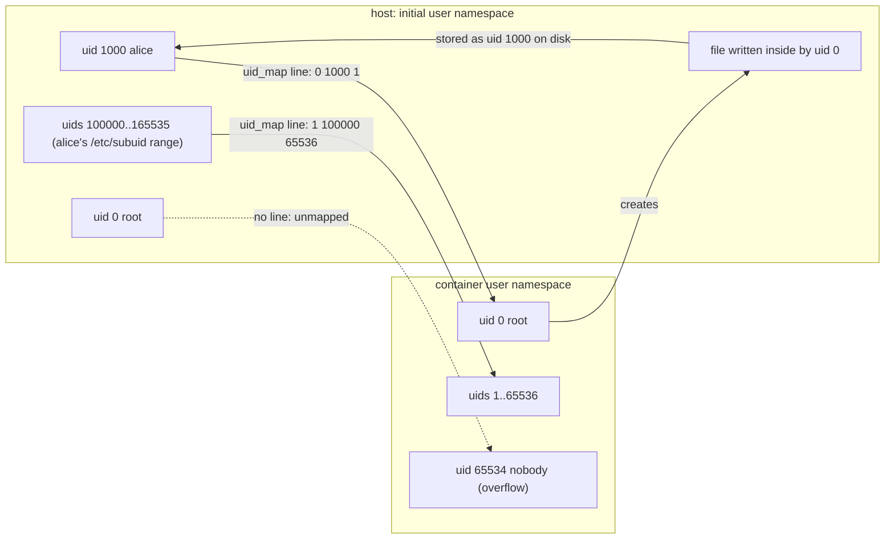

# Rootless Means a User Namespace, Not Less Container

*Root inside a rootless container is your own uid behind a table in /proc/PID/uid_map; the host never hands out uid 0.*

## Metadata

| Field | Value |
|---|---|
| Type | Build |
| Languages | Python, Bash |
| Prerequisites | [Process Isolation](https://cloudcaptain.io/learn/containers/process-isolation) |
| Time | 60 minutes |
| Tools | podman, unshare, newuidmap, docker |

<Quiz stage="pre" />

## The Problem

The shared CI runner has a `docker` group with forty members, because every pipeline needs `docker build`. Anyone in that group can run `docker run -v /:/host alpine chroot /host` and is root on the machine: the daemon runs as root, the container's uid 0 is the host's uid 0, and the socket is a root shell with extra steps. Security asks for the runner to stop handing out root. The team switches it to rootless Podman on a Friday afternoon, and on Monday there are five tickets. A build that writes into a bind-mounted cache leaves files owned by uid 100999 on the host that nobody can delete without `sudo`. The reverse-proxy container fails with `permission denied` on port 80. A job that talks to `/var/run/docker.sock` cannot find it. Long-running containers die when the runner user's session ends. And on one new machine `podman run` stops at `no subuid ranges found`.

All five are the same object seen from five sides: the user namespace. Inside a rootless container the process that runs `id` prints `uid=0(root)` and is telling the truth about its own namespace, while the kernel remembers that this uid 0 is uid 1000 on the host and that container uid 999 is host uid 100998. Every file write, every port bind and every capability check is translated through that table, and nothing on the host ever sees a uid 0 that came from the container. Learn the table and the five tickets become one paragraph.

You are going to write `userns`, a tool that computes that table for a user from `/etc/subuid` and `/etc/subgid`, renders exactly what `newuidmap` writes into `/proc/PID/uid_map`, translates ids in both directions, explains a running process's map, and on Linux creates a user namespace from Python so you can watch yourself become uid 0 without `sudo`. After that, `podman unshare`, `--userns=keep-id`, the `:U` volume flag, rootless Docker and Kubernetes' `hostUsers: false` all read as settings on a table you can print.

## The Concept

A user namespace is a translation table for user and group ids, not a sandbox. Every process belongs to one. The initial namespace's table is the identity: one line, `0 0 4294967295`, meaning "inside id 0 is outside id 0, for about four billion ids". When an unprivileged process calls `unshare(CLONE_NEWUSER)` it gets a fresh namespace with an empty table and holds every capability inside it. Those capabilities are real but scoped: they apply to objects owned by this namespace and to the mount, pid, network and other namespaces it creates afterwards, which is how a rootless engine sets up a container's mounts and interfaces without being root on the host. The kernel keeps the table in `/proc/PID/uid_map` and `/proc/PID/gid_map`, one line per range: `inside outside count`.

The table is written once, and who may write what is the whole security model. The process itself may write a single line that maps its own host uid to any uid inside; that is what `unshare -Ur` does, and why `id` inside it shows `uid=0` with every other id unmapped. To map more ids you need `CAP_SETUID` in the parent namespace. The shadow suite ships two setuid helpers, `newuidmap` and `newgidmap`, that have it and will write a longer table on your behalf only for ranges `/etc/subuid` and `/etc/subgid` grant you: a line like `alice:100000:65536` hands alice 65536 ids that no real account on the host uses. Podman lays them out as `0 1000 1` (you become root) followed by `1 100000 65536` (container ids 1 to 65536 become the subordinate range). The kernel accepts a few hundred such lines per map.



Two consequences do most of the work in production. First, ownership is stored in host ids: a file created by container uid 0 lands on disk as uid 1000, and one created by container uid 999 lands as 100998, which is what `ls -ln` shows on a volume. Second, permission checks use host ids and respect the table: the container's root has `CAP_DAC_OVERRIDE`, but a file owned by host root is owned by an id that is not in the table, so the capability does not apply and the plain mode bits decide, with uid 1000 as the subject. Unmapped ids show up inside as the overflow id, `65534` by default, and cannot be chowned to. The kernel is still shared: a user namespace shrinks what a successful escape is worth, from root to your account, and does nothing about a kernel bug itself.

Around the table a rootless engine stacks the namespaces you built in the process isolation lesson, all owned by the new user namespace. Networking needs a helper, because creating a bridge or a veth on the host requires host `CAP_NET_ADMIN`: `pasta` (the default in recent Podman releases) or `slirp4netns` run as your user, hold the host side of a published port and copy packets into the container's network namespace, which is also why ports below `net.ipv4.ip_unprivileged_port_start` cannot be published. Image layers are unpacked under `~/.local/share/containers/storage` with their file owners translated through the table, so an image containing files owned by uid 70000 needs a map that reaches 70000 or the pull fails. Resource limits need cgroup v2 with the controllers delegated to your user slice by systemd.

## Build It

`code/main.py` is `userns`. Everything that reads `/etc/subuid`, a saved `uid_map` or a `/proc` tree takes the path as an argument, so the tests run on fixtures on any OS; only `run` needs Linux.

### Step 1: parse the grants

`/etc/subuid` is `OWNER:START:COUNT` per line, where the owner may be a name or a numeric uid, with comments and blank lines allowed. Malformed lines are reported with their number instead of being skipped, because a silently ignored line is the "no subuid ranges found" ticket:

```python
def parse_subid(text, source="/etc/subuid"):
    ranges = []
    for number, raw in enumerate(text.splitlines(), 1):
        line = raw.strip()
        if not line or line.startswith("#"):
            continue
        parts = line.split(":")
        if len(parts) != 3 or not parts[0] or not parts[1].isdigit() or not parts[2].isdigit():
            raise ValueError(f"{source}:{number}: expected OWNER:START:COUNT, got {raw!r}")
        ...
```

`ranges_for(ranges, user, uid)` picks the lines that belong to one account by either spelling.

### Step 2: lay out the table

The first line makes you root; every grant follows, contiguous on the inside and wherever `/etc/subuid` put it on the outside. The same function validates the result the way the kernel would: no overlapping ranges on either side, 32-bit ids, at most 340 lines:

```python
def build_mapping(own_id, ranges):
    entries = [MapEntry(0, own_id, 1)]
    next_inside = 1
    for r in ranges:
        entries.append(MapEntry(next_inside, r.start, r.count))
        next_inside += r.count
    validate_mapping(entries)
    return entries
```

### Step 3: render what the kernel and the helpers expect

`/proc/PID/uid_map` prints three right-aligned ten-character columns; `newuidmap` takes the same numbers flattened after the PID. Rendering both from one list of entries is what lets you compare your plan with `podman unshare cat /proc/self/uid_map` byte for byte:

```python
def render_id_map(entries):
    return "".join(f"{e.inside:>10} {e.outside:>10} {e.count:>10}\n" for e in entries)

def newidmap_args(tool, pid, entries):
    args = [tool, str(pid)]
    for e in entries:
        args.extend([str(e.inside), str(e.outside), str(e.count)])
    return args
```

### Step 4: translate across the boundary

Both directions are one arithmetic step inside the matching range, and `None` when there is none. That `None` is the answer to "why can't I chown to this id" and "why does the volume show 65534":

```python
def to_host(entries, inside):
    for e in entries:
        if e.inside <= inside <= e.inside_last:
            return e.outside + (inside - e.inside)
    return None

def to_container(entries, outside):
    for e in entries:
        if e.outside <= outside <= e.outside_last:
            return e.inside + (outside - e.outside)
    return None
```

`describe()` turns a table into sentences ("container uids 1..65536 are host uids 100000..165535", "host uid 0 is unmapped: inside it appears as 65534") and `verdict()` classifies it: the identity map of the initial namespace, a single-user map, or a map with subordinate ranges.

### Step 5: explain a running process

`explain_process(pid, root)` reads `uid_map`, `gid_map` and `sys/kernel/overflowuid` under a procfs root you pass in, so a fake tree in a temp dir stands in for `/proc`:

```python
def explain_process(pid, root="/proc"):
    base = os.path.join(root, str(pid))
    uid_text = read_optional(os.path.join(base, "uid_map"))
    if uid_text is None:
        raise FileNotFoundError(f"no readable {base}/uid_map (wrong PID, or run with sudo)")
    gid_text = read_optional(os.path.join(base, "gid_map"))
    uid_entries = parse_id_map(uid_text, f"{base}/uid_map")
    ...
```

### Step 6: become root in a namespace you own (Linux)

`run` calls `unshare(2)` through `ctypes` with `CLONE_NEWUSER` plus any extra namespaces you ask for, then writes the three files an unprivileged process is allowed to write, in the only order the kernel accepts: `setgroups` must say `deny` before a `gid_map` can be written without `CAP_SETGID` in the parent:

```python
def single_user_map(uid, gid):
    return [
        ("/proc/self/setgroups", "deny"),
        ("/proc/self/uid_map", render_id_map([MapEntry(0, uid, 1)])),
        ("/proc/self/gid_map", render_id_map([MapEntry(0, gid, 1)])),
    ]

def run(command, namespaces=""):
    flags = parse_namespaces(namespaces)
    ...
    libc = ctypes.CDLL(None, use_errno=True)
    if libc.unshare(CLONE_NEWUSER | flags) != 0:
        errno = ctypes.get_errno()
        raise OSError(errno, f"unshare(CLONE_NEWUSER) failed: {os.strerror(errno)}")
    for path, text in single_user_map(uid, gid):
        write_once(path, text)
    pid = os.fork()
    if pid == 0:
        child(command, flags, libc)
    _, status = os.waitpid(pid, 0)
    return os.waitstatus_to_exitcode(status)
```

Each file is written with one `write(2)`; the kernel rejects a map written in pieces. With `--ns mnt,pid` the child, now root in its own namespace, also gets a private mount tree and mounts a fresh `/proc` with `nosuid,nodev,noexec`, the flags the host's `/proc` carries and that a user namespace must keep.

### Step 7: run it

```bash
python3 code/main.py map --user alice --uid 1000 --gid 1000 --subuid fixtures/subuid --subgid fixtures/subgid   # any OS: the table, the newuidmap line, the sentences
python3 code/main.py map                                           # your own account against the real /etc/subuid; exit 1 and a usermod line if you have no range
python3 code/main.py translate --map 0 1000 1 --map 1 100000 65536 999 70000      # 100998, then unmapped
python3 code/main.py translate --user alice --uid 1000 --subuid fixtures/subuid --from-host 100999   # the volume question answered: container uid 1000
```

On Linux, without `sudo`:

```bash
python3 code/main.py run -- sh -c 'id; cat /proc/self/uid_map; touch /tmp/made-inside'
ls -ln /tmp/made-inside                                            # owned by your uid, not 0
python3 code/main.py run --ns mnt,pid -- sh -c 'echo $$; ps -eo pid,user,comm'   # PID 1, and ps shows only your two processes
unshare -Ur sleep 300 & python3 code/main.py explain $!           # "rootless single-user map: uid 0 inside is host uid 1000"
python3 code/main.py explain $$                                    # "not rootless: this is the initial user namespace"
bash code/main.sh                                                  # the same tour with grep, cat and unshare -Ur
```

Inside `run`, `id` prints `uid=0(root) gid=0(root) groups=0(root),65534(nogroup)`: your supplementary groups are not in the one-line `gid_map`, so each of them shows as the overflow id.

<RunTests />

## Use It

Podman does Step 2 and Step 3 on every rootless `podman run`: it reads your grants, calls `newuidmap` and `newgidmap` on the container's first process, then creates the other namespaces inside the new user namespace. Compare the table it produces with yours:

```bash
podman info --format '{{json .Host.IDMappings}}'                  # the ranges podman found in /etc/subuid and /etc/subgid
podman unshare cat /proc/self/uid_map                             # the table newuidmap wrote, same columns as render_id_map
podman unshare cat /proc/self/uid_map > /tmp/podman-uid_map && python3 code/main.py explain --uid-map /tmp/podman-uid_map
podman run --rm alpine:3.22 id                                    # uid=0(root): true inside its namespace
podman run --rm alpine:3.22 cat /proc/self/uid_map                # the same table seen from inside
podman top -l huser user                                          # host uid next to container uid for every process
```

The volume ticket, reproduced and fixed three ways:

```bash
mkdir /tmp/data
podman run --rm -v /tmp/data:/data alpine:3.22 sh -c 'touch /data/f && chown 999:999 /data/f'
ls -ln /tmp/data                                                  # uid 100998 on the host: python3 code/main.py translate --uid-map /tmp/podman-uid_map 999
podman unshare chown -R 999:999 /tmp/data                         # chown from inside the mapping: the same as chown 100998 on the host, no sudo
podman run --rm -v /tmp/data:/data:U alpine:3.22 ls -ln /data     # :U makes podman chown the volume to the container user on start
podman run --rm --userns=keep-id -v /tmp/data:/data alpine:3.22 id -u   # your uid inside and outside; files stay yours
```

Ports, sockets and lifetime, which are the other three tickets:

```bash
podman run --rm -p 80:80 alpine:3.22 true                         # "rootlessport cannot expose privileged port 80": the host-side listener runs as you
sysctl net.ipv4.ip_unprivileged_port_start                        # 1024; sudo sysctl -w net.ipv4.ip_unprivileged_port_start=80 moves the line
podman info | grep -iE 'networkBackend|rootlessNetworkCmd'        # pasta in recent releases; slirp4netns before it
systemctl --user enable --now podman.socket                       # a Docker-compatible API socket owned by you
export DOCKER_HOST=unix://$XDG_RUNTIME_DIR/podman/podman.sock      # docker and compose clients talk to it unchanged
loginctl enable-linger "$USER"                                    # your user manager, and your containers, survive logout
```

Rootless Docker is the same mechanism with a daemon in the picture:

```bash
dockerd-rootless-setuptool.sh install                             # dockerd runs as you; RootlessKit owns the user namespace
docker context use rootless && docker info -f '{{.SecurityOptions}}'   # name=rootless
docker run --rm alpine:3.22 cat /proc/self/uid_map               # the same two-line table; on a rootful daemon this prints 0 0 4294967295
```

Rootful Docker has a middle setting, `"userns-remap": "default"` in `daemon.json`: containers get a user namespace from the `dockremap` account's ranges while the daemon itself stays root. Kubernetes has the per-pod version: `spec.hostUsers: false` asks the kubelet for a pod-level user namespace mapped to a range the node picks, and recent releases enable it by default when the container runtime and kernel support it (id-mapped mounts for the volumes). Check the feature-gate table for your version and the runtime's documentation before relying on it.

```bash
kubectl apply -f - <<'EOF'
apiVersion: v1
kind: Pod
metadata: {name: userns-demo}
spec:
  hostUsers: false
  containers:
  - name: shell
    image: alpine:3.22
    command: ["sh", "-c", "cat /proc/self/uid_map; sleep 3600"]
EOF
kubectl logs userns-demo           # a short map starting in a subordinate range when the node supports it; otherwise the pod fails to start or the field is dropped, depending on the version
```

| What you built | Real tool | Note |
|---|---|---|
| `parse_subid` + `ranges_for` | `grep "^$USER:" /etc/subuid /etc/subgid`, `podman info` id mappings | `usermod --add-subuids` edits the file; `podman system migrate` makes podman re-read it |
| `build_mapping` + `newidmap_args` | `newuidmap PID 0 1000 1 1 100000 65536`, called by podman, RootlessKit and `unshare --map-auto` | setuid helpers from the `uidmap` package; the only way past one line |
| `run` with the single-user map | `unshare -Ur`, `podman unshare` | `podman unshare` has the full table, so `chown` inside it reaches the subordinate ids |
| `translate` | `podman top CID huser user`, `ls -ln` on a volume | `:U` and `--userns=keep-id` are two ways to stop needing the answer |
| `explain PID` | `cat /proc/PID/uid_map`, `lsns -t user`, `podman inspect` (HostConfig IDMappings) | `0 0 4294967295` means no user namespace at all |
| `--ns mnt,pid` as the new root | podman creating the other namespaces inside the user namespace | capabilities inside are scoped to objects the namespace owns |

<Quiz stage="check" />

## Ship It

Two artifacts in `outputs/`:

- **`skill-rootless-migration.md`**: a runbook for moving a Docker host or a CI runner to rootless Podman (or rootless Docker): preflight the account (ranges, helpers, sysctls, cgroup v2 delegation), inventory what the current containers rely on, then a decision table for the five breakages (volume ownership, ports below 1024, `docker.sock` consumers, containers dying at logout, missing subordinate ranges), each with the command that proves the cause and the fix, and a verification list.
- **`prompt-explain-uid-map.md`**: paste `/proc/PID/uid_map` and `gid_map`, optionally the `/etc/subuid` lines, podman's id mappings and an `ls -ln` of a volume, and get back the table in words, who root really is, each listed owner translated both ways, the unmapped ids and what they break, and a verdict on what this isolation does and does not protect.

<ShipIt />

## Exercises

### Easy

Add `--kind gid` to `explain --uid-map` so a saved `gid_map` can be explained on its own, and make `describe()` take the overflow gid from `/proc/sys/kernel/overflowgid` instead of reusing the uid value. Tests first: a fake tree where `overflowuid` is 65534 and `overflowgid` is 60000, and the sentence for host gid 0 must quote 60000.

### Medium

Implement `userns image-check DIR`: walk an unpacked image root (`podman image mount`, or an extracted `docker save` tarball), collect every file's owner and group with `os.lstat`, and report which ids the user's table from `/etc/subuid` cannot represent, the way a failing `podman pull` would. You cannot `chown` files to arbitrary ids in a test without root, so make the walker take an injectable `stat` function and test it with a fake that returns chosen uids.

### Hard

Make `run` accept the full table: when `/etc/subuid` grants exist, exec `newuidmap` and `newgidmap` on the child from the parent instead of writing `/proc/self/uid_map` yourself. The child must `unshare` and then block on a pipe until the parent has run both helpers, because a map can be written only once and must exist before the child changes identity. Prove it with `cat /proc/self/uid_map` inside showing two lines, `touch` as container uid 999 producing a host file owned by `100998`, and a test with a fake helper runner that asserts the exact argv.

<Quiz stage="post" />

## Key Terms

| Term | Common misconception | Precise definition |
|---|---|---|
| User namespace | "A sandbox for the process." | A per-process translation table between inside and outside uids and gids, with its own capability set that applies only to objects and namespaces it owns. |
| `uid_map` and `gid_map` | "A list of the users in the container." | `/proc/PID/uid_map`: lines of `inside outside count`, written once, by the process itself (one line, its own id) or by a process with `CAP_SETUID` in the parent namespace. |
| Subordinate ids | "Fake uids podman invents." | Real host ids no account owns, granted to a user by `/etc/subuid` and `/etc/subgid` as `OWNER:START:COUNT`; `newuidmap` and `newgidmap` map only ids inside those grants. |
| Rootless | "Containers without root inside." | The engine and the container run as your account; `id` inside can still say 0 because the user namespace maps your uid to 0. Nothing on the host runs as root for it. |
| Overflow id | "A corrupted uid." | The id (65534 by default, from `/proc/sys/kernel/overflowuid`) shown inside a namespace for any outside id the table does not cover; it cannot be chowned to. |
| `--userns=keep-id` | "Runs the container as root." | Maps your uid to the same number inside so files on volumes keep your ownership; the rest of the table still comes from your grants. |
| pasta and slirp4netns | "Rootless networking is a bridge." | User-space helpers running as you that hold the host side of a published port and move packets into the container's network namespace; the host's privileged-port rule applies to them. |
| `hostUsers: false` | "Kubernetes pods are always rootless." | The pod field that asks for a per-pod user namespace; without it a pod's uid 0 is the node's uid 0. Needs runtime and kernel support; check your version's feature gate. |

## Further Reading

- [Podman Fundamentals](https://cloudcaptain.io/docs/tools/podman/fundamentals): rootless setup, pods and systemd integration, the operational side of what you built.
- [Docker Security & Production](https://cloudcaptain.io/docs/tools/docker/security-production): rootless Docker, `userns-remap` and the other hardening knobs side by side.
- [Linux Security](https://cloudcaptain.io/docs/tools/linux/security): capabilities, the `unprivileged_userns_clone` sysctl and why some distributions restrict user namespaces.
- [Kubernetes Security](https://cloudcaptain.io/docs/tools/kubernetes/security): Pod Security Standards and `securityContext`, where `hostUsers` sits among the other pod-level controls.
- [user_namespaces(7)](https://man7.org/linux/man-pages/man7/user_namespaces.7.html): the rules for writing `uid_map`, capability scoping and the `setgroups` requirement, in the kernel's own words.
- [subuid(5)](https://man7.org/linux/man-pages/man5/subuid.5.html) and [newuidmap(1)](https://man7.org/linux/man-pages/man1/newuidmap.1.html): the grant file format and the helper that enforces it.
- [podman-run(1): --userns](https://docs.podman.io/en/latest/markdown/podman-run.1.html#userns-mode): `keep-id`, `auto`, `nomap` and the `:U` volume option.
- [Run the Docker daemon as a non-root user](https://docs.docker.com/engine/security/rootless/): rootless Docker's setup, limits and the RootlessKit design.
- [Kubernetes: user namespaces](https://kubernetes.io/docs/concepts/workloads/pods/user-namespaces/): `hostUsers`, the runtime and kernel requirements, and which versions enable it by default.
