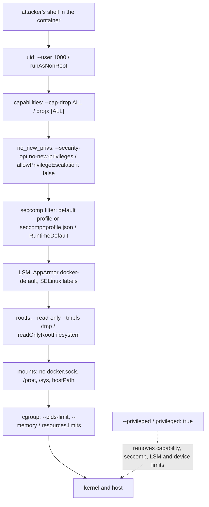

# Shrink What a Compromised Process Can Do: seccomp, Capabilities, Read-Only Roots

*Assume the shell is already inside: what it can still call, hold and write is decided before the process starts, by flags you can read back.*

## Metadata

| Field | Value |
|---|---|
| Type | Build |
| Languages | Python |
| Prerequisites | [Permissions & Caps](https://cloudcaptain.io/learn/linux/permissions-capabilities), [Syscalls & strace](https://cloudcaptain.io/learn/linux/syscalls-strace) |
| Time | 90 minutes |
| Tools | docker, kubectl, strace, kind, trivy |

<Quiz stage="pre" />

## The Problem

The image service has a bug in its thumbnail library: a crafted upload gives whoever sends it a shell inside the container. Two teams run the same image. On the first team's node the container runs as root with Docker's defaults, mounts `/var/run/docker.sock` for a metrics sidecar and has a writable root filesystem. The attacker writes a miner into `/usr/local/bin`, uses the socket to start a privileged container with the host's root mounted, and owns the node in eleven minutes. On the second team's node the same shell lands as uid 1000 with no capabilities, a read-only root, a seccomp filter and a limit of one hundred processes. It can read the application's own files and write to `/tmp`. The bug is identical; the blast radius is not.

The first team is not careless. They scan every image with `trivy` in CI, patch base images weekly, and have a hardening ticket that has been open for a year because the one time someone added a `securityContext` to a manifest the pod crash-looped and the change was reverted. Nobody can say, for a running container, which controls apply to it: `docker inspect` prints forty fields, the pod manifest has none, and the cluster still has no admission policy because PodSecurityPolicy was removed years ago and the namespace labels that replaced it were never set.

You are going to write `hardencheck`, a tool that reads a seccomp profile and says which syscalls a process could still make, builds a profile from a trace of what the workload actually does, scores a `docker inspect` dump and a Kubernetes manifest check by check, and prints the flag or field that closes each gap. After that, `--security-opt`, `--cap-drop`, `--read-only`, `securityContext` and the Pod Security Standards are one list you can read off any running container.

## The Concept

Runtime hardening is not one control. It is a stack of independent limits that each shrink what a process can do after an attacker owns it, and the stack is only as strong as its weakest unset member. A compromised process can do three kinds of things: make system calls, use privilege, and touch the filesystem and the network. Each layer bounds one of them.

- **Identity**: the uid decides which permission bits apply. Root with Docker's default capabilities reads any file in the container; uid 1000 reads what the image granted it. You covered that in the capabilities lesson.
- **Capabilities**: 41 bits on the process. `--cap-drop ALL` leaves zero; the restricted Pod Security Standard allows adding back exactly one, `NET_BIND_SERVICE`. `no_new_privs` stops `execve` from gaining any.
- **seccomp**: a BPF program attached to the process and inherited by every child. At each syscall entry the kernel runs it on the syscall number, the architecture and the raw arguments, and the program returns an action: allow, fail with an errno, kill the thread or the process, log, or notify a supervisor. Docker's default profile allows a few hundred syscalls and returns `EPERM` for the rest, with some gated on capabilities (`mount` only with `CAP_SYS_ADMIN`) or on arguments (`clone` without `CLONE_NEWUSER`). A filter can be tightened, never removed, and installing one needs `no_new_privs` or `CAP_SYS_ADMIN`.
- **Mandatory access control**: AppArmor (Debian, Ubuntu, SUSE) or SELinux (Fedora, RHEL) confine paths and labels. Docker's `docker-default` AppArmor profile denies writes to `/proc/sys` and `/sys` even for root.
- **Filesystem**: `--read-only` makes the root mount read-only and `--tmpfs /tmp` gives a scratch space that can be `noexec`. A shell that cannot write anywhere persistent cannot install anything. Bind mounts of `/`, `/proc`, `/sys`, `/etc` or the container runtime's socket undo everything above: the socket is root on the host over HTTP.
- **Resources**: `--pids-limit` and `--memory` bound a fork bomb or a leak to the container; the OOM killer picks this cgroup instead of the node.



Kubernetes spells the same stack as `securityContext` fields and makes it enforceable per namespace. The **Pod Security Standards** define three profiles: *privileged* (anything), *baseline* (no privileged containers, host namespaces, hostPath, hostPort or unsafe sysctls), and *restricted* (baseline plus `runAsNonRoot`, `allowPrivilegeEscalation: false`, `drop: [ALL]`, a `RuntimeDefault` or `Localhost` seccomp profile, and a short list of volume types). **Pod Security Admission** enforces a profile when a namespace carries the label `pod-security.kubernetes.io/enforce: restricted`, and can `warn` and `audit` before it enforces. It replaced PodSecurityPolicy, which was removed. Note what restricted does not require: a read-only root filesystem, resource limits and leaving the service account token unmounted are still yours to add.

Two things no flag fixes. A kernel exploit runs below every layer in the diagram; seccomp shrinks the surface that reaches the kernel, and sandboxes such as gVisor and Kata put a second kernel or a VM in between. And a secret the process legitimately holds (the database password, the service account token) is readable by any shell inside it; hardening decides what the shell can do next, not what it can read first.

## Build It

`code/main.py` is `hardencheck`. Everything is a pure function over JSON that came from a file: a seccomp profile, an strace log, `docker inspect` output, a Pod manifest. The one impure path, `inspect NAME`, runs `docker inspect` through an injectable runner, so the tests pass on macOS without Docker.

### Step 1: model a seccomp profile

Docker's profile format and the OCI runtime spec share one shape: a `defaultAction`, an optional errno for it, architectures, and rules that name syscalls, an action, optional argument filters and, in Docker's dialect, `includes` and `excludes` conditions on capabilities, architectures and kernel version.

```python
@dataclass
class Rule:
    names: List[str]
    action: str
    args: List[dict]
    includes: dict
    excludes: dict
    index: int


def parse_profile(data, source="profile"):
    if not isinstance(data, dict) or "defaultAction" not in data:
        raise HardenError(f"{source}: not a seccomp profile (no defaultAction)")
    ...
    for index, raw in enumerate(data.get("syscalls") or []):
        names = raw.get("names") or ([raw["name"]] if raw.get("name") else [])
        rules.append(Rule([str(n) for n in names], str(raw.get("action", ALLOW)), list(raw.get("args") or []), dict(raw.get("includes") or {}), dict(raw.get("excludes") or {}), index))
```

`code/fixtures/seccomp-docker-default-excerpt.json` has the structure of Docker's default profile with a shorter allow list so the tests stay readable. Fetch the real one with `curl -fsSL https://raw.githubusercontent.com/moby/moby/master/profiles/seccomp/default.json -o default.json` and run every command below against it as well.

### Step 2: resolve one syscall for one container

A rule applies when the container's architecture is not excluded, when none of the `excludes.caps` and all of the `includes.caps` are in its bounding set, and when the kernel is new enough. That is the order the daemon uses:

```python
def rule_applies(rule, caps, arch, kernel=None):
    excludes, includes = rule.excludes, rule.includes
    if arch in (excludes.get("arches") or []):
        return False
    if any(cap in caps for cap in excludes.get("caps") or []):
        return False
    if excludes.get("minKernel") and kernel_at_least(kernel, str(excludes["minKernel"])):
        return False
    if includes.get("arches") and arch not in includes["arches"]:
        return False
    if any(cap not in caps for cap in includes.get("caps") or []):
        return False
    if includes.get("minKernel") and not kernel_at_least(kernel, str(includes["minKernel"])):
        return False
    return True
```

`resolve()` walks the rules in order. An applicable rule without argument filters decides; one with filters makes the syscall *conditional* (`clone` is allowed unless the flags include `CLONE_NEWUSER`); nothing applicable means the default action. Rules that would have applied with more capabilities are remembered, so the report can say `mount: ERRNO, allowed with CAP_SYS_ADMIN`, the sentence that explains why `--cap-add SYS_ADMIN` is never "just one capability".

### Step 3: list, diff, and the syscalls that matter

`classify()` sorts every syscall the profile names into allowed, conditional, explicitly denied, or left to the default action. A profile that allows three hundred names is hard to read, so `NOTABLE` carries the syscalls an attacker reaches for (`mount`, `ptrace`, `unshare`, `bpf`, `init_module`, `open_by_handle_at`, `keyctl` and friends) with a one-line meaning, and the report prints their decision under the capabilities you assume. `diff_profiles()` compares what two profiles allow for the same container, which is how you review a profile change or see what a `--cap-add` really unlocks.

### Step 4: generate a profile from a trace

The strace lesson taught you to read a log; here you only need the syscall names in it. One regular expression accepts every prefix `strace` prints (`[pid N]`, a bare pid from `-o`, `-t` and `-tt` timestamps, `-r` deltas) and skips signal lines, exit lines and `<... resumed>` continuations:

```python
TRACE_LINE = re.compile(r"^(?:\[pid\s+\d+\]\s*)?(?:\d+\s+)?(?:\d{2}:\d{2}:\d{2}(?:\.\d+)?\s+)?(?:\d+\.\d+\s+)?([a-z_][a-z0-9_]*)\(")


def generate_profile(traced, errno_value=1):
    names = set(traced)
    added = sorted(set(ALWAYS_NEEDED) - names)
    profile = {"defaultAction": ERRNO, "defaultErrnoRet": errno_value, "syscalls": [{"names": sorted(names | set(ALWAYS_NEEDED)), "action": ALLOW}]}
    return profile, added
```

`ALWAYS_NEEDED` is the set a trace can miss and a container cannot start without: what the dynamic loader does before `main` (`brk`, `mmap`, `mprotect`, `arch_prctl`, `set_tid_address`, `prlimit64`), signals and exit (`rt_sigaction`, `rt_sigreturn`, `exit_group`), and the calls runc itself makes between installing the filter and `execve`: `capget` and `capset` to drop capabilities, `setgroups`, `setresgid` and `setresuid` to switch user, `chdir` into the working directory. Leave those out and the container dies before your program starts, with `unable to get capability version from the kernel`. The generated profile names no architectures, so libseccomp uses the native one wherever it runs. A trace taken on your laptop's glibc is not a trace of the Alpine image's musl: trace inside the image the profile is for.

### Step 5: score a running container

`docker inspect` returns a list of objects; `inspect_findings()` turns one into thirteen findings, each with a status, the evidence and the fix. Every check reads one field:

```python
    user = str(config.get("User") or "")
    as_root = user == "" or user.split(":")[0] in ("0", "root")
    ...
    cap_drop = [normalize_cap(c) for c in host.get("CapDrop") or []]
    dangerous = sorted(c for c in cap_add if c in DANGEROUS_CAPS)
    ...
    nnp = security_option(options, "no-new-privileges")
    readonly = bool(host.get("ReadonlyRootfs"))
    seccomp = security_option(options, "seccomp")
```

The seccomp check knows three shapes: `unconfined` (fail), nothing (the runtime default, pass), and a JSON object, because the Docker CLI reads `--security-opt seccomp=profile.json` on the client and stores the whole profile in `SecurityOpt`; the check parses it and reports its default action and rule count. `privileged` fails four checks at once because that is what it does: every capability, every device, no seccomp, no AppArmor. Only `bind` mounts are tested against the sensitive path list, so a named volume under `/var/lib/docker/volumes` is not a finding while `/var/run/docker.sock` is, read-only or not. A weighted score adds the passes up and `hardened_flags()` assembles the `docker run` line that would pass.

### Step 6: score a pod against the restricted standard

`pod_templates()` finds the pod spec inside a Pod, a Deployment, StatefulSet, DaemonSet, Job, CronJob or List; `k8s_findings()` applies the baseline and restricted rules to every container, init container and ephemeral container, with the pod-level `securityContext` inherited unless the container overrides it:

```python
    non_root = [f'pod or {kind} "{c.get("name")}" must set securityContext.runAsNonRoot=true' for c, kind in containers if context(c).get("runAsNonRoot", pod_context.get("runAsNonRoot")) is not True]
    ...
    for c, kind in containers:
        effective = (context(c).get("seccompProfile") or {}).get("type") or pod_seccomp
        if effective not in ("RuntimeDefault", "Localhost"):
            seccomp_failures.append(...)
```

The messages copy the admission controller's wording, so the output reads like the error `kubectl apply` prints in an enforcing namespace. Three *extra* checks (`readOnlyRootFilesystem`, a memory limit, `automountServiceAccountToken: false`) are labelled as beyond the standard and do not affect the admitted or rejected verdict. `--fix` prints a strategic merge patch with a restricted pod-level context and a per-container context, nested at `spec`, `spec.template.spec` or `spec.jobTemplate.spec.template.spec` according to the kind.

### Step 7: run it

```bash
python3 code/main.py seccomp code/fixtures/seccomp-docker-default-excerpt.json --check mkdir,mount,ptrace,clone
python3 code/main.py seccomp code/fixtures/seccomp-docker-default-excerpt.json --caps docker-default,SYS_ADMIN --check mount,unshare,bpf
python3 code/main.py seccomp code/fixtures/seccomp-docker-default-excerpt.json --caps none --check chroot              # drop SYS_CHROOT and chroot goes with it
python3 code/main.py seccomp-diff code/fixtures/seccomp-docker-default-excerpt.json code/fixtures/seccomp-tiny.json
python3 code/main.py generate code/fixtures/strace-python-print.log --out profile.json                                # 32 traced + 43 always needed
python3 code/main.py seccomp profile.json --check mkdir,execve                                                         # mkdir ERRNO, execve ALLOW
python3 code/main.py inspect code/fixtures/inspect-default.json                                                        # score 40, eight fixes, one docker run line
python3 code/main.py inspect code/fixtures/inspect-hardened.json --fail-under 100; echo "exit $?"
python3 code/main.py k8s code/fixtures/pod-violating.json                                                              # REJECTED, 8 violations
python3 code/main.py k8s code/fixtures/deployment.json --fix                                                           # the patch, nested under spec.template.spec
python3 code/main.py k8s code/fixtures/pod-restricted.json --fail-under 100; echo "exit $?"
```

<RunTests />

## Use It

Now the real stack, flag by flag, with the same tool reading the result back:

```bash
docker run -d --name web --user 1000 --cap-drop ALL --security-opt no-new-privileges --read-only --tmpfs /tmp:rw,noexec,nosuid,size=64m \
  --pids-limit 100 --memory 256m -p 127.0.0.1:8080:8080 python:3.12-alpine python3 -m http.server 8080
docker inspect web | python3 code/main.py inspect -                                            # 100/100
docker exec web grep -E 'Uid|CapEff|NoNewPrivs|Seccomp' /proc/1/status                          # 1000, 0000000000000000, 1, 2
docker exec web sh -c 'touch /usr/x || echo "read-only: $?"; touch /tmp/x && echo "tmpfs ok"'
docker info --format '{{.SecurityOptions}}'                                                      # name=seccomp,profile=builtin name=apparmor ...
docker run --rm --security-opt seccomp=unconfined alpine:3.22 grep Seccomp /proc/self/status     # Seccomp: 0
```

Build a profile for the image from a trace taken inside that image, then prove what it blocks. Tracing needs `ptrace`, which the default profile allows on current kernels; `--cap-add SYS_PTRACE` is for the kernels where it does not:

```bash
docker run --rm --cap-add SYS_PTRACE python:3.12-alpine sh -c 'apk add -q strace && strace -f -qq -o /tmp/t.log python3 -c print && cat /tmp/t.log' > trace.log
python3 code/main.py generate trace.log --out profile.json
docker run --rm --security-opt seccomp=profile.json python:3.12-alpine python3 -c 'print("runs")'
docker run --rm --security-opt seccomp=profile.json python:3.12-alpine python3 -c 'import os; os.mkdir("/tmp/x")'   # PermissionError: [Errno 1] Operation not permitted
python3 code/main.py seccomp profile.json --check mkdir                                        # ERRNO, default action
```

A `SCMP_ACT_ERRNO` profile fails loudly inside the application; `SCMP_ACT_LOG` as the default action records every unlisted syscall in the kernel log (`dmesg | grep SECCOMP`, or `journalctl -k`) without failing it, which is how you grow a profile through a test suite before you enforce it. Image scanners run before any of this: `docker scout cves IMAGE` and `trivy image IMAGE` find known vulnerabilities in what is installed; the flags above decide what an unknown one can do.

Kubernetes puts the same knobs in `securityContext` and the restricted standard makes them mandatory:

```yaml
spec:
  automountServiceAccountToken: false
  securityContext:
    runAsNonRoot: true
    runAsUser: 10001
    seccompProfile:
      type: RuntimeDefault
  containers:
    - name: app
      securityContext:
        allowPrivilegeEscalation: false
        readOnlyRootFilesystem: true
        capabilities:
          drop: ["ALL"]
      resources:
        limits:
          memory: 256Mi
```

```bash
kubectl get pod web -o json | python3 code/main.py k8s -                                        # the verdict the admission controller would give
kubectl create --dry-run=client --validate=false -o json -f deploy.yaml | python3 code/main.py k8s - --fix
kubectl label --dry-run=server --overwrite ns payments pod-security.kubernetes.io/enforce=restricted    # warns about every existing pod that would be rejected; changes nothing
kubectl label ns payments pod-security.kubernetes.io/warn=restricted pod-security.kubernetes.io/audit=restricted      # step one: warnings and audit entries
kubectl label ns payments pod-security.kubernetes.io/enforce=restricted                                               # step two: new pods are rejected
kubectl apply -f code/fixtures/pod-violating.json -n payments                                   # Error ... violates PodSecurity "restricted:latest": privileged ...
kubectl exec web -- grep -E 'CapEff|NoNewPrivs|Seccomp' /proc/1/status
```

Pod Security Admission is built into the API server and replaced PodSecurityPolicy, which was removed; for rules the standards do not express (allowed registries, required labels, a custom seccomp profile per namespace) a policy engine such as Kyverno or OPA Gatekeeper sits beside it. Two more layers belong in the picture. **Falco** watches the syscalls the filter let through and alerts on patterns (a shell spawned in a container, a write below `/usr/bin`, a read of `/etc/shadow`); that is detection, not prevention. **gVisor** (`--runtime=runsc`, a `RuntimeClass` in Kubernetes) and **Kata Containers** run the container against a user-space kernel or inside a VM, so a kernel exploit does not reach the host.

| What you built | Real tool | Note |
|---|---|---|
| `seccomp PROFILE --caps` | `docker run --security-opt seccomp=profile.json`, `grep Seccomp /proc/1/status` | `Seccomp: 2` means a filter is installed; the runtime default allows a few hundred syscalls and gates `mount`, `unshare`, `bpf` on capabilities |
| `seccomp-diff A B` | `--cap-add X` against the profile's `includes.caps` | adding a capability also widens the syscall filter |
| `generate TRACE` | `strace -f -qq -o`, `SCMP_ACT_LOG` plus `dmesg` | trace inside the image the profile is for |
| `inspect` | `docker inspect`, `docker info --format '{{.SecurityOptions}}'`, `docker scout`, `trivy image` | inspect shows what was asked for, `/proc/1/status` what was granted; scanners cover the image, not the runtime |
| `k8s` verdict | `kubectl label --dry-run=server ns X pod-security.kubernetes.io/enforce=restricted` | the same violations from the real admission controller, before you enforce |
| `k8s --fix` | `kubectl patch deploy X --type strategic -p "$(... --fix)"` | a Pod's `securityContext` is immutable; patch the workload and let it roll |
| extra checks | `readOnlyRootFilesystem`, `resources.limits`, `automountServiceAccountToken: false` | not in the restricted standard; add them anyway |
| nothing | Falco, gVisor, Kata, AppArmor and SELinux profiles | detection, a second kernel, and path or label confinement are layers your checker only reports on |

<Quiz stage="check" />

## Ship It

Two artifacts in `outputs/`:

- **`skill-container-hardening-review.md`**: a runbook that inventories what a container or pod has today (`docker inspect`, `/proc/1/status`, the manifest), scores it, works through each finding with the least-privilege fix and the one error each fix can cause, proves the result with negative tests (`mkdir` under the profile, `touch /usr/x`, a `--cap-add` that changes nothing), rolls Pod Security Admission out as warn, audit, enforce, and writes a report that separates the restricted standard from the extras.
- **`prompt-seccomp-profile-review.md`**: paste a seccomp profile and a sentence about the workload, get back the default action and errno, every allowed syscall that matters with the risk it carries, the conditional rules in plain words, what the always-needed set is missing, and a revised profile with the two commands that prove it.

<ShipIt />

## Exercises

### Easy

Add a `compose` renderer to `inspect`: for each failing finding emit the `docker compose` keys (`user`, `cap_drop`, `security_opt`, `read_only`, `tmpfs`, `pids_limit`, `mem_limit`) as JSON, which is valid YAML, so the fix can be pasted into the service definition. Write the test first against `inspect-default.json`: the rendered block must contain `cap_drop: [ALL]` and `read_only: true` and nothing for checks that pass.

### Medium

`generate` throws away argument filters. Extend it so that when the trace contains `clone` the profile keeps Docker's masked rule that denies `CLONE_NEWUSER`, and when it contains `socket` it adds a rule that denies `AF_PACKET` (family 17) unless `CAP_NET_RAW` is assumed. Test with `resolve()` that `clone` becomes conditional and that `socket` is conditional without the capability and unconditional with it; then verify on Linux that `unshare -U` inside a container running under the generated profile fails with `EPERM`.

### Hard

Build `k8s --namespace NAME`, which calls `kubectl get pods,deploy,sts,ds,jobs,cronjobs -n NAME -o json` through the runner, scores every template, and prints the same list of would-be violations that `kubectl label --dry-run=server --overwrite ns NAME pod-security.kubernetes.io/enforce=restricted` prints as warnings. Unit-test it with a fake runner returning a `List`; then run both against a kind cluster with the two fixture pods applied and diff the outputs. Every difference is either a bug in your checker or a rule you did not know the standard had; document which.

<Quiz stage="post" />

## Key Terms

| Term | Common misconception | Precise definition |
|---|---|---|
| seccomp | "A list of blocked syscalls." | A BPF program attached to a process and inherited by its children, run by the kernel at every syscall entry on the number, architecture and arguments; it returns allow, errno, kill, log, trace or notify. It can be tightened, never loosened. |
| `SCMP_ACT_ERRNO` vs `SCMP_ACT_KILL_PROCESS` | "Denied syscalls crash the program." | ERRNO returns an error (`EPERM` by default) and the program decides what to do; KILL ends it with `SIGSYS`. Docker's default uses ERRNO; LOG records without denying. |
| `RuntimeDefault` | "Pods get seccomp automatically." | The container runtime's own profile (containerd and Docker ship the same one). A pod with no `seccompProfile` runs Unconfined unless the kubelet's `seccompDefault` setting is on; restricted requires it to be stated. |
| Pod Security Standards | "A policy object you create." | Three fixed profiles, privileged, baseline and restricted, defined field by field in the Kubernetes docs. Pod Security Admission applies one per namespace through labels; PodSecurityPolicy, the old object, was removed. |
| `enforce`, `warn`, `audit` | "Labelling a namespace breaks running pods." | Three independent modes. `enforce` rejects new pods only; existing ones keep running. `warn` prints on `kubectl apply`, `audit` writes to the audit log. `--dry-run=server` on the label previews the damage. |
| Read-only root filesystem | "The container cannot write at all." | The root mount is read-only; volumes, `emptyDir` and `tmpfs` mounted into it are writable. A shell cannot change binaries or configuration, so a foothold cannot persist. |
| `--privileged` | "A superset of a few `--cap-add`s." | All 41 capabilities, every host device, no seccomp filter, no AppArmor profile, writable `/sys`. It is the host's root in a different mount namespace. |
| Container socket mount | "Just how the sidecar reaches the API." | `/var/run/docker.sock` is the Docker API with root privileges: anything that can connect can start a privileged container with `/` mounted. A read-only bind mount does not stop `connect()`. |
| Sandbox (gVisor, Kata) | "A stronger seccomp profile." | A separate kernel boundary: gVisor implements the syscall interface in user space, Kata runs the container in a lightweight VM. They bound kernel exploits, which no filter in this lesson does. |
| Falco | "It prevents attacks." | A runtime detection engine that watches syscalls and Kubernetes audit events and raises alerts on rules. It tells you a shell was spawned; the layers above decide what the shell could do. |

## Further Reading

- [Docker Security & Production](https://cloudcaptain.io/docs/tools/docker/security-production): the full hardening checklist this lesson's `inspect` scores, with `--read-only`, seccomp, AppArmor and scanning in context.
- [Kubernetes Security](https://cloudcaptain.io/docs/tools/kubernetes/security): `securityContext` field by field, the three Pod Security Standards and the admission labels.
- [Linux Security](https://cloudcaptain.io/docs/tools/linux/security): AppArmor, SELinux and auditing on the host that runs the containers.
- [DevSecOps Fundamentals](https://cloudcaptain.io/docs/tools/devsecops/fundamentals): where image scanning, admission policy and runtime detection sit in a pipeline.
- [seccomp(2)](https://man7.org/linux/man-pages/man2/seccomp.2.html): the system call, the actions, and why installing a filter needs `no_new_privs`.
- [Seccomp BPF, kernel documentation](https://www.kernel.org/doc/html/latest/userspace-api/seccomp_filter.html): the filter model, return values and the notify API from the kernel's side.
- [Docker: seccomp security profiles](https://docs.docker.com/engine/security/seccomp/): the default profile's intent and the `--security-opt seccomp=` syntax; the profile itself is `profiles/seccomp/default.json` in the moby repository.
- [OCI runtime spec: seccomp](https://github.com/opencontainers/runtime-spec/blob/main/config-linux.md#seccomp): the `linux.seccomp` object every runtime consumes, which is what Docker's and Kubernetes' profile files are translated into.
- [Pod Security Standards](https://kubernetes.io/docs/concepts/security/pod-security-standards/): the field-by-field definition of baseline and restricted, including the allowed volume types, sysctls and capability adds.
- [Pod Security Admission](https://kubernetes.io/docs/concepts/security/pod-security-admission/): the labels, the modes and the `--dry-run=server` rollout.
- [Restrict a container's syscalls with seccomp](https://kubernetes.io/docs/tutorials/security/seccomp/): the Kubernetes tutorial with `Localhost` profiles and an audit-mode profile, on kind.
- [Falco](https://falco.org/docs/), [gVisor](https://gvisor.dev/docs/) and [Kata Containers](https://katacontainers.io/docs/): the detection and sandboxing layers this lesson only points at.
