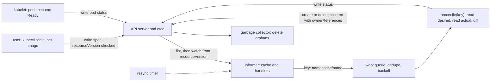

# A Controller Is a Loop That Compares: Reconcilers From Scratch

*Kubernetes does not run your command; it records a wish, and independent loops compare it with the world until the two match.*

## Metadata

| Field | Value |
|---|---|
| Type | Build |
| Languages | Python |
| Prerequisites | [Compose](https://cloudcaptain.io/learn/containers/compose) |
| Time | 90 minutes |
| Tools | kubectl, kind, kube-controller-manager |

<Quiz stage="pre" />

## The Problem

The checkout service runs as ten containers on three VMs. A supervisor script subscribes to `docker events` and starts a replacement whenever it sees a container `die`. For months it works. Then, during a Tuesday deploy, the supervisor itself is restarted and is blind for eleven seconds, and in those eleven seconds the out-of-memory killer takes two containers. Nobody tells the supervisor again. The service runs at eight of ten until a traffic peak exposes it, six days later. The fix is to also scan on startup and once a minute. The next incident is a deploy where the old and the new copy of the supervisor are both alive for a minute: both see the same `die` event, both start a replacement, and the service has eleven containers. The one after that is a bad release in which every container fails its health check: the script replaces all ten at once, and the service has zero healthy containers for forty seconds.

None of the three is a bug in the script's code. They are consequences of its shape. "When X happens, do Y" is **edge-triggered**: it is correct only if it hears every event exactly once, acts alone, and finishes before the next one arrives. Real systems drop events, deliver them twice, deliver them late and run two copies. A Kubernetes controller has a different shape. It keeps a wish in a database (ten replicas of this template), and its loop does one thing: read the wish, read the world, and do the difference. The event that woke it up only says which object to look at again. Around that loop the API server supplies what the script lacked: a version on every object so two writers cannot silently overwrite each other, an ordered change stream that can be resumed from a version, ownership as a field so cleanup needs no code, and a queue between the stream and the loop that collapses duplicate wake-ups and spaces out retries. A rolling update is the same loop applied to two sets of pods, with arithmetic that decides how far it may move in one step.

You are going to write `minictl`: an in-memory API store with `resourceVersion`, list and watch, 409 conflicts, label selectors, `ownerReferences` and garbage collection; a work queue with deduplication and exponential backoff; an informer that lists, watches, relists on `410 Gone` and resyncs; a ReplicaSet controller; and a Deployment controller with `maxSurge`, `maxUnavailable`, revisions and rollback. A fake kubelet makes pods Ready after a few ticks, and a scenario runner prints the event log. After that, `kubectl get rs,pods -w` and `kubectl rollout status` are windows onto loops you have written, and `Scaled up replica set web-5d4f8c7b9 to 1 from 0` reads as one line of Python.

## The Concept

A thermostat does not subscribe to "window opened" events. Every few seconds it reads the temperature, compares it with the set point and switches the heater if they differ. Open the window, close it, unplug the thermostat for an hour: the next reading corrects whatever happened in between, and nobody had to describe what happened. A Kubernetes **controller** is that machine with a database as the set point. The set point is an object's `spec`, the reading is a list query, the heater is a create or delete call, and what the loop found is written back into `status`.

The loop is **level-triggered**: it acts on the level of the difference, not on the edge where the difference appeared. That distinction decides everything else. An edge-triggered handler ("a pod was deleted, so create one") is right only if it hears every event exactly once. A level-triggered one ("there should be three pods and I count two") is right whenever it runs, however it was woken, however often. A controller can therefore be restarted, can miss events, can run twice for the same object, and the next pass lands in the same place. Events are only hints about which object deserves a look.

Around the loop the API server provides five things, and `minictl` builds each of them:

| Piece | What it guarantees | Why the loop needs it |
|---|---|---|
| `resourceVersion` on every object | a new value on every write | a write that carries an old one is refused with `409 Conflict`, so two writers cannot silently overwrite each other |
| list and watch | a list returns objects plus the version of the collection; a watch streams ordered changes after a version | read everything once, then follow changes without polling; a version too old to resume from gets `410 Gone`, and the answer is to list again |
| labels and selectors | a ReplicaSet owns "the pods matching `app=web`", not a hand-kept list | membership is computed from state, so relabelling a pod changes who owns it |
| `ownerReferences` and garbage collection | a child names its owner by `uid` | delete the owner and the collector deletes the children; no controller writes cleanup code |
| `spec`, `status` and `generation` | users write spec, controllers write status; `generation` counts spec changes | a reader can tell whether a status describes the spec in front of it |

Between the stream and the loop sits a **work queue**. It holds keys such as `default/web`, not events. Ten events for one object are one entry, so one reconcile does the work of all ten. A failed reconcile goes back with a delay that doubles per consecutive failure; a success forgets the count. Because reconcile reads current state instead of the event, collapsing events loses nothing.



Controllers form chains. A **Deployment** owns **ReplicaSets**, a ReplicaSet owns **Pods**, and each link is one of these loops. The ReplicaSet controller keeps `spec.replicas` pods matching its selector. The Deployment controller never touches a pod: it keeps one ReplicaSet per pod template, named after a hash of the template (the `pod-template-hash` label), and moves replicas from the old ReplicaSets to the new one in steps. Two numbers bound each step. **maxSurge** is how many pods above the desired count may exist; **maxUnavailable** is how many below it may be not available. With 3 replicas, surge 1 and unavailable 0, the cluster may hold at most 4 pods and must always have 3 ready: start one new pod, wait until it is ready, retire one old pod, repeat. If the new pods never become ready, the rollout stalls with every old pod still serving, which is the safety property working. `rollout undo` is then just a template edit back to an earlier ReplicaSet's template, and the same loop executes it.

| Failure in The Problem | What removes it |
|---|---|
| events missed while the supervisor was down | the controller lists on start, relists on `410 Gone` and resyncs periodically; work is derived from state, not from events heard |
| two copies reacting to one event | every write is version-checked, a key is processed by one worker at a time, and `kube-controller-manager` runs one active copy chosen with a Lease |
| every container replaced at once | `maxSurge` and `maxUnavailable` cap how far one rollout step may move |
| cleanup after the fact | `ownerReferences`: delete the owner and the garbage collector deletes the dependents |

## Build It

`code/main.py` is `minictl`. Everything runs in memory on a virtual clock: one `tick()` is one pass over the fake kubelet, the Deployment controller, the ReplicaSet controller and the garbage collector. A scenario is therefore deterministic, prints the same event log on every run, and finishes in milliseconds on macOS and in CI with no cluster.

### Step 1: a store where every write gets a version and an old version loses

`ApiServer` keeps objects in a dict keyed by kind, namespace and name, and one global counter. The counter is the `resourceVersion` of the whole store; each object is stamped with the value at its last write, the way etcd stamps keys with a revision. `write()` is the heart of it:

```python
sent = meta.get("resourceVersion")
if sent not in (None, "") and sent != current["metadata"]["resourceVersion"]:
    raise Conflict(f'Operation cannot be fulfilled on {kind.lower()}s "{name}": {CONFLICT_TEXT}')
```

A writer proves it saw the latest version by sending it back. If someone else got in first, the write fails with `409` and the message `the object has been modified; please apply your changes to the latest version and try again`. A write that sends no version is unconditional and overwrites whatever is there; the API server allows that for Deployments and most built-in types, and it is exactly the shortcut a retry loop must never take. The rest of `write()` decides what changed:

```python
if comparable(candidate) == comparable(current):
    return copy.deepcopy(current)
validate(candidate)
if subresource != "status" and candidate.get("spec") != current.get("spec"):
    candidate["metadata"]["generation"] = current["metadata"]["generation"] + 1
candidate["metadata"]["resourceVersion"] = self.bump()
self.objects[key] = candidate
self.record("MODIFIED", candidate, current)
```

An identical write changes nothing and emits no event, which is what keeps a controller that rewrites its status every pass from waking itself up forever. `generation` moves only when `spec` does. `update()` ignores any `status` you send and `update_status()` ignores everything but `status`, the split that lets users own the spec and controllers own the status. `validate()` is the 422 that stops a ReplicaSet whose selector does not match its own template labels, which would otherwise create pods it can never count and create them forever.

### Step 2: list, then watch from a version

Every change is appended to a history with the version it happened at. A list returns the objects and the current version; a watch returns the events after a version you hand it:

```python
def events_since(self, kind: str, revision: int, namespace: Optional[str] = None, selector: Union[str, Sequence[Requirement], None] = None) -> Tuple[List[Obj], int]:
    if revision < self.compacted:
        raise Gone(f"too old resource version: {revision} ({self.compacted})")
    requirements = parse_selector(selector) if isinstance(selector, str) else list(selector or [])
    events = []
    for entry in self.history:
        if entry["rv"] > revision and entry["object"]["kind"] == kind:
            event = watch_event(entry, namespace, requirements)
            if event:
                events.append(event)
    return events, self.revision
```

Start the watch at the version the list returned and nothing between the two is lost. `compact()` drops old history, as etcd does, and from then on a version older than the cut returns `410 Gone`; the only correct client response is to list again. A real client treats the version as an opaque string and hands back what it was given; `minictl` converts to an integer because its store is one counter.

Selectors apply to watches too, and the rule is what makes label changes visible. An object that starts matching is an `ADDED` event for that watcher, one that stops matching is `DELETED`, even though nothing was deleted:

```python
matches_now = selector_matches(selector, labels_of(obj))
matched_before = previous is not None and selector_matches(selector, labels_of(previous))
if entry["type"] == "DELETED":
    etype = "DELETED" if matched_before else None
elif entry["type"] == "ADDED":
    etype = "ADDED" if matches_now else None
elif matches_now and matched_before:
    etype = "MODIFIED"
elif matches_now:
    etype = "ADDED"
else:
    etype = "DELETED" if matched_before else None
```

### Step 3: labels and selectors

A selector is a list of requirements that must all hold. The text form (`kubectl get -l`) and the object form (`matchLabels`, `matchExpressions`) both become the same `Requirement` tuples. The split on commas must not cut inside `in (a,b)`, so it uses a negative lookahead:

```python
TERM_SPLIT = re.compile(r",(?![^()]*\))")
```

Matching is four small rules. The negative operators match an object that lacks the key altogether, which surprises people exactly once:

```python
def selector_matches(requirements: Sequence[Requirement], labels: Dict[str, str]) -> bool:
    for req in requirements:
        present = req.key in labels
        if req.operator == "in" and not (present and labels[req.key] in req.values):
            return False
        if req.operator == "notin" and present and labels[req.key] in req.values:
            return False
        if req.operator == "exists" and not present:
            return False
        if req.operator == "!exists" and present:
            return False
    return True
```

`env!=prod` is `notin`, so a pod with no `env` label matches it. `python3 code/main.py select 'app=web,env!=prod' --file pods.json` runs this function over any `kubectl get ... -o json`, which is how the smoke test checks it against the real API server.

### Step 4: owners, garbage collection and adoption

A child names its owner by `uid`. The reference marked `controller: true` is the one managing reference, and a child has at most one:

```python
def owner_reference(owner: Obj) -> Obj:
    return {
        "apiVersion": owner.get("apiVersion", "v1"),
        "kind": owner["kind"],
        "name": owner["metadata"]["name"],
        "uid": owner["metadata"]["uid"],
        "controller": True,
        "blockOwnerDeletion": True,
    }
```

The garbage collector is a loop too. It looks at objects that have owner references, and deletes those whose owners are all gone. A deleted ReplicaSet orphans its pods on the next pass, so a cascade moves one level per iteration:

```python
live = {obj["metadata"]["uid"] for obj in self.objects.values()}
doomed = [
    key for key in sorted(self.objects)
    if self.objects[key]["metadata"].get("ownerReferences")
    and not any(ref["uid"] in live for ref in self.objects[key]["metadata"]["ownerReferences"])
]
```

Deleting with `orphan=True` goes the other way: the owner is removed and its dependents have the reference stripped, so they survive. Controllers use selectors and owners together in `claim()`. Of the candidate objects it keeps those already controlled by this owner and matching its selector, **adopts** matching objects that nobody controls, and **releases** owned objects whose labels no longer match:

```python
if ref is None and matches:
    adopted = copy.deepcopy(obj)
    adopted["metadata"].setdefault("ownerReferences", []).append(owner_reference(owner))
    claimed.append(api.update(adopted))
elif ref is not None and ref["uid"] == owner["metadata"]["uid"]:
    if matches:
        claimed.append(obj)
    else:
        released = copy.deepcopy(obj)
        released["metadata"]["ownerReferences"] = [r for r in released["metadata"]["ownerReferences"] if r["uid"] != ref["uid"]]
        api.update(released)
```

Release is the quarantine trick: `kubectl label pod web-x app-` takes a sick pod out of its ReplicaSet, which immediately creates a replacement while you keep the sick one running for a post-mortem.

### Step 5: a work queue that dedupes and backs off

The queue maps each key to the tick when it is next due. Adding a key that is already queued keeps the earlier time, so a burst of events is one entry, and fresh news beats a pending backoff. A key being processed is not handed out again until `done()`:

```python
def add_after(self, key: str, delay: int, now: int) -> None:
    when = now + delay
    if key not in self.due or when < self.due[key]:
        self.due[key] = when

def add_rate_limited(self, key: str, now: int) -> int:
    failures = self.failures.get(key, 0)
    delay = min(self.base_delay * 2 ** failures, self.max_delay)
    self.failures[key] = failures + 1
    self.add_after(key, delay, now)
    return delay

def get(self, now: int) -> Optional[str]:
    ready = self.ready(now)
    if not ready:
        return None
    key = min(ready, key=lambda k: self.due[k])
    del self.due[key]
    self.processing.add(key)
    return key
```

The delays for one failing key are 1, 2, 4, 8, 16, 32 and then 32 again; `forget()` after a success resets the count. The queue stores keys instead of objects on purpose. When the worker finally runs, it reads the object as it is now, so a stale event cannot cause a stale decision.

### Step 6: an informer that lists, watches, relists and resyncs

An `Informer` turns the change stream of one kind into calls to a handler and keeps a cache of what it has seen. The first poll lists; later polls watch from the last version; `410` triggers a relist, which compares the fresh list with the cache so that objects that vanished in the gap still produce a `DELETED` call:

```python
try:
    events, revision = self.api.events_since(self.kind, self.revision)
except Gone as err:
    self.last_gone = err.message
    self.relist()
```

With a `resync_period` it also replays the whole cache to the handler as `SYNC` events every N ticks. That is the safety net under everything: if an event is ever lost, or a bug in a handler dropped one, the next resync queues every key again and the level-triggered reconcile repairs the difference. `Controller` wires informers to the queue. The primary kind enqueues its own key. An owned kind (pods for a ReplicaSet) finds the controller owner reference and enqueues the owner's key, which is how "a pod died" becomes "look at its ReplicaSet". The worker loop drains whatever is due, requeues failures with backoff and forgets successes:

```python
for _ in range(len(self.queue.ready(now))):
    key = self.queue.get(now)
    if key is None:
        break
    try:
        self.stats["reconciles"] += 1
        self.reconcile(key)
    except ApiError as err:
        delay = self.queue.add_rate_limited(key, now)
        self.stats["conflicts" if isinstance(err, Conflict) else "errors"] += 1
        self.cluster.record(self.name, f"{self.kind}/{key}", err.reason, f"{err.message}; requeue in {delay} tick(s)")
    else:
        self.queue.forget(key)
    finally:
        self.queue.done(key)
```

A `409` is not special: it is one more error that puts the key back with a delay, and the next attempt starts with a fresh read.

### Step 7: the ReplicaSet controller, level-triggered

This is the whole job of a ReplicaSet. Read the object, claim the pods that match, count the active ones, create or delete the difference, write the status:

```python
selector = selector_from_spec(rs["spec"].get("selector"))
pods = claim(self.api, rs, self.api.list("Pod", namespace)[0], selector)
active = [pod for pod in pods if pod_active(pod)]
wanted = int_of(rs["spec"].get("replicas"), 1)
for _ in range(wanted - len(active)):
    pod = self.api.create(pod_from_template(rs))
    self.cluster.record(self.name, rs, "SuccessfulCreate", f"Created pod: {pod['metadata']['name']}")
for pod in sorted(active, key=deletion_rank)[: max(0, len(active) - wanted)]:
    self.api.delete("Pod", namespace, pod["metadata"]["name"])
    self.cluster.record(self.name, rs, "SuccessfulDelete", f"Deleted pod: {pod['metadata']['name']}")
```

There is no "on delete" anywhere in it. It does not matter whether the pod was deleted, crashed into `Failed`, relabelled or never existed: three wanted, two counted, create one. When it must remove pods it prefers the cheapest to lose, the order `deletion_rank` encodes: not yet scheduled first, then running but not ready, then ready; within a group the newest first. Status is written only when it differs from what is stored, and `update_status()` carries the `resourceVersion` the controller read, so a concurrent change makes that write lose and the key goes back on the queue.

### Step 8: the Deployment controller, hashes and rolling updates

The Deployment controller needs a stable name for "this pod template". It hashes the template with FNV-1a and encodes the decimal result in an alphabet without vowels, so the hash cannot spell a word; the hash label is excluded so adding it does not change the hash:

```python
def pod_template_hash(template: Obj) -> str:
    stripped = copy.deepcopy(template)
    (stripped.get("metadata") or {}).get("labels", {}).pop(HASH_LABEL, None)
    canonical = json.dumps(stripped, sort_keys=True, separators=(",", ":"))
    return safe_encode(str(fnv1a_32(canonical.encode("utf-8"))))
```

Kubernetes uses the same construction over its own serialization of the template, so the values you see on a real cluster will not match the ones `minictl` prints; the property that matters, same template same hash, holds in both. `reconcile()` finds the ReplicaSet whose hash label equals the hash of the current template, or creates it with zero replicas and the next revision number. If the match is an older ReplicaSet (the template went back to an earlier version) it is renumbered to the newest revision instead. Then `rolling_update()` does the arithmetic. Surge rounds up and unavailable rounds down when given as percentages, and if both come out as zero, `maxUnavailable` becomes 1 so a rollout can move at all:

```python
def rolling_update(self, deployment: Obj, new_rs: Obj, old: List[Obj]) -> None:
    replicas = int_of(deployment["spec"].get("replicas"), 1)
    surge, unavailable = rolling_limits(deployment)
    have = spec_replicas(new_rs)
    if not any(spec_replicas(rs) for rs in old) and have != replicas:
        return self.scale(deployment, new_rs, replicas)
    if have > replicas:
        return self.scale(deployment, new_rs, replicas)
    total = have + sum(spec_replicas(rs) for rs in old)
    room = replicas + surge - total
    if room > 0 and have < replicas:
        return self.scale(deployment, new_rs, min(replicas, have + room))
    budget = total - (replicas - unavailable) - (have - status_int(new_rs, "availableReplicas"))
    for rs in old:
        take = min(spec_replicas(rs), budget)
        if take > 0:
            self.scale(deployment, rs, spec_replicas(rs) - take)
            budget -= take
```

Read it as two moves that each run on a fresh look at the world. Scale the new ReplicaSet up by however much room the surge allows. Otherwise scale old ReplicaSets down by the budget: the pods that exist, minus the number that must stay available, minus the new pods that are not available yet. With 3 replicas, surge 1 and unavailable 0 the budget is zero until a new pod is Ready, then one, so the loop alternates up, wait, down, wait. A new pod that never becomes Ready keeps the budget at zero forever: nothing old is removed and the service never dips. `write_status()` summarises the counts and sets a `Progressing` condition; if the counts have not moved for `progressDeadlineSeconds` it becomes `ProgressDeadlineExceeded`, which is what `rollout status` reports. Nothing wakes the controller when nothing is happening, so in that branch it queues its own key for when the deadline will have passed.

`Kubectl.undo()` is a client-side template edit: find the ReplicaSet for a revision, copy its template (without the hash label) into the Deployment, update. The controller does the rest. `revisionHistoryLimit` bounds how many idle ReplicaSets are kept, and `prune_history()` deletes the oldest beyond it, which is why a limit of 0 means nothing to roll back to.

### Step 9: run the scenarios

The fake kubelet marks pods Running one tick after creation and Ready after `--ready-after` ticks (default 2); an image tag ending in `:broken` never becomes Ready. The scenarios drive the cluster the way `kubectl` would:

```bash
cd curriculum/phases/06-orchestration/01-reconciler
python3 code/main.py list
python3 code/main.py run self-heal
python3 code/main.py run rolling
python3 code/main.py run rollback
python3 code/main.py run rollback --json | python3 -c 'import json,sys; print(json.load(sys.stdin)["summary"])'
```

The `rolling` log shows the alternation, with the pod count never above 4 and the ready count never below 3:

```
t=001  deployment-controller Deployment/default/web                 ScalingReplicaSet  Scaled up replica set web-7dd8c4b48f to 3 from 0
t=003  kubectl               Deployment/default/web                 SetImage           kubectl set image deployment/web app=web:2.0
t=004  deployment-controller Deployment/default/web                 ScalingReplicaSet  Scaled up replica set web-cf7b5f45b to 1 from 0
t=006  kubelet               Pod/default/web-cf7b5f45b-5sw5b        Ready              container is ready
t=007  deployment-controller Deployment/default/web                 ScalingReplicaSet  Scaled down replica set web-7dd8c4b48f to 2 from 3
t=008  deployment-controller Deployment/default/web                 ScalingReplicaSet  Scaled up replica set web-cf7b5f45b to 2 from 1
...
  max_pods: 4
  min_ready: 3
  revisions: [1, 2]
```

The other scenarios each isolate one mechanism. `rollback` sets a broken image and shows the stall (4 pods, 3 ready, `exceeded its progress deadline`), then undoes it and ends with history `[2, 3]`. `conflict` makes a stale update fail with 409 and makes a controller lose a race, so you can read `requeue in 1 tick(s)` in the log. `quarantine`, `gc`, `resync` and `relist` do what their names say. The final line of every run compares events to reconciles per controller, for instance `replicaset-controller: 37 events -> 12 reconciles`, which is the work queue collapsing duplicates.

<RunTests />

## Use It

Everything above runs inside `kube-controller-manager`, one binary that hosts dozens of controllers (deployment, replicaset, garbage collector, endpoints and more) against the API server; replicas of it elect one active copy with a Lease. Current release: Kubernetes <ToolVersion name="kubernetes" />; a throwaway cluster is `kind create cluster --name cc-lab` (kind <ToolVersion name="kind" />). Start with the objects the loops produce:

```bash
kubectl create namespace reconcile-lab
kubectl -n reconcile-lab create deployment web --image=registry.k8s.io/pause:3.10 --replicas=3
kubectl -n reconcile-lab rollout status deployment/web --timeout=120s
kubectl -n reconcile-lab get deploy,rs,pods -o wide --show-labels
kubectl -n reconcile-lab get rs -o jsonpath='{range .items[*]}{.metadata.name}{"\t"}{.metadata.labels.pod-template-hash}{"\t"}{.metadata.annotations.deployment\.kubernetes\.io/revision}{"\t"}{.metadata.ownerReferences[0].kind}/{.metadata.ownerReferences[0].name}{"\n"}{end}'
kubectl -n reconcile-lab get pods -o jsonpath='{range .items[*]}{.metadata.name}{"\t"}{.metadata.ownerReferences[0].kind}/{.metadata.ownerReferences[0].name}{"\t"}{.metadata.ownerReferences[0].controller}{"\n"}{end}'
```

One Deployment, one ReplicaSet named `web-HASH`, three pods named `web-HASH-xxxxx`, every pod labelled `pod-template-hash=HASH`, every pod's controller owner reference pointing at the ReplicaSet and the ReplicaSet's at the Deployment. Now break something and watch the loop. In a second terminal run `kubectl -n reconcile-lab get rs,pods -w`, then:

```bash
VICTIM=$(kubectl -n reconcile-lab get pods -o jsonpath='{.items[0].metadata.name}')
kubectl -n reconcile-lab delete pod "$VICTIM"
kubectl -n reconcile-lab get pods -o wide
kubectl -n reconcile-lab get events --field-selector reason=SuccessfulCreate
```

The watch shows the victim go `Terminating` and a new pod appear `Pending`, `ContainerCreating`, `Running` under the same ReplicaSet. The real kubelet adds what `minictl` skips: a pod being deleted gets a `deletionTimestamp` and a grace period, and the ReplicaSet controller already ignores it when counting, which is why the replacement appears before the old pod is gone. The `get events` line is your `SuccessfulCreate` record. The stream behind `-w` is the watch from Step 2, and you can read it raw by asking for it from a version:

```bash
RV=$(kubectl -n reconcile-lab get pods -o jsonpath='{.metadata.resourceVersion}')
VICTIM=$(kubectl -n reconcile-lab get pods -o jsonpath='{.items[0].metadata.name}')
kubectl -n reconcile-lab delete pod "$VICTIM"
kubectl get --raw "/api/v1/namespaces/reconcile-lab/pods?watch=1&resourceVersion=$RV&timeoutSeconds=5"
```

That prints one JSON object per line, `{"type":"MODIFIED","object":{...}}` and so on, replayed from `RV` and in order: the victim gets a `deletionTimestamp`, a replacement is `ADDED`, statuses change, and finally the victim is `DELETED`. A version older than the server's watch cache returns a single `ERROR` event whose status has code 410, the real `Gone`; the cure is the relist in Step 6. Optimistic concurrency is just as visible. Save an object, let someone else change it, then write your stale copy:

```bash
kubectl -n reconcile-lab get deployment web -o json > saved.json
kubectl -n reconcile-lab annotate deployment web touched=yes
kubectl -n reconcile-lab replace -f saved.json
```

The last command fails with `Error from server (Conflict): ... Operation cannot be fulfilled on deployments.apps "web": the object has been modified; please apply your changes to the latest version and try again`. That is the string your `Conflict` carries. The fix is the one `update_with_retry()` implements: read again, apply your change to the fresh object, write again. Selectors and the quarantine trick:

```bash
kubectl -n reconcile-lab get pods -l 'app=web,pod-template-hash' --show-labels
kubectl -n reconcile-lab get pods -o json | python3 code/main.py select 'app in (web,db),!canary' --file -
P=$(kubectl -n reconcile-lab get pods -o jsonpath='{.items[0].metadata.name}')
kubectl -n reconcile-lab label pod "$P" app-
kubectl -n reconcile-lab get pods --show-labels
kubectl -n reconcile-lab get pod "$P" -o jsonpath='{.metadata.ownerReferences}{"\n"}'
```

`select` runs your selector code over the live objects. Removing the label takes the pod out of the ReplicaSet's selector: the ReplicaSet releases it (the last command prints nothing) and creates a replacement, and the sick pod keeps running for you to inspect. Now the Deployment layer, with the same arithmetic as Step 8:

```bash
C=$(kubectl -n reconcile-lab get deploy web -o jsonpath='{.spec.template.spec.containers[0].name}')
kubectl -n reconcile-lab set image deployment/web "$C=registry.k8s.io/pause:3.9"
kubectl -n reconcile-lab rollout status deployment/web --timeout=120s
kubectl -n reconcile-lab get rs
kubectl -n reconcile-lab rollout history deployment/web
kubectl -n reconcile-lab rollout undo deployment/web
kubectl -n reconcile-lab rollout history deployment/web
kubectl -n reconcile-lab scale deployment/web --replicas=5
kubectl -n reconcile-lab rollout restart deployment/web
kubectl -n reconcile-lab describe deployment web
```

`set image` changes the template, so its hash changes and a second ReplicaSet appears while the first is scaled to zero but kept; `rollout status` prints the same `Waiting for deployment ... rollout to finish: 1 out of 3 new replicas have been updated...` sentences as `Kubectl.rollout_status()`. History lists revisions 1 and 2. After `undo` it lists 2 and 3: the old ReplicaSet was reused and renumbered, as in the `rollback` scenario. `scale` changes only `spec.replicas`, so no new ReplicaSet. `rollout restart` is not a restart at all: it writes an annotation into the pod template, which changes the hash, which starts a rolling update with an unchanged image. The `describe` events show the Deployment controller's `ScalingReplicaSet` lines (`Scaled up replica set web-HASH to 1 from 0` on recent releases; older ones stop after `to 1`). Finally ownership and garbage collection, then the controller manager itself:

```bash
kubectl -n reconcile-lab delete deployment web
kubectl -n reconcile-lab get rs,pods
kubectl -n reconcile-lab create deployment keep --image=registry.k8s.io/pause:3.10
kubectl -n reconcile-lab delete deployment keep --cascade=orphan
kubectl -n reconcile-lab get rs,pods
kubectl -n kube-system get pods -l component=kube-controller-manager
kubectl -n kube-system get lease kube-controller-manager -o jsonpath='{.spec.holderIdentity}{"\n"}'
```

The first delete takes the ReplicaSets and pods with it: nobody wrote cleanup code, the garbage collector followed `ownerReferences`. With `--cascade=orphan` the Deployment goes and its ReplicaSet and pod stay, with the owner reference removed; they keep running, still managed by the ReplicaSet controller. `--cascade=foreground` deletes the children first and uses `blockOwnerDeletion` to hold the owner until they are gone. The last two commands show where the loops live and which replica holds the Lease. Clean up with `kubectl delete namespace reconcile-lab`.

| What you built | Real tool | Note |
|---|---|---|
| `ApiServer.write()` with the version check | kube-apiserver over etcd | `resourceVersion` is opaque to clients: compare it for equality, never for order |
| `events_since()`, `Gone`, `compact()` | the watch cache, `watch=1`, `410 Expired` | a client can ask for `BOOKMARK` events (`allowWatchBookmarks=true`) that only advance the version, so a quiet watch stays resumable |
| `parse_selector()`, `selector_from_spec()` | `kubectl get -l`, `matchLabels` and `matchExpressions` | the same four operators; Services use only equality |
| `owner_reference()`, `garbage_collect()`, `claim()` | `ownerReferences`, the garbage collector controller, `ControllerRefManager` | background, foreground and orphan deletion are the `--cascade` modes |
| `WorkQueue` | client-go `workqueue` with a rate limiter | the default controller limiter combines per-item exponential backoff (5 ms up to 1000 s) with an overall token bucket |
| `Informer` | client-go Reflector and SharedInformer | the real cache is indexed, shared between controllers, and serves reads |
| `Controller.step()` | controller-runtime `Reconciler`, `MaxConcurrentReconciles` | returning an error requeues with backoff; returning a result with `RequeueAfter` is your `add_after` |
| reading live state in `reconcile()` | listers backed by the informer cache plus ReplicaSet expectations | cache reads can lag, so the ReplicaSet controller records pending creates and deletes and waits to see them |
| `DeploymentController` | the deployment controller in `kube-controller-manager` | adds proportional scaling, `Recreate`, `paused`, `minReadySeconds` |
| `FakeKubelet` | the kubelet and readiness probes | Ready depends on probes and `minReadySeconds`, not on a counter |

<Quiz stage="check" />

## Ship It

Two artifacts in `outputs/`:

- **`skill-controller-debugging.md`**: a runbook for any "Kubernetes did not do what I asked" report: a Deployment that is not progressing, a pod that is not replaced, a rollout that is stuck, a replica count that keeps changing. It finds which layer owns the symptom (Deployment, ReplicaSet, Pod), compares `generation` with `observedGeneration` to tell "not seen" from "seen and blocked", reads conditions and `FailedCreate` events, checks selectors and owner references for orphans and overlaps, finds two writers fighting over one field, and ends with a decision table and a report format.
- **`prompt-explain-rollout.md`**: paste `kubectl rollout status`, `kubectl get deploy,rs,pods -o wide` and the Deployment's conditions and get the rollout explained as the arithmetic it is: which ReplicaSet is old and which is new, what the surge and unavailable limits allow right now, what the controllers are waiting for, whether to wait or to act, and the next three commands.

<ShipIt />

## Exercises

### Easy

Add the `Recreate` strategy. Today `validate()` rejects it. Write the tests first: a Deployment with `strategy.type: Recreate` is accepted; on a template change every old ReplicaSet is scaled to zero, the new one is scaled up only after no old pod is left, and a sampler shows the ready count dropping to zero for at least one tick. Then add the `--recreate` flag to the `rolling` scenario and compare its log with the rolling one.

### Medium

Make "ready" and "available" different. Add `minReadySeconds` to the pod template's Deployment spec (in ticks): a pod counts toward `availableReplicas` only after it has been Ready for that long, and `readyReplicas` stays as it is. Change the ReplicaSet status, the rolling budget and `rollout_status()` to use available. Tests first: with `minReadySeconds: 3` the rollout takes exactly three more ticks per step, `min_ready` is still 3, and a pod that goes unready during the window resets the clock. Explain in two sentences why a service whose pods are Ready for a second and then crash would sail through a rollout without it.

### Hard

Make `reconcile()` read pods from the informer cache instead of the API, so a pass can see a view one tick old. Write the failing test first: scale a ReplicaSet from 3 to 5 and show it creates more than 5 pods because the second reconcile cannot see the first one's creations yet. Then add expectations: per key, record how many creates and deletes were issued, skip the diff while the informer has not yet reported them, and give up waiting after a timeout in ticks so a lost event cannot wedge the key. Show with `drop = True` on the pod informer what the timeout is for, and write a paragraph on why `UIDTrackingControllerExpectations` tracks UIDs rather than counts for deletions.

<Quiz stage="post" />

## Key Terms

| Term | Common misconception | Precise definition |
|---|---|---|
| Reconcile loop | "A handler that runs when something changes." | A function from a key to a diff: read the desired state, read the actual state, issue the writes that close the gap, report status. It is safe to run any number of times, for any reason, in any order. |
| Level-triggered vs edge-triggered | "Level-triggered just means polling." | A level-triggered controller derives its work from current state, so a missed or duplicated event cannot make it wrong. An edge-triggered one derives it from the event stream and is correct only if every event arrives exactly once. Events still exist, as hints about which key to look at. |
| `resourceVersion` | "A timestamp or a counter I can compare." | An opaque token for the version of an object, or of a whole list. A write carrying a stale one gets `409 Conflict`; a watch starting from one resumes after it, or gets `410 Gone` if the server no longer remembers that far back. |
| Optimistic concurrency | "A lock." | No lock is taken. The writer proves it saw the latest version by sending it back; the loser re-reads, reapplies its change and tries again. Removing the version to force a write overwrites the other party. |
| Work queue | "A queue of events." | A set of keys with due times. Adding a key already queued is a no-op, a key being processed is not handed out twice, failures return with exponentially growing delay, and success forgets the failure count. |
| Informer | "A client that fetches objects." | A list followed by a watch from the list's version, feeding a local cache and calling handlers; on `410 Gone` it relists, and with a resync period it replays its cache as a safety net. |
| `ownerReferences` and garbage collection | "Labels that group related objects." | An entry naming the owner by `uid`, with `controller: true` on the managing one. The garbage collector deletes objects whose owners are all gone; orphan deletion strips the reference instead, and a controller may adopt or release children by selector. |
| `generation` and `observedGeneration` | "`resourceVersion` says whether the status is current." | `metadata.generation` counts changes to `spec`; `status.observedGeneration` is the generation the controller had when it wrote the status. Equal means the status describes the spec you are reading. |
| `pod-template-hash` | "A random suffix Kubernetes adds." | A hash of the pod template, used in the name and selector of the Deployment's ReplicaSet. Same template, same hash, same ReplicaSet; a new hash is a new ReplicaSet, and a rollback is a return to an old hash. |
| `maxSurge` and `maxUnavailable` | "How fast a rollout goes." | The bounds on how far one step may move: pods above the desired count, and desired pods that may be unavailable. They decide the budget for scaling old ReplicaSets down, so a new pod that never becomes ready stops the rollout without any pod being removed. |
| Resync | "A full re-download." | A periodic replay of the informer's cached objects to the handlers, which queues every key again so level-triggered reconciles can correct any drift that no event announced. |

## Further Reading

- [Kubernetes Fundamentals](https://cloudcaptain.io/docs/tools/kubernetes/fundamentals): the API objects and the control plane components this lesson reimplements.
- [Kubernetes Workloads](https://cloudcaptain.io/docs/tools/kubernetes/workloads): Deployments, ReplicaSets and rollout strategies from the user's side.
- [kubectl Cheat Sheet](https://cloudcaptain.io/docs/tools/kubernetes/cheatsheet): `rollout`, `scale`, `get -w` and the other commands used above.
- [Kubernetes in Production](https://cloudcaptain.io/docs/tools/kubernetes/production-operations): rollout tuning, availability budgets and what to watch while a release moves.
- [Controllers](https://kubernetes.io/docs/concepts/architecture/controller/): the thermostat model, desired versus current state, from the project itself.
- [Deployments](https://kubernetes.io/docs/concepts/workloads/controllers/deployment/): rollover, `maxSurge`, `maxUnavailable`, `progressDeadlineSeconds` and the status conditions, exactly as specified.
- [API concepts: efficient detection of changes](https://kubernetes.io/docs/reference/using-api/api-concepts/#efficient-detection-of-changes): list and watch, `resourceVersion` semantics, bookmarks and `410 Gone`.
- [Owners and dependents](https://kubernetes.io/docs/concepts/overview/working-with-objects/owners-dependents/): `ownerReferences`, `blockOwnerDeletion` and how deletion cascades.
- [Garbage collection](https://kubernetes.io/docs/concepts/architecture/garbage-collection/): foreground, background and orphan deletion in detail.
- [client-go workqueue](https://pkg.go.dev/k8s.io/client-go/util/workqueue): the real rate-limiting queue behind every controller, worth reading next to your `WorkQueue`.
