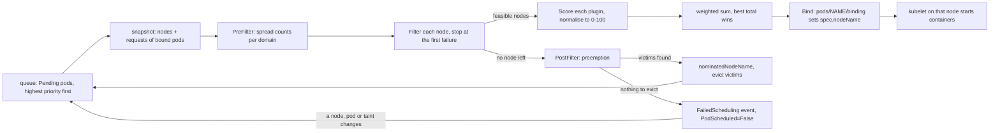

# A Scheduler Is Filter, Score, Bind

*A Pending pod is a filter that rejected every node; the event names which one, and the fix is a request, a taint or a label, not a restart.*

## Metadata

| Field | Value |
|---|---|
| Type | Build |
| Languages | Python |
| Prerequisites | [Reconcilers From Scratch](https://cloudcaptain.io/learn/orchestration/reconciler) |
| Time | 90 minutes |
| Tools | kubectl, kind, kube-scheduler |

<Quiz stage="pre" />

## The Problem

Friday, 16:40. The `checkout` rollout has been stuck for twenty minutes: four new pods are Running, two are `Pending`, and `kubectl rollout status` is still waiting. `kubectl top nodes` shows every node under 35% CPU, so somebody says the cluster is "obviously not full" and deletes the two Pending pods. The ReplicaSet creates two new ones. They are Pending too. Someone else bumps the node group from twelve to fifteen nodes; three nodes join, the pods stay Pending, and the new nodes sit there almost empty and billed by the hour.

The answer was on the screen the whole time, in the event nobody read closely: `0/12 nodes are available: 3 node(s) had untolerated taint(s), 4 Insufficient memory, 5 node(s) didn't match pod topology spread constraints.` Every one of the twelve nodes is in that sentence exactly once. Three are control-plane nodes the pod does not tolerate. Four have less free memory than the pod *requests*, which has nothing to do with what `top` measures. Five would push one zone two pods ahead of another, and the release added `maxSkew: 1` across zones while all three new nodes landed in the same zone. Deleting pods changes none of that, and new nodes help only if they fix the specific reason.

The scheduler is not a black box that "decides". It runs a fixed list of filter plugins against every node, keeps the nodes that pass all of them, scores those with another list of plugins, and writes one field: `spec.nodeName`. When no node passes, it counts the reasons and prints the histogram you just read. You are going to write `minisched`, which does the same thing from `kubectl get nodes -o json` and the pods already bound: the same filters in the same order, the same scores and weights, preemption, and the FailedScheduling message word for word. After that, every Pending pod is one line of that message and one change you can name.

## The Concept

Think of a shortlist for a job. First the hard requirements remove candidates: the visa, the licence, the start date. Whoever is left is ranked on preferences, the best one gets the offer, and the offer is a single letter. If nobody passes the requirements, the honest rejection lists how many candidates failed which requirement, not "no suitable candidates".

kube-scheduler is that process for pods. It watches for pods whose `spec.nodeName` is empty and whose `spec.schedulerName` matches one of its profiles, and takes them one at a time from a priority queue (highest `spec.priority` first, then oldest). For each pod it takes a snapshot of every node and the pods already on it, then:

- **Filter.** Each plugin answers yes or no for one node. For a node, the plugins run in a fixed order and stop at the first no: `NodeUnschedulable`, `NodeName`, `TaintToleration`, `NodeAffinity`, `NodePorts`, `NodeResourcesFit`, the volume plugins, `PodTopologySpread`, `InterPodAffinity`. A node that fails gets one status naming the first failing plugin and its reasons.
- **Score.** Each plugin gives each feasible node a number, normalised to 0-100, multiplied by the plugin's weight (`TaintToleration` 3, `NodeAffinity` 2, `PodTopologySpread` 2, `InterPodAffinity` 2, `NodeResourcesFit` 1, `NodeResourcesBalancedAllocation` 1, `ImageLocality` 1 in the default profile) and summed. The highest total wins; ties are broken at random. With a single feasible node, scoring is skipped.
- **Bind.** The scheduler records the choice in its cache and sends a `Binding` to the API server (`POST /api/v1/namespaces/NS/pods/NAME/binding`), which sets `spec.nodeName`. That is the whole output. The kubelet on that node is watching for pods with its name and starts the containers.

Resources are **requests**, never usage. `NodeResourcesFit` adds up the requests of every non-terminal pod bound to the node and compares the remainder of `status.allocatable` with the new pod's requests. Allocatable is capacity minus `kube-reserved`, `system-reserved` and the hard eviction threshold. A node at 5% CPU with all its CPU requested is full.



Failure has two flavours. A status code `Unschedulable` (not enough CPU, a spread constraint) might be fixed by removing pods, so the `DefaultPreemption` plugin tries: if the pod has a higher priority than some pods on that node and evicting them would make it fit, the node is nominated and the victims are deleted. `UnschedulableAndUnresolvable` (a taint, a cordon, a label that does not match) cannot be fixed by evicting anything, and the preemption half of the message says `Preemption is not helpful for scheduling`. Either way the pod gets a `FailedScheduling` event and the condition `PodScheduled=False` with reason `Unschedulable`, and goes back to the queue. It is retried when something that could change the answer happens (a node is added or uncordoned, a pod is deleted, a taint is removed) or after a periodic flush, which is why removing a taint schedules a Pending pod within seconds without recreating it.

## Build It

`code/main.py` is `minisched`. It loads nodes and bound pods from `kubectl ... -o json`, so you can point it at a real cluster, and everything after loading is pure functions over dataclasses. The tests build clusters in memory and `code/fixtures/` holds a three-node cluster (one tainted control plane, two workers) used by the walk-through below.

### Step 1: quantities are exact decimals with suffixes

`500m` CPU, `1.5` CPU, `16405884Ki` and `1Gi` of memory are all quantities: a decimal number with an optional binary suffix (`Ki`, `Mi`, `Gi`), decimal suffix (`m`, `k`, `M`, `G`) or exponent. The API server rounds up to whole millicores and whole bytes, so `minisched` uses `Fraction` instead of floats and rounds the same way:

```python
def parse_quantity(text: Any) -> Fraction:
    raw = str(text).strip()
    match = QUANTITY.match(raw)
    if not match:
        raise InputError(f"not a Kubernetes quantity: {raw!r} (examples: 500m, 2, 1.5, 128Mi, 1Gi, 1e3)")
    number, exponent, suffix = match.groups()
    value = Fraction(number)
    if exponent:
        return value * Fraction(10) ** int(exponent[1:])
    if suffix in BINARY_SUFFIXES:
        return value * BINARY_SUFFIXES[suffix]
    return value * DECIMAL_SUFFIXES[suffix or ""]


def milli_cpu(text: Any) -> int:
    return math.ceil(parse_quantity(text) * 1000)
```

`1G` is 10^9 bytes and `1Gi` is 2^30; the 7% between them is a classic reason a pod "almost" fits.

### Step 2: what a pod asks for

A pod's request is not the sum of its containers. Init containers run one after another before the app, so only the largest counts; sidecars (init containers with `restartPolicy: Always`) keep running, so they add to the app and to every init container that starts after them; `spec.overhead` (set by a RuntimeClass) is added on top:

```python
def pod_requests(spec: Dict[str, Any], non_zero: bool = False) -> Dict[str, int]:
    total = total_of(container_requests(c, non_zero) for c in spec.get("containers") or [])
    sidecars: Dict[str, int] = {}
    init_peak: Dict[str, int] = {}
    for container in spec.get("initContainers") or []:
        requests = container_requests(container, non_zero)
        if container.get("restartPolicy") == "Always":
            sidecars = add(sidecars, requests)
            init_peak = maximum(init_peak, sidecars)
        else:
            init_peak = maximum(init_peak, add(sidecars, requests))
    total = maximum(add(total, sidecars), init_peak)
    return add(total, resource_list(spec.get("overhead")))
```

`container_requests()` applies the API server's defaulting (a limit without a request becomes the request) and, for the scoring view, kube-scheduler's rule that a container with no CPU or memory request counts as 100m and 200Mi. Filtering always uses the real numbers, so a pod with no requests fits anywhere; scoring uses the defaults, so a hundred such pods still spread out instead of piling onto one node.

### Step 3: filters run in order and stop at the first failure

```python
FILTERS: List[Tuple[str, FilterPlugin]] = [
    ("NodeUnschedulable", node_unschedulable),
    ("NodeName", node_name),
    ("TaintToleration", taint_toleration),
    ("NodeAffinity", node_affinity),
    ("NodeResourcesFit", resources_fit),
    ("PodTopologySpread", topology_spread),
]


def run_filters(pod: Pod, info: NodeInfo, state: CycleState) -> Optional[Status]:
    for _, plugin in FILTERS:
        status = plugin(pod, info, state)
        if status is not None:
            return status
    return None
```

The order is kube-scheduler's default order minus the plugins this lesson leaves out (ports, volumes, inter-pod affinity). It is why a tainted node never reports `Insufficient cpu`: the taint answered first. A toleration matches a taint when the effects match (or the toleration has none), the keys match (or the toleration has none, which needs `Exists`), and the values are equal (or the operator is `Exists`):

```python
def tolerates(toleration: Dict[str, Any], taint: Dict[str, Any]) -> bool:
    effect = toleration.get("effect") or ""
    if effect and effect != taint.get("effect"):
        return False
    key = toleration.get("key") or ""
    if key and key != taint.get("key"):
        return False
    operator = toleration.get("operator") or "Equal"
    if operator == "Exists":
        return True
    if operator == "Equal":
        return (toleration.get("value") or "") == (taint.get("value") or "")
    return False
```

`taint_toleration()` looks only at `NoSchedule` and `NoExecute` taints and reports the first untolerated one. The event says only `node(s) had untolerated taint(s)`: current releases stopped printing the taint's key and value there (older ones printed `{KEY: VALUE}`), so minisched keeps the taint in its per-node detail, the column you would otherwise rebuild with `kubectl get nodes -o custom-columns=NAME:.metadata.name,TAINTS:.spec.taints`; `PreferNoSchedule` only lowers the score. `node_unschedulable()` rejects a cordoned node (`spec.unschedulable: true`) unless the pod tolerates `node.kubernetes.io/unschedulable:NoSchedule`, which is how DaemonSet pods still land on cordoned nodes. `node_name()` matters for simulations only: a pod created with `spec.nodeName` already set never reaches the scheduler at all. `node_affinity()` checks `nodeSelector` (every pair must match) and the required `nodeSelectorTerms` (terms are ORed, expressions inside a term are ANDed, `NotIn` and `DoesNotExist` match nodes that lack the label, and an empty term matches nothing). `matchFields` on `metadata.name` is what the DaemonSet controller writes to pin a pod to one node.

### Step 4: requests against allocatable, and skew against the minimum

`resources_fit()` reports every shortage at once, which is why one node can contribute both `Insufficient cpu` and `Insufficient memory` to the histogram:

```python
for name in sorted(pod.requests, key=resource_order):
    wanted = pod.requests[name]
    if name == "pods" or wanted <= 0:
        continue
    free = allocatable.get(name, 0) - used.get(name, 0)
    if wanted > free:
        reasons.append(f"Insufficient {name}")
        details.append(f"{name}: requested {show(name, wanted)}, free {show(name, free)} of {show(name, allocatable.get(name, 0))}")
```

`used` is `info.requested`: the sum over pods bound to the node that are not `Succeeded` or `Failed`. A finished Job pod costs nothing; a pod stuck terminating still does. The pod count against `allocatable.pods` (110 by default) gives `Too many pods`, and an extended resource such as `nvidia.com/gpu` on a node that does not advertise it gives `Insufficient nvidia.com/gpu`.

`topology_spread()` needs a cluster-wide view, so `prefilter()` counts matching pods per domain once per cycle. For each `DoNotSchedule` constraint the skew of placing the pod on a node is the count in that node's domain, plus one if the pod matches its own selector, minus the smallest count over all eligible domains:

```python
def topology_spread(pod: Pod, info: NodeInfo, state: CycleState) -> Optional[Status]:
    for constraint, counts in zip(state.hard_spread, state.hard_counts):
        domain = info.node.labels.get(constraint.topology_key)
        if domain is None:
            return Status("PodTopologySpread", UNRESOLVABLE, [REASON_SPREAD_LABEL], f"node has no label {constraint.topology_key}")
        self_match = 1 if selector_matches(constraint.selector, pod.labels) else 0
        skew = counts.get(domain, 0) + self_match - global_minimum(counts, constraint)
        if skew > constraint.max_skew:
            return Status("PodTopologySpread", UNSCHEDULABLE, [REASON_SPREAD], f"{constraint.topology_key}={domain}: skew {skew} > maxSkew {constraint.max_skew}")
    return None
```

Which nodes are "eligible domains" is the trap. By default (`nodeAffinityPolicy: Honor`, `nodeTaintsPolicy: Ignore`) nodes that fail the pod's node affinity are left out but **tainted nodes are counted**. A control-plane node the pod can never run on is a domain with zero pods, the minimum stays zero, and a hostname spread with `maxSkew: 1` blocks every worker that already has one replica. `minDomains` forces the minimum to zero until enough domains exist; `matchLabelKeys: [pod-template-hash]` limits counting to the pod's own ReplicaSet.

### Step 5: the FailedScheduling message is a sorted histogram

```python
def fit_error(total_nodes: int, statuses: Iterable[Status]) -> str:
    histogram: Dict[str, int] = {}
    for status in statuses:
        for reason in status.reasons:
            histogram[reason] = histogram.get(reason, 0) + 1
    parts = sorted(f"{count} {reason}" for reason, count in histogram.items())
    message = f"0/{total_nodes} nodes are available:"
    if parts:
        message += " " + ", ".join(parts) + "."
    return message
```

The sort is on the whole `"COUNT REASON"` string, as in kube-scheduler, so `10 ...` sorts before `2 ...`. The counts can add up to more than the node count when one node had several shortages, and never to fewer.

### Step 6: preemption, the second sentence

When no node is feasible, `preempt()` walks the nodes again. A node whose status is `UnschedulableAndUnresolvable` gets `Preemption is not helpful for scheduling`. A node with no pods of lower priority gets `No preemption victims found for incoming pod`. Otherwise it removes every lower-priority pod, runs the filters again, and if the pod now fits, adds the victims back one at a time from the highest priority down, keeping each one that still leaves room:

```python
lower = sorted((p for p in info.pods if p.priority < pod.priority), key=lambda p: (-p.priority, p.key))
if not lower:
    outcomes.append(Status("DefaultPreemption", UNRESOLVABLE, [REASON_NO_VICTIMS]))
    continue
victims, failure = select_victims(pod, cluster, info.node.name, lower)
```

Among the nodes that work it picks the one whose most important victim has the lowest priority, then the lowest sum, then the fewest victims (kube-scheduler first minimises PodDisruptionBudget violations and finally compares start times; `minisched` falls back to the node name). If no node works, the outcomes become a second histogram prefixed with `preemption:` and appended to the message. Depending on the release, the real event may end that sentence with two periods, because the inner message is itself a complete fit error wrapped in the same format.

### Step 7: scores, normalised and weighted

`NodeResourcesFit` scores with `LeastAllocated` by default: for CPU and memory, the share left free after placing the pod, in integer arithmetic, averaged. `MostAllocated` inverts it and packs nodes tightly, which is what you want when an autoscaler can remove empty ones:

```python
def least_allocated(pairs: List[Tuple[int, int]]) -> int:
    total = weights = 0
    for requested, allocatable in pairs:
        if allocatable == 0:
            continue
        total += 0 if requested > allocatable else (allocatable - requested) * MAX_NODE_SCORE // allocatable
        weights += 1
    return total // weights if weights else 0
```

`NodeResourcesBalancedAllocation` rewards nodes where CPU and memory would be used in the same proportion, so neither is stranded: `(1 - std) * 100`, where for two resources the standard deviation is half the difference between the two fractions. Preferred node affinity sums the weights of the matching terms and scales the best node to 100. `TaintToleration` counts untolerated `PreferNoSchedule` taints and scales in reverse, so fewer is better. Soft spread (`ScheduleAnyway`) sums, per constraint, the matching pods in the node's domain times `log(domains + 2)` plus `maxSkew - 1`, then maps the lowest raw value to 100 with `100 * (max + min - raw) // max`. The weighted sum and a deterministic tie-break finish it:

```python
results.append(NodeScore(name, per_plugin, sum(WEIGHTS[p] * s for p, s in per_plugin.items())))
```

```python
return sorted(results, key=lambda s: (-s.total, s.node))
```

kube-scheduler picks uniformly at random among nodes with the same top total; `minisched` takes the first by name so its output is reproducible.

### Step 8: run it

```bash
F=code/fixtures
python3 code/main.py --nodes $F/nodes.json --pods $F/pods.json --pod $F/pod-web.json
#   cp-1      TaintToleration    node(s) had untolerated taint(s) ...
#   node            Fit  Balance    Taint   total
#   worker-a         56       77      100     433
#   worker-b         24       96      100     420
# bind default/web to worker-a
python3 code/main.py --nodes $F/nodes.json --pods $F/pods.json --pod $F/pod-web.json --strategy MostAllocated   # worker-b: bin packing
python3 code/main.py --nodes $F/nodes.json --pod $F/pod-web.json      # no bound pods: equal scores, worker-a by name
```

`worker-b` is better balanced but has 8Gi of memory requested by `db-0`, so `LeastAllocated` prefers `worker-a`. Now the failures:

```bash
python3 code/main.py --nodes $F/nodes.json --pods $F/pods.json --pod $F/pod-big.json; echo "exit $?"
#   worker-a  NodeResourcesFit   Insufficient cpu (cpu: requested 2000m, free 1800m of 3800m)
#   worker-b  NodeResourcesFit   Insufficient cpu (cpu: requested 2000m, free 1300m of 3800m)
# FailedScheduling: 0/3 nodes are available: 1 node(s) had untolerated taint(s), 2 Insufficient cpu. preemption: 0/3 nodes are available: 1 Preemption is not helpful for scheduling, 2 No preemption victims found for incoming pod.
# exit 1
python3 code/main.py --nodes $F/nodes.json --pods $F/pods.json --pod $F/pod-urgent.json
# preemption: nominate worker-a and evict default/batch-1 (priority 0)
python3 code/main.py --nodes $F/nodes.json --pods $F/pods.json --pod $F/pod-gpu.json       # NodeAffinity answers before the GPU is even counted
python3 code/main.py --nodes $F/nodes.json --pods $F/pods.json --pod $F/pod-spread.json    # skew 2 > maxSkew 1 on both workers
sed 's/"DoNotSchedule"/"DoNotSchedule", "nodeTaintsPolicy": "Honor"/' $F/pod-spread.json \
  | python3 code/main.py --nodes $F/nodes.json --pods $F/pods.json --pod -                 # cp-1 stops counting; bind to worker-a
python3 code/main.py --nodes $F/nodes.json --pods $F/pods.json --pod $F/pod-big.json --json > big.json; head -20 big.json
```

`urgent` is `big` with `priority: 1000`. Removing both priority-0 pods from `worker-a` makes room; putting `api-1` back still fits, putting `batch-1` back does not, so only `batch-1` is a victim. Exit codes are 0 for a binding, 1 for FailedScheduling, 2 for input that is not JSON or not a quantity.

<RunTests />

## Use It

Run the real scheduler (Kubernetes <ToolVersion name="kubernetes" />) against the same questions on a kind cluster, then point `minisched` at the cluster's own JSON. kind removes the control-plane taint when a cluster has no workers, so the single node accepts pods:

```bash
kind create cluster --name cc-lab
kubectl config use-context kind-cc-lab
kubectl create namespace sched
cat > hog.json <<'EOF'
{"apiVersion": "v1", "kind": "Pod", "metadata": {"name": "hog", "namespace": "sched"},
 "spec": {"containers": [{"name": "main", "image": "registry.k8s.io/pause:3.10", "resources": {"requests": {"cpu": "1000"}}}]}}
EOF
kubectl apply -f hog.json
kubectl -n sched get pod hog                                    # Pending
kubectl -n sched describe pod hog | sed -n '/^Events:/,$p'      # Warning  FailedScheduling  default-scheduler  0/1 nodes are available: 1 Insufficient cpu. preemption: ...
kubectl get events -A --field-selector reason=FailedScheduling  # every Pending pod in the cluster, one line each
kubectl -n sched get pod hog -o jsonpath='{.status.conditions[?(@.type=="PodScheduled")]}'   # status False, reason Unschedulable, the same message
kubectl get nodes -o json > nodes.json && kubectl get pods -A -o json > pods.json
python3 code/main.py --nodes nodes.json --pods pods.json --pod hog.json                       # minisched says the same sentence
```

On a cluster where Dynamic Resource Allocation is on, as it is on current kind clusters, the real event also carries `no new claims to deallocate,` before the preemption part. The DRA plugin's post-filter adds it, and it means only that releasing device claims would not make the pod fit; minisched leaves it out.

Requests against allocatable, and why `top` is the wrong tool for this question:

```bash
NODE=cc-lab-control-plane
kubectl get node $NODE -o jsonpath='{.status.capacity}{"\n"}{.status.allocatable}{"\n"}'     # allocatable = capacity - reserved - eviction threshold
kubectl describe node $NODE | sed -n '/Allocated resources/,/Events/p'                        # sum of requests and limits, as percentages of allocatable
kubectl top node                                                                              # usage, with metrics-server installed; the scheduler never reads it
```

Taints, cordons and the requeue:

```bash
kubectl taint nodes $NODE dedicated=db:NoSchedule
kubectl -n sched run plain --image=registry.k8s.io/pause:3.10                 # Pending: 1 node(s) had untolerated taint(s)
kubectl taint nodes $NODE dedicated=db:NoSchedule-                            # the trailing dash removes it; plain is bound within seconds, not recreated
kubectl cordon $NODE && kubectl get node $NODE                                # STATUS Ready,SchedulingDisabled; existing pods keep running
kubectl -n sched run late --image=registry.k8s.io/pause:3.10                  # 1 node(s) were unschedulable
kubectl uncordon $NODE
kubectl -n sched get pods -o wide                                             # NODE and NOMINATED NODE columns
kubectl drain $NODE --ignore-daemonsets --dry-run=server                      # drain is cordon plus evictions
```

A cordoned node also gets the taint `node.kubernetes.io/unschedulable:NoSchedule` from the node lifecycle controller, but `NodeUnschedulable` runs before `TaintToleration`, so the message names the cordon.

**Profiles and `schedulerName`.** One kube-scheduler process can serve several profiles, each with its own plugin set, weights and arguments, selected by the pod's `spec.schedulerName`. A bin-packing profile next to the default one:

```yaml
apiVersion: kubescheduler.config.k8s.io/v1
kind: KubeSchedulerConfiguration
clientConnection:
  kubeconfig: /etc/kubernetes/scheduler.conf
profiles:
  - schedulerName: default-scheduler
  - schedulerName: bin-packing
    pluginConfig:
      - name: NodeResourcesFit
        args:
          scoringStrategy:
            type: MostAllocated
            resources:
              - name: cpu
                weight: 1
              - name: memory
                weight: 1
```

kube-scheduler reads it from `--config`; on kind and kubeadm clusters the scheduler is a static pod, so the flag goes into its manifest, which you can read with `docker exec cc-lab-control-plane cat /etc/kubernetes/manifests/kube-scheduler.yaml`. A pod whose `schedulerName` no running scheduler serves stays Pending forever with **no** event and no `PodScheduled` condition: silence, not a FailedScheduling, is the symptom.

**Priority and preemption.** Priority comes from a PriorityClass, resolved into `spec.priority` at admission:

```yaml
apiVersion: scheduling.k8s.io/v1
kind: PriorityClass
metadata:
  name: incident
value: 1000
preemptionPolicy: PreemptLowerPriority
description: "on-call workloads that may evict batch pods"
```

A pod with `priorityClassName: incident` that does not fit gets `status.nominatedNodeName` (the NOMINATED NODE column), its victims get a `Preempted` event and are deleted with their normal grace period, and the pod is bound on a later cycle. PodDisruptionBudgets are respected on a best-effort basis only. `preemptionPolicy: Never` keeps the queue position without evicting anyone. `system-cluster-critical` and `system-node-critical` are the built-in classes above every user class.

**After the decision.** The scheduler decides once and never moves a running pod. The [descheduler](https://github.com/kubernetes-sigs/descheduler) evicts pods that no longer fit the rules (`RemovePodsViolatingTopologySpreadConstraint`, `RemovePodsViolatingNodeTaints`, `LowNodeUtilization`) so that the scheduler places them again. Node autoscalers start from the same signal you used: a pod with `PodScheduled=False` and reason `Unschedulable`. cluster-autoscaler runs the scheduler's own filter plugins against a template node for each node group and grows a group whose template would fit (events `TriggeredScaleUp` or `NotTriggerScaleUp` on the pod); Karpenter computes a node shape from the pending pods' requests and its NodePool constraints and creates a NodeClaim. Both read requests, not usage, and neither can help a pod whose reason is a label or taint that no node shape provides.

| What you built | Real tool | Note |
|---|---|---|
| `filter_nodes()`, first failure per node | kube-scheduler Filter extension point | real nodes are checked in parallel; in large clusters it stops once it has enough feasible nodes (`percentageOfNodesToScore`) |
| `fit_error()` | the `FailedScheduling` event and the `PodScheduled` condition message | the same sorted histogram; read it with `kubectl describe pod` or `get events --field-selector reason=FailedScheduling` |
| `resources_fit()` over requests | `NodeResourcesFit`, `kubectl describe node` Allocated resources | requests against allocatable, never usage |
| `taint_toleration()`, `node_unschedulable()` | `kubectl taint`, `kubectl cordon`, `kubectl drain` | `NoExecute` also evicts running pods; the scheduler only filters |
| `node_affinity()` | `nodeSelector`, `affinity.nodeAffinity` | `Gt` and `Lt` compare integers; `matchFields` only knows `metadata.name` |
| `topology_spread()`, `spread_scores()` | `topologySpreadConstraints` | `nodeTaintsPolicy`, `minDomains`, `matchLabelKeys`; cluster-level default constraints apply when a pod has none |
| `score()` with `WEIGHTS` | profiles and plugin weights in `KubeSchedulerConfiguration` | ties are random in the real scheduler |
| `--strategy MostAllocated` | `NodeResourcesFit` `scoringStrategy` | bin packing for autoscaled clusters; `RequestedToCapacityRatio` is the third option |
| `preempt()` | `DefaultPreemption`, PriorityClass | `nominatedNodeName`, PDBs best effort, `preemptionPolicy: Never` |
| `bind ... to NODE` | the `pods/binding` subresource | the only write the scheduler makes for a pod |
| exit code 1 with the message | cluster-autoscaler, Karpenter | both watch for `PodScheduled=False` |

<Quiz stage="check" />

## Ship It

Two artifacts in `outputs/`:

- **`skill-pending-pod-triage.md`**: a runbook for a pod stuck in `Pending`. It first rules out the cases that never reach a filter (scheduling gates, an unknown `schedulerName`, unbound PersistentVolumeClaims), then splits the FailedScheduling message into its reasons and maps each one to the command that confirms it and the change that fixes it, checks whether preemption or an autoscaler can help, and ends with a fixed report.
- **`prompt-explain-failedscheduling.md`**: paste a FailedScheduling message, optionally with the pod spec and `kubectl describe node` output, and get each reason explained with the number of nodes it eliminated, the single change that makes the most nodes feasible, and what will not help.

<ShipIt />

## Exercises

### Easy

Add the `NodePorts` filter between `NodeAffinity` and `NodeResourcesFit`: a pod whose containers declare a `hostPort` cannot land on a node where a bound pod already uses the same `hostPort`, protocol and `hostIP` (an empty or `0.0.0.0` `hostIP` conflicts with every address). The reason is `node(s) didn't have free ports for the requested pod ports`. Write the tests first: two pods on 8080/TCP conflict, 8080/TCP and 8080/UDP do not, and the reason appears in the histogram.

### Medium

Add required inter-pod anti-affinity (`podAntiAffinity.requiredDuringSchedulingIgnoredDuringExecution` with a `topologyKey`) as an `InterPodAffinity` filter after `PodTopologySpread`. Handle both directions: the incoming pod's terms against pods already in the domain (`node(s) didn't match pod anti-affinity rules`) and existing pods' terms against the incoming pod (`node(s) didn't satisfy existing pods anti-affinity rules`). Tests first, including a namespace selector and a term that matches nothing.

### Hard

Add `--replicas N` for a Deployment manifest: schedule N copies one after another, adding each placed pod to the cluster before the next cycle, as the scheduler cache does, and print the final distribution per node and per zone. Then add `--node-template node.json` that answers the cluster-autoscaler question: for the pods left Pending, how many nodes shaped like the template would make them all feasible, and which reasons would no number of such nodes fix. Prove it with a test where a taint on the template makes the answer "none".

<Quiz stage="post" />

## Key Terms

| Term | Common misconception | Precise definition |
|---|---|---|
| Filter plugin | "The scheduler checks everything and lists all problems per node." | A yes or no per node. Filters run in a fixed order and stop at the first failure, so each node contributes the reasons of exactly one plugin to the message. |
| Score plugin | "The node with the most free CPU wins." | A 0-100 value per feasible node from each enabled plugin, multiplied by the plugin's weight and summed; resources are one plugin among several, and ties are broken at random. |
| Requests | "The scheduler looks at how busy a node is." | The amounts declared in `resources.requests`. Filtering compares them with allocatable minus the requests of bound pods; actual usage is never read. |
| Allocatable | "The node's CPU and memory." | `status.allocatable`: capacity minus `kube-reserved`, `system-reserved` and the hard eviction threshold. It is the budget requests are counted against. |
| Taint and toleration | "A toleration attracts a pod to a node." | A taint on a node repels pods (`NoSchedule`, `PreferNoSchedule`, `NoExecute`); a toleration only allows a pod to ignore a matching taint. Steering a pod onto a node needs node affinity as well. |
| Cordon | "Cordoning stops the pods on a node." | Setting `spec.unschedulable: true`. New pods are filtered out by `NodeUnschedulable`; running pods stay until they are evicted, which is what `drain` adds. |
| Topology spread skew | "maxSkew counts only the nodes the pod can use." | The pods in a domain plus the incoming one minus the smallest count over eligible domains. Tainted nodes are eligible unless `nodeTaintsPolicy: Honor`. |
| Preemption | "A higher priority means the pod is scheduled first, nothing more." | When no node is feasible, the scheduler may delete lower-priority pods from one node to make room, nominate that node and bind on a later cycle; it never helps with a taint, a cordon or a label mismatch. |
| Binding | "The scheduler starts the pod." | The single API write `pods/NAME/binding`, which sets `spec.nodeName`. The kubelet on that node starts the containers. |

## Further Reading

- [Kubernetes Workloads & Scheduling](https://cloudcaptain.io/docs/tools/kubernetes/workloads): node selectors, affinity, taints and tolerations in the manifests you write every day.
- [Kubernetes Fundamentals](https://cloudcaptain.io/docs/tools/kubernetes/fundamentals): where kube-scheduler sits among the control-plane components and what it hands to the kubelet.
- [Kubernetes in Production](https://cloudcaptain.io/docs/tools/kubernetes/production-operations): sizing requests, priority classes and cluster autoscaler tuning.
- [kubectl Cheat Sheet](https://cloudcaptain.io/docs/tools/kubernetes/cheatsheet): `taint`, `cordon`, `drain`, `describe` and event queries in one place.
- [Scheduling Framework](https://kubernetes.io/docs/concepts/scheduling-eviction/scheduling-framework/): every extension point (PreFilter, Filter, PostFilter, Score, Reserve, Permit, Bind) that `minisched` collapses into a few functions.
- [Scheduler Configuration](https://kubernetes.io/docs/reference/scheduling/config/): profiles, the default plugin list and the plugin arguments such as `scoringStrategy`.
- [Pod Topology Spread Constraints](https://kubernetes.io/docs/concepts/scheduling-eviction/topology-spread-constraints/): skew, `minDomains`, `nodeTaintsPolicy` and the default constraints.
- [Pod Priority and Preemption](https://kubernetes.io/docs/concepts/scheduling-eviction/pod-priority-preemption/): how victims are chosen and the limits around PodDisruptionBudgets.
- [Reserve Compute Resources for System Daemons](https://kubernetes.io/docs/tasks/administer-cluster/reserve-compute-resources/): the formula behind allocatable.
- [kube-scheduler plugins source](https://github.com/kubernetes/kubernetes/tree/master/pkg/scheduler/framework/plugins): the real filters and scorers, including every reason string quoted in this lesson.
