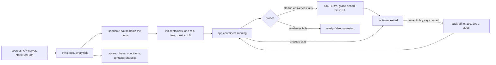

# A Node Agent Turns a Pod Spec Into Processes

*A kubelet is a loop over pod specs: start what is missing, probe what runs, restart with back-off, stop with a grace period, report it all.*

## Metadata

| Field | Value |
|---|---|
| Type | Build |
| Languages | Python |
| Prerequisites | [Scheduler](https://cloudcaptain.io/learn/orchestration/scheduler) |
| Time | 90 minutes |
| Tools | kubectl, kind, crictl, docker |

<Quiz stage="pre" />

## The Problem

Friday, 16:40. The payments API rollout is stuck: `kubectl get pods` shows the new pods at `0/1 CrashLoopBackOff` with `RESTARTS 6`, and the gap between restarts keeps growing. Someone deletes a pod "to unstick it"; the ReplicaSet creates a fresh one and the same thing happens, only now `kubectl logs --previous` has nothing, because the container that crashed is gone. Somebody else notices the liveness probe calls `/health`, which checks the database, and raises `failureThreshold` to 20. The real cause, a missing environment variable that makes the process exit with code 1 in under a second, sits in the `lastState` field that nobody read.

The week before, the same team lost every replica of the checkout service at once. Postgres slowed down for forty seconds; `/health` checked Postgres; every pod failed its liveness probe three times in a row and was killed. The restarted pods queued their connections behind the slow database, failed again, and went into back-off together. A readiness probe would have taken them out of the Service and left them running. And on a control-plane node, an engineer fixed a flag in `/etc/kubernetes/manifests/kube-apiserver.yaml` with a stray indent. The API server disappeared, `kubectl` could not reach anything, and nothing in the cluster could bring it back, because the thing that runs the API server is not behind the API server.

All three incidents are one component doing exactly what it was told. The scheduler from the previous lesson ends its job by writing `spec.nodeName`. From then on, a loop on that node, the **kubelet**, compares the pod specs it has been given with the processes that exist, and every field in `kubectl describe pod` is that loop's report of what it compared and what it did. You are going to write `minikubelet`: a sync loop over a directory of pod manifests, a runtime interface shaped like the CRI with a plain-process runtime and a `docker` runtime, init containers, the three restart policies, CrashLoopBackOff with the kubelet's back-off, startup, liveness and readiness probes, a graceful stop with SIGTERM and SIGKILL, and a status table that reads like `kubectl get pods`.

## The Concept

The kubelet is a reconciler whose actual state is processes on one machine. It gets desired pods from **sources**: the API server (pods whose `nodeName` is this node), a directory of manifest files (`staticPodPath`), and optionally a URL. Every sync it walks each pod and asks the same questions in the same order. Does the pod have a **sandbox** yet (the pause container that holds the pod's network namespace)? Have the **init containers** all exited 0, one after another? Is every app container running? If one has exited, does the pod's **restartPolicy** say to start it again, and has its **back-off** expired? Are the running containers passing their **probes**? Is this pod still wanted at all, or should it be stopped with SIGTERM, a grace period, and SIGKILL? Then it writes what it found into the pod's status: a phase, conditions, and one state per container.

Three probes, three different consequences. Getting them confused causes most probe incidents:

| Probe | Runs | On failure (`failureThreshold` in a row) | On success (`successThreshold` in a row) |
|---|---|---|---|
| startup | from container start until it succeeds once | container killed and restarted per `restartPolicy` | liveness and readiness begin |
| liveness | after startup succeeds, every `periodSeconds` | container killed and restarted per `restartPolicy` | nothing changes |
| readiness | after startup succeeds, for the container's whole life | container `ready=false`, pod leaves Service endpoints; **no restart** | container `ready=true` |

Restart back-off is per container: the first restart is immediate, then the kubelet waits 10 seconds, then 20, 40, and so on, capped at 300 seconds, and resets the delay once a container has run for 10 minutes without a problem. While it waits, the container's state is `waiting` with reason `CrashLoopBackOff`. That is a container state, not a pod phase: the phase of a crash-looping pod with `restartPolicy: Always` is `Running`. The `STATUS` column in `kubectl get pods` is computed by kubectl from the container states, which is why it can show words such as `CrashLoopBackOff`, `Init:1/2` or `Terminating` that are not phases.



A **static pod** comes from the directory source. The kubelet runs it with no API server involved, which is how kubeadm and kind start the control plane itself: `etcd`, `kube-apiserver`, `kube-controller-manager` and `kube-scheduler` are files in `/etc/kubernetes/manifests`. So that you can see them, the kubelet creates a read-only **mirror pod** in the API named `NAME-NODENAME`. Deleting the mirror pod changes nothing on the node; the kubelet recreates it. Removing the file stops the pod.

## Build It

`code/main.py` is `minikubelet`. Manifest parsing is pure. The `Kubelet` class holds the loop and takes a runtime, a prober and a clock as constructor arguments. The status functions turn its state into objects shaped like the API, and the printer works on those objects or on real `kubectl get pods -o json` output. The tests drive the loop with a fake runtime and a fake clock, so the whole state machine runs on macOS in a few seconds; a second set of tests starts real child processes.

### Step 1: a directory of manifests is a pod source

YAML goes through the same hand-written subset parser as the [Compose lesson](https://cloudcaptain.io/learn/containers/compose) (copied, not imported; each lesson stands alone), JSON through `json`. Like the kubelet, `load_manifests()` skips hidden files, so an editor's `.kube-apiserver.yaml.swp` is never read as a pod:

```python
def load_manifests(directory, node=""):
    pods, errors = {}, {}
    for name in sorted(os.listdir(directory)):
        path = os.path.join(directory, name)
        if name.startswith(".") or not name.endswith(MANIFEST_SUFFIXES) or not os.path.isfile(path):
            continue
        try:
            pod = load_manifest(path, node)
        except ManifestError as exc:
            errors[name] = str(exc)
            continue
        if pod.key in pods:
            errors[name] = f"{name}: pod {pod.key} is already defined in {pods[pod.key].source}; ignoring this file"
            continue
        pods[pod.key] = pod
    return pods, errors
```

A file that stops parsing simply drops out of the result, so the loop treats it as removed and stops its pod. The real kubelet behaves the same way on its next directory scan, which is how a stray indent in `kube-apiserver.yaml` takes the API server down. Each pod is named after its node, as mirror pods are, and carries a hash of its manifest so the loop can tell a changed file from an unchanged one:

```python
@property
def full_name(self):
    return f"{self.name}-{self.node}" if self.node else self.name

def config_hash(data, node):
    canonical = json.dumps({"node": node, "pod": data}, sort_keys=True, separators=(",", ":"))
    return hashlib.sha256(canonical.encode("utf-8")).hexdigest()[:32]
```

The hash is computed my own way: the kubelet also hashes the decoded pod into `kubernetes.io/config.hash`, but with a different function, so the values do not match.

### Step 2: refuse what the API server would refuse

`parse_pod()` checks what you would otherwise discover at three in the morning: `kind: Pod`, at least one container, unique container names across init and app containers, a known `restartPolicy`, environment values that are strings. Probes get the same rules as the API:

```python
handlers = [name for name in PROBE_HANDLERS if name in raw]
if len(handlers) != 1:
    raise ManifestError(f"{where}: needs exactly one of exec, httpGet, tcpSocket (found {', '.join(handlers) or 'none'})")
...
if kind in ("liveness", "startup") and probe.success_threshold != 1:
    raise ManifestError(f"{where}.successThreshold: must be 1 for {kind} probes; the API server rejects anything else")
```

A named `httpGet.port` such as `http` resolves against the container's `ports`, and init containers may not have probes. A `valueFrom` in `env` is refused with the reason: static pods cannot reference ConfigMaps or Secrets either. `Probe.describe()` prints a probe exactly the way `kubectl describe` does, so the smoke test can compare the two:

```python
def describe(self):
    timing = f"delay={go_duration(self.initial_delay)} timeout={go_duration(self.timeout)} period={go_duration(self.period)}"
    return f"{self.target()} {timing} #success={self.success_threshold} #failure={self.failure_threshold}"
```

### Step 3: a runtime interface shaped like the CRI

The kubelet never starts a process itself. It calls a container runtime over the Container Runtime Interface, a gRPC API. `minikubelet` keeps the same split, with one Python method per call:

| `minikubelet` runtime method | CRI call | Process runtime | Docker runtime |
|---|---|---|---|
| `run_sandbox(pod)` | `RunPodSandbox` | a directory for logs | `docker run --ipc shareable registry.k8s.io/pause:3.10` |
| `start(sandbox, pod, container, attempt)` | `CreateContainer` + `StartContainer` | `subprocess.Popen` in a new session | `docker run --network container:SANDBOX` |
| `status(cid)` | `ContainerStatus` | `Popen.poll()` | `docker inspect -f '{{.State.Running}} {{.State.ExitCode}}'` |
| `kill(cid, sig)` | `StopContainer` (the signal half) | `os.killpg` | `docker kill --signal` |
| `exec_sync(cid, argv, timeout)` | `ExecSync` | `subprocess.run` in the container's directory | `docker exec` |
| `remove(cid)`, `remove_sandbox(sb)` | `RemoveContainer`, `StopPodSandbox` + `RemovePodSandbox` | kill the process group | `docker rm -f` |

The process runtime starts every container in its own session so a signal reaches the whole process group, and turns Python's negative return codes into the shell's `128 + signal`, which is what a container runtime reports:

```python
proc = subprocess.Popen(argv, cwd=sandbox, env=env, stdin=subprocess.DEVNULL, stdout=log, stderr=subprocess.STDOUT, start_new_session=True)

def exit_code_of(returncode):
    return 128 - returncode if returncode < 0 else returncode
```

It has no isolation and no images: every container shares the host's network, and `command:` is required because there is no image entrypoint to fall back on. The docker runtime builds a real pod. The pause container is started first and owns the network namespace; every container joins it, so containers in one pod reach each other on `127.0.0.1`. Kubernetes `command` replaces the image's `ENTRYPOINT` and `args` replaces its `CMD`, which maps onto `docker run` like this:

```python
args = ["run", "-d", "--name", name, "--network", f"container:{sandbox}", "--ipc", f"container:{sandbox}"]
...
if container.command:
    args += ["--entrypoint", container.command[0]]
args.append(container.image)
args += container.command[1:] + container.args
```

### Step 4: one sync compares wanted with running

`sync()` is level-triggered: it receives the full set of desired pods every tick and reacts to the difference, never to an event:

```python
def sync(self, desired):
    now = self.now()
    for key, spec in desired.items():
        state = self.pods.get(key)
        if state is None:
            self.pods[key] = self.new_pod(spec, now)
        elif state.deleting_since is None and state.spec.config_hash != spec.config_hash:
            state.replacement = spec
            self.begin_termination(state, now)
        ...
    for key, state in self.pods.items():
        if key not in desired:
            state.replacement = None
            if state.deleting_since is None:
                self.begin_termination(state, now)
```

A changed manifest means the old pod is stopped completely and a new one with the new hash is created, the way the kubelet replaces a static pod when its file changes. `sync_pod()` then runs the per-pod questions in order: sandbox, `refresh()` every running container from the runtime, termination if the pod is going away, init containers, app containers.

### Step 5: init containers, then the restart policy

Init containers run one at a time; the first that has not exited 0 is the only one that matters:

```python
def sync_init(self, state, now):
    if state.init_failed:
        return False
    for container in state.init:
        if container.succeeded:
            continue
        if container.state == "running":
            return False
        if container.terminations and state.spec.restart_policy == "Never":
            state.init_failed = True
            return False
        self.start_or_back_off(state, container, now)
        return False
    return True
```

A failed init container is restarted with back-off until it succeeds, unless the pod's policy is `Never`, in which case the pod is `Failed`. App containers do not start until `sync_init()` returns `True`. When an app container exits, the pod-level policy decides:

```python
def should_restart(policy, exit_code):
    if policy == "Always":
        return True
    if policy == "OnFailure":
        return exit_code != 0
    return False
```

`Always` restarts a container that exited 0 too, which is why a Deployment whose container finishes its work goes into CrashLoopBackOff with exit code 0.

### Step 6: CrashLoopBackOff is a delay with memory

The `Backoff` class reproduces the kubelet's rule. The delay is keyed by pod and container, it is measured from the moment the container finished, and an entry older than twice the cap is forgotten:

```python
def remaining(self, key, finished_at, now):
    entry = self.entries.get(key)
    if entry is None or self.expired(entry, finished_at):
        return None
    left = finished_at + entry[0] - now
    return left if left > EPSILON else None

def next(self, key, finished_at, now):
    entry = self.entries.get(key)
    delay = self.base if entry is None or self.expired(entry, finished_at) else min(entry[0] * 2, self.cap)
    self.entries[key] = (delay, now)
    return delay
```

The first crash finds no entry, so the container restarts at once and the entry is set to the base. The second crash waits the base, the third twice that, until the cap. A container that then runs for more than `2 × cap` (ten minutes with the defaults) before crashing starts over. While a container waits, `start_or_back_off()` sets its state to `waiting` with reason `CrashLoopBackOff` and emits one `BackOff` event with the kubelet's wording, `Back-off restarting failed container NAME in pod POD`. The schedule, without running anything:

```bash
python3 code/main.py backoff
```

```text
RESTART   WAIT     SINCE FIRST CRASH
1         0s       0s
2         10s      10s
3         20s      30s
4         40s      70s
5         80s      150s
6         160s     310s
7         300s     610s
8         300s     910s
9         300s     1210s
```

`--backoff-base` and `--backoff-max` on `run` make the same curve fast enough for a test.

### Step 7: probes are counters with a schedule

Each probe gets a tracker that knows when it is due and counts consecutive results:

```python
def due(self, now, started_at):
    if now + EPSILON < started_at + self.probe.initial_delay:
        return False
    return self.last_run is None or now + EPSILON >= self.last_run + self.probe.period

def record(self, ok, now):
    self.last_run = now
    self.calls += 1
    if ok:
        self.successes += 1
        self.failures = 0
        return True if self.successes >= self.probe.success_threshold else None
    self.failures += 1
    self.successes = 0
    return False if self.failures >= self.probe.failure_threshold else None
```

`probe()` applies the table from The Concept in order: while a startup probe has not succeeded nothing else runs and a startup failure kills the container; a liveness failure kills it with the message `Container NAME failed liveness probe, will be restarted`; a readiness verdict only flips `ready`. A container with no readiness probe is ready as soon as it has started. `initialDelaySeconds` counts from container start. The `Prober` runs exec probes through the runtime (`ExecSync`, inside the container), and HTTP and TCP probes from the node against the pod IP. Any status from 200 to 399 is a success:

```python
if 200 <= code < 400:
    return ProbeResult(True, f"HTTP {code}")
return ProbeResult(False, f"HTTP probe failed with statuscode: {code}")
```

Every failure becomes an `Unhealthy` event, `Readiness probe failed: HTTP probe failed with statuscode: 503`, which is the line you grep for in `kubectl get events`.

### Step 8: stopping is SIGTERM, a grace period, then SIGKILL

```python
def kill(self, state, container, message):
    ...
    began = self.now()
    grace = state.spec.grace_period
    self.event(state, "Normal", "Killing", container.spec.name, message)
    if container.spec.pre_stop and grace > 0:
        code, output = self.runtime.exec_sync(container.cid, container.spec.pre_stop, grace)
        ...
        grace -= self.now() - began
    grace = max(grace, self.min_grace)
    container.ready = False
    self.runtime.kill(container.cid, signal.SIGTERM)
    container.kill_grace = grace
    container.kill_deadline = self.now() + grace
```

The `preStop` hook runs first and its time comes out of `terminationGracePeriodSeconds`. Whatever is left, with a floor of two seconds (the kubelet's own minimum), is the window between SIGTERM and SIGKILL. The loop does not block: `refresh()` checks on later ticks and sends SIGKILL when the deadline passes. CRI's `StopContainer` takes the timeout and lets the runtime do this escalation; doing it in the loop makes it visible as a `GraceExpired` line. The same `kill()` serves a liveness failure, a removed manifest, a changed manifest and the shutdown of `minikubelet` itself.

### Step 9: status the way the API reports it

`pod_object()` produces a `v1` Pod: annotations `kubernetes.io/config.hash` and `kubernetes.io/config.source: file`, `containerStatuses` with `state` and `lastState`, `restartCount`, and four conditions (`PodReadyToStartContainers`, `Initialized`, `ContainersReady`, `Ready`). The phase follows the kubelet's rule, in which a container waiting to be restarted counts as stopped, not as waiting:

```python
for container in state.containers:
    if container.state == "running":
        running += 1
    elif container.state == "terminated":
        stopped += 1
        succeeded += 1 if container.last_exit == 0 else 0
    elif container.terminations:
        stopped += 1
    else:
        waiting += 1
if waiting:
    return "Pending"
if running:
    return "Running"
if state.spec.restart_policy == "Always":
    return "Running"
```

`status_reason()` is a port of the kubectl printer that fills the `STATUS` column: the first unfinished init container gives `Init:N/M` or `Init:REASON`, otherwise the last container with a waiting or terminated reason wins, and a `deletionTimestamp` turns it into `Terminating`. Because it reads API-shaped dicts, `get pods -f` renders a `minikubelet` status file and a real `kubectl get pods -o json` with the same code.

### Step 10: run it

Every pod is one file in the directory. Write two and start the loop:

```bash
mkdir -p /tmp/mk/manifests /tmp/mk/docroot
cat > /tmp/mk/manifests/web.yaml <<'EOF'
apiVersion: v1
kind: Pod
metadata:
  name: web
  namespace: demo
spec:
  terminationGracePeriodSeconds: 2
  initContainers:
    - name: write-index
      image: python:3.12-alpine
      command: ["python3", "-c", "import time; time.sleep(1); open('/tmp/mk/docroot/index.html', 'w').write('hello from init')"]
  containers:
    - name: web
      image: python:3.12-alpine
      command: ["python3", "-m", "http.server", "8088", "--bind", "127.0.0.1", "--directory", "/tmp/mk/docroot"]
      ports:
        - name: http
          containerPort: 8088
      readinessProbe:
        httpGet:
          path: /index.html
          port: http
        initialDelaySeconds: 1
        periodSeconds: 1
        successThreshold: 2
EOF
echo '{"apiVersion": "v1", "kind": "Pod", "metadata": {"name": "crash", "namespace": "demo"}, "spec": {"containers": [{"name": "crash", "image": "x", "command": ["python3", "-c", "raise SystemExit(1)"]}]}}' > /tmp/mk/manifests/crash.json
python3 code/main.py validate /tmp/mk/manifests --node lab                 # the pods, and each probe as kubectl describe prints it
python3 code/main.py run --manifests /tmp/mk/manifests --node lab --backoff-base 1 --backoff-max 8 --status-file /tmp/mk/status.json
```

```text
    0.0s  Normal   Started       demo/crash-lab crash: Started container crash
    0.0s  Normal   Started       demo/web-lab write-index: Started container write-index
    1.0s  Warning  Exited        demo/crash-lab crash: exit code 1 (Error)
    1.0s  Normal   Started       demo/crash-lab crash: Started container crash
    2.0s  Warning  Exited        demo/crash-lab crash: exit code 1 (Error)
    2.0s  Warning  BackOff       demo/crash-lab crash: Back-off restarting failed container crash in pod crash-lab
    2.0s  Normal   Exited        demo/web-lab write-index: exit code 0 (Completed)
    2.0s  Normal   Started       demo/web-lab web: Started container web
    3.0s  Normal   Started       demo/crash-lab crash: Started container crash
    4.1s  Warning  Exited        demo/crash-lab crash: exit code 1 (Error)
    4.1s  Warning  BackOff       demo/crash-lab crash: Back-off restarting failed container crash in pod crash-lab
    4.1s  Normal   Ready         demo/web-lab web: container is ready
    6.1s  Normal   Started       demo/crash-lab crash: Started container crash
```

(`Created` lines are left out here.) The first restart of `crash` is immediate, the next waits 1s, then 2s; `web` starts only after `write-index` exits 0 and turns ready after two successful probes.

In a second terminal, watch the table and change the inputs:

```bash
watch -n1 python3 code/main.py get pods -f /tmp/mk/status.json           # crash-lab 0/1 CrashLoopBackOff, web-lab 1/1 Running
rm /tmp/mk/docroot/index.html                                            # three readiness failures: web-lab 0/1, no restart
rm /tmp/mk/manifests/crash.json                                          # Killing, PodRemoved: a removed file stops its pod
```

`Ctrl-C` stops every pod with SIGTERM and prints the last table. With Docker on Linux, the same loop runs real pods: `--runtime docker` starts a pause sandbox per pod and joins each container to it, so two containers in one manifest reach each other on `127.0.0.1`. Both runtimes also show a difference you met in the [PID 1 lesson](https://cloudcaptain.io/learn/linux/pid1-supervisor). Under the process runtime `http.server` dies on SIGTERM with exit 143. Under the docker runtime the same command is PID 1 of its container, installs no SIGTERM handler, ignores the signal, and is killed with SIGKILL after the grace period with exit 137.

Kubelet reasons (`Created`, `Started`, `Killing`, `Unhealthy`, `BackOff`, `Failed`, `FailedPreStopHook`) are named after the real ones. `Exited`, `Ready`, `NotReady`, `GraceExpired` and `PodRemoved` are status changes that the real kubelet writes into the pod's status rather than into events; `minikubelet` logs them so you can follow the loop.

<RunTests />

## Use It

Start with the static pods that run the control plane of a kind cluster. The kind node is a container, so `docker exec` takes you onto the node:

```bash
kind create cluster --name cc-lab
docker exec cc-lab-control-plane ls /etc/kubernetes/manifests                      # etcd.yaml kube-apiserver.yaml kube-controller-manager.yaml kube-scheduler.yaml
docker exec cc-lab-control-plane grep staticPodPath /var/lib/kubelet/config.yaml   # staticPodPath: /etc/kubernetes/manifests
kubectl get pods -n kube-system -o wide                                            # the mirror pods: NAME-NODENAME
kubectl get pod -n kube-system kube-apiserver-cc-lab-control-plane -o jsonpath='{.metadata.annotations}{"\n"}{.metadata.ownerReferences[0].kind}{"\n"}'
```

The annotations include `kubernetes.io/config.source: file` and `kubernetes.io/config.mirror`, which carries the same value as `kubernetes.io/config.hash`, and the owner is the Node. Now write a static pod of your own, the way the smoke test does:

```bash
cat <<'EOF' | docker exec -i cc-lab-control-plane tee /etc/kubernetes/manifests/static-web.yaml >/dev/null
apiVersion: v1
kind: Pod
metadata:
  name: static-web
spec:
  containers:
    - name: web
      image: nginx:1.29-alpine
EOF
kubectl get pods -w                                                   # static-web-cc-lab-control-plane appears without any kubectl apply
kubectl delete pod static-web-cc-lab-control-plane                    # the mirror comes back with a new UID; the container never stopped
docker exec cc-lab-control-plane rm /etc/kubernetes/manifests/static-web.yaml   # this is how you stop a static pod
```

Below the kubelet is the CRI and containerd. `crictl` is a CRI client that kind nodes ship, so you can ask the runtime directly what the kubelet asked it to do:

```bash
docker exec cc-lab-control-plane crictl pods                          # sandboxes: one per pod, the pause containers
docker exec cc-lab-control-plane crictl ps -a                         # containers, including exited ones kept for logs --previous
docker exec cc-lab-control-plane crictl ps --name kube-apiserver -q
docker exec cc-lab-control-plane crictl logs <container-id>
docker exec cc-lab-control-plane crictl inspectp <pod-id>             # the sandbox: network namespace path, pod IP, labels
docker exec cc-lab-control-plane journalctl -u kubelet --no-pager -n 50          # where "Could not process manifest file" appears
```

Probes in a Deployment, with the three kinds doing three jobs:

```yaml
apiVersion: apps/v1
kind: Deployment
metadata:
  name: web
spec:
  replicas: 2
  selector:
    matchLabels:
      app: web
  template:
    metadata:
      labels:
        app: web
    spec:
      terminationGracePeriodSeconds: 30
      containers:
        - name: web
          image: nginx:1.29-alpine
          ports:
            - name: http
              containerPort: 80
          startupProbe:
            httpGet: {path: /, port: http}
            periodSeconds: 2
            failureThreshold: 30
          readinessProbe:
            httpGet: {path: /, port: http}
            periodSeconds: 5
          livenessProbe:
            tcpSocket: {port: http}
            periodSeconds: 10
          lifecycle:
            preStop:
              exec:
                command: ["sh", "-c", "sleep 5"]
```

```bash
kubectl apply -f web.yaml
kubectl describe pod -l app=web | grep -E 'Startup|Liveness|Readiness'      # the same line minikubelet's describe() prints
kubectl exec deploy/web -- rm /usr/share/nginx/html/index.html              # GET / now returns 403: readiness fails, liveness (TCP) still passes
kubectl get pods -l app=web -w                                              # 0/1 Running, RESTARTS stays 0
kubectl get events --field-selector reason=Unhealthy                        # Readiness probe failed: HTTP probe failed with statuscode: 403
```

The startup probe gives nginx up to `2 × 30` seconds before liveness starts counting. That is how you protect a slow-starting application without a large `initialDelaySeconds` that would also delay detection of a real hang. Then make a container crash and read the fields the team in The Problem never looked at:

```bash
kubectl run crash --image=alpine:3.22 -- sh -c 'echo crashing; exit 1'
kubectl get pod crash -w                                                    # Error, CrashLoopBackOff, RESTARTS climbing with longer gaps
kubectl get pod crash -o jsonpath='{.status.phase} {.status.containerStatuses[0].state.waiting.reason} {.status.containerStatuses[0].restartCount}{"\n"}'
kubectl get pod crash -o jsonpath='{.status.containerStatuses[0].lastState.terminated}{"\n"}'    # exitCode 1, reason Error, finishedAt
kubectl logs crash --previous                                               # the output of the container that crashed
kubectl get events --field-selector involvedObject.name=crash,reason=BackOff
kubectl get pod crash -o json > crash.json && python3 code/main.py get pods -f crash.json        # your printer on the real object
```

And the grace period, with a process that ignores SIGTERM because it is PID 1:

```bash
kubectl run sleeper --image=alpine:3.22 -- sleep 3600
time kubectl delete pod sleeper                                             # about 30s: sleep never sees SIGTERM, the kubelet waits out the default grace
kubectl run sleeper2 --image=alpine:3.22 -- sleep 3600
time kubectl delete pod sleeper2 --grace-period=3                           # about 3s, then SIGKILL; exit code 137
```

The real chain is `kubelet` → CRI over gRPC (`unix:///run/containerd/containerd.sock` on kind) → containerd's CRI plugin → one `containerd-shim-runc-v2` per pod → `runc`. The kubelet notices exits through the PLEG (pod lifecycle event generator), which relists runtime state about once a second; an evented PLEG that subscribes to CRI events exists behind a feature gate. Docker Engine used to sit in that chain through dockershim, which was removed in Kubernetes 1.24; clusters that still need Docker Engine use the external `cri-dockerd` adapter. Current releases (<ToolVersion name="kubernetes" />) also run **sidecars** as init containers with `restartPolicy: Always`, which start in order like init containers but keep running next to the app containers, and the KEP-4603 feature gates let an operator tune the CrashLoopBackOff curve on a kubelet, so check the kubelet configuration before you quote 10 and 300 seconds about a particular cluster.

| What you built | Real tool | Note |
|---|---|---|
| `load_manifests()` over `--manifests` | kubelet file source, `staticPodPath` in the kubelet config (the older `--pod-manifest-path` flag) | the kubelet watches the directory and also rescans it periodically (`fileCheckFrequency`, 20s by default); hidden files are ignored |
| `full_name`, `config_hash` | mirror pod `NAME-NODENAME`, `kubernetes.io/config.hash` and `kubernetes.io/config.mirror` | the mirror pod is owned by the Node; deleting it changes nothing on the node |
| `ProcessRuntime`, `DockerRuntime` | the CRI: containerd or CRI-O | dockershim was removed in 1.24 |
| `run_sandbox()` with pause | `RunPodSandbox`, `crictl pods`, the pause image | the sandbox holds the network and IPC namespaces every container joins |
| `refresh()` polling `status()` | PLEG relist | roughly every second |
| `Backoff` | the kubelet's container restart back-off | 0, then 10s doubling to 300s; reset after 10 minutes of clean running |
| `ProbeTracker`, `Prober` | the kubelet's probe workers | exec via `ExecSync`; HTTP and TCP from the node to the pod IP; user agent `kube-probe/<version>` |
| `kill()` with `min_grace` | `terminationGracePeriodSeconds`, `preStop`, `kubectl delete --grace-period` | the hook's time counts against the grace period |
| `pod_object()` | `kubectl get pod -o json` `.status` | written by the kubelet's status manager |
| `status_reason()` | the `STATUS` column of `kubectl get pods` | computed by kubectl from container states; not the phase |
| `Unhealthy`, `BackOff`, `Killing` events | `kubectl get events`, `kubectl describe pod` | same reasons and wording |
| one dead container kept per container | kubelet container garbage collection | what `kubectl logs --previous` reads |

<Quiz stage="check" />

## Ship It

Two artifacts in `outputs/`:

- **`skill-crashloop-triage.md`**: a runbook for a pod in `CrashLoopBackOff`, `Init:CrashLoopBackOff` or a restart loop driven by probes. It reads `lastState` before anything else, maps the exit code to a cause (1, 126, 127, 128 `StartError`, 137 as OOMKilled or liveness kill or grace expiry, 139, 143), separates a crashing process from a probe that kills a healthy one, covers init containers, static pods on the node with `crictl` and `journalctl`, and ends with a fixed report shape.
- **`prompt-probe-review.md`**: paste a pod or Deployment spec (and optionally `kubectl describe` output) and get each probe checked for the right kind, the right endpoint and the right timing. It works out the worst-case time to detect a hang and the startup budget, finds liveness probes that depend on other services, and returns corrected YAML.

<ShipIt />

## Exercises

### Easy

Support `httpGet.httpHeaders` (a list of `name`/`value` pairs sent with the request) and the probe-level `terminationGracePeriodSeconds`, which overrides the pod's grace period when a liveness or startup probe kills the container. Tests first: a fake `http` function that asserts the headers arrive, and a liveness kill whose SIGKILL lands at the probe's grace, not the pod's.

### Medium

Implement sidecars: an init container with `restartPolicy: Always` starts in order like any init container, but the next one starts as soon as it is running (or its startup probe has passed) instead of when it exits. It keeps running next to the app containers, restarts with its own back-off, counts towards the pod's `Ready` condition, and is stopped only after the app containers have exited during termination. Write the tests first: ordering of `Started` events, a crashing sidecar that does not block the app container, and the stop order.

### Hard

Make `minikubelet` survive its own restart the way the real kubelet does. With the docker runtime, stop removing containers on exit (keep that behaviour behind `--stop-pods-on-exit`). On start, list containers by the `minikubelet.pod` and `minikubelet.container` labels, adopt every sandbox and container whose manifest hash still matches, and only create what is missing. Persist `restartCount` and the back-off entries in a small checkpoint file so a restart does not reset the curve. Prove it with the docker runtime: send `minikubelet` SIGKILL, start it again, and show with `docker ps` that the container IDs, the restart counts and the readiness of a running pod are unchanged.

<Quiz stage="post" />

## Key Terms

| Term | Common misconception | Precise definition |
|---|---|---|
| Kubelet | "It runs on the control plane and starts pods everywhere." | The agent on every node. It takes pods from its sources (the API server for pods bound to its node, a manifest directory, a URL), drives a container runtime through the CRI until each pod matches its spec, runs the probes, and writes the pod status. |
| Static pod and mirror pod | "A static pod can be managed with `kubectl`." | A static pod is read from `staticPodPath` and runs without the API server. The mirror pod `NAME-NODENAME` is its read-only reflection, owned by the Node; deleting it changes nothing on the node, and removing the file stops the pod. |
| `restartPolicy` | "Each container has its own." | One pod-level setting: `Always` restarts every exit, `OnFailure` only non-zero exits, `Never` none. Init containers are retried until they succeed unless it is `Never`, which fails the pod. |
| CrashLoopBackOff | "A pod phase, or an error from the runtime." | A container's `waiting` reason while the kubelet delays the next restart: 0, then 10s doubling to 300s, reset after 10 minutes of clean running. The pod's phase stays `Running`; the cause is in `lastState.terminated`. |
| Liveness vs readiness vs startup | "All three restart the container." | Startup gates the other two and restarts on failure; liveness restarts on failure; readiness only sets `ready=false` and removes the pod from Service endpoints. A liveness probe that checks a dependency restarts every replica when that dependency is slow. |
| Grace period | "`kubectl delete` kills the process." | SIGTERM, then up to `terminationGracePeriodSeconds` (default 30, the `preStop` hook included), then SIGKILL. A PID 1 without a SIGTERM handler never sees the first signal and always waits out the full period. |
| Pod sandbox | "A pod is one container." | The CRI object created by `RunPodSandbox`: a pause container that holds the network and IPC namespaces. Every container in the pod joins it, which is why they share `localhost` and one pod IP. |
| Phase vs `STATUS` column | "`kubectl get pods` shows the phase." | The phase is one of Pending, Running, Succeeded, Failed, Unknown. `STATUS` is computed by kubectl from container states and adds `Init:1/2`, `CrashLoopBackOff`, `Completed`, `Terminating`. |

## Further Reading

- [Kubernetes Workloads & Scheduling](https://cloudcaptain.io/docs/tools/kubernetes/workloads): pods, init containers and probes from the workload side, where the specs this lesson runs come from.
- [Kubernetes Fundamentals](https://cloudcaptain.io/docs/tools/kubernetes/fundamentals): the node components, kubelet and container runtime, in the context of the whole cluster.
- [Kubernetes in Production](https://cloudcaptain.io/docs/tools/kubernetes/production-operations): probe design, graceful shutdown and troubleshooting pods that will not stay up.
- [kubectl Cheat Sheet](https://cloudcaptain.io/docs/tools/kubernetes/cheatsheet): `describe`, `logs --previous`, `get events` and the jsonpath queries used in Use It.
- [Pod Lifecycle](https://kubernetes.io/docs/concepts/workloads/pods/pod-lifecycle/): phases, container states, restart policy, the back-off and the termination sequence, from the source.
- [Configure Liveness, Readiness and Startup Probes](https://kubernetes.io/docs/tasks/configure-pod-container/configure-liveness-readiness-startup-probes/): every probe field, its default, and what counts as success.
- [Create static Pods](https://kubernetes.io/docs/tasks/configure-pod-container/static-pod/): `staticPodPath`, mirror pods and the restrictions on what a static pod may reference.
- [Container Runtime Interface](https://kubernetes.io/docs/concepts/architecture/cri/): the gRPC API between the kubelet and containerd or CRI-O, the boundary your runtime classes copy.
- [Debugging Kubernetes nodes with crictl](https://kubernetes.io/docs/tasks/debug/debug-cluster/crictl/): `crictl pods`, `ps`, `logs` and `inspectp` on a node.
- [pid_namespaces(7)](https://man7.org/linux/man-pages/man7/pid_namespaces.7.html): why PID 1 of a container ignores SIGTERM unless it installs a handler.
