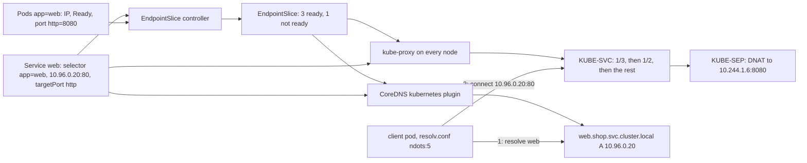

# A Service Is a Virtual IP and a Rewrite Rule

*A ClusterIP lives on no interface: every node DNATs it to a ready pod, and CoreDNS turns the same objects into names.*

## Metadata

| Field | Value |
|---|---|
| Type | Build |
| Languages | Python |
| Prerequisites | [Kubelet Lite](https://cloudcaptain.io/learn/orchestration/kubelet-lite), [Container Networking](https://cloudcaptain.io/learn/containers/container-networking) |
| Time | 90 minutes |
| Tools | kubectl, kind, iptables, nft, coredns, docker |

<Quiz stage="pre" />

## The Problem

Version 2 of `payments` renames its container port from `http` to `web` because a linter asked for consistent names. The Service still says `targetPort: http`. The rollout completes, every new pod passes its readiness probe, and `kubectl get pods` is green. As the old ReplicaSet scales down, latency from `checkout` climbs, because every request now lands on fewer and fewer old pods; when the last old pod goes, the errors stop being slow responses and become an instant `connection refused`. Someone runs `ping` against the Service's ClusterIP from a debug pod, gets no reply, and declares the Service broken. Someone else restarts CoreDNS. Neither changes anything.

The same week, the CoreDNS dashboard shows that most of its answers are NXDOMAIN, and a batch job's p99 lookup time is measured in seconds. The job calls `api.partner.example.com` once per record. Nobody typed a wrong name anywhere: every lookup is first tried as `api.partner.example.com.batch.svc.cluster.local`, then with two more cluster suffixes, then with whatever search domains the node adds, and only then as itself, and each of those names is asked twice, for A and for AAAA.

A Service is not a process, and in iptables and nftables mode its ClusterIP is not on any interface, which is why `ping` gets nothing back. A Service is a record that three independent loops read. The EndpointSlice controller lists the pods that match the selector, says which are ready, and resolves `targetPort` in each one. kube-proxy on every node turns those lists into DNAT rules for the virtual address. CoreDNS turns the same objects into names. In the payments incident the new pods had no port named `http`, so the controller put them in a slice without that port, kube-proxy had nothing to rewrite to once the old pods were gone, and a Service with no endpoints is a REJECT rule. You are going to write `miniproxy`, which does all three jobs from `kubectl get -o json` output and then walks a real node's ruleset, so that every line of `iptables-save`, every EndpointSlice condition and every query in a pod's `resolv.conf` reads as something you have produced yourself.

## The Concept

In the container networking lesson a published port was one DNAT rule: traffic for the host's port 18080 was rewritten to one container's address before routing, and conntrack remembered the rewrite for the rest of the flow and reversed it on the replies. A Service is the same rule with two changes. The address being rewritten is a virtual IP that no interface owns, taken from the cluster's Service range (10.96.x.x in kind and kubeadm clusters), so nothing answers ARP or ICMP for it. And there are several candidate targets, so the rule has to choose one per new connection. Every node carries the rules for every Service, which means the rewrite happens on the sending pod's own node, before the packet leaves it; by the time the packet is on the wire it is addressed to a pod.

Three loops produce those rules and the names in front of them. The **EndpointSlice controller** in kube-controller-manager takes each Service that has a selector, lists the pods in its namespace whose labels match, skips pods without an IP and pods that have finished (`Succeeded` or `Failed`), and resolves every Service port's `targetPort` in each pod: a number is used as is, a name is looked up among that pod's container ports. Each endpoint gets three conditions: `ready` (the pod's Ready condition is true and it is not being deleted), `serving` (Ready, whether or not it is being deleted) and `terminating` (it has a `deletionTimestamp`). `publishNotReadyAddresses: true` forces the first two to true. Endpoints that resolved to the same port list share a slice, up to 100 per slice, so a pod whose named port does not exist lands in a slice that lacks that port. **kube-proxy** on each node watches Services and slices; for each Service port it uses the ready endpoints from slices that carry that port name, and only if there are none, the ones that are serving and terminating, so a rollout that drains every pod at once still has somewhere to send traffic. **CoreDNS** answers `name.namespace.svc.cluster.local` from the same two objects.

iptables has no "choose one of n" operation; it walks a chain top to bottom and takes the first rule that matches. So kube-proxy writes a cascade: the first endpoint rule matches with probability 1/n, the second with 1/(n-1) of the packets that are left, and so on, and the last rule matches everything that remains. Each endpoint ends up with exactly 1/n: the second one gets (1 - 1/n) times 1/(n-1), which is 1/n. The nftables mode replaces the cascade with `numgen random mod n` and a verdict map, and replaces the walk past every Service on the node with one map lookup keyed by address, protocol and port.

Rewriting the destination is half the job. A NodePort client on the internet sends to one node; if that node DNATs to a pod on another node, the pod's reply would go straight back to the client from a node it never talked to, where no conntrack entry can reverse the rewrite. A pod that calls its own Service gets its own packet back with its own address as the source and answers itself, bypassing the DNAT. kube-proxy fixes both with source NAT, and treats every packet for a ClusterIP whose source is outside the pod CIDR the same way, because it cannot tell where such a reply will go. The mechanism is a **mark**: rules jump to `KUBE-MARK-MASQ`, which only sets bit 0x4000 on the packet, and one rule in POSTROUTING masquerades every marked packet. `externalTrafficPolicy: Local` turns the mark off for external traffic and keeps only the endpoints on the receiving node, which preserves the client's source address at the cost of dropping traffic on nodes that run no endpoint.



Names come last. A ClusterIP Service gets one A record, its ClusterIP. A **headless** Service (`clusterIP: None`) gets no virtual IP and no rules at all; its name returns one A record per ready endpoint, and a pod whose `hostname` and `subdomain` match the Service also gets its own name, which is how StatefulSet pods become `db-0.db.shop.svc.cluster.local`. Every named port also gets an SRV record, `_http._tcp.web.shop.svc.cluster.local`. The kubelet writes each pod a `resolv.conf` with three search domains (the pod's namespace under `svc`, then `svc`, then the cluster zone) and `options ndots:5`. The stub resolver's rule is short: a name with fewer than five dots is tried with each search domain appended first, and as typed last. `web` therefore costs one lookup, `web.payments` two, `api.partner.example.com` four, and even the fully qualified `web.shop.svc.cluster.local` costs four unless you write it with a trailing dot.

## Build It

`code/main.py` is `miniproxy`. It reads `kubectl get svc,pods,endpointslices -o json` output, and every function after the loader is pure: the controller returns slices, the renderers return text, the resolver returns a list of attempts. `trace` reads a ruleset from a file, so the tests run on fixtures in `code/fixtures/` and you point it at a real node only in Use It.

### Step 1: read what the API server already has

`load_objects()` accepts a `List` (what `kubectl get a,b,c -o json` prints), a single object, or a JSON array, from any number of `--from` files, and `cluster_from()` turns the three kinds it cares about into dataclasses. The one parsing decision that matters is `targetPort`: the API stores it as a number or a string, and a string is a name to look up later, not a number to convert:

```python
target = item.get("targetPort", number)
if isinstance(target, str) and target.isdigit():
    target = int(target)
ports.append(ServicePort(item.get("name") or "", number, target, protocol_of(item), item.get("nodePort")))
```

Real EndpointSlices are parsed too, with the defaults the API documents: a missing `ready` means ready, a missing `serving` means "same as ready", a missing `terminating` means false.

### Step 2: the EndpointSlice controller

A named `targetPort` is resolved per pod, so two versions of a pod may serve it on different container ports:

```python
def resolve_target_port(port: ServicePort, pod: Pod) -> Optional[int]:
    if isinstance(port.target_port, int):
        return port.target_port
    for container_port in pod.ports:
        if container_port.name == port.target_port and container_port.protocol == port.protocol:
            return container_port.port
    return None
```

The three conditions come straight from the pod:

```python
def endpoint_for(service: Service, pod: Pod) -> Endpoint:
    ready = service.publish_not_ready or (pod.ready and not pod.terminating)
    serving = service.publish_not_ready or pod.ready
    hostname = pod.hostname if pod.hostname and pod.subdomain == service.name else None
    return Endpoint(pod.ip or "", ready, serving, pod.terminating, pod.node_name, pod.name, hostname)
```

`reconcile_slices()` keeps every matching pod that has an IP and has not finished, groups the endpoints by the port list they resolved to, and cuts each group into slices of at most 100:

```python
for pod in sorted(pods, key=lambda p: (ip_key(p.ip), p.name)):
    if not selects(service, pod) or not in_endpoints(pod):
        continue
    ports = []
    for port in service.ports:
        number = resolve_target_port(port, pod)
        if number is not None:
            ports.append((port.name, number, port.protocol))
    groups.setdefault(tuple(ports), []).append(endpoint_for(service, pod))
```

A pod that is not ready is still in the slice, with `ready=false`; that is how you can see it with `kubectl get endpointslices` while no traffic reaches it. A pod whose named port does not exist goes into a slice with no ports, which is the payments incident in one line. A Service whose selector matches nothing still gets one empty slice, the one `kubectl` shows with `<unset>` ports. `slices_for()` runs the controller only for Services that have a selector: a Service without one is yours to fill, and `miniproxy` uses the slices you supplied, exactly as kube-proxy does.

### Step 3: which endpoints kube-proxy uses

```python
def proxy_endpoints(port: ServicePort, slices: Iterable[EndpointSlice], node: Optional[str] = None) -> List[Tuple[str, int]]:
    candidates: List[Tuple[Endpoint, int]] = []
    for endpoint_slice in slices:
        if endpoint_slice.address_type != "IPv4":
            continue
        match = next((p for p in endpoint_slice.ports if p.name == port.name and p.protocol == port.protocol), None)
        if match is None:
            continue
        for endpoint in endpoint_slice.endpoints:
            if node is None or endpoint.node_name == node:
                candidates.append((endpoint, match.port))
    chosen = [c for c in candidates if c[0].ready] or [c for c in candidates if c[0].serving and c[0].terminating]
    return sorted({(e.address, number) for e, number in chosen}, key=lambda item: (ip_key(item[0]), item[1]))
```

Slices are matched by port **name**, which is why an unnamed port and a port called `http` are different things to the proxy. The `or` is the terminating fallback. Passing `node` restricts the set to this node's endpoints, which is what `externalTrafficPolicy: Local` needs.

### Step 4: the probability cascade, as iptables prints it

kube-proxy writes `1/n` with ten decimals. The `statistic` match stores it as a 31-bit fraction and `iptables-save` prints that fraction back with eleven, so `0.3333333333` comes back as `0.33333333349`. `miniproxy` prints what you will actually see on a node:

```python
def iptables_probability(remaining: int) -> str:
    written = float(f"{1.0 / remaining:0.10f}")
    return f"{round(written * STATISTIC_SCALE) / STATISTIC_SCALE:.11f}"


def cascade(count: int) -> List[Optional[str]]:
    if count <= 0:
        return []
    return [iptables_probability(count - index) for index in range(count - 1)] + [None]
```

`cascade(3)` is `["0.33333333349", "0.50000000000", None]`, and `shares()` turns any cascade back into the fraction each endpoint really receives; the tests check that it is `1/n` for every n up to seven.

### Step 5: render the chains

`plan_ports()` turns each Service port with a virtual IP into a `PortPlan`, and `render_iptables()` writes it in `iptables-save` format. A port with no endpoints gets no nat rules at all, only a REJECT in the filter table, which is where the instant `connection refused` comes from:

```python
if not plan.endpoints:
    filter_chains["KUBE-SERVICES"].append(f"-A KUBE-SERVICES -d {plan.cluster_ip}/32 -p {plan.proto} {comment(f'{plan.id} has no endpoints')} -m {plan.proto} --dport {plan.port} -j REJECT --reject-with icmp-port-unreachable")
```

Otherwise one rule in `KUBE-SERVICES` matches the ClusterIP and port and jumps to the Service's `KUBE-SVC-` chain. That chain starts with the masquerade mark for sources outside the pod CIDR, then the cascade:

```python
for (sep, address, number), probability in zip(seps, cascade(len(seps))):
    statistic = f" -m statistic --mode random --probability {probability}" if probability else ""
    rules.append(f"-A {chain} {comment(f'{plan.id} -> {address}:{number}')}{statistic} -j {sep}")
```

Each endpoint has its own `KUBE-SEP-` chain: a hairpin mark for packets from the pod itself, then the DNAT:

```python
return [
    f"-A {sep} -s {address}/32 {comment(plan.id)} -j KUBE-MARK-MASQ",
    f"-A {sep} -p {plan.proto} {comment(plan.id)}{recent} -m {plan.proto} -j DNAT --to-destination {address}:{number}",
]
```

`sessionAffinity: ClientIP` adds one `-m recent --rcheck` rule per endpoint ahead of the cascade and a `-m recent --set` on each DNAT, so a client seen within `timeoutSeconds` goes back to the same pod. A NodePort adds a rule in `KUBE-NODEPORTS` (reached from the last rule of `KUBE-SERVICES`, for packets to any of the node's own addresses) that jumps to a `KUBE-EXT-` chain; with `externalTrafficPolicy: Cluster` that chain marks and jumps to `KUBE-SVC-`, with `Local` it jumps to a `KUBE-SVL-` chain that holds only this node's endpoints, and external clients are not marked.

The chain names are `miniproxy`'s own: sixteen hex digits of a SHA-256 over the Service port's identity, from `short_hash()`. kube-proxy also hashes the port's identity, but encodes it in base32, so its names use letters and the digits 2 to 7 (the Medium exercise has you reproduce them). You can always tell which tool wrote a chain, and you should compare chains by what they contain, never by name.

### Step 6: the same Services in nftables

`render_nftables()` writes the shape of kube-proxy's nftables mode: a `service-ips` verdict map from `address . protocol . port` to a per-Service chain, and in that chain one `numgen` lookup instead of a cascade:

```python
targets = ", ".join(f"{slot} : goto {nft_endpoint_chain(plan, a, n)}" for slot, (a, n) in enumerate(plan.endpoints))
body.append(f"numgen random mod {len(plan.endpoints)} vmap {{ {targets} }}")
```

Services without endpoints go into a `no-endpoint-services` map that jumps to a reject chain. NodePorts are left out of this rendering; it is there to compare the two data structures, not to replace the iptables one.

### Step 7: trace a real ruleset

`trace` is the tool you will point at a node. `parse_rule()` splits a rule with `shlex` (comments are quoted) and records every option with whether a `!` preceded it. `matches()` checks only what a destination address can decide:

```python
def matches(rule: Rule, packet: Packet) -> bool:
    for option in ("-d", "--destination"):
        if option in rule.options:
            value, negated = rule.options[option]
            if in_network(packet.address, value) == negated:
                return False
    if "-p" in rule.options:
        value, negated = rule.options["-p"]
        if (value.lower() == packet.protocol) == negated:
            return False
```

The walk starts at `KUBE-SERVICES`, records every `KUBE-MARK-MASQ` jump it passes as a condition under which the packet would be SNATed, skips rules that depend on the source (it does not know who is asking), and follows the first matching jump into a user chain until it reaches a chain that jumps to `KUBE-SEP-`:

```python
for rule in rules:
    if not matches(rule, packet):
        continue
    if rule.jump == "KUBE-MARK-MASQ":
        result.masquerade.append(masquerade_condition(rule))
        continue
    if source_conditioned(rule) or rule.jump not in nat:
        continue
    following = rule
    break
```

There it collects the cascade, computes each endpoint's real share, and reads the `--to-destination` of every endpoint chain. A real node's ruleset holds chains that have nothing to do with Services (kind's `DOCKER_OUTPUT` for its embedded DNS, `KIND-MASQ-AGENT`); they never match a ClusterIP, so the walk passes them by. Before the nat walk, `trace` checks the filter table for a REJECT or DROP on the same address, and a ruleset that starts with `table ip` is walked through the nftables map instead. `--simulate N` draws N new connections through the cascade with a seeded random generator, so you can watch the 1/3, 1/2, rest sequence produce three equal thirds.

### Step 8: cluster DNS and the search path

`dns_records()` builds the zone the way the CoreDNS `kubernetes` plugin answers it. For a headless Service it uses only ready endpoints, adds a name per endpoint (its hostname when the pod set one, the dashed address otherwise), and an SRV per named port with the endpoint's own port:

```python
for port in service.ports:
    if not port.name:
        continue
    targets = sorted({(f"{e.hostname or dashed(e.address)}.{fqdn}", p.port) for e, s in ready for p in s.ports if p.name == port.name and p.protocol == port.protocol})
    for target, number in targets:
        add(Record(f"_{port.name}._{port.protocol.lower()}.{fqdn}", "SRV", target, number, 100 // len(targets)))
```

The client side is `candidate_names()`, the stub resolver's search rule:

```python
def candidate_names(name: str, search: Sequence[str], ndots: int = 5, libc: str = "glibc") -> List[str]:
    if name.endswith("."):
        return [name[:-1]]
    expanded = [f"{name}.{domain}" for domain in search]
    if name.count(".") >= ndots:
        return [name] + ([] if libc == "musl" else expanded)
    return expanded + [name]
```

glibc tries a name with `ndots` or more dots as typed first and falls back to the search list; musl (Alpine) never applies the search list to such a name. `resolve()` walks the candidates, answers names under the cluster zone from the records (NXDOMAIN when there is none), treats any other dotted name as forwarded upstream when it is the name you typed, and stops at the first answer. It reports every attempt, so the cost of a name is a number you can put in a review.

### Step 9: run it

```bash
F=code/fixtures/shop.json
python3 code/main.py endpoints --from $F                              # web: 4 endpoints, 10.244.2.8 ready=false; empty: ports <unset>
python3 code/main.py iptables --from $F --cluster-cidr 10.244.0.0/16 --node kind-worker > /tmp/nat.txt
grep 'shop/web:http' /tmp/nat.txt                                     # KUBE-SERVICES, the masquerade mark, 0.33333333349, 0.50000000000, the rest
python3 code/main.py trace --ruleset /tmp/nat.txt --to 10.96.0.20:80 --simulate 3000
python3 code/main.py trace --ruleset /tmp/nat.txt --to 10.96.0.40:80; echo "exit $?"     # REJECT in filter/KUBE-SERVICES: shop/empty:http has no endpoints; exit 1
python3 code/main.py trace --ruleset /tmp/nat.txt --to 172.18.0.3:30080 --node-local     # NODEPORTS -> EXT -> SVL: only kind-worker's checkout pod
python3 code/main.py trace --ruleset code/fixtures/node-nat.txt --to 10.96.0.10:53 --proto udp   # kube-dns in a kind-style ruleset
python3 code/main.py nftables --from $F --cluster-cidr 10.244.0.0/16 | grep numgen
python3 code/main.py dns web-headless --namespace shop --from $F      # three A records, not four
python3 code/main.py dns _pg._tcp.db --type SRV --namespace shop --from $F               # db-0.db and db-1.db, the StatefulSet shape
python3 code/main.py dns api.partner.example.com --namespace shop --from $F              # 4 names tried, 3 NXDOMAIN, 8 queries
python3 code/main.py dns api.partner.example.com. --namespace shop --from $F             # 1 name
python3 code/main.py resolv-conf --namespace shop --nameserver 10.96.0.10
```

<RunTests />

## Use It

Run the real thing on a kind cluster (current Kubernetes release <ToolVersion name="kubernetes" />, kind <ToolVersion name="kind" />). `code/fixtures/web.yaml` is a Deployment of three `python:3.12-alpine` web servers with a container port named `http`, one extra pod with the same `app: web` label whose readiness probe always fails, a ClusterIP Service `web` with `targetPort: http`, and a headless Service `web-headless`. The extra pod carries `track: canary` and the Deployment selects `track: stable`, so the ReplicaSet does not adopt it, while the Services, which select only `app: web`, do.

```bash
kind create cluster --name cc-lab
kubectl create namespace shop
kubectl -n shop apply -f code/fixtures/web.yaml
kubectl -n shop rollout status deployment/web --timeout=180s
kubectl -n shop get svc,endpointslices -o wide                            # web: 4 endpoints listed, the unready one included
kubectl -n shop get endpointslices -l kubernetes.io/service-name=web -o yaml | grep -B2 -A3 conditions
kubectl -n shop get svc,pods,endpointslices -o json > objects.json
python3 code/main.py endpoints --from objects.json --slices computed      # your controller, from the pods
python3 code/main.py endpoints --from objects.json --slices input         # the real controller's output: the same rows
```

Then find out which proxy you are looking at before you read its rules, and read them:

```bash
kubectl -n kube-system get configmap kube-proxy -o jsonpath='{.data.config\.conf}' | grep -E '^(mode|clusterCIDR):'
docker exec cc-lab-control-plane iptables-save -t nat > node-nat.txt
grep 'shop/web:http' node-nat.txt                                         # KUBE-SERVICES, KUBE-SVC with 0.33333333349 and 0.50000000000, three KUBE-SEP
CIP=$(kubectl -n shop get svc web -o jsonpath='{.spec.clusterIP}')
python3 code/main.py trace --ruleset node-nat.txt --to "$CIP:80" --simulate 3000
python3 code/main.py iptables --from objects.json --slices input --cluster-cidr 10.244.0.0/16 > mine.txt
python3 code/main.py trace --ruleset mine.txt --to "$CIP:80"             # same endpoints, same probabilities, different chain names
kubectl -n shop scale deployment web --replicas=0
docker exec cc-lab-control-plane iptables-save -t filter | grep 'shop/web:http has no endpoints'
kubectl -n shop scale deployment web --replicas=3
```

An empty `mode:` means the platform default, iptables on Linux in the releases this lesson was written against; detect the mode, do not assume it. The nftables mode is stable since Kubernetes 1.33; create a second cluster with it and compare the data structures:

```bash
printf 'kind: Cluster\napiVersion: kind.x-k8s.io/v1alpha4\nnetworking:\n  kubeProxyMode: nftables\n' > nft.yaml
kind create cluster --name cc-nft --config nft.yaml
docker exec cc-nft-control-plane nft list table ip kube-proxy | grep -A3 'map service-ips'
docker exec cc-nft-control-plane nft list table ip kube-proxy > node.nft
python3 code/main.py trace --ruleset node.nft --to 10.96.0.10:53 --proto udp      # numgen slots instead of a cascade
kind delete cluster --name cc-nft
```

NodePorts and the client address:

```bash
kubectl -n shop expose deployment web --name web-np --type NodePort --port 80 --target-port http
docker exec cc-lab-control-plane iptables-save -t nat | grep -E 'KUBE-(NODEPORTS|EXT)'          # EXT marks for SNAT, then jumps to SVC
kubectl -n shop patch svc web-np -p '{"spec":{"externalTrafficPolicy":"Local"}}'
docker exec cc-lab-control-plane iptables-save -t nat | grep -E 'KUBE-(EXT|SVL)'                 # SVL: local endpoints only, no mark, client IP preserved
```

Now DNS, from inside a pod. The kubelet wrote its `resolv.conf`; CoreDNS answers from the objects you just dumped:

```bash
kubectl -n shop run dnsprobe --image=alpine:3.22 --restart=Never -- sh -c 'cat /etc/resolv.conf; getent hosts web; nslookup web-headless; nslookup -type=srv _http._tcp.web-headless'
kubectl -n shop wait --for=jsonpath='{.status.phase}'=Succeeded pod/dnsprobe --timeout=120s
kubectl -n shop logs dnsprobe                       # search shop.svc.cluster.local svc.cluster.local cluster.local, ndots:5; three addresses for web-headless
kubectl -n kube-system get configmap coredns -o jsonpath='{.data.Corefile}'
python3 code/main.py dns web-headless --namespace shop --from objects.json --slices input
python3 code/main.py dns api.partner.example.com --namespace shop --from objects.json     # what every external lookup costs this pod
```

The Corefile's `kubernetes cluster.local in-addr.arpa ip6.arpa` block is the plugin your `dns_records()` imitates; `pods insecure` answers the dashed pod names; `forward . /etc/resolv.conf` sends everything else to the node's resolver; `cache 30` is why a name you just fixed may keep its old answer for half a minute. To make external names cheap, end them with a dot in configuration, or lower `ndots` for the pod:

```yaml
spec:
  dnsConfig:
    options:
      - name: ndots
        value: "2"
```

Headless Services exist for clients that want every address rather than one virtual one: a StatefulSet's `serviceName` points at one, each pod gets `hostname` and `subdomain`, and `db-0.db.shop.svc.cluster.local` follows that pod across restarts even when its IP changes. Nothing in Steps 4 to 7 applies to them: no ClusterIP, no rules, the client picks.

Finally, all of the rules above are optional. Cilium's kube-proxy replacement attaches eBPF programs to the pods' and the node's interfaces and looks the ClusterIP up in a BPF hash map, at the socket when it can; none of the `KUBE-` chains exist on such a node, and `kubectl -n kube-system exec ds/cilium -- cilium-dbg service list` prints the same frontend-to-backends table that `trace` prints. The EndpointSlices and the DNS names are the same, because they come from the same controllers.

| What you built | Real tool | Note |
|---|---|---|
| `reconcile_slices()` | the EndpointSlice controller in kube-controller-manager | real names come from `generateName`; changes are batched |
| `endpoint_for()` conditions | `conditions.ready`, `serving`, `terminating` in `kubectl get endpointslice -o yaml` | `publishNotReadyAddresses` forces ready, for peers that must find each other before they are ready |
| `proxy_endpoints()` | kube-proxy's endpoint selection, the terminating fallback | matched by port name and protocol |
| `render_iptables()` | kube-proxy in iptables mode, `iptables-save -t nat` | same structure; chain names hashed differently; the real filter table has more chains |
| `cascade()` | `-m statistic --mode random --probability` | 31-bit fraction: `0.33333333349`, `0.20000000019` |
| `render_nftables()` | kube-proxy nftables mode, `nft list table ip kube-proxy` | one map lookup per packet instead of a walk over every Service |
| `trace` and `--simulate` | reading `iptables-save` by hand, `conntrack -L -d CLUSTERIP` | conntrack shows the pod each existing connection was sent to |
| `dns_records()` | CoreDNS `kubernetes` plugin | A, SRV, CNAME for ExternalName, dashed pod names |
| `candidate_names()` and `resolve()` | glibc and musl stub resolvers with `options ndots:5` | `dnsConfig.options` per pod, a trailing dot, or CoreDNS `autopath` |
| `render_resolv_conf()` | the kubelet for `dnsPolicy: ClusterFirst` | node search domains are appended after the three cluster ones |
| all of it | Cilium kube-proxy replacement | eBPF maps instead of chains; `cilium-dbg service list` |

<Quiz stage="check" />

## Ship It

Two artifacts in `outputs/`:

- **`skill-service-connectivity-triage.md`**: a runbook for "the Service does not answer", "one request in three fails" and "DNS is slow". It walks the layers in the order the packet meets them (the name, the Service object, the EndpointSlices and their conditions, the pod's own port, the node's rules, conntrack, policy), with a symptom-to-layer table that tells an instant `connection refused` from a timeout, and a report format that names the command and the value that proved each finding.
- **`prompt-explain-iptables-save.md`**: paste `iptables-save -t nat` (or `nft list table ip kube-proxy`) from a node, optionally with `kubectl get svc,endpointslices -o wide`, and get every Service traced to its endpoints with the real share each receives, the traffic that will be SNATed and why, the anomalies (no endpoints, endpoints in slices but not in rules, stale chains, uneven cascades) and an answer to your question.

<ShipIt />

## Exercises

### Easy

Implement `internalTrafficPolicy: Local`. Parse the field, and when it is `Local` make `plan_ports()` use only the endpoints on `--node` for the ClusterIP path, and render a DROP in the filter table's `KUBE-SERVICES`, commented `has no local endpoints`, when there are none. Write the tests first: a two-node fixture where `--node kind-worker` yields one `KUBE-SEP-` chain, and `--node kind-control-plane` yields the DROP and no `KUBE-SVC-` chain.

### Medium

Reproduce kube-proxy's chain names. The `KUBE-SVC-` suffix is the first sixteen characters of the base32 encoding of SHA-256 over the service port name (`namespace/name:port`, or `namespace/name` for an unnamed port) followed by the lower-case protocol: `default/kubernetes:https` with `tcp` gives `NPX46M4PTMTKRN6Y`, and `kube-system/kube-dns:dns` with `udp` gives `TCOU7JCQXEZGVUNU`, two chains that exist on every cluster. Write those two as test vectors, add `--kube-proxy-names`, then work out what kube-proxy appends for `KUBE-SEP-` by testing candidates against a real node's `iptables-save` (start from the endpoint's `ip:port`). Finish by making the smoke compare chain names, not only their contents.

### Hard

Add `miniproxy explain NS/NAME --from objects.json --ruleset node.txt`, which joins the Service, its slices and a node's ruleset and reports drift with an exit code: ready endpoints missing from the rules (kube-proxy not synced or not running), `KUBE-SEP-` targets that no endpoint has (stale rules), Service ports whose named `targetPort` resolves in no pod or only in some (the payments incident, with the pod names), a cascade whose effective shares are not equal, and a headless Service whose DNS answer differs from its ready endpoints. Build a fixture for each case before writing the check, then run it against your kind cluster after renaming the container port in `web.yaml`.

<Quiz stage="post" />

## Key Terms

| Term | Common misconception | Precise definition |
|---|---|---|
| ClusterIP | "An address some pod or proxy listens on." | A virtual IP from the Service range that no interface owns in iptables or nftables mode. It exists only as a match in every node's rules, for the Service's ports and protocols; `ping` gets no reply because no rule handles ICMP. |
| EndpointSlice | "The list of running pods behind a Service." | An object written by the EndpointSlice controller (or by you, for a Service without a selector) listing addresses with conditions, one port list per slice, up to 100 endpoints. Not-ready pods are listed too, with `ready: false`. |
| Endpoint conditions | "Ready means the pod is Running." | `ready`: the pod's Ready condition is true and it is not terminating. `serving`: Ready, even while terminating. `terminating`: a `deletionTimestamp` is set. kube-proxy uses ready endpoints, and serving terminating ones only when none are ready. |
| `targetPort` | "Always a port number on the pod." | A number, or the name of a container port resolved separately in every pod. A pod without that name gets no endpoint for the port, which is how a port rename empties a Service. |
| kube-proxy | "A proxy that traffic passes through." | A controller on each node that watches Services and EndpointSlices and writes kernel rules (iptables, nftables or IPVS). In iptables and nftables mode it never touches a packet; the kernel rewrites them. |
| Probability cascade | "Each endpoint rule has probability 1/n." | Rule k of n (counting from 0) matches 1/(n-k) of the packets that reach it and the last matches all that remain, so each endpoint receives 1/n. The nftables mode uses `numgen random mod n` instead. |
| `KUBE-MARK-MASQ` | "The rule that masquerades." | A chain that only sets bit 0x4000 on the packet; `KUBE-POSTROUTING` masquerades marked packets. Marks are set for sources outside the pod CIDR, for NodePort traffic with the Cluster policy, and for hairpin traffic. |
| Headless Service | "A Service without a selector." | A Service with `clusterIP: None`: no virtual IP and no proxy rules. DNS returns one A record per ready endpoint, plus a name per pod whose `hostname` and `subdomain` match, which gives StatefulSet pods stable names. |
| `ndots:5` | "Only matters for short names." | A name with fewer than five dots is tried with every search domain first. `api.partner.example.com` costs four names (eight queries with A and AAAA); a trailing dot or a lower `ndots` makes it one. |
| `externalTrafficPolicy: Local` | "Faster routing." | External traffic is sent only to endpoints on the node that received it and is not masqueraded, so the pod sees the client's address; a node with no local endpoint drops the traffic. |

## Further Reading

- [Kubernetes Networking & Services](https://cloudcaptain.io/docs/tools/kubernetes/networking-services): every Service type, headless Services, DNS-based discovery and NetworkPolicy, the Reference page for this lesson.
- [Linux Networking](https://cloudcaptain.io/docs/tools/linux/networking): iptables, nftables and routing on the node, the layer kube-proxy writes into.
- [Network Fundamentals](https://cloudcaptain.io/docs/tools/networking/fundamentals): DNS resolution and record types, before you reason about search paths.
- [Virtual IPs and Service Proxies](https://kubernetes.io/docs/reference/networking/virtual-ips/): the official description of the proxy modes, session affinity and traffic policies.
- [EndpointSlices](https://kubernetes.io/docs/concepts/services-networking/endpoint-slices/): conditions, ownership and how slices are split, from the source.
- [DNS for Services and Pods](https://kubernetes.io/docs/concepts/services-networking/dns-pod-service/): records, `dnsPolicy`, `dnsConfig` and the `resolv.conf` the kubelet writes.
- [Kubernetes DNS-Based Service Discovery](https://github.com/kubernetes/dns/blob/master/docs/specification.md): the specification every cluster DNS server implements, including SRV and headless records.
- [CoreDNS kubernetes plugin](https://coredns.io/plugins/kubernetes/): the options in the Corefile block, `pods insecure` and `fallthrough`.
- [resolv.conf(5)](https://man7.org/linux/man-pages/man5/resolv.conf.5.html): `search`, `ndots` and the order in which names are tried.
- [iptables-extensions(8)](https://man7.org/linux/man-pages/man8/iptables-extensions.8.html): the `statistic`, `recent` and `addrtype` matches kube-proxy's rules are built from.
- [KEP-3866: nftables kube-proxy backend](https://github.com/kubernetes/enhancements/tree/master/keps/sig-network/3866-nftables-proxy): why the maps replace the chains and what that does to large clusters.
- [Cilium kube-proxy replacement](https://docs.cilium.io/en/stable/network/kubernetes/kubeproxy-free/): Services without any of these rules.
