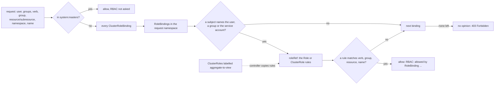

# kubectl auth can-i Is a Function You Can Write

*Authorization is a pure function of who asks, what they ask and every binding in the cluster; the answer is yes with a reason, or no.*

## Metadata

| Field | Value |
|---|---|
| Type | Build |
| Languages | Python |
| Prerequisites | [Reconcilers](https://cloudcaptain.io/learn/orchestration/reconciler) |
| Time | 75 minutes |
| Tools | kubectl, kind |

<Quiz stage="pre" />

## The Problem

Friday, 16:40. The release pipeline fails on its last step with `deployments.apps "checkout" is forbidden: User "system:serviceaccount:ci:deployer" cannot patch resource "deployments" in API group "apps" in the namespace "shop"`. The engineer on call runs `kubectl auth can-i patch deployments -n shop` on their laptop, gets `yes`, and decides the API server is flaky. It is not. The question was asked as the engineer, whose group is bound to `cluster-admin`, while the pipeline is a service account whose only RoleBinding lives in `shop-staging`. Ten minutes later someone runs `kubectl create clusterrolebinding ci-admin --clusterrole=cluster-admin --serviceaccount=ci:deployer`, the release goes out, and the binding is still there in March.

The audit in March finds worse. A dashboard's service account can read every Secret in the cluster through a ClusterRoleBinding to `edit` that someone created "for the metrics"; a Role granting only `get configmaps` was later bound next to it "to restrict it", and nothing changed, because RBAC has no way to take a permission away. The team's onboarding bot holds `cluster-admin` because it once failed with `attempting to grant RBAC permissions not currently held` while creating a RoleBinding to `edit`: the API server was refusing exactly the escalation that the fix then made permanent. And a ClusterRole labelled `aggregate-to-view` to give readers access to one new resource also reached every subject bound to `edit` and `admin`.

Each of these mistakes treats authorization as a box with a yes/no light. It is a pure function. An identity (a user name and its groups), a request (verb, API group, resource, subresource, namespace, name, or a URL path) and the RBAC objects in the cluster go in; "allow" with the binding and rule that matched, or "no opinion", comes out. You are going to write `canhaz`, that function over a JSON dump of a cluster's Roles, ClusterRoles and bindings. It answers like `kubectl auth can-i` and explains every yes and every no, lists everything a subject may do, finds who may do something, and applies the escalation rule to a binding before you create it. On a kind cluster its answers match the API server's, question for question.

## The Concept

Every request that reaches authorization has already been authenticated: a client certificate, an OIDC token or a service account token has become a user name and a list of groups. A service account token becomes the user `system:serviceaccount:NAMESPACE:NAME` in the groups `system:serviceaccounts`, `system:serviceaccounts:NAMESPACE` and `system:authenticated`. Kubernetes stores no user objects; users and groups are strings. The request becomes a handful of attributes: a verb (`get`, `list`, `watch`, `create`, `update`, `patch`, `delete`, `deletecollection`, or a special one such as `bind`, `escalate`, `impersonate`), an API group (the empty string for the core group, `apps`, `rbac.authorization.k8s.io`), a resource, an optional subresource (`log`, `exec`, `scale`, `status`), a namespace or none, and an optional object name. A request that is not about an API object, such as `/healthz` or `/metrics`, carries a URL path instead.

RBAC is a list of grants and nothing else. A Role (namespaced) or ClusterRole holds rules. Each rule says "these verbs on these resources in these API groups", optionally narrowed by `resourceNames`, or "these verbs on these URL paths" (`nonResourceURLs`, which only take effect in ClusterRoles bound cluster-wide). A RoleBinding gives a role's rules to subjects inside one namespace; a ClusterRoleBinding gives a ClusterRole's rules everywhere; a RoleBinding may point at a ClusterRole, which is how `view`, `edit` and `admin` are reused namespace by namespace. There are no deny rules, so evaluation is a search: visit every ClusterRoleBinding, then every RoleBinding in the request's namespace, skip the bindings whose subjects do not name this user, one of its groups or its service account, and stop at the first rule that matches. If nothing matches, RBAC has no opinion and the request is forbidden. Members of `system:masters` never get that far: the first authorizer in the API server's chain allows them before RBAC is asked.

Two mechanisms change what the rules are. **Aggregation**: a ClusterRole with an `aggregationRule` has its rules written by a controller, as the union of every ClusterRole whose labels match its selectors. `view` collects `rbac.authorization.k8s.io/aggregate-to-view: "true"`, and because `view` itself carries `aggregate-to-edit` and `edit` carries `aggregate-to-admin`, a rule added for readers reaches editors and admins as well. **Escalation prevention**: creating a RoleBinding or ClusterRoleBinding succeeds only if you hold the `bind` verb on the role it references or already hold every permission that role grants in that scope; creating or updating a role needs `escalate` or the same covering check. Without that rule, `create rolebindings` would be `cluster-admin` with extra steps.



That is all `kubectl auth can-i` does: it sends a SelfSubjectAccessReview carrying these attributes, the API server runs the same chain on it without performing anything, and kubectl prints `yes` or `no`.

## Build It

`code/main.py` is `canhaz`. It reads the JSON that `kubectl get roles,rolebindings,clusterroles,clusterrolebindings -A -o json` prints, and everything after loading is pure. The tests use `code/fixtures/rbac.json`, a dump of a namespace `shop` with trimmed copies of the default roles; the smoke test compares `canhaz` with a real API server on kind.

### Step 1: load the dump

`kubectl get` returns a `List`; the raw API returns a `RoleList` whose items carry no `kind`, so the list's kind is passed down as a hint:

```python
def iter_objects(doc: object, kind_hint: str = "") -> Iterator[dict]:
    if isinstance(doc, list):
        for item in doc:
            yield from iter_objects(item, kind_hint)
        return
    if not isinstance(doc, dict):
        raise RbacError(f"expected JSON objects, found a {type(doc).__name__}")
    kind = doc.get("kind") or kind_hint
    if isinstance(doc.get("items"), list):
        yield from iter_objects(doc["items"], kind[:-4] if kind.endswith("List") and kind != "List" else "")
        return
    if kind in OBJECT_KINDS:
        yield dict(doc, kind=kind)
```

`load_policy()` keys every object by kind, namespace and name, so a second `-f proposed.json` replaces objects from the first. That is how you ask "what will this pull request grant?" before anyone applies it. Rules become frozen `Rule` dataclasses of tuples, which makes them hashable for the set operations aggregation needs.

### Step 2: who is asking

```python
def identity_for(user: str, groups: Sequence[str] = (), implicit: bool = True) -> Identity:
    wanted = list(dict.fromkeys(groups))
    if not implicit:
        return Identity(user, wanted)
    account = split_service_account(user)
    if account and not wanted:
        wanted = [ALL_SERVICE_ACCOUNTS, f"{ALL_SERVICE_ACCOUNTS}:{account[0]}"]
    if user != ANONYMOUS and AUTHENTICATED not in wanted and UNAUTHENTICATED not in wanted:
        wanted.append(AUTHENTICATED)
    return Identity(user, wanted)
```

This is the API server's impersonation logic, which is what `kubectl --as` goes through. A service-account user name with no `--as-group` gets its two service-account groups, and every user except `system:anonymous` gets `system:authenticated` unless you named it or `system:unauthenticated` yourself. A SubjectAccessReview does none of this: it evaluates exactly the user and groups you send, which `--no-default-groups` reproduces. The difference decides real answers, because the default ClusterRoleBindings (`system:basic-user`, `system:discovery`) grant to groups, not to users.

### Step 3: one rule against one request

```python
def resource_matches(rule: Rule, combined: str, subresource: str) -> bool:
    for resource in rule.resources:
        if resource == "*" or resource == combined:
            return True
        if subresource and resource == "*/" + subresource:
            return True
    return False


def name_matches(rule: Rule, name: str) -> bool:
    return not rule.resource_names or name in rule.resource_names


def rule_allows(rule: Rule, request: Request) -> bool:
    if request.is_resource:
        return (
            verb_matches(rule, request.verb)
            and group_matches(rule, request.api_group)
            and resource_matches(rule, request.combined_resource, request.subresource)
            and name_matches(rule, request.name)
        )
    return verb_matches(rule, request.verb) and url_matches(rule, request.path)
```

All four must match. `*` matches every verb, group or resource, subresources included; `pods` does not match `pods/log`, which is why log access is a rule of its own; `*/scale` matches the scale subresource of anything. An empty `resourceNames` means every name, and a non-empty one never matches a request without a name, so `resourceNames` cannot restrict `list`, `watch` or `create`. Non-resource URLs match exactly or through a trailing `*`.

`parse_request()` reads the target the way kubectl does: `TYPE[/NAME]`. So `kubectl auth can-i get pods/log` asks about a pod *named* `log`; a subresource needs `--subresource log`. `canhaz` maps short names and plurals (`deploy`, `networkpolicy`) to `deployments.apps` and `networkpolicies.networking.k8s.io` from a small table and accepts `RESOURCE.GROUP` for anything else; kubectl asks the API server's discovery instead.

### Step 4: walk the bindings

```python
def applies_to(subject: Subject, identity: Identity, namespace: str) -> bool:
    if subject.kind == "User":
        return identity.user == subject.name
    if subject.kind == "Group":
        return subject.name in identity.groups
    if subject.kind == "ServiceAccount":
        account_namespace = subject.namespace or namespace
        return bool(account_namespace) and identity.user == service_account_user(account_namespace, subject.name)
    return False
```

A ServiceAccount subject without a namespace means the binding's namespace, so a RoleBinding in `kube-system` that names `ci` grants `kube-system:ci`, not the `ci` you meant in `shop`. In a ClusterRoleBinding there is no binding namespace and such a subject never matches. Then the walk:

```python
for seen in visit(policy, identity, namespace):
    visited += 1
    if seen.error:
        errors.append(seen.error)
        continue
    rule = next((r for r in seen.rules if rule_allows(r, request)), None)
    if rule is not None:
        grants.append(Grant(seen.binding, seen.subject, rule))
return Decision(bool(grants), identity, request, grants, errors, visited)
```

`visit()` yields ClusterRoleBindings first, then RoleBindings in the request's namespace, and only those with a subject that applies. A non-resource request has no namespace, so only ClusterRoleBindings can grant `/healthz`. A binding whose `roleRef` names a missing role does not fail the request; it becomes an error string that shows up in the reason when nothing else allows it. `canhaz` collects every grant, while the API server stops at the first; the order of bindings within one kind is not guaranteed there, so do not depend on which binding it names when several allow a request.

### Step 5: the reason and the 403

```python
def describe_source(binding: Binding, subject: Subject) -> str:
    if binding.kind == "ClusterRoleBinding":
        return f"ClusterRoleBinding {quote(binding.name)} of {binding.role_kind} {quote(binding.role_name)} to {describe_subject(subject, '')}"
    return f"RoleBinding {quote(binding.name + '/' + binding.namespace)} of {binding.role_kind} {quote(binding.role_name)} to {describe_subject(subject, binding.namespace)}"
```

```python
elif request.namespace:
    message = f"User {user} cannot {request.verb} resource {quote(request.combined_resource)} in API group {quote(request.api_group)} in the namespace {quote(request.namespace)}"
else:
    message = f"User {user} cannot {request.verb} resource {quote(request.combined_resource)} in API group {quote(request.api_group)} at the cluster scope"
```

Both strings are the API server's own. The first, prefixed with `RBAC: allowed by`, is the `status.reason` of a SubjectAccessReview and the `authorization.k8s.io/reason` annotation in the audit log. The second is the body of every 403, prefixed with the resource (`deployments.apps "web" is forbidden: ...`). Reading it is half the debugging: the user says who the server thinks you are, the API group says whether the client asked the group you expected, and "at the cluster scope" says the request had no namespace, so no RoleBinding could have helped.

### Step 6: aggregation is a fixpoint

```python
for _ in range(len(cluster_roles) + 1):
    changed = False
    for name in aggregated:
        rules: List[Rule] = []
        for selector in cluster_roles[name].selectors or []:
            for other in sorted(cluster_roles):
                if other == name or not selector_matches(selector, cluster_roles[other].labels):
                    continue
                for rule in effective[other]:
                    if rule not in rules:
                        rules.append(rule)
        if set(rules) != set(effective[name]):
            changed = True
        effective[name] = rules
    if not changed:
        break
```

The aggregation controller in kube-controller-manager writes the union of the matching ClusterRoles into the aggregated role's `rules`, replacing anything written there by hand, and runs again whenever any ClusterRole changes, so the chain from `view` to `edit` to `admin` settles after a few passes. `canhaz` computes the same fixpoint and warns when the stored rules in the dump differ: the dump was taken mid-update, or someone edited `view` and the controller is about to undo it. `--no-aggregate` uses the stored rules as they are, which is what the API server authorizes with at that instant.

### Step 7: `--list` is break down, then compact

```python
def breakdown(rule: Rule) -> List[Rule]:
    pieces: List[Rule] = []
    for group in rule.api_groups:
        for resource in rule.resources:
            for verb in rule.verbs:
                if rule.resource_names:
                    pieces.extend(Rule((verb,), (group,), (resource,), (name,)) for name in rule.resource_names)
                else:
                    pieces.append(Rule((verb,), (group,), (resource,)))
    for url in rule.non_resource_urls:
        pieces.extend(Rule((verb,), non_resource_urls=(url,)) for verb in rule.verbs)
    return pieces
```

A SelfSubjectRulesReview returns every rule from every binding that applies in the namespace. kubectl breaks each rule into single verb, group, resource and name pieces and `compact()` merges pieces that differ only by verb, so `pods [] [] [get list watch]` is one row whether the verbs came from one rule or from three bindings. `access_list()` does the same and renders `deployments/scale` in `apps` as `deployments.apps/scale`, exactly like kubectl's table.

### Step 8: who can, and the escalation rule

`who_can()` turns the walk around: for every binding that applies in the namespace, if any rule of its role allows the request, every subject of that binding is listed, with service accounts resolved to their namespace and wide groups explained (`system:authenticated` is everyone with a credential). Kubernetes has no built-in reverse query; this one is twenty lines because the data is already in memory.

The escalation check runs in the same order as the API server's RBAC storage when it creates a binding:

```python
create = authorize(policy, identity, Request("create", namespace, RBAC_GROUP, binding_kind.lower() + "s"))
if not create.allowed:
    return result(False, "forbidden", message=create.forbidden or "")
if PRIVILEGED_GROUP in identity.groups:
    return result(True, "privileged", via=f"member of {PRIVILEGED_GROUP}: the escalation check is skipped")
bind = authorize(policy, identity, Request("bind", namespace, RBAC_GROUP, "clusterroles" if role_kind == "ClusterRole" else "roles", name=role_name))
if bind.allowed:
    return result(True, "bind", via=f"holds bind on {role_kind.lower()}s/{role_name}: {bind.reason}")
granted, error = role_rules(policy, Binding(binding_kind, "", namespace, role_kind, role_name, []), namespace)
if error:
    return result(False, "not-found", message=error)
held, _ = rules_for(policy, identity, namespace)
covered, missing = covers(held, granted)
```

`covers()` breaks the role's rules into pieces and requires each piece to be covered by one rule the creator holds in that namespace, cluster-wide grants included. A grant limited by `resourceNames` covers only those names, so holding `get` on one Secret does not let you bind a role that reads all of them. The refusal is printed in the API server's format, `{APIGroups:[""], Resources:["pods/exec"], Verbs:["create" "get"]}`, one line per missing piece.

### Step 9: run it

```bash
F=code/fixtures/rbac.json
SA=system:serviceaccount:shop:dashboard
python3 code/main.py whoami --as $SA                                              # the user and the three groups impersonation adds
python3 code/main.py can-i get pods -n shop --as $SA -f $F                        # yes: RoleBinding "dashboard-view/shop" of ClusterRole "view", also pod-reader
python3 code/main.py can-i get secrets/shop-db-readonly -n shop --as $SA -f $F    # yes, only through resourceNames in pod-reader
python3 code/main.py can-i list secrets -n shop --as $SA -f $F; echo "exit $?"    # no, with the 403 text; exit 1 like kubectl
python3 code/main.py can-i list leases.coordination.k8s.io -n shop --as $SA -f $F # yes: shop-leases-view aggregates into view
python3 code/main.py can-i delete roles -n shop --as bob --as-group shop-oncall -f $F   # no, and the reason names the missing ClusterRole
python3 code/main.py can-i --list -n shop --as $SA -f $F                          # the kubectl auth can-i --list table
python3 code/main.py who-can create pods --subresource exec -n shop -f $F         # Group shop-oncall through edit, User alice through admin, system:masters
python3 code/main.py can-bind --clusterrole edit -n shop --as system:serviceaccount:shop:ci -f $F   # refused, every missing piece listed
python3 code/main.py can-bind --clusterrole view -n shop --as system:serviceaccount:shop:ci -f $F   # allowed: ci holds bind on clusterroles/view
```

A denial reads like this:

```text
no
  no rule matched create pods/exec named web-1 in namespace shop for user "system:serviceaccount:shop:dashboard" in groups system:serviceaccounts, system:serviceaccounts:shop, system:authenticated
  RBAC is deny-by-default and additive: 4 binding(s) apply to this identity here and none grants it
  the API server answers 403: pods "web-1" is forbidden: User "system:serviceaccount:shop:dashboard" cannot create resource "pods/exec" in API group "" in the namespace "shop"
```

<RunTests />

## Use It

Build the same `shop` on a kind cluster (current Kubernetes is <ToolVersion name="kubernetes" />) and ask the real authorizer:

```bash
kind create cluster --name cc-lab
kubectl create namespace shop
kubectl -n shop create serviceaccount dashboard
kubectl -n shop create role pod-reader --verb=get,list --resource=pods,pods/log
kubectl -n shop create role db-secret --verb=get --resource=secrets --resource-name=shop-db-readonly
kubectl -n shop create rolebinding pod-reader --role=pod-reader --serviceaccount=shop:dashboard
kubectl -n shop create rolebinding db-secret --role=db-secret --serviceaccount=shop:dashboard
kubectl -n shop create rolebinding dashboard-view --clusterrole=view --serviceaccount=shop:dashboard
SA=system:serviceaccount:shop:dashboard
kubectl auth whoami                                                    # you: on recent kubeadm and kind clusters, a user in kubeadm:cluster-admins
kubectl auth whoami --as $SA                                           # the service account and the groups impersonation adds
kubectl auth can-i get pods --subresource=log -n shop --as $SA         # yes
kubectl auth can-i get pods/log -n shop --as $SA                       # yes, but it asked about a pod NAMED log
kubectl auth can-i get secrets/shop-db-readonly -n shop --as $SA       # yes
kubectl auth can-i list secrets -n shop --as $SA                       # no: resourceNames never matches list
kubectl auth can-i list pods -A --as $SA                               # no: at cluster scope only ClusterRoleBindings count
kubectl auth can-i list nodes -n shop --as $SA                         # kubectl warns that nodes are not namespaced; ask with -A
kubectl auth can-i --list -n shop --as $SA                             # the table canhaz --list prints
kubectl get secrets -n shop --as $SA                                   # the real 403, word for word what canhaz predicts
kubectl get roles,rolebindings,clusterroles,clusterrolebindings -A -o json > rbac.json
python3 code/main.py can-i get pods --subresource log -n shop --as $SA -f rbac.json     # the same yes, plus the binding that said it
```

`kubectl auth can-i` only answers for you or for someone you impersonate. To ask about any identity, or to see the reason the server gives, send a SubjectAccessReview yourself:

```bash
kubectl create -f - -o yaml <<'SAR'
apiVersion: authorization.k8s.io/v1
kind: SubjectAccessReview
spec:
  user: system:serviceaccount:shop:dashboard
  groups: ["system:serviceaccounts", "system:serviceaccounts:shop", "system:authenticated"]
  resourceAttributes:
    namespace: shop
    verb: get
    resource: secrets
    name: shop-db-readonly
SAR
```

`status.reason` reads `RBAC: allowed by RoleBinding "db-secret/shop" of Role "db-secret" to ServiceAccount "dashboard/shop"`. Remove the `groups:` line and ask about `create selfsubjectaccessreviews` in `authorization.k8s.io`: the answer flips to not allowed, because the grant comes from the `system:basic-user` ClusterRoleBinding to the group `system:authenticated`, and a SubjectAccessReview only knows the groups you send.

The default ClusterRoles are the ones you bind most: `cluster-admin` (every verb on everything; the ClusterRoleBinding of the same name gives it to `system:masters`, and recent kubeadm binds it to `kubeadm:cluster-admins` for the everyday admin kubeconfig, keeping `system:masters` for a separate break-glass `super-admin.conf`), `admin` (everything in a namespace including Roles and RoleBindings, but not the namespace object or its quota), `edit` (read and write most objects, Secrets and `pods/exec` included, no RBAC) and `view` (read most objects, not Secrets, not RBAC). Watch aggregation do its work:

```yaml
apiVersion: rbac.authorization.k8s.io/v1
kind: ClusterRole
metadata:
  name: leases-reader
  labels:
    rbac.authorization.k8s.io/aggregate-to-view: "true"
rules:
  - apiGroups: ["coordination.k8s.io"]
    resources: ["leases"]
    verbs: ["get", "list", "watch"]
```

```bash
kubectl apply -f leases-reader.yaml
kubectl get clusterrole view -o jsonpath='{.aggregationRule}'; echo           # the selector
kubectl get clusterrole view edit --show-labels                               # view carries aggregate-to-edit, edit carries aggregate-to-admin
kubectl get clusterrole view edit admin -o json | python3 -c 'import json,sys; [print(i["metadata"]["name"], any("leases" in r.get("resources", []) for r in i["rules"])) for i in json.load(sys.stdin)["items"]]'
kubectl auth can-i list leases.coordination.k8s.io -n shop --as $SA          # yes, through view
kubectl edit clusterrole view                                                 # delete the leases rule and save: the controller puts it back
```

Three verbs are dangerous on their own. `impersonate` on users and groups is `cluster-admin`, because `--as anyone --as-group system:masters` is a valid request. `bind` on a ClusterRole lets you hand it to anyone, yourself included. `escalate` on roles lets you write any rule into a role you can update. Less obvious: `create pods` in a namespace lets you start a pod as any service account there and use its token; `create serviceaccounts/token` mints tokens directly; `get` or `list` on Secrets reads long-lived token Secrets where they still exist; `nodes/proxy` reaches the kubelet's API. Find them with the reverse query, which Kubernetes does not have but your tool does:

```bash
python3 code/main.py who-can impersonate groups -A -f rbac.json
python3 code/main.py who-can bind clusterroles -A -f rbac.json
python3 code/main.py who-can escalate roles -n shop -f rbac.json
python3 code/main.py who-can create pods -n shop -f rbac.json
```

Then watch the escalation rule refuse a bot and accept it once it holds `bind` on exactly one role:

```bash
kubectl -n shop create serviceaccount onboarding
kubectl -n shop create role binder --verb=create --resource=rolebindings.rbac.authorization.k8s.io
kubectl -n shop create rolebinding onboarding-binder --role=binder --serviceaccount=shop:onboarding
BOT=system:serviceaccount:shop:onboarding
kubectl -n shop create rolebinding grant-edit --clusterrole=edit --user=new-hire --as $BOT        # Forbidden: attempting to grant RBAC permissions not currently held
kubectl get roles,rolebindings,clusterroles,clusterrolebindings -A -o json > rbac.json
python3 code/main.py can-bind --clusterrole edit -n shop --as $BOT -f rbac.json                    # the same refusal, the same missing pieces
kubectl -n shop create role bind-edit --verb=bind --resource=clusterroles.rbac.authorization.k8s.io --resource-name=edit
kubectl -n shop create rolebinding onboarding-bind-edit --role=bind-edit --serviceaccount=shop:onboarding
kubectl -n shop create rolebinding grant-edit --clusterrole=edit --user=new-hire --as $BOT        # created: the bot may hand out edit in shop, and nothing else
kind delete cluster --name cc-lab
```

In production you rarely ask by hand. The API server's audit log records `authorization.k8s.io/decision` and `authorization.k8s.io/reason` on every request, which is the reason string from Step 5 for requests that already happened, and `kubectl auth reconcile -f rbac.yaml` applies RBAC manifests while respecting the same escalation rule.

| What you built | Real tool | Note |
|---|---|---|
| `authorize()` over a JSON dump | `kubectl auth can-i`, a SelfSubjectAccessReview through the authorizer chain | the API server reads its informer cache; same rules, same order of binding kinds |
| `identity_for()` | `--as` and `--as-group` impersonation; `kubectl auth whoami` | service-account groups are added only when no `--as-group` is given |
| `--no-default-groups` | a SubjectAccessReview with `spec.groups` | evaluates exactly the identity you send |
| `Decision.reason` | `status.reason`; the audit annotation `authorization.k8s.io/reason` | the server names the first binding it visits; canhaz lists them all |
| `forbidden_message()` | the 403 body | user, verb, resource with subresource, API group, namespace or cluster scope |
| `access_list()` | `kubectl auth can-i --list` (SelfSubjectRulesReview) | may be incomplete when a webhook authorizer is configured |
| `aggregate_cluster_roles()` | the clusterrole-aggregation controller in kube-controller-manager | overwrites hand edits of `view`, `edit` and `admin` |
| `who_can()` | `kubectl who-can` (Aqua Security, a krew plugin), `rakkess` (`kubectl access-matrix`) | third-party; Kubernetes has no reverse query |
| `can_bind()` | the escalation check in the RBAC storage on binding create and update | `bind` on the role, or covering every piece; `escalate` is the role-side twin |

<Quiz stage="check" />

## Ship It

Two artifacts in `outputs/`:

- **`skill-rbac-least-privilege-review.md`**: a review runbook for a subject's access or for an RBAC change in a pull request: dump the cluster's RBAC, establish the identity exactly (user and groups), list what it can do, find the wildcard and escalation-equivalent grants, compare with what the workload actually calls (from the audit log), write the smallest Role that covers it, prove the before and after with a can-i matrix, and check that whoever creates the binding passes the escalation rule without `cluster-admin`.
- **`prompt-explain-forbidden-error.md`**: paste a `Forbidden` error (and, if you have them, `kubectl auth whoami` and `kubectl auth can-i --list` for the same identity) and get the identity, the exact request attributes, why nothing allowed it, the smallest Role and RoleBinding that would, and the fixes not to apply.

<ShipIt />

## Exercises

### Easy

Add `can-escalate`: the rule for creating or updating a Role or ClusterRole. It is allowed when the creator holds `escalate` on that role by name, or covers every rule in the new role in that namespace; otherwise it is refused with the same missing-pieces message. Write the tests first against the fixture: `ci` can create roles in `shop` once you give it that verb, cannot write `pods/exec` into one, and can after it is granted `escalate` on `roles` with `resourceNames: [debug]`, for the role named `debug` only.

### Medium

Add `audit`, a report of escalation-equivalent grants per subject across the dump: wildcard verbs or resources, `escalate`, `bind`, `impersonate`, Secrets readable at cluster scope, `create pods` or `pods/exec`, `serviceaccounts/token`, `nodes/proxy`, and bindings whose role does not exist. Each finding carries the binding and rule that grant it and a severity, and `--json` makes it a CI gate. Tests first: on the fixture, `shop-oncall` is flagged for `pods/exec` and Secrets in `shop`, `alice` for RBAC writes through `admin`, `system:masters` for everything, and `legacy-metrics` as a dangling binding.

### Hard

Make `canhaz` an authorizer the API server calls. Serve the SubjectAccessReview webhook protocol over HTTPS with `http.server` and `ssl` (read the posted `authorization.k8s.io/v1` SubjectAccessReview, answer with `status.allowed`, `status.denied` and `status.reason`), then create a kind cluster whose API server uses the structured authorization configuration (`--authorization-config`, passed through kind's `kubeadmConfigPatches` and an `extraMounts` entry for the file) with the chain Node, your webhook, RBAC. The webhook denies `delete` on namespaces listed in its config for everyone outside a break-glass group and has no opinion otherwise. Show with `kubectl auth can-i` and a real `kubectl delete namespace` that the explicit deny beats an RBAC allow from `cluster-admin`, and explain from the chain why it still cannot stop `system:masters`.

<Quiz stage="post" />

## Key Terms

| Term | Common misconception | Precise definition |
|---|---|---|
| Subject | "A user account stored in the cluster." | A User, Group or ServiceAccount named in a binding. Users and groups are strings from authentication; a ServiceAccount authenticates as `system:serviceaccount:NS:NAME` in `system:serviceaccounts` and `system:serviceaccounts:NS`. |
| Role and ClusterRole | "A ClusterRole grants cluster-wide access." | Both are lists of rules. A Role lives in one namespace and can only be used there; a ClusterRole is cluster-scoped and grants cluster-wide only through a ClusterRoleBinding. Through a RoleBinding its rules apply inside that namespace. |
| RoleBinding and ClusterRoleBinding | "The role decides the scope." | The binding decides the scope. A RoleBinding grants its role's rules in its own namespace, a ClusterRoleBinding everywhere. Requests without a namespace, and URL paths, are only granted by ClusterRoleBindings. |
| Deny-by-default, additive | "A narrower Role restricts a broader one." | There are no deny rules. A request is allowed when any rule of any binding that applies matches, and forbidden only when none does. To remove a permission, change or delete the binding that grants it. |
| Subresource | "`pods` covers `pods/log` and `pods/exec`." | A separately authorized part of a resource such as `pods/log`, `pods/exec`, `deployments/scale`. A rule must name it, or use `*` or `*/NAME`; kubectl asks about it with `--subresource`. |
| `resourceNames` | "It restricts `list` to those objects." | Limits a rule to requests that carry one of those names. `list`, `watch`, `create` and `deletecollection` carry no name, so a rule with `resourceNames` never allows them. |
| Aggregation | "Labels add permissions to one role." | A controller writes into each ClusterRole with an `aggregationRule` the union of every ClusterRole matching its selectors, replacing hand edits. `view` aggregates into `edit` and `edit` into `admin`, so a rule for readers reaches all three. |
| Escalation prevention | "Anyone who may create bindings may grant anything." | Creating a binding needs `bind` on the referenced role or holding every permission it grants in that scope; creating or updating a role needs `escalate` or the same covering check. `system:masters` skips it. |
| Impersonation | "`--as` is a dry run." | The `Impersonate-User` and `Impersonate-Group` headers make the API server authorize and perform the request as another identity, provided the caller holds `impersonate` on users, groups or serviceaccounts. |
| SubjectAccessReview | "The same as `kubectl auth can-i`." | An API object that asks the authorizer chain about any identity and request and returns `allowed`, `denied` and `reason`. It evaluates exactly the groups in `spec.groups`; `kubectl auth can-i` sends the self variant for the caller. |

## Further Reading

- [Kubernetes Security & Hardening](https://cloudcaptain.io/docs/tools/kubernetes/security): RBAC next to Pod Security and network policy, the layers a 403 sits among.
- [kubectl Cheat Sheet](https://cloudcaptain.io/docs/tools/kubernetes/cheatsheet): the `auth can-i`, `--as` and `create role` forms you used here.
- [Kubernetes Certification Prep](https://cloudcaptain.io/docs/tools/kubernetes/exam-prep): CKA and CKS RBAC tasks, which this lesson's can-i matrix answers in seconds.
- [DevSecOps Fundamentals](https://cloudcaptain.io/docs/tools/devsecops/fundamentals): least privilege as a pipeline practice rather than a one-off review.
- [Using RBAC Authorization](https://kubernetes.io/docs/reference/access-authn-authz/rbac/): rules, bindings, aggregation, default roles and privilege escalation prevention, from the source.
- [Authorization overview](https://kubernetes.io/docs/reference/access-authn-authz/authorization/): request attributes, the authorizer chain and checking access with SubjectAccessReview.
- [User impersonation](https://kubernetes.io/docs/reference/access-authn-authz/authentication/#user-impersonation): the headers behind `--as` and the `impersonate` verb.
- [RBAC good practices](https://kubernetes.io/docs/concepts/security/rbac-good-practices/): the escalation paths (`escalate`, `bind`, `impersonate`, pod creation, token requests) to look for in a review.
- [The RBAC authorizer, rbac.go](https://github.com/kubernetes/kubernetes/blob/master/plugin/pkg/auth/authorizer/rbac/rbac.go): a few hundred lines of Go to read next to `authorize()`.
- [The rule resolver and escalation check, rule.go](https://github.com/kubernetes/kubernetes/blob/master/pkg/registry/rbac/validation/rule.go): `appliesTo`, the binding describers and `ConfirmNoEscalation`.
