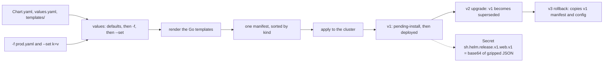

# A Chart Is a Template Plus a Release Record

*A chart is a function from values to one manifest; a release is that manifest written down per revision, and rollback is one more revision.*

## Metadata

| Field | Value |
|---|---|
| Type | Build |
| Languages | Python |
| Prerequisites | [Reconcilers](https://cloudcaptain.io/learn/orchestration/reconciler) |
| Time | 90 minutes |
| Tools | helm, kubectl, kind |

<Quiz stage="pre" />

## The Problem

Friday, 16:40. The payments API was installed three weeks ago with `helm install payments ./chart -f prod.yaml`: four replicas, the production database host, a memory limit sized after the last incident. Today someone ships a one-line fix with `helm upgrade payments ./chart --set image.tag=1.8.3`. The rollout is green, and two minutes later the API is running one replica, pointed at the chart's default database host, with no memory limit. Nobody touched those values. The upgrade dropped them: when you pass any values to `helm upgrade`, Helm starts again from the chart's defaults plus what you just typed, and it reuses the previous release's values only when you pass none.

The on-call engineer runs `helm rollback payments`. The values come back, but the history now shows revision 7, "Rollback to 5", and a teammate assumes revision 6 was undone and removed. Twenty minutes later a CI job that was killed halfway through an upgrade leaves the release in `pending-upgrade`, and every further attempt fails with `another operation (install/upgrade/rollback) is in progress`. Someone suggests deleting the namespace. Someone else finds seven Secrets named `sh.helm.release.v1.payments.v1` to `.v7`, opens one, and sees a wall of base64.

Every one of those surprises follows from two small programs that ship as one binary. The first is a pure function: it merges values in a fixed order and renders Go templates into one manifest. The second is a ledger: every install, upgrade and rollback writes a numbered record (the chart, the values you passed, the rendered manifest) into a Secret, and the statuses on those records are Helm's only memory. You are going to build both as `minihelm`: a YAML subset that types scalars the way Helm does, the values merge, a Go-template engine with the functions real charts use, the manifest renderer, and a release store that writes the same Secrets Helm writes, so that the real `helm history` can read releases your code made.

## The Concept

Think of a chart as a function. Its inputs are the chart (`Chart.yaml` for the name and version, `values.yaml` for defaults, `templates/` for text with holes), your values, and the release (name, namespace, revision). Its output is one string, a multi-document manifest. Nothing in that function talks to the cluster: `helm template` is the function on its own.

**Values** are layered before rendering, in an order that never changes: chart defaults, then each `-f` file in the order given (maps merge key by key, everything else replaces), then `--set`, then `--set-string`. A list is a value, not a map, so `--set ports[1].port=9100` builds a new two-item list whose first item is empty and replaces the default list wholesale. A `null` deletes a default. Two typing rules cause most of the surprises. Files are read as YAML 1.1 and then through JSON, so `yes`, `on` and `NO` are booleans, `0755` is the octal number 493, and every number is a 64-bit float, which Go prints as `1e+06` once it reaches a million. `--set` has its own rules: `true`, `false`, `null` and plain integers are typed, and everything else, `1.5` included, stays a string.

**Templates** are Go's `text/template`. The dot is the current data, and `.Values.image.tag` walks maps; a missing key yields an empty value until you ask for a field of it, which fails with `nil pointer evaluating interface {}.tag`. A pipeline `a | b | c` passes each result as the last argument of the next function, which is why `default` takes the fallback first. `{{-` and `-}}` eat the whitespace on their side, newlines included, and `nindent` puts a newline and an indent back, which is how labels land at the right depth. `define` names a block of text and `include` renders it with the dot you pass and returns a string, so it can be piped; inside it, `$` is that dot.

**Rendering** executes every file under `templates/` except partials (names starting with `_`) and `NOTES.txt`, splits each output on `---`, parses every document (a template that produces invalid YAML fails here, naming the file), sets aside documents with a `helm.sh/hook` annotation, sorts the rest by kind so that Namespaces, ServiceAccounts, Secrets and ConfigMaps come before the Deployments that use them, and joins them with a `# Source:` comment per document.

**The ledger** stores revision N of release R as a Secret `sh.helm.release.v1.R.vN` of type `helm.sh/release.v1`, labelled `owner=helm`, `name`, `status` and `version`. Its `release` key holds the record as JSON, gzipped, then base64-encoded, and the Secret API base64-encodes it once more, which is why decoding one by hand is `base64 -d | base64 -d | gunzip`. A record carries the name, namespace, revision, status and description, the chart (metadata, default values and every template file), the values you supplied (`config`) and the rendered manifest.



The statuses form a state machine, and an operation that dies halfway leaves its record in the middle of a transition. Install writes `pending-install` before it applies anything and `deployed` or `failed` after; upgrade and rollback do the same with `pending-upgrade` and `pending-rollback`, and on success mark every earlier `deployed` record `superseded`. A pending record works as a lock: the next upgrade refuses to start. Rollback rewinds nothing. It reads an old record and writes a new revision that replays that record's manifest and values without rendering them again, so `.Release.Revision` inside it still says the old number. Upgrade is the only path that renders, and it deletes the objects that were in the current manifest but are missing from the new one.

## Build It

`code/main.py` is `minihelm`, about 2,500 lines of standard-library Python in layers you can read in order: YAML in and out, values, the template engine, rendering, release records, stores, the release manager and the CLI. Everything that touches the outside world is injected: the store (memory, a directory of Secret JSON files, or real Secrets through `kubectl`), the applier (one that records what it would do, or `kubectl apply`), the `kubectl` runner and the clock. The tests use the fakes, and `code/fixtures/webapp` is the chart you render throughout; its output is byte-identical to `helm template` for every case the smoke test checks, and so is the output for the chart `helm create` writes.

### Step 1: scalars typed the way Helm types them

Helm reads values with a YAML 1.1 parser and then converts them through JSON. The parser decides each type from the spelling:

```python
def plain_scalar(text: str) -> Any:
    if text in NULL_WORDS:
        return None
    if text in TRUE_WORDS:
        return True
    if text in FALSE_WORDS:
        return False
    for pattern, base, prefix in INT_FORMS:
        if pattern.match(text):
            sign = -1 if text.startswith("-") else 1
            digits = text.lstrip("+-")[len(prefix):].replace("_", "")
            if digits:
                return sign * int(digits, base)
    if FLOAT_RE.match(text):
        return float(text)
    if text in SPECIAL_FLOATS:
        return SPECIAL_FLOATS[text]
    return text
```

`TRUE_WORDS` holds `y`, `yes` and `on` in three casings, `FALSE_WORDS` holds `n`, `no` and `off`, and `INT_FORMS` covers decimal, `0x`, `0o`, `0b` and a leading zero for octal. Plain keys go through the same function, so a key spelled `n:` becomes the string `"false"`. Around it sits the compose lesson's indentation parser, extended with literal and folded block scalars (`|`, `|-`, `>`), a document splitter on `---`, and Helm's rule for duplicate keys: the last one wins, silently. `load_values_file()` finishes with `floatify()`, because after the JSON round trip every number in a values file is a float64.

### Step 2: values in a fixed order

`user_values()` merges the `-f` files with `merge_maps()`, which recurses into maps and replaces everything else, then applies each `--set` and `--set-string`. `--set` has its own typing, much smaller than YAML's:

```python
def typed_set_value(text: str) -> Any:
    if text.lower() == "true":
        return True
    if text.lower() == "false":
        return False
    if text.lower() == "null":
        return None
    if text == "0":
        return 0
    if text and text[0] != "0" and re.fullmatch(r"[-+]?\d+", text):
        number = int(text)
        if -(2 ** 63) <= number < 2 ** 63:
            return number
    return text
```

`parse_set()` splits on unescaped commas (but not inside `{a,b}`, which is list syntax) and on dots, and `set_path()` turns `ports[1]` into a list padded with `None`. The user's values then go on top of the chart's defaults:

```python
def coalesce(defaults: Dict[str, Any], config: Dict[str, Any]) -> Dict[str, Any]:
    result = copy.deepcopy(config)
    for key, default in defaults.items():
        if key in result:
            if result[key] is None:
                del result[key]
            elif isinstance(result[key], dict) and isinstance(default, dict):
                result[key] = coalesce(default, result[key])
        elif default is not None:
            result[key] = clean_nils(copy.deepcopy(default))
    return result
```

Three rules: your value wins, two maps merge key by key, and a `null` from you deletes the default. A list is not a map, so it never merges.

### Step 3: lex the actions and eat whitespace

`lex_template()` splits a file into text and action tokens. An action opened with `{{-` followed by a space, or closed with a space and `-}}`, trims all whitespace, newlines included, from the neighbouring text once the whole file is tokenised:

```python
    for index, token in enumerate(tokens):
        if token.kind == "text":
            continue
        if token.trim_left and index > 0 and tokens[index - 1].kind == "text":
            tokens[index - 1].value = tokens[index - 1].value.rstrip(" \t\r\n")
        if token.trim_right and index + 1 < len(tokens) and tokens[index + 1].kind == "text":
            tokens[index + 1].value = tokens[index + 1].value.lstrip(" \t\r\n")
```

`action_end()` finds the closing braces while skipping string literals, so a `}}` inside quotes does not end the action, and it recognises `/* comments */`. `TemplateParser` then builds the tree: text, actions, `if` with any number of `else if` branches and an `else`, `range` and `with` (each with an optional `else`), top-level `define`, and `template`. A missing `end` is a parse error that says `unexpected EOF`, and an unknown function is rejected at parse time, as Go does, before any value is read.

### Step 4: pipelines, fields and how Go prints values

`ExpressionParser` turns `include "webapp.labels" . | nindent 4` into commands made of operands: field chains (`.Values.image.tag`), variables (`$`, `$key`), literals, parenthesised pipelines and function names. Evaluation passes each command's result to the next one as its last argument:

```python
    def command(self, command: List[Operand], scope: Scope, piped: Any) -> Any:
        head = command[0]
        if head.kind == "func":
            if head.value in ("and", "or"):
                return self.logical(head.value, command[1:], scope, piped)
            args = [self.operand(operand, scope) for operand in command[1:]]
            if piped is not MISSING:
                args.append(piped)
            return self.call(head.value, args)
        if len(command) > 1 or piped is not MISSING:
            raise TemplateError(f"can't give argument to non-function {head.text}")
        return self.operand(head, scope)
```

`and` and `or` evaluate lazily, so `and .Values.a .Values.a.b` is a safe guard. Field access is where the error everybody meets comes from:

```python
def field_of(value: Any, name: str) -> Any:
    if isinstance(value, Obj):
        if name in value:
            return value[name]
        raise TemplateError(f"can't evaluate field {name} in type {value.type_name}")
    if isinstance(value, dict):
        return value.get(name)
    if value is None:
        raise TemplateError(f"nil pointer evaluating interface {{}}.{name}")
    raise TemplateError(f"can't evaluate field {name} in type {go_type(value)}")
```

`.Values` is a map, so a missing key is `None`, which prints as an empty string; `.Release` and `.Chart` are structs (`Obj`), so a misspelt field is an error. Printing follows Go's `fmt`: `go_float()` prints the float64 1000000 as `1e+06`, `go_sprintf()` prints `printf "%d"` of a float as `%!d(float64=80)`, and `eq` between a values-file number and an integer literal fails with `incompatible types for comparison: float64 and int`, the same message Helm gives. The functions are a table, `BASE_FUNCTIONS`: `default`, `quote`, `upper`, `lower`, `trunc`, `trimSuffix`, `replace`, `contains`, `indent`, `nindent`, `toYaml`, `toJson`, `printf`, `print`, `eq`, `ne`, `not`, `and`, `or`, `len`, `index`, `sha256sum`, `b64enc`, `list`, `dict` and `first`, plus `include` and `required`, which the engine binds to itself.

### Step 5: define, include and required

`include` renders a named template in a fresh scope whose dot and `$` are its argument, and returns a string you can pipe into `nindent`. `required` raises a private exception that travels through every nested `include` and is reported at the outermost call site, which is where Helm reports it:

```python
    def required(self, message: Any, value: Any) -> Any:
        if value is None or value == "":
            raise RequiredValue(go_print(message))
        return value
```

```python
        except RequiredValue as exc:
            if self.depth > 1:
                raise
            raise TemplateError(f"execution error at ({where}): {exc}", located=True) from exc
```

`toYaml` is an emitter that writes what Helm's `sigs.k8s.io/yaml` writes: sorted keys, sequences flush with their parent key, double quotes for strings that would otherwise change type (`"yes"`, `"1.0"`, `"0x10"`, a key named `"n"`), single quotes for strings that start with an indicator or contain a colon and a space, and literal blocks for multi-line strings.

### Step 6: one manifest, sorted by kind

`render_chart()` builds the top-level object (`.Values`, `.Release`, `.Chart` and `.Template`), executes every non-partial file in path order, parses each output document, separates hooks, and sorts the rest:

```python
    entries.sort(key=lambda entry: kind_rank(entry["kind"]))
    hooks.sort(key=lambda entry: kind_rank(entry["kind"]))
    manifest = "".join(f"---\n# Source: {entry['path']}\n{entry['content']}\n" for entry in entries)
    return Rendered(manifest, entries, hooks, values)
```

`kind_rank()` uses Helm's install order (Namespace, NetworkPolicy, ResourceQuota, ..., ServiceAccount, Secret, ConfigMap, ..., Service, ..., Deployment, ..., Ingress); the sort is stable, and kinds it does not know go last in alphabetical order. The fixture's Deployment carries `checksum/config` set to `include (print $.Template.BasePath "/configmap.yaml") . | sha256sum`, the standard trick: it renders the ConfigMap a second time and hashes it into the pod template, so pods restart when the configuration changes and not when only the replica count does.

### Step 7: the release record and its Secret

```python
def encode_release(record: Dict[str, Any]) -> str:
    payload = json.dumps(record, separators=(",", ":"), ensure_ascii=False).encode("utf-8")
    return base64.b64encode(gzip.compress(payload, compresslevel=9, mtime=0)).decode("ascii")
```

```python
def secret_object(record: Dict[str, Any], moment: datetime, created: bool) -> Dict[str, Any]:
    labels = {"name": record["name"], "owner": "helm", "status": record["info"]["status"], "version": str(record["version"])}
    labels["createdAt" if created else "modifiedAt"] = str(int(moment.timestamp()))
    return {
        "apiVersion": "v1",
        "kind": "Secret",
        "metadata": {"name": release_key(record["name"], record["version"]), "namespace": record["namespace"], "labels": labels},
        "type": SECRET_TYPE,
        "data": {"release": base64.b64encode(encode_release(record).encode("ascii")).decode("ascii")},
    }
```

`new_record()` fills the JSON with Helm's field names: `name`, `info.first_deployed`, `info.last_deployed`, `info.status`, `info.description`, `chart.metadata`, `chart.templates` with base64 file data, `chart.values`, `config`, `manifest`, `version`, `namespace` and `apply_method`. Three stores hold these Secret objects: `MemorySecrets` for tests, `DirSecrets` with one JSON file per revision, and `KubectlSecrets`, which runs `kubectl create`, `replace`, `get secrets -l name=NAME,owner=helm` and `delete`. Because the bytes and the labels match, a release that `minihelm --store secrets` writes shows up in `helm history`.

### Step 8: install, upgrade and rollback are writes to the ledger

`Manager.install()` refuses a name that already has records (`cannot reuse a name that is still in use`), renders revision 1, stores it as `pending-install`, applies it, and updates it to `deployed`, or to `failed` with the error. `Manager.upgrade()` refuses when the last record is pending, chooses the values, renders the next revision with `.Release.IsUpgrade` set, applies it, and has the applier delete what the old manifest had and the new one lacks. The rule from The Problem is these lines:

```python
        old_config = floatify(current.get("config") or {})
        defaults = None
        if reuse_values:
            defaults = coalesce(floatify((current.get("chart") or {}).get("values") or {}), old_config)
            config = merge_maps(old_config, config)
        elif reset_then_reuse_values:
            config = merge_maps(old_config, config)
        elif not config and not reset_values:
            config = old_config
```

`--reuse-values` also freezes the old chart's defaults, which is why a new chart version's defaults do not appear with it; `--reset-then-reuse-values` takes the new chart's defaults, then the old values, then the new ones. `Manager.rollback()` renders nothing at all:

```python
        record = new_record(name, target["namespace"], last["version"] + 1, target["chart"], target.get("config") or {}, target.get("manifest", ""), self.clock(), "pending-rollback", f"Rollback to {target_version}", current["info"].get("first_deployed"))
        record["info"]["rollback_revision"] = target_version
```

Like Helm's, it works even when the last record is pending, which makes it the way out of a stuck upgrade. `prune()` keeps at most `--history-max` revisions (10 by default) and never deletes the deployed one. `uninstall()` deletes the objects and then every record, or with `--keep-history` marks the last record `uninstalled`.

### Step 9: run it

```bash
cd code/fixtures
python3 ../main.py template web webapp | head -20            # the manifest; --json gives the parsed documents
python3 ../main.py values webapp -f override.yaml             # chart defaults under the -f file, as YAML
python3 ../main.py template web webapp --set 'ports[1].containerPort=9100'
# minihelm: template: webapp/templates/deployment.yaml:33: executing ... at <.name>: nil pointer evaluating interface {}.name
python3 ../main.py template web webapp --set team=null; echo "exit $?"
# minihelm: execution error at (webapp/templates/configmap.yaml:6): team is required: pass --set team=NAME   exit 2

S=$(mktemp -d)
python3 ../main.py install web webapp -f override.yaml --store dir:$S
python3 ../main.py upgrade web webapp --set replicaCount=2 --store dir:$S
python3 ../main.py get values web --store dir:$S              # only replicaCount: the -f values are gone
python3 ../main.py rollback web 1 --store dir:$S
python3 ../main.py history web --store dir:$S
# 1  Sun Nov  1 ...  superseded  webapp-0.1.0  3.10  Install complete
# 2  Sun Nov  1 ...  superseded  webapp-0.1.0  3.10  Upgrade complete
# 3  Sun Nov  1 ...  deployed    webapp-0.1.0  3.10  Rollback to 1
python3 ../main.py get manifest web --store dir:$S | grep rendered-at   # "1": a rollback replays, it does not render
ls $S/default                                                 # sh.helm.release.v1.web.v1.json to .v3.json
python3 ../main.py decode $S/default/sh.helm.release.v1.web.v3.json | head -20
```

The Secret's `data.release` starts with `SDRzSUFBQUFBQUFD`, the base64 of `H4sIAAAAAAAC`, which is in turn the base64 of the gzip magic bytes `1f 8b 08`. Once you have seen it, you can recognise a Helm release Secret from its first few characters.

<RunTests />

## Use It

Helm (current release <ToolVersion name="helm" />) is the same function and the same ledger. With the fixture chart and a kind cluster:

```bash
helm create demo                                              # a starter chart: helpers, deployment, service, hpa, ingress, httproute, a test hook
helm template web code/fixtures/webapp -f code/fixtures/override.yaml > helm.yaml
python3 code/main.py template web code/fixtures/webapp -f code/fixtures/override.yaml > mini.yaml
diff helm.yaml mini.yaml && echo identical
helm lint code/fixtures/webapp                                # renders the chart and checks its structure
helm install web code/fixtures/webapp -n demo --create-namespace --dry-run=server   # schema-checked against the cluster, nothing stored
helm upgrade --install web code/fixtures/webapp -n demo --create-namespace -f code/fixtures/override.yaml
helm upgrade web code/fixtures/webapp -n demo --set replicaCount=2
kubectl get configmap web-webapp-config -n demo -o jsonpath='{.data.MESSAGE}'   # "hello from minihelm": the -f values were dropped
helm rollback web 1 -n demo
helm history web -n demo                                      # 1 superseded, 2 superseded, 3 deployed "Rollback to 1"
helm get values web -n demo                                   # USER-SUPPLIED VALUES, the record's config; --all for computed values
helm get manifest web -n demo                                 # the stored manifest, not a fresh render
kubectl get secrets -n demo -l owner=helm --show-labels       # one Secret per revision
kubectl get secret sh.helm.release.v1.web.v3 -n demo -o jsonpath='{.data.release}' | base64 -d | base64 -d | gunzip | python3 -m json.tool | head -30
helm get manifest web -n demo | kubectl diff -n demo -f -     # drift: what changed in the cluster since Helm last applied
```

`--dry-run=server` renders with the cluster reachable (so `lookup` works), validates the objects against the server's OpenAPI schema and checks that none of them already exists under another owner; it does not send them through admission webhooks. Real Helm also stamps every object it applies with the label `app.kubernetes.io/managed-by: Helm` and the annotations `meta.helm.sh/release-name` and `meta.helm.sh/release-namespace`, and an install refuses objects that exist without them (`invalid ownership metadata`) unless you pass `--take-ownership`. Helm 4 differs from what you built, and from Helm 3, in a few more places:

- New installs use server-side apply by default; an upgrade's `--server-side=auto` follows the method the release was installed with, and the record's `apply_method` field (`ssa` or `csa`) is how Helm remembers it. minihelm uses client-side `kubectl apply` and records `csa`.
- `--wait` takes a strategy: a bare `--wait` means `--wait=watcher`, and `legacy` and `hookOnly` are the others. `--rollback-on-failure` replaces `--atomic` and `--force-replace` replaces `--force`; the old names are deprecated.
- Hooks (documents annotated `helm.sh/hook`) run at `pre-install`, `post-upgrade` and the other events, and `helm test` runs the `test` ones. minihelm renders hooks and warns that it never runs them.
- `lookup` reads live objects while rendering, `tpl` renders a string as a template, `.Capabilities` describes the cluster's API versions, `.Files` reads non-template files, `values.schema.json` validates values, and subcharts under `charts/` get their own `.Values` scope. None of these are in the subset.

Charts are also OCI artifacts, next to classic `index.yaml` repositories:

```bash
helm package code/fixtures/webapp                             # webapp-0.1.0.tgz
helm registry login ghcr.io -u YOUR_USER
helm push webapp-0.1.0.tgz oci://ghcr.io/YOUR_ORG/charts
helm show values oci://ghcr.io/YOUR_ORG/charts/webapp --version 0.1.0
helm upgrade --install web oci://ghcr.io/YOUR_ORG/charts/webapp --version 0.1.0 -n demo
```

Many tutorials still install from the Bitnami catalogue (`helm repo add bitnami https://charts.bitnami.com/bitnami`). Treat it as retired for free use: in 2025 Bitnami's free container images moved to a `bitnamilegacy` repository that receives no updates, so those charts are effectively deprecated as a default. Prefer charts maintained by the project itself, and pin images you build or mirror.

| What you built | Real tool | Note |
|---|---|---|
| `load_chart()` | the loader behind `helm lint` and `helm package` | also reads `.helmignore`, `charts/`, `crds/`, `values.schema.json` and `Chart.lock` |
| `user_values()` and `coalesce()` | `-f`, `--set`, `--set-string`, `--set-file`, `--set-json` | the same order; `helm get values --all` prints the computed result |
| `plain_scalar()` and `floatify()` | `sigs.k8s.io/yaml` | the reason to quote `"on"`, `"0755"` and `"1.0"`, and why `eq .Values.port 80` fails |
| `Engine` and `BASE_FUNCTIONS` | Go `text/template`, Sprig and Helm's `include`, `tpl`, `required`, `lookup` | a few dozen of the functions charts can call |
| `render_chart()` | `helm template`, `helm install --dry-run` | `--debug` prints the invalid YAML when rendering fails |
| `kind_rank()` | Helm's install order | uninstall uses the reverse |
| `encode_release()` and `secret_object()` | the `secrets` storage driver | `HELM_DRIVER=configmap` or `sql` stores the same record elsewhere |
| the values rule in `Manager.upgrade()` | `--reuse-values`, `--reset-values`, `--reset-then-reuse-values` | with no flags and no values, the previous config is reused |
| `Manager.rollback()` | `helm rollback NAME REVISION` | a new revision with `rollback_revision`; the history keeps every step |
| pending statuses as a lock | `another operation (install/upgrade/rollback) is in progress` | `helm rollback` to the last good revision clears it |
| `prune()` | `--history-max`, default 10 | pruned revisions can no longer be rolled back to |
| `KubectlApplier` | Helm's kube client | server-side apply by default in Helm 4, a three-way merge in Helm 3 |

<Quiz stage="check" />

## Ship It

Two artifacts in `outputs/`:

- **`skill-helm-release-triage.md`**: a runbook for a release that misbehaves: read the ledger with `helm history` and the release Secrets, decode a record, compare stored and live state with `kubectl diff`, and work through a decision table for pending locks, failed revisions, values lost on upgrade, rollbacks that did not fix anything, objects deleted by an upgrade, ownership conflicts and immutable-field errors, ending in a report with the revision you chose and why.
- **`prompt-chart-review.md`**: paste a chart's `values.yaml` and templates (or `helm template` output) and get a review in a fixed shape: values typing traps, nil-pointer risks, whitespace and indentation, upgrade safety (immutable selectors, renamed objects, config checksums), names and labels, secrets in values, hooks and CRDs, with the `helm template` cases that would prove each finding.

<ShipIt />

## Exercises

### Easy

Add `--set-json KEY=JSON`, applied after `--set-string` as in Helm's order, so `--set-json 'resources={"limits":{"cpu":"1"}}'` sets a whole object and `--set-json 'ports[0]={"name":"http"}'` sets one list item. Write the tests first: an object, a list item, a JSON number that must stay an integer, and invalid JSON producing a `ValuesError` that names the flag and the key.

### Medium

Implement `upgrade --rollback-on-failure`: when the applier fails, mark the new revision `failed`, then roll back to the last `deployed` revision and report both in the error. Test it with `RecordingApplier(fail_with=...)` swapped in after the first apply: the history must end with `failed` and then `deployed` with the description `Rollback to 1`, the applier must have been asked to apply revision 1's manifest again, and a second failure during the rollback must leave both records in a state an operator can read.

### Hard

Support subcharts: load `charts/NAME/` recursively, give each subchart its own `.Values` scope taken from the parent's `NAME:` key, merge `global:` into every chart, honour `condition:` on dependencies, and render the subchart templates under `PARENT/charts/NAME/templates/...` paths. Build a two-chart fixture, then prove with the smoke pattern that `minihelm template` and `helm template` produce the same documents with and without the condition enabled and with a `global` value overridden by `--set`.

<Quiz stage="post" />

## Key Terms

| Term | Common misconception | Precise definition |
|---|---|---|
| Chart | "A zip of Kubernetes YAML." | A directory, `.tgz` or OCI artifact with `Chart.yaml` (name, SemVer version, appVersion), `values.yaml` defaults and `templates/` that Go templates render into one manifest. |
| Release | "The running pods." | A named instance of a chart in a namespace. Helm knows it only through its records, one per revision, each holding the chart, the user-supplied values and the rendered manifest. |
| Revision | "Rollback returns to an old revision." | A number that only grows. Every install, upgrade and rollback writes a new one; a rollback writes revision N+1 with an older revision's manifest and values. |
| Release record | "Helm keeps its state on the laptop that ran it." | JSON, gzipped and base64-encoded in the `release` key of Secret `sh.helm.release.v1.NAME.vN`, type `helm.sh/release.v1`, labelled `owner=helm`, in the release namespace. |
| User-supplied values (`config`) | "Helm remembers every value it ever saw." | Only what `-f` and `--set` passed is stored. An upgrade that passes any value starts from the chart defaults again unless `--reuse-values` or `--reset-then-reuse-values` says otherwise. |
| Pipeline | "The pipe works like a shell pipe on text." | Each command's result becomes the last argument of the next function, so `.Values.x \| default "y"` is `default "y" .Values.x`, and the result can be any type. |
| Whitespace trimming | "A dash trims spaces on one line." | A dash and a space inside the opening braces remove all whitespace before the action, newlines included; the closing form removes all whitespace after it. `nindent` adds a newline and indentation back. |
| Pending status | "A display state that clears itself." | `pending-install`, `pending-upgrade` or `pending-rollback` is written before Helm applies anything and works as a lock. A killed client leaves it behind; a rollback to a good revision clears it. |
| YAML 1.1 typing | "Values are strings unless they look like numbers." | `yes`, `no`, `on`, `off`, `y` and `n` are booleans, a leading zero means octal, and every number from a values file becomes a float64, so a million prints as `1e+06`. |

## Further Reading

- [Helm](https://cloudcaptain.io/docs/tools/helm): the Reference page for everyday Helm commands, chart structure and hooks.
- [Kubernetes Workloads & Scheduling](https://cloudcaptain.io/docs/tools/kubernetes/workloads): the Deployments, Services and ConfigMaps a chart renders, and which of their fields are immutable.
- [YAML Fundamentals](https://cloudcaptain.io/docs/tools/yaml/fundamentals): the full language your parser is a subset of, including the quoting rules that decide types.
- [GitOps](https://cloudcaptain.io/docs/tools/cicd/gitops): how Argo CD and Flux render charts themselves and keep the cluster in sync without Helm's ledger.
- [Helm chart template guide](https://helm.sh/docs/chart_template_guide/): the official walk through `.Values`, pipelines, `define`, `include` and whitespace control.
- [Go text/template](https://pkg.go.dev/text/template): the language specification behind every chart, including pipelines, variables, `range` and the comparison rules for `eq`.
- [Sprig function documentation](https://masterminds.github.io/sprig/): the string, list and dictionary functions charts call, with their argument order.
- [Helm storage backends](https://helm.sh/docs/topics/advanced/#storage-backends): the Secret, ConfigMap and SQL drivers that hold the release record you decoded.
- [YAML 1.1 boolean type](https://yaml.org/type/bool.html): the list of spellings that become booleans, the root of the `NO` and `on` surprises.
