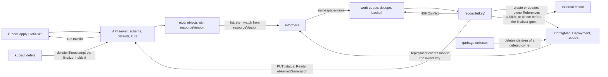

# An Operator Is a Controller for a Type You Defined

*A CRD teaches the API server a new noun; an operator is the loop that turns each one into real objects and reports back in status.*

## Metadata

| Field | Value |
|---|---|
| Type | Build |
| Languages | Python |
| Prerequisites | [Reconcilers](https://cloudcaptain.io/learn/orchestration/reconciler), [RBAC Authorizer](https://cloudcaptain.io/learn/orchestration/rbac-authorizer) |
| Time | 120 minutes |
| Tools | kubectl, kind, kubebuilder, kopf |

<Quiz stage="pre" />

## The Problem

The marketing team runs forty microsites on the platform cluster. Each one is three objects copied from a wiki page (a ConfigMap holding the HTML, an nginx Deployment that mounts it, a Service) plus a DNS record that a platform engineer adds by hand at the DNS provider. Six months in, the inventory has rotted. A content edit updates the ConfigMap and nothing changes on screen until someone restarts the pods. A launch site was copied with `replicas: 1` and went dark during a node drain on launch morning. Three sites were "deleted" by deleting their Deployment, so their ConfigMaps, Services and DNS records are still there, and one of those records now points at an address the cloud provider has since handed to another customer.

The first fix was a Python script on a CronJob: every minute it read a list of sites from Git, created whatever was missing, and deleted the DNS record of any site no longer listed. It crashed halfway through a run the night someone edited a Deployment by hand and the API server answered `409 Conflict`. It missed a deletion the week its own pod sat in `ImagePullBackOff`, so nothing ever removed that site's DNS record. And nobody could answer "is the spring campaign site up?" without reading three objects and a log file.

Both failures have one cause: the cluster does not know what a site is. So teach it. A **CustomResourceDefinition** makes `StaticSite` an API type with a schema the API server enforces (a prod site with one replica is refused at `kubectl apply`, with your message) and a status everyone can read. A controller for that type, an **operator**, watches every StaticSite, makes the children match the spec, marks them as owned so the garbage collector deletes them with their parent, writes what it observed into status, and holds a **finalizer** so the API server cannot finish deleting a site until its external record is gone. You will build `minioperator` with the standard library, run it on kind through `kubectl proxy` under a least-privilege Role, and then read kubebuilder and kopf as frameworks for exactly what you wrote.

## The Concept

The API server is a typed database with a change feed. Every resource type, built in or yours, gets the same machinery: storage in etcd, a `resourceVersion` on every write, list and watch, optimistic concurrency, schema validation and defaulting, the spec and status split, finalizers, and garbage collection by owner. A CRD is the registration form: a group, a kind, a plural, a scope, versions, and an OpenAPI schema per version. After you apply it, the API server serves `/apis/learn.cloudcaptain.io/v1alpha1/namespaces/NS/staticsites`, `kubectl get site` works, and nothing else happens, because no code knows what a StaticSite means. That code is the operator.

| The API server does this for any CRD | The operator does this for StaticSite |
|---|---|
| validates against the schema, applies defaults, prunes unknown fields, evaluates CEL rules | reads the spec and decides which objects it implies |
| stores the object, assigns `uid` and `resourceVersion`, bumps `metadata.generation` when the spec changes | creates or updates a ConfigMap, a Deployment and a Service, each with a controller owner reference |
| streams every change to watchers, starting from a `resourceVersion` | lists, watches, and queues the key of anything that changed |
| refuses a write that carries a stale `resourceVersion` with `409 Conflict` | rereads and retries with backoff, never forces |
| on delete, sets `deletionTimestamp` and keeps the object while `metadata.finalizers` is non-empty | cleans what lives outside the cluster, then removes its own finalizer |
| deletes objects whose owner is gone | never deletes its children itself, so it needs no `delete` permission |
| accepts `status` only through the `/status` subresource | writes `observedGeneration` and a `Ready` condition there |

Two fields make status trustworthy. `metadata.generation` is a counter the API server increments on every spec change and never on a status change; `status.observedGeneration` is the generation the controller had in hand when it wrote the status. When they are equal, the status describes the spec you are looking at; when observed lags, the controller has not caught up yet. `kubectl wait`, Argo CD health checks and every well-behaved tool read status this way, and a condition list (`type`, `status`, `reason`, `message`, `lastTransitionTime`) carries the verdict in a shape they all understand.

Deletion with a finalizer is a two-phase commit between the API server and your controller. `kubectl delete` sets `deletionTimestamp` (and bumps `generation`), the object stays readable, and every writer may still update it, but no one may add a new finalizer. Your controller sees the change, deletes the DNS record or the bucket or the database user, and removes its finalizer with an ordinary update. When the list is empty the API server deletes the object for real, and the garbage collector deletes every object whose `ownerReferences` names its `uid`. Kill the controller between those steps and nothing is lost: the object waits, visibly stuck, with `deletionTimestamp` set.



The loop is level-triggered. An event only says which key to look at; `reconcile` reads the current object and the current children and makes them match, every time, from scratch. That is why a missed event costs nothing: after a restart, or after a `410 Gone` because the watch fell too far behind, the controller lists everything again, queues every key, and the same function converges.

## Build It

`code/main.py` is `minioperator`. The CRD and the Role are Python dicts printed as JSON (`kubectl apply -f` reads JSON). The controller talks to an API object with seven methods (`list`, `watch`, `get`, `create`, `update`, `update_status`, `delete`). `HttpApi` implements them with `urllib` against `kubectl proxy`; `FakeApi` implements them in memory with real semantics (resourceVersions, generations, the status subresource, finalizers, garbage collection, compaction and `410`), so the tests and the demo run on macOS without a cluster. `HttpApi` retries `429 TooManyRequests` after the server's `Retry-After` (capped, with exponential backoff when the header is missing): right after a CRD is created the API server can answer that for a moment with `storage is (re)initializing`, and client-go waits and retries in the same way.

### Step 1: the type

The schema is the contract. `content` is required; `replicas` and `tier` have defaults the API server fills in; and one CEL rule says what OpenAPI cannot, a constraint across two fields:

```python
        "spec": {
            "type": "object",
            "description": "What the site should be. The operator never writes here.",
            "required": ["content"],
            "x-kubernetes-validations": [
                {"rule": "self.tier != 'prod' || self.replicas >= 2", "message": "prod sites need at least 2 replicas"},
            ],
            "properties": {
                "content": {"type": "string", "minLength": 1, "maxLength": 65536, "description": "The index.html nginx serves at /."},
                "replicas": {"type": "integer", "minimum": 1, "maximum": 10, "default": 1, "description": "Number of nginx pods."},
                "tier": {"type": "string", "enum": ["dev", "prod"], "default": "dev", "description": "prod sites need at least 2 replicas."},
            },
        },
```

The version entry adds `"subresources": {"status": {}}`, which splits writes into `/staticsites/NAME` (spec and metadata) and `/staticsites/NAME/status` (status only), and four `additionalPrinterColumns` so `kubectl get site` shows replicas, the `Ready` status and its reason. `status.conditions` is declared with `x-kubernetes-list-type: map` keyed on `type`, the convention for condition lists.

### Step 2: admission, the way the API server does it

`admit()` walks the object against the schema. Objects drop fields the schema does not declare (pruning) and gain defaults for missing ones; scalars are checked against `enum`, `minLength`, `maximum` and friends; then the CEL rules run with `self` bound to the value at that level:

```python
def check_object(schema: Obj, value: Obj, path: str, errors: List[str], warnings: List[str]) -> Obj:
    properties = schema.get("properties") or {}
    result: Obj = {}
    for key, item in value.items():
        if not path and key in ROOT_KEYS:
            result[key] = copy.deepcopy(item)
        elif key in properties:
            result[key] = check(properties[key], item, join(path, key), errors, warnings)
        else:
            warnings.append(f'unknown field "{join(path, key)}"')
    for key, child in properties.items():
        if key not in result and "default" in child:
            result[key] = copy.deepcopy(child["default"])
    for key in schema.get("required") or []:
        if key not in result:
            errors.append(f"{join(path, key)}: Required value")
    return result
```

```python
def check_rules(schema: Obj, value: Any, path: str, errors: List[str]) -> None:
    for rule in schema.get("x-kubernetes-validations") or []:
        label = schema.get("type", "object")
        try:
            passed = cel_eval(cel_compile(rule["rule"]), {"self": value})
        except CelError as exc:
            errors.append(f'{path}: Invalid value: "{label}": rule {rule["rule"]!r} could not be evaluated: {exc}')
            continue
        if passed is not True:
            errors.append(f'{path}: Invalid value: "{label}": {rule.get("message") or "failed rule: " + rule["rule"]}')
```

Defaults land before the rule runs, which is why `self.tier` never fails with "no such key" here. `cel_compile()` is a recursive-descent parser for a CEL subset (literals, field selection, indexing, `!`, `&&`, `||`, comparisons, `in`, `+ - * / %`, the ternary, `has()`, `size()`, `startsWith`, `endsWith`, `contains`, `matches`), and `cel_eval()` refuses mixed types the way CEL's type checker does (`self.replicas == 'two'` is "no matching overload", not `false`). The boolean operators short-circuit left to right:

```python
    if tag in ("and", "or"):
        left = cel_bool(cel_eval(node[1], env), "&&" if tag == "and" else "||")
        if left == (tag == "or"):
            return left
        return cel_bool(cel_eval(node[2], env), "&&" if tag == "and" else "||")
```

`FakeApi` calls `admit()` on every create and update of a StaticSite and turns errors into a `422 Invalid` worded like the API server's: `StaticSite.learn.cloudcaptain.io "shop" is invalid: spec: Invalid value: "object": prod sites need at least 2 replicas`.

### Step 3: one interface, two API servers

Through `kubectl proxy` the API is plain HTTP on localhost: the proxy adds your credentials. A watch is a `GET` with `watch=1` that never ends on its own; the body is one JSON event per line. `allowWatchBookmarks` asks the server for periodic `BOOKMARK` events that carry only a newer `resourceVersion`, and `timeoutSeconds` makes the server close the stream so the client reconnects cleanly:

```python
    def watch(self, kind: Kind, namespace: str, resource_version: str, label_selector: Optional[str] = None, timeout: float = 60.0) -> Iterator[Obj]:
        query = {"watch": "1", "resourceVersion": resource_version, "allowWatchBookmarks": "true", "timeoutSeconds": str(int(timeout)), "labelSelector": label_selector}
        response = self.send("GET", kind.path(namespace), query=query, timeout=timeout + 15)
        try:
            yield from parse_watch_lines(response)
        finally:
            response.close()
```

```python
def parse_watch_lines(lines: Iterable[Any]) -> Iterator[Obj]:
    for raw in lines:
        text = (raw.decode("utf-8") if isinstance(raw, bytes) else raw).strip()
        if not text:
            continue
        event = json.loads(text)
        if event.get("type") == "ERROR":
            raise status_error(event.get("object") or {})
        yield event
```

An `ERROR` event carries a `Status` object; code `410` becomes `Gone`, everything else an `ApiError` with the code, reason and message. HTTP errors on ordinary calls go through the same `status_error()`, so a `409` from a `PUT` and a `409` inside the fake look identical to the controller.

`FakeApi` serves its watch through the same parser, from an event history it can compact. Its delete is the two-phase deletion from The Concept, and its final removal is the garbage collector:

```python
    def delete(self, kind: Kind, namespace: str, name: str) -> Obj:
        current = copy.deepcopy(self.stored(kind, namespace, name))
        meta = current["metadata"]
        if not meta.get("finalizers"):
            return self.remove(kind, current)
        if meta.get("deletionTimestamp"):
            return current
        meta["deletionTimestamp"] = iso(self.clock())
        meta["deletionGracePeriodSeconds"] = 0
        if "generation" in meta:
            meta["generation"] += 1
        return self.commit(kind, current, "MODIFIED")

    def remove(self, kind: Kind, body: Obj) -> Obj:
        gone = self.commit(kind, body, "DELETED")
        uid = gone["metadata"]["uid"]
        for (plural, namespace, name), other in list(self.objects.items()):
            owned = any(ref.get("uid") == uid for ref in other["metadata"].get("ownerReferences") or [])
            if owned and (plural, namespace, name) in self.objects:
                self.collected.append(f"{KINDS[plural].kind} {namespace}/{name}")
                self.delete(KINDS[plural], namespace, name)
        return gone
```

Its `update` refuses a stale `resourceVersion` with the real `409` text ("the object has been modified; please apply your changes to the latest version and try again"), keeps `status` untouched for StaticSites and Deployments, bumps `generation` only when something outside `metadata` and `status` changed, treats an identical write as a no-op that emits no event, and refuses new finalizers on an object that is being deleted.

### Step 4: list, then watch from where the list left off

An `Informer` keeps a cache of one kind and turns every change into work-queue keys. The list returns the collection's `resourceVersion`; the watch starts there, so nothing between the two is lost. When the server says the version is too old, the only correct move is to list again, and any object that vanished in the gap is still queued so its key gets one more reconcile:

```python
    def relist(self) -> None:
        items, revision = self.api.list(self.kind, self.namespace, self.label_selector)
        fresh = {object_key(item): item for item in items}
        missed = [self.cache[key] for key in self.cache if key not in fresh]
        self.cache = fresh
        self.resource_version = revision
        for obj in missed + items:
            for key in self.keys_of(obj):
                self.enqueue(key)
        self.note(self.kind.plural, "list", f"{len(items)} item(s) at resourceVersion {revision}")
```

```python
    def poll(self) -> None:
        try:
            for event in self.api.watch(self.kind, self.namespace, self.resource_version, self.label_selector, self.watch_timeout):
                self.handle(event)
        except Gone as exc:
            self.note(self.kind.plural, "watch expired", f"410 Gone ({exc.message}); relisting")
            self.relist()
```

The operator runs two informers. The one for StaticSites maps an object to its own key. The one for Deployments (filtered by `app.kubernetes.io/managed-by=minioperator`) maps a Deployment to the key of the StaticSite that controls it, which is how "a pod became ready" or "someone ran `kubectl scale`" wakes up the owner:

```python
def owner_keys(obj: Obj) -> List[str]:
    meta = obj.get("metadata") or {}
    return [f"{meta.get('namespace', '')}/{ref['name']}" for ref in meta.get("ownerReferences") or [] if ref.get("controller") and ref.get("kind") == SITE.kind and ref.get("apiVersion") == SITE.api_version]
```

In `run` mode each informer's `run()` loops on `poll()` in its own thread; in the tests and the demo, `Operator.pump()` calls `poll()` on both and drains the queue, one key at a time, until nothing is due.

### Step 5: a queue of keys, not of events

Ten events for one site are one reconcile. The queue holds each key once, with the time it becomes due; a failure pushes the key back with a delay that doubles per consecutive failure up to a cap, and a success resets the count:

```python
    def add(self, key: str, delay: float = 0.0) -> None:
        with self.cond:
            when = self.clock() + delay
            if key not in self.due or when < self.due[key]:
                self.due[key] = when
            self.cond.notify()

    def retry(self, key: str) -> float:
        with self.cond:
            self.failures[key] = self.failures.get(key, 0) + 1
            delay = min(self.cap, self.base * 2 ** (self.failures[key] - 1))
            self.add(key, delay)
        return delay
```

A new event for a key that is waiting out a backoff makes it due immediately: fresh information beats waiting.

### Step 6: reconcile, finalizer first

`reconcile()` reads the site live, handles deletion, and otherwise makes sure the finalizer is on the object before it creates anything that would need cleaning up. The order matters: an external record published before the finalizer lands is a record nobody is guaranteed to delete.

```python
    def reconcile(self, key: str) -> str:
        namespace, name = key.split("/", 1)
        try:
            site = self.api.get(SITE, namespace, name)
        except ApiError as exc:
            if exc.code == 404:
                return "absent"
            raise
        meta = site["metadata"]
        finalizers = list(meta.get("finalizers") or [])
        if meta.get("deletionTimestamp"):
            return self.finalize(key, site, finalizers)
        if FINALIZER not in finalizers:
            meta["finalizers"] = finalizers + [FINALIZER]
            site = self.api.update(SITE, namespace, site)
            self.note(key, "finalizer added", FINALIZER)
```

Each child goes through `ensure()` with a **mutate function**: start from the current object (or a skeleton carrying the controller owner reference), set only the fields this operator owns, and write only if that changed anything. Comparing a desired object with the live one would always differ, because the API server fills in defaults (`imagePullPolicy`, `terminationMessagePath`, a volume's `defaultMode`); setting your fields on top of the live object and comparing that does not. An object with the right name that some other owner controls is reported, never adopted.

```python
    def ensure(self, kind: Kind, namespace: str, name: str, site: Obj, mutate: Callable[[Obj, Obj], Obj]) -> Tuple[Optional[Obj], str]:
        try:
            current = self.api.get(kind, namespace, name)
        except ApiError as exc:
            if exc.code != 404:
                raise
            return self.api.create(kind, namespace, mutate(skeleton(kind, namespace, name, site), site)), "created"
        if not controlled_by(current, site):
            return None, "not adopted"
        wanted = mutate(copy.deepcopy(current), site)
        if wanted == current:
            return current, "unchanged"
        return self.api.update(kind, namespace, wanted), "updated"
```

`mutate_deployment()` sets the replicas, the `nginx:1.30-alpine` container with a readiness probe, the ConfigMap volume at `/usr/share/nginx/html`, and one annotation on the pod template: `learn.cloudcaptain.io/content-sha256`, a hash of `spec.content`. A ConfigMap change alone never restarts pods; a changed template annotation makes the Deployment roll them, which fixes the first complaint in The Problem. The owner reference is `controller: true` with `blockOwnerDeletion: true`, so the garbage collector owns cleanup and a foreground delete of the site waits for its children.

### Step 7: status that says which spec it describes

`ready_condition()` reads the Deployment the same way `kubectl rollout status` does: the Deployment controller must have observed its own latest generation and updated every replica before readiness counts.

```python
    if int(status.get("observedGeneration") or 0) < int(deployment["metadata"].get("generation") or 1) or updated < desired:
        return "False", "RollingOut", f"{updated}/{desired} pods run the current template"
    if ready < desired:
        return "False", "PodsNotReady", f"{ready}/{desired} pods ready"
    return "True", "Available", f"{ready}/{desired} pods ready at {site_url(site)}"
```

`desired_status()` stamps `observedGeneration` on the status and on the condition, keeps `lastTransitionTime` when the condition's status did not flip, and `reconcile()` writes it through `/status` only when it differs:

```python
        status = desired_status(site, deployment, problems, iso(self.clock()))
        if status != site.get("status"):
            site["status"] = status
            self.api.update_status(SITE, namespace, site)
```

That `if` is load-bearing. Every status write is an event on the operator's own watch; an operator that writes unconditionally (a fresh timestamp, a changing message) reconciles itself in a hot loop forever. The test `test_steady_state_writes_nothing` proves a resync of a settled site makes zero writes.

### Step 8: deletion and conflicts

```python
    def finalize(self, key: str, site: Obj, finalizers: List[str]) -> str:
        if FINALIZER not in finalizers:
            return "deleting"
        namespace, name = key.split("/", 1)
        removed = self.records.remove(namespace, name)
        self.note(key, "external record deleted" if removed else "external record already gone", site_url(site))
        site["metadata"]["finalizers"] = [item for item in finalizers if item != FINALIZER]
        self.api.update(SITE, namespace, site)
        self.note(key, "finalizer removed", "the API server can delete the object now")
        return "finalized"
```

The cleanup must be idempotent ("already gone" is success), because the update after it can fail and the whole function will run again. If `remove()` raises, the finalizer stays and the object waits; that is the guarantee you wanted. The external system here is `DirectoryRecords`, one JSON file per site in `--records-dir`, standing in for the DNS provider's API.

Every failure becomes a requeue with backoff, and a `409` is just one of them:

```python
    def process(self, key: str) -> Optional[str]:
        try:
            outcome = self.reconcile(key)
        except ApiError as exc:
            delay = self.queue.retry(key)
            self.note(key, "conflict" if exc.code == 409 else "error", f"{exc.message or exc}; requeue in {delay:g}s")
            return None
        except (OSError, ValueError, http.client.HTTPException) as exc:
            delay = self.queue.retry(key)
            self.note(key, "error", f"{exc}; requeue in {delay:g}s")
            return None
        self.queue.forget(key)
        return outcome
```

The next attempt starts with a fresh `get`, so it carries the current `resourceVersion` and recomputes everything from the current spec. Retrying the same stale body, or dropping `resourceVersion` to force the write, would overwrite whatever the other writer just did.

### Step 9: run it

```bash
python3 code/main.py demo                    # the whole lifecycle against FakeApi: finalizer, children, Ready, generation 2, drift, 409, 410, CEL, stuck delete, GC
python3 code/main.py demo --json | python3 -c 'import json,sys; print([c["resource"] for c in json.load(sys.stdin)["calls"]])'
python3 code/main.py cel "self.tier != 'prod' || self.replicas >= 2" --self '{"tier": "prod", "replicas": 1}'    # false
echo '{"metadata": {"name": "shop"}, "spec": {"content": "<p>shop</p>", "tier": "prod", "replicas": 1, "colour": "red"}}' > /tmp/shop.json
python3 code/main.py validate /tmp/shop.json; echo "exit $?"    # Warning: unknown field "spec.colour", then the CEL message, exit 1
python3 code/main.py crd | head -20          # the CustomResourceDefinition you apply in Use It
python3 code/main.py rbac --namespace sites  # ServiceAccount, Role and RoleBinding: no delete verb anywhere
```

The demo ends with every API call the operator made, checked against the Role from `rbac`. That list is the least-privilege Role, derived from behaviour instead of guessed: `get`, `list`, `watch` and `update` on staticsites, `update` on `staticsites/status` and `staticsites/finalizers`, `get`, `create` and `update` on the children, and `list` and `watch` on Deployments only, because those are the only children it watches.

<RunTests />

## Use It

Now the real API server does the admission, the storage, the watch and the garbage collection, and your operator does the rest. Use a kind cluster (Kubernetes <ToolVersion name="kubernetes" /> is current):

```bash
kind create cluster --name cc-lab
python3 code/main.py crd > crd.json
kubectl apply -f crd.json
kubectl wait --for=condition=Established crd/staticsites.learn.cloudcaptain.io --timeout=60s
kubectl api-resources --api-group=learn.cloudcaptain.io     # staticsites, short name site, namespaced, kind StaticSite
kubectl explain staticsite.spec                             # your schema's descriptions, served by the API server
kubectl create namespace sites
python3 code/main.py rbac --namespace sites > rbac.json && kubectl apply -f rbac.json
kubectl auth can-i --list -n sites --as system:serviceaccount:sites:minioperator
kubectl proxy --port=8001 --as system:serviceaccount:sites:minioperator &      # every call through it uses the operator's Role
curl -s -o /dev/null -w '%{http_code}\n' http://127.0.0.1:8001/api/v1/namespaces/sites/secrets   # 403: the proxy really is the service account
python3 code/main.py run --server http://127.0.0.1:8001 --namespace sites --records-dir /tmp/records
```

In a second terminal, drive it with `kubectl` and watch both sides:

```bash
kubectl get site -n sites -w &                              # REPLICAS READY REASON AGE, from additionalPrinterColumns
kubectl apply -n sites -f - <<'EOF'
apiVersion: learn.cloudcaptain.io/v1alpha1
kind: StaticSite
metadata:
  name: hello
spec:
  content: "<h1>hello from kind</h1>"
  replicas: 2
EOF
kubectl wait -n sites --for=condition=Ready site/hello --timeout=180s
kubectl get site hello -n sites -o jsonpath='{.spec.tier} {.metadata.finalizers}{"\n"}'          # dev, filled in by the schema default; your finalizer
kubectl get deploy,cm,svc -n sites -l app.kubernetes.io/managed-by=minioperator
kubectl get deploy hello -n sites -o jsonpath='{.metadata.ownerReferences[0].kind}/{.metadata.ownerReferences[0].name} controller={.metadata.ownerReferences[0].controller}{"\n"}'
kubectl exec -n sites deploy/hello -- wget -qO- http://127.0.0.1/                                # the ConfigMap, served by nginx
kubectl patch site hello -n sites --type=merge -p '{"spec":{"replicas":3}}'
kubectl get site hello -n sites -o jsonpath='{.metadata.generation} {.status.observedGeneration}{"\n"}'   # 2 1, then 2 2
kubectl patch site hello -n sites --subresource=status --type=merge -p '{"status":{"readyReplicas":0}}'
kubectl get site hello -n sites -o jsonpath='{.status.readyReplicas}{"\n"}'                     # back to 3: status belongs to the controller
kubectl scale deploy/hello -n sites --replicas=7; sleep 2; kubectl get deploy hello -n sites -o jsonpath='{.spec.replicas}{"\n"}'   # 3 again: drift on a child is reverted
kubectl get --raw '/apis/learn.cloudcaptain.io/v1alpha1/namespaces/sites/staticsites?watch=1&timeoutSeconds=5'   # the newline-delimited stream your informer parses
```

The schema rejects a bad spec before any controller sees it:

```bash
kubectl apply -n sites -f - <<'EOF'
apiVersion: learn.cloudcaptain.io/v1alpha1
kind: StaticSite
metadata:
  name: shop
spec:
  content: "<p>shop</p>"
  tier: prod
  replicas: 1
EOF
# The StaticSite "shop" is invalid: spec: ...: prod sites need at least 2 replicas
kubectl apply -n sites -f - <<'EOF'
apiVersion: learn.cloudcaptain.io/v1alpha1
kind: StaticSite
metadata:
  name: typo
spec:
  content: "<p>x</p>"
  replicaz: 2
EOF
# kubectl asks for strict field validation by default, so the typo is an error: unknown field "spec.replicaz"
# with --validate=warn (and for any client that does not ask) it is only a warning, and the field is pruned before storage
```

Then a stuck deletion, the most common operator ticket. Stop the operator (Ctrl-C) and delete a site:

```bash
kubectl delete site hello -n sites --wait=false
kubectl get site hello -n sites -o jsonpath='{.metadata.deletionTimestamp} {.metadata.finalizers}{"\n"}'   # set, and still ["learn.cloudcaptain.io/external-record"]
ls /tmp/records                                             # the external record is still there, which is the point
python3 code/main.py run --server http://127.0.0.1:8001 --namespace sites --records-dir /tmp/records     # it lists, finds the deleting site, cleans up, removes the finalizer
kubectl get deploy,cm,svc -n sites                          # gone: the garbage collector followed the ownerReferences
```

The fix for a stuck object is to bring the controller back. Removing the finalizer by hand (`kubectl patch site NAME --type=merge -p '{"metadata":{"finalizers":null}}'`) unblocks the API server and leaks whatever the finalizer was protecting, so do it only when the operator is gone for good, and delete the external resource yourself. The same applies one level up: deleting the CRD deletes every StaticSite, and with finalizers present and no operator running, the CRD sits in `Terminating` until someone decides; deleting a namespace behaves the same way.

What you wrote is what the frameworks generate. **Kubebuilder** (and **Operator SDK**, which builds on it and adds Helm- and Ansible-based operators and Operator Lifecycle Manager bundles) scaffolds a Go project on **controller-runtime**:

```bash
kubebuilder init --domain cloudcaptain.io --repo example.com/staticsite
kubebuilder create api --group learn --version v1alpha1 --kind StaticSite --resource --controller
make manifests     # controller-gen writes the CRD YAML and config/rbac/role.yaml from markers
make install       # kubectl apply the CRD
make run           # run the controller against your current kubeconfig context
```

The markers on the Go types and the reconciler are your `SITE_SCHEMA` and `RBAC_RULES`:

```go
// +kubebuilder:validation:XValidation:rule="self.tier != 'prod' || self.replicas >= 2",message="prod sites need at least 2 replicas"
type StaticSiteSpec struct { ... }

// +kubebuilder:subresource:status
// +kubebuilder:printcolumn:name="Ready",type=string,JSONPath=`.status.conditions[?(@.type=="Ready")].status`
type StaticSite struct { ... }

// +kubebuilder:rbac:groups=learn.cloudcaptain.io,resources=staticsites,verbs=get;list;watch;update
// +kubebuilder:rbac:groups=learn.cloudcaptain.io,resources=staticsites/status,verbs=update
// +kubebuilder:rbac:groups=apps,resources=deployments,verbs=get;list;watch;create;update
func (r *StaticSiteReconciler) Reconcile(ctx context.Context, req ctrl.Request) (ctrl.Result, error) {
	var site learnv1alpha1.StaticSite
	if err := r.Get(ctx, req.NamespacedName, &site); err != nil {
		return ctrl.Result{}, client.IgnoreNotFound(err)
	}
	if !site.DeletionTimestamp.IsZero() {
		if err := r.deleteRecord(ctx, &site); err != nil {
			return ctrl.Result{}, err
		}
		controllerutil.RemoveFinalizer(&site, finalizer)
		return ctrl.Result{}, r.Update(ctx, &site)
	}
	if controllerutil.AddFinalizer(&site, finalizer) {
		if err := r.Update(ctx, &site); err != nil {
			return ctrl.Result{}, err
		}
	}
	deploy := &appsv1.Deployment{ObjectMeta: metav1.ObjectMeta{Name: site.Name, Namespace: site.Namespace}}
	if _, err := controllerutil.CreateOrUpdate(ctx, r.Client, deploy, func() error {
		deploy.Spec.Replicas = &site.Spec.Replicas
		return controllerutil.SetControllerReference(&site, deploy, r.Scheme)
	}); err != nil {
		return ctrl.Result{}, err
	}
	site.Status.ObservedGeneration = site.Generation
	meta.SetStatusCondition(&site.Status.Conditions, metav1.Condition{Type: "Ready", Status: metav1.ConditionTrue, Reason: "Available", ObservedGeneration: site.Generation})
	return ctrl.Result{}, r.Status().Update(ctx, &site)
}

func (r *StaticSiteReconciler) SetupWithManager(mgr ctrl.Manager) error {
	return ctrl.NewControllerManagedBy(mgr).For(&learnv1alpha1.StaticSite{}).Owns(&appsv1.Deployment{}).Complete(r)
}
```

Returning an error, a `409` included, requeues the request through client-go's rate-limited work queue with per-item exponential backoff. `r.Get` reads from the informer cache rather than the API server, which is cheaper and can be a moment stale; that staleness is one reason conflicts are routine and why "return the error and let it retry" is the standard answer. `Owns()` is your `owner_keys()`, and `CreateOrUpdate` returns the same three outcomes as `ensure()`: created, updated, unchanged. Controller-runtime's `envtest` starts a real `kube-apiserver` and `etcd` locally for tests, which is what `FakeApi` approximates.

**kopf** is the Python route: decorated handlers (`@kopf.on.create`, `@kopf.on.update`, `@kopf.on.delete`, `@kopf.timer`) instead of one reconcile function, `kopf.adopt()` to set owner references, a finalizer added automatically when a delete handler exists, and handler progress kept on the object itself. It is a good fit for small operators in Python shops; read its docs on idempotence, because the handler-per-event style makes it easy to forget that every handler must be safe to run twice.

| What you built | Real tool | Note |
|---|---|---|
| `CRD` dict and `crd` command | CRD YAML from `controller-gen` (`make manifests`) | markers such as `+kubebuilder:validation:Minimum=1` and `+kubebuilder:default=1` become the same schema keys |
| `admit()`: defaults, pruning, OpenAPI checks | the API server's structural schema validation | by default unknown fields are pruned with a warning; kubectl requests strict field validation, which makes them errors |
| `cel_compile()` and `cel_eval()` subset | CEL in `x-kubernetes-validations`, stable since Kubernetes 1.29 | real CEL adds a type checker, a cost budget, `oldSelf` transition rules and `messageExpression` |
| `HttpApi` over `kubectl proxy` | client-go REST clients with a kubeconfig or the pod's service account token | in a pod, the token is mounted and the API server is `kubernetes.default.svc` |
| `Informer`: list, watch from `resourceVersion`, relist on `410` | client-go Reflector and SharedInformer | bookmarks keep the version fresh; reads come from the cache |
| `WorkQueue`: one entry per key, exponential backoff | client-go `workqueue` with the default controller rate limiter | per item, starting at 5 ms and capped at 1000 s |
| `ensure()` with a mutate function | `controllerutil.CreateOrUpdate` | server-side apply (`client.Apply`) is the alternative: send only your fields, let field ownership merge |
| `owner_reference()` and `owner_keys()` | `SetControllerReference` and `Owns()` | owner and dependent must share a namespace, or the owner must be cluster-scoped |
| `desired_status()` and the write guard | `meta.SetStatusCondition` and `r.Status().Update` | `SetStatusCondition` also keeps `lastTransitionTime` unless the status flips |
| finalizer in `reconcile()` and `finalize()` | `controllerutil.AddFinalizer` and `RemoveFinalizer`; kopf adds its own | the cleanup must be idempotent |
| 409 to `queue.retry()` | returning the error from `Reconcile` | never drop `resourceVersion` to force a write |
| `RBAC_RULES`, `RecordingApi`, `kubectl proxy --as` | `+kubebuilder:rbac` markers and `config/rbac/role.yaml` | test the Role under impersonation, as the smoke test does |
| `FakeApi` | `envtest` | a real API server without nodes, so no Deployment controller: tests set status themselves, like `settle()` |

<Quiz stage="check" />

## Ship It

Two artifacts in `outputs/`:

- **`skill-operator-review.md`**: a runbook for reviewing an operator before it goes into a cluster, yours or a vendor's: read the CRD (structural schema, defaults, CEL rules, status subresource, printer columns, versions), read the Role and test it under impersonation, then run six drills on kind (create, spec change, status tampering, drift on a child, deletion with the operator stopped, a conflicting writer) and record a verdict in a fixed report.
- **`prompt-crd-design.md`**: paste a description of an operational task ("every team needs a Postgres user, a bucket and a DNS name") and get a CRD design in a fixed structure: kind, group and scope, a spec table with types, defaults and validation, CEL rules with messages, status fields and conditions, owned objects, finalizers and external resources, the Role, printer columns, a versioning plan, and the CRD YAML.

<ShipIt />

## Exercises

### Easy

Emit Kubernetes Events. Add a `record_event(site, reason, message)` call that POSTs a `core/v1` Event (`involvedObject` pointing at the site, `type` `Normal` or `Warning`) on created, updated, finalized and every error, implement `create` for events in `FakeApi`, and add `create` on `events` to `RBAC_RULES`. Write the tests first: a fresh site produces three `Created` events, a conflict produces one `Warning`, and `test_role_covers_every_call_and_grants_no_delete` still passes. On kind, `kubectl describe site hello` now shows them.

### Medium

Make `tier` immutable with a CEL transition rule: `{"rule": "self == oldSelf", "message": "tier cannot change after creation"}` on the `tier` property. Extend `cel_eval()`'s environment with `oldSelf`, have `check_rules()` skip transition rules on create and receive the stored object on update, and pass it from `FakeApi.update()`. Tests first: create a dev site, an update to prod is a 422 with your message, an update of `replicas` still succeeds, and the same object applied through `kubectl` on kind gives the same message.

### Hard

Run two copies of the operator safely. Implement leader election with a `coordination.k8s.io/v1` Lease: acquire it by creating it or by updating an expired one with your identity and the current `resourceVersion` (a `409` means someone else won), renew every few seconds, stop reconciling the moment a renewal fails, and add `get`, `create` and `update` on `leases` to the Role. Prove it on kind: start two operators, show from both logs that only the holder writes, kill the holder with `kill -9`, and show the other takes over within `leaseDurationSeconds` with no duplicate external records.

<Quiz stage="post" />

## Key Terms

| Term | Common misconception | Precise definition |
|---|---|---|
| CustomResourceDefinition | "Installing a CRD installs the operator." | An API object that registers a new resource type (group, kind, plural, scope, versions, a schema per version) with the API server. It adds storage, validation and endpoints; behaviour comes only from a controller you run separately. |
| Operator | "Any Helm chart with a controller in it." | A controller for a custom resource type that encodes how to run something: it watches the type, converges owned objects and external systems on the spec, and reports in status. |
| Structural schema and pruning | "The schema only rejects bad objects." | The OpenAPI v3 schema required for `apiextensions.k8s.io/v1` CRDs. Besides validating, the API server applies its defaults and drops undeclared fields with only a warning, unless the client requests strict field validation (kubectl does by default). |
| CEL validation rule | "A webhook in YAML." | An expression in `x-kubernetes-validations` that the API server evaluates during validation with `self` bound to the value at that schema node; it can relate several fields, and with `oldSelf` it can constrain transitions. No extra service runs. |
| Status subresource | "Status is just another field." | With `subresources.status` enabled, writes to the main endpoint ignore `status` and writes to `/status` ignore everything else, so users own the spec, the controller owns status, and RBAC can grant them separately. |
| `generation` and `observedGeneration` | "`resourceVersion` says whether status is current." | `metadata.generation` counts spec changes; `status.observedGeneration` is the generation the controller had when it wrote status. Equal means the status describes the current spec. `resourceVersion` changes on every write, status included. |
| Finalizer | "A hook the API server calls before deleting." | A string in `metadata.finalizers`. Delete sets `deletionTimestamp` and waits; a controller does the cleanup and removes its string with an ordinary update; the object is deleted when the list is empty. Nothing calls you: you must be watching. |
| Owner reference | "Labels that group related objects." | An entry in `metadata.ownerReferences` naming the owner by `uid`. With `controller: true` it marks the one managing controller; the garbage collector deletes dependents whose owner no longer exists. |
| `410 Gone` | "The object was deleted." | The watch was asked to start from a `resourceVersion` the server no longer has in its history. The client must list again and watch from the new version; level-triggered reconcile makes that safe. |

## Further Reading

- [Kubernetes Fundamentals](https://cloudcaptain.io/docs/tools/kubernetes/fundamentals): the API server, controllers and objects this lesson extends with a type of its own.
- [Kubernetes Interview Questions](https://cloudcaptain.io/docs/tools/kubernetes/interview-questions): the CRD and Operator pattern questions, now with an implementation behind each answer.
- [Kubernetes Security & Hardening](https://cloudcaptain.io/docs/tools/kubernetes/security): RBAC for the operator's service account, and why `escalate`, `bind` and `impersonate` are kept away from it.
- [Extend the Kubernetes API with CustomResourceDefinitions](https://kubernetes.io/docs/tasks/extend-kubernetes/custom-resources/custom-resource-definitions/): structural schemas, pruning, defaulting, subresources, printer columns and versioning, from the source.
- [Validation rules with CEL](https://kubernetes.io/docs/reference/using-api/cel/): the CEL dialect the API server runs, its libraries, cost limits and transition rules.
- [API concepts: efficient detection of changes](https://kubernetes.io/docs/reference/using-api/api-concepts/#efficient-detection-of-changes): list and watch, `resourceVersion` semantics, bookmarks and `410 Gone`.
- [Finalizers](https://kubernetes.io/docs/concepts/overview/working-with-objects/finalizers/) and [garbage collection](https://kubernetes.io/docs/concepts/architecture/garbage-collection/): the deletion protocol and owner references your operator relies on.
- [Kubernetes API conventions](https://github.com/kubernetes/community/blob/master/contributors/devel/sig-architecture/api-conventions.md): spec and status, conditions and `observedGeneration`, the rules your status follows.
- [The Kubebuilder Book](https://book.kubebuilder.io/): the CronJob tutorial builds the controller-runtime version of this lesson, markers and envtest included.
- [kopf documentation](https://kopf.readthedocs.io/): handlers, finalizers and idempotence in the Python framework.
