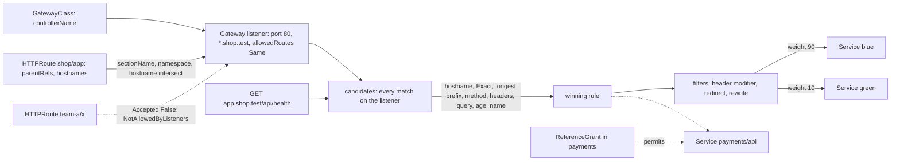

# Routing Is Listeners, Routes and Precedence: the Gateway API

*A Gateway listens, an HTTPRoute attaches and matches, the most specific match wins in a fixed order, and status names the step that failed.*

## Metadata

| Field | Value |
|---|---|
| Type | Build |
| Languages | Python |
| Prerequisites | [Services and DNS](https://cloudcaptain.io/learn/orchestration/services-dns) |
| Time | 90 minutes |
| Tools | kubectl, kind, helm, envoy-gateway, curl, ingress2gateway |

<Quiz stage="pre" />

## The Problem

The shop serves `shop.example.com` through one ingress-nginx controller, and that controller was retired in March 2026: no more releases, no more security fixes. Fourteen Ingress objects in five namespaces carry the real configuration in annotations: `use-regex`, `rewrite-target`, `canary-weight`, and a `configuration-snippet` nobody can explain. The migration ticket says "move to the Gateway API". Someone runs `ingress2gateway`, applies the HTTPRoutes it prints to a new Envoy Gateway, and moves DNS on Friday afternoon.

On Monday there are three tickets. The mobile app's old `/apiv2/orders` calls return 404. Under `use-regex` the Ingress path `/api` had been a regular expression that also matched `/apiv2`, and the translated `PathPrefix: /api` compares whole path segments. Checkout's `/pay` requests get 500s. Ingress could never point at a Service in another namespace, so the team had kept an ExternalName Service as a workaround; the new route references `payments/api` directly, and `kubectl get httproute` shows `ResolvedRefs: False` with reason `RefNotPermitted`. The third ticket is the strangest. The search team deleted and re-applied its route during the cutover, and since then every `/api/search` request is answered by the catalogue team's service, whose old route still had a leftover rule for the same prefix.

None of this is random. The Gateway API writes the order down: a listener decides which routes may attach, from which namespaces and for which hostnames; a route's matches select requests; when several matches select the same request a fixed precedence picks one, down to "the older route wins a full tie"; and the controller records in `status` exactly which step said no. You are going to build `minigateway`: a controller that attaches routes and writes their status conditions, a router that ranks matches the way the specification says, and a small reverse proxy that applies filters and weighted backends to real HTTP requests. Then Envoy Gateway runs the same objects on a kind cluster and produces the same status and the same routing.

## The Concept

Ingress was one object doing two jobs. It named the controller and the TLS certificate (infrastructure) and it listed hosts and paths (application routing), so a platform team and forty application teams edited the same kind of object. It could match a host and a path with `Exact` or `Prefix`, and everything else (rewrites, header matches, canary weights, redirects, timeouts) lived in annotations whose names and meaning belonged to one controller. It could not reference a Service in another namespace, and its status held an address and nothing else. The Ingress API is still served but frozen; new routing features go into the Gateway API.

The Gateway API splits the same job by role:

- **GatewayClass** (cluster-scoped, owned by whoever provides the infrastructure) names the controller: `controllerName: gateway.envoyproxy.io/gatewayclass-controller`. A controller only acts on Gateways whose class names it.
- **Gateway** (owned by the cluster operator) is a set of **listeners**. Each has a port, a protocol, an optional hostname (`*.shop.test` is allowed: a wildcard matches one or more labels in front of the suffix, never the apex `shop.test`) and `allowedRoutes`: which namespaces may attach (`Same` by default, `All`, or `Selector` on namespace labels) and which route kinds.
- **HTTPRoute** (owned by an application team) names its parents in `parentRefs` (a Gateway, optionally one listener by `sectionName` or `port`), lists `hostnames`, and has rules. A rule has matches (path `Exact` or `PathPrefix`, headers, query parameters, method; every condition in one match must hold, and any one match in the list is enough), filters, and weighted `backendRefs`.
- **ReferenceGrant** (owned by the namespace being referenced) is consent: it lives in the backend's namespace and says "HTTPRoutes from namespace `shop` may reference Services here".

Attachment is three gates, and each has its own `Accepted: False` reason. The parentRef must select a listener: otherwise `NoMatchingParent`. The listener must allow the route's namespace and kind: otherwise `NotAllowedByListeners`. The listener's hostname and the route's hostnames must intersect: otherwise `NoMatchingListenerHostname`. A route that passes gets `Accepted: True` on that parent. Separately, `ResolvedRefs` says whether every backend can be used: a supported kind (`InvalidKind`), a ReferenceGrant for anything in another namespace (`RefNotPermitted`), and a Service that exists (`BackendNotFound`). A route can be accepted with broken references; the share of traffic that would go to an invalid backend gets a 500.

Once attached, every match of every rule of every route on that listener is a candidate, and the specification fixes the order between candidates that match the same request: the most specific hostname (most characters in a matching exact hostname, then in any matching hostname), then an `Exact` path, then the longest `PathPrefix`, then a method match, then the most header matches, then the most query parameter matches. Only if all of that ties does the age of the route decide (oldest `creationTimestamp` first), then `namespace/name` alphabetically, then rule order inside one route. No candidate means 404. The winner's filters run (modify headers, redirect, rewrite), and a backend is chosen by weight.



Status is the controller's report, and reading it is most of debugging. One case has no condition at all: if a `parentRef` names a Gateway that no controller owns (a typo, the wrong namespace, a class nobody implements), no controller writes anything, and `status.parents` stays empty. That silence is the diagnosis.

## Build It

`code/main.py` is `minigateway`. The control plane is pure: `build_world()` turns JSON objects into dataclasses, `attach()` decides attachments and writes conditions, `decide()` ranks candidates and applies filters. The data plane is two small `http.server` servers: `GatewayServer`, which forwards with `urllib`, and `EchoServer`, a backend that answers with its name and the request it saw. The input is what `kubectl get ... -o json` prints, so the same files work for hand-written examples and live clusters; `code/fixtures/routes.json` is the example used below, and `kubectl apply -f` accepts it unchanged.

### Step 1: load objects the way the API server stores them

`flatten()` accepts a `List`, a JSON array or single objects, so `kubectl get gateways,httproutes,services -o json` loads as is. Then the parser applies the defaults the CRDs apply (a rule without matches gets `PathPrefix /`, a backend gets `weight: 1` and kind `Service`, a parentRef gets the Gateway group and kind) and refuses what the CRDs' validation rules refuse, with the path to the field:

```python
if "RequestRedirect" in kinds and "URLRewrite" in kinds:
    raise InputError(f"{where}: may specify either RequestRedirect or URLRewrite, but not both")
if "RequestRedirect" in kinds and backends:
    raise InputError(f"{where}: RequestRedirect filter must not be used together with backendRefs")
```

A path value must start with `/`, a Service `backendRef` needs a `port`, and `ReplacePrefixMatch` needs exactly one `PathPrefix` match to know which prefix to replace. Header names are folded to lower case because HTTP header names are case-insensitive; query parameter names are not.

### Step 2: hostnames intersect, they do not just match

A route is not checked against the listener's hostname; the two hostnames are intersected, and the result is what requests are matched against:

```python
def hostname_matches(pattern: str, host: str) -> bool:
    if pattern.startswith("*."):
        return host.endswith(pattern[1:]) and len(host) > len(pattern) - 1
    return pattern == host


def intersect(listener: Optional[str], route: str) -> Optional[str]:
    if listener is None or listener == route:
        return route
    route_wild, listener_wild = route.startswith("*."), listener.startswith("*.")
    if listener_wild and not route_wild:
        return route if hostname_matches(listener, route) else None
    if route_wild and not listener_wild:
        return listener if hostname_matches(route, listener) else None
    if route_wild and listener_wild:
        if route.endswith(listener[1:]):
            return route
        if listener.endswith(route[1:]):
            return listener
    return None
```

A listener `*.shop.test` and a route `app.shop.test` give `app.shop.test`; a listener `app.shop.test` and a route `*.shop.test` also give `app.shop.test`, the narrower of the two; a route `shop.test` on a `*.shop.test` listener gives nothing. Route hostnames that do not intersect are dropped silently; if none is left, the route is not accepted on that listener.

### Step 3: attachment writes the Accepted condition

`accept()` is the three gates from The Concept, in order, each with its reason:

```python
named = [l for l in gateway.listeners if parent.section in (None, l.name) and parent.port in (None, l.port)]
if not named:
    return accepted(False, "NoMatchingParent", f"no listener on {gateway.key} has sectionName {parent.section!r} and port {parent.port}"), []
allowed = [l for l in named if namespace_allowed(l, gateway, route, world) and "HTTPRoute" in l.allowed_kinds]
if not allowed:
    return accepted(False, "NotAllowedByListeners", f"listener(s) {', '.join(l.name for l in named)} on {gateway.key} do not allow HTTPRoutes from namespace {route.namespace}"), []
landed: List[Attachment] = []
for listener in allowed:
    hostnames = effective_hostnames(listener, route)
    if hostnames is not None:
        landed.append(Attachment(route, gateway, listener, hostnames))
```

`namespace_allowed()` handles `Same`, `All` and `Selector`; for `Selector` it reads the labels of the route's Namespace, and every namespace carries `kubernetes.io/metadata.name` automatically, which is how a listener can name one namespace without anyone adding a label. A `parentRef` to a Gateway that is not in the input produces no status entry, only a warning, because that is what a real cluster shows.

### Step 4: references write the ResolvedRefs condition

```python
def ref_problem(route: Route, ref: BackendRef, world: World) -> Optional[Tuple[str, str]]:
    if ref.kind != "Service" or ref.group != "":
        return "InvalidKind", f"backendRef {ref.group or 'core'}/{ref.kind} {ref.name}: only core Services are supported"
    if ref.namespace != route.namespace and not reference_granted(world.grants, route, ref):
        return "RefNotPermitted", f"backendRef {ref.key} is in another namespace and no ReferenceGrant in {ref.namespace} allows HTTPRoutes from {route.namespace}"
    if ref.key not in world.services:
        return "BackendNotFound", f"service {ref.key} not found"
    return None
```

`reference_granted()` looks only at grants in the backend's namespace, requires a `from` entry for HTTPRoutes in the route's namespace, and a `to` entry for Services that either has no name (all Services) or names this one. The same function is used again when a request picks a backend, so status and data plane can never disagree about which references are valid.

### Step 5: matching is segment-wise and AND-ed

```python
def path_matches(kind: str, value: str, path: str) -> bool:
    if kind == "Exact":
        return path == value
    if kind == "PathPrefix":
        prefix = value.rstrip("/")
        return not prefix or path == prefix or path.startswith(prefix + "/")
    return re.fullmatch(value, path) is not None
```

`/api` matches `/api`, `/api/` and `/api/v1`, never `/apis`, and a trailing slash in the prefix changes nothing. `request_matches()` then requires the method, every header and every query parameter of the match; a rule with several matches is tried once per match, which is how "or" is expressed.

### Step 6: precedence is a sort key

Every candidate that matches the request is sorted by one tuple. Smaller sorts first, so "more is better" criteria are negated:

```python
def precedence_key(candidate: Candidate, host: Optional[str]) -> tuple:
    match = candidate.match
    route = candidate.attachment.route
    exact_chars, any_chars = hostname_rank(candidate.attachment.hostnames, host)
    path_rank = {"Exact": 2, "PathPrefix": 1}.get(match.path_type, 0)
    path_chars = len(match.path.rstrip("/")) if match.path_type == "PathPrefix" else len(match.path)
    return (
        -exact_chars,
        -any_chars,
        -path_rank,
        -path_chars,
        0 if match.method else 1,
        -len(match.headers),
        -len(match.query),
        route.created,
        route.key,
        candidate.rule.index,
        candidate.match_index,
    )
```

The tuple is the specification's list read top to bottom. `why_first()` compares the winner's key with the runner-up's and names the first position where they differ, so every decision comes with its reason: `exact path`, `more header matches`, `older route`. The search team's ticket from The Problem is position 8: identical keys up to `route.created`, and re-creating the route made it the younger one. `RegularExpression` paths rank below prefixes here; the specification leaves their precedence to the implementation, and minigateway's choice is just that, a choice.

### Step 7: filters and weights

`RequestHeaderModifier` sets, adds (appending with a comma) and removes headers on the way to the backend. `URLRewrite` and `RequestRedirect` share one path function, and `ReplacePrefixMatch` replaces exactly the matched prefix, which the tests check against the table in the specification:

```python
def replace_prefix(path: str, prefix: str, replacement: str) -> str:
    rest = path[len(prefix.rstrip("/")):]
    return (replacement.rstrip("/") + rest) or "/"
```

A redirect builds a `Location` from the request unless the filter overrides a part, and the port follows the specification: the well-known port of an explicit scheme, otherwise the listener's port, and never written out when it is 80 for `http` or 443 for `https`:

```python
port = spec.get("port")
if port is None:
    port = WELL_KNOWN_PORTS.get(scheme, listener.port) if spec.get("scheme") else listener.port
authority = hostname if WELL_KNOWN_PORTS.get(scheme) == port else f"{hostname}:{port}"
```

Weights are integers; a backend's share is its weight over the sum, and weight 0 receives nothing:

```python
def pick_backend(backends: Sequence[BackendRef], rng: random.Random) -> Optional[BackendRef]:
    total = sum(b.weight for b in backends)
    if total <= 0:
        return None
    point = rng.randrange(total)
    for backend in backends:
        if point < backend.weight:
            return backend
        point -= backend.weight
    return None
```

The pick happens first and validity is checked second, which is what makes "10% of requests get a 500 when the 10% backend is gone" fall out of the code instead of being a special case. A rule with no usable weight at all answers 500 for everything.

### Step 8: the data plane

`GatewayHandler` turns each HTTP request into a `Request`, asks the router, and either answers itself (404, 500, a redirect) or forwards with `urllib`. Two details matter. The opener is built with a redirect handler that refuses to follow, so a backend's own 302 reaches the client instead of being chased by the gateway. And a Service with no address configured answers 503 (no ready endpoints) rather than 500 (invalid reference), the distinction the specification recommends. Each response carries `x-minigateway-route: shop/app rule 0` so you can see which rule served it. `serve` takes one `--backend NAMESPACE/NAME=URL` per Service, standing in for EndpointSlices, and binds each listener port plus 8000 unless `--bind 80=0` asks for a free port.

### Step 9: run it

```bash
python3 code/main.py status code/fixtures/routes.json
python3 code/main.py table code/fixtures/routes.json
python3 code/main.py route code/fixtures/routes.json --host app.shop.test --path /api/health -H 'x-version: v2'
```

```text
GET app.shop.test/api/health on shop/web port 80
candidates in precedence order:
  1. shop/app rule 0 match 0: Exact /api/health
  2. shop/app rule 2 match 0: PathPrefix /api, headers x-version=v2
  3. shop/app rule 1 match 0: PathPrefix /api
winner: shop/app rule 0 (beats the next candidate on exact path)
filters: RequestHeaderModifier
forward: shop/green:8080 weight 1 (100.0%)
```

`status` prints `app` accepted and resolved, `broken` accepted with `ResolvedRefs=False (BackendNotFound)`, and `elsewhere` with `Accepted=False (NoMatchingListenerHostname)`. Now real requests:

```bash
python3 code/main.py backend --name blue --port 9001 &
python3 code/main.py backend --name green --port 9002 &
python3 code/main.py serve code/fixtures/routes.json --backend shop/blue=http://127.0.0.1:9001 --backend shop/green=http://127.0.0.1:9002 --verbose &
curl -s -H 'Host: app.shop.test' 127.0.0.1:8080/api/health                    # green, and the backend saw x-route: exact
curl -s -H 'Host: app.shop.test' -H 'x-version: v2' 127.0.0.1:8080/api/users   # green: the header match beats the plain prefix
curl -s -H 'Host: app.shop.test' 127.0.0.1:8080/v1/users                       # blue, with "path": "/api/users" after the rewrite
curl -si -H 'Host: app.shop.test' 127.0.0.1:8080/old | head -3                  # 301 and Location: http://app.shop.test/api/v1
curl -s -o /dev/null -w '%{http_code}\n' -H 'Host: app.shop.test' 127.0.0.1:8080/apis     # 404
curl -s -o /dev/null -w '%{http_code}\n' -H 'Host: app.shop.test' 127.0.0.1:8080/broken   # 500
for i in $(seq 200); do curl -s -H 'Host: app.shop.test' 127.0.0.1:8080/canary; done | grep -o '"backend": "[a-z]*"' | sort | uniq -c
kill %1 %2 %3
```

The last loop prints roughly 180 blue and 20 green.

<RunTests />

## Use It

The real controller does the same job on a cluster. Install the Gateway API CRDs from the standard channel (current release <ToolVersion name="gateway-api" />; this lesson pins v1.7.0) and Envoy Gateway (current release <ToolVersion name="envoy-gateway" />; pinned v1.9.3):

```bash
kind create cluster --name cc-lab
kubectl apply --server-side -f https://github.com/kubernetes-sigs/gateway-api/releases/download/v1.7.0/standard-install.yaml
kubectl get crd -o name | grep gateway.networking.k8s.io       # gatewayclasses, gateways, httproutes, grpcroutes, referencegrants, ...
helm pull oci://docker.io/envoyproxy/gateway-helm --version v1.9.3 --untar
kubectl apply --server-side -f gateway-helm/crds/generated/     # Envoy Gateway's own CRDs (EnvoyProxy and its policy types)
helm install eg ./gateway-helm -n envoy-gateway-system --create-namespace --skip-crds
kubectl wait --timeout=5m -n envoy-gateway-system deployment/envoy-gateway --for=condition=Available
```

The chart bundles its own copy of the Gateway API CRDs, and on a scratch cluster `helm install eg oci://docker.io/envoyproxy/gateway-helm --version v1.9.3 -n envoy-gateway-system --create-namespace` alone is enough. Installing the standard channel yourself and skipping the bundled copy keeps the CRD version, which every Gateway API implementation in the cluster shares, a decision you made rather than a side effect of one chart. Server-side apply is what the project's install instructions use: these CRDs are large enough that the `last-applied-configuration` annotation client-side apply writes can exceed its size limit.

Now the same objects minigateway read. The GatewayClass binds the name `eg` to Envoy Gateway's controller; the backends are this lesson's echo server in `python:3.12-alpine`, mounted from a ConfigMap:

```bash
kubectl apply -f - <<'EOF'
apiVersion: gateway.networking.k8s.io/v1
kind: GatewayClass
metadata:
  name: eg
spec:
  controllerName: gateway.envoyproxy.io/gatewayclass-controller
EOF
kubectl create namespace shop
kubectl create configmap minigateway -n shop --from-file=main.py=code/main.py
kubectl apply -f code/fixtures/backends.json        # Deployments blue and green running "main.py backend"
kubectl apply -f code/fixtures/routes.json          # Gateway web, Services blue and green, HTTPRoutes app, broken, elsewhere
kubectl wait --for=condition=Available deployment --all -n shop --timeout=180s
```

Written as YAML, the first rules of `app` read like this:

```yaml
apiVersion: gateway.networking.k8s.io/v1
kind: HTTPRoute
metadata:
  name: app
  namespace: shop
spec:
  parentRefs:
    - name: web
  hostnames: ["app.shop.test"]
  rules:
    - matches:
        - path: {type: Exact, value: /api/health}
      filters:
        - type: RequestHeaderModifier
          requestHeaderModifier:
            set: [{name: x-route, value: exact}]
      backendRefs: [{name: green, port: 8080}]
    - matches:
        - path: {type: PathPrefix, value: /api}
      backendRefs: [{name: blue, port: 8080}]
    - matches:
        - path: {type: PathPrefix, value: /canary}
      backendRefs:
        - {name: blue, port: 8080, weight: 90}
        - {name: green, port: 8080, weight: 10}
```

Read what the controller wrote, and compare it with what minigateway computes from the same live objects:

```bash
kubectl get gatewayclass eg                                       # ACCEPTED True
kubectl get gateway -n shop web                                   # CLASS, ADDRESS, PROGRAMMED; with no load balancer on kind the address may stay empty
kubectl get httproute -n shop -o jsonpath='{range .items[*]}{.metadata.name}{": "}{range .status.parents[*].conditions[*]}{.type}={.status}/{.reason} {end}{"\n"}{end}'
kubectl get httproute -n shop elsewhere -o yaml                   # status.parents[0].conditions: Accepted False NoMatchingListenerHostname
kubectl get gateway -n shop web -o jsonpath='{.status.listeners[*].attachedRoutes}'
kubectl get gateways.gateway.networking.k8s.io,httproutes,referencegrants,services -n shop -o json > live.json
python3 code/main.py status live.json                             # the same reasons, computed from the same objects
```

Envoy Gateway runs the data plane as an Envoy Deployment and Service it creates for each Gateway, in its own namespace by default, labelled with the Gateway's name and namespace. On kind there is no load balancer, so port-forward to that Service and send the requests from Step 9:

```bash
ENVOY_SVC=$(kubectl get svc -n envoy-gateway-system -l gateway.envoyproxy.io/owning-gateway-namespace=shop,gateway.envoyproxy.io/owning-gateway-name=web -o jsonpath='{.items[0].metadata.name}')
kubectl -n envoy-gateway-system port-forward svc/$ENVOY_SVC 8888:80 &
curl -s -H 'Host: app.shop.test' -H 'x-version: v2' 127.0.0.1:8888/api/health    # green with x-route: exact; Exact beats the header rule
curl -s -H 'Host: app.shop.test' 127.0.0.1:8888/api/users                         # blue
curl -s -o /dev/null -w '%{http_code}\n' -H 'Host: app.shop.test' 127.0.0.1:8888/apis     # 404, segment-wise prefix
curl -s -o /dev/null -w '%{http_code}\n' -H 'Host: app.shop.test' 127.0.0.1:8888/broken   # 500, BackendNotFound
curl -s -o /dev/null -w '%{http_code}\n' -H 'Host: other.example' 127.0.0.1:8888/         # 404, route not accepted
for i in $(seq 200); do curl -s -H 'Host: app.shop.test' 127.0.0.1:8888/canary; done | grep -o '"backend": "[a-z]*"' | sort | uniq -c
```

A canary is a weight change, not a new object. Move to 50/50 and watch the split follow, then send everything to green:

```bash
kubectl patch httproute app -n shop --type=json -p='[{"op":"replace","path":"/spec/rules/4/backendRefs/0/weight","value":50},{"op":"replace","path":"/spec/rules/4/backendRefs/1/weight","value":50}]'
kubectl patch httproute app -n shop --type=json -p='[{"op":"replace","path":"/spec/rules/4/backendRefs/0/weight","value":0},{"op":"replace","path":"/spec/rules/4/backendRefs/1/weight","value":100}]'
```

Cross-namespace backends need consent from the namespace that owns them. Point a rule at `payments/api`, watch `ResolvedRefs` turn `False` with `RefNotPermitted`, then grant it from the `payments` side:

```yaml
apiVersion: gateway.networking.k8s.io/v1beta1
kind: ReferenceGrant
metadata:
  name: shop-routes-to-api
  namespace: payments
spec:
  from:
    - group: gateway.networking.k8s.io
      kind: HTTPRoute
      namespace: shop
  to:
    - group: ""
      kind: Service
      name: api
```

Finally the migration path. ingress-nginx is retired, and `ingress2gateway` reads Ingress objects (from the cluster or a file) and prints Gateway API objects. Host rules and `Prefix` or `Exact` paths translate one to one; TLS becomes an HTTPS listener with `certificateRefs`; a handful of annotations become filters or weights; regex paths with capture groups, snippets, auth and rate limits do not translate, and the output tells you what it dropped:

```bash
ingress2gateway print --providers=ingress-nginx -A                         # every Ingress in the current cluster
ingress2gateway print --providers=ingress-nginx --input-file ingress.yaml   # or from a file, no cluster needed
```

| What you built | Real tool | Note |
|---|---|---|
| `build_world()` defaults and validation errors | the Gateway API CRDs' defaults and CEL validation rules | `kubectl apply` refuses a redirect with backendRefs before any controller sees it |
| `accept()` with `NoMatchingParent`, `NotAllowedByListeners`, `NoMatchingListenerHostname` | Envoy Gateway writing `status.parents[].conditions` | the reasons are defined by the specification, so they are the same in every conformant implementation |
| `ref_problem()` and `reference_granted()` | `ResolvedRefs` with `RefNotPermitted`, `BackendNotFound`; `ReferenceGrant` | the grant lives in the target namespace |
| `precedence_key()` and `why_first()` | the route order Envoy Gateway programs into Envoy's route table | the specification's order; regex precedence is implementation-specific |
| `path_matches()` segment-wise | Envoy's path-separated prefix match | `/api` never matches `/apis` |
| `RequestHeaderModifier`, `URLRewrite`, `RequestRedirect` | the same filters, translated to Envoy route actions | core and extended support levels are listed per implementation |
| `pick_backend()` with weights, 500 for invalid shares | Envoy weighted clusters | a weight change is a canary step |
| `--backend NAMESPACE/NAME=URL` | EndpointSlices of the Service | 503 when there are no ready endpoints |
| `serve` on listener port + 8000 | the Envoy Deployment and Service per Gateway | `kubectl port-forward` stands in for a load balancer on kind |
| Ingress `pathType` plus annotations | Ingress API (frozen), ingress-nginx (retired March 2026) | `ingress2gateway` drafts the translation |

<Quiz stage="check" />

## Ship It

Two artifacts in `outputs/`:

- **`skill-ingress-to-gateway-migration.md`**: a runbook for moving off Ingress and the retired ingress-nginx controller: inventory hosts, paths and annotations into a test plan, classify every annotation as a standard field, an implementation policy or something to delete, install the Gateway API and an implementation next to the old controller, translate with `ingress2gateway` and review the draft, refuse to continue until every route is `Accepted` and `ResolvedRefs`, compare old and new responses request by request, shift DNS one hostname at a time, decommission, and report.
- **`prompt-explain-httproute-status.md`**: paste `kubectl get httproute -o yaml` with its Gateway and get where the route attached, a table of its conditions with what each reason means, the root cause, the request walked through the precedence order when routing is wrong but status is green, the smallest YAML fix on the right object with its owner, and the commands that prove the fix.

<ShipIt />

## Exercises

### Easy

Add `ResponseHeaderModifier`: the same `set`, `add` and `remove` as the request filter, applied to the backend's response headers before `GatewayHandler` sends them, and listed by `route`. Tests first: a unit test on the header dictionary and a proxy test where the echo backend's `Content-Type` is replaced and an `x-served-by` header is added.

### Medium

Write `minigateway from-ingress FILE`: read `networking.k8s.io/v1` Ingress objects as JSON and print a Gateway (one HTTP listener per distinct host, HTTPS listeners with `certificateRefs` for `spec.tls`) and one HTTPRoute per Ingress, mapping `Prefix` to `PathPrefix`, `Exact` to `Exact`, `defaultBackend` to a `PathPrefix /` rule, and `canary-weight` pairs to weights. Every annotation it cannot translate goes to stderr with the object name. Write the tests from three Ingress files, then compare your output with `ingress2gateway print --input-file` on the same files by parsing both, not by diffing text.

### Hard

Make minigateway a real controller for a second GatewayClass. Through `kubectl proxy` and `urllib` (the operator lesson's list-then-watch loop), watch GatewayClasses, Gateways, HTTPRoutes, ReferenceGrants, Services and EndpointSlices; act only on classes whose `controllerName` is `cloudcaptain.io/minigateway`; resolve backends to ready endpoint addresses from EndpointSlices instead of `--backend`; rebuild the routing table on every event; and write your conditions to `status.parents` through the status subresource with your own `controllerName` and `observedGeneration`. Run it next to Envoy Gateway with one HTTPRoute whose `parentRefs` name a Gateway of each class, and show with `kubectl get httproute -o yaml` that two controllers maintain two independent parent entries on the same object.

<Quiz stage="post" />

## Key Terms

| Term | Common misconception | Precise definition |
|---|---|---|
| GatewayClass | "A kind of load balancer." | A cluster-scoped object whose `controllerName` says which controller implements Gateways of this class; a controller ignores Gateways of classes it does not name. |
| Listener | "The Gateway's port." | One entry in a Gateway's `listeners`: port, protocol, optional hostname (a leftmost wildcard matches one or more labels, not the apex) and `allowedRoutes` for namespaces and route kinds. |
| Attachment | "A route applies once it names the Gateway." | A route attaches to a listener only if its parentRef selects the listener, the listener allows the route's namespace and kind, and their hostnames intersect; each failure has its own `Accepted: False` reason. |
| PathPrefix | "A string prefix." | A prefix compared segment by segment: `/api` matches `/api`, `/api/` and `/api/x`, not `/apis`; a trailing slash in the value is ignored. |
| Match precedence | "The first rule in the file wins." | The specification's order across every route on a listener: most specific hostname, Exact path, longest prefix, method, most header matches, most query matches, oldest route, `namespace/name`, then rule order. |
| backendRef weight | "A percentage." | An integer from 0 to 1,000,000; a backend's share is its weight over the rule's total, 0 means no traffic, and the share of an invalid backend gets 500 responses. |
| ReferenceGrant | "Created next to the route that needs it." | An object in the referenced namespace that allows named kinds from another namespace (for example HTTPRoutes from `shop`) to reference its objects (for example Services, optionally by name). |
| Route status | "Green means traffic flows." | Per parent, `Accepted` (attachment) and `ResolvedRefs` (backends) with reasons and `observedGeneration`; a route can be Accepted with broken references, and a parentRef no controller owns gets no status at all. |
| Ingress | "Deprecated." | A GA API that is frozen: still served, no new features. Routing beyond host and path lived in controller-specific annotations; ingress-nginx, the most common controller, was retired in March 2026. |

## Further Reading

- [Kubernetes Networking & Services](https://cloudcaptain.io/docs/tools/kubernetes/networking-services): Services, Ingress, the ingress-nginx retirement note and where the Gateway API fits in the networking stack.
- [Kubernetes Fundamentals](https://cloudcaptain.io/docs/tools/kubernetes/fundamentals): the objects and controllers vocabulary, plus a Gateway API install snippet.
- [Nginx Fundamentals](https://cloudcaptain.io/docs/tools/nginx/fundamentals): reverse proxying and location matching, the mental model most Ingress controllers grew out of.
- [Gateway API: HTTPRoute](https://gateway-api.sigs.k8s.io/reference/api-types/httproute/): matches, filters, backendRefs and the precedence rules in the specification's own words.
- [Gateway API reference](https://gateway-api.sigs.k8s.io/reference/api-spec/): every field, its defaults and validation, and the condition reasons your `status` command writes.
- [ReferenceGrant](https://gateway-api.sigs.k8s.io/reference/api-types/referencegrant/): why consent sits in the target namespace and what `from` and `to` allow.
- [Envoy Gateway quickstart](https://gateway.envoyproxy.io/docs/tasks/quickstart/): the install, the GatewayClass and the port-forward used in Use It, from the project.
- [ingress2gateway](https://github.com/kubernetes-sigs/ingress2gateway): the migration tool, its providers and what each provider translates.
- [Kubernetes Ingress](https://kubernetes.io/docs/concepts/services-networking/ingress/): `pathType` semantics and the note that the API is frozen.
- [ingress-nginx](https://github.com/kubernetes/ingress-nginx): the retired controller's repository and its retirement notice.
