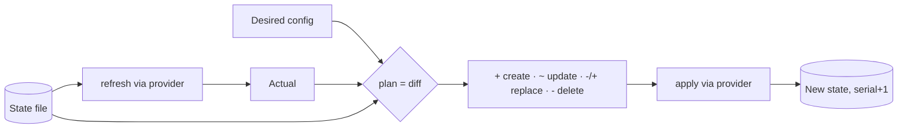

# Plan and Apply: A State File Is Just a Diff

*Infrastructure as code is three functions: read what exists, diff it against what you want, apply the difference, then write it down.*

## Metadata

| Field | Value |
|---|---|
| Type | Build |
| Languages | Python |
| Prerequisites | None |
| Time | 90 minutes |
| Tools | terraform, tofu |

<Quiz stage="pre" />

## The Problem

A `create-buckets.sh` script has been running in CI for two years. It was run twice on the same morning and there are now two staging buckets, and the application writes to whichever it finds first. Someone deleted a bucket by hand last week, and the script, which only ever creates, has no idea. Nobody can answer the question that matters before a deploy: *what exactly will this change?*

Every imperative script has these three holes. It does not know what already exists, it cannot show you the difference between now and the goal, and it leaves no record of what it owns. Terraform, OpenTofu, Pulumi and CloudFormation all close the same three holes with the same three mechanisms: **refresh**, **plan**, and **state**. The syntax differs. The engine underneath is small enough to write in an afternoon, and after you have, every confusing plan output you will ever read becomes legible.

## The Concept

The engine holds three pictures of the world and reconciles them:

- **Desired**: the configuration you wrote (what should exist).
- **State**: what the engine created last time, with the real-world id of each resource and the attributes it applied.
- **Actual**: what the provider reports right now, obtained by *refreshing* every resource in state.

A **plan** is the diff. For each desired resource: not in state means `create`; in state but gone from reality means `create` (drift); present with different mutable attributes means `update`; present with a different immutable attribute means `replace` (destroy, then create); unchanged means nothing. Anything in state that is no longer desired means `delete`. **Apply** executes the plan through the provider and writes the new state.



State is what makes the engine *own* things: without it, the engine cannot tell a bucket it created from one that happened to exist. That is also why state must be shared and locked when more than one person applies.

## Build It

`code/main.py` is `minitf`: a complete plan/apply engine whose provider manages files and directories on your disk instead of cloud resources. Everything else, the state format, the diff rules, the replace semantics, works exactly like the real thing.

### Step 1: a provider that can read, create, update and delete

The provider is the only part that touches the world. Two resource types are enough: `local_file` (attributes `path`, `content`) and `local_dir` (`path`). `read` returns the actual attributes or `None` if the resource is gone:

```python
class LocalProvider:
    def read(self, rtype, attrs):
        full = os.path.join(self.root, attrs["path"])
        if rtype == "local_file":
            if not os.path.isfile(full):
                return None
            with open(full, encoding="utf-8") as handle:
                return {"path": attrs["path"], "content": handle.read()}
        if rtype == "local_dir":
            return {"path": attrs["path"]} if os.path.isdir(full) else None
```

### Step 2: configuration and state

Desired state is JSON (HCL is a parser problem, not an engine problem):

```json
{
  "resources": [
    {"type": "local_dir", "name": "site", "path": "site"},
    {"type": "local_file", "name": "index", "path": "site/index.html", "content": "hello"}
  ]
}
```

State maps each address (`type.name`) to the provider id and the last-applied attributes, with a serial that increments on every write:

```json
{"serial": 1, "resources": {"local_file.index": {"type": "local_file", "id": "site/index.html", "attrs": {"path": "site/index.html", "content": "hello"}}}}
```

### Step 3: the diff

Refresh asks the provider about every resource in state, then `plan()` applies the rules from The Concept. The only subtlety is which attributes force replacement; the provider declares them:

```python
IMMUTABLE = {"local_file": {"path"}, "local_dir": {"path"}}

changed = sorted(k for k in set(current) | set(resource.attrs) if current.get(k) != resource.attrs.get(k))
if not changed:
    verb = "noop"
elif set(changed) & IMMUTABLE[resource.type]:
    verb = "replace"
else:
    verb = "update"
```

### Step 4: apply, then write state

Apply walks the actions, deletes before creates for replacements, runs deletes in reverse creation order (a directory after the files inside it, which is what Terraform's dependency graph gives you for free), and bumps the serial only if something changed:

```python
for action in actions:
    if action.verb in ("delete", "replace"):
        provider.delete(action.rtype, action.before)
        new_state["resources"].pop(action.address, None)
    if action.verb in ("create", "replace", "update"):
        rid = provider.create(action.rtype, action.after)
        new_state["resources"][action.address] = {"type": action.rtype, "id": rid, "attrs": action.after}
```

### Step 5: use it like the real thing

```bash
cd /tmp && mkdir -p minitf-demo && cd minitf-demo
cat > main.json <<'EOF'
{"resources": [
  {"type": "local_dir",  "name": "site",  "path": "site"},
  {"type": "local_file", "name": "index", "path": "site/index.html", "content": "hello"}
]}
EOF
MINITF=~/CloudCaptain/curriculum/phases/07-iac/01-state-reconciler/code/main.py
python3 $MINITF plan
python3 $MINITF apply
python3 $MINITF plan                 # No changes.
sed -i.bak 's/hello/hello v2/' main.json && python3 $MINITF plan      # ~ update
rm site/index.html && python3 $MINITF plan                          # + create (drift)
sed -i.bak 's#site/index.html#site/home.html#' main.json && python3 $MINITF plan   # -/+ replace
python3 $MINITF show
python3 $MINITF destroy
```

<RunTests />

## Use It

Terraform and OpenTofu ship a provider that does the same job as yours. Same resources, same four commands, same state shape:

```bash
mkdir -p /tmp/tf-demo && cd /tmp/tf-demo
cat > main.tf <<'EOF'
resource "local_file" "index" {
  filename = "${path.module}/site/index.html"
  content  = "hello"
}
EOF
terraform init          # or: tofu init
terraform plan
terraform apply -auto-approve
terraform plan          # No changes.
sed -i.bak 's/hello/hello v2/' main.tf && terraform plan     # ~ update in-place
rm site/index.html && terraform plan                        # + create (refresh noticed the drift)
sed -i.bak 's#site/index.html#site/home.html#' main.tf && terraform plan   # -/+ destroy and then create replacement
terraform state list
terraform show -json | python3 -m json.tool | head -40
cat terraform.tfstate | python3 -c 'import json,sys; s=json.load(sys.stdin); print(s["serial"], [r["type"]+"."+r["name"] for r in s["resources"]])'
```

Line them up:

| minitf | Terraform / OpenTofu | Same idea |
|---|---|---|
| `main.json` | `*.tf` (HCL) | desired state |
| `state.json` with `serial` | `terraform.tfstate` with `serial` | ownership + last-applied attributes |
| `refresh()` | the refresh phase of `plan` (`-refresh=false` to skip) | read reality |
| `+ ~ -/+ -` | `+ ~ -/+ -` | the plan symbols |
| `IMMUTABLE` | `# forces replacement` in plan output | which attributes destroy |
| `--root` | provider configuration | where the provider acts |

What the real engines add that you did not build: a dependency graph so resources apply in the right order and in parallel, a remote backend with **locking** so two applies cannot race, `moved` blocks so a rename is not a destroy, `prevent_destroy` lifecycle rules, data sources, modules, and hundreds of providers. Every one of them is a layer over the loop you just wrote. The licence differs too: Terraform is BUSL 1.1 since 2023; OpenTofu is the MPL-licensed fork with the same commands.

<Quiz stage="check" />

## Ship It

Two artifacts in `outputs/`:

- **`prompt-review-terraform-plan.md`**: paste any plan and get a verdict, a table of destroys and replacements with the forcing attribute, drift and blast-radius notes, and up to five questions for the author.
- **`skill-plan-review.md`**: a skill for coding agents that gates plans in CI: machine-readable plan via `terraform show -json`, classification of every action, a block list of stateful resource types, the three classic traps (rename-that-destroys, known-after-apply on security attributes, plan touching more than the PR says), and the rule that the reviewed plan file is the one that gets applied.

<ShipIt />

## Exercises

### Easy

Add `--target ADDRESS` to `plan` and `apply` so only one resource is considered, the way `terraform -target` works. Make the plan print a warning that targeted applies leave state partially reconciled.

### Medium

Implement a `moved` list in `main.json` (`{"from": "local_file.index", "to": "local_file.home"}`) so renaming a resource in config produces a state rename instead of a destroy and create. Tests first: after the move, plan must be a no-op.

### Hard

Add a dependency graph. Let a resource declare `"depends_on": ["local_dir.site"]`, build the graph, apply creates in topological order and deletes in reverse, and detect cycles. Then add a lock file (`state.lock` containing pid and timestamp) acquired at the start of `apply` and released at the end, and show two concurrent applies failing cleanly instead of corrupting state.

<Quiz stage="post" />

## Key Terms

| Term | Common misconception | Precise definition |
|---|---|---|
| State | "State is a cache you can delete." | The authoritative record of which real resources a configuration owns, their provider ids and last-applied attributes. Deleting it orphans every resource. |
| Refresh | "Plan compares config to state." | Plan compares config to *refreshed* state: the engine first asks the provider what actually exists. Drift shows up here. |
| Plan | "Plan is a preview that can be approximated." | A deterministic diff of desired against actual, serialisable to a file; applying that file guarantees you run what you reviewed. |
| Replace (`-/+`) | "Replace is an update that takes longer." | Destroy followed by create, triggered by a change to an attribute the provider cannot modify in place. For stateful resources this is data loss. |
| Drift | "Drift is a Terraform bug." | Any difference between the last-applied state and reality, usually caused by manual changes; refresh detects it, apply repairs it. |
| Idempotency | "Idempotent means it only runs once." | Running the same operation again produces the same result and no further changes; a correct plan on an unchanged system is empty. |
| State lock | "Locks are for big teams." | A mutual-exclusion guard on the state file so two applies cannot both read the old serial and overwrite each other's writes. |

## Further Reading

- [Terraform Fundamentals](https://cloudcaptain.io/docs/tools/terraform/fundamentals): providers, resources, variables and the workflow, now with the engine in your head.
- [Terraform Advanced](https://cloudcaptain.io/docs/tools/terraform/advanced): remote state, locking, workspaces and modules, the layers on top of the loop.
- [Terraform Cheat Sheet](https://cloudcaptain.io/docs/tools/terraform/cheatsheet): `state list/mv/rm`, `import`, `-target`, `-refresh-only` and the rest of the CLI.
- [OpenTofu documentation](https://opentofu.org/docs/): the same commands under an open-source licence, including state encryption.
- [Terraform state internals (HashiCorp docs)](https://developer.hashicorp.com/terraform/language/state): the official description of the file format you reimplemented.
