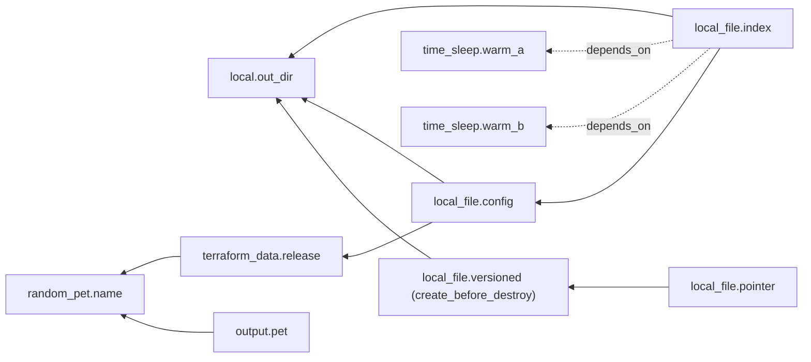

# Apply Order Is a Graph Walk

*Every reference is an edge; apply walks the graph in parallel, destroy walks it backwards, and a cycle means no order exists.*

## Metadata

| Field | Value |
|---|---|
| Type | Build |
| Languages | Python |
| Prerequisites | [Plan and Apply](https://cloudcaptain.io/learn/iac/state-reconciler) |
| Time | 90 minutes |
| Tools | tofu, terraform, graphviz |

<Quiz stage="pre" />

## The Problem

The platform team's OpenTofu stack builds an IAM role, attaches a policy that can read the release bucket, creates an instance profile and boots an instance whose first-boot script copies the build from that bucket. In review the plan looked perfect. On the first apply the instance came up, the boot script got `AccessDenied`, and the service never started. A second apply changed nothing and the next instance booted fine. The instance referenced the instance profile, the profile referenced the role, and nothing referenced the policy attachment, so OpenTofu started the instance in parallel with the attachment and the instance won the race.

The same week, someone fixed a rate-limit error from the cloud API with `-parallelism=1`, and a forty-resource apply went from three minutes to twenty-five. A refactor made two security groups reference each other's IDs in their ingress rules and the plan stopped with `Error: Cycle: aws_security_group.a, aws_security_group.b`. And a TLS certificate replacement destroyed the old certificate before the new one existed, so the load balancer listener pointed at nothing for ninety seconds. Four tickets, one question nobody on the team could answer quickly: *in what order will this run, and what decides it?*

The answer is a graph. Every `${...}` reference in a resource is an edge to the thing it names; `depends_on` adds the edges a reference cannot express; the engine sorts the graph, refuses to run if it has a cycle, walks it with a pool of workers that starts each resource the moment its dependencies are done, walks it backwards for destroy, and splits every replacement into two nodes whose order `create_before_destroy` flips. You are going to write `minigraph`, an extension of the previous lesson's engine that reads OpenTofu's JSON configuration syntax, so the same `main.tf.json` runs in `minigraph` and in `tofu`, and you can line up their graphs, their plans and their apply logs.

## The Concept

Start with what you would do by hand. To build a house you list the jobs, and for each job, the jobs that must be finished first. Painting needs walls; walls need a foundation; the electrician needs walls but not paint. Nobody writes the order down: it falls out of the "needs" list. Two painters do not make the foundation dry faster, but they can paint while the electrician wires, because neither needs the other.

An infrastructure configuration is that list. A resource whose argument contains `${terraform_data.release.output}` needs `terraform_data.release`, because the value does not exist until that resource is created. The engine finds these references by parsing every expression, adds one edge per reference, adds an edge for every `depends_on` entry, and checks the result is a **directed acyclic graph**. If it is, a **topological order** exists: every node after everything it needs. If the graph has a **cycle** (A needs B needs A), no order exists and the only correct answer is an error that names the cycle.



That is the lesson's configuration, minus `time_sleep.warm_c` and `time_sleep.warm_d`, which need nothing and are needed by nothing. Arrows point from a node to what it needs, the same direction `tofu graph` draws them; the dotted ones are `depends_on`. Group the resources by how far they are from having no dependencies and you get **waves**: six resources need nothing, two need wave one, one needs wave two, `local_file.index` comes last. The longest chain, `random_pet.name` to `terraform_data.release` to `local_file.config` to `local_file.index`, is the **critical path**: with enough workers the apply takes as long as that chain, however many resources sit beside it.

A good walker does not run wave by wave. It keeps a count of unfinished dependencies per node, starts every node whose count is zero, and when a node finishes it decrements its dependents and starts any that reach zero. `-parallelism=N` is the size of the worker pool, nothing more: it caps how many nodes run at once and never changes which node waits for which.

Three more rules finish the picture. **Destroy** reverses every edge: you remove the instance before the subnet it sits in. **Replacement** of one resource is two nodes, destroy-old and create-new; by default the destroy runs first, and `create_before_destroy` flips them so the new object exists, every dependent moves to it, and only then is the old one (now called *deposed*) removed. That flip would create a cycle if a dependency of such a resource were still destroyed first, so the engine **propagates** `create_before_destroy` to everything the resource depends on. And during **plan**, a value that comes from a resource not yet created is **unknown**: it shows as `(known after apply)`, it flows along the same edges, and when it lands on an argument the provider cannot change in place, it forces a replacement, which is how one change cascades.

## Build It

`code/main.py` is `minigraph`. It loads `*.tf.json`, builds the graph, rejects cycles, plans with unknowns, builds a second graph of create and destroy steps from the plan, and walks it with a thread pool. Its provider implements four real resource types, `local_file`, `random_pet`, `terraform_data` and `time_sleep`, with the same argument names as `hashicorp/local`, `hashicorp/random`, the built-in `terraform` provider and `hashicorp/time`, so OpenTofu accepts the identical file. Everything is the standard library; the tests run on macOS without `tofu`.

### Step 1: read OpenTofu's JSON syntax

HCL and JSON are two spellings of one configuration language. In the JSON form a resource is `resource.TYPE.NAME`, expressions are strings with `${...}` interpolation, and the meta-arguments (`depends_on`, `lifecycle`) sit next to the provider's arguments:

```json
{
  "locals": {"out_dir": "${path.module}/out"},
  "resource": {
    "random_pet": {"name": {"length": 2}},
    "terraform_data": {"release": {"input": "${random_pet.name.id}"}},
    "local_file": {
      "config": {"filename": "${local.out_dir}/config.txt", "content": "release=${terraform_data.release.output}\n"},
      "index": {"filename": "${local.out_dir}/index.html", "content": "see ${local_file.config.filename}\n",
                "depends_on": ["time_sleep.warm_a", "time_sleep.warm_b"]}
    }
  }
}
```

The full file, `code/fixtures/demo/main.tf.json`, adds four one-second `time_sleep` resources, a `create_before_destroy` file that another file points at, and an output. Each resource type has a schema: its arguments with defaults, which are required, which force replacement, and which attributes only exist after apply:

```python
SCHEMAS: Dict[str, Schema] = {
    "local_file": Schema({"filename": None, "content": ""}, {"filename"}, {"filename", "content"}, {"id"}),
    "random_pet": Schema({"length": 2, "separator": "-", "prefix": None, "keepers": None}, set(), {"length", "separator", "prefix", "keepers"}, {"id"}),
    "terraform_data": Schema({"input": None, "triggers_replace": None}, set(), {"triggers_replace"}, {"id", "output"}, {"id"}),
    "time_sleep": Schema({"create_duration": None, "destroy_duration": None, "triggers": None}, set(), {"triggers"}, {"id"}, {"id"}),
}
```

`parse_resource()` separates meta-arguments from arguments and rejects what the schema does not know with OpenTofu's wording, `an argument named "mode" is not expected here`. `count`, `for_each` and `var.` are refused with a pointer to the next lesson.

### Step 2: every reference is an edge

A template is literal text and `${...}` parts. `$${` is an escaped dollar, not a reference:

```python
if text.startswith("$${", position):
    literal.append("${")
    position += 3
elif text.startswith("${", position):
    end = text.find("}", position + 2)
    expression = text[position + 2:end].strip()
    if not TRAVERSAL.match(expression):
        raise ConfigError(f"{where}: minigraph understands plain references inside ${{...}}, got ${{{expression}}}")
    parts.append(("ref", expression))
```

A reference names a node by its first two parts. `random_pet.name.id` points at `random_pet.name`; `local.out_dir` at the local value; `path.module` at nothing, because it is known before anything runs:

```python
address = f"{parts[0]}.{parts[1]}"
resource = config.resources.get(address)
if resource is None:
    raise ConfigError(f"{where}: reference to undeclared resource {address}")
if len(parts) > 2 and parts[2] not in SCHEMAS[resource.type].attributes:
    raise ConfigError(f'{where}: unsupported attribute "{parts[2]}" on {address}')
```

`config_graph()` collects the targets of every expression in a resource, adds the `depends_on` entries, and remembers which edges were explicit so the DOT output can draw them dashed:

```python
targets = targets_of(resource.body, config, address)
for dep in resource.depends_on:
    if dep not in config.resources:
        raise ConfigError(f"{address}.depends_on: {dep!r} is not a declared resource")
    targets.add(dep)
    explicit.add((address, dep))
```

Locals and outputs are nodes too. For ordering resources, `resource_graph()` looks through them: `local_file.config` needs `local.out_dir`, which needs nothing, so its resource dependencies are just `terraform_data.release`. That flattened set is also what gets written into state as `dependencies`.

### Step 3: find a cycle and print its path

Depth-first search with three colours. A node is *visiting* while its dependencies are being explored; reaching a visiting node again means you walked in a circle, and the stack holds the path:

```python
def visit(node: str) -> Optional[List[str]]:
    status[node] = "visiting"
    stack.append(node)
    for dep in sorted(deps.get(node, ())):
        if status.get(dep) == "visiting":
            return stack[stack.index(dep):] + [dep]
        if dep not in status:
            found = visit(dep)
            if found:
                return found
    stack.pop()
    status[node] = "done"
    return None
```

For `code/fixtures/cycle/main.tf.json` the answer is `Cycle: terraform_data.a -> terraform_data.c -> terraform_data.b -> terraform_data.a`, read as "a needs c needs b needs a". `terraform_data.d`, which needs `a` but is not part of the loop, is not named.

### Step 4: waves, the critical path and the picture

Kahn's algorithm, one wave at a time, alphabetical inside a wave so the output is stable:

```python
while remaining:
    ready = sorted(node for node, found in remaining.items() if not found)
    if not ready:
        raise CycleError(find_cycle(remaining) or sorted(remaining))
    result.append(ready)
    for node in ready:
        del remaining[node]
    for found in remaining.values():
        found.difference_update(ready)
```

`critical_path()` starts from the last wave and steps back one wave at a time through a dependency in the previous wave. `graph` prints DOT. Like the graphs OpenTofu prints, it is the **transitive reduction**: an edge is dropped when another path already implies it, so `local_file.index` points at `local_file.config` and not also at everything behind it:

```python
for node, direct in deps.items():
    implied: Set[str] = set()
    for dep in direct:
        implied |= reachable(deps, dep)
    reduced[node] = {dep for dep in direct if dep not in implied}
```

`--full` keeps every declared edge; `-draw-cycles` still prints a cyclic graph, with the cycle's edges in red, before exiting 1.

### Step 5: plan with unknown values

The plan evaluates resources in topological order, so every value a resource references has already been planned. A created resource's computed attributes are `UNKNOWN`, and any template that touches an unknown becomes unknown:

```python
resolved = self.resolve(text, where)
if not is_known(resolved):
    return UNKNOWN
pieces.append(stringify(resolved, where))
```

`plan_resource()` from the previous lesson gains one rule: an unknown argument counts as changed, because it might be. If that argument forces replacement, the resource is replaced:

```python
changed = sorted(key for key in args if not is_known(args[key]) or args[key] != current.get(key))
if not changed:
    return Change(address, resource.type, "noop", "", current, dict(current), cbd)
forced = [key for key in changed if key in schema.force_new]
if forced:
    return Change(address, resource.type, "replace", f"{', '.join(forced)} forces replacement", current, with_unknown_computed(schema, args), cbd, forced)
```

So on a fresh plan `local_file.config.content` is `(known after apply)` while `local_file.index.content` is a literal, although `index` depends on `config`: `index` only uses `config.filename`, an argument known at plan time. Unknowns follow values, not edges. Change `random_pet.name.length` later and you get the cascade: the pet is replaced, `terraform_data.release.input` becomes unknown (an in-place update, since `input` does not force replacement), its `output` becomes unknown, and `local_file.config` is replaced because `content` does.

### Step 6: the apply graph

Apply does not walk the configuration graph; it walks a graph of steps built from the plan. Every resource that stays gets a node named by its address, every delete or replacement gets a `(destroy)` node, and the edges follow the rules from The Concept:

```python
if change.verb != "delete":
    nodes[address] |= {dep for dep in resource_deps.get(address, ()) if dep in nodes}
if change.verb == "replace" and change.create_before_destroy:
    nodes[destroy_node(address)].add(address)
    nodes[destroy_node(address)] |= {dependent for dependent, found in resource_deps.items() if address in found and dependent in nodes}
elif change.verb == "replace":
    nodes[address].add(destroy_node(address))
```

and, for destroys, the edges recorded in state run backwards, so a resource removed from the configuration is still destroyed after the things that depended on it:

```python
for address, found in state_deps(state).items():
    if destroy_node(address) in nodes:
        for dep in found:
            if destroy_node(dep) in nodes:
                nodes[destroy_node(dep)].add(destroy_node(address))
```

`effective_cbd()` marks every dependency of a `create_before_destroy` resource the same way. One test builds the apply graph with that propagation switched off and asserts `find_cycle()` finds the loop it would cause.

### Step 7: a parallel walk

A `ThreadPoolExecutor` with `parallelism` workers. Ready nodes are submitted, the loop waits for whichever finishes first, and each finished node releases its dependents:

```python
while ready or running:
    for node in ready:
        running[pool.submit(run, node)] = node
    ready = []
    done, _ = wait(list(running), return_when=FIRST_COMPLETED)
    for future in sorted(done, key=lambda item: running[item]):
        node = running.pop(future)
        error = future.exception()
        if error is not None:
            result.failed[node] = str(error)
            continue
        result.completed.append(node)
        for child in sorted(dependents[node]):
            waiting[child].discard(node)
            if not waiting[child]:
                ready.append(child)
```

A failed node never releases its dependents, so they are reported as skipped, while unrelated branches finish: the same partial apply OpenTofu leaves behind, with the state written for what succeeded. `run()` counts nodes in flight, and the visit function prints OpenTofu's progress lines (`Creating...`, `Creation complete after 1s [id=...]`, `(deposed object 1a2b3c4d): Destroying...`), so one parser reads both tools' logs.

### Step 8: run it

```bash
LESSON=~/CloudCaptain/curriculum/phases/07-iac/02-dependency-graph
mkdir -p /tmp/minigraph-demo && cd /tmp/minigraph-demo
cp $LESSON/code/fixtures/demo/main.tf.json .
MG="python3 $LESSON/code/main.py"
$MG validate                          # Success! The configuration is valid.
$MG order                             # wave 1: six nodes ... critical path (4 steps): random_pet.name -> ... -> local_file.index
$MG graph | dot -Tsvg > graph.svg     # if graphviz is installed; dashed edges are depends_on
$MG plan                              # + content = (known after apply) on local_file.config, a literal on local_file.index
time $MG apply -parallelism=1         # one line pair at a time, about 4 s for the four 1 s sleeps
$MG destroy                           # local_file.index goes first, random_pet.name last
time $MG apply                        # default -parallelism=10: the sleeps overlap, about 1 s
sed -i.bak 's#/v1.txt#/v2.txt#' main.tf.json
$MG plan                              # +/- local_file.versioned, -/+ local_file.pointer
$MG graph -type=apply                 # "local_file.versioned (destroy)" -> "local_file.pointer"
$MG apply                             # versioned: Creating... pointer replaced ... versioned (deposed object ...): Destroying...
```

Then break it on purpose: `$MG -chdir=$LESSON/code/fixtures/cycle validate` prints the loop and exits 1. Or edit `terraform_data.release.input` to `${local_file.index.id}` and watch the cycle run through `local_file.config`.

<RunTests />

## Use It

OpenTofu (current release <ToolVersion name="opentofu" />) builds the same graph from the same file. Run it next to `minigraph` in a second directory so the two state files never meet:

```bash
mkdir -p /tmp/tofu-graph && cd /tmp/tofu-graph
cp $LESSON/code/fixtures/demo/main.tf.json .
tofu init                                             # installs hashicorp/local, hashicorp/random, hashicorp/time
tofu graph > graph.dot && dot -Tsvg graph.dot -o graph.svg
tofu graph -type=plan-destroy | dot -Tsvg > destroy.svg
tofu plan -out=plan.out                                # content = (known after apply) on local_file.config only
tofu show -json plan.out | python3 -c 'import json,sys; [print(r["address"], sorted(k for k,v in r["change"]["after_unknown"].items() if v)) for r in json.load(sys.stdin)["resource_changes"]]'
time tofu apply -auto-approve -parallelism=1           # strictly one "Creating..." at a time
tofu destroy -auto-approve                             # dependents first
time tofu apply -auto-approve                          # default -parallelism=10
sed -i.bak 's#/v1.txt#/v2.txt#' main.tf.json
tofu plan                                              # +/- create replacement and then destroy
tofu apply -auto-approve                               # local_file.versioned (deposed object ...): Destroying... comes last
```

Depending on the release and `-type`, `tofu graph` draws either the resources alone or the whole plumbing: provider nodes, `[root]` prefixes, `(expand)` and `(close)` suffixes, a `root` node. The edges between resources are the same either way, and `code/smoke.sh` compares exactly those: it parses both DOT files, strips the decoration, computes which resources reach which, and requires the reduced edge sets to be identical. `terraform graph` and `terraform apply -parallelism=N` behave the same way.

The cycle fixture (`mkdir -p /tmp/tofu-cycle && cp $LESSON/code/fixtures/cycle/main.tf.json /tmp/tofu-cycle/ && cd /tmp/tofu-cycle && tofu init && tofu plan`) fails in OpenTofu like this; the order of the names, and an `(expand)` suffix on them, vary between releases:

```text
│ Error: Cycle: terraform_data.b, terraform_data.c, terraform_data.a
```

The fix is never `depends_on`, which can only add edges. Break the loop: move the shared value into a local or variable both sides read, or split the resource that holds both ends. The classic case is two security groups whose inline rules reference each other; move the rules into separate `aws_vpc_security_group_ingress_rule` resources that reference both groups, and the groups themselves no longer depend on each other.

**Hidden dependencies** are the opposite failure: an order that matters at runtime but has no reference. The instance in The Problem needs the policy attachment to exist before its boot script runs, but nothing in the instance's arguments mentions the attachment:

```hcl
resource "aws_iam_role_policy_attachment" "read_releases" {
  role       = aws_iam_role.app.name
  policy_arn = aws_iam_policy.read_releases.arn
}

resource "aws_instance" "app" {
  ami                  = data.aws_ami.al2023.id
  instance_type        = "t3.micro"
  iam_instance_profile = aws_iam_instance_profile.app.name
  user_data            = file("${path.module}/boot.sh")
  depends_on           = [aws_iam_role_policy_attachment.read_releases]
}
```

`depends_on` adds the edge the graph could not infer. Two cautions. IAM is eventually consistent, so the edge makes the race rare, not impossible, and the boot script should retry. And `depends_on` is coarse: on a module or a data source it makes every read inside wait until apply whenever the dependency has changes, turning more values into `(known after apply)`. Prefer a real reference (pass `aws_iam_role_policy_attachment.read_releases.id` into something the instance uses) where one exists.

`lifecycle { create_before_destroy = true }` (HCL block syntax) is the fix for the certificate in The Problem: the new certificate is created, the listener moves to it, then the old one is deleted. It needs the provider to allow two objects at once, so resources with fixed unique names usually pair it with `name_prefix` or a random suffix. `-parallelism` is the worker pool and only that; lower it when an API rate-limits you, and expect the apply to take as long as the sum of everything that would have overlapped.

| What you built | Real tool | Note |
|---|---|---|
| `template_parts()`, `reference_target()` | HCL expression analysis | real expressions have functions, `for` and conditionals; the engine still only needs the traversals inside them |
| `config_graph()` + `depends_on` | the plan graph | also has provider, variable, module and data-source nodes |
| `find_cycle()` | `Error: Cycle: ...` | OpenTofu lists every resource in the loop; `tofu graph -draw-cycles` colours its edges |
| `waves()`, `critical_path()` | no direct command | `tofu graph` plus graphviz shows the shape; the apply log shows the timing |
| `transitive_reduction()`, `render_dot()` | `tofu graph`, `-type=plan-destroy` | the same reduction keeps pictures readable |
| `Evaluator` with `UNKNOWN` | `(known after apply)`, `after_unknown` in `tofu show -json` | unknown on a force-new argument plans a replacement in both |
| `apply_graph()` | the apply graph (`tofu graph -plan=plan.out`) | destroy nodes, deposed objects, CBD edges |
| `effective_cbd()` | `create_before_destroy` propagation | stored per resource in state, like `minigraph`'s `create_before_destroy` field |
| `walk(parallelism=N)` | `-parallelism=N` (default 10) | a semaphore on node execution; order comes from edges only |
| `dependencies` in state | `dependencies` in `terraform.tfstate` | how a resource removed from the configuration is still destroyed in order |

<Quiz stage="check" />

## Ship It

Two artifacts in `outputs/`:

- **`skill-iac-dependency-review.md`**: a review runbook for ordering problems in a Terraform or OpenTofu change: extract the graph and its waves, hunt hidden runtime dependencies with a table of the usual suspects (IAM attachments, routes and NAT, DNS, API enablement, CRDs before custom resources), audit every `depends_on`, read and break cycles, check replacements for destroy-first downtime and `create_before_destroy` name collisions, check destroy order, and report in a fixed shape.
- **`prompt-explain-tofu-graph.md`**: paste `tofu graph` output (and optionally a plan or an apply log) and get the graph explained: nodes by kind, waves and the critical path, explicit versus implicit edges, suspicious or missing edges, the destroy order, and for a cycle error, where the loop is and how to break it.

<ShipIt />

## Exercises

### Easy

Add `lifecycle.prevent_destroy`. A plan that would delete or replace a protected resource must fail before anything runs, naming the address and the attribute that forced the replacement, the way OpenTofu stops with `Instance cannot be destroyed`. Write the tests first: a protected `terraform_data` whose `input` changes plans an in-place update and passes; the same resource with a new `triggers_replace` fails the plan; `destroy` of a state that holds it fails too.

### Medium

Implement `-target=ADDRESS` for `plan` and `apply`. A target pulls in everything it depends on (for apply) or everything that depends on it (for destroy), and nothing else. Tests first: `-target=local_file.index` on an empty state plans exactly six resources (`index`, `config`, `release`, `name`, `warm_a`, `warm_b`) and prints a warning that the state is now only partly reconciled; `destroy -target=random_pet.name` destroys four.

### Hard

Make `create_before_destroy` survive a failure. When the new object is created and destroying the deposed one fails, OpenTofu keeps the old object in state as *deposed* and destroys it on the next apply. Store deposed objects in `minigraph`'s state with their key, show them in `plan` as `# local_file.versioned (deposed object 805acf2b) will be destroyed`, and add a destroy node for them in `apply_graph()`. Test with a provider whose `delete` fails once: the first apply exits 1 with the new file in place and the deposed entry in state, the second apply removes the old file and leaves state clean.

<Quiz stage="post" />

## Key Terms

| Term | Common misconception | Precise definition |
|---|---|---|
| Dependency graph | "Resources are applied in file order." | A directed graph with a node per resource, local, output and provider, and an edge from each node to every node it references or lists in `depends_on`. Apply order is derived from it; file order is irrelevant. |
| Implicit dependency | "You must declare every dependency." | An edge the engine infers from a reference such as `${aws_iam_role.app.arn}`. Most edges are implicit, and an implicit edge carries the value as well as the order. |
| `depends_on` | "It makes the configuration safer, so add it everywhere." | An explicit edge for an ordering the arguments do not express (a hidden dependency). It carries no value and, on modules and data sources, defers reads to apply time, so overuse makes plans less precise. |
| Cycle | "Add `depends_on` to choose the order." | A path that returns to its start, so no topological order exists. The only fix is to remove an edge: move a shared value into a local or variable, or split a resource. |
| `-parallelism` | "It changes the order of operations." | The number of graph nodes allowed to execute at once (default 10). Edges alone decide order; parallelism only decides how many ready nodes run together. |
| `(known after apply)` | "The plan is incomplete or broken." | An unknown value: it comes from an attribute that only exists after a resource is created or replaced. It propagates along references and, on a force-new argument, forces a replacement. |
| `create_before_destroy` | "It only reorders one resource." | Flips a replacement to create the new object first, update dependents, then destroy the old (deposed) object. It propagates to the resource's dependencies so the graph stays acyclic, and needs the provider to allow two objects at once. |
| Transitive reduction | "`tofu graph` shows every edge I wrote." | The smallest edge set with the same reachability. Graph output drops an edge when another path already implies it, so a direct reference can look missing from the picture. |

## Further Reading

- [Terraform Fundamentals](https://cloudcaptain.io/docs/tools/terraform/fundamentals): resources, references and meta-arguments, now with the graph behind them.
- [Terraform Advanced](https://cloudcaptain.io/docs/tools/terraform/advanced): lifecycle rules including `create_before_destroy`, and the larger configurations where ordering bites.
- [Terraform Cheat Sheet](https://cloudcaptain.io/docs/tools/terraform/cheatsheet): `graph`, `-parallelism`, `-target` and `-replace` on one page.
- [Terraform Interview Questions](https://cloudcaptain.io/docs/tools/terraform/interview-questions): implicit versus explicit dependencies and parallelism as interviewers ask about them.
- [AWS Security & IAM](https://cloudcaptain.io/docs/cloud/aws/security-iam): roles, instance profiles and policy attachments, the most common hidden dependency.
- [OpenTofu: tofu graph](https://opentofu.org/docs/cli/commands/graph/): the graph types and options the Use It section runs.
- [OpenTofu: the depends_on meta-argument](https://opentofu.org/docs/language/meta-arguments/depends_on/): when an explicit edge is needed and why it should be the exception.
- [OpenTofu: the lifecycle meta-argument](https://opentofu.org/docs/language/meta-arguments/lifecycle/): `create_before_destroy`, `prevent_destroy` and `replace_triggered_by`, the exercises' next steps.
- [OpenTofu: JSON configuration syntax](https://opentofu.org/docs/language/syntax/json/): the `.tf.json` rules `minigraph` reads, including `${}` templates and the `"//"` comment key.
- [Terraform internals: resource graph](https://developer.hashicorp.com/terraform/internals/graph): how the engine builds the graph, walks it and applies the reduction, the design OpenTofu inherited.
- [Kahn, Topological sorting of large networks (1962)](https://dl.acm.org/doi/10.1145/368996.369025): the algorithm in `waves()`.
