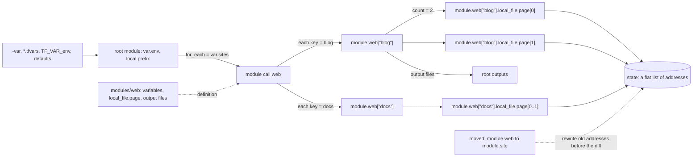

# A Module Is a Function With a Namespace

*A module call is a function call: typed variables in, outputs back, and every resource inside lives under the address of the call.*

## Metadata

| Field | Value |
|---|---|
| Type | Build |
| Languages | Python |
| Prerequisites | [Apply Order Is a Graph Walk](https://cloudcaptain.io/learn/iac/dependency-graph) |
| Time | 90 minutes |
| Tools | tofu, terraform |

<Quiz stage="pre" />

## The Problem

A platform team keeps six copies of the same sixty lines of OpenTofu in `envs/dev`, `envs/staging`, `envs/prod-eu` and three more folders. Someone finally extracts them into `modules/service`, opens a pull request, and the plan for production reads `Plan: 14 to add, 0 to change, 14 to destroy.` The database is in that list. Nothing about the database changed except its address: `aws_db_instance.main` became `module.service.aws_db_instance.main`, and to the engine a new address is a new object. The pull request is closed and the copies stay.

The same week a teammate removes `eu-west-2` from the middle of a region list that drives `count = length(var.regions)`, and every region after it is planned for replacement, because `count` addresses are positions and every later position now holds a different value. Then an `instance_size = "xlarge2"` typo passes plan and fails ten minutes into the apply, at the cloud API, because the variable had a type but no validation, so nothing checked the value until a provider sent it.

All three come from treating a module as a folder you paste. It is a function. Its variables are typed parameters with preconditions, its outputs are return values, its locals are local variables, and every resource inside gets the call's address as a prefix: a namespace. `count` and `for_each` call it several times, each call with its own key in that prefix. The engine you built in the last two lessons never sees modules at all; it sees a flat list of instance addresses, and a `moved` block is how you tell it that a new address belongs to an old object. You are going to write `minimod`, the front end that turns a tree of modules into that flat list, and use it to predict exactly what `tofu state list` and `tofu plan` will say.

## The Concept

Read a module the way you read a function:

- **Definition**: a directory of `.tf` or `.tf.json` files. Nothing runs until something calls it.
- **Parameters**: `variable` blocks. A `type` constraint converts the value (the string `"2"` becomes the number 2) or rejects it; `validation` blocks are preconditions that run before any resource is planned; `sensitive` is a mark that travels with the value into everything derived from it.
- **Body**: `locals`, resources and further module calls, evaluated in the module's own scope. A child cannot read its caller's locals, and the caller cannot read the child's resources except through outputs.
- **Return values**: `output` blocks, read by the caller as `module.NAME.OUTPUT`.
- **Call site**: a `module "web"` block. Its arguments are expressions evaluated in the *caller's* scope, which is where `each.key` and `count.index` come from.
- **Namespace**: the call's address. A resource `local_file.page` inside the call `module.web` keyed `"blog"` is the instance `module.web["blog"].local_file.page[0]`. That string is the identity the state file stores.

`count = 3` keys the instances 0, 1, 2; `for_each` keys them by name. Removing the middle element of a list shifts every later position, so with `count` the addresses stay and the content moves; with `for_each` exactly one key disappears. Both must be known during plan, because they decide how many addresses exist; a key that depends on an attribute the provider computes at apply time is an error, not a guess.



Evaluation is demand driven. An output needs a resource, the resource needs a variable, the variable needs the caller's expression, which needs a local. Each of those is its own vertex in the graph you walked in the previous lesson: OpenTofu does not treat a module as one node, it has a node per input variable, local and output, which is why one module can consume an output of a module that consumes one of its own outputs. Two kinds of value flow along the edges besides plain data. An attribute the provider fills in at apply time (an `id`) is **unknown** during plan and stays unknown through every expression that touches it; the plan prints it as `(known after apply)`. A value derived from a `sensitive` variable carries a **mark**; the plan hides it, and a root output that exposes it without saying `sensitive = true` is an error.

## Build It

`code/main.py` is `minimod`. It reads OpenTofu's JSON syntax (`*.tf.json`), so the fixture in `code/fixtures/site/` is a real configuration that `tofu` runs unchanged in Use It. It has no provider: `apply` only writes a state file in the same version-4 shape `tofu` writes, so `plan` can diff against its own state or against `terraform.tfstate`. Lesson 1's `minitf` is the part that touches disk; this lesson is the front end that decides what the addresses are.

### Step 1: load a module directory and its children

Every `*.tf.json` file in a directory is one module; the files are merged, and a second declaration of the same name is an error that names both files. A `module` block keeps its non-meta arguments as compiled expressions, the call's inputs:

```python
elif block_type == "module":
    for name, content in labeled(body):
        claim(definition, f"module.{name}", file, "Duplicate module call")
        spec = body_of(content, "module", file)
        if not isinstance(spec.get("source"), str):
            raise MiniModError("Missing required argument", f'{file}: module "{name}" needs a "source" string.')
        inputs = {key: compile_json(value) for key, value in spec.items() if key not in MODULE_META}
        definition.modules[name] = ModuleCall(name, spec["source"], file, inputs, optional_expression(spec, "count"), optional_expression(spec, "for_each"), spec.get("version"))
```

`load_module()` then follows each local `source` (`./` or `../`) recursively and checks the call against the child's interface before anything is evaluated: an argument the child does not declare is `Unsupported argument`, a variable without a default that the call does not set is `Missing required argument`. A registry or git source is refused with the hint that `tofu init` is what downloads those.

### Step 2: every JSON string is a template

In JSON syntax a string is a template: `"${var.env}-site"` interpolates, `"$${x}"` is a literal `${x}`. `split_template()` cuts a string into literal pieces and expressions, skipping braces inside nested strings such as `"${join(\", \", keys(var.sites))}"`. One rule changes the type of the result:

```python
def compile_template(text: str, unescape: bool = False) -> Any:
    parts = split_template(text, unescape)
    if len(parts) == 1:
        return ("lit", parts[0]) if isinstance(parts[0], str) else parts[0]
    return ("template", parts)
```

A string that is exactly one interpolation returns the value itself, not its text. That is how `"for_each": "${var.sites}"` hands a map to `for_each` instead of a string. Expressions are parsed by a small precedence-climbing `Parser`: references with `.attr`, `[index]` and the `[*]` splat, function calls, lists and objects, `!` and unary `-`, then `* / %`, `+ -`, comparisons, `== !=`, `&&`, `||` and `? :`. Eighteen functions (`length`, `contains`, `join`, `keys`, `toset`, `regex`, `can`, `format` and friends) cover what validation rules and module code use most.

### Step 3: types convert, validations reject

A type constraint is a conversion first. `convert()` turns `"3"` into 3 for a `number`, `[1, true]` into `["1", "true"]` for `list(string)`, drops extra attributes for an `object(...)`, and reports the path to the first bad element:

```python
if kind == "map":
    if not isinstance(value, dict):
        raise ConversionError(f"{type_name(typ)} required")
    return {key: convert_element(item, typ[1], f'element "{key}"') for key, item in value.items()}
```

Then every `validation` runs with the converted value in scope. A false condition stops the run with the author's message, the variable's address and its value, unless the variable is sensitive:

```python
message = evaluate(rule.error_message, scope)
shown = "(sensitive value)" if spec.sensitive else display(value)
raise MiniModError("Invalid value for variable", f"{to_string(message) if isinstance(message, str) else display(message)}\n\n{self.label('var.' + spec.name)} is {shown}\nThis was checked by the validation rule at {spec.file} (variable \"{spec.name}\", validation {index}).")
```

Root values come from `collect_root_inputs()` in OpenTofu's order, later wins: defaults, `TF_VAR_name`, `terraform.tfvars`, `terraform.tfvars.json`, `*.auto.tfvars(.json)` in lexical order, then `-var` and `-var-file` in the order you typed them. `minimod` reads a `.tfvars` line as `NAME = <JSON literal>`, which is a subset of HCL, so `prod.tfvars` works in both tools.

### Step 4: lazy evaluation is the graph walk

Nothing is evaluated in file order. Every variable, local, resource and output is computed on first use and cached per module instance. `Run.tracked()` keeps a stack of what is being computed, which turns a reference cycle into an error with its path, and a parallel stack of sensitivity marks:

```python
def tracked(self, label: str, compute: Callable[[], Any]) -> Tuple[Any, bool]:
    if label in self.stack:
        cycle = self.stack[self.stack.index(label):] + [label]
        raise MiniModError("Cycle", " -> ".join(cycle))
    self.stack.append(label)
    self.taint.append(False)
    try:
        value = resolve_modules(compute())
        return value, self.taint[-1]
    finally:
        self.stack.pop()
        self.taint.pop()
```

```python
def memo(self, key: Tuple, label: str, compute: Callable[[], Any]) -> Any:
    if key not in self.cache:
        self.cache[key] = self.run.tracked(self.label(label), compute)
    value, sensitive = self.cache[key]
    self.run.mark(sensitive)
    return value
```

Reading a sensitive variable marks the current frame; reading a cached value that was marked when it was computed marks the reader. That is enough for the real rule: `root_outputs()` refuses an output whose frame is marked unless the output says `"sensitive": true`. Resource attributes are tracked one by one, so `local_file.page.filename` stays readable even when `content` came from a secret. Attributes the configuration does not set (`id`) come back as `UNKNOWN`, and templates, operators and functions return `UNKNOWN` when any input is.

### Step 5: count and for_each turn one block into keyed instances

`expansion()` evaluates the meta-argument in the module's scope and returns one `(key, Scope)` per instance. `count` must be a known whole number; `for_each` must be a map or a set of strings, fully known, and not sensitive, because its keys become part of every address:

```python
if isinstance(value, dict):
    return [(key, Scope(self, each=(key, item))) for key, item in sorted(value.items())]
if isinstance(value, frozenset) and all(isinstance(item, str) for item in value):
    return [(item, Scope(self, each=(item, item))) for item in sorted(value)]
raise MiniModError("Invalid for_each argument", f'The given "for_each" argument value for {self.label(what)} is unsuitable: the "for_each" argument must be a map, or set of strings, and you have provided a value of type {type_label(value)}.')
```

The `Scope` carries `each` or `count`, so `each.key` outside a `for_each` block is an error rather than a silent empty string. A list is refused on purpose: wrap it in `toset()` and the positions disappear from the addresses.

### Step 6: a module call creates instances with a prefix

A module call goes through the same expansion. Each instance is a `ModuleInstance` with its own cache and a path one step longer than its caller's:

```python
def expand_module(self, call: ModuleCall) -> List[Tuple[Key, "ModuleInstance"]]:
    assert call.definition is not None
    children = []
    for key, scope in self.expansion(call.count, call.for_each, f"module.{call.name}"):
        child = ModuleInstance(self.run, call.definition, self.path + ((call.name, key),), call, scope)
        self.run.instances.append(child)
        children.append((key, child))
    return children
```

The child keeps the caller's `scope`. When the child first reads `var.name`, `raw_input()` evaluates the call's `name` expression in that scope, where `each.key` is `"blog"`, then converts and validates it inside the child, so a bad value is reported as `module.web["Blog"].var.name`. `path.module` is the module's directory relative to the root (`modules/web`), `path.root` is `.`. The address of every resource inside is `render_module_path(path)` plus `type.name[key]`; that string is what `minimod addresses` prints and what the state stores.

### Step 7: moved rewrites the old addresses before the diff

`plan` loads a version-4 state (`load_state()` reads both `minimod.tfstate` and `tofu`'s `terraform.tfstate`), collects every `moved` block from every module instance with that instance's prefix, orders them so chains work in any order, and rewrites the prior addresses before comparing them with the configuration:

```python
depth = len(source.modules)
if len(address.modules) < depth or address.modules[: depth - 1] != source.modules[:-1]:
    return None
name, key = address.modules[depth - 1]
source_name, source_key = source.modules[-1]
target_name, target_key = target.modules[-1]
whole = source_key is None and target_key is None
if name != source_name or (not whole and key != source_key):
    return None
step = (target_name, key if whole else target_key)
return Address(target.modules[:-1] + (step,) + address.modules[depth:], address.rtype, address.name, address.key)
```

`module.web` to `module.site` without keys moves every instance and keeps its key; `module.web` to `module.web["blog"]` moves the single unkeyed instance into one key, which is what you write when you add `for_each` to an existing call. `check_moves()` rejects a move whose source is still declared and a move that changes the resource type, since `moved` only renames. After the rewrite the diff is lesson 1's: an address in config but not in state is `+`, the reverse is `-`, and changed attributes are `~`, or `-/+` for `local_file` whose provider replaces on any change.

### Step 8: run it

```bash
cp -R code/fixtures/site /tmp/minimod-demo && cd /tmp/minimod-demo
MINIMOD=~/CloudCaptain/curriculum/phases/07-iac/03-modules-variables/code/main.py
python3 $MINIMOD addresses                         # dev defaults: index plus one page per site
python3 $MINIMOD addresses -var-file=prod.tfvars   # copies = 2: five addresses
python3 $MINIMOD plan -var env=qa                  # Error: Invalid value for variable
python3 $MINIMOD plan -var 'sites={"Blog": "x", "blog": "y"}'   # module.web["Blog"].var.name fails the child's rule
python3 $MINIMOD outputs -var-file=prod.tfvars     # token = <sensitive>
python3 $MINIMOD eval 'module.web["blog"].files' -var-file=prod.tfvars
python3 $MINIMOD eval 'local_file.index.id'        # (known after apply)
python3 $MINIMOD apply -var-file=prod.tfvars       # writes minimod.tfstate, serial 1
cp ~/CloudCaptain/curriculum/phases/07-iac/03-modules-variables/code/fixtures/renamed/main.tf.json main.tf.json
python3 $MINIMOD plan -var-file=prod.tfvars        # five "has moved to" lines, Plan: 0 to add, 0 to change, 0 to destroy.
python3 - <<'PY'
import json
config = json.load(open("main.tf.json"))
config.pop("moved")
json.dump(config, open("main.tf.json", "w"))
PY
python3 $MINIMOD plan -var-file=prod.tfvars        # the same rename without moved: 5 to add, 5 to destroy
```

<RunTests />

## Use It

The fixture is valid OpenTofu. Run the same directory through `tofu` (Terraform behaves the same for everything here; swap the binary name):

```bash
MINIMOD=~/CloudCaptain/curriculum/phases/07-iac/03-modules-variables/code/main.py
cp -R ~/CloudCaptain/curriculum/phases/07-iac/03-modules-variables/code/fixtures/site /tmp/tofu-mod && cd /tmp/tofu-mod
tofu init                                  # Initializing modules... - web in modules/web
cat .terraform/modules/modules.json        # Key "web", Source "./modules/web", Dir "modules/web": local modules are recorded, not copied
tofu plan -var env=qa                      # Error: Invalid value for variable ... The env variable must be dev or prod.
tofu plan -var-file=prod.tfvars            # Plan: 5 to add, 0 to change, 0 to destroy.
TF_VAR_env=prod tofu plan                  # env from the environment, copies from the default: 3 to add
tofu apply -auto-approve -var-file=prod.tfvars
tofu state list                            # the five addresses minimod printed
diff <(tofu state list | sort) <(python3 $MINIMOD addresses -var-file=prod.tfvars | sort) && echo same
tofu output                                # blog_files, index_file, token = <sensitive>
tofu output -json | python3 -m json.tool   # -json is for machines: the sensitive value is in clear
echo 'module.web["blog"].files' | tofu console -var-file=prod.tfvars
```

Now the refactor. Rename the module call and the root resource, with and without `moved`:

```bash
cp ~/CloudCaptain/curriculum/phases/07-iac/03-modules-variables/code/fixtures/renamed/main.tf.json main.tf.json
tofu plan -var-file=prod.tfvars            # "# module.web["blog"].local_file.page[0] has moved to module.site["blog"]..." and 0 to add, 0 to destroy
python3 $MINIMOD plan -var-file=prod.tfvars --state terraform.tfstate   # the same five moves, read from tofu's own state
tofu apply -auto-approve -var-file=prod.tfvars
tofu state list                            # module.site[...] and local_file.home
tofu state mv -dry-run 'module.site["docs"]' 'module.web["docs"]'      # the imperative way: edits state directly, no plan, no review
```

The JSON files map one to one onto HCL. The child module's variable, written the way you will usually see it:

```hcl
variable "name" {
  type = string
  validation {
    condition     = can(regex("^[a-z][a-z0-9-]*$", var.name)) && length(var.name) <= 24
    error_message = "The name must be lowercase letters, digits and dashes, at most 24 characters."
  }
}
```

Registry and git modules go through the same loader after `tofu init` has downloaded them into `.terraform/modules`:

```hcl
module "vpc" {
  source  = "terraform-aws-modules/vpc/aws"
  version = "~> 5.1"
}

module "web" {
  source = "git::https://github.com/example/infra-modules.git//web?ref=v1.4.0"
}
```

`~> 5.1` allows any 5.x from 5.1 up and never 6.0; a git source has no `version`, the `ref` is the pin. `tofu init -upgrade` picks newer versions inside the constraint. The dependency lock file `.terraform.lock.hcl` pins providers only, so a module without an exact constraint can change under you between two `init`s; pin modules you do not own exactly, and review their changelog like code.

| What you built | Real tool | Note |
|---|---|---|
| `load_module()` over `*.tf.json` | `tofu init`, then the config loader | init resolves sources into `.terraform/modules`; the loader reads `.tf` and `.tf.json` alike |
| `collect_root_inputs()` | `-var`, `-var-file`, `TF_VAR_name`, `*.auto.tfvars` | same precedence; real `-var` values for complex types are HCL, minimod's are JSON |
| `convert()` and `check_rule()` | `type` and `validation` | the error summary is `Invalid value for variable` in both |
| `Run.tracked()` and `memo()` | the graph walk, one vertex per variable, local and output | see it with `tofu graph` from the previous lesson |
| `expansion()` | `count`, `for_each` | positions versus keys; unknown keys are an error in both |
| `minimod addresses` | `tofu state list` | identical address syntax |
| `UNKNOWN` | `(known after apply)` | a computed attribute during plan |
| sensitivity marks | `sensitive = true`, `(sensitive value)`, `nonsensitive()` | marks hide values in output; the state file still holds them in clear |
| `apply_moves()` | `moved {}` blocks, `tofu state mv` | declarative and reviewed in a plan versus imperative and immediate |
| `minimod eval` | `tofu console` | the same expression language over the same scope |

What `tofu` adds that `minimod` does not: HCL native syntax, `for` expressions and dynamic blocks, many more functions, `optional()` attributes with defaults, data sources, provider configuration passed into modules (`providers = { aws = aws.eu }`), `removed` and `import` blocks, implied moves when you add `count` to a resource, and real providers. The address arithmetic and the evaluation rules are the ones you wrote.

<Quiz stage="check" />

## Ship It

Two artifacts in `outputs/`:

- **`skill-module-design-review.md`**: a review runbook for a new or changed module. It checks the interface (types precise enough to reject bad input, validations with actionable messages, defaults that are safe, sensitive inputs and outputs), the instance keys (`for_each` with stable keys over positional `count`, no keys from computed values), the call sites (no provider blocks inside children, pinned sources), and that every refactor ships with `moved` blocks and a plan showing 0 to destroy. It ends with a decision table and a report format.
- **`prompt-refactor-with-moved.md`**: paste the old and new configuration, `tofu state list` and the plan, and get the exact `moved` blocks that turn every destroy-and-create pair caused by a rename into a move, the instance pairs it could not match and why, and the commands to prove the result is `0 to add, 0 to destroy`.

<ShipIt />

## Exercises

### Easy

OpenTofu treats adding `count` to a resource that had none as an implied move from the unkeyed instance to `[0]`, without a `moved` block. Implement that in `minimod`: write the test first (apply a config with `local_file.a`, add `"count": 1`, assert the plan is a move with no add or destroy), then add the implied statements in `Run.moves()` only when no explicit `moved` block mentions that resource.

### Medium

Add `for` expressions to the `Parser`: `[for name in var.names : upper(name)]`, `[for k, v in var.sites : k if v != ""]` and `{for k, m in module.web : k => m.files}`. Start with tests for each form, including iteration order over maps (sorted keys) and sets, and an `UNKNOWN` collection producing `UNKNOWN`. Then use the third form in the fixture as an output `pages` and check that `tofu output -json pages` and `minimod outputs --json` agree.

### Hard

Write `minimod refactor OLD_DIR NEW_DIR --state terraform.tfstate`, which proposes `moved` blocks automatically. Expand both configurations, take the addresses that would be destroyed and created, and pair them when the resource type matches and the configured attributes are equal, preferring whole-module moves when every instance under a prefix pairs the same way. Print the blocks in JSON syntax, then prove them: insert them into `NEW_DIR`, run `minimod plan` and `tofu plan`, and fail unless both show 0 to add and 0 to destroy.

<Quiz stage="post" />

## Key Terms

| Term | Common misconception | Precise definition |
|---|---|---|
| Module | "A folder of files that gets copied in." | A configuration directory evaluated as a function: variables in, outputs out, its own scope for locals and resources, called once per instance of a `module` block. |
| Instance address | "The resource name in the code." | The full path that identifies one object in state, such as `module.web["blog"].local_file.page[0]`. Changing any part of it, including the module call's name or key, makes it a different object unless a `moved` block says otherwise. |
| Input variable | "A variable you can reassign." | A typed parameter of a module. The value is fixed for the run, converted to the declared type, checked by every `validation`, and set by the caller (or, for the root, by defaults, `TF_VAR_name`, tfvars files and `-var`). |
| Validation | "A type check." | A condition over the converted value with an author-written message, evaluated during plan before any resource that uses the variable; it catches values a type allows but the system does not, such as `qa` for an environment. |
| `count` vs `for_each` | "Two spellings of a loop." | `count` keys instances by position, so removing a middle element changes every later instance; `for_each` keys them by map key or set member, so removing one element removes one instance. Both must be known during plan. |
| `moved` block | "A shortcut for `state mv`." | A declarative statement in configuration that rewrites prior state addresses before the diff, so a rename shows as a move in a plan that can be reviewed, applied by CI and repeated safely in every environment. |
| Sensitive | "Encrypts the value." | A mark that hides a value in plan and output and propagates to everything derived from it. The value is still stored in clear in the state file, which is why state access is a secret-level permission (OpenTofu can additionally encrypt state). |
| Known after apply | "A bug in the plan." | A value the provider only computes during apply, such as an `id`. It stays unknown through every expression that uses it, and it cannot decide `count` or `for_each`, because the number of addresses must be known before apply. |

## Further Reading

- [Terraform Advanced](https://cloudcaptain.io/docs/tools/terraform/advanced): module structure, registry modules and remote state, the layers this lesson's address arithmetic sits under.
- [Terraform Fundamentals](https://cloudcaptain.io/docs/tools/terraform/fundamentals): variables, tfvars files and outputs in HCL, the syntax you will read most days.
- [Terraform Cheat Sheet](https://cloudcaptain.io/docs/tools/terraform/cheatsheet): `state list`, `state mv`, `console`, `-var-file` and the module commands in one place.
- [OpenTofu: Input Variables](https://opentofu.org/docs/language/values/variables/): types, validation, sensitive values and the exact precedence order you implemented.
- [OpenTofu: Refactoring with moved blocks](https://opentofu.org/docs/language/modules/develop/refactoring/): the official rules for moving resources and modules, including implied moves for `count`.
- [OpenTofu: JSON Configuration Syntax](https://opentofu.org/docs/language/syntax/json/): how every block and expression maps from HCL to JSON, the format `minimod` reads.
- [OpenTofu: The for_each Meta-Argument](https://opentofu.org/docs/language/meta-arguments/for_each/): why keys must be known during plan and how to choose `count` or `for_each`.
