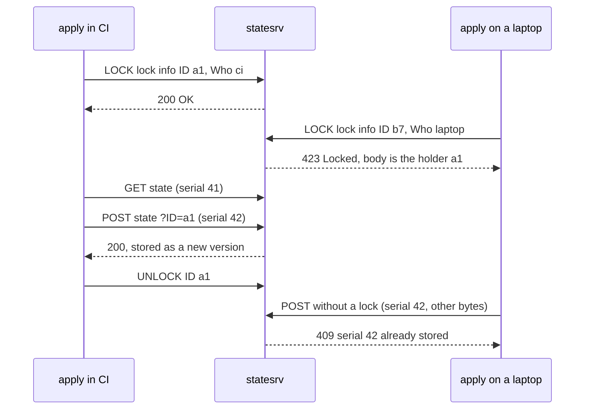

# Two Applies, One State: Locking Is the Product

*A remote backend is a file server with one hard job: let exactly one apply write at a time, and refuse every write built on an old read.*

## Metadata

| Field | Value |
|---|---|
| Type | Build |
| Languages | Python |
| Prerequisites | [Plan and Apply](https://cloudcaptain.io/learn/iac/state-reconciler) |
| Time | 90 minutes |
| Tools | tofu, terraform, curl |

<Quiz stage="pre" />

## The Problem

Monday, 16:40. A pull request that adds a NAT gateway merges, and the pipeline starts `tofu apply` against the production network stack. Two minutes in, while the gateway is still being created, an engineer runs `tofu apply` from a laptop to widen a security group rule for an incident. The state lives in a bucket and nothing locks it. Both runs read serial 41. The pipeline finishes first and writes serial 42 with the gateway in it. The laptop finishes thirty seconds later and writes its own serial 42, built from the old read, without the gateway. The bucket accepts both, because to a bucket a state file is just bytes. The gateway is real, is billed every hour, and is no longer in state. Tuesday's plan wants to create it again and fails with "already exists" from the cloud API; for a resource type that allows duplicates, it quietly makes a second one.

Then the team turns on locking, and the next incident is about locking itself. A pipeline is cancelled mid-apply, the runner is killed before it can release its lock, and every later run fails with `Error acquiring the state lock`. Someone copies the lock ID from the message and runs `force-unlock`. For a dead holder that is the right fix. For a live one it is the worst: if the "stuck" apply was only slow, it is now running without a lock, and its final write will land on top of whatever the next apply writes.

Every remote backend closes these holes with the same three mechanisms: a **lock** that only one writer can create, identified by an ID the holder must present on every write; a **serial and lineage** inside the state, so a write built on an old read, or on a different state, is refused; and a **history** of versions so a bad write can be undone. You are going to build `statesrv`, a state server that does all three and speaks the OpenTofu/Terraform HTTP backend protocol, so the real `tofu` stores its state in it. After that, the lock error, `-lock-timeout`, `force-unlock`, `errored.tfstate` and a refused `state push` are all messages from a server you wrote.

## The Concept

An apply is a long read-modify-write: lock, read state, refresh, plan, change the world for minutes, write state, unlock. Two of them on one state is the oldest bug in concurrent programming, the **lost update**, and state backends use both standard defences against it.

The **lock** is the pessimistic defence. Before it reads, the client creates a lock record that can only be created if none exists: a file made with `link()` or `O_EXCL`, an S3 object written with `If-None-Match: *`, a DynamoDB item with a conditional put, a GCS object with a generation precondition. The record is the **lock info**: a random ID, who, which operation, when, and which tool version. The second client's create fails and the backend answers with the holder's lock info, which is why the error can tell you whom to ask. The ID is a capability. The holder sends it with every write (the HTTP backend appends `?ID=` to the update URL) and with the unlock, so a write from anyone else, including a holder whose lock was force-unlocked, can be refused. None of these locks expire: a killed runner keeps its lock until a person removes it, and the lock info is the evidence that person needs.

**Serial and lineage** are the optimistic defence, for writers that got past the lock: `-lock=false`, a backend without locking, a force-unlocked holder still finishing its apply. The **lineage** is a UUID generated with the first write of a state and never changed; it is the state's identity. The **serial** goes up by one on every write that changes the state. A write is safe only if its lineage equals the stored one and its serial is higher. The same serial with the same bytes is a retry. Anything else was built on a stale read, or belongs to a different state (production's state pushed into staging's address, for example). `tofu state push` checks this on the client, and `-force` skips the check, which is why the server must check too.

The **history** is the undo. Every accepted write becomes a version you can read back: the role bucket versioning plays for S3 and state versions play in HCP Terraform.



The HTTP backend protocol is the smallest of these to implement. `GET address` returns the state, or 404/204 when there is none yet. `POST address` (the `update_method`) stores it, with `?ID=` when a lock is held. A lock request (`lock_method`, `LOCK` by default) and an unlock request (`unlock_method`, `UNLOCK` by default) go to `lock_address` and `unlock_address` with the lock info JSON as the body; 200 means success, and 423 or 409 with the holder's lock info means the lock is taken. Everything else is the server's own policy, and the policy is the product.

## Build It

`code/main.py` is `statesrv`: a `StateStore` over a directory, an HTTP handler that speaks the backend protocol, and a `StateClient` that does what `tofu` does. Each state lives in its own directory: `state.tfstate`, `lock.json`, `versions/000001.tfstate` and on, `versions.json` and an `events.jsonl` audit log. The tests start the server on a free port in a thread and drive it over real HTTP, so they run anywhere Python does.

### Step 1: a lock is a create-if-absent

The lock record is written to a temporary file first and then linked into place. `link()` fails with `EEXIST` if `lock.json` already exists, and the file appears complete or not at all, so no reader ever sees half a lock:

```python
staged = write_temp(directory, json.dumps(record, indent=2).encode("utf-8"))
try:
    os.link(staged, os.path.join(directory, "lock.json"))
except FileExistsError:
    holder = self.lock_info(name) or {}
    if holder.get("ID") == lock_id:
        return holder
    self.record(name, "lock-refused", lock_id=lock_id, who=record.get("Who"), holder=holder.get("ID"), by=by)
    raise StoreError(423, f"state {name} is already locked ({describe(holder)})", holder, lock_body=True)
finally:
    os.unlink(staged)
```

`lock_body=True` makes the error's HTTP body the holder's lock info itself, because that is what the client parses to print `ID=...` and the `Lock Info:` block. A thread mutex orders requests inside one server; the link is what keeps two server processes on one directory honest, and `test_lock_is_exclusive_across_two_store_instances_on_one_directory` proves it. This is the same primitive as the S3 backend's `.tflock` object written with `If-None-Match: *`.

### Step 2: the lock ID is a capability

Every write and every delete passes through one rule:

```python
def check_lock(holder: Optional[Dict[str, Any]], lock_id: Optional[str], require_lock: bool) -> None:
    if holder is not None:
        if not lock_id:
            raise StoreError(423, f"state is locked ({describe(holder)}); a write must carry ?ID=<lock id>", holder)
        if lock_id != holder.get("ID"):
            raise StoreError(409, f"lock ID {lock_id} does not match the held lock ({describe(holder)})", holder)
        return
    if lock_id:
        raise StoreError(409, f"lock ID {lock_id} is not held: the lock was released or force-unlocked while you were working")
    if require_lock:
        raise StoreError(428, "this server only accepts writes made under a lock: configure lock_address and unlock_address")
```

The third case is the one that matters during an incident. A write that carries a lock ID nobody holds comes from an apply whose lock was force-unlocked. Accepting it would overwrite whatever happened since; refusing it makes `tofu` save its state to `errored.tfstate` instead, which a person can inspect and push. `--require-lock` adds the fourth rule: writes from clients configured without `lock_address`, or run with `-lock=false`, get 428 instead of slipping through. Unlock uses the same comparison: the wrong ID is a 409 and the lock stays.

### Step 3: serial and lineage refuse a write built on an old read

```python
def check_order(current: Optional[Dict[str, Any]], current_md5: Optional[str], incoming: Dict[str, Any], incoming_md5: str) -> str:
    if not ordered(current) or not ordered(incoming):
        return "new"
    assert current is not None
    if incoming["lineage"] != current["lineage"]:
        raise StoreError(409, f"lineage {incoming['lineage']} does not match the stored lineage {current['lineage']}: this is a different state, not a newer version of it")
    if incoming["serial"] < current["serial"]:
        raise StoreError(409, f"serial {incoming['serial']} is older than the stored serial {current['serial']}: someone wrote after you read")
    if incoming["serial"] == current["serial"]:
        if incoming_md5 == current_md5:
            return "same"
        raise StoreError(409, f"serial {incoming['serial']} is already stored with different content")
    return "new"
```

`"same"` exists because the client retries: `tofu`'s HTTP client retries on connection errors and 5xx, so a write whose response was lost arrives twice, and the second copy must succeed without becoming a new version. The first write of a state is accepted with any lineage, which is how `tofu` gets to choose it. `parse_state()` refuses JSON that has neither a serial and lineage nor an `encrypted_data` field, so a misconfigured client cannot store an arbitrary document as state.

### Step 4: every accepted write is a version, every refusal an event

```python
entry = {
    "version": versions[-1]["version"] + 1 if versions else 1,
    "serial": state.get("serial"),
    "lineage": state.get("lineage"),
    "md5": digest,
    "bytes": len(body),
    "written_at": self.clock(),
    "lock_id": lock_id or "",
    "who": holder.get("Who", ""),
    "operation": holder.get("Operation", ""),
    "opaque": not ordered(state),
}
os.makedirs(os.path.join(directory, "versions"), exist_ok=True)
atomic_write(os.path.join(directory, "versions", f"{entry['version']:06d}.tfstate"), body)
atomic_write(os.path.join(directory, "versions.json"), json.dumps(versions + [entry], indent=2).encode("utf-8"))
atomic_write(os.path.join(directory, "state.tfstate"), body)
```

`atomic_write()` writes a temporary file, calls `fsync()` and renames it over the target, so a crash leaves the old state or the new one, never a truncated file. The version records who held the lock when it was written, which turns "who overwrote prod?" into a lookup. Refusals go to `events.jsonl` together with locks, unlocks and the caller (the basic-auth user or the client address). An unlock whose body carries only the ID is recorded as such, because that is exactly what `tofu force-unlock` sends: the client that ran it never held the lock, so it has nothing else to send.

### Step 5: speak the backend protocol

The handler maps paths and methods onto the store. A state lives at `/states/NAME`; `GET` and `POST`/`PUT` read and write it, and `LOCK`/`UNLOCK` (the default `lock_method` and `unlock_method`) work on the same URL, for a configuration whose `lock_address` equals its `address`. The `/lock` sub-resource accepts the methods other servers use, so any `lock_method`/`unlock_method` pair you configure works:

```python
elif rest == ["lock"]:
    if method == "GET":
        holder = store.lock_info(name)
        if holder is None:
            raise StoreError(404, f"state {name} is not locked")
        return 200, json_bytes(holder), "application/json", {}
    if method in LOCK_ACQUIRE:
        return self.acquire(name, body)
    if method in LOCK_RELEASE:
        return self.release(name, body)
```

`LOCK_ACQUIRE` is `LOCK`, `POST` and `PUT`; `LOCK_RELEASE` is `UNLOCK` and `DELETE`. Python's `BaseHTTPRequestHandler` dispatches any method name to `do_<METHOD>`, so `do_LOCK` and `do_UNLOCK` are ordinary methods. Three more details come from the client: it sends `Content-MD5` with every body, and a mismatch is a 400 rather than a corrupted state; it reads 401 as "requires auth" and 403 as "invalid auth", so a missing `Authorization` header gets 401 with `WWW-Authenticate` and wrong credentials get 403; and every error carries an `X-Statesrv-Error` header so `curl -i` shows the reason.

### Step 6: a client, and two applies at once

`StateClient` sends the same requests as `tofu`'s HTTP backend client. On top of it, `locked_apply()` is an apply with the state reduced to a dictionary:

```python
def locked_apply(client: StateClient, change: Callable[[Dict[str, Any]], None], who: str, operation: str = "OperationTypeApply") -> Dict[str, Any]:
    lock = client.lock(operation=operation, who=who)
    try:
        state = client.get() or empty_state()
        change(state)
        state["serial"] += 1
        client.put(state, lock_id=lock["ID"])
        return state
    finally:
        client.unlock(lock["ID"], lock)
```

`test_two_concurrent_applies_the_second_fails_naming_the_first_lock` runs one `locked_apply` in a thread whose `change` blocks on an event, starts a second one, and asserts it raises `LockedError` with the first one's ID and `Who`. `test_without_a_lock_the_lost_update_is_caught_by_the_serial_check` replays the Monday incident without locks: two clients read serial 1, both write serial 2, and the second gets 409 instead of erasing the first.

### Step 7: run it

```bash
python3 code/main.py serve --data /tmp/statesrv --port 8080 &
A=http://127.0.0.1:8080/states/demo
curl -i $A                                                  # 404: no state yet, which tofu reads as empty
ID=$(python3 code/main.py lock $A --who alice@laptop); echo $ID
python3 code/main.py lock $A --who bob@ci; echo "exit $?"    # locked: <ID> held by alice@laptop ...; exit 1
curl -s -X LOCK -d '{"ID":"x","Who":"curl"}' $A             # 423, and alice's lock info is the body
cat > /tmp/s1.tfstate <<'EOF'
{"version": 4, "serial": 1, "lineage": "3f1c6a52-6d1e-4c39-9b55-0d4f1c2a7e10", "outputs": {}, "resources": []}
EOF
python3 code/main.py push $A /tmp/s1.tfstate                 # HTTP 423: a write must carry ?ID=<lock id>
python3 code/main.py push $A /tmp/s1.tfstate --id $ID        # stored version 1 (serial 1)
python3 code/main.py push $A /tmp/s1.tfstate --id $ID        # unchanged: an idempotent retry
python3 code/main.py unlock $A --id $ID
python3 code/main.py push $A /tmp/s1.tfstate --id $ID        # HTTP 409: lock ... is not held
python3 code/main.py status $A
python3 code/main.py history $A
python3 code/main.py events $A                              # lock, lock-refused, write-refused, write, unlock ...
python3 code/main.py lock $A --who crashed-runner && python3 code/main.py force-unlock --data /tmp/statesrv demo
kill %1
```

`--user tofu` (with the password in `STATESRV_PASSWORD`) turns on basic auth, `--require-lock` refuses unlocked writes, and `--port 0 --port-file F` picks a free port and writes it down, which is how the smoke test starts it.

<RunTests />

## Use It

Point `tofu` at `statesrv`. The backend block holds the addresses and methods; the credentials come from the environment, so they never land in the configuration or in `.terraform/`:

```hcl
terraform {
  backend "http" {
    address        = "http://127.0.0.1:8080/states/demo"
    lock_address   = "http://127.0.0.1:8080/states/demo/lock"
    unlock_address = "http://127.0.0.1:8080/states/demo/lock"
    lock_method    = "POST"
    unlock_method  = "DELETE"
  }
}

resource "local_file" "motd" {
  filename = "${path.module}/out/motd.txt"
  content  = "hello\n"
}
```

```bash
export STATESRV_PASSWORD=change-me TF_HTTP_USERNAME=tofu TF_HTTP_PASSWORD=change-me
python3 code/main.py serve --data /tmp/statesrv --port 8080 --user tofu &
tofu init
tofu apply -auto-approve
python3 code/main.py history http://127.0.0.1:8080/states/demo        # version 1, serial 1, who, lock ID
tofu state pull | jq '{serial, lineage}'                               # the same serial and lineage
```

`POST` and `DELETE` on a `/lock` URL are what GitLab's managed Terraform state documents for its HTTP backend server; leave out `lock_method` and `unlock_method` and `tofu` sends `LOCK` and `UNLOCK` instead, which `statesrv` also accepts. Leave out `lock_address` and `unlock_address` and there is no locking at all: for this backend locking is opt-in, which is the Monday incident waiting to happen, and `--require-lock` is how the server refuses such clients. Most arguments have a `TF_HTTP_*` environment variable (`TF_HTTP_ADDRESS`, `TF_HTTP_LOCK_ADDRESS`, `TF_HTTP_LOCK_METHOD` and so on), and `retry_max`, `retry_wait_min` and `retry_wait_max` control the retries that Step 3's idempotent write exists for.

Now hold the lock and apply from a second terminal, or start two applies at once:

```bash
python3 code/main.py lock http://127.0.0.1:8080/states/demo --who alice@laptop --operation OperationTypeApply
tofu apply -auto-approve
```

```text
│ Error: Error acquiring the state lock
│
│ Error message: HTTP remote state already locked: ID=8d0b6f0e-...
│ Lock Info:
│   ID:        8d0b6f0e-...
│   Operation: OperationTypeApply
│   Who:       alice@laptop
│   Created:   2026-11-01 16:40:02.123456 +0000 UTC
│   (abridged)
│
│ OpenTofu acquires a state lock to protect the state from being written
│ by multiple users at the same time. ...
```

The `Lock Info` block is the body of the 423 your server returned. Read `Who`, `Operation` and `Created` before you do anything: a CI runner that is still alive needs waiting, not unlocking. In pipelines, `tofu apply -lock-timeout=5m` keeps retrying the lock for five minutes instead of failing on the first refusal, which absorbs a short overlap between two merges. `-lock=false` skips the lock entirely and should never appear in automation.

When the holder is really gone (the job was cancelled, the runner pod no longer exists), release it by ID:

```bash
tofu force-unlock -force 8d0b6f0e-...      # sends the unlock request with only the ID; statesrv records it as such
python3 code/main.py events http://127.0.0.1:8080/states/demo | tail -3
```

Force-unlocking a holder that is still running is the second incident from The Problem. Against `statesrv` it ends visibly: the old apply's final `POST ?ID=...` carries a lock ID that is no longer held, the server answers 409, and `tofu` reports that it failed to persist state and writes what it has to `errored.tfstate` in the working directory. The infrastructure changes already happened; only the record is missing. If nobody has written since (`statesrv history` shows no newer version), `tofu state push errored.tfstate` puts it back. If someone has, do not push: `tofu` only refuses a file whose serial is lower than the stored one, so depending on how many writes happened in between, a push can replace their version with yours. Pull the current state, compare its resources with the errored file, and reconcile with `import` and `state rm` instead.

`state pull` and `state push` are the raw read and write:

```bash
tofu state pull > backup.tfstate                     # GET address; keep one before any surgery
tofu state push errored.tfstate                      # lock, POST ?ID=..., unlock; tofu checks lineage and serial first
tofu state push -force old.tfstate                   # skips tofu's checks; statesrv still answers 409
python3 code/main.py pull http://127.0.0.1:8080/states/demo --version 1 > v1.tfstate
```

Most teams on AWS keep state in S3. The S3 backend's lock is an object next to the state, written with a conditional request so it is created only if it does not exist, the same create-if-absent as Step 1:

```hcl
terraform {
  backend "s3" {
    bucket       = "acme-tofu-state"
    key          = "network/prod.tfstate"
    region       = "eu-central-1"
    use_lockfile = true
  }
}
```

The lock object is the key plus `.tflock` (`network/prod.tfstate.tflock`), so the role needs `s3:GetObject`, `s3:PutObject` and `s3:DeleteObject` on it as well as on the state. `use_lockfile` removes the need for a DynamoDB lock table. OpenTofu added it in 1.10 and keeps `dynamodb_table` as a supported alternative; current Terraform releases have `use_lockfile` too and mark the DynamoDB arguments deprecated, and Terraform's documentation describes setting both during a migration. The S3 backend does not compare serials on the server, so turn on bucket versioning: it is the version history `statesrv` keeps, and the only undo after a bad write.

OpenTofu can also encrypt state before it leaves the client (state encryption, since OpenTofu 1.7):

```hcl
terraform {
  encryption {
    key_provider "pbkdf2" "main" {
      passphrase = var.state_passphrase
    }
    method "aes_gcm" "main" {
      keys = key_provider.pbkdf2.main
    }
    state {
      method   = method.aes_gcm.main
      enforced = true
    }
  }
}
```

The backend then stores an envelope with `meta`, `encrypted_data` and `encryption_version`. `statesrv` can no longer see serial or lineage, records the write as `opaque`, and the lock is the only guard left. Encryption protects the secrets in state from whoever can read the bucket; it makes locking more important, not less.

| What you built | Real tool | Note |
|---|---|---|
| `StateStore.lock` with `link()` | S3 `.tflock` with a conditional write, DynamoDB conditional put, GCS generation precondition | create-if-absent is the whole lock |
| 423 with the holder's lock info | `Error acquiring the state lock` and the `Lock Info` block | `Who`, `Operation` and `Created` tell you whether the holder is alive |
| `check_lock` and `?ID=` | the HTTP backend adding the lock ID to updates | a force-unlocked holder's write is refused, so `tofu` writes `errored.tfstate` |
| `check_order` (serial, lineage) | `tofu state push` checks; `-force` skips them | a server-side check catches writers the client let through |
| `--require-lock` (428) | no equivalent flag in the backends | closes `-lock=false` and clients configured without a lock address |
| `versions/`, `history`, `pull --version` | S3 or GCS object versioning, HCP Terraform state versions | the undo for a bad write |
| `events.jsonl` | CloudTrail data events on the bucket, HCP Terraform audit trail | who locked, who unlocked, which writes were refused |
| `force-unlock --data` | deleting the `.tflock` object or the DynamoDB item by hand | the admin path when no client can run |
| basic auth (401, 403) | `username`, `password`, `TF_HTTP_USERNAME`, `TF_HTTP_PASSWORD` | GitLab uses an access token as the password |
| `StateClient`, `locked_apply` | the HTTP backend client inside `tofu` | lock, read, write with the ID, unlock |

<Quiz stage="check" />

## Ship It

Two artifacts in `outputs/`:

- **`skill-state-lock-incident.md`**: a runbook for an agent or an on-call engineer facing `Error acquiring the state lock`, `errored.tfstate`, a refused write, or a state that lost resources. It reads the lock info, decides with a table whether the holder is alive, force-unlocks only a dead holder and only by ID, recovers `errored.tfstate` when nobody wrote since, reconciles a forked state when someone did, restores a previous version from bucket versioning or `statesrv`, and files a report with the timeline and the guard that was missing.
- **`prompt-explain-state-file.md`**: paste a state file or `tofu state pull` output and get a structured explanation: format version, tool version, serial and lineage and what they mean for the next write, resources by module, type and provider, dependencies, sensitive values present (never echoed), and what to check before a `state push`, `state mv` or `state rm`.

<ShipIt />

## Exercises

### Easy

Add `--max-versions N` to `serve`: keep the newest N version bodies on disk, delete older bodies, and mark their entries in `versions.json` with `"pruned": true` instead of removing them, so the history of serials stays complete. Write the tests first: after five writes with `N=2`, `history` lists five entries, `pull --version 1` exits 1 with a clear message, and `pull --version 5` still works.

### Medium

Add `statesrv restore ADDRESS --version K`: take the lock, read version K, write it back with the stored lineage and serial set to the current serial plus one, and unlock, so a restore is a new version and never a rewind that the serial check would refuse. Refuse to restore across lineages. Test it first against the threaded server, then use it on the Use It stack: apply with two different file contents, restore version 1, and show that `tofu plan` now reports a change for the file, because the restored state and the file on disk disagree.

### Hard

Run two `statesrv` processes behind one address. Replace the store's thread mutex with an object-store interface that offers only two primitives, create-if-absent and compare-and-swap on an ETag (the S3 `If-None-Match` and `If-Match` conditions), implement it once over the filesystem and once as an in-memory fake, and rewrite `lock()` and `write()` on top of it. Prove with a multiprocessing test that two servers sharing one store never accept two writes of the same serial and never both grant a lock, then explain in a paragraph why `tofu`'s S3 backend needs only the first primitive and what it gives up by not having the second.

<Quiz stage="post" />

## Key Terms

| Term | Common misconception | Precise definition |
|---|---|---|
| State lock | "A flag that says someone is busy." | A record that can only be created if none exists, held for the whole read-modify-write of one operation. Its ID must accompany every write and the unlock. |
| Lock info | "Debug output." | The JSON the holder stored with the lock: `ID`, `Operation`, `Who`, `Version`, `Created`, `Path`, `Info`. The backend returns it to anyone refused, and it is the evidence for deciding whether the holder is alive. |
| `force-unlock` | "Unsticks a hung run." | Releases a lock by ID on behalf of a holder that never released it. Safe for a dead holder; for a live one it removes the only guard while it is still going to write. |
| Serial | "A version counter for humans." | An integer in the state that goes up by one on every write that changes it. A write with a serial at or below the stored one was built on a stale read. |
| Lineage | "Same as the workspace name." | A UUID set by the first write of a state and never changed. A different lineage means a different state, not a newer one. |
| `errored.tfstate` | "Corrupt state to delete." | The state an apply could not write to the backend, saved locally. It records changes that already happened; push it if nobody wrote since, reconcile it if someone did. |
| `-lock-timeout` | "Makes locks expire." | How long the client keeps retrying to acquire a lock before failing. It never touches the holder's lock; locks in these backends have no expiry. |
| `use_lockfile` | "S3 locking needs DynamoDB." | The S3 backend setting that stores the lock as a `.tflock` object created with a conditional write, so no DynamoDB table is needed. |

## Further Reading

- [Terraform Advanced](https://cloudcaptain.io/docs/tools/terraform/advanced): remote state and backends, with the S3 and DynamoDB setup this lesson replaces with a lock file.
- [Terraform Cheat Sheet](https://cloudcaptain.io/docs/tools/terraform/cheatsheet): `state pull`, `state push`, `force-unlock` and the other state commands in one page.
- [AWS Databases and Storage](https://cloudcaptain.io/docs/cloud/aws/databases-storage): S3 versioning and encryption, the storage under most production state.
- [OpenTofu: http backend](https://opentofu.org/docs/language/settings/backends/http/): every argument, its environment variable, and the lock protocol you implemented.
- [OpenTofu: s3 backend](https://opentofu.org/docs/language/settings/backends/s3/): `use_lockfile`, DynamoDB locking and the permissions both need.
- [OpenTofu: state locking](https://opentofu.org/docs/language/state/locking/): which operations take the lock, why `-lock=false` is not recommended, and `force-unlock`.
- [OpenTofu: state encryption](https://opentofu.org/docs/language/state/encryption/): key providers, methods, `enforced` and migrating an existing state.
- [Amazon S3 conditional writes](https://docs.aws.amazon.com/AmazonS3/latest/userguide/conditional-writes.html): `If-None-Match` and `If-Match`, the primitives behind the S3 lock file and the Hard exercise.
- [RFC 4918, section 11.3](https://www.rfc-editor.org/rfc/rfc4918#section-11.3): where 423 Locked comes from.
